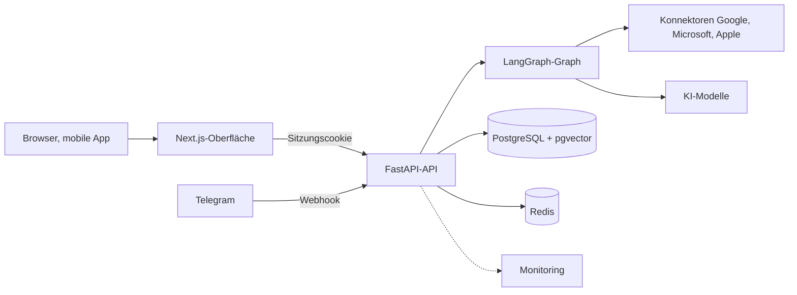
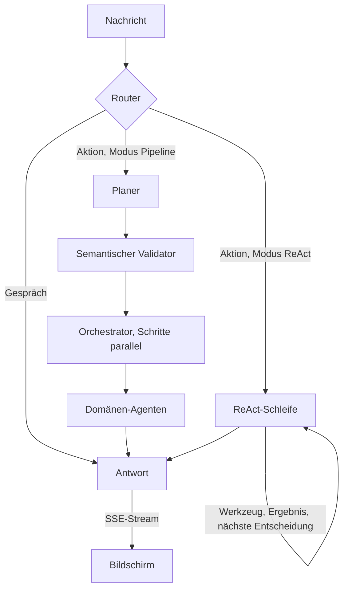
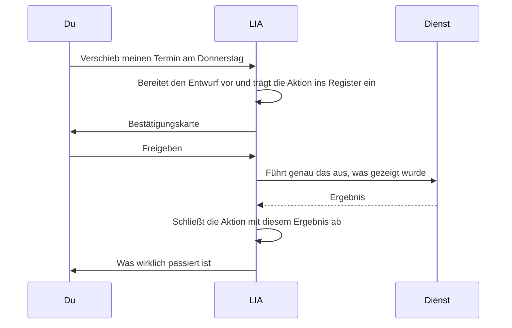
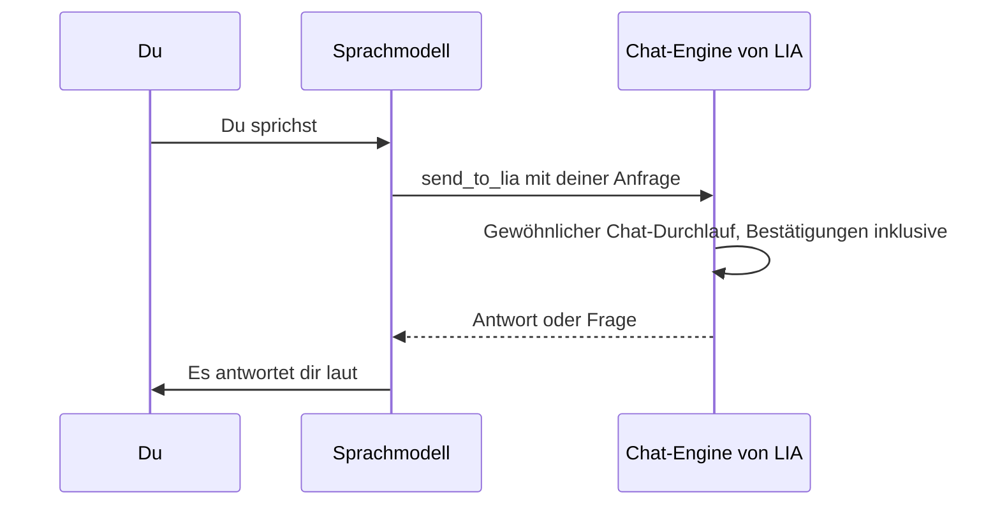

# LIA — Technischer Leitfaden

> Wie LIA aufgebaut ist, in groben Zügen. Die Details stehen im Code, in den ADR und in der Dokumentation des Repositorys.

**Version**: 6.0
**Datum**: 2026-10-23
**Application**: LIA v4.2.0
**Lizenz**: AGPL-3.0 (Open Source)

---

## Inhaltsverzeichnis

1. [Überblick](#1-überblick)
2. [Ein nach Domänen gegliedertes Backend](#2-ein-nach-domänen-gegliedertes-backend)
3. [Der Weg einer Nachricht](#3-der-weg-einer-nachricht)
4. [Mit Vorsicht handeln](#4-mit-vorsicht-handeln)
5. [Gedächtnis und Kontext](#5-gedächtnis-und-kontext)
6. [Die Modelle](#6-die-modelle)
7. [Konnektoren und Werkzeuge](#7-konnektoren-und-werkzeuge)
8. [Stimme, Live-Modus und Telefon](#8-stimme-live-modus-und-telefon)
9. [Die Initiative](#9-die-initiative)
10. [Sicherheit und Privatsphäre](#10-sicherheit-und-privatsphäre)
11. [Beobachten und messen](#11-beobachten-und-messen)
12. [Die Oberflächen](#12-die-oberflächen)
13. [Wie dieser Code gepflegt wird](#13-wie-dieser-code-gepflegt-wird)
14. [Weiterlesen](#14-weiterlesen)

---

## 1. Überblick

Ich habe LIA so entworfen, dass sie bei dir läuft, auf bescheidener Hardware. Die Referenzplattform ist ein Raspberry Pi 5 (ARM64), und alles Weitere folgt daraus: eine einzige Maschine, eine lokale PostgreSQL-Datenbank und ein lokales Redis, keine anderswo gehostete Datenbank. Zugangsdaten und Schlüssel der Anbieter werden verschlüsselt gespeichert.

Drei Prinzipien leiten den Rest. Zuerst **Transparenz**: Observability ist von Anfang an Teil der Architektur, und jedes verbrauchte Token wird mit seinen Kosten erfasst. Dann **Defence in Depth**: Quoten, Bestätigungen und Schutzmechanismen gegen Halluzinationen sind voneinander unabhängige Schichten. Und schließlich **Unabhängigkeit von den Anbietern**: Jede Rolle im System kann einem anderen Modell anvertraut werden, was mich vor einer Preiserhöhung ebenso schützt wie vor einem Ausfall.

Der Stack ist bewusst klassisch:

| Schicht | Wahl |
| --- | --- |
| Backend | Python 3.14, FastAPI, durchgehend asynchron |
| Orchestrierung der Agenten | LangGraph 1.x |
| Daten | PostgreSQL mit pgvector: Daten, Checkpoints des Graphen und Vektorsuche |
| Cache und Koordination | Redis: Cache, Sitzungen, Ratenbegrenzung, Leader-Wahl |
| Frontend | Next.js 16 (App Router), React 19, striktes TypeScript |
| Modelle | OpenAI, Anthropic, Google Gemini, DeepSeek, Perplexity, Qwen und jedes lokale Modell über Ollama |
| Logs | Strukturiertes JSON, personenbezogene Daten gefiltert |

Ein lokales Modell läuft ohne API-Kosten, vollständig bei dir. Die API läuft in mehreren Workern; eine Leader-Wahl in Redis reserviert die geplanten Aufgaben für einen einzigen von ihnen. Jedes optionale Subsystem wird über ein Flag aktiviert, und die Konfiguration folgt einer einzigen Kaskade: Was der Administrator in der Anwendung einstellt, hat Vorrang vor der Umgebung, die wiederum Vorrang vor den Konstanten im Code hat. Ich wollte eine einzige Kaskade, weil eine Konstante, die stillschweigend von der tatsächlichen Konfiguration abweicht, die am schwersten zu erkennenden Bugs erzeugt.

Ein geführtes Installationsprogramm stellt ein paar Fragen, legt das Administratorkonto an, ohne ein Geheimnis im Klartext zu schreiben, prüft, dass die Installation wirklich funktioniert, und kann sie später neu konfigurieren, ohne die Schlüssel erneut abzufragen ([LIA installieren](/de/faq#faq-self_hosting)).

In Größenordnungen: mehr als 350 ADR, Hunderte Prometheus-Metriken, Zehntausende automatisierte Tests, eine Oberfläche in sechs Sprachen (Französisch, Englisch, Deutsch, Spanisch, Italienisch, Chinesisch).

*Weiterlesen: [allgemeine Architektur](https://github.com/jgouviergmail/LIA-Assistant/blob/main/docs/ARCHITECTURE.md) · [Selbst-Hosting](https://github.com/jgouviergmail/LIA-Assistant/blob/main/docs/guides/GUIDE_SELF_HOSTING.md) · [Modellanbieter](https://github.com/jgouviergmail/LIA-Assistant/blob/main/docs/technical/LLM_PROVIDERS.md) · [administrierbare Fähigkeiten](https://github.com/jgouviergmail/LIA-Assistant/blob/main/docs/architecture/ADR-217-Capacites-Administrables.md)*

## 2. Ein nach Domänen gegliedertes Backend

Das Backend folgt dem Domain-Driven Design. Jede fachliche Domäne (Agenten, Konnektoren, Stimme, Gedächtnis, Erinnerungen, Gespräche…) ist ein isolierter Kontext in `src/domains/`, nach demselben Muster gegliedert: Router, Service, Repository, Modell, Schema. Daneben trägt ein übergreifender Kern (`core`) die Konfiguration und die gemeinsamen Regeln, und eine gemeinsame Infrastrukturschicht bündelt, was alle brauchen: die Modell-Factory, den Cache, den MCP-Client, den Browser, die Ratenbegrenzung, den Aufgabenplaner, die Observability.

Für die externen Dienste habe ich eine hexagonale Architektur gewählt. Die Werkzeuge kennen nur Python-Protokolle (Ports), und die Clients für Google, Microsoft, Apple oder Philips Hue setzen sie um (Adapter). Einen Anbieter hinzuzufügen berührt also nicht den Code, der ihn aufruft.

Das Repository ist ein Monorepo: `apps/api` für das Backend, `apps/web` für die Oberfläche, `infrastructure/` für Docker und das Monitoring, `docs/` für die Dokumentation. Ein Administrator, der in der Oberfläche ein Modell ändert, sieht die Änderung sofort wirksam, ohne neues Deployment, weil die laufende Konfiguration in der Datenbank liegt.

*Weiterlesen: [einen Konnektor erstellen](https://github.com/jgouviergmail/LIA-Assistant/blob/main/docs/guides/GUIDE_CONNECTOR_IMPLEMENTATION.md) · [einen Agenten erstellen](https://github.com/jgouviergmail/LIA-Assistant/blob/main/docs/guides/GUIDE_AGENT_CREATION.md) · [ein Werkzeug erstellen](https://github.com/jgouviergmail/LIA-Assistant/blob/main/docs/guides/GUIDE_TOOL_CREATION.md) · [einen Kanal hinzufügen](https://github.com/jgouviergmail/LIA-Assistant/blob/main/docs/templates/NEW_CHANNEL_CHECKLIST.md) · [einen Modellanbieter hinzufügen](https://github.com/jgouviergmail/LIA-Assistant/blob/main/docs/technical/LLM_PROVIDER_CONSTRAINTS.md) · [eine proaktive Aufgabe hinzufügen](https://github.com/jgouviergmail/LIA-Assistant/blob/main/docs/templates/NEW_PROACTIVE_TASK_CHECKLIST.md)*

## 3. Der Weg einer Nachricht

Ich habe LangGraph für die Orchestrierung der Agenten gewählt, weil es drei Dinge mitbrachte, die ich brauchte: einen als Checkpoints in PostgreSQL gespeicherten Zustand, Zyklen und `interrupt()`, mit dem sich ein Durchlauf anhalten lässt, um eine Bestätigung einzuholen, und dann genau dort fortsetzen lässt, wo er stehen geblieben war. Ohne diesen Mechanismus gibt es keine ernsthafte menschliche Bestätigung.

Jede Nachricht geht zuerst durch einen **Router**, der sie als einfaches Gespräch oder als Anfrage einordnet, die eine Aktion verlangt. Ein Gespräch geht direkt zur Antwort. Eine Aktion folgt dem Modus, der im Kopf des Chats gewählt ist.

Im Modus **Pipeline**, dem Standardmodus, schreibt der Planer vor jeder Ausführung einen `ExecutionPlan`: einen Plan in JSON, dessen Schritte über ihre Abhängigkeiten verbunden sind. Ein zweites Modell, getrennt vom Planer, validiert diesen Plan, damit kein Modell seine eigene Arbeit beurteilt. Der Orchestrator führt die Schritte dann in parallelen Wellen aus. Der Modus **ReAct** lässt das Modell dagegen ein Werkzeug aufrufen, das Ergebnis lesen und über das Weitere entscheiden, Schritt für Schritt.

Ich habe beide behalten, weil sie zwei Bedürfnisse erfüllen. Die Pipeline plant, parallelisiert, kontrolliert sich selbst und sieht ihre Kosten voraus: ein Aufruf für den Planer und einer für die Antwort, gegenüber einem Aufruf pro Iteration bei ReAct, also 4- bis 8-mal weniger Tokens. ReAct passt sich jedem Ergebnis an, was für eine explorative Recherche oder eine mehrdeutige Anfrage besser ist. Beide Modi teilen sich die Werkzeug-Registry, die Bestätigungen, den Antwortknoten und die Observability.

Die Wahl der Domänen und Werkzeuge läuft über einen **semantischen Router** mit Embeddings statt über Schlüsselwörter oder das Modell allein: Er ist günstiger und irrt sich seltener. Jedes Werkzeug deklariert ein Manifest (Parameter, Ausgaben, Kosten, Berechtigungen, Schlüsselwörter in mehreren Sprachen), das der Planer, der Router und der Agenten-Builder lesen, und jeder Agent wird ein einziges Mal in einer zentralen Registry deklariert. Smart Services senken den Verbrauch weiter, indem sie die Analyse der Anfragen cachen und wiederkehrende Pläne lernen. Nach einem Durchlauf mit Aktion schaut ein Initiativ-Knoten, nur lesend, was das Ergebnis anderswo bedeutet: Angekündigter Regen verweist auf die Aktivitäten im Freien in deinem Kalender.

Ein paar Regeln halten das Ganze ehrlich. Eine Anfrage ohne Handlungsabsicht kann keinen Plan erzeugen, der irgendetwas ändert, und das ist eine deterministische Regel, geprüft vor jedem Modellaufruf. Ein Änderungsplan, der seine Korrekturversuche aufgebraucht hat, wird nicht ausgeführt: LIA stellt eine Frage, statt falsche Daten zu schreiben. Eine Ablehnung oder ein Fehlschlag wird nie als erledigte Aktion dargestellt, und sobald der Plan ausgeführt ist, wird nichts hinter deinem Rücken wiederholt: Die Antwort nennt jeden Fehlschlag, welches Werkzeug, warum, und die genaue Gesamtzahl. Für einen Modus, der sich unterwegs selbst korrigiert, gibt es ReAct.

Die Antwort kommt Token für Token per SSE. Die Generierung ist von der Verbindung entkoppelt: Ein losgelöster Producer veröffentlicht in einen eigenen Redis-Stream für den Durchlauf, und die Seite ist nur einer seiner Abonnenten. Den Tab zu schließen hält also nichts an, und die Antwort wartet auf dich.

*Weiterlesen: [die zwei Modi](https://github.com/jgouviergmail/LIA-Assistant/blob/main/docs/architecture/ADR-070-ReAct-Execution-Mode.md) · [die Wahl von LangGraph](https://github.com/jgouviergmail/LIA-Assistant/blob/main/docs/architecture/ADR-001-LangGraph-Orchestration.md) · [der Graph im Detail](https://github.com/jgouviergmail/LIA-Assistant/blob/main/docs/ARCHITECTURE_LANGRAPH.md) · [der Router](https://github.com/jgouviergmail/LIA-Assistant/blob/main/docs/technical/ROUTER.md) · [der Plan und seine parallele Ausführung](https://github.com/jgouviergmail/LIA-Assistant/blob/main/docs/architecture/ADR-014-ExecutionPlan-Parallel-Executor.md) · [der Planer und die Massenoperationen](https://github.com/jgouviergmail/LIA-Assistant/blob/main/docs/technical/PLANNER.md) · [der semantische Router](https://github.com/jgouviergmail/LIA-Assistant/blob/main/docs/architecture/ADR-048-Semantic-Tool-Router.md) · [die Werkzeug-Manifeste](https://github.com/jgouviergmail/LIA-Assistant/blob/main/docs/architecture/ADR-019-Agent-Manifest-Catalogue-System.md) · [ein Fehlschlag der Pipeline wird genannt, nie wiederholt](https://github.com/jgouviergmail/LIA-Assistant/blob/main/docs/architecture/ADR-346-Advisory-Replanner-Retired-A-Pipeline-Failure-Is-Said-Never-Replayed.md) · [die Wiedergabe von Werkzeugfehlern](https://github.com/jgouviergmail/LIA-Assistant/blob/main/docs/architecture/ADR-303-Tool-Failure-Restitution.md) · [Durchläufe, die den Tab überleben](https://github.com/jgouviergmail/LIA-Assistant/blob/main/docs/architecture/ADR-117-Background-Chat-Runs.md) · [der ReAct-Modus](https://github.com/jgouviergmail/LIA-Assistant/blob/main/docs/technical/REACT_EXECUTION_MODE.md)*

## 4. Mit Vorsicht handeln

LIA fragt vor dem, was wirklich geschehen wird: vor jedem Entwurf (eine E-Mail, ein Termin, eine Löschung), vor jeder Massenoperation, die mindestens ein Element ändert, vor jedem Werkzeug, das deklariert, dass es eine Bestätigung braucht. Die Bestätigung wird Aktion für Aktion eingeholt, dort, wo die Aktion vorbereitet wird, und nicht für den ganzen Plan. Umgekehrt fragt eine Aktion, die nichts umlenken kann, nach nichts: Eine E-Mail, die du dir selbst schickst, geht direkt hinaus.

Was du bestätigst, ist genau der zuletzt angezeigte Inhalt, und jede Änderung wird nur einmal ausgeführt. Mehrere Entwürfe desselben Durchlaufs werden einzeln geprüft. Du kannst frei formuliert antworten: Ein Modell ordnet deine Antwort als Zustimmung, Ablehnung oder Änderungswunsch ein. Außerhalb des Gesprächs holt ein Ticket seine Bestätigung auf dem Ticket selbst ein, und eine Routine, die läuft, während niemand vor dem Bildschirm sitzt, stellt keine Frage: Sie lehnt die Aktion ab und sagt es, sonst würde deine nächste Nachricht als Antwort gelten. Ein Befehl an den Chat („zeig meine Antworten als Karten“) folgt derselben Regel, und verlangt er eine Kontoverbindung, einen Schlüssel oder die Auswahl einer Datei, geschieht dieser Schritt im authentifizierten Browser. LIA prüft das verlangte Ergebnis an dem, was sie beobachten kann, aber eine Delegation an ein Werkzeug beweist für sich allein nicht alle seine internen Wirkungen. Ebenso verhindert eine Sperre eine doppelte Ausführung, ohne garantieren zu können, dass ein externer Anbieter nur einmal handelt.

Auch die Antwort selbst hat einen Rahmen: Das Modell schreibt nur auf Grundlage der echten Ergebnisse der Werkzeuge. Und alles, was LIA tut, wird in drei getrennte **Register** eingetragen: die Aktionen, die Abfragen und die Durchläufe. Ihre Summen lassen sich nicht addieren, denn ein Durchlauf kann fünf Quellen abfragen, ohne etwas zu ändern. Eine Aktion wird eingetragen, bevor sie stattfindet, und erst mit einem ausdrücklichen Ergebnis abgeschlossen. Ein Gespräch zu löschen entfernt die Dateien, die du darin gesendet hast, nicht die, die LIA für dich erzeugt hat.

*Weiterlesen: [die Bestätigungen](https://github.com/jgouviergmail/LIA-Assistant/blob/main/docs/technical/HITL.md) · [die Autoritätskette und die Register](https://github.com/jgouviergmail/LIA-Assistant/blob/main/docs/architecture/ADR-263-Execution-Authority-Chain-And-Effect-Register.md) · [die Register aus Nutzersicht](/de/faq#faq-registers) · [die Tickets](https://github.com/jgouviergmail/LIA-Assistant/blob/main/docs/technical/WORKBOARD.md) · [die Anwendungsbefehle](https://github.com/jgouviergmail/LIA-Assistant/blob/main/docs/technical/APPLICATION_COMMANDS.md) · [was eine Delegation beweist](https://github.com/jgouviergmail/LIA-Assistant/blob/main/docs/architecture/ADR-336-Requested-Outcomes-Checked-Against-Canonical-Observations.md) · [Werkzeugbeispiele, E-Mail an sich selbst und Entwürfe](https://github.com/jgouviergmail/LIA-Assistant/blob/main/docs/knowledge/05_tool_examples.md) · [die Synthese der Antwort](https://github.com/jgouviergmail/LIA-Assistant/blob/main/docs/technical/RESPONSE.md)*

## 5. Gedächtnis und Kontext

Der Zustand eines Gesprächs ist ein `MessagesState`, den LangGraph nach jedem Knoten als Checkpoint in PostgreSQL speichert. Dadurch lässt sich ein Durchlauf nach einer Bestätigung fortsetzen, auch Stunden später. Die Ergebnisse der Werkzeuge liegen nicht im Nachrichtenverlauf, sondern in einer eigenen Daten-Registry, sodass sie erhalten bleiben, wenn der Verlauf gekürzt wird. Ab einer Schwelle werden ältere Austausche zusammengefasst; ein Badge zeigt, wie voll der Kontext ist, und `/resume` löst diese Zusammenfassung auf Wunsch aus. Im ReAct-Modus wird, was eine Schleife bereits gelesen hat, als Checkpoint gespeichert und im Durchlauf wiederverwendet; ein Abbruch vor diesem Checkpoint kann dazu führen, dass eine Quelle erneut gelesen wird.

Das Langzeitgedächtnis, die Wissensräume und der Kontext der Werkzeuge liegen in derselben Datenbank, mit pgvector. Nach jedem Austausch extrahiert eine Hintergrundaufgabe die Erinnerungen aus der letzten Nachricht; Erinnerungen, die der Frage nahekommen, kehren in den nächsten Kontext zurück, und das Gedächtnis ist auch ein Werkzeug, das der Planer und ReAct befragen. Eine dauerhafte Anweisung („antworte kürzer“) wird angeheftet und ist sichtbar. Wird ein sensibles Thema berührt, verbietet eine Direktive, zu scherzen oder etwas herunterzuspielen.

Um dieses Gedächtnis herum habe ich mehrere Schichten ergänzt. Die **Tagebücher** sind LIAs Aufzeichnungen in der Ich-Form; aus ihnen ergibt sich ein Porträt der Person, mit den Quellen, aus denen es gespeist wurde, und es lässt sich nur über indirekte Hebel korrigieren. Die **Psyche Engine** gibt LIA einen psychologischen Zustand, der sich mit jedem Austausch verändert und in ihrem Stil durchscheint, ohne angekündigt zu werden; sie lernt außerdem, Bereich für Bereich, wo LIA verlässlich ist, anhand von Belegen; das ist ein Pilotversuch, für den vorerst kein Gewinn behauptet wird. Sie hat eine eingestandene Grenze: Sie meldet fast nie eine ruhige, wenig intensive Emotion, und dieser Teil ihrer Aktivierung bleibt gesperrt. Die **Interessen** werden in deinen Anfragen erkannt und aus mehreren Quellen gespeist. Die **Gewohnheiten** schließlich werden ohne trainiertes Modell gelernt, über statistische Tests, und dafür hatte ich drei Gründe, jeder für sich ausreichend: Ein Raspberry Pi hat kein Trainingsbudget, eine Formel lässt sich der Person offenlegen, die sie betrifft, und bei so kleinen Datenmengen würde ein Modell vor allem das Rauschen lernen.

*Weiterlesen: [die Checkpoints](https://github.com/jgouviergmail/LIA-Assistant/blob/main/docs/architecture/ADR-022-LangGraph-State-Checkpointing.md) · [die Daten-Registry](https://github.com/jgouviergmail/LIA-Assistant/blob/main/docs/architecture/ADR-012-Data-Registry-StandardToolOutput-Pattern.md) · [die Kompaktierung](https://github.com/jgouviergmail/LIA-Assistant/blob/main/docs/technical/COMPACTION_v2.md) · [die gesicherten Lesevorgänge von ReAct](https://github.com/jgouviergmail/LIA-Assistant/blob/main/docs/architecture/ADR-337-Checkpointed-ReAct-Read-Segments-And-Turn-Local-Reuse.md) · [das Gedächtnis in PostgreSQL](https://github.com/jgouviergmail/LIA-Assistant/blob/main/docs/architecture/ADR-066-Memory-PostgreSQL-Migration.md) · [das Langzeitgedächtnis](https://github.com/jgouviergmail/LIA-Assistant/blob/main/docs/technical/LONG_TERM_MEMORY.md) · [das Gedächtnis als Suchwerkzeug](https://github.com/jgouviergmail/LIA-Assistant/blob/main/docs/architecture/ADR-313-Long-Term-Memory-As-An-Active-Lookup.md) · [die dauerhaften Regeln](https://github.com/jgouviergmail/LIA-Assistant/blob/main/docs/architecture/ADR-236-procedural-memory.md) · [die Tagebücher und das Porträt](https://github.com/jgouviergmail/LIA-Assistant/blob/main/docs/technical/JOURNALS.md) · [die Psyche Engine](https://github.com/jgouviergmail/LIA-Assistant/blob/main/docs/technical/PSYCHE_ENGINE.md) · [ihre gemessene Grenze](https://github.com/jgouviergmail/LIA-Assistant/blob/main/docs/architecture/ADR-142-Psyche-Observability-And-Dominance-Recentering.md) · [die Psyche aus Nutzersicht](https://github.com/jgouviergmail/LIA-Assistant/blob/main/docs/knowledge/22_psyche.md) · [die aus Belegen gelernte Wirksamkeit](https://github.com/jgouviergmail/LIA-Assistant/blob/main/docs/architecture/ADR-348-Efficacy-Learned-From-Evidence-Results-And-Usefulness-Kept-Apart.md) · [die Interessen](https://github.com/jgouviergmail/LIA-Assistant/blob/main/docs/technical/INTERESTS.md) · [die Gewohnheiten](https://github.com/jgouviergmail/LIA-Assistant/blob/main/docs/knowledge/28_habits.md) · [die Suche in den Tagebüchern und den Registern](https://github.com/jgouviergmail/LIA-Assistant/blob/main/docs/architecture/ADR-318-Assistant-Tools-Exact-Answers-And-Own-Records.md)*

## 6. Die Modelle

Eine einzige Factory instanziiert das Modell jedes unterstützten Anbieters und wendet seinen Adapter an. Jede Rolle hat ihren eigenen Modellplatz (das Gespräch, die Planung, das Bild, die Transkription, die Sprachsynthese…), der in der Administration ohne neues Deployment eingestellt wird. Der Modellkatalog liegt in der Datenbank und deklariert Modell für Modell seine Fähigkeiten, die Parameter, die es akzeptiert, und die Denkstufen, die es kennt; der Konfigurationsbildschirm bietet so nur an, was die API des Modells wirklich akzeptiert.

Manche Aufgaben sind keine Generierungen, sondern begrenzte Entscheidungen: ein Format wählen, eine E-Mail einstufen. Sie können einer nativen Entscheidungs-Engine anvertraut werden, jede hinter ihrem eigenen Schalter und einem Hauptschalter. Eine unsichere Entscheidung fällt auf die übliche Verarbeitung zurück, und weder Rechte noch Bestätigungen werden an sie delegiert. Ein Einstufungsurteil authentifiziert keinen Absender, und ein auf einem Testkorpus gemessener Gewinn ist kein Versprechen für jede Anfrage.

Jeder Modellaufruf, in der Pipeline wie in den Hintergrundaufgaben, wird erfasst und anhand der Tarife in der Datenbank bewertet, dann pro Durchlauf zusammengefasst. Bei den Kosten kommt die größte Ersparnis aus dem Cache der Anbieter. Jeder Prompt stellt seinen stabilen Inhalt vor eine Markierung und den anfragespezifischen Inhalt dahinter, und die Infrastruktur übersetzt diese Markierung in den Cache-Mechanismus jedes Anbieters. Da jeder Modellplatz das Modell wechseln kann, stimme ich diesen Cache nicht auf ein bestimmtes Modell ab: Ich ziele auf den besten Durchschnitt, und ein Modell ohne Cache zahlt nichts mehr. Die Untersuchungen zu anderen lokalen Engines (oMLX, llama.cpp, LM Studio) sind Qualifizierungen, keine ausgelieferten Integrationen: Es zählen nur die Anbieter, die die Instanz anbietet.

*Weiterlesen: [die Modellauswahl](https://github.com/jgouviergmail/LIA-Assistant/blob/main/docs/architecture/ADR-026-LLM-Model-Selection-Strategy.md) · [der Katalog in der Datenbank](https://github.com/jgouviergmail/LIA-Assistant/blob/main/docs/architecture/ADR-078-LLM-Catalogue-DB-Source-Of-Truth.md) · [der Konfigurationsbildschirm](https://github.com/jgouviergmail/LIA-Assistant/blob/main/docs/technical/LLM_CONFIG_ADMIN.md) · [die nativen Entscheidungen](https://github.com/jgouviergmail/LIA-Assistant/blob/main/docs/architecture/ADR-325-JEV-Bounded-Decisions-With-Hot-Switches-And-Accounted-Fallbacks.md) · [ihre Integration](https://github.com/jgouviergmail/LIA-Assistant/blob/main/docs/technical/JEV_INTEGRATION.md) · [die Einstufung von E-Mails](https://github.com/jgouviergmail/LIA-Assistant/blob/main/docs/technical/EMAIL_EVENT_CLASSIFICATION.md) · [ein Prompt-Layout für alle Caches](https://github.com/jgouviergmail/LIA-Assistant/blob/main/docs/architecture/ADR-309-One-Prompt-Layout-For-Every-Cache-Mechanism.md) · [die Filterung des Werkzeugkatalogs](https://github.com/jgouviergmail/LIA-Assistant/blob/main/docs/architecture/ADR-003-Multi-Domain-Dynamic-Filtering.md) · [die untersuchten lokalen Engines](https://github.com/jgouviergmail/LIA-Assistant/blob/main/docs/knowledge/16_other.md)*

## 7. Konnektoren und Werkzeuge

Jede Konnektor-Kategorie (E-Mail, Kalender, Kontakte, Aufgaben, Dateien, Zuhause) ist ein Python-Protokoll. Pro Kategorie ist jeweils nur ein Anbieter aktiv, und die OAuth-Einwilligung wird einmal pro Google- oder Microsoft-Konto erteilt. Die Dienste, die von der Person nichts verlangen (Wikipedia, das Lesen von Seiten, die Orte, das Wetter), gehören der Instanz und sind für alle aktiv. Bei E-Mails wird jede Nachricht einmal zusammengefasst und dann wiederverwendet, ein Anhang wird als Text oder über ein Vision-Modell gelesen, und ein Versand wird nach einer verlorenen Empfangsbestätigung nie wiederholt.

Die Werkzeuge beruhen auf fünf kombinierbaren Schichten: einer gemeinsamen Konnektor-Basis (OAuth, Cache, Injection), einem Decorator, Formatierern pro Domäne, dem Manifest, das der Planer liest, und einem Katalog-Loader. Die **MCP**-Werkzeuge werden in gewöhnliche LangChain-Werkzeuge umgewandelt und kommen in denselben Katalog, der von einer Nachricht zur nächsten erhalten bleibt, damit eine Nachricht in der Regel auf keinen Server wartet; ein MCP-Server muss HTTPS verwenden, seine Zugangsdaten werden verschlüsselt, und LIA glaubt einer Annotation, die eine Änderung ankündigt, nie aber einer, die behauptet, nur zu lesen. **Plugins** im Format Agent Plugins werden als Ganzes installiert, ohne lokalen Server. **Skills** nach dem Standard agentskills.io können eine kleine App im Chat darstellen oder ihre eigenen Befehle in einer Kopie ihres Ordners ausführen; ein Skill von anderswo läuft isoliert und erhält nie das Token eines Konnektors.

Wenn ein Schritt eine echte Berechnung braucht, kann der ReAct-Modus ein kurzes Python-Skript schreiben und es in einem Wegwerf-Container ausführen. Dieses Skript erreicht das Web nur über einen einzigen Proxy, sieht den Schlüssel der Person nicht (der Proxy setzt ihn nur auf dem erlaubten Host ein), und bei einem unbekannten Host wird nachgefragt, mit drei möglichen Antworten. In beiden Modi laufen Berechnungen, Zeitspannen und Währungsumrechnungen über exakte Werkzeuge statt über das Modell. Ein Agent kann auch einen Browser steuern (Playwright) oder eine Seite in Text umwandeln.

Die Dokumente der **Wissensräume** werden zerlegt, vektorisiert und in PostgreSQL abgelegt statt in einer externen Vektordatenbank, dann über eine hybride, semantische und lexikalische Suche wiedergefunden. Ein Raum kann einem Drive-Ordner samt Unterordnern oder einem Gmail-Label folgen, ohne das ganze Postfach zu indexieren. Es gibt keine Zeichenerkennung: Ein gescanntes PDF wird in dieser Form nicht indexiert. Von außen gesendete Daten (SMS, Schrittzahl, Herzfrequenz, von einem iPhone, einem Android-Gerät oder jedem System, das JSON senden kann) kommen über Endpunkte herein, die mit einem eingeschränkten, widerrufbaren Token authentifiziert werden, getrennt von der Sitzung.

Für eine komplexe Aufgabe delegiert LIA an kurzlebige, rein lesende Sub-Agenten. Sie erzeugt auch Dateien: Dokumente, Bilder, Screenshots, die in einer Galerie abgelegt, behalten, per E-Mail verschickt oder, bei einem Bild, mit einer Person geteilt werden, die mit der Instanz verbunden ist.

*Weiterlesen: [die Konnektor-Patterns](https://github.com/jgouviergmail/LIA-Assistant/blob/main/docs/technical/CONNECTORS_PATTERNS.md) · [die gebündelte OAuth-Einwilligung](https://github.com/jgouviergmail/LIA-Assistant/blob/main/docs/architecture/ADR-302-OAuth-Grant-Par-Compte-Et-Consentement-Groupe.md) · [die Dienste der Instanz](https://github.com/jgouviergmail/LIA-Assistant/blob/main/docs/architecture/ADR-307-Keyless-Connectors-Belong-To-The-Instance.md) · [die Konnektoren aus Nutzersicht](/de/faq#faq-connectors) · [die E-Mails und ihre Zusammenfassungen](https://github.com/jgouviergmail/LIA-Assistant/blob/main/docs/architecture/ADR-287-Email-Content-First-Detail-Levels-Digests-And-Neutral-Message.md) · [die Anhänge](https://github.com/jgouviergmail/LIA-Assistant/blob/main/docs/architecture/ADR-296-Mail-Attachments-Read-By-Text-Or-Vision.md) · [die Zeitlimits pro Modellplatz](https://github.com/jgouviergmail/LIA-Assistant/blob/main/docs/architecture/ADR-221-Timeout-Par-Emplacement-Applique.md) · [die Basis der Werkzeuge](https://github.com/jgouviergmail/LIA-Assistant/blob/main/docs/architecture/ADR-015-ConnectorTool-Base-Class-Pattern.md) · [MCP](https://github.com/jgouviergmail/LIA-Assistant/blob/main/docs/technical/MCP_INTEGRATION.md) · [der Standard Agent Plugins](https://github.com/jgouviergmail/LIA-Assistant/blob/main/docs/architecture/ADR-225-Standard-Agent-Plugins-v1.md) · [die Plugins](https://github.com/jgouviergmail/LIA-Assistant/blob/main/docs/technical/PLUGINS_INTEGRATION.md) · [die Skills](https://github.com/jgouviergmail/LIA-Assistant/blob/main/docs/technical/SKILLS_INTEGRATION.md) · [die Skills aus Nutzersicht](https://github.com/jgouviergmail/LIA-Assistant/blob/main/docs/knowledge/12_skills.md) · [Skills von Dritten](https://github.com/jgouviergmail/LIA-Assistant/blob/main/docs/architecture/ADR-327-Skill-Library-And-Third-Party-Skills.md) · [einen Skill ändern](https://github.com/jgouviergmail/LIA-Assistant/blob/main/docs/architecture/ADR-165-Skill-Editing-By-Regeneration.md) · [eine Fähigkeit teilen](https://github.com/jgouviergmail/LIA-Assistant/blob/main/docs/technical/PEER_CAPABILITY_TRANSFERS.md) · [das kurzlebige Python](https://github.com/jgouviergmail/LIA-Assistant/blob/main/docs/architecture/ADR-249-Ephemeral-Python-In-The-Existing-Sandbox.md) · [der Netzwerkausgang der Sandbox](https://github.com/jgouviergmail/LIA-Assistant/blob/main/docs/architecture/ADR-298-Sandbox-Egress-Toolbox.md) · [die berechneten Antworten](https://github.com/jgouviergmail/LIA-Assistant/blob/main/docs/knowledge/35_computed_answers.md) · [der Browser](https://github.com/jgouviergmail/LIA-Assistant/blob/main/docs/technical/BROWSER_CONTROL.md) · [das Lesen von Seiten](https://github.com/jgouviergmail/LIA-Assistant/blob/main/docs/technical/WEB_FETCH.md) · [die Wissensräume](https://github.com/jgouviergmail/LIA-Assistant/blob/main/docs/architecture/ADR-055-RAG-Spaces-Architecture.md) · [ihr Leitfaden](https://github.com/jgouviergmail/LIA-Assistant/blob/main/docs/guides/GUIDE_RAG_SPACES.md) · [ihre Nutzung](https://github.com/jgouviergmail/LIA-Assistant/blob/main/docs/knowledge/14_rag_spaces.md) · [ein Drive-Ordner ist ein Baum](https://github.com/jgouviergmail/LIA-Assistant/blob/main/docs/architecture/ADR-297-Drive-Folder-Is-A-Tree-And-The-Count-Is-Exact.md) · [ein Gmail-Label als Quelle](https://github.com/jgouviergmail/LIA-Assistant/blob/main/docs/architecture/ADR-262-Opt-In-Mail-Label-RAG-Source.md) · [die eingebaute FAQ](https://github.com/jgouviergmail/LIA-Assistant/blob/main/docs/architecture/ADR-058-System-RAG-Spaces.md) · [ein Dokument aus einem Raum anhängen](https://github.com/jgouviergmail/LIA-Assistant/blob/main/docs/architecture/ADR-295-Knowledge-Documents-As-Message-Attachments.md) · [die Sub-Agenten](https://github.com/jgouviergmail/LIA-Assistant/blob/main/docs/knowledge/13_sub_agents.md) · [die Gesundheitsdaten](https://github.com/jgouviergmail/LIA-Assistant/blob/main/docs/technical/HEALTH_METRICS.md) · [ihre Aufnahme](https://github.com/jgouviergmail/LIA-Assistant/blob/main/docs/architecture/ADR-076-Health-Metrics-Ingestion.md) · [die Gesundheit aus Nutzersicht](https://github.com/jgouviergmail/LIA-Assistant/blob/main/docs/knowledge/23_health_metrics.md) · [die SMS](https://github.com/jgouviergmail/LIA-Assistant/blob/main/docs/technical/SMS_INGESTION.md) · [die Dokumentenerstellung](https://github.com/jgouviergmail/LIA-Assistant/blob/main/docs/technical/DOCUMENT_GENERATION.md) · [die Dokumente aus Nutzersicht](https://github.com/jgouviergmail/LIA-Assistant/blob/main/docs/knowledge/32_document_generation.md) · [die Bilder](https://github.com/jgouviergmail/LIA-Assistant/blob/main/docs/knowledge/21_image_generation.md) · [die erzeugten Dateien](https://github.com/jgouviergmail/LIA-Assistant/blob/main/docs/knowledge/39_generated_files.md) · [eine Datei behalten](https://github.com/jgouviergmail/LIA-Assistant/blob/main/docs/architecture/ADR-319-A-Generated-File-Can-Be-Kept.md) · [per E-Mail senden](https://github.com/jgouviergmail/LIA-Assistant/blob/main/docs/architecture/ADR-321-A-File-Or-An-Answer-Sent-By-E-Mail.md) · [die Anhänge im Eingabefeld](https://github.com/jgouviergmail/LIA-Assistant/blob/main/docs/technical/ATTACHMENTS_INTEGRATION.md) · [die behaltenen Antworten](https://github.com/jgouviergmail/LIA-Assistant/blob/main/docs/knowledge/40_bookmarks.md)*

## 8. Stimme, Live-Modus und Telefon

Die klassische Stimme besteht aus unabhängigen Bausteinen. Das Aktivierungswort „Dis LIA“ wird im Browser erkannt, und nichts wird gesendet, bevor es gehört wurde; vorerst wird nur das französische Modell ausgeliefert, in der Beta. Das Diktat wird in der Sprache des Kontos transkribiert, auf dem Server und offline mit Whisper, oder je nach Einstellung von einer entfernten Engine. Die Sprachsynthese hat mehrere Anbieter, standardmäßig das kostenlose Edge, und die Antwort wird schon Satz für Satz vorgelesen, während der Rest noch geschrieben wird. Ein experimenteller sprechender Avatar kann hinzukommen, mit dem Simli-Schlüssel der Person, über den auch die Stille berechnet wird, solange die Verbindung offen bleibt.

Der **Live-Modus** ist ein echtes Gespräch von Stimme zu Stimme. Ich habe ihm zwei Intelligenzen und eine einzige Naht gegeben: Das Sprachmodell führt das Gespräch, und jede Anfrage nach Daten oder einer Aktion geht über eine einzige Funktion, `send_to_lia`, an die Chat-Engine. Die Anfrage wird zu einem gewöhnlichen Chat-Durchlauf, mit seinen Bestätigungen, seinen Registern und seinen Quoten. Die Stimme besitzt weder ein Werkzeug noch Zugangsdaten noch ein eigenes Gedächtnis.

Eine Live-Sitzung schläft ein, statt zu sterben: Im Ruhezustand ist die Verbindung zum Anbieter geschlossen, und nichts wird berechnet. Die Kosten beim Live-Anbieter laufen über den Schlüssel der Person und werden von LIA nie erfasst. In Live direkt liest die Stimme deine Daten selbst, ohne etwas zu ändern.

Das **Telefon** übernimmt dieselben zwei Modi. LIA kann nach einer Bestätigung für dich eine dritte Person anrufen oder dich selbst unter einer verifizierten Nummer erreichen, und dann hast du am Telefon deine Daten und alle ihre Funktionen, wie im Chat. Wenn LIA eine dritte Person anruft, hat der Anruf-Agent nur ein lesendes Frei/Belegt-Werkzeug: Der Schutz deines Kalenders ist strukturell, er hängt nicht von einer Anweisung in einem Prompt ab. Am Telefon gibt es den Live-Modus nur, wenn der Anbieter deine Instanz erreichen kann.

Eine Besprechung wird im Browser aufgenommen: Das Audio geht in kleinen Segmenten hinaus, wird dann transkribiert und zu einem strukturierten Protokoll zusammengefasst, das in einem Wissensraum abgelegt wird. Das persönliche Radio schließlich produziert nur während einer Hörsitzung und behält nichts zum erneuten Anhören.

*Weiterlesen: [die Stimme aus Nutzersicht](/de/faq#faq-voice_mode) · [der Live-Ruhezustand und das Aktivierungswort](https://github.com/jgouviergmail/LIA-Assistant/blob/main/docs/architecture/ADR-329-Live-Standby-And-Multilingual-Wake-Word.md) · [die Stimmen und die Synthese](https://github.com/jgouviergmail/LIA-Assistant/blob/main/docs/architecture/ADR-345-Fish-Audio-Served-Whole-One-Door-One-Allowance-Cues-Each-Engine-Reads.md) · [der sprechende Avatar](https://github.com/jgouviergmail/LIA-Assistant/blob/main/docs/technical/SPEAKING_AVATAR.md) · [der Live-Modus](https://github.com/jgouviergmail/LIA-Assistant/blob/main/docs/architecture/ADR-299-Live-Voice-Mode-Two-Intelligences-One-Seam.md) · [die Telefonie aus Nutzersicht](/de/faq#faq-telephony) · [das Telefon als Kanal](https://github.com/jgouviergmail/LIA-Assistant/blob/main/docs/architecture/ADR-290-Phone-As-A-Channel-Owner-Calls.md) · [das Radio](/de/faq#faq-radio) · [die Besprechungen](https://github.com/jgouviergmail/LIA-Assistant/blob/main/docs/technical/MEETINGS.md) · [das strukturierte Protokoll](https://github.com/jgouviergmail/LIA-Assistant/blob/main/docs/architecture/ADR-258-Meeting-Recording-And-Structured-Minutes.md) · [die Protokollvorlagen](https://github.com/jgouviergmail/LIA-Assistant/blob/main/docs/architecture/ADR-259-Meeting-Template-Library-And-Reformatting.md)*

## 9. Die Initiative

LIA ergreift die Initiative in drei Formen. Ein periodischer **Heartbeat** schaut sich deine Quellen an und schreibt dir nur, wenn ein Signal es rechtfertigt, und nennt dabei ein oder zwei geprüfte Fakten. Mit einer Quelle verbunden zu sein und zu akzeptieren, von ihr unterbrochen zu werden, sind zwei getrennte Entscheidungen. Eine Push-Benachrichtigung von Google kann diesen Heartbeat für eine einzelne Person wecken, und ein **Moment** (das Ende einer Besprechung, das Eintreffen einer erwarteten Mail) wird auf die Minute bedient statt beim nächsten Durchgang. Die **proaktiven Gespräche** schließlich verlangen eine Antwort, mit ihren eigenen Regeln: Uhrzeiten, ein Höchstmaß pro Tag, sensible Themen, die privat bleiben, Ausgaben, die reserviert werden, bevor sie anfallen.

**Routinen** werden nach einem Zeitplan oder bei einer Bedingung ausgelöst, nicht bei beidem, und eine Wochenansicht zeigt, was wirklich passiert ist. Eine Erinnerung kann sich wiederholen. Das **Ticket-Board** gibt einer Aufgabe einen Lebenszyklus, einen Verantwortlichen und ein Ergebnis.

Zwei Regeln begrenzen das Ganze. Die Initiative liest nur: Ein Schreibvorgang wird vorgeschlagen, nie von selbst ausgeführt. Und ein erneuter Versuch derselben Ausführung wird abgelehnt, sobald das Wirkungsregister zeigt, dass die Aktion schon ausgeführt wurde. Die Seite Aktivität zeigt an einem Ort alles, was LIA allein unternommen hat, mit exakten Summen.

*Weiterlesen: [der Heartbeat](https://github.com/jgouviergmail/LIA-Assistant/blob/main/docs/technical/HEARTBEAT_AUTONOME.md) · [die Erlaubnis zu unterbrechen](https://github.com/jgouviergmail/LIA-Assistant/blob/main/docs/architecture/ADR-197-Interrupt-Permission-Is-Not-Connection.md) · [das Wecken per Push](https://github.com/jgouviergmail/LIA-Assistant/blob/main/docs/architecture/ADR-261-Push-Driven-Heartbeat-Wake-And-Incremental-Drive-Sync.md) · [die Momente und die Beobachtungen](https://github.com/jgouviergmail/LIA-Assistant/blob/main/docs/architecture/ADR-281-Anticipated-Moments-And-Mail-Watches.md) · [die proaktiven Gespräche](https://github.com/jgouviergmail/LIA-Assistant/blob/main/docs/technical/PROACTIVE_DISCUSSIONS.md) · [ihre Zustellung](https://github.com/jgouviergmail/LIA-Assistant/blob/main/docs/architecture/ADR-358-Independent-Proactive-Discussions-And-Native-Delivery.md) · [ihr Kontext](https://github.com/jgouviergmail/LIA-Assistant/blob/main/docs/architecture/ADR-359-Longitudinal-Discussion-Context-And-User-Control.md) · [ihr Budget](https://github.com/jgouviergmail/LIA-Assistant/blob/main/docs/architecture/ADR-360-Bounded-Discussion-Research-And-Accounted-Abstention.md) · [die Routinen](https://github.com/jgouviergmail/LIA-Assistant/blob/main/docs/knowledge/10_scheduled_actions.md) · [die Woche der Routinen](https://github.com/jgouviergmail/LIA-Assistant/blob/main/docs/architecture/ADR-265-Routine-Week-Timeline-And-Run-History.md) · [die Erinnerungen](https://github.com/jgouviergmail/LIA-Assistant/blob/main/docs/knowledge/07_reminders.md) · [eine Erinnerung, die immer einen Text hat](https://github.com/jgouviergmail/LIA-Assistant/blob/main/docs/architecture/ADR-285-Short-Answer-Without-Reasoning-And-One-Family-Declaration.md) · [die Initiative, nur lesend](https://github.com/jgouviergmail/LIA-Assistant/blob/main/docs/architecture/ADR-062-Agent-Initiative-Phase.md) · [das Ticket-Board](https://github.com/jgouviergmail/LIA-Assistant/blob/main/docs/architecture/ADR-276-Workboard.md) · [die Seite Aktivität](https://github.com/jgouviergmail/LIA-Assistant/blob/main/docs/architecture/ADR-234-activity-timeline.md) · [eine Benachrichtigung bewerten](https://github.com/jgouviergmail/LIA-Assistant/blob/main/docs/knowledge/09_proactive_notifications.md)*

## 10. Sicherheit und Privatsphäre

Die Sicherheit ist in unabhängigen Schichten gedacht, und jede Angriffsart hat ihren eigenen Schutz. Konten melden sich über OAuth 2.1 an, und die Rechte folgen Rollen. Für die Sitzungen habe ich das BFF-Pattern gewählt: ein HTTP-only-Cookie und eine Sitzung in Redis statt eines JWT, der, läge er im Browser, XSS ausgesetzt wäre, schwer zu transportieren und nicht widerrufbar. Ein Konto lässt sich mit Passkeys und einem zweiten Faktor schützen, jedes verbundene Gerät lässt sich widerrufen, und das Verknüpfen einer Google-Identität ändert nie den Status eines Kontos. Die Nutzungsgrenzen gelten an allen Zugängen, Routinen inklusive.

Alles, was für die Person ausgeführt wird, wird als feindlich behandelt: Der Code der Skills läuft in einem Wegwerf-Container, und eine Aufgabe auf einem entfernten Server wird vorbereitet und dann bestätigt. Ebenso bleibt alles, was LIA liest, Daten und wird nicht zu einer Anweisung. Die Herkunft ist eine Eigenschaft der Daten: Jeder Inhaltstyp wird einmal eingestuft, ein unbekannter Typ wird als extern behandelt, und ein Typ, den niemand eingestuft hat, verhindert den Start der Anwendung.

Oberhalb der Debug-Stufe trägt eine Logzeile Fakten (Zahlen, Kennungen, Codes, den Host einer Adresse), weder das, was du geschrieben hast, noch das, was ein Modell über dich geschrieben hat. Zwei Vorbehalte: Die Fehlermeldung eines externen Dienstes in einem unbekannten Format kann noch ein Bruchstück davon zitieren, und die Debug-Stufe, die in Produktion abgeschaltet ist, behält mehr davon. Die Datenbank wird automatisch gesichert: Mit den Standardeinstellungen kann höchstens ein Tag an Daten verloren gehen. Die Kopie außer Haus und die Anhänge bleiben außerhalb dieser Sicherungen.

Zwei Grenzen solltest du kennen. Diese Maßnahmen belegen für sich allein nicht die DSGVO-Konformität eines Deployments. Und das Löschen von Rohmesswerten, etwa deiner Gesundheitsdaten, löscht nicht die daraus abgeleiteten Erinnerungen, die ihre eigenen Kontrollen haben.

*Weiterlesen: [die Sicherheit](https://github.com/jgouviergmail/LIA-Assistant/blob/main/docs/technical/SECURITY.md) · [die BFF-Authentifizierung](https://github.com/jgouviergmail/LIA-Assistant/blob/main/docs/architecture/ADR-002-BFF-Pattern-Authentication.md) · [die Passkeys](https://github.com/jgouviergmail/LIA-Assistant/blob/main/docs/architecture/ADR-143-Strong-Authentication-Passkeys.md) · [die Geräte](https://github.com/jgouviergmail/LIA-Assistant/blob/main/docs/architecture/ADR-144-Device-Sessions.md) · [die Nutzungsgrenzen](https://github.com/jgouviergmail/LIA-Assistant/blob/main/docs/technical/USAGE_LIMITS.md) · [die Sandbox](https://github.com/jgouviergmail/LIA-Assistant/blob/main/docs/architecture/ADR-149-Security-Remediation-Wave-1.md) · [die Herkunft der Inhalte](https://github.com/jgouviergmail/LIA-Assistant/blob/main/docs/architecture/ADR-167-Content-Trust-Registry.md) · [die Privatsphäre aus Nutzersicht](/de/faq#faq-privacy) · [Logs ohne personenbezogene Daten](https://github.com/jgouviergmail/LIA-Assistant/blob/main/docs/technical/PII_LOGGING_SECURITY.md) · [eine Logzeile trägt Fakten](https://github.com/jgouviergmail/LIA-Assistant/blob/main/docs/architecture/ADR-317-A-Log-Line-Carries-Facts-Never-The-Words.md) · [die Sicherungen](https://github.com/jgouviergmail/LIA-Assistant/blob/main/docs/architecture/ADR-109-PostgreSQL-Backup-Strategy.md) · [die Herkunft einer Erinnerung](https://github.com/jgouviergmail/LIA-Assistant/blob/main/docs/architecture/ADR-201-Provenance-Is-A-Bounded-Reference.md)*

## 11. Beobachten und messen

Das Monitoring ist Teil des Deployments: Prometheus und Grafana für die Metriken, Loki für die Logs, Tempo für die Traces, Langfuse für die Modellaufrufe, Alertmanager für die Alarme. Der Code definiert Hunderte Metriken, rund dreißig Dashboards werden einsatzbereit mitgeliefert, und das Ausgeben der Metriken ist defensiv: Eine Metrik, die fehlschlägt, bringt keine Anfrage zu Fall.

Das Debugging habe ich auch in die Oberfläche gebracht, weil ein Agent schwer zu debuggen ist: Das Debug-Panel zeigt für jeden Austausch die Absicht, den Plan, jedes Werkzeug und jeden Modellaufruf, und man sieht, warum eine Anfrage teuer war oder warum diese oder jene Domäne gewählt wurde, ohne Grafana zu öffnen.

Bei den Kosten wird jeder Euro, den die Plattform für eine Person zahlt, für sie nachverfolgt, angezeigt, zugeordnet und gezählt, egal, wie er ausgegeben wurde. Neben den Quoten pro Konto gibt es eine Ausgabenobergrenze für die Instanz, weil mehrere Konten mal ihre Quote immer noch eine unbegrenzte Ausgabe sind. Ein Betreiber schaltet eine Fähigkeit ab, ohne neu zu deployen: Was das Deployment erlaubt und was der Betreiber wählt, wirken zusammen, und die kleinere der beiden Grenzen gilt.

LIA liest auch ihre eigene Telemetrie, um sich selbst zu diagnostizieren: Jeder kritische Alarm wird mit seiner Vorgehensweise per E-Mail verschickt und wird zu einem Vorfall, und ihre Empfehlungen bleiben Vorschläge. Ein Administrator kann sogar Claude Code CLI aus dem Chat heraus steuern, um seinen Server zu untersuchen.

Eine Klarstellung zur Performance: Die gemessenen Latenzen sind die der Infrastruktur. Die Antwortzeit, die du spürst, hängt vor allem von der Abfolge der Modellaufrufe ab, von ein paar Sekunden bis zu mehreren Dutzend, je nach Anfrage und Hardware. Und die Skalierung über eine einzige Maschine hinaus (mehrere Knoten, Replikate, Redis im Cluster) bleibt eine mögliche Weiterentwicklung, keine Realität. Zwei Fragen bleiben offen: das Wachstum des Speichers eines Workers über mehrere Tage und die Aufbewahrung der Checkpoints von LangGraph.

*Weiterlesen: [der Observability-Stack](https://github.com/jgouviergmail/LIA-Assistant/blob/main/docs/architecture/ADR-020-Observability-Stack.md) · [das Debug-Panel](https://github.com/jgouviergmail/LIA-Assistant/blob/main/docs/technical/DEBUG_PANEL.md) · [seine Architektur](https://github.com/jgouviergmail/LIA-Assistant/blob/main/docs/technical/DEBUG_PANEL_ARCHITECTURE.md) · [die Obergrenze der Instanz](https://github.com/jgouviergmail/LIA-Assistant/blob/main/docs/architecture/ADR-216-Plafond-De-Depense-D-Instance.md) · [jede Ausgabe untersteht zwei Obergrenzen](https://github.com/jgouviergmail/LIA-Assistant/blob/main/docs/architecture/ADR-272-Every-Platform-Paid-Token-Answers-To-Both-Ceilings.md) · [die Verwaltung per Arbeitsmappe](https://github.com/jgouviergmail/LIA-Assistant/blob/main/docs/technical/TABULAR_ADMIN_IO.md) · [die gezielten Ankündigungen](https://github.com/jgouviergmail/LIA-Assistant/blob/main/docs/architecture/ADR-312-A-Broadcast-Says-Who-It-Was-Addressed-To.md) · [die Demo-Instanz](https://github.com/jgouviergmail/LIA-Assistant/blob/main/docs/technical/DEMO_INSTANCE.md) · [die Selbstdiagnose](https://github.com/jgouviergmail/LIA-Assistant/blob/main/docs/technical/DIAGNOSTICS_DOMAIN.md) · [die Alarme und ihre Belastbarkeit](https://github.com/jgouviergmail/LIA-Assistant/blob/main/docs/architecture/ADR-247-Self-Diagnostics-And-Answer-Resilience.md) · [Claude CLI aus dem Chat](https://github.com/jgouviergmail/LIA-Assistant/blob/main/docs/guides/GUIDE_DEVOPS_CLAUDE_CLI.md) · [die Anatomie eines Workers](https://github.com/jgouviergmail/LIA-Assistant/blob/main/docs/architecture/ADR-283-Worker-Memory-Anatomy.md) · [die vollständigen Auszüge der Register](https://github.com/jgouviergmail/LIA-Assistant/blob/main/docs/architecture/ADR-273-Complete-Register-Extractions.md) · [die Organisation der Hintergrundaufgaben](https://github.com/jgouviergmail/LIA-Assistant/blob/main/docs/architecture/ADR-046-Background-Job-Scheduling.md)*

## 12. Die Oberflächen

Die Weboberfläche ist eine Next.js-Anwendung, die sich wie eine App installieren lässt (PWA). Der Chat aktualisiert das Gespräch ohne Neuladen, stellt mathematische Formeln und farbig hervorgehobenen Code dar, behält einen Entwurf pro Konto und lässt sich durchsuchen; die Einstellungen haben ihre eigene Suche, ein tiefschwarzes Design für OLED-Bildschirme und eine einstellbare Textgröße.

In der Anzeige als Karten, einem der drei wählbaren Modi neben einfachem HTML und Markdown, wird eine Antwort mit Daten nicht vom Modell formatiert: Der Server stellt sie als deterministische **Karten** in HTML dar, unabhängig von Modell und Modus, und archiviert sie mit der Nachricht. Eine Karte zeigt einen empfangenen Fakt vollständig und erfindet nichts, und eine Aktion von einer Karte aus bereitet eine Anfrage vor, statt zu handeln. Damit die Oberfläche stimmig bleibt, habe ich Regeln geschrieben, die Tests prüfen: Ein Status bezieht seinen Farbton aus einer einzigen Tabelle, eine Aktion hat eine Wichtigkeitsstufe, und eine Listenzeile zeigt ihre Aktionen auf eine einzige Weise. Die Browser- und Barrierefreiheitstests zielen auf Stufe WCAG AA, ohne die Darstellung auf einem physischen Gerät oder die Treue der Übersetzungen zu zertifizieren.

Die mobilen Apps sind native Hüllen, einmal pro Store veröffentlicht. Sie laden die Serveradresse, die beim ersten Start eingegeben wird, und duplizieren die Oberfläche nicht, weil eine einzige App allen dienen muss, die LIA hosten. Unter Android laufen die Benachrichtigungen über das Firebase-Projekt deines eigenen Servers; unter iOS, wo nur der Herausgeber einer App benachrichtigen kann, weckt ein minimales Relay das Telefon. Einen Text oder einen Link vom Telefon aus mit LIA zu teilen bereitet einen Chat-Entwurf vor, der nicht von selbst abgeschickt wird.

Rund um den Chat reagiert ein Begleiter mit ausdrucksstarken Augen auf den ganzen Ablauf einer Antwort, und jede Antwort trägt einen kleinen Stimmungs-Avatar. **LIAs Welt** ist eine weitere Oberfläche: ein gemeinsames Haus mit Garten, in dem man herumspaziert, ohne dass ein Raum zusätzliche Rechte gewährt. Sprachübertragung zwischen Personen und Föderation zwischen Instanzen sind dort nicht umgesetzt. Das Präsentationsvideo wiederum zeigt Nachbildungen der Oberfläche und Demodaten.

Zwei Personen derselben Instanz können ihre Assistenten verbinden, damit diese einander Nachrichten übermitteln, und die Seite Beziehungen bündelt, was jede Person betrifft, mit einem vom Modell verfassten Debriefing.

*Weiterlesen: [der Chat aus Nutzersicht](https://github.com/jgouviergmail/LIA-Assistant/blob/main/docs/knowledge/02_chat.md) · [die Einstellungen](https://github.com/jgouviergmail/LIA-Assistant/blob/main/docs/knowledge/03_settings.md) · [die Suche in den Einstellungen](https://github.com/jgouviergmail/LIA-Assistant/blob/main/docs/architecture/ADR-172-Settings-Quick-Search.md) · [die ersten Schritte](https://github.com/jgouviergmail/LIA-Assistant/blob/main/docs/knowledge/01_getting_started.md) · [der Chat, der dem Server folgt](https://github.com/jgouviergmail/LIA-Assistant/blob/main/docs/architecture/ADR-320-The-Chat-Follows-The-Server-Without-A-Reload.md) · [die Karten](https://github.com/jgouviergmail/LIA-Assistant/blob/main/docs/architecture/ADR-332-Deterministic-Cards-Received-Facts-And-Message-Owned-Actions.md) · [ihre Darstellung](https://github.com/jgouviergmail/LIA-Assistant/blob/main/docs/technical/HTML_CARDS.md) · [die Orte und die Wege](https://github.com/jgouviergmail/LIA-Assistant/blob/main/docs/architecture/ADR-355-Acquired-Place-Details-And-Accounted-Selected-Routes.md) · [der bekannte Standort](https://github.com/jgouviergmail/LIA-Assistant/blob/main/docs/architecture/ADR-219-Derniere-Position-Connue-Generalisee.md) · [die Primitive und ihr Vertrag](https://github.com/jgouviergmail/LIA-Assistant/blob/main/docs/architecture/ADR-206-A-Primitive-Owns-Its-Contract.md) · [die Android-App](https://github.com/jgouviergmail/LIA-Assistant/blob/main/docs/guides/GUIDE_MOBILE_ANDROID.md) · [die nativen Benachrichtigungen](https://github.com/jgouviergmail/LIA-Assistant/blob/main/docs/architecture/ADR-246-Native-Push-And-Wake-Relay.md) · [die Apps aus Nutzersicht](https://github.com/jgouviergmail/LIA-Assistant/blob/main/docs/knowledge/33_native_apps.md) · [die ausdrucksstarken Augen](https://github.com/jgouviergmail/LIA-Assistant/blob/main/docs/architecture/ADR-240-expressive-eyes-widget.md) · [die nativen Begleiter](https://github.com/jgouviergmail/LIA-Assistant/blob/main/docs/technical/NATIVE_AVATAR_VOLUME.md) · [das Präsentationsvideo](https://github.com/jgouviergmail/LIA-Assistant/blob/main/docs/architecture/ADR-341-Editable-Motion-Production-And-Exclusive-Presentation.md) · [die Fähigkeitenkarte](https://github.com/jgouviergmail/LIA-Assistant/blob/main/docs/knowledge/30_platform_capabilities.md) · [die Welt](/de/faq#faq-world) · [ihr Prototyp](https://github.com/jgouviergmail/LIA-Assistant/blob/main/docs/technical/WORLD_PROTOTYPE.md) · [die Verbindungen zwischen Assistenten](https://github.com/jgouviergmail/LIA-Assistant/blob/main/docs/knowledge/26_peer_connections.md) · [die Beziehungen](https://github.com/jgouviergmail/LIA-Assistant/blob/main/docs/knowledge/27_relations.md) · [das Debriefing einer Beziehung](https://github.com/jgouviergmail/LIA-Assistant/blob/main/docs/architecture/ADR-269-Relationship-Debrief.md) · [Telegram](https://github.com/jgouviergmail/LIA-Assistant/blob/main/docs/knowledge/18_telegram.md)*

## 13. Wie dieser Code gepflegt wird

Jede Änderung durchläuft lokale Prüfungen (vor dem Commit, vor dem Push) und dann die Continuous Integration auf GitHub Actions, die genau dieselben Befehle aufruft wie ein Entwickler. Die Python-Abhängigkeiten sind Absichtsmanifeste, kompiliert zu universellen Lockfiles, die den Hash jedes Pakets tragen: Derselbe Commit installiert immer dieselben geprüften Versionen, auf jeder Architektur.

Die Regeln des Projekts hängen nicht vom Gedächtnis derer ab, die gegenlesen: Automatische Wächter halten sie. Mehrere von ihnen berechnen den Schutz aus der Quelle der Wahrheit neu (den Code selbst, die tatsächlich eingebundenen Routen, die Konnektor-Registry), statt eine von Hand geschriebene Liste festzuschreiben, und wurden absichtlich ausgehebelt, um zu prüfen, dass sie wirklich fehlschlagen. Anderswo können Referenzlisten nur schrumpfen, damit keine technische Schuld unbemerkt wächst. Die Prompts sind versionierte Textdateien, eine pro Prompt, gelesen von einem einzigen Loader. Mehr als 350 ADR halten die Entscheidungen, die verworfenen Alternativen und die akzeptierten Kompromisse fest, und Zehntausende Tests, die Continuous Integration und die strikte Typisierung erlauben es, das System ohne Regressionen weiterzuentwickeln.

Ein vollständiges technisches 360-Grad-Audit ist samt Protokoll im Repository veröffentlicht, damit jeder es wiederholen kann. Wie dieser Code geschrieben wurde, fast vollständig von einer gelenkten und kontrollierten KI, erzählt der [Erfahrungsbericht](/de/story).

*Weiterlesen: [die Continuous Integration](https://github.com/jgouviergmail/LIA-Assistant/blob/main/docs/technical/CI_CD.md) · [das Sperren der Abhängigkeiten](https://github.com/jgouviergmail/LIA-Assistant/blob/main/docs/architecture/ADR-112-Python-Dependency-Locking.md) · [die versionierten Prompts](https://github.com/jgouviergmail/LIA-Assistant/blob/main/docs/architecture/ADR-025-Prompt-Engineering-Versioning.md) · [das öffentliche Audit](https://github.com/jgouviergmail/LIA-Assistant/blob/main/docs/audit/README.md)*

## 14. Weiterlesen

Dieser Leitfaden stützt sich auf den Code, auf mehr als 800 technische Dokumente und auf die ADR. Zum Weiterlesen:

- der [Index der Dokumentation](https://github.com/jgouviergmail/LIA-Assistant/blob/main/docs/INDEX.md) und der [Index der ADR](https://github.com/jgouviergmail/LIA-Assistant/blob/main/docs/architecture/ADR_INDEX.md);
- die [Architektur der Agenten](https://github.com/jgouviergmail/LIA-Assistant/blob/main/docs/ARCHITECTURE_AGENT.md) und der [LangGraph-Graph](https://github.com/jgouviergmail/LIA-Assistant/blob/main/docs/ARCHITECTURE_LANGRAPH.md);
- die [lebendigen Karten](/de/maps), die die Funktionen, die Technik und die Geschichte der Entscheidungen zeigen;
- die [FAQ](/de/faq) für die tägliche Nutzung und der [Erfahrungsbericht](/de/story) für die Methode.

Der Code steht unter AGPL-3.0, auf [GitHub](https://github.com/jgouviergmail/LIA-Assistant).
