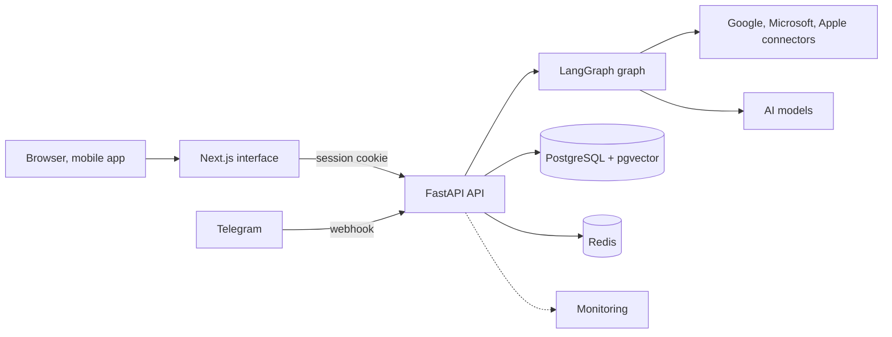
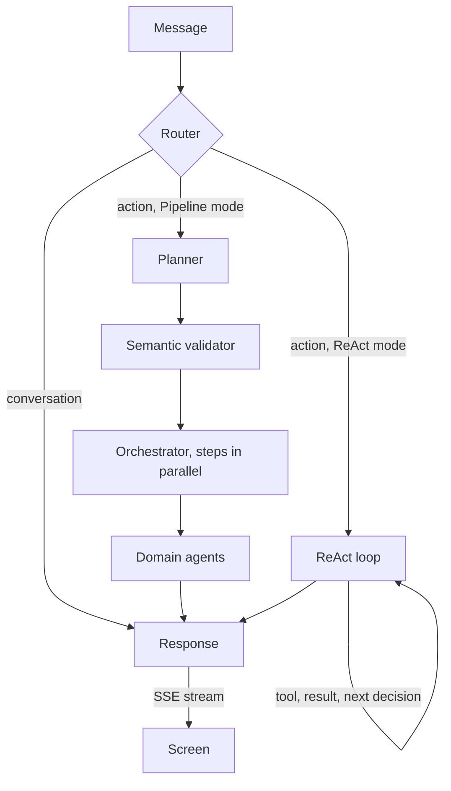
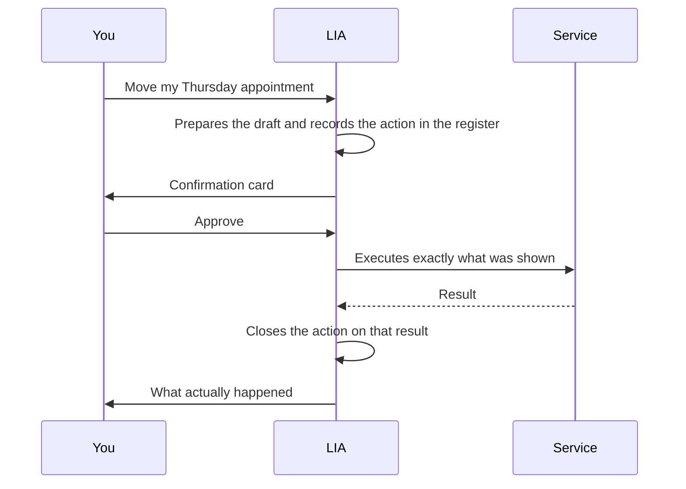
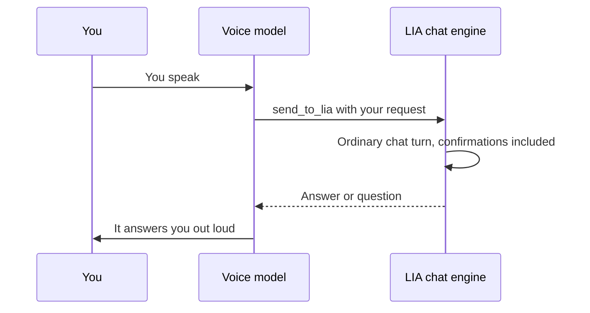

# LIA — Technical Guide

> How LIA is built, in broad strokes. The details are in the code, the ADRs and the repository's documentation.

**Version**: 6.0
**Date**: 2026-10-23
**Application**: LIA v4.2.0
**License**: AGPL-3.0 (Open Source)

---

## Table of Contents

1. [Overview](#1-overview)
2. [A backend split by domain](#2-a-backend-split-by-domain)
3. [The journey of a message](#3-the-journey-of-a-message)
4. [Acting with care](#4-acting-with-care)
5. [Memory and context](#5-memory-and-context)
6. [The models](#6-the-models)
7. [Connectors and tools](#7-connectors-and-tools)
8. [Voice, Live mode and phone](#8-voice-live-mode-and-phone)
9. [Initiative](#9-initiative)
10. [Security and privacy](#10-security-and-privacy)
11. [Observing and measuring](#11-observing-and-measuring)
12. [The interfaces](#12-the-interfaces)
13. [How this code is kept in shape](#13-how-this-code-is-kept-in-shape)
14. [Going further](#14-going-further)

---

## 1. Overview

I designed LIA to run in your home, on modest hardware. The reference platform is a Raspberry Pi 5 (ARM64), and everything that follows comes from that: a single machine, a local PostgreSQL database and a local Redis, no database hosted elsewhere. Credentials and provider keys are stored encrypted.

Three principles guide the rest. **Transparency** first: observability is part of the architecture from the start, and every token consumed is tracked with its cost. **Defense in depth** next: quotas, confirmations and guardrails against hallucinations are independent layers. **Provider independence** last: each role in the system can be given to a different model, which protects me from a price rise as much as from an outage.

The stack is deliberately classic:

| Layer | Choice |
| --- | --- |
| Backend | Python 3.14, FastAPI, asynchronous end to end |
| Agent orchestration | LangGraph 1.x |
| Data | PostgreSQL with pgvector: data, graph checkpoints and vector search |
| Cache and coordination | Redis: cache, sessions, rate limits, leader election |
| Frontend | Next.js 16 (App Router), React 19, strict TypeScript |
| Models | OpenAI, Anthropic, Google Gemini, DeepSeek, Perplexity, Qwen, and any local model through Ollama |
| Logs | Structured JSON, personal data filtered out |

A local model runs with no API cost, entirely in your home. The API runs as several workers; a leader election in Redis reserves scheduled jobs for just one of them. Each optional subsystem is turned on by a flag, and configuration follows a single cascade: what the administrator sets in the app wins over the environment, which wins over the code's constants. I wanted a single cascade because a constant that silently drifts from the real configuration produces the hardest bugs to see.

A guided installer asks a few questions, creates the administrator account without writing any secret in clear text, checks that the installation really works and can reconfigure it later without asking for the keys again ([installing LIA](/en/faq#faq-self_hosting)).

In orders of magnitude: more than 350 ADRs, hundreds of Prometheus metrics, tens of thousands of automated tests, an interface in six languages (French, English, German, Spanish, Italian, Chinese).

*Going further: [overall architecture](https://github.com/jgouviergmail/LIA-Assistant/blob/main/docs/ARCHITECTURE.md) · [self-hosting](https://github.com/jgouviergmail/LIA-Assistant/blob/main/docs/guides/GUIDE_SELF_HOSTING.md) · [model providers](https://github.com/jgouviergmail/LIA-Assistant/blob/main/docs/technical/LLM_PROVIDERS.md) · [administrable capabilities](https://github.com/jgouviergmail/LIA-Assistant/blob/main/docs/architecture/ADR-217-Capacites-Administrables.md)*

## 2. A backend split by domain

The backend follows Domain-Driven Design. Each business domain (agents, connectors, voice, memory, reminders, conversations…) is an isolated context in `src/domains/`, split the same way: router, service, repository, model, schema. Alongside them, a cross-cutting core (`core`) carries the configuration and the shared rules, and a shared infrastructure layer groups what they all need: the model factory, the cache, the MCP client, the browser, rate limits, the job scheduler, observability.

I chose a hexagonal architecture for external services. Tools know only Python protocols (ports), and the Google, Microsoft, Apple or Philips Hue clients implement them (adapters). Adding a provider therefore does not touch the code that calls it.

The repository is a monorepo: `apps/api` for the backend, `apps/web` for the interface, `infrastructure/` for Docker and monitoring, `docs/` for the documentation. An administrator who changes a model in the interface sees it take effect at once, without redeploying, because the live configuration is in the database.

*Going further: [creating a connector](https://github.com/jgouviergmail/LIA-Assistant/blob/main/docs/guides/GUIDE_CONNECTOR_IMPLEMENTATION.md) · [creating an agent](https://github.com/jgouviergmail/LIA-Assistant/blob/main/docs/guides/GUIDE_AGENT_CREATION.md) · [creating a tool](https://github.com/jgouviergmail/LIA-Assistant/blob/main/docs/guides/GUIDE_TOOL_CREATION.md) · [adding a channel](https://github.com/jgouviergmail/LIA-Assistant/blob/main/docs/templates/NEW_CHANNEL_CHECKLIST.md) · [adding a model provider](https://github.com/jgouviergmail/LIA-Assistant/blob/main/docs/technical/LLM_PROVIDER_CONSTRAINTS.md) · [adding a proactive task](https://github.com/jgouviergmail/LIA-Assistant/blob/main/docs/templates/NEW_PROACTIVE_TASK_CHECKLIST.md)*

## 3. The journey of a message

I chose LangGraph to orchestrate the agents because it brought three things I needed: state persisted as checkpoints in PostgreSQL, cycles, and `interrupt()`, which lets a turn be suspended to ask for a confirmation and then resumed exactly where it stopped. Without this mechanism, there is no serious human confirmation.

Each message first goes through a **router**, which classifies it as plain conversation or as a request that calls for an action. A conversation goes straight to the response. An action follows the mode chosen in the chat header.

In **Pipeline** mode, the default, the planner writes an `ExecutionPlan` before anything runs: a JSON plan whose steps are linked by their dependencies. A second model, separate from the planner, validates this plan, so that no model judges its own work. The orchestrator then runs the steps in parallel waves. **ReAct** mode, by contrast, lets the model call a tool, read the result and decide what comes next, step by step.

I kept both because they meet two needs. The Pipeline plans, parallelizes, checks itself and forecasts its cost: one call to the planner and one for the response, against one call per iteration for ReAct, which means 4 to 8 times fewer tokens. ReAct adapts to each result, which is better for an exploratory search or an ambiguous request. Both modes share the tool registry, the confirmations, the response node and the observability.

Domains and tools are chosen by an embedding-based **semantic router** rather than by keywords or by the model alone: it costs less and makes fewer mistakes. Each tool declares a manifest (parameters, outputs, cost, permissions, keywords in several languages) read by the planner, the router and the agent builder, and each agent declares itself once in a central registry. Smart Services cut consumption further by caching query analysis and learning the plans that come back. After an actionable turn, an initiative node looks, read-only, at what the result implies elsewhere: forecast rain points to the outdoor activities in your calendar.

A few rules keep the whole thing honest. A request with no intent to act cannot produce a plan that changes anything, and that is a deterministic rule, checked before any call to the model. A modification plan that runs out of correction attempts is not executed: LIA asks a question rather than write wrong data. A refusal or a failure is never presented as a completed action, and once the plan has run, nothing is replayed behind your back: the answer states each failure, which tool, why, and the exact total. For a mode that corrects itself along the way, there is ReAct.

The answer arrives token by token over SSE. Generation is decoupled from the connection: a detached producer publishes to a Redis stream specific to the turn, and the page is just one of its subscribers. Closing the tab therefore stops nothing, and the answer waits for you.

*Going further: [the two modes](https://github.com/jgouviergmail/LIA-Assistant/blob/main/docs/architecture/ADR-070-ReAct-Execution-Mode.md) · [the choice of LangGraph](https://github.com/jgouviergmail/LIA-Assistant/blob/main/docs/architecture/ADR-001-LangGraph-Orchestration.md) · [the graph in detail](https://github.com/jgouviergmail/LIA-Assistant/blob/main/docs/ARCHITECTURE_LANGRAPH.md) · [the router](https://github.com/jgouviergmail/LIA-Assistant/blob/main/docs/technical/ROUTER.md) · [the plan and its parallel execution](https://github.com/jgouviergmail/LIA-Assistant/blob/main/docs/architecture/ADR-014-ExecutionPlan-Parallel-Executor.md) · [the planner and bulk operations](https://github.com/jgouviergmail/LIA-Assistant/blob/main/docs/technical/PLANNER.md) · [the semantic router](https://github.com/jgouviergmail/LIA-Assistant/blob/main/docs/architecture/ADR-048-Semantic-Tool-Router.md) · [tool manifests](https://github.com/jgouviergmail/LIA-Assistant/blob/main/docs/architecture/ADR-019-Agent-Manifest-Catalogue-System.md) · [a pipeline failure is said, never replayed](https://github.com/jgouviergmail/LIA-Assistant/blob/main/docs/architecture/ADR-346-Advisory-Replanner-Retired-A-Pipeline-Failure-Is-Said-Never-Replayed.md) · [reporting tool failures](https://github.com/jgouviergmail/LIA-Assistant/blob/main/docs/architecture/ADR-303-Tool-Failure-Restitution.md) · [turns that outlive the tab](https://github.com/jgouviergmail/LIA-Assistant/blob/main/docs/architecture/ADR-117-Background-Chat-Runs.md) · [ReAct mode](https://github.com/jgouviergmail/LIA-Assistant/blob/main/docs/technical/REACT_EXECUTION_MODE.md)*

## 4. Acting with care

LIA asks before what is actually going to happen: each draft (an email, an event, a deletion), each bulk operation that changes at least one item, each tool that declares it owes a confirmation. Confirmation is asked action by action, where the action is prepared, and not on the whole plan. Conversely, an action that nothing can divert asks for nothing: an email you send to yourself goes out directly.

What you confirm is exactly the last content shown, and each change runs only once. Several drafts in the same turn are reviewed one by one. You can reply in your own words: a model classifies your answer as agreement, refusal or a request for changes. Outside a conversation, a ticket asks for its confirmation on the ticket itself, and a routine running with nobody in front of the screen asks no question: it refuses the action and says so, otherwise your next message would pass for an answer. A command given to the chat ("switch my answers to cards") follows the same rule, and when it needs an account connection, a key or a file to be chosen, that step happens in the authenticated browser. LIA checks the requested outcome against what she can observe, but a delegation to a tool does not by itself prove all of its internal effects. Likewise, a lock prevents a double execution without being able to guarantee that an outside provider will act only once.

The answer itself is framed: the model writes only from the tools' real results. And everything LIA does is recorded in three separate **registers**: actions, consultations and turns. Their totals do not add up, since one turn can consult five sources without changing anything. An action is recorded before it happens and closed only on an explicit result. Erasing a conversation removes the files you sent in it, not the ones LIA produced for you.

*Going further: [confirmations](https://github.com/jgouviergmail/LIA-Assistant/blob/main/docs/technical/HITL.md) · [the authority chain and the registers](https://github.com/jgouviergmail/LIA-Assistant/blob/main/docs/architecture/ADR-263-Execution-Authority-Chain-And-Effect-Register.md) · [the registers on the user side](/en/faq#faq-registers) · [tickets](https://github.com/jgouviergmail/LIA-Assistant/blob/main/docs/technical/WORKBOARD.md) · [application commands](https://github.com/jgouviergmail/LIA-Assistant/blob/main/docs/technical/APPLICATION_COMMANDS.md) · [what a delegation proves](https://github.com/jgouviergmail/LIA-Assistant/blob/main/docs/architecture/ADR-336-Requested-Outcomes-Checked-Against-Canonical-Observations.md) · [tool examples, email to yourself and drafts](https://github.com/jgouviergmail/LIA-Assistant/blob/main/docs/knowledge/05_tool_examples.md) · [synthesizing the answer](https://github.com/jgouviergmail/LIA-Assistant/blob/main/docs/technical/RESPONSE.md)*

## 5. Memory and context

A conversation's state is a `MessagesState` that LangGraph checkpoints in PostgreSQL after every node. That is what lets a turn resume after a confirmation, even hours later. Tool results do not live in the message history but in a separate data registry, so they survive when the history is truncated. Past a threshold, older exchanges are summarized; a badge shows how full the context is, and `/resume` triggers that summary on demand. In ReAct mode, what a loop has already read is checkpointed and reused within the turn; a stop before that checkpoint can cause a source to be read again.

Long-term memory, knowledge spaces and tool context live in the same database, with pgvector. After each exchange, a background job extracts memories from the last message; memories close to the question come back into the next context, and memory is also a tool that the planner and ReAct consult. A lasting instruction ("answer more briefly") is pinned and visible. When a sensitive subject comes up, a directive forbids joking or minimizing.

Around this memory, I added several layers. The **journals** are LIA's notebooks, in the first person; a portrait of the person emerges from them, with the sources that fed it, and it can only be corrected through indirect levers. The **Psyche Engine** gives LIA a psychological state that evolves with every exchange and shows in her style without being announced; it also learns, domain by domain, where she is reliable, from evidence; it is a pilot, with no gain claimed for now. It has an acknowledged limit: it almost never reports a calm, low-intensity emotion, and that part of its activation stays locked. **Interests** are detected in your requests and fed by several sources. **Habits**, finally, are learned without a trained model, through statistical tests, and I had three reasons, each sufficient on its own: a Raspberry Pi has no training budget, a formula can be published to the person it concerns, and on such small volumes a model would mostly learn noise.

*Going further: [checkpoints](https://github.com/jgouviergmail/LIA-Assistant/blob/main/docs/architecture/ADR-022-LangGraph-State-Checkpointing.md) · [the data registry](https://github.com/jgouviergmail/LIA-Assistant/blob/main/docs/architecture/ADR-012-Data-Registry-StandardToolOutput-Pattern.md) · [compaction](https://github.com/jgouviergmail/LIA-Assistant/blob/main/docs/technical/COMPACTION_v2.md) · [ReAct's checkpointed reads](https://github.com/jgouviergmail/LIA-Assistant/blob/main/docs/architecture/ADR-337-Checkpointed-ReAct-Read-Segments-And-Turn-Local-Reuse.md) · [memory in PostgreSQL](https://github.com/jgouviergmail/LIA-Assistant/blob/main/docs/architecture/ADR-066-Memory-PostgreSQL-Migration.md) · [long-term memory](https://github.com/jgouviergmail/LIA-Assistant/blob/main/docs/technical/LONG_TERM_MEMORY.md) · [memory as a search tool](https://github.com/jgouviergmail/LIA-Assistant/blob/main/docs/architecture/ADR-313-Long-Term-Memory-As-An-Active-Lookup.md) · [lasting rules](https://github.com/jgouviergmail/LIA-Assistant/blob/main/docs/architecture/ADR-236-procedural-memory.md) · [journals and the portrait](https://github.com/jgouviergmail/LIA-Assistant/blob/main/docs/technical/JOURNALS.md) · [the Psyche Engine](https://github.com/jgouviergmail/LIA-Assistant/blob/main/docs/technical/PSYCHE_ENGINE.md) · [its measured limit](https://github.com/jgouviergmail/LIA-Assistant/blob/main/docs/architecture/ADR-142-Psyche-Observability-And-Dominance-Recentering.md) · [the psyche on the user side](https://github.com/jgouviergmail/LIA-Assistant/blob/main/docs/knowledge/22_psyche.md) · [efficacy learned from evidence](https://github.com/jgouviergmail/LIA-Assistant/blob/main/docs/architecture/ADR-348-Efficacy-Learned-From-Evidence-Results-And-Usefulness-Kept-Apart.md) · [interests](https://github.com/jgouviergmail/LIA-Assistant/blob/main/docs/technical/INTERESTS.md) · [habits](https://github.com/jgouviergmail/LIA-Assistant/blob/main/docs/knowledge/28_habits.md) · [searching the journals and the registers](https://github.com/jgouviergmail/LIA-Assistant/blob/main/docs/architecture/ADR-318-Assistant-Tools-Exact-Answers-And-Own-Records.md)*

## 6. The models

A single factory instantiates the model of any supported provider and applies its adapter. Each role has its model slot (conversation, planning, images, transcription, speech synthesis…), set in the administration without redeploying. The model catalogue lives in the database and declares, model by model, its capabilities, the parameters it accepts and the reasoning scale it knows; the configuration screen therefore offers only what the model's API really accepts.

Some tasks are not generations but bounded decisions: choosing a format, qualifying an email. They can be handed to a native decision engine, each behind its own switch and a general switch. An uncertain decision falls back to the usual processing, and neither rights nor confirmations are delegated to it. A qualification verdict authenticates no sender, and a gain measured on a test corpus is no promise for every request.

Every model call, in the pipeline as in background jobs, is tracked and priced from the rates in the database, then grouped by turn. On cost, the main saving comes from the providers' cache. Each prompt places its stable content before a marker and the request-specific content after it, and the infrastructure translates that marker into each provider's caching mechanism. Since every slot can change model, I do not tune this cache for any one model: I aim for the best average, and a model without a cache pays nothing extra. The studies run on other local engines (oMLX, llama.cpp, LM Studio) are qualifications, not shipped integrations: only the providers the instance offers count.

*Going further: [model selection](https://github.com/jgouviergmail/LIA-Assistant/blob/main/docs/architecture/ADR-026-LLM-Model-Selection-Strategy.md) · [the catalogue in the database](https://github.com/jgouviergmail/LIA-Assistant/blob/main/docs/architecture/ADR-078-LLM-Catalogue-DB-Source-Of-Truth.md) · [the configuration screen](https://github.com/jgouviergmail/LIA-Assistant/blob/main/docs/technical/LLM_CONFIG_ADMIN.md) · [native decisions](https://github.com/jgouviergmail/LIA-Assistant/blob/main/docs/architecture/ADR-325-JEV-Bounded-Decisions-With-Hot-Switches-And-Accounted-Fallbacks.md) · [their integration](https://github.com/jgouviergmail/LIA-Assistant/blob/main/docs/technical/JEV_INTEGRATION.md) · [qualifying emails](https://github.com/jgouviergmail/LIA-Assistant/blob/main/docs/technical/EMAIL_EVENT_CLASSIFICATION.md) · [one layout for every cache](https://github.com/jgouviergmail/LIA-Assistant/blob/main/docs/architecture/ADR-309-One-Prompt-Layout-For-Every-Cache-Mechanism.md) · [filtering the tool catalogue](https://github.com/jgouviergmail/LIA-Assistant/blob/main/docs/architecture/ADR-003-Multi-Domain-Dynamic-Filtering.md) · [the local engines studied](https://github.com/jgouviergmail/LIA-Assistant/blob/main/docs/knowledge/16_other.md)*

## 7. Connectors and tools

Each connector category (email, calendar, contacts, tasks, files, home) is a Python protocol. Only one provider is active at a time per category, and OAuth consent is given once per Google or Microsoft account. Services that ask nothing of the person (Wikipedia, page reading, places, weather) belong to the instance and are active for everyone. On the email side, each message is summarized once and then reused, an attachment is read as text or by a vision model, and a send is never retried after a lost acknowledgment.

Tools rest on five composable layers: a common connector base (OAuth, cache, injection), a decorator, per-domain formatters, the manifest the planner reads, and a catalogue loader. **MCP** tools are converted into ordinary LangChain tools and join the same catalogue, kept from one message to the next so that a message usually waits for no server; an MCP server must use HTTPS, its credentials are encrypted, and LIA believes an annotation that announces a modification, never one that claims to be read-only. **Plugins** in the Agent Plugins format install as a single block, with no local server. **Skills** following the agentskills.io standard can render a small app in the chat or run their own commands in a copy of their folder; a skill from elsewhere runs isolated and never receives a connector's token.

When a step needs a real calculation, ReAct mode can write a short Python script and run it in a disposable container. This script reaches the web only through a single proxy, does not see the person's key (the proxy substitutes it on the one authorized host), and an unknown host is asked about with three possible answers. In both modes, calculations, durations and currency conversions go through exact tools rather than the model. An agent can also drive a browser (Playwright) or convert a page into text.

Documents in **knowledge spaces** are chunked, embedded and stored in PostgreSQL rather than in an external vector database, then retrieved by a hybrid search, semantic and lexical. A space can follow a Drive folder with its subfolders, or a Gmail label, without indexing the whole mailbox. There is no character recognition: a scanned PDF is not indexed as is. Data sent from outside (SMS, step count, heart rate, from an iPhone, an Android or any system able to send JSON) comes in through endpoints authenticated by a limited-scope, revocable token, separate from the session.

For a complex task, LIA delegates to ephemeral, read-only sub-agents. She also produces files: documents, images, screenshots, filed in a gallery, kept, sent by email or, for an image, shared with a person connected to the instance.

*Going further: [connector patterns](https://github.com/jgouviergmail/LIA-Assistant/blob/main/docs/technical/CONNECTORS_PATTERNS.md) · [grouped OAuth consent](https://github.com/jgouviergmail/LIA-Assistant/blob/main/docs/architecture/ADR-302-OAuth-Grant-Par-Compte-Et-Consentement-Groupe.md) · [the instance's services](https://github.com/jgouviergmail/LIA-Assistant/blob/main/docs/architecture/ADR-307-Keyless-Connectors-Belong-To-The-Instance.md) · [connectors on the user side](/en/faq#faq-connectors) · [emails and their summaries](https://github.com/jgouviergmail/LIA-Assistant/blob/main/docs/architecture/ADR-287-Email-Content-First-Detail-Levels-Digests-And-Neutral-Message.md) · [attachments](https://github.com/jgouviergmail/LIA-Assistant/blob/main/docs/architecture/ADR-296-Mail-Attachments-Read-By-Text-Or-Vision.md) · [per-slot timeouts](https://github.com/jgouviergmail/LIA-Assistant/blob/main/docs/architecture/ADR-221-Timeout-Par-Emplacement-Applique.md) · [the tool base](https://github.com/jgouviergmail/LIA-Assistant/blob/main/docs/architecture/ADR-015-ConnectorTool-Base-Class-Pattern.md) · [MCP](https://github.com/jgouviergmail/LIA-Assistant/blob/main/docs/technical/MCP_INTEGRATION.md) · [the Agent Plugins standard](https://github.com/jgouviergmail/LIA-Assistant/blob/main/docs/architecture/ADR-225-Standard-Agent-Plugins-v1.md) · [plugins](https://github.com/jgouviergmail/LIA-Assistant/blob/main/docs/technical/PLUGINS_INTEGRATION.md) · [skills](https://github.com/jgouviergmail/LIA-Assistant/blob/main/docs/technical/SKILLS_INTEGRATION.md) · [skills on the user side](https://github.com/jgouviergmail/LIA-Assistant/blob/main/docs/knowledge/12_skills.md) · [third-party skills](https://github.com/jgouviergmail/LIA-Assistant/blob/main/docs/architecture/ADR-327-Skill-Library-And-Third-Party-Skills.md) · [editing a skill](https://github.com/jgouviergmail/LIA-Assistant/blob/main/docs/architecture/ADR-165-Skill-Editing-By-Regeneration.md) · [sharing a capability](https://github.com/jgouviergmail/LIA-Assistant/blob/main/docs/technical/PEER_CAPABILITY_TRANSFERS.md) · [ephemeral Python](https://github.com/jgouviergmail/LIA-Assistant/blob/main/docs/architecture/ADR-249-Ephemeral-Python-In-The-Existing-Sandbox.md) · [the sandbox's network egress](https://github.com/jgouviergmail/LIA-Assistant/blob/main/docs/architecture/ADR-298-Sandbox-Egress-Toolbox.md) · [computed answers](https://github.com/jgouviergmail/LIA-Assistant/blob/main/docs/knowledge/35_computed_answers.md) · [the browser](https://github.com/jgouviergmail/LIA-Assistant/blob/main/docs/technical/BROWSER_CONTROL.md) · [page reading](https://github.com/jgouviergmail/LIA-Assistant/blob/main/docs/technical/WEB_FETCH.md) · [knowledge spaces](https://github.com/jgouviergmail/LIA-Assistant/blob/main/docs/architecture/ADR-055-RAG-Spaces-Architecture.md) · [their guide](https://github.com/jgouviergmail/LIA-Assistant/blob/main/docs/guides/GUIDE_RAG_SPACES.md) · [their use](https://github.com/jgouviergmail/LIA-Assistant/blob/main/docs/knowledge/14_rag_spaces.md) · [a Drive folder is a tree](https://github.com/jgouviergmail/LIA-Assistant/blob/main/docs/architecture/ADR-297-Drive-Folder-Is-A-Tree-And-The-Count-Is-Exact.md) · [a Gmail label as a source](https://github.com/jgouviergmail/LIA-Assistant/blob/main/docs/architecture/ADR-262-Opt-In-Mail-Label-RAG-Source.md) · [the built-in FAQ](https://github.com/jgouviergmail/LIA-Assistant/blob/main/docs/architecture/ADR-058-System-RAG-Spaces.md) · [attaching a document from a space](https://github.com/jgouviergmail/LIA-Assistant/blob/main/docs/architecture/ADR-295-Knowledge-Documents-As-Message-Attachments.md) · [sub-agents](https://github.com/jgouviergmail/LIA-Assistant/blob/main/docs/knowledge/13_sub_agents.md) · [health data](https://github.com/jgouviergmail/LIA-Assistant/blob/main/docs/technical/HEALTH_METRICS.md) · [its ingestion](https://github.com/jgouviergmail/LIA-Assistant/blob/main/docs/architecture/ADR-076-Health-Metrics-Ingestion.md) · [health on the user side](https://github.com/jgouviergmail/LIA-Assistant/blob/main/docs/knowledge/23_health_metrics.md) · [SMS](https://github.com/jgouviergmail/LIA-Assistant/blob/main/docs/technical/SMS_INGESTION.md) · [document generation](https://github.com/jgouviergmail/LIA-Assistant/blob/main/docs/technical/DOCUMENT_GENERATION.md) · [documents on the user side](https://github.com/jgouviergmail/LIA-Assistant/blob/main/docs/knowledge/32_document_generation.md) · [images](https://github.com/jgouviergmail/LIA-Assistant/blob/main/docs/knowledge/21_image_generation.md) · [generated files](https://github.com/jgouviergmail/LIA-Assistant/blob/main/docs/knowledge/39_generated_files.md) · [keeping a file](https://github.com/jgouviergmail/LIA-Assistant/blob/main/docs/architecture/ADR-319-A-Generated-File-Can-Be-Kept.md) · [sending by email](https://github.com/jgouviergmail/LIA-Assistant/blob/main/docs/architecture/ADR-321-A-File-Or-An-Answer-Sent-By-E-Mail.md) · [composer attachments](https://github.com/jgouviergmail/LIA-Assistant/blob/main/docs/technical/ATTACHMENTS_INTEGRATION.md) · [kept answers](https://github.com/jgouviergmail/LIA-Assistant/blob/main/docs/knowledge/40_bookmarks.md)*

## 8. Voice, Live mode and phone

Classic voice is made of independent building blocks. The wake word "Dis LIA" is detected in the browser and sends nothing before it is heard; only the French model ships for now, in beta. Dictation is transcribed in the account's language, on the server and offline with Whisper, or by a remote engine depending on the setting. Speech synthesis has several providers, free Edge by default, and the answer starts being read sentence by sentence while the rest is still being written. An experimental talking avatar can be added, on the person's Simli key, which also bills silences as long as the connection stays open.

**Live mode** is a real speech-to-speech conversation. I gave it two intelligences and a single seam: the voice model carries the conversation, and every request for data or for an action goes to the chat engine through a single function, `send_to_lia`. The request becomes an ordinary chat turn, with its confirmations, its registers and its quotas. The voice owns no tool, no credential and no memory of its own.

A Live session falls asleep instead of dying: during standby, the connection to the provider is closed and nothing is billed. The Live provider's spend is paid by the person's key and is never recorded by LIA. In Live direct, the voice reads your data itself without changing anything.

The **phone** takes up the same two modes. LIA can call a third party for you after confirmation, or call you on a verified number, and you then have your data and all her functions on the phone, as in the chat. When LIA calls a third party, the calling agent has only a read-only free/busy tool: the protection of your calendar is structural, it does not depend on an instruction in a prompt. On the phone, Live mode exists only if the provider can reach your instance.

A meeting is recorded from the browser: the audio leaves in small segments, then it is transcribed and summarized into structured minutes, filed in a knowledge space. The personal radio, finally, produces only during a listening session and keeps nothing for a later replay.

*Going further: [voice on the user side](/en/faq#faq-voice_mode) · [Live standby and the wake word](https://github.com/jgouviergmail/LIA-Assistant/blob/main/docs/architecture/ADR-329-Live-Standby-And-Multilingual-Wake-Word.md) · [voices and speech synthesis](https://github.com/jgouviergmail/LIA-Assistant/blob/main/docs/architecture/ADR-345-Fish-Audio-Served-Whole-One-Door-One-Allowance-Cues-Each-Engine-Reads.md) · [the talking avatar](https://github.com/jgouviergmail/LIA-Assistant/blob/main/docs/technical/SPEAKING_AVATAR.md) · [Live mode](https://github.com/jgouviergmail/LIA-Assistant/blob/main/docs/architecture/ADR-299-Live-Voice-Mode-Two-Intelligences-One-Seam.md) · [telephony on the user side](/en/faq#faq-telephony) · [the phone as a channel](https://github.com/jgouviergmail/LIA-Assistant/blob/main/docs/architecture/ADR-290-Phone-As-A-Channel-Owner-Calls.md) · [the radio](/en/faq#faq-radio) · [meetings](https://github.com/jgouviergmail/LIA-Assistant/blob/main/docs/technical/MEETINGS.md) · [structured minutes](https://github.com/jgouviergmail/LIA-Assistant/blob/main/docs/architecture/ADR-258-Meeting-Recording-And-Structured-Minutes.md) · [minutes templates](https://github.com/jgouviergmail/LIA-Assistant/blob/main/docs/architecture/ADR-259-Meeting-Template-Library-And-Reformatting.md)*

## 9. Initiative

LIA takes initiative in three forms. A periodic **heartbeat** looks at your sources and writes to you only if a signal warrants it, naming one or two verified facts. Being connected to a source and agreeing to be interrupted by it are two separate decisions. A push notification from Google can wake this heartbeat for a single person, and a **moment** (the end of a meeting, the arrival of an expected email) is served to the minute rather than at the next pass. **Proactive discussions**, finally, call for a reply, with their own policy: hours, a daily maximum, sensitive topics kept private, spend reserved before it happens.

**Routines** trigger on a schedule or on a condition, not both, and a week view shows what actually happened. A reminder can repeat. The **ticket board** gives a task a lifecycle, a holder and a result.

Two rules bound all of this. Initiative only reads: a write is proposed, never executed on its own. And a new attempt at the same run is refused as soon as the effect register shows the action already done. The Activity page shows in one place everything LIA undertook on her own, with exact totals.

*Going further: [the heartbeat](https://github.com/jgouviergmail/LIA-Assistant/blob/main/docs/technical/HEARTBEAT_AUTONOME.md) · [permission to interrupt](https://github.com/jgouviergmail/LIA-Assistant/blob/main/docs/architecture/ADR-197-Interrupt-Permission-Is-Not-Connection.md) · [push wake-up](https://github.com/jgouviergmail/LIA-Assistant/blob/main/docs/architecture/ADR-261-Push-Driven-Heartbeat-Wake-And-Incremental-Drive-Sync.md) · [moments and watches](https://github.com/jgouviergmail/LIA-Assistant/blob/main/docs/architecture/ADR-281-Anticipated-Moments-And-Mail-Watches.md) · [proactive discussions](https://github.com/jgouviergmail/LIA-Assistant/blob/main/docs/technical/PROACTIVE_DISCUSSIONS.md) · [their delivery](https://github.com/jgouviergmail/LIA-Assistant/blob/main/docs/architecture/ADR-358-Independent-Proactive-Discussions-And-Native-Delivery.md) · [their context](https://github.com/jgouviergmail/LIA-Assistant/blob/main/docs/architecture/ADR-359-Longitudinal-Discussion-Context-And-User-Control.md) · [their budget](https://github.com/jgouviergmail/LIA-Assistant/blob/main/docs/architecture/ADR-360-Bounded-Discussion-Research-And-Accounted-Abstention.md) · [routines](https://github.com/jgouviergmail/LIA-Assistant/blob/main/docs/knowledge/10_scheduled_actions.md) · [the routines' week](https://github.com/jgouviergmail/LIA-Assistant/blob/main/docs/architecture/ADR-265-Routine-Week-Timeline-And-Run-History.md) · [reminders](https://github.com/jgouviergmail/LIA-Assistant/blob/main/docs/knowledge/07_reminders.md) · [a reminder that always has a text](https://github.com/jgouviergmail/LIA-Assistant/blob/main/docs/architecture/ADR-285-Short-Answer-Without-Reasoning-And-One-Family-Declaration.md) · [read-only initiative](https://github.com/jgouviergmail/LIA-Assistant/blob/main/docs/architecture/ADR-062-Agent-Initiative-Phase.md) · [the ticket board](https://github.com/jgouviergmail/LIA-Assistant/blob/main/docs/architecture/ADR-276-Workboard.md) · [the Activity page](https://github.com/jgouviergmail/LIA-Assistant/blob/main/docs/architecture/ADR-234-activity-timeline.md) · [rating a notification](https://github.com/jgouviergmail/LIA-Assistant/blob/main/docs/knowledge/09_proactive_notifications.md)*

## 10. Security and privacy

Security is designed as independent layers, each type of attack having its own protection. Accounts sign in through OAuth 2.1 and rights follow roles. For sessions, I chose the BFF pattern: an HTTP-only cookie and a session in Redis rather than a JWT, which would be exposed to XSS if it lived in the browser, heavy to carry and impossible to revoke. An account can be protected with passkeys and a second factor, each connected device can be revoked, and linking a Google identity never changes an account's status. Usage limits apply at every door, routines included.

Everything that runs for the person is treated as hostile: skill code runs in a disposable container, and a task on a remote server is prepared and then confirmed. Likewise, what LIA reads remains data and does not become an instruction. Provenance is a property of the data: each content type is classified once, an unknown type is treated as external, and a type nobody has classified keeps the application from starting.

Above debug level, a log line carries facts (numbers, identifiers, codes, the host of an address), not what you wrote or what a model wrote about you. Two caveats: the error message of an outside service in an unknown format can still quote a fragment of it, and the debug level, switched off in production, keeps more. The database is backed up automatically: at most one day of data can be lost with the default settings. The off-site copy and the attachments stay outside these backups.

Two limits are worth knowing. These measures do not on their own demonstrate a deployment's GDPR compliance. And deleting raw measurements, such as your health data, does not delete the memories derived from them, which have their own controls.

*Going further: [security](https://github.com/jgouviergmail/LIA-Assistant/blob/main/docs/technical/SECURITY.md) · [BFF authentication](https://github.com/jgouviergmail/LIA-Assistant/blob/main/docs/architecture/ADR-002-BFF-Pattern-Authentication.md) · [passkeys](https://github.com/jgouviergmail/LIA-Assistant/blob/main/docs/architecture/ADR-143-Strong-Authentication-Passkeys.md) · [devices](https://github.com/jgouviergmail/LIA-Assistant/blob/main/docs/architecture/ADR-144-Device-Sessions.md) · [usage limits](https://github.com/jgouviergmail/LIA-Assistant/blob/main/docs/technical/USAGE_LIMITS.md) · [the sandbox](https://github.com/jgouviergmail/LIA-Assistant/blob/main/docs/architecture/ADR-149-Security-Remediation-Wave-1.md) · [content provenance](https://github.com/jgouviergmail/LIA-Assistant/blob/main/docs/architecture/ADR-167-Content-Trust-Registry.md) · [privacy on the user side](/en/faq#faq-privacy) · [logs without personal data](https://github.com/jgouviergmail/LIA-Assistant/blob/main/docs/technical/PII_LOGGING_SECURITY.md) · [a log line carries facts](https://github.com/jgouviergmail/LIA-Assistant/blob/main/docs/architecture/ADR-317-A-Log-Line-Carries-Facts-Never-The-Words.md) · [backups](https://github.com/jgouviergmail/LIA-Assistant/blob/main/docs/architecture/ADR-109-PostgreSQL-Backup-Strategy.md) · [a memory's provenance](https://github.com/jgouviergmail/LIA-Assistant/blob/main/docs/architecture/ADR-201-Provenance-Is-A-Bounded-Reference.md)*

## 11. Observing and measuring

Monitoring ships with the deployment: Prometheus and Grafana for metrics, Loki for logs, Tempo for traces, Langfuse for model calls, Alertmanager for alerts. The code defines hundreds of metrics, some thirty dashboards ship ready to use, and metric emission is defensive: a metric that fails does not bring down a request.

I also put debugging in the interface, because an agent is hard to debug: for each exchange, the debug panel shows the intent, the plan, each tool and each model call, and you can see why a request was expensive or why a given domain was chosen without opening Grafana.

On costs, every euro the platform pays for a person is traced, shown, attributed and counted for them, however it was spent. An instance spending cap exists alongside the per-account quotas, because several accounts multiplied by their quota are still an unbounded spend. An operator turns a capability off without redeploying: what the deployment allows and what the operator chooses are combined, and the smaller of the two bounds wins.

LIA also reads her own telemetry to diagnose herself: each vital alert is sent by email with its procedure and becomes an incident, and her recommendations remain proposals. An administrator can even drive Claude Code CLI from the chat to examine their server.

A note on performance: the measured latencies are the infrastructure's. The response time you feel depends mostly on the chain of model calls, from a few seconds to several tens of seconds depending on the request and the hardware. And scaling beyond a single machine (several nodes, replicas, clustered Redis) remains a possible evolution, not a reality. Two questions remain open: the growth of a worker's memory over several days and the retention of LangGraph's checkpoints.

*Going further: [the observability stack](https://github.com/jgouviergmail/LIA-Assistant/blob/main/docs/architecture/ADR-020-Observability-Stack.md) · [the debug panel](https://github.com/jgouviergmail/LIA-Assistant/blob/main/docs/technical/DEBUG_PANEL.md) · [its architecture](https://github.com/jgouviergmail/LIA-Assistant/blob/main/docs/technical/DEBUG_PANEL_ARCHITECTURE.md) · [the instance cap](https://github.com/jgouviergmail/LIA-Assistant/blob/main/docs/architecture/ADR-216-Plafond-De-Depense-D-Instance.md) · [every spend answers to two caps](https://github.com/jgouviergmail/LIA-Assistant/blob/main/docs/architecture/ADR-272-Every-Platform-Paid-Token-Answers-To-Both-Ceilings.md) · [administration by workbook](https://github.com/jgouviergmail/LIA-Assistant/blob/main/docs/technical/TABULAR_ADMIN_IO.md) · [targeted broadcasts](https://github.com/jgouviergmail/LIA-Assistant/blob/main/docs/architecture/ADR-312-A-Broadcast-Says-Who-It-Was-Addressed-To.md) · [the demo instance](https://github.com/jgouviergmail/LIA-Assistant/blob/main/docs/technical/DEMO_INSTANCE.md) · [self-diagnosis](https://github.com/jgouviergmail/LIA-Assistant/blob/main/docs/technical/DIAGNOSTICS_DOMAIN.md) · [alerts and their resilience](https://github.com/jgouviergmail/LIA-Assistant/blob/main/docs/architecture/ADR-247-Self-Diagnostics-And-Answer-Resilience.md) · [Claude CLI from the chat](https://github.com/jgouviergmail/LIA-Assistant/blob/main/docs/guides/GUIDE_DEVOPS_CLAUDE_CLI.md) · [the anatomy of a worker](https://github.com/jgouviergmail/LIA-Assistant/blob/main/docs/architecture/ADR-283-Worker-Memory-Anatomy.md) · [complete register extractions](https://github.com/jgouviergmail/LIA-Assistant/blob/main/docs/architecture/ADR-273-Complete-Register-Extractions.md) · [how background jobs are organized](https://github.com/jgouviergmail/LIA-Assistant/blob/main/docs/architecture/ADR-046-Background-Job-Scheduling.md)*

## 12. The interfaces

The web interface is a Next.js application that installs like an app (PWA). The chat updates the conversation without reloading, renders math formulas and syntax-highlighted code, keeps one draft per account, and can be searched; the settings have their own search, a pure black theme for OLED screens and an adjustable text size.

In the cards display, one of three modes to choose from along with plain HTML and Markdown, an answer that carries data is not formatted by the model: the server renders it as deterministic HTML **cards**, independent of the model and the mode, archived with the message. A card shows a received fact in full and invents nothing, and an action from a card prepares a request instead of acting. To keep the interface consistent, I wrote rules that tests check: a status takes its tone from a single table, an action has a level of importance, and a list row exposes its actions in a single way. Browser and accessibility tests target WCAG level AA, without certifying the rendering on a physical device or the accuracy of the translations.

The mobile apps are native shells published once per store. They load the server address entered at first launch and do not duplicate the interface, because a single app must serve everyone who hosts LIA. On Android, notifications go through your own server's Firebase project; on iOS, where only an app's publisher can send notifications, a minimal relay wakes the phone. Sharing a text or a link to LIA from the phone prepares a chat draft, which does not go out on its own.

Around the chat, a companion with expressive eyes reacts to the whole cycle of an answer, and each answer carries a small mood avatar. **LIA World** is another interface: a shared house and garden where you stroll around, without any room granting extra rights. Voice between people and federation between instances are not implemented there. The presentation video, for its part, shows interface replicas and demonstration data.

Two people on the same instance can link their assistants so that they pass messages to each other, and the Relations page gathers what concerns each person, with a debrief written by the model.

*Going further: [the chat on the user side](https://github.com/jgouviergmail/LIA-Assistant/blob/main/docs/knowledge/02_chat.md) · [the settings](https://github.com/jgouviergmail/LIA-Assistant/blob/main/docs/knowledge/03_settings.md) · [searching the settings](https://github.com/jgouviergmail/LIA-Assistant/blob/main/docs/architecture/ADR-172-Settings-Quick-Search.md) · [getting started](https://github.com/jgouviergmail/LIA-Assistant/blob/main/docs/knowledge/01_getting_started.md) · [the chat that follows the server](https://github.com/jgouviergmail/LIA-Assistant/blob/main/docs/architecture/ADR-320-The-Chat-Follows-The-Server-Without-A-Reload.md) · [cards](https://github.com/jgouviergmail/LIA-Assistant/blob/main/docs/architecture/ADR-332-Deterministic-Cards-Received-Facts-And-Message-Owned-Actions.md) · [their rendering](https://github.com/jgouviergmail/LIA-Assistant/blob/main/docs/technical/HTML_CARDS.md) · [places and routes](https://github.com/jgouviergmail/LIA-Assistant/blob/main/docs/architecture/ADR-355-Acquired-Place-Details-And-Accounted-Selected-Routes.md) · [the known location](https://github.com/jgouviergmail/LIA-Assistant/blob/main/docs/architecture/ADR-219-Derniere-Position-Connue-Generalisee.md) · [primitives and their contract](https://github.com/jgouviergmail/LIA-Assistant/blob/main/docs/architecture/ADR-206-A-Primitive-Owns-Its-Contract.md) · [the Android app](https://github.com/jgouviergmail/LIA-Assistant/blob/main/docs/guides/GUIDE_MOBILE_ANDROID.md) · [native notifications](https://github.com/jgouviergmail/LIA-Assistant/blob/main/docs/architecture/ADR-246-Native-Push-And-Wake-Relay.md) · [the apps on the user side](https://github.com/jgouviergmail/LIA-Assistant/blob/main/docs/knowledge/33_native_apps.md) · [the expressive eyes](https://github.com/jgouviergmail/LIA-Assistant/blob/main/docs/architecture/ADR-240-expressive-eyes-widget.md) · [native companions](https://github.com/jgouviergmail/LIA-Assistant/blob/main/docs/technical/NATIVE_AVATAR_VOLUME.md) · [the presentation video](https://github.com/jgouviergmail/LIA-Assistant/blob/main/docs/architecture/ADR-341-Editable-Motion-Production-And-Exclusive-Presentation.md) · [the capability map](https://github.com/jgouviergmail/LIA-Assistant/blob/main/docs/knowledge/30_platform_capabilities.md) · [LIA World](/en/faq#faq-world) · [its prototype](https://github.com/jgouviergmail/LIA-Assistant/blob/main/docs/technical/WORLD_PROTOTYPE.md) · [connections between assistants](https://github.com/jgouviergmail/LIA-Assistant/blob/main/docs/knowledge/26_peer_connections.md) · [relations](https://github.com/jgouviergmail/LIA-Assistant/blob/main/docs/knowledge/27_relations.md) · [a relationship's debrief](https://github.com/jgouviergmail/LIA-Assistant/blob/main/docs/architecture/ADR-269-Relationship-Debrief.md) · [Telegram](https://github.com/jgouviergmail/LIA-Assistant/blob/main/docs/knowledge/18_telegram.md)*

## 13. How this code is kept in shape

Every change passes local gates (before the commit, before the push) and then continuous integration on GitHub Actions, which calls exactly the same commands as a developer. Python dependencies are intent manifests compiled into universal lockfiles that carry each package's hash: the same commit always installs the same verified versions, on every architecture.

The project's rules do not rely on the memory of whoever reviews: automated guards hold them. Several of them recompute the protection from the source of truth (the code itself, the routes actually mounted, the connector registry) instead of pinning a handwritten list, and were deliberately broken to check that they really fail. Elsewhere, reference lists can only shrink, so that no debt grows in silence. Prompts are versioned text files, one per prompt, read by a single loader. More than 350 ADRs record the decisions, the alternatives set aside and the trade-offs accepted, and tens of thousands of tests, continuous integration and strict typing let the system evolve without regressions.

A full 360-degree technical audit is published in the repository with its protocol, so that anyone can run it again. How this code was written, almost entirely by an AI that was directed and checked, is told in the [field report](/en/story).

*Going further: [continuous integration](https://github.com/jgouviergmail/LIA-Assistant/blob/main/docs/technical/CI_CD.md) · [dependency locking](https://github.com/jgouviergmail/LIA-Assistant/blob/main/docs/architecture/ADR-112-Python-Dependency-Locking.md) · [versioned prompts](https://github.com/jgouviergmail/LIA-Assistant/blob/main/docs/architecture/ADR-025-Prompt-Engineering-Versioning.md) · [the public audit](https://github.com/jgouviergmail/LIA-Assistant/blob/main/docs/audit/README.md)*

## 14. Going further

This guide draws on the code, on more than 800 technical documents and on the ADRs. To go further:

- the [documentation index](https://github.com/jgouviergmail/LIA-Assistant/blob/main/docs/INDEX.md) and the [ADR index](https://github.com/jgouviergmail/LIA-Assistant/blob/main/docs/architecture/ADR_INDEX.md);
- the [agent architecture](https://github.com/jgouviergmail/LIA-Assistant/blob/main/docs/ARCHITECTURE_AGENT.md) and the [LangGraph graph](https://github.com/jgouviergmail/LIA-Assistant/blob/main/docs/ARCHITECTURE_LANGRAPH.md);
- the [living maps](/en/maps), which show the functions, the technology and the history of the decisions;
- the [FAQ](/en/faq) for everyday use, and the [field report](/en/story) for the method.

The code is under AGPL-3.0, on [GitHub](https://github.com/jgouviergmail/LIA-Assistant).
