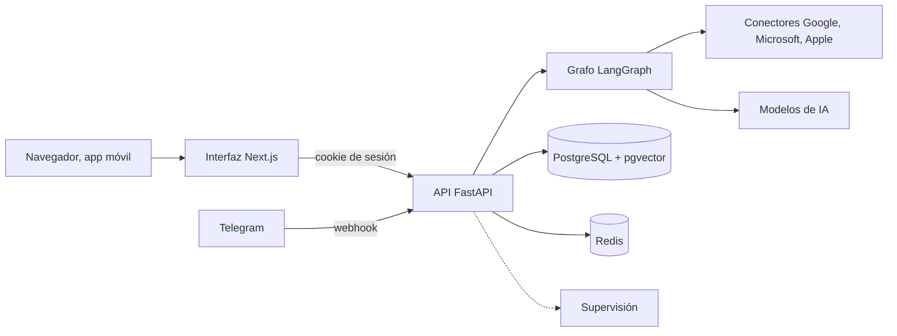
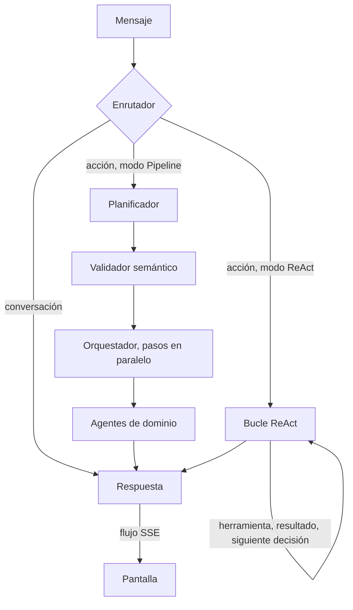
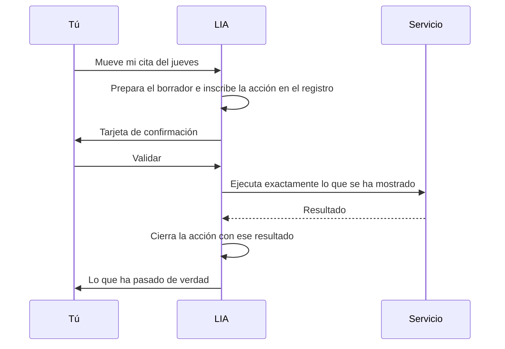
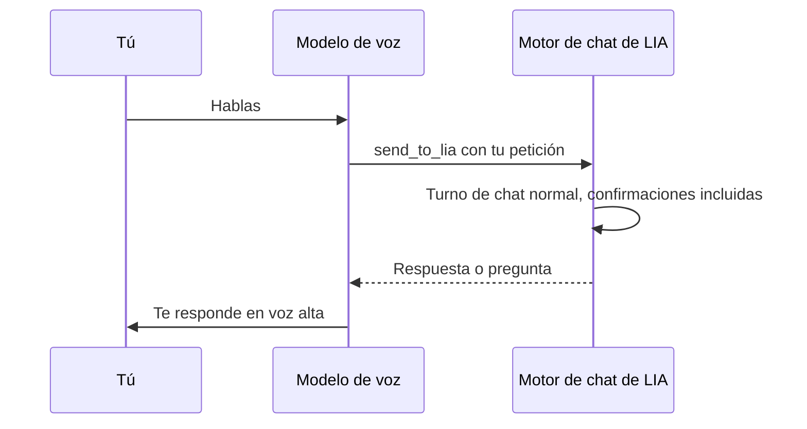

# LIA — Guía técnica

> Cómo está construida LIA, a grandes rasgos. El detalle está en el código, los ADR y la documentación del repositorio.

**Versión**: 6.0
**Fecha**: 2026-10-23
**Aplicación**: LIA v4.2.0
**Licencia**: AGPL-3.0 (Open Source)

---

## Tabla de contenidos

1. [Visión general](#1-visión-general)
2. [Un backend dividido por dominios](#2-un-backend-dividido-por-dominios)
3. [El recorrido de un mensaje](#3-el-recorrido-de-un-mensaje)
4. [Actuar con prudencia](#4-actuar-con-prudencia)
5. [Memoria y contexto](#5-memoria-y-contexto)
6. [Los modelos](#6-los-modelos)
7. [Conectores y herramientas](#7-conectores-y-herramientas)
8. [Voz, modo Live y teléfono](#8-voz-modo-live-y-teléfono)
9. [La iniciativa](#9-la-iniciativa)
10. [Seguridad y privacidad](#10-seguridad-y-privacidad)
11. [Observar y medir](#11-observar-y-medir)
12. [Las interfaces](#12-las-interfaces)
13. [Cómo se mantiene este código](#13-cómo-se-mantiene-este-código)
14. [Para saber más](#14-para-saber-más)

---

## 1. Visión general

Diseñé LIA para que funcione en tu casa, con hardware modesto. La plataforma de referencia es una Raspberry Pi 5 (ARM64), y todo lo que sigue se deriva de ello: una sola máquina, una base de datos PostgreSQL y un Redis locales, ninguna base de datos alojada en otro sitio. Las credenciales y las claves de los proveedores se guardan cifradas.

Tres principios guían el resto. **La transparencia**, primero: la observabilidad forma parte de la arquitectura desde el principio, y cada token consumido se sigue con su coste. **La defensa en profundidad**, después: cuotas, confirmaciones y salvaguardas contra las alucinaciones son capas independientes. **La independencia respecto a los proveedores**, por último: cada rol del sistema puede confiarse a un modelo distinto, lo que me protege tanto de una subida de tarifas como de una caída.

El stack es deliberadamente clásico:

| Capa | Elección |
| --- | --- |
| Backend | Python 3.14, FastAPI, asíncrono de principio a fin |
| Orquestación de los agentes | LangGraph 1.x |
| Datos | PostgreSQL con pgvector: datos, checkpoints del grafo y búsqueda vectorial |
| Caché y coordinación | Redis: caché, sesiones, límites de tasa, elección de un líder |
| Frontend | Next.js 16 (App Router), React 19, TypeScript estricto |
| Modelos | OpenAI, Anthropic, Google Gemini, DeepSeek, Perplexity, Qwen, y cualquier modelo local mediante Ollama |
| Logs | JSON estructurado, datos personales filtrados |

Un modelo local funciona sin coste de API, enteramente en tu casa. La API se ejecuta en varios workers; una elección de líder en Redis reserva las tareas programadas a uno solo de ellos. Cada subsistema opcional se activa con un flag, y la configuración sigue una sola cascada: lo que el administrador ajusta en la aplicación prevalece sobre el entorno, que prevalece sobre las constantes del código. Quise una sola cascada porque una constante que diverge en silencio de la configuración real produce los bugs más difíciles de ver.

Un instalador guiado hace unas pocas preguntas, crea la cuenta de administrador sin escribir ningún secreto en claro, comprueba que la instalación funciona de verdad y sabe reconfigurarla más adelante sin volver a pedir las claves ([instalar LIA](/es/faq#faq-self_hosting)).

En órdenes de magnitud: más de 350 ADR, cientos de métricas Prometheus, decenas de miles de pruebas automatizadas, una interfaz en seis idiomas (francés, inglés, alemán, español, italiano, chino).

*Para saber más: [arquitectura general](https://github.com/jgouviergmail/LIA-Assistant/blob/main/docs/ARCHITECTURE.md) · [autoalojamiento](https://github.com/jgouviergmail/LIA-Assistant/blob/main/docs/guides/GUIDE_SELF_HOSTING.md) · [proveedores de modelos](https://github.com/jgouviergmail/LIA-Assistant/blob/main/docs/technical/LLM_PROVIDERS.md) · [capacidades administrables](https://github.com/jgouviergmail/LIA-Assistant/blob/main/docs/architecture/ADR-217-Capacites-Administrables.md)*

## 2. Un backend dividido por dominios

El backend sigue el Domain-Driven Design. Cada dominio de negocio (agentes, conectores, voz, memoria, recordatorios, conversaciones…) es un contexto aislado en `src/domains/`, dividido de la misma manera: router, servicio, repositorio, modelo, esquema. Al lado, un núcleo transversal (`core`) lleva la configuración y las reglas comunes, y una capa de infraestructura compartida reúne lo que todos necesitan: la fábrica de modelos, la caché, el cliente MCP, el navegador, los límites de tasa, el planificador de tareas, la observabilidad.

Elegí una arquitectura hexagonal para los servicios externos. Las herramientas solo conocen protocolos de Python (los puertos), y los clientes de Google, Microsoft, Apple o Philips Hue los implementan (los adaptadores). Añadir un proveedor no toca, por tanto, el código que lo llama.

El repositorio es un monorepo: `apps/api` para el backend, `apps/web` para la interfaz, `infrastructure/` para Docker y la supervisión, `docs/` para la documentación. Un administrador que cambia un modelo en la interfaz lo ve aplicado al instante, sin volver a desplegar, porque la configuración viva está en la base de datos.

*Para saber más: [crear un conector](https://github.com/jgouviergmail/LIA-Assistant/blob/main/docs/guides/GUIDE_CONNECTOR_IMPLEMENTATION.md) · [crear un agente](https://github.com/jgouviergmail/LIA-Assistant/blob/main/docs/guides/GUIDE_AGENT_CREATION.md) · [crear una herramienta](https://github.com/jgouviergmail/LIA-Assistant/blob/main/docs/guides/GUIDE_TOOL_CREATION.md) · [añadir un canal](https://github.com/jgouviergmail/LIA-Assistant/blob/main/docs/templates/NEW_CHANNEL_CHECKLIST.md) · [añadir un proveedor de modelos](https://github.com/jgouviergmail/LIA-Assistant/blob/main/docs/technical/LLM_PROVIDER_CONSTRAINTS.md) · [añadir una tarea proactiva](https://github.com/jgouviergmail/LIA-Assistant/blob/main/docs/templates/NEW_PROACTIVE_TASK_CHECKLIST.md)*

## 3. El recorrido de un mensaje

Elegí LangGraph para orquestar los agentes porque aportaba tres cosas que necesitaba: un estado persistido en checkpoints en PostgreSQL, ciclos, e `interrupt()`, que permite suspender un turno para pedir una confirmación y luego retomarlo exactamente donde se había quedado. Sin ese mecanismo, no hay confirmación humana seria.

Cada mensaje pasa primero por un **enrutador**, que lo clasifica como conversación simple o como petición que requiere una acción. Una conversación va directa a la respuesta. Una acción sigue el modo elegido en la cabecera del chat.

En modo **Pipeline**, el modo por defecto, el planificador escribe antes de cualquier ejecución un `ExecutionPlan`: un plan en JSON cuyos pasos están enlazados por sus dependencias. Un segundo modelo, distinto del planificador, valida ese plan, para evitar que un modelo juzgue su propio trabajo. El orquestador ejecuta después los pasos en oleadas paralelas. El modo **ReAct**, en cambio, deja que el modelo llame a una herramienta, lea el resultado y decida qué sigue, paso a paso.

Mantuve los dos porque responden a dos necesidades. El Pipeline planifica, paraleliza, se controla y prevé su coste: una llamada al planificador y otra a la respuesta, frente a una llamada por iteración en ReAct, es decir, de 4 a 8 veces menos tokens. ReAct se adapta a cada resultado, lo que es mejor para una búsqueda exploratoria o una petición ambigua. Los dos modos comparten el registro de herramientas, las confirmaciones, el nodo de respuesta y la observabilidad.

La elección de los dominios y de las herramientas pasa por un **enrutador semántico** basado en embeddings en lugar de por palabras clave o por el modelo solo: cuesta menos y se equivoca menos. Cada herramienta declara un manifiesto (parámetros, salidas, coste, permisos, palabras clave en varios idiomas) que leen el planificador, el enrutador y el constructor de agentes, y cada agente se declara una sola vez en un registro central. Unos Smart Services reducen aún más el consumo almacenando en caché el análisis de las peticiones y aprendiendo los planes que se repiten. Tras un turno con acción, un nodo de iniciativa mira, en solo lectura, lo que el resultado implica en otros ámbitos: una lluvia anunciada remite a las actividades al aire libre de tu agenda.

Unas pocas reglas mantienen honesto el conjunto. Una petición sin intención de actuar no puede producir un plan que modifique nada, y es una regla determinista, comprobada antes de cualquier llamada al modelo. Un plan de modificación que agota sus intentos de corrección no se ejecuta: LIA hace una pregunta en lugar de escribir un dato falso. Un rechazo o un fallo nunca se presenta como una acción realizada, y una vez ejecutado el plan, nada se repite a tus espaldas: la respuesta dice cada fallo, qué herramienta, por qué, y el total exacto. Para un modo que se corrige sobre la marcha, está ReAct.

La respuesta llega token a token por SSE. La generación está desacoplada de la conexión: un productor independiente publica en un flujo de Redis propio del turno, y la página no es más que un suscriptor. Cerrar la pestaña no detiene nada, y la respuesta te espera.

*Para saber más: [los dos modos](https://github.com/jgouviergmail/LIA-Assistant/blob/main/docs/architecture/ADR-070-ReAct-Execution-Mode.md) · [la elección de LangGraph](https://github.com/jgouviergmail/LIA-Assistant/blob/main/docs/architecture/ADR-001-LangGraph-Orchestration.md) · [el grafo en detalle](https://github.com/jgouviergmail/LIA-Assistant/blob/main/docs/ARCHITECTURE_LANGRAPH.md) · [el enrutador](https://github.com/jgouviergmail/LIA-Assistant/blob/main/docs/technical/ROUTER.md) · [el plan y su ejecución paralela](https://github.com/jgouviergmail/LIA-Assistant/blob/main/docs/architecture/ADR-014-ExecutionPlan-Parallel-Executor.md) · [el planificador y las operaciones masivas](https://github.com/jgouviergmail/LIA-Assistant/blob/main/docs/technical/PLANNER.md) · [el enrutador semántico](https://github.com/jgouviergmail/LIA-Assistant/blob/main/docs/architecture/ADR-048-Semantic-Tool-Router.md) · [los manifiestos de herramientas](https://github.com/jgouviergmail/LIA-Assistant/blob/main/docs/architecture/ADR-019-Agent-Manifest-Catalogue-System.md) · [un fallo del pipeline se dice, nunca se repite](https://github.com/jgouviergmail/LIA-Assistant/blob/main/docs/architecture/ADR-346-Advisory-Replanner-Retired-A-Pipeline-Failure-Is-Said-Never-Replayed.md) · [la restitución de los fallos de herramientas](https://github.com/jgouviergmail/LIA-Assistant/blob/main/docs/architecture/ADR-303-Tool-Failure-Restitution.md) · [los turnos que sobreviven a la pestaña](https://github.com/jgouviergmail/LIA-Assistant/blob/main/docs/architecture/ADR-117-Background-Chat-Runs.md) · [el modo ReAct](https://github.com/jgouviergmail/LIA-Assistant/blob/main/docs/technical/REACT_EXECUTION_MODE.md)*

## 4. Actuar con prudencia

LIA pregunta antes de lo que va a ocurrir de verdad: cada borrador (un correo, un evento, un borrado), cada operación masiva que modifica al menos un elemento, cada herramienta que declara requerir una confirmación. La confirmación se pide acción por acción, allí donde se prepara la acción, y no sobre el plan entero. A la inversa, una acción que nada puede desviar no pide nada: un correo que te envías a ti mismo sale directamente.

Lo que confirmas es exactamente el último contenido mostrado, y cada modificación solo se ejecuta una vez. Varios borradores de un mismo turno se revisan uno por uno. Puedes responder con tus propias palabras: un modelo clasifica tu respuesta como acuerdo, rechazo o petición de modificación. Fuera de la conversación, un ticket pide su confirmación en el propio ticket, y una rutina que se ejecuta sin nadie delante de la pantalla no hace preguntas: rechaza la acción y lo dice, porque si no tu siguiente mensaje pasaría por una respuesta. Una orden dada al chat («pon mis respuestas en tarjetas») sigue la misma regla, y cuando exige conectar una cuenta, introducir una clave o elegir un archivo, ese paso se hace en el navegador autenticado. LIA comprueba el resultado pedido en lo que puede observar, pero una delegación a una herramienta no prueba por sí sola todos sus efectos internos. Del mismo modo, un bloqueo impide una doble ejecución sin poder garantizar que un proveedor externo actúe una sola vez.

La respuesta misma está acotada: el modelo solo redacta a partir de los resultados reales de las herramientas. Y todo lo que LIA hace se inscribe en tres **registros** distintos: las acciones, las consultas y los turnos. Sus totales no se suman, ya que un turno puede consultar cinco fuentes sin cambiar nada. Una acción se inscribe antes de ocurrir y solo se cierra con un resultado explícito. Borrar una conversación retira los archivos que enviaste en ella, no los que LIA ha producido para ti.

*Para saber más: [las confirmaciones](https://github.com/jgouviergmail/LIA-Assistant/blob/main/docs/technical/HITL.md) · [la cadena de autoridad y los registros](https://github.com/jgouviergmail/LIA-Assistant/blob/main/docs/architecture/ADR-263-Execution-Authority-Chain-And-Effect-Register.md) · [los registros del lado del usuario](/es/faq#faq-registers) · [los tickets](https://github.com/jgouviergmail/LIA-Assistant/blob/main/docs/technical/WORKBOARD.md) · [los comandos de aplicación](https://github.com/jgouviergmail/LIA-Assistant/blob/main/docs/technical/APPLICATION_COMMANDS.md) · [lo que prueba una delegación](https://github.com/jgouviergmail/LIA-Assistant/blob/main/docs/architecture/ADR-336-Requested-Outcomes-Checked-Against-Canonical-Observations.md) · [ejemplos de herramientas, correo a uno mismo y borradores](https://github.com/jgouviergmail/LIA-Assistant/blob/main/docs/knowledge/05_tool_examples.md) · [la síntesis de la respuesta](https://github.com/jgouviergmail/LIA-Assistant/blob/main/docs/technical/RESPONSE.md)*

## 5. Memoria y contexto

El estado de una conversación es un `MessagesState` que LangGraph guarda en checkpoints en PostgreSQL después de cada nodo. Eso es lo que permite retomar un turno tras una confirmación, incluso horas después. Los resultados de las herramientas no viven en el historial de mensajes sino en un registro de datos aparte, de modo que sobreviven cuando el historial se trunca. Por encima de un umbral, los intercambios antiguos se resumen; un indicador muestra cuánto se ha llenado el contexto, y `/resume` lanza ese resumen a petición. En modo ReAct, lo que un bucle ya ha leído se guarda en un checkpoint y se reutiliza dentro del turno; una parada antes de ese checkpoint puede hacer que se vuelva a leer una fuente.

La memoria a largo plazo, los espacios de conocimiento y el contexto de las herramientas viven en la misma base de datos, con pgvector. Tras cada intercambio, una tarea en segundo plano extrae los recuerdos del último mensaje; los recuerdos cercanos a la pregunta vuelven al contexto siguiente, y la memoria también es una herramienta que consultan el planificador y ReAct. Una indicación duradera («responde más corto») queda fijada y visible. Cuando se toca un tema sensible, una directiva prohíbe bromear o quitarle importancia.

Alrededor de esta memoria, añadí varias capas. Los **diarios** son los cuadernos de LIA, en primera persona; de ellos surge un retrato de la persona, con las fuentes que lo han alimentado, y solo se corrige mediante palancas indirectas. El **Psyche Engine** da a LIA un estado psicológico que evoluciona con cada intercambio y se transparenta en su estilo sin anunciarse; también aprende, ámbito por ámbito, dónde es fiable, a partir de pruebas; es un piloto, sin ninguna ganancia reivindicada por ahora. Tiene un límite asumido: casi nunca informa de una emoción tranquila y poco intensa, y esa parte de su activación sigue bloqueada. Los **intereses** se detectan en tus peticiones y se alimentan de varias fuentes. Los **hábitos**, por último, se aprenden sin modelo entrenado, mediante tests estadísticos, y tenía tres razones, cada una suficiente por sí sola: una Raspberry Pi no tiene presupuesto de entrenamiento, una fórmula se le puede mostrar a la persona a la que concierne, y con volúmenes tan pequeños un modelo aprendería sobre todo el ruido.

*Para saber más: [los checkpoints](https://github.com/jgouviergmail/LIA-Assistant/blob/main/docs/architecture/ADR-022-LangGraph-State-Checkpointing.md) · [el registro de datos](https://github.com/jgouviergmail/LIA-Assistant/blob/main/docs/architecture/ADR-012-Data-Registry-StandardToolOutput-Pattern.md) · [la compactación](https://github.com/jgouviergmail/LIA-Assistant/blob/main/docs/technical/COMPACTION_v2.md) · [las lecturas de ReAct en checkpoints](https://github.com/jgouviergmail/LIA-Assistant/blob/main/docs/architecture/ADR-337-Checkpointed-ReAct-Read-Segments-And-Turn-Local-Reuse.md) · [la memoria en PostgreSQL](https://github.com/jgouviergmail/LIA-Assistant/blob/main/docs/architecture/ADR-066-Memory-PostgreSQL-Migration.md) · [la memoria a largo plazo](https://github.com/jgouviergmail/LIA-Assistant/blob/main/docs/technical/LONG_TERM_MEMORY.md) · [la memoria como herramienta de búsqueda](https://github.com/jgouviergmail/LIA-Assistant/blob/main/docs/architecture/ADR-313-Long-Term-Memory-As-An-Active-Lookup.md) · [las reglas duraderas](https://github.com/jgouviergmail/LIA-Assistant/blob/main/docs/architecture/ADR-236-procedural-memory.md) · [los diarios y el retrato](https://github.com/jgouviergmail/LIA-Assistant/blob/main/docs/technical/JOURNALS.md) · [el Psyche Engine](https://github.com/jgouviergmail/LIA-Assistant/blob/main/docs/technical/PSYCHE_ENGINE.md) · [su límite medido](https://github.com/jgouviergmail/LIA-Assistant/blob/main/docs/architecture/ADR-142-Psyche-Observability-And-Dominance-Recentering.md) · [la psique del lado del usuario](https://github.com/jgouviergmail/LIA-Assistant/blob/main/docs/knowledge/22_psyche.md) · [la eficacia aprendida a partir de pruebas](https://github.com/jgouviergmail/LIA-Assistant/blob/main/docs/architecture/ADR-348-Efficacy-Learned-From-Evidence-Results-And-Usefulness-Kept-Apart.md) · [los intereses](https://github.com/jgouviergmail/LIA-Assistant/blob/main/docs/technical/INTERESTS.md) · [los hábitos](https://github.com/jgouviergmail/LIA-Assistant/blob/main/docs/knowledge/28_habits.md) · [la búsqueda en los diarios y los registros](https://github.com/jgouviergmail/LIA-Assistant/blob/main/docs/architecture/ADR-318-Assistant-Tools-Exact-Answers-And-Own-Records.md)*

## 6. Los modelos

Una fábrica única instancia el modelo de cualquier proveedor compatible y le aplica su adaptador. Cada rol tiene su slot de modelo (la conversación, la planificación, la imagen, la transcripción, la síntesis de voz…), ajustado en la administración sin volver a desplegar. El catálogo de modelos vive en la base de datos y declara, modelo por modelo, sus capacidades, los parámetros que acepta y la escala de reflexión que conoce; así, la pantalla de configuración solo ofrece lo que la API del modelo acepta de verdad.

Algunas tareas no son generaciones sino decisiones acotadas: elegir un formato, calificar un correo. Pueden confiarse a un motor de decisión nativo, cada una detrás de su propio interruptor y de un interruptor general. Una decisión incierta vuelve al tratamiento habitual, y ni los derechos ni las confirmaciones se le delegan. Un dictamen de calificación no autentica a ningún remitente, y una ganancia medida en un corpus de prueba no vale como promesa para cada petición.

Cada llamada a un modelo, tanto en el pipeline como en las tareas en segundo plano, se sigue y se valora a partir de las tarifas de la base de datos, y luego se agrupa por turno. En cuanto al coste, el principal ahorro viene de la caché de los proveedores. Cada prompt coloca su contenido estable antes de un marcador y el contenido propio de la petición después, y la infraestructura traduce ese marcador al mecanismo de caché de cada proveedor. Como cada slot puede cambiar de modelo, no ajusto esa caché para un modelo concreto: apunto a la mejor media, y un modelo sin caché no paga nada de más. Los estudios hechos sobre otros motores locales (oMLX, llama.cpp, LM Studio) son validaciones, no integraciones entregadas: solo cuentan los proveedores que ofrece la instancia.

*Para saber más: [la selección de los modelos](https://github.com/jgouviergmail/LIA-Assistant/blob/main/docs/architecture/ADR-026-LLM-Model-Selection-Strategy.md) · [el catálogo en la base de datos](https://github.com/jgouviergmail/LIA-Assistant/blob/main/docs/architecture/ADR-078-LLM-Catalogue-DB-Source-Of-Truth.md) · [la pantalla de configuración](https://github.com/jgouviergmail/LIA-Assistant/blob/main/docs/technical/LLM_CONFIG_ADMIN.md) · [las decisiones nativas](https://github.com/jgouviergmail/LIA-Assistant/blob/main/docs/architecture/ADR-325-JEV-Bounded-Decisions-With-Hot-Switches-And-Accounted-Fallbacks.md) · [su integración](https://github.com/jgouviergmail/LIA-Assistant/blob/main/docs/technical/JEV_INTEGRATION.md) · [la calificación de los correos](https://github.com/jgouviergmail/LIA-Assistant/blob/main/docs/technical/EMAIL_EVENT_CLASSIFICATION.md) · [una disposición para todas las cachés](https://github.com/jgouviergmail/LIA-Assistant/blob/main/docs/architecture/ADR-309-One-Prompt-Layout-For-Every-Cache-Mechanism.md) · [el filtrado del catálogo de herramientas](https://github.com/jgouviergmail/LIA-Assistant/blob/main/docs/architecture/ADR-003-Multi-Domain-Dynamic-Filtering.md) · [los motores locales estudiados](https://github.com/jgouviergmail/LIA-Assistant/blob/main/docs/knowledge/16_other.md)*

## 7. Conectores y herramientas

Cada categoría de conectores (correo, agenda, contactos, tareas, archivos, hogar) es un protocolo de Python. Solo hay un proveedor activo a la vez por categoría, y el consentimiento OAuth se da una vez por cuenta de Google o Microsoft. Los servicios que no piden nada a la persona (Wikipedia, la lectura de páginas, los lugares, el tiempo) pertenecen a la instancia y están activos para todos. En el correo, cada mensaje se resume una vez y luego se reutiliza, un adjunto se lee como texto o mediante un modelo de visión, y un envío nunca se reintenta tras un acuse de recibo perdido.

Las herramientas descansan sobre cinco capas componibles: una base común de conector (OAuth, caché, inyección), un decorador, formateadores por dominio, el manifiesto que lee el planificador y un cargador de catálogo. Las herramientas **MCP** se convierten en herramientas LangChain normales y entran en el mismo catálogo, que se conserva de un mensaje a otro para que un mensaje no suela esperar a ningún servidor; un servidor MCP debe usar HTTPS, sus credenciales están cifradas, y LIA cree una anotación que anuncia una modificación, nunca una que dice ser de solo lectura. Los **plugins** en formato Agent Plugins se instalan de una pieza, sin servidor local. Las **skills** del estándar agentskills.io pueden mostrar una pequeña aplicación en el chat o ejecutar sus propios comandos en una copia de su carpeta; una skill venida de fuera se ejecuta aislada y nunca recibe el token de un conector.

Cuando un paso requiere un cálculo de verdad, el modo ReAct puede escribir un breve script de Python y ejecutarlo en un contenedor desechable. Ese script solo llega a la web a través de un proxy único, no ve la clave de la persona (el proxy la sustituye en el único host autorizado), y un host desconocido da lugar a una pregunta con tres respuestas posibles. En los dos modos, los cálculos, las duraciones y las conversiones de divisas pasan por herramientas exactas en lugar de por el modelo. Un agente también sabe manejar un navegador (Playwright) o convertir una página en texto.

Los documentos de los **espacios de conocimiento** se dividen, se vectorizan y se guardan en PostgreSQL en lugar de en una base vectorial externa, y luego se recuperan mediante una búsqueda híbrida, semántica y léxica. Un espacio puede seguir una carpeta de Drive con sus subcarpetas o una etiqueta de Gmail, sin indexar todo el buzón. No hay reconocimiento de caracteres: un PDF escaneado no se indexa tal cual. Los datos enviados desde fuera (SMS, número de pasos, frecuencia cardíaca, desde un iPhone, un Android o cualquier sistema capaz de enviar JSON) entran por puntos de acceso autenticados con un token de alcance limitado y revocable, distinto de la sesión.

Para una tarea compleja, LIA delega en subagentes efímeros, en solo lectura. También produce archivos: documentos, imágenes, capturas, ordenados en una galería, guardados, enviados por correo o, en el caso de una imagen, compartidos con una persona conectada a la instancia.

*Para saber más: [los patrones de conectores](https://github.com/jgouviergmail/LIA-Assistant/blob/main/docs/technical/CONNECTORS_PATTERNS.md) · [el consentimiento OAuth agrupado](https://github.com/jgouviergmail/LIA-Assistant/blob/main/docs/architecture/ADR-302-OAuth-Grant-Par-Compte-Et-Consentement-Groupe.md) · [los servicios de la instancia](https://github.com/jgouviergmail/LIA-Assistant/blob/main/docs/architecture/ADR-307-Keyless-Connectors-Belong-To-The-Instance.md) · [los conectores del lado del usuario](/es/faq#faq-connectors) · [los correos y sus resúmenes](https://github.com/jgouviergmail/LIA-Assistant/blob/main/docs/architecture/ADR-287-Email-Content-First-Detail-Levels-Digests-And-Neutral-Message.md) · [los adjuntos](https://github.com/jgouviergmail/LIA-Assistant/blob/main/docs/architecture/ADR-296-Mail-Attachments-Read-By-Text-Or-Vision.md) · [los tiempos de espera por slot](https://github.com/jgouviergmail/LIA-Assistant/blob/main/docs/architecture/ADR-221-Timeout-Par-Emplacement-Applique.md) · [la base de las herramientas](https://github.com/jgouviergmail/LIA-Assistant/blob/main/docs/architecture/ADR-015-ConnectorTool-Base-Class-Pattern.md) · [MCP](https://github.com/jgouviergmail/LIA-Assistant/blob/main/docs/technical/MCP_INTEGRATION.md) · [el estándar Agent Plugins](https://github.com/jgouviergmail/LIA-Assistant/blob/main/docs/architecture/ADR-225-Standard-Agent-Plugins-v1.md) · [los plugins](https://github.com/jgouviergmail/LIA-Assistant/blob/main/docs/technical/PLUGINS_INTEGRATION.md) · [las skills](https://github.com/jgouviergmail/LIA-Assistant/blob/main/docs/technical/SKILLS_INTEGRATION.md) · [las skills del lado del usuario](https://github.com/jgouviergmail/LIA-Assistant/blob/main/docs/knowledge/12_skills.md) · [las skills de terceros](https://github.com/jgouviergmail/LIA-Assistant/blob/main/docs/architecture/ADR-327-Skill-Library-And-Third-Party-Skills.md) · [modificar una skill](https://github.com/jgouviergmail/LIA-Assistant/blob/main/docs/architecture/ADR-165-Skill-Editing-By-Regeneration.md) · [compartir una capacidad](https://github.com/jgouviergmail/LIA-Assistant/blob/main/docs/technical/PEER_CAPABILITY_TRANSFERS.md) · [el Python efímero](https://github.com/jgouviergmail/LIA-Assistant/blob/main/docs/architecture/ADR-249-Ephemeral-Python-In-The-Existing-Sandbox.md) · [la salida de red del entorno aislado](https://github.com/jgouviergmail/LIA-Assistant/blob/main/docs/architecture/ADR-298-Sandbox-Egress-Toolbox.md) · [las respuestas calculadas](https://github.com/jgouviergmail/LIA-Assistant/blob/main/docs/knowledge/35_computed_answers.md) · [el navegador](https://github.com/jgouviergmail/LIA-Assistant/blob/main/docs/technical/BROWSER_CONTROL.md) · [la lectura de páginas](https://github.com/jgouviergmail/LIA-Assistant/blob/main/docs/technical/WEB_FETCH.md) · [los espacios de conocimiento](https://github.com/jgouviergmail/LIA-Assistant/blob/main/docs/architecture/ADR-055-RAG-Spaces-Architecture.md) · [su guía](https://github.com/jgouviergmail/LIA-Assistant/blob/main/docs/guides/GUIDE_RAG_SPACES.md) · [su uso](https://github.com/jgouviergmail/LIA-Assistant/blob/main/docs/knowledge/14_rag_spaces.md) · [una carpeta de Drive es un árbol](https://github.com/jgouviergmail/LIA-Assistant/blob/main/docs/architecture/ADR-297-Drive-Folder-Is-A-Tree-And-The-Count-Is-Exact.md) · [una etiqueta de Gmail como fuente](https://github.com/jgouviergmail/LIA-Assistant/blob/main/docs/architecture/ADR-262-Opt-In-Mail-Label-RAG-Source.md) · [la FAQ integrada](https://github.com/jgouviergmail/LIA-Assistant/blob/main/docs/architecture/ADR-058-System-RAG-Spaces.md) · [adjuntar un documento de un espacio](https://github.com/jgouviergmail/LIA-Assistant/blob/main/docs/architecture/ADR-295-Knowledge-Documents-As-Message-Attachments.md) · [los subagentes](https://github.com/jgouviergmail/LIA-Assistant/blob/main/docs/knowledge/13_sub_agents.md) · [los datos de salud](https://github.com/jgouviergmail/LIA-Assistant/blob/main/docs/technical/HEALTH_METRICS.md) · [su ingesta](https://github.com/jgouviergmail/LIA-Assistant/blob/main/docs/architecture/ADR-076-Health-Metrics-Ingestion.md) · [la salud del lado del usuario](https://github.com/jgouviergmail/LIA-Assistant/blob/main/docs/knowledge/23_health_metrics.md) · [los SMS](https://github.com/jgouviergmail/LIA-Assistant/blob/main/docs/technical/SMS_INGESTION.md) · [la generación de documentos](https://github.com/jgouviergmail/LIA-Assistant/blob/main/docs/technical/DOCUMENT_GENERATION.md) · [los documentos del lado del usuario](https://github.com/jgouviergmail/LIA-Assistant/blob/main/docs/knowledge/32_document_generation.md) · [las imágenes](https://github.com/jgouviergmail/LIA-Assistant/blob/main/docs/knowledge/21_image_generation.md) · [los archivos generados](https://github.com/jgouviergmail/LIA-Assistant/blob/main/docs/knowledge/39_generated_files.md) · [guardar un archivo](https://github.com/jgouviergmail/LIA-Assistant/blob/main/docs/architecture/ADR-319-A-Generated-File-Can-Be-Kept.md) · [enviar por correo](https://github.com/jgouviergmail/LIA-Assistant/blob/main/docs/architecture/ADR-321-A-File-Or-An-Answer-Sent-By-E-Mail.md) · [los adjuntos del compositor](https://github.com/jgouviergmail/LIA-Assistant/blob/main/docs/technical/ATTACHMENTS_INTEGRATION.md) · [las respuestas guardadas](https://github.com/jgouviergmail/LIA-Assistant/blob/main/docs/knowledge/40_bookmarks.md)*

## 8. Voz, modo Live y teléfono

La voz clásica está hecha de piezas independientes. La palabra de activación «Dis LIA» se detecta en el navegador y no envía nada antes de oírse; por ahora solo se entrega el modelo francés, en beta. El dictado se transcribe en el idioma de la cuenta, en el servidor y sin conexión con Whisper, o mediante un motor remoto según el ajuste. La síntesis de voz tiene varios proveedores, Edge gratuito por defecto, y la respuesta empieza a leerse frase a frase mientras se escribe el resto. Puede añadirse un avatar parlante experimental, con la clave de Simli de la persona, que también factura los silencios mientras la conexión siga abierta.

El **modo Live** es una verdadera conversación de voz a voz. Le puse dos inteligencias y una sola costura: el modelo de voz lleva la conversación, y cada petición de datos o de acción pasa al motor del chat por una sola función, `send_to_lia`. La petición se convierte en un turno de chat normal, con sus confirmaciones, sus registros y sus cuotas. La voz no posee ni herramienta, ni credencial, ni memoria propia.

Una sesión Live se duerme en lugar de morir: durante el reposo, la conexión con el proveedor está cerrada y no se factura nada. El gasto del proveedor Live lo paga la clave de la persona y LIA nunca lo registra. En Live directo, la voz lee ella misma tus datos sin modificar nada.

El **teléfono** retoma los mismos dos modos. LIA puede llamar a un tercero por ti tras una confirmación, o llamarte a ti a un número verificado, y entonces tienes al teléfono tus datos y todas sus funciones, como en el chat. Cuando LIA llama a un tercero, el agente de llamada solo tiene una herramienta libre/ocupado en solo lectura: la protección de tu agenda es estructural, no depende de una instrucción en un prompt. Al teléfono, el modo Live solo existe si el proveedor puede acceder a tu instancia.

Una reunión se graba desde el navegador: el audio sale en pequeños segmentos, y luego se transcribe y se resume en un acta estructurada, guardada en un espacio de conocimiento. La radio personal, por último, solo produce durante una sesión de escucha y no guarda nada para una nueva escucha.

*Para saber más: [la voz del lado del usuario](/es/faq#faq-voice_mode) · [el reposo Live y la palabra de activación](https://github.com/jgouviergmail/LIA-Assistant/blob/main/docs/architecture/ADR-329-Live-Standby-And-Multilingual-Wake-Word.md) · [las voces y la síntesis](https://github.com/jgouviergmail/LIA-Assistant/blob/main/docs/architecture/ADR-345-Fish-Audio-Served-Whole-One-Door-One-Allowance-Cues-Each-Engine-Reads.md) · [el avatar parlante](https://github.com/jgouviergmail/LIA-Assistant/blob/main/docs/technical/SPEAKING_AVATAR.md) · [el modo Live](https://github.com/jgouviergmail/LIA-Assistant/blob/main/docs/architecture/ADR-299-Live-Voice-Mode-Two-Intelligences-One-Seam.md) · [la telefonía del lado del usuario](/es/faq#faq-telephony) · [el teléfono como canal](https://github.com/jgouviergmail/LIA-Assistant/blob/main/docs/architecture/ADR-290-Phone-As-A-Channel-Owner-Calls.md) · [la radio](/es/faq#faq-radio) · [las reuniones](https://github.com/jgouviergmail/LIA-Assistant/blob/main/docs/technical/MEETINGS.md) · [el acta estructurada](https://github.com/jgouviergmail/LIA-Assistant/blob/main/docs/architecture/ADR-258-Meeting-Recording-And-Structured-Minutes.md) · [las plantillas de acta](https://github.com/jgouviergmail/LIA-Assistant/blob/main/docs/architecture/ADR-259-Meeting-Template-Library-And-Reformatting.md)*

## 9. La iniciativa

LIA toma la iniciativa de tres formas. Un **heartbeat** periódico mira tus fuentes y solo te escribe si una señal lo justifica, nombrando uno o dos hechos verificados. Estar conectado a una fuente y aceptar que te interrumpa son dos decisiones distintas. Una notificación push de Google puede despertar ese heartbeat para una sola persona, y un **momento** (el final de una reunión, la llegada de un correo esperado) se sirve al minuto en lugar de en la siguiente pasada. Las **conversaciones proactivas**, por último, piden una respuesta, con su propia política: horarios, máximo por día, temas sensibles mantenidos en privado, gasto reservado antes de producirse.

Las **rutinas** se activan según un calendario o según una condición, no ambas cosas, y una vista de la semana muestra lo que ha pasado de verdad. Un recordatorio puede repetirse. El **tablero de tickets** da a una tarea un ciclo de vida, un responsable y un resultado.

Dos reglas acotan todo esto. La iniciativa solo lee: una escritura se propone, nunca se ejecuta por sí sola. Y un nuevo intento de una misma ejecución se rechaza en cuanto el registro de efectos muestra que la acción ya se hizo. La página Actividad muestra en un mismo lugar todo lo que LIA ha emprendido sola, con totales exactos.

*Para saber más: [el heartbeat](https://github.com/jgouviergmail/LIA-Assistant/blob/main/docs/technical/HEARTBEAT_AUTONOME.md) · [el permiso para interrumpir](https://github.com/jgouviergmail/LIA-Assistant/blob/main/docs/architecture/ADR-197-Interrupt-Permission-Is-Not-Connection.md) · [el despertar por push](https://github.com/jgouviergmail/LIA-Assistant/blob/main/docs/architecture/ADR-261-Push-Driven-Heartbeat-Wake-And-Incremental-Drive-Sync.md) · [los momentos y las vigilancias](https://github.com/jgouviergmail/LIA-Assistant/blob/main/docs/architecture/ADR-281-Anticipated-Moments-And-Mail-Watches.md) · [las conversaciones proactivas](https://github.com/jgouviergmail/LIA-Assistant/blob/main/docs/technical/PROACTIVE_DISCUSSIONS.md) · [su entrega](https://github.com/jgouviergmail/LIA-Assistant/blob/main/docs/architecture/ADR-358-Independent-Proactive-Discussions-And-Native-Delivery.md) · [su contexto](https://github.com/jgouviergmail/LIA-Assistant/blob/main/docs/architecture/ADR-359-Longitudinal-Discussion-Context-And-User-Control.md) · [su presupuesto](https://github.com/jgouviergmail/LIA-Assistant/blob/main/docs/architecture/ADR-360-Bounded-Discussion-Research-And-Accounted-Abstention.md) · [las rutinas](https://github.com/jgouviergmail/LIA-Assistant/blob/main/docs/knowledge/10_scheduled_actions.md) · [la semana de las rutinas](https://github.com/jgouviergmail/LIA-Assistant/blob/main/docs/architecture/ADR-265-Routine-Week-Timeline-And-Run-History.md) · [los recordatorios](https://github.com/jgouviergmail/LIA-Assistant/blob/main/docs/knowledge/07_reminders.md) · [un recordatorio que siempre tiene texto](https://github.com/jgouviergmail/LIA-Assistant/blob/main/docs/architecture/ADR-285-Short-Answer-Without-Reasoning-And-One-Family-Declaration.md) · [la iniciativa en solo lectura](https://github.com/jgouviergmail/LIA-Assistant/blob/main/docs/architecture/ADR-062-Agent-Initiative-Phase.md) · [el tablero de tickets](https://github.com/jgouviergmail/LIA-Assistant/blob/main/docs/architecture/ADR-276-Workboard.md) · [la página Actividad](https://github.com/jgouviergmail/LIA-Assistant/blob/main/docs/architecture/ADR-234-activity-timeline.md) · [valorar una notificación](https://github.com/jgouviergmail/LIA-Assistant/blob/main/docs/knowledge/09_proactive_notifications.md)*

## 10. Seguridad y privacidad

La seguridad está pensada en capas independientes, cada tipo de ataque con su propia protección. Las cuentas se conectan por OAuth 2.1 y los derechos siguen roles. Para las sesiones, elegí el patrón BFF: una cookie HTTP-only y una sesión en Redis en lugar de un token JWT, que estaría expuesto al XSS si viviera en el navegador, sería pesado de transportar e imposible de revocar. Una cuenta puede protegerse con passkeys y un segundo factor, cada dispositivo conectado se puede revocar, y vincular una identidad de Google nunca cambia el estado de una cuenta. Los límites de uso se aplican a todas las puertas, rutinas incluidas.

Todo lo que se ejecuta para la persona se trata como hostil: el código de las skills se ejecuta en un contenedor desechable, y una tarea en un servidor remoto se prepara y luego se confirma. Del mismo modo, lo que LIA lee sigue siendo un dato y no se convierte en una instrucción. La procedencia es una propiedad del dato: cada tipo de contenido se clasifica una vez, un tipo desconocido se trata como externo, y un tipo que nadie ha clasificado impide que la aplicación arranque.

Por encima del nivel debug, una línea de log lleva hechos (números, identificadores, códigos, el host de una dirección), no lo que escribiste ni lo que un modelo escribió sobre ti. Dos salvedades: el mensaje de error de un servicio externo en un formato desconocido aún puede citar un fragmento de ello, y el nivel debug, desactivado en producción, guarda más. La base de datos se respalda automáticamente: como mucho se puede perder un día de datos con los ajustes por defecto. La copia externa y los adjuntos quedan fuera de estas copias de seguridad.

Hay dos límites que conviene conocer. Estas medidas no demuestran por sí solas la conformidad con el RGPD de un despliegue. Y eliminar mediciones brutas, como tus datos de salud, no elimina los recuerdos que se derivan de ellas, que tienen sus propios controles.

*Para saber más: [la seguridad](https://github.com/jgouviergmail/LIA-Assistant/blob/main/docs/technical/SECURITY.md) · [la autenticación BFF](https://github.com/jgouviergmail/LIA-Assistant/blob/main/docs/architecture/ADR-002-BFF-Pattern-Authentication.md) · [las passkeys](https://github.com/jgouviergmail/LIA-Assistant/blob/main/docs/architecture/ADR-143-Strong-Authentication-Passkeys.md) · [los dispositivos](https://github.com/jgouviergmail/LIA-Assistant/blob/main/docs/architecture/ADR-144-Device-Sessions.md) · [los límites de uso](https://github.com/jgouviergmail/LIA-Assistant/blob/main/docs/technical/USAGE_LIMITS.md) · [el entorno aislado](https://github.com/jgouviergmail/LIA-Assistant/blob/main/docs/architecture/ADR-149-Security-Remediation-Wave-1.md) · [la procedencia de los contenidos](https://github.com/jgouviergmail/LIA-Assistant/blob/main/docs/architecture/ADR-167-Content-Trust-Registry.md) · [la privacidad del lado del usuario](/es/faq#faq-privacy) · [logs sin datos personales](https://github.com/jgouviergmail/LIA-Assistant/blob/main/docs/technical/PII_LOGGING_SECURITY.md) · [una línea de log lleva hechos](https://github.com/jgouviergmail/LIA-Assistant/blob/main/docs/architecture/ADR-317-A-Log-Line-Carries-Facts-Never-The-Words.md) · [las copias de seguridad](https://github.com/jgouviergmail/LIA-Assistant/blob/main/docs/architecture/ADR-109-PostgreSQL-Backup-Strategy.md) · [la procedencia de un recuerdo](https://github.com/jgouviergmail/LIA-Assistant/blob/main/docs/architecture/ADR-201-Provenance-Is-A-Bounded-Reference.md)*

## 11. Observar y medir

La supervisión viene integrada en el despliegue: Prometheus y Grafana para las métricas, Loki para los logs, Tempo para las trazas, Langfuse para las llamadas a los modelos, Alertmanager para las alertas. El código define cientos de métricas, una treintena de dashboards se entregan listos para usar, y la emisión de métricas es defensiva: una métrica que falla no tumba una petición.

También puse la depuración en la interfaz, porque un agente es difícil de depurar: el panel de debug muestra para cada intercambio la intención, el plan, cada herramienta y cada llamada al modelo, y se ve por qué una petición ha costado cara o por qué se eligió tal dominio sin abrir Grafana.

En cuanto a los costes, cada euro que la plataforma paga por una persona se rastrea, se muestra, se atribuye y se contabiliza para ella, sea cual sea la forma en que se gastó. Existe un techo de gasto de la instancia junto a las cuotas por cuenta, porque varias cuentas multiplicadas por su cuota siguen siendo un gasto sin límite. Un operador apaga una capacidad sin volver a desplegar: lo que el despliegue autoriza y lo que el operador elige se combinan, y prevalece el menor de los dos límites.

LIA también lee su propia telemetría para autodiagnosticarse: cada alerta vital se envía por correo con su procedimiento y se convierte en un incidente, y sus recomendaciones siguen siendo propuestas. Un administrador puede incluso manejar Claude Code CLI desde el chat para examinar su servidor.

Una precisión sobre el rendimiento: las latencias medidas son las de la infraestructura. El tiempo de respuesta que percibes depende sobre todo de la secuencia de llamadas a los modelos, de unos pocos segundos a varias decenas según la petición y el hardware. Y el escalado más allá de una sola máquina (varios nodos, réplicas, Redis en clúster) sigue siendo una evolución posible, no una realidad. Quedan dos cuestiones abiertas: el crecimiento de la memoria de un worker a lo largo de varios días y la conservación de los checkpoints de LangGraph.

*Para saber más: [el stack de observabilidad](https://github.com/jgouviergmail/LIA-Assistant/blob/main/docs/architecture/ADR-020-Observability-Stack.md) · [el panel de debug](https://github.com/jgouviergmail/LIA-Assistant/blob/main/docs/technical/DEBUG_PANEL.md) · [su arquitectura](https://github.com/jgouviergmail/LIA-Assistant/blob/main/docs/technical/DEBUG_PANEL_ARCHITECTURE.md) · [el techo de la instancia](https://github.com/jgouviergmail/LIA-Assistant/blob/main/docs/architecture/ADR-216-Plafond-De-Depense-D-Instance.md) · [cada gasto responde a dos techos](https://github.com/jgouviergmail/LIA-Assistant/blob/main/docs/architecture/ADR-272-Every-Platform-Paid-Token-Answers-To-Both-Ceilings.md) · [la administración por hoja de cálculo](https://github.com/jgouviergmail/LIA-Assistant/blob/main/docs/technical/TABULAR_ADMIN_IO.md) · [los anuncios dirigidos](https://github.com/jgouviergmail/LIA-Assistant/blob/main/docs/architecture/ADR-312-A-Broadcast-Says-Who-It-Was-Addressed-To.md) · [la instancia de demostración](https://github.com/jgouviergmail/LIA-Assistant/blob/main/docs/technical/DEMO_INSTANCE.md) · [el autodiagnóstico](https://github.com/jgouviergmail/LIA-Assistant/blob/main/docs/technical/DIAGNOSTICS_DOMAIN.md) · [las alertas y su resiliencia](https://github.com/jgouviergmail/LIA-Assistant/blob/main/docs/architecture/ADR-247-Self-Diagnostics-And-Answer-Resilience.md) · [Claude CLI desde el chat](https://github.com/jgouviergmail/LIA-Assistant/blob/main/docs/guides/GUIDE_DEVOPS_CLAUDE_CLI.md) · [la anatomía de un worker](https://github.com/jgouviergmail/LIA-Assistant/blob/main/docs/architecture/ADR-283-Worker-Memory-Anatomy.md) · [las extracciones completas de los registros](https://github.com/jgouviergmail/LIA-Assistant/blob/main/docs/architecture/ADR-273-Complete-Register-Extractions.md) · [la organización de las tareas en segundo plano](https://github.com/jgouviergmail/LIA-Assistant/blob/main/docs/architecture/ADR-046-Background-Job-Scheduling.md)*

## 12. Las interfaces

La interfaz web es una aplicación Next.js que se instala como una aplicación (PWA). El chat actualiza la conversación sin recargar, muestra las fórmulas matemáticas y el código con colores, guarda un borrador por cuenta, y se puede buscar en él; los ajustes tienen su propia búsqueda, un tema negro absoluto para las pantallas OLED y un tamaño de texto ajustable.

En la visualización en tarjetas, uno de los tres modos a elegir junto con el HTML simple y el Markdown, una respuesta que trae datos no la formatea el modelo: el servidor la muestra en **tarjetas** HTML deterministas, independientes del modelo y del modo, archivadas con el mensaje. Una tarjeta muestra un hecho recibido entero y no inventa nada, y una acción desde una tarjeta prepara una petición en lugar de actuar. Para mantener la interfaz coherente, escribí reglas que unas pruebas verifican: un estado toma su tono de una tabla única, una acción tiene un nivel de importancia, y una fila de lista expone sus acciones de una sola forma. Las pruebas de navegador y de accesibilidad apuntan al nivel WCAG AA, sin certificar la visualización en un dispositivo físico ni la fidelidad de las traducciones.

Las aplicaciones móviles son carcasas nativas publicadas una vez por tienda. Cargan la dirección del servidor introducida en el primer arranque y no duplican la interfaz, porque una sola aplicación debe servir a todos los que alojan LIA. En Android, las notificaciones pasan por el proyecto Firebase de tu propio servidor; en iOS, donde solo el editor de una app puede notificar, un relé mínimo despierta el teléfono. Compartir un texto o un enlace con LIA desde el teléfono prepara un borrador de chat, que no se envía solo.

Alrededor del chat, un compañero de ojos expresivos reacciona a todo el ciclo de una respuesta, y cada respuesta lleva un pequeño avatar de estado de ánimo. El **mundo de LIA** es otra interfaz: una casa y un jardín compartidos por los que uno se pasea, sin que ninguna sala conceda derechos adicionales. La voz entre personas y la federación entre instancias no están implementadas en él. El vídeo de presentación, por su parte, muestra réplicas de la interfaz y datos de demostración.

Dos personas de una misma instancia pueden vincular sus asistentes para que se transmitan mensajes, y la página Relaciones reúne lo que concierne a cada persona, con un resumen redactado por el modelo.

*Para saber más: [el chat del lado del usuario](https://github.com/jgouviergmail/LIA-Assistant/blob/main/docs/knowledge/02_chat.md) · [los ajustes](https://github.com/jgouviergmail/LIA-Assistant/blob/main/docs/knowledge/03_settings.md) · [la búsqueda en los ajustes](https://github.com/jgouviergmail/LIA-Assistant/blob/main/docs/architecture/ADR-172-Settings-Quick-Search.md) · [los primeros pasos](https://github.com/jgouviergmail/LIA-Assistant/blob/main/docs/knowledge/01_getting_started.md) · [el chat que sigue al servidor](https://github.com/jgouviergmail/LIA-Assistant/blob/main/docs/architecture/ADR-320-The-Chat-Follows-The-Server-Without-A-Reload.md) · [las tarjetas](https://github.com/jgouviergmail/LIA-Assistant/blob/main/docs/architecture/ADR-332-Deterministic-Cards-Received-Facts-And-Message-Owned-Actions.md) · [su renderizado](https://github.com/jgouviergmail/LIA-Assistant/blob/main/docs/technical/HTML_CARDS.md) · [los lugares y los trayectos](https://github.com/jgouviergmail/LIA-Assistant/blob/main/docs/architecture/ADR-355-Acquired-Place-Details-And-Accounted-Selected-Routes.md) · [la ubicación conocida](https://github.com/jgouviergmail/LIA-Assistant/blob/main/docs/architecture/ADR-219-Derniere-Position-Connue-Generalisee.md) · [las primitivas y su contrato](https://github.com/jgouviergmail/LIA-Assistant/blob/main/docs/architecture/ADR-206-A-Primitive-Owns-Its-Contract.md) · [la aplicación Android](https://github.com/jgouviergmail/LIA-Assistant/blob/main/docs/guides/GUIDE_MOBILE_ANDROID.md) · [las notificaciones nativas](https://github.com/jgouviergmail/LIA-Assistant/blob/main/docs/architecture/ADR-246-Native-Push-And-Wake-Relay.md) · [las aplicaciones del lado del usuario](https://github.com/jgouviergmail/LIA-Assistant/blob/main/docs/knowledge/33_native_apps.md) · [los ojos expresivos](https://github.com/jgouviergmail/LIA-Assistant/blob/main/docs/architecture/ADR-240-expressive-eyes-widget.md) · [los compañeros nativos](https://github.com/jgouviergmail/LIA-Assistant/blob/main/docs/technical/NATIVE_AVATAR_VOLUME.md) · [el vídeo de presentación](https://github.com/jgouviergmail/LIA-Assistant/blob/main/docs/architecture/ADR-341-Editable-Motion-Production-And-Exclusive-Presentation.md) · [el mapa de capacidades](https://github.com/jgouviergmail/LIA-Assistant/blob/main/docs/knowledge/30_platform_capabilities.md) · [el mundo](/es/faq#faq-world) · [su prototipo](https://github.com/jgouviergmail/LIA-Assistant/blob/main/docs/technical/WORLD_PROTOTYPE.md) · [las conexiones entre asistentes](https://github.com/jgouviergmail/LIA-Assistant/blob/main/docs/knowledge/26_peer_connections.md) · [las relaciones](https://github.com/jgouviergmail/LIA-Assistant/blob/main/docs/knowledge/27_relations.md) · [el resumen de una relación](https://github.com/jgouviergmail/LIA-Assistant/blob/main/docs/architecture/ADR-269-Relationship-Debrief.md) · [Telegram](https://github.com/jgouviergmail/LIA-Assistant/blob/main/docs/knowledge/18_telegram.md)*

## 13. Cómo se mantiene este código

Cada cambio pasa unas puertas locales (antes del commit, antes del envío) y luego la integración continua en GitHub Actions, que llama exactamente a los mismos comandos que un desarrollador. Las dependencias de Python son manifiestos de intención compilados en archivos de bloqueo universales que llevan la huella de cada paquete: un mismo commit instala siempre las mismas versiones, verificadas, en cada arquitectura.

Las reglas del proyecto no dependen de la memoria de quien revisa: las sostienen guardas automáticas. Varias de ellas recalculan la protección desde la fuente de verdad (el propio código, las rutas realmente montadas, el registro de conectores) en lugar de fijar una lista escrita a mano, y se han forzado a fallar a propósito para comprobar que fallan de verdad. En otros lugares, unas listas de referencia solo pueden encogerse, para que ninguna deuda crezca en silencio. Los prompts son archivos de texto versionados, uno por prompt, leídos por un único cargador. Más de 350 ADR recogen las decisiones, las alternativas descartadas y los compromisos aceptados, y decenas de miles de pruebas, la integración continua y el tipado estricto permiten hacer evolucionar el sistema sin regresiones.

Una auditoría técnica completa, de 360 grados, está publicada en el repositorio con su protocolo, para que cualquiera pueda repetirla. Cómo se escribió este código, casi por completo por una IA dirigida y controlada, se cuenta en el [informe de experiencia](/es/story).

*Para saber más: [la integración continua](https://github.com/jgouviergmail/LIA-Assistant/blob/main/docs/technical/CI_CD.md) · [el bloqueo de dependencias](https://github.com/jgouviergmail/LIA-Assistant/blob/main/docs/architecture/ADR-112-Python-Dependency-Locking.md) · [los prompts versionados](https://github.com/jgouviergmail/LIA-Assistant/blob/main/docs/architecture/ADR-025-Prompt-Engineering-Versioning.md) · [la auditoría pública](https://github.com/jgouviergmail/LIA-Assistant/blob/main/docs/audit/README.md)*

## 14. Para saber más

Esta guía se apoya en el código, en más de 800 documentos técnicos y en los ADR. Para saber más:

- el [índice de la documentación](https://github.com/jgouviergmail/LIA-Assistant/blob/main/docs/INDEX.md) y el [índice de los ADR](https://github.com/jgouviergmail/LIA-Assistant/blob/main/docs/architecture/ADR_INDEX.md);
- la [arquitectura de los agentes](https://github.com/jgouviergmail/LIA-Assistant/blob/main/docs/ARCHITECTURE_AGENT.md) y el [grafo LangGraph](https://github.com/jgouviergmail/LIA-Assistant/blob/main/docs/ARCHITECTURE_LANGRAPH.md);
- los [mapas vivos](/es/maps), que muestran las funciones, la técnica y la historia de las decisiones;
- la [FAQ](/es/faq) para el uso diario, y el [informe de experiencia](/es/story) para el método.

El código está bajo AGPL-3.0, en [GitHub](https://github.com/jgouviergmail/LIA-Assistant).
