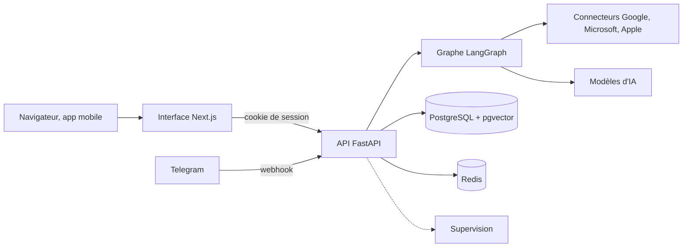
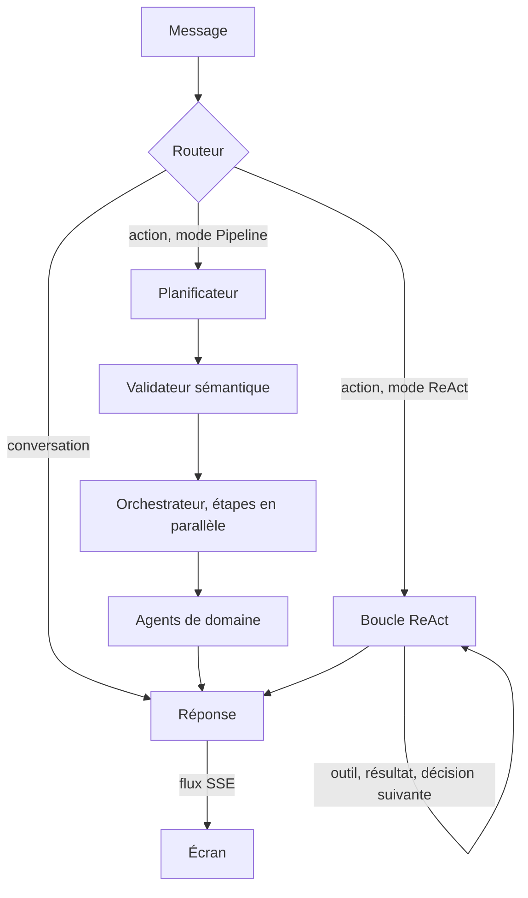
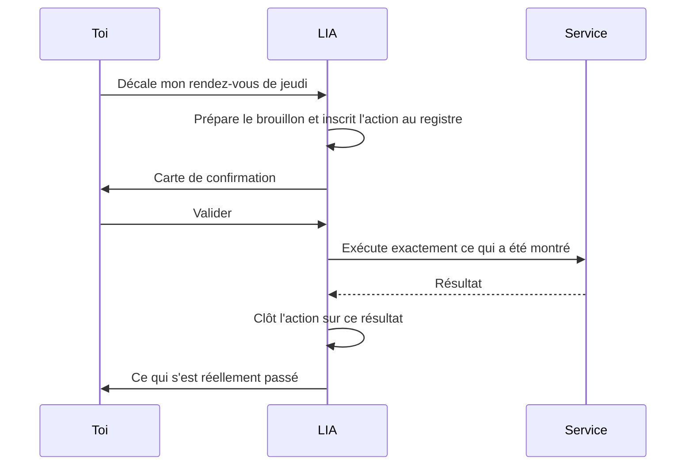
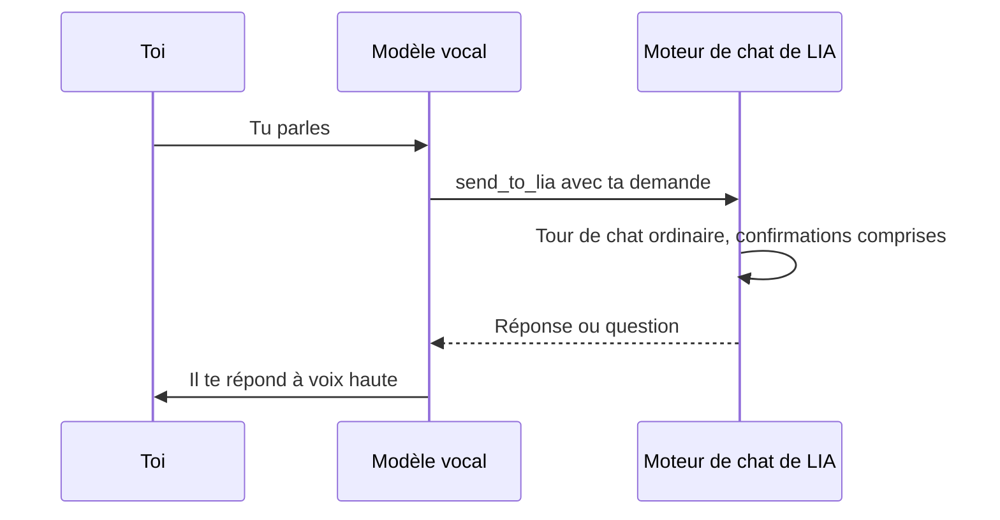

# LIA — Guide technique

> Comment LIA est construite, dans les grandes lignes. Le détail est dans le code, les ADR et la documentation du dépôt.

**Version** : 6.0
**Date** : 2026-10-23
**Application** : LIA v4.2.0
**Licence** : AGPL-3.0 (Open Source)

---

## Table des matières

1. [Vue d'ensemble](#1-vue-densemble)
2. [Un backend découpé par domaines](#2-un-backend-découpé-par-domaines)
3. [Le parcours d'un message](#3-le-parcours-dun-message)
4. [Agir avec prudence](#4-agir-avec-prudence)
5. [Mémoire et contexte](#5-mémoire-et-contexte)
6. [Les modèles](#6-les-modèles)
7. [Connecteurs et outils](#7-connecteurs-et-outils)
8. [Voix, mode Live et téléphone](#8-voix-mode-live-et-téléphone)
9. [L'initiative](#9-linitiative)
10. [Sécurité et vie privée](#10-sécurité-et-vie-privée)
11. [Observer et mesurer](#11-observer-et-mesurer)
12. [Les interfaces](#12-les-interfaces)
13. [Comment ce code est tenu](#13-comment-ce-code-est-tenu)
14. [Pour aller plus loin](#14-pour-aller-plus-loin)

---

## 1. Vue d'ensemble

J'ai conçu LIA pour qu'elle tourne chez toi, sur du matériel modeste. La plateforme de référence est un Raspberry Pi 5 (ARM64), et tout ce qui suit en découle : une seule machine, une base PostgreSQL et un Redis locaux, aucune base de données hébergée ailleurs. Les identifiants et les clés des fournisseurs sont stockés chiffrés.

Trois principes guident le reste. **La transparence** d'abord : l'observabilité fait partie de l'architecture dès le départ, et chaque token consommé est suivi avec son coût. **La défense en profondeur** ensuite : quotas, confirmations et garde-fous contre les hallucinations sont des couches indépendantes. **L'indépendance vis-à-vis des fournisseurs** enfin : chaque rôle du système peut être confié à un modèle différent, ce qui me protège d'une hausse de tarif comme d'une panne.

La pile est volontairement classique :

| Couche | Choix |
| --- | --- |
| Backend | Python 3.14, FastAPI, asynchrone de bout en bout |
| Orchestration des agents | LangGraph 1.x |
| Données | PostgreSQL avec pgvector : données, checkpoints du graphe et recherche vectorielle |
| Cache et coordination | Redis : cache, sessions, limites de débit, élection d'un leader |
| Frontend | Next.js 16 (App Router), React 19, TypeScript strict |
| Modèles | OpenAI, Anthropic, Google Gemini, DeepSeek, Perplexity, Qwen, et tout modèle local via Ollama |
| Journaux | JSON structuré, données personnelles filtrées |

Un modèle local tourne sans coût d'API, entièrement chez toi. L'API tourne en plusieurs workers ; une élection de leader dans Redis réserve les tâches planifiées à un seul d'entre eux. Chaque sous-système optionnel s'active par un drapeau, et la configuration suit une seule cascade : ce que l'administrateur règle dans l'application l'emporte sur l'environnement, qui l'emporte sur les constantes du code. J'ai voulu une seule cascade parce qu'une constante qui diverge en silence de la configuration réelle produit les bugs les plus difficiles à voir.

Un installateur guidé pose quelques questions, crée le compte administrateur sans écrire de secret en clair, vérifie que l'installation fonctionne vraiment et sait la reconfigurer plus tard sans redemander les clés ([installer LIA](/faq#faq-self_hosting)).

En ordres de grandeur : plus de 350 ADR, des centaines de métriques Prometheus, des dizaines de milliers de tests automatisés, une interface en six langues (français, anglais, allemand, espagnol, italien, chinois).

*Pour aller plus loin : [architecture générale](https://github.com/jgouviergmail/LIA-Assistant/blob/main/docs/ARCHITECTURE.md) · [auto-hébergement](https://github.com/jgouviergmail/LIA-Assistant/blob/main/docs/guides/GUIDE_SELF_HOSTING.md) · [fournisseurs de modèles](https://github.com/jgouviergmail/LIA-Assistant/blob/main/docs/technical/LLM_PROVIDERS.md) · [capacités administrables](https://github.com/jgouviergmail/LIA-Assistant/blob/main/docs/architecture/ADR-217-Capacites-Administrables.md)*

## 2. Un backend découpé par domaines

Le backend suit le Domain-Driven Design. Chaque domaine métier (agents, connecteurs, voix, mémoire, rappels, conversations…) est un contexte isolé dans `src/domains/`, découpé de la même façon : routeur, service, dépôt, modèle, schéma. À côté, un noyau transversal (`core`) porte la configuration et les règles communes, et une couche d'infrastructure partagée regroupe ce dont tous ont besoin : la fabrique de modèles, le cache, le client MCP, le navigateur, les limites de débit, le planificateur de tâches, l'observabilité.

J'ai choisi une architecture hexagonale pour les services extérieurs. Les outils ne connaissent que des protocoles Python (des ports), et les clients Google, Microsoft, Apple ou Philips Hue les réalisent (des adaptateurs). Ajouter un fournisseur ne touche donc pas au code qui l'appelle.

Le dépôt est un monorepo : `apps/api` pour le backend, `apps/web` pour l'interface, `infrastructure/` pour Docker et la supervision, `docs/` pour la documentation. Un administrateur qui change un modèle dans l'interface le voit pris en compte aussitôt, sans redéploiement, parce que la configuration vivante est en base.

*Pour aller plus loin : [créer un connecteur](https://github.com/jgouviergmail/LIA-Assistant/blob/main/docs/guides/GUIDE_CONNECTOR_IMPLEMENTATION.md) · [créer un agent](https://github.com/jgouviergmail/LIA-Assistant/blob/main/docs/guides/GUIDE_AGENT_CREATION.md) · [créer un outil](https://github.com/jgouviergmail/LIA-Assistant/blob/main/docs/guides/GUIDE_TOOL_CREATION.md) · [ajouter un canal](https://github.com/jgouviergmail/LIA-Assistant/blob/main/docs/templates/NEW_CHANNEL_CHECKLIST.md) · [ajouter un fournisseur de modèles](https://github.com/jgouviergmail/LIA-Assistant/blob/main/docs/technical/LLM_PROVIDER_CONSTRAINTS.md) · [ajouter une tâche proactive](https://github.com/jgouviergmail/LIA-Assistant/blob/main/docs/templates/NEW_PROACTIVE_TASK_CHECKLIST.md)*

## 3. Le parcours d'un message

J'ai choisi LangGraph pour orchestrer les agents parce qu'il apportait trois choses dont j'avais besoin : un état persisté en checkpoints dans PostgreSQL, des cycles, et `interrupt()`, qui permet de suspendre un tour pour demander une confirmation puis de le reprendre exactement là où il s'était arrêté. Sans ce mécanisme, il n'y a pas de confirmation humaine sérieuse.

Chaque message passe d'abord par un **routeur**, qui le classe en conversation simple ou en demande qui appelle une action. Une conversation va droit à la réponse. Une action suit le mode choisi dans l'en-tête du chat.

En mode **Pipeline**, le mode par défaut, le planificateur écrit avant toute exécution un `ExecutionPlan` : un plan en JSON dont les étapes sont reliées par leurs dépendances. Un second modèle, distinct du planificateur, valide ce plan, pour éviter qu'un modèle juge son propre travail. L'orchestrateur exécute ensuite les étapes par vagues parallèles. Le mode **ReAct** laisse au contraire le modèle appeler un outil, lire le résultat et décider de la suite, pas à pas.

J'ai gardé les deux parce qu'ils répondent à deux besoins. Le Pipeline planifie, parallélise, se contrôle et prévoit son coût : un appel au planificateur et un à la réponse, contre un appel par itération pour ReAct, soit 4 à 8 fois moins de tokens. ReAct s'adapte à chaque résultat, ce qui vaut mieux pour une recherche exploratoire ou une demande ambiguë. Les deux modes partagent le registre d'outils, les confirmations, le nœud de réponse et l'observabilité.

Le choix des domaines et des outils passe par un **routeur sémantique** à embeddings plutôt que par des mots-clés ou par le modèle seul : il coûte moins cher et se trompe moins. Chaque outil déclare un manifeste (paramètres, sorties, coût, permissions, mots-clés dans plusieurs langues) que lisent le planificateur, le routeur et le constructeur d'agents, et chaque agent se déclare une seule fois dans un registre central. Des Smart Services réduisent encore la consommation en mettant en cache l'analyse des requêtes et en apprenant les plans qui reviennent. Après un tour actionnable, un nœud d'initiative regarde, en lecture seule, ce que le résultat implique ailleurs : une pluie annoncée renvoie aux activités en extérieur de ton agenda.

Quelques règles tiennent l'ensemble honnête. Une demande sans intention d'agir ne peut pas produire un plan qui modifie quoi que ce soit, et c'est une règle déterministe, vérifiée avant tout appel au modèle. Un plan de modification qui épuise ses tentatives de correction n'est pas exécuté : LIA pose une question plutôt que d'écrire une donnée fausse. Un refus ou un échec n'est jamais présenté comme une action accomplie, et une fois le plan exécuté, rien n'est rejoué dans ton dos : la réponse dit chaque échec, quel outil, pourquoi, et le total exact. Pour un mode qui se corrige en cours de route, il y a ReAct.

La réponse arrive token par token en SSE. La génération est découplée de la connexion : un producteur détaché publie dans un flux Redis propre au tour, et la page n'en est qu'un abonné. Fermer l'onglet n'arrête donc rien, et la réponse t'attend.

*Pour aller plus loin : [les deux modes](https://github.com/jgouviergmail/LIA-Assistant/blob/main/docs/architecture/ADR-070-ReAct-Execution-Mode.md) · [le choix de LangGraph](https://github.com/jgouviergmail/LIA-Assistant/blob/main/docs/architecture/ADR-001-LangGraph-Orchestration.md) · [le graphe en détail](https://github.com/jgouviergmail/LIA-Assistant/blob/main/docs/ARCHITECTURE_LANGRAPH.md) · [le routeur](https://github.com/jgouviergmail/LIA-Assistant/blob/main/docs/technical/ROUTER.md) · [le plan et son exécution parallèle](https://github.com/jgouviergmail/LIA-Assistant/blob/main/docs/architecture/ADR-014-ExecutionPlan-Parallel-Executor.md) · [le planificateur et les opérations en masse](https://github.com/jgouviergmail/LIA-Assistant/blob/main/docs/technical/PLANNER.md) · [le routeur sémantique](https://github.com/jgouviergmail/LIA-Assistant/blob/main/docs/architecture/ADR-048-Semantic-Tool-Router.md) · [les manifestes d'outils](https://github.com/jgouviergmail/LIA-Assistant/blob/main/docs/architecture/ADR-019-Agent-Manifest-Catalogue-System.md) · [un échec du pipeline est dit, jamais rejoué](https://github.com/jgouviergmail/LIA-Assistant/blob/main/docs/architecture/ADR-346-Advisory-Replanner-Retired-A-Pipeline-Failure-Is-Said-Never-Replayed.md) · [la restitution des échecs d'outils](https://github.com/jgouviergmail/LIA-Assistant/blob/main/docs/architecture/ADR-303-Tool-Failure-Restitution.md) · [les tours qui survivent à l'onglet](https://github.com/jgouviergmail/LIA-Assistant/blob/main/docs/architecture/ADR-117-Background-Chat-Runs.md) · [le mode ReAct](https://github.com/jgouviergmail/LIA-Assistant/blob/main/docs/technical/REACT_EXECUTION_MODE.md)*

## 4. Agir avec prudence

LIA demande avant ce qui va réellement se produire : chaque brouillon (un e-mail, un événement, une suppression), chaque opération en masse qui modifie au moins un élément, chaque outil qui déclare devoir une confirmation. La confirmation se demande action par action, là où l'action se prépare, et non sur le plan entier. À l'inverse, une action que rien ne peut détourner ne demande rien : un e-mail que tu t'envoies à toi-même part directement.

Ce que tu confirmes est exactement le dernier contenu affiché, et chaque modification ne s'exécute qu'une fois. Plusieurs brouillons d'un même tour sont revus un par un. Tu peux répondre en langage libre : un modèle classe ta réponse en accord, refus ou demande de modification. Hors conversation, un ticket demande sa confirmation sur le ticket lui-même, et une routine qui tourne sans personne devant l'écran ne pose pas de question : elle refuse l'action et le dit, sinon ton message suivant passerait pour une réponse. Une commande donnée au chat (« passe mes réponses en cartes ») suit la même règle, et quand elle exige de connecter un compte, de saisir une clé ou de choisir un fichier, cette étape se fait dans le navigateur authentifié. LIA vérifie le résultat demandé sur ce qu'elle peut observer, mais une délégation à un outil ne prouve pas à elle seule tous ses effets internes. De même, un verrou empêche une double exécution sans pouvoir garantir qu'un fournisseur extérieur n'agira qu'une fois.

La réponse elle-même est encadrée : le modèle ne rédige qu'à partir des résultats réels des outils. Et tout ce que LIA fait est inscrit dans trois **registres** distincts : les actions, les consultations et les tours. Leurs totaux ne s'additionnent pas, puisqu'un tour peut consulter cinq sources sans rien changer. Une action est inscrite avant d'avoir lieu et close seulement sur un résultat explicite. Effacer une conversation retire les fichiers que tu y as envoyés, pas ceux que LIA a produits pour toi.

*Pour aller plus loin : [les confirmations](https://github.com/jgouviergmail/LIA-Assistant/blob/main/docs/technical/HITL.md) · [la chaîne d'autorité et les registres](https://github.com/jgouviergmail/LIA-Assistant/blob/main/docs/architecture/ADR-263-Execution-Authority-Chain-And-Effect-Register.md) · [les registres côté utilisateur](/faq#faq-registers) · [les tickets](https://github.com/jgouviergmail/LIA-Assistant/blob/main/docs/technical/WORKBOARD.md) · [les commandes applicatives](https://github.com/jgouviergmail/LIA-Assistant/blob/main/docs/technical/APPLICATION_COMMANDS.md) · [ce qu'une délégation prouve](https://github.com/jgouviergmail/LIA-Assistant/blob/main/docs/architecture/ADR-336-Requested-Outcomes-Checked-Against-Canonical-Observations.md) · [exemples d'outils, e-mail à soi et brouillons](https://github.com/jgouviergmail/LIA-Assistant/blob/main/docs/knowledge/05_tool_examples.md) · [la synthèse de la réponse](https://github.com/jgouviergmail/LIA-Assistant/blob/main/docs/technical/RESPONSE.md)*

## 5. Mémoire et contexte

L'état d'une conversation est un `MessagesState` que LangGraph checkpointe dans PostgreSQL après chaque nœud. C'est ce qui permet de reprendre un tour après une confirmation, même des heures plus tard. Les résultats des outils ne vivent pas dans l'historique des messages mais dans un registre de données à part, si bien qu'ils survivent quand l'historique est tronqué. Au-delà d'un seuil, les anciens échanges sont résumés ; une pastille montre le remplissage du contexte, et `/resume` déclenche ce résumé à la demande. En mode ReAct, ce qu'une boucle a déjà lu est checkpointé et réutilisé dans le tour ; un arrêt avant ce checkpoint peut faire relire une source.

La mémoire long terme, les espaces de connaissances et le contexte des outils vivent dans la même base, avec pgvector. Après chaque échange, une tâche de fond extrait les souvenirs du dernier message ; les souvenirs proches de la question reviennent dans le contexte suivant, et la mémoire est aussi un outil que le planificateur et ReAct consultent. Une consigne durable (« réponds plus court ») est épinglée et visible. Quand un sujet sensible est touché, une directive interdit de plaisanter ou de minimiser.

Autour de cette mémoire, j'ai ajouté plusieurs couches. Les **journaux** sont les carnets de LIA, à la première personne ; un portrait de la personne s'en dégage, avec les sources qui l'ont nourri, et ne se corrige que par des leviers indirects. Le **Psyche Engine** donne à LIA un état psychologique qui évolue à chaque échange et transparaît dans son style sans être annoncé ; il apprend aussi, domaine par domaine, où elle est fiable, à partir de preuves ; c'est un pilote, sans gain revendiqué pour l'instant. Il a une limite assumée : il ne rapporte presque jamais une émotion calme et peu intense, et cette part de son activation reste verrouillée. Les **centres d'intérêt** sont détectés dans tes requêtes et nourris par plusieurs sources. Les **habitudes**, enfin, sont apprises sans modèle entraîné, par des tests statistiques, et j'avais trois raisons, chacune suffisante : un Raspberry Pi n'a pas de budget d'entraînement, une formule se publie à la personne qu'elle concerne, et sur des volumes aussi petits un modèle apprendrait surtout le bruit.

*Pour aller plus loin : [les checkpoints](https://github.com/jgouviergmail/LIA-Assistant/blob/main/docs/architecture/ADR-022-LangGraph-State-Checkpointing.md) · [le registre de données](https://github.com/jgouviergmail/LIA-Assistant/blob/main/docs/architecture/ADR-012-Data-Registry-StandardToolOutput-Pattern.md) · [la compaction](https://github.com/jgouviergmail/LIA-Assistant/blob/main/docs/technical/COMPACTION_v2.md) · [les lectures checkpointées de ReAct](https://github.com/jgouviergmail/LIA-Assistant/blob/main/docs/architecture/ADR-337-Checkpointed-ReAct-Read-Segments-And-Turn-Local-Reuse.md) · [la mémoire dans PostgreSQL](https://github.com/jgouviergmail/LIA-Assistant/blob/main/docs/architecture/ADR-066-Memory-PostgreSQL-Migration.md) · [la mémoire long terme](https://github.com/jgouviergmail/LIA-Assistant/blob/main/docs/technical/LONG_TERM_MEMORY.md) · [la mémoire comme outil de recherche](https://github.com/jgouviergmail/LIA-Assistant/blob/main/docs/architecture/ADR-313-Long-Term-Memory-As-An-Active-Lookup.md) · [les règles durables](https://github.com/jgouviergmail/LIA-Assistant/blob/main/docs/architecture/ADR-236-procedural-memory.md) · [les journaux et le portrait](https://github.com/jgouviergmail/LIA-Assistant/blob/main/docs/technical/JOURNALS.md) · [le Psyche Engine](https://github.com/jgouviergmail/LIA-Assistant/blob/main/docs/technical/PSYCHE_ENGINE.md) · [sa limite mesurée](https://github.com/jgouviergmail/LIA-Assistant/blob/main/docs/architecture/ADR-142-Psyche-Observability-And-Dominance-Recentering.md) · [la psyché côté utilisateur](https://github.com/jgouviergmail/LIA-Assistant/blob/main/docs/knowledge/22_psyche.md) · [l'efficacité apprise sur preuves](https://github.com/jgouviergmail/LIA-Assistant/blob/main/docs/architecture/ADR-348-Efficacy-Learned-From-Evidence-Results-And-Usefulness-Kept-Apart.md) · [les centres d'intérêt](https://github.com/jgouviergmail/LIA-Assistant/blob/main/docs/technical/INTERESTS.md) · [les habitudes](https://github.com/jgouviergmail/LIA-Assistant/blob/main/docs/knowledge/28_habits.md) · [la recherche dans les journaux et les registres](https://github.com/jgouviergmail/LIA-Assistant/blob/main/docs/architecture/ADR-318-Assistant-Tools-Exact-Answers-And-Own-Records.md)*

## 6. Les modèles

Une fabrique unique instancie le modèle de n'importe quel fournisseur pris en charge et lui applique son adaptateur. Chaque rôle a son emplacement de modèle (la conversation, la planification, l'image, la transcription, la synthèse vocale…), réglé dans l'administration sans redéploiement. Le catalogue des modèles vit en base et déclare, modèle par modèle, ses capacités, les paramètres qu'il accepte et l'échelle de réflexion qu'il connaît ; l'écran de configuration n'offre ainsi que ce que l'API du modèle accepte vraiment.

Certaines tâches ne sont pas des générations mais des décisions bornées : choisir un format, qualifier un e-mail. Elles peuvent être confiées à un moteur de décision natif, chacune derrière son propre interrupteur et un interrupteur général. Une décision incertaine retombe sur le traitement habituel, et ni les droits ni les confirmations ne lui sont délégués. Un avis de qualification n'authentifie aucun expéditeur, et un gain mesuré sur un corpus de test ne vaut pas promesse pour chaque demande.

Chaque appel à un modèle, dans le pipeline comme dans les tâches de fond, est suivi et valorisé à partir des tarifs en base, puis regroupé par tour. Pour le coût, la principale économie vient du cache des fournisseurs. Chaque prompt place son contenu stable avant un marqueur et le contenu propre à la requête après, et l'infrastructure traduit ce marqueur dans le mécanisme de cache de chaque fournisseur. Comme chaque emplacement peut changer de modèle, je ne règle pas ce cache pour un modèle en particulier : je vise la meilleure moyenne, et un modèle sans cache ne paie rien de plus. Les études menées sur d'autres moteurs locaux (oMLX, llama.cpp, LM Studio) sont des qualifications, pas des intégrations livrées : seuls comptent les fournisseurs que l'instance propose.

*Pour aller plus loin : [la sélection des modèles](https://github.com/jgouviergmail/LIA-Assistant/blob/main/docs/architecture/ADR-026-LLM-Model-Selection-Strategy.md) · [le catalogue en base](https://github.com/jgouviergmail/LIA-Assistant/blob/main/docs/architecture/ADR-078-LLM-Catalogue-DB-Source-Of-Truth.md) · [l'écran de configuration](https://github.com/jgouviergmail/LIA-Assistant/blob/main/docs/technical/LLM_CONFIG_ADMIN.md) · [les décisions natives](https://github.com/jgouviergmail/LIA-Assistant/blob/main/docs/architecture/ADR-325-JEV-Bounded-Decisions-With-Hot-Switches-And-Accounted-Fallbacks.md) · [leur intégration](https://github.com/jgouviergmail/LIA-Assistant/blob/main/docs/technical/JEV_INTEGRATION.md) · [la qualification des e-mails](https://github.com/jgouviergmail/LIA-Assistant/blob/main/docs/technical/EMAIL_EVENT_CLASSIFICATION.md) · [une mise en page pour tous les caches](https://github.com/jgouviergmail/LIA-Assistant/blob/main/docs/architecture/ADR-309-One-Prompt-Layout-For-Every-Cache-Mechanism.md) · [le filtrage du catalogue d'outils](https://github.com/jgouviergmail/LIA-Assistant/blob/main/docs/architecture/ADR-003-Multi-Domain-Dynamic-Filtering.md) · [les moteurs locaux étudiés](https://github.com/jgouviergmail/LIA-Assistant/blob/main/docs/knowledge/16_other.md)*

## 7. Connecteurs et outils

Chaque catégorie de connecteurs (e-mail, agenda, contacts, tâches, fichiers, maison) est un protocole Python. Un seul fournisseur est actif à la fois par catégorie, et le consentement OAuth se donne une fois par compte Google ou Microsoft. Les services qui ne demandent rien à la personne (Wikipédia, la lecture de pages, les lieux, la météo) appartiennent à l'instance et sont actifs pour tous. Côté e-mail, chaque message se résume une fois puis se réutilise, une pièce jointe se lit en texte ou par un modèle de vision, et un envoi n'est jamais retenté après un accusé de réception perdu.

Les outils reposent sur cinq couches composables : une base commune de connecteur (OAuth, cache, injection), un décorateur, des formateurs par domaine, le manifeste lu par le planificateur et un chargeur de catalogue. Les outils **MCP** sont convertis en outils LangChain ordinaires et entrent dans le même catalogue, gardé d'un message à l'autre pour qu'un message n'attende en général aucun serveur ; un serveur MCP doit être en HTTPS, ses identifiants sont chiffrés, et LIA croit une annotation qui annonce une modification, jamais une qui prétend à la seule lecture. Les **plugins** au format Agent Plugins s'installent d'un bloc, sans serveur local. Les **skills** au standard agentskills.io peuvent rendre une petite application dans le chat ou exécuter leurs propres commandes dans une copie de leur dossier ; une skill venue d'ailleurs tourne isolée et ne reçoit jamais le jeton d'un connecteur.

Quand une étape demande un vrai calcul, le mode ReAct peut écrire un court script Python et l'exécuter dans un conteneur jetable. Ce script n'atteint le web que par un proxy unique, ne voit pas la clé de la personne (le proxy la substitue sur le seul hôte autorisé), et un hôte inconnu est demandé avec trois réponses possibles. Dans les deux modes, les calculs, les durées et les conversions de devises passent par des outils exacts plutôt que par le modèle. Un agent sait aussi piloter un navigateur (Playwright) ou convertir une page en texte.

Les documents des **espaces de connaissances** sont découpés, vectorisés et rangés dans PostgreSQL plutôt que dans une base vectorielle externe, puis retrouvés par une recherche hybride, sémantique et lexicale. Un espace peut suivre un dossier Drive avec ses sous-dossiers ou un libellé Gmail, sans indexer toute la boîte. Il n'y a pas de reconnaissance de caractères : un PDF scanné n'est pas indexé tel quel. Les données envoyées de l'extérieur (SMS, nombre de pas, fréquence cardiaque, depuis un iPhone, un Android ou tout système capable d'envoyer du JSON) entrent par des points d'accès authentifiés par un jeton à portée limitée et révocable, distinct de la session.

Pour une tâche complexe, LIA délègue à des sous-agents éphémères, en lecture seule. Elle produit aussi des fichiers : documents, images, captures, rangés dans une galerie, gardés, envoyés par e-mail ou, pour une image, partagés avec une personne connectée à l'instance.

*Pour aller plus loin : [les patterns de connecteurs](https://github.com/jgouviergmail/LIA-Assistant/blob/main/docs/technical/CONNECTORS_PATTERNS.md) · [le consentement OAuth groupé](https://github.com/jgouviergmail/LIA-Assistant/blob/main/docs/architecture/ADR-302-OAuth-Grant-Par-Compte-Et-Consentement-Groupe.md) · [les services de l'instance](https://github.com/jgouviergmail/LIA-Assistant/blob/main/docs/architecture/ADR-307-Keyless-Connectors-Belong-To-The-Instance.md) · [les connecteurs côté utilisateur](/faq#faq-connectors) · [les e-mails et leurs résumés](https://github.com/jgouviergmail/LIA-Assistant/blob/main/docs/architecture/ADR-287-Email-Content-First-Detail-Levels-Digests-And-Neutral-Message.md) · [les pièces jointes](https://github.com/jgouviergmail/LIA-Assistant/blob/main/docs/architecture/ADR-296-Mail-Attachments-Read-By-Text-Or-Vision.md) · [les délais par emplacement](https://github.com/jgouviergmail/LIA-Assistant/blob/main/docs/architecture/ADR-221-Timeout-Par-Emplacement-Applique.md) · [la base des outils](https://github.com/jgouviergmail/LIA-Assistant/blob/main/docs/architecture/ADR-015-ConnectorTool-Base-Class-Pattern.md) · [MCP](https://github.com/jgouviergmail/LIA-Assistant/blob/main/docs/technical/MCP_INTEGRATION.md) · [le standard Agent Plugins](https://github.com/jgouviergmail/LIA-Assistant/blob/main/docs/architecture/ADR-225-Standard-Agent-Plugins-v1.md) · [les plugins](https://github.com/jgouviergmail/LIA-Assistant/blob/main/docs/technical/PLUGINS_INTEGRATION.md) · [les skills](https://github.com/jgouviergmail/LIA-Assistant/blob/main/docs/technical/SKILLS_INTEGRATION.md) · [les skills côté utilisateur](https://github.com/jgouviergmail/LIA-Assistant/blob/main/docs/knowledge/12_skills.md) · [les skills tierces](https://github.com/jgouviergmail/LIA-Assistant/blob/main/docs/architecture/ADR-327-Skill-Library-And-Third-Party-Skills.md) · [modifier une skill](https://github.com/jgouviergmail/LIA-Assistant/blob/main/docs/architecture/ADR-165-Skill-Editing-By-Regeneration.md) · [partager une capacité](https://github.com/jgouviergmail/LIA-Assistant/blob/main/docs/technical/PEER_CAPABILITY_TRANSFERS.md) · [le Python éphémère](https://github.com/jgouviergmail/LIA-Assistant/blob/main/docs/architecture/ADR-249-Ephemeral-Python-In-The-Existing-Sandbox.md) · [la sortie réseau du bac à sable](https://github.com/jgouviergmail/LIA-Assistant/blob/main/docs/architecture/ADR-298-Sandbox-Egress-Toolbox.md) · [les réponses calculées](https://github.com/jgouviergmail/LIA-Assistant/blob/main/docs/knowledge/35_computed_answers.md) · [le navigateur](https://github.com/jgouviergmail/LIA-Assistant/blob/main/docs/technical/BROWSER_CONTROL.md) · [la lecture de pages](https://github.com/jgouviergmail/LIA-Assistant/blob/main/docs/technical/WEB_FETCH.md) · [les espaces de connaissances](https://github.com/jgouviergmail/LIA-Assistant/blob/main/docs/architecture/ADR-055-RAG-Spaces-Architecture.md) · [leur guide](https://github.com/jgouviergmail/LIA-Assistant/blob/main/docs/guides/GUIDE_RAG_SPACES.md) · [leur usage](https://github.com/jgouviergmail/LIA-Assistant/blob/main/docs/knowledge/14_rag_spaces.md) · [un dossier Drive est un arbre](https://github.com/jgouviergmail/LIA-Assistant/blob/main/docs/architecture/ADR-297-Drive-Folder-Is-A-Tree-And-The-Count-Is-Exact.md) · [un libellé Gmail comme source](https://github.com/jgouviergmail/LIA-Assistant/blob/main/docs/architecture/ADR-262-Opt-In-Mail-Label-RAG-Source.md) · [la FAQ intégrée](https://github.com/jgouviergmail/LIA-Assistant/blob/main/docs/architecture/ADR-058-System-RAG-Spaces.md) · [joindre un document d'un espace](https://github.com/jgouviergmail/LIA-Assistant/blob/main/docs/architecture/ADR-295-Knowledge-Documents-As-Message-Attachments.md) · [les sous-agents](https://github.com/jgouviergmail/LIA-Assistant/blob/main/docs/knowledge/13_sub_agents.md) · [les données de santé](https://github.com/jgouviergmail/LIA-Assistant/blob/main/docs/technical/HEALTH_METRICS.md) · [leur ingestion](https://github.com/jgouviergmail/LIA-Assistant/blob/main/docs/architecture/ADR-076-Health-Metrics-Ingestion.md) · [la santé côté utilisateur](https://github.com/jgouviergmail/LIA-Assistant/blob/main/docs/knowledge/23_health_metrics.md) · [les SMS](https://github.com/jgouviergmail/LIA-Assistant/blob/main/docs/technical/SMS_INGESTION.md) · [la génération de documents](https://github.com/jgouviergmail/LIA-Assistant/blob/main/docs/technical/DOCUMENT_GENERATION.md) · [les documents côté utilisateur](https://github.com/jgouviergmail/LIA-Assistant/blob/main/docs/knowledge/32_document_generation.md) · [les images](https://github.com/jgouviergmail/LIA-Assistant/blob/main/docs/knowledge/21_image_generation.md) · [les fichiers générés](https://github.com/jgouviergmail/LIA-Assistant/blob/main/docs/knowledge/39_generated_files.md) · [garder un fichier](https://github.com/jgouviergmail/LIA-Assistant/blob/main/docs/architecture/ADR-319-A-Generated-File-Can-Be-Kept.md) · [envoyer par e-mail](https://github.com/jgouviergmail/LIA-Assistant/blob/main/docs/architecture/ADR-321-A-File-Or-An-Answer-Sent-By-E-Mail.md) · [les pièces jointes du composeur](https://github.com/jgouviergmail/LIA-Assistant/blob/main/docs/technical/ATTACHMENTS_INTEGRATION.md) · [les réponses gardées](https://github.com/jgouviergmail/LIA-Assistant/blob/main/docs/knowledge/40_bookmarks.md)*

## 8. Voix, mode Live et téléphone

La voix classique est faite de briques indépendantes. Le mot d'activation « Dis LIA » est détecté dans le navigateur et n'envoie rien avant d'être entendu ; seul le modèle français est livré pour l'instant, en bêta. La dictée est transcrite dans la langue du compte, sur le serveur et hors ligne avec Whisper, ou par un moteur distant selon le réglage. La synthèse vocale a plusieurs fournisseurs, Edge gratuit par défaut, et la réponse commence à se lire phrase par phrase pendant que la suite s'écrit. Un avatar parlant expérimental peut s'y ajouter, sur la clé Simli de la personne, qui facture aussi les silences tant que la connexion reste ouverte.

Le **mode Live** est une vraie conversation de parole à parole. J'y ai mis deux intelligences et une seule couture : le modèle vocal tient la conversation, et chaque demande de donnée ou d'action passe au moteur du chat par une seule fonction, `send_to_lia`. La demande devient un tour de chat ordinaire, avec ses confirmations, ses registres et ses quotas. La voix ne possède ni outil, ni identifiant, ni mémoire à elle.

Une session Live s'endort au lieu de mourir : pendant la veille, la connexion au fournisseur est fermée et rien ne se facture. La dépense du fournisseur Live est payée par la clé de la personne et n'est jamais enregistrée par LIA. En Live direct, la voix lit elle-même tes données sans rien modifier.

Le **téléphone** reprend les mêmes deux modes. LIA peut appeler un tiers pour toi après confirmation, ou t'appeler toi sur un numéro vérifié, et tu as alors au téléphone tes données et toutes ses fonctions, comme dans le chat. Quand LIA appelle un tiers, l'agent d'appel n'a qu'un outil libre/occupé en lecture seule : la protection de ton agenda est structurelle, elle ne dépend pas d'une consigne dans un prompt. Au téléphone, le mode Live n'existe que si le fournisseur peut joindre ton instance.

Une réunion s'enregistre depuis le navigateur : l'audio part en petits segments, puis il est transcrit et résumé en un compte rendu structuré, rangé dans un espace de connaissances. La radio personnelle, enfin, ne produit que pendant une session d'écoute et ne garde rien pour une réécoute.

*Pour aller plus loin : [la voix côté utilisateur](/faq#faq-voice_mode) · [la veille Live et le mot d'activation](https://github.com/jgouviergmail/LIA-Assistant/blob/main/docs/architecture/ADR-329-Live-Standby-And-Multilingual-Wake-Word.md) · [les voix et la synthèse](https://github.com/jgouviergmail/LIA-Assistant/blob/main/docs/architecture/ADR-345-Fish-Audio-Served-Whole-One-Door-One-Allowance-Cues-Each-Engine-Reads.md) · [l'avatar parlant](https://github.com/jgouviergmail/LIA-Assistant/blob/main/docs/technical/SPEAKING_AVATAR.md) · [le mode Live](https://github.com/jgouviergmail/LIA-Assistant/blob/main/docs/architecture/ADR-299-Live-Voice-Mode-Two-Intelligences-One-Seam.md) · [la téléphonie côté utilisateur](/faq#faq-telephony) · [le téléphone comme canal](https://github.com/jgouviergmail/LIA-Assistant/blob/main/docs/architecture/ADR-290-Phone-As-A-Channel-Owner-Calls.md) · [la radio](/faq#faq-radio) · [les réunions](https://github.com/jgouviergmail/LIA-Assistant/blob/main/docs/technical/MEETINGS.md) · [le compte rendu structuré](https://github.com/jgouviergmail/LIA-Assistant/blob/main/docs/architecture/ADR-258-Meeting-Recording-And-Structured-Minutes.md) · [les modèles de compte rendu](https://github.com/jgouviergmail/LIA-Assistant/blob/main/docs/architecture/ADR-259-Meeting-Template-Library-And-Reformatting.md)*

## 9. L'initiative

LIA prend des initiatives sous trois formes. Un **heartbeat** périodique regarde tes sources et ne t'écrit que si un signal le justifie, en nommant un ou deux faits vérifiés. Être connecté à une source et accepter d'être interrompu par elle sont deux décisions séparées. Une notification push de Google peut réveiller ce heartbeat pour une seule personne, et un **moment** (la fin d'une réunion, l'arrivée d'un courrier attendu) est servi à la minute plutôt qu'au passage suivant. Les **discussions proactives**, enfin, appellent une réponse, avec leur propre politique : heures, maximum par jour, sujets sensibles gardés privés, dépense réservée avant d'avoir lieu.

Les **routines** se déclenchent sur un calendrier ou sur une condition, pas les deux, et une vue de la semaine montre ce qui s'est réellement passé. Un rappel peut se répéter. Le **tableau de tickets** donne à une tâche un cycle de vie, un porteur et un résultat.

Deux règles bornent tout cela. L'initiative ne fait que lire : une écriture est proposée, jamais exécutée d'elle-même. Et une nouvelle tentative d'une même exécution est refusée dès que le registre des effets montre l'action déjà faite. La page Activité montre au même endroit tout ce que LIA a entrepris seule, avec des totaux exacts.

*Pour aller plus loin : [le heartbeat](https://github.com/jgouviergmail/LIA-Assistant/blob/main/docs/technical/HEARTBEAT_AUTONOME.md) · [la permission d'interrompre](https://github.com/jgouviergmail/LIA-Assistant/blob/main/docs/architecture/ADR-197-Interrupt-Permission-Is-Not-Connection.md) · [le réveil par push](https://github.com/jgouviergmail/LIA-Assistant/blob/main/docs/architecture/ADR-261-Push-Driven-Heartbeat-Wake-And-Incremental-Drive-Sync.md) · [les moments et les veilles](https://github.com/jgouviergmail/LIA-Assistant/blob/main/docs/architecture/ADR-281-Anticipated-Moments-And-Mail-Watches.md) · [les discussions proactives](https://github.com/jgouviergmail/LIA-Assistant/blob/main/docs/technical/PROACTIVE_DISCUSSIONS.md) · [leur livraison](https://github.com/jgouviergmail/LIA-Assistant/blob/main/docs/architecture/ADR-358-Independent-Proactive-Discussions-And-Native-Delivery.md) · [leur contexte](https://github.com/jgouviergmail/LIA-Assistant/blob/main/docs/architecture/ADR-359-Longitudinal-Discussion-Context-And-User-Control.md) · [leur budget](https://github.com/jgouviergmail/LIA-Assistant/blob/main/docs/architecture/ADR-360-Bounded-Discussion-Research-And-Accounted-Abstention.md) · [les routines](https://github.com/jgouviergmail/LIA-Assistant/blob/main/docs/knowledge/10_scheduled_actions.md) · [la semaine des routines](https://github.com/jgouviergmail/LIA-Assistant/blob/main/docs/architecture/ADR-265-Routine-Week-Timeline-And-Run-History.md) · [les rappels](https://github.com/jgouviergmail/LIA-Assistant/blob/main/docs/knowledge/07_reminders.md) · [un rappel qui a toujours un texte](https://github.com/jgouviergmail/LIA-Assistant/blob/main/docs/architecture/ADR-285-Short-Answer-Without-Reasoning-And-One-Family-Declaration.md) · [l'initiative en lecture seule](https://github.com/jgouviergmail/LIA-Assistant/blob/main/docs/architecture/ADR-062-Agent-Initiative-Phase.md) · [le tableau de tickets](https://github.com/jgouviergmail/LIA-Assistant/blob/main/docs/architecture/ADR-276-Workboard.md) · [la page Activité](https://github.com/jgouviergmail/LIA-Assistant/blob/main/docs/architecture/ADR-234-activity-timeline.md) · [noter une notification](https://github.com/jgouviergmail/LIA-Assistant/blob/main/docs/knowledge/09_proactive_notifications.md)*

## 10. Sécurité et vie privée

La sécurité est pensée en couches indépendantes, chaque type d'attaque ayant sa propre protection. Les comptes se connectent par OAuth 2.1 et les droits suivent des rôles. Pour les sessions, j'ai choisi le pattern BFF : un cookie HTTP-only et une session dans Redis plutôt qu'un jeton JWT, qui serait exposé au XSS s'il vivait dans le navigateur, lourd à transporter et impossible à révoquer. Un compte peut se protéger par des passkeys et un second facteur, chaque appareil connecté se révoque, et rattacher une identité Google ne change jamais le statut d'un compte. Les limites d'usage s'appliquent à toutes les portes, routines comprises.

Tout ce qui s'exécute pour la personne est traité comme hostile : le code des skills tourne dans un conteneur jetable, et une tâche sur un serveur distant est préparée puis confirmée. De même, ce que LIA lit reste une donnée et ne devient pas une consigne. La provenance est une propriété de la donnée : chaque type de contenu est classé une fois, un type inconnu est traité comme extérieur, et un type que personne n'a classé empêche l'application de démarrer.

Au-dessus du niveau debug, une ligne de journal porte des faits (des nombres, des identifiants, des codes, l'hôte d'une adresse), pas ce que tu as écrit ni ce qu'un modèle a écrit à ton sujet. Deux réserves : le message d'erreur d'un service extérieur dans un format inconnu peut encore en citer un fragment, et le niveau debug, coupé en production, en garde davantage. La base est sauvegardée automatiquement : au plus une journée de données peut être perdue avec les réglages par défaut. La copie hors site et les pièces jointes restent hors de ces sauvegardes.

Deux limites sont à connaître. Ces mesures ne démontrent pas à elles seules la conformité RGPD d'un déploiement. Et supprimer des mesures brutes, comme tes données de santé, ne supprime pas les souvenirs qui en dérivent, qui ont leurs propres contrôles.

*Pour aller plus loin : [la sécurité](https://github.com/jgouviergmail/LIA-Assistant/blob/main/docs/technical/SECURITY.md) · [l'authentification BFF](https://github.com/jgouviergmail/LIA-Assistant/blob/main/docs/architecture/ADR-002-BFF-Pattern-Authentication.md) · [les passkeys](https://github.com/jgouviergmail/LIA-Assistant/blob/main/docs/architecture/ADR-143-Strong-Authentication-Passkeys.md) · [les appareils](https://github.com/jgouviergmail/LIA-Assistant/blob/main/docs/architecture/ADR-144-Device-Sessions.md) · [les limites d'usage](https://github.com/jgouviergmail/LIA-Assistant/blob/main/docs/technical/USAGE_LIMITS.md) · [le bac à sable](https://github.com/jgouviergmail/LIA-Assistant/blob/main/docs/architecture/ADR-149-Security-Remediation-Wave-1.md) · [la provenance des contenus](https://github.com/jgouviergmail/LIA-Assistant/blob/main/docs/architecture/ADR-167-Content-Trust-Registry.md) · [la vie privée côté utilisateur](/faq#faq-privacy) · [des journaux sans données personnelles](https://github.com/jgouviergmail/LIA-Assistant/blob/main/docs/technical/PII_LOGGING_SECURITY.md) · [une ligne de journal porte des faits](https://github.com/jgouviergmail/LIA-Assistant/blob/main/docs/architecture/ADR-317-A-Log-Line-Carries-Facts-Never-The-Words.md) · [les sauvegardes](https://github.com/jgouviergmail/LIA-Assistant/blob/main/docs/architecture/ADR-109-PostgreSQL-Backup-Strategy.md) · [la provenance d'un souvenir](https://github.com/jgouviergmail/LIA-Assistant/blob/main/docs/architecture/ADR-201-Provenance-Is-A-Bounded-Reference.md)*

## 11. Observer et mesurer

La supervision est embarquée dans le déploiement : Prometheus et Grafana pour les métriques, Loki pour les journaux, Tempo pour les traces, Langfuse pour les appels aux modèles, Alertmanager pour les alertes. Le code définit des centaines de métriques, une trentaine de tableaux de bord sont livrés prêts à l'emploi, et l'émission des métriques est défensive : une métrique qui échoue ne fait pas tomber une requête.

J'ai aussi mis le débogage dans l'interface, parce qu'un agent est difficile à déboguer : le panneau de debug montre pour chaque échange l'intention, le plan, chaque outil et chaque appel au modèle, et on voit pourquoi une requête a coûté cher ou pourquoi tel domaine a été choisi sans ouvrir Grafana.

Côté coûts, chaque euro que la plateforme paie pour une personne est tracé, affiché, attribué et compté pour elle, quelle que soit la façon dont il a été dépensé. Un plafond de dépense de l'instance existe à côté des quotas par compte, parce que plusieurs comptes multipliés par leur quota restent une dépense sans borne. Un exploitant coupe une capacité sans redéployer : ce que le déploiement autorise et ce que l'opérateur choisit se composent, et la plus petite des deux bornes l'emporte.

LIA lit aussi sa propre télémétrie pour s'auto-diagnostiquer : chaque alerte vitale est envoyée par e-mail avec sa procédure et devient un incident, et ses recommandations restent des propositions. Un administrateur peut même piloter Claude Code CLI depuis le chat pour examiner son serveur.

Une précision sur la performance : les latences mesurées sont celles de l'infrastructure. Le temps de réponse que tu ressens dépend surtout de la suite d'appels aux modèles, de quelques secondes à plusieurs dizaines selon la demande et le matériel. Et la montée en charge au-delà d'une seule machine (plusieurs nœuds, réplicas, Redis en cluster) reste une évolution possible, pas une réalité. Deux questions restent ouvertes : la croissance de la mémoire d'un worker sur plusieurs jours et la conservation des points de reprise de LangGraph.

*Pour aller plus loin : [la pile d'observabilité](https://github.com/jgouviergmail/LIA-Assistant/blob/main/docs/architecture/ADR-020-Observability-Stack.md) · [le panneau de debug](https://github.com/jgouviergmail/LIA-Assistant/blob/main/docs/technical/DEBUG_PANEL.md) · [son architecture](https://github.com/jgouviergmail/LIA-Assistant/blob/main/docs/technical/DEBUG_PANEL_ARCHITECTURE.md) · [le plafond de l'instance](https://github.com/jgouviergmail/LIA-Assistant/blob/main/docs/architecture/ADR-216-Plafond-De-Depense-D-Instance.md) · [chaque dépense répond à deux plafonds](https://github.com/jgouviergmail/LIA-Assistant/blob/main/docs/architecture/ADR-272-Every-Platform-Paid-Token-Answers-To-Both-Ceilings.md) · [l'administration par classeur](https://github.com/jgouviergmail/LIA-Assistant/blob/main/docs/technical/TABULAR_ADMIN_IO.md) · [les annonces ciblées](https://github.com/jgouviergmail/LIA-Assistant/blob/main/docs/architecture/ADR-312-A-Broadcast-Says-Who-It-Was-Addressed-To.md) · [l'instance de démonstration](https://github.com/jgouviergmail/LIA-Assistant/blob/main/docs/technical/DEMO_INSTANCE.md) · [l'auto-diagnostic](https://github.com/jgouviergmail/LIA-Assistant/blob/main/docs/technical/DIAGNOSTICS_DOMAIN.md) · [les alertes et leur résilience](https://github.com/jgouviergmail/LIA-Assistant/blob/main/docs/architecture/ADR-247-Self-Diagnostics-And-Answer-Resilience.md) · [Claude CLI depuis le chat](https://github.com/jgouviergmail/LIA-Assistant/blob/main/docs/guides/GUIDE_DEVOPS_CLAUDE_CLI.md) · [l'anatomie d'un worker](https://github.com/jgouviergmail/LIA-Assistant/blob/main/docs/architecture/ADR-283-Worker-Memory-Anatomy.md) · [les extractions complètes des registres](https://github.com/jgouviergmail/LIA-Assistant/blob/main/docs/architecture/ADR-273-Complete-Register-Extractions.md) · [l'organisation des tâches de fond](https://github.com/jgouviergmail/LIA-Assistant/blob/main/docs/architecture/ADR-046-Background-Job-Scheduling.md)*

## 12. Les interfaces

L'interface web est une application Next.js qui s'installe comme une application (PWA). Le chat met à jour la conversation sans rechargement, rend les formules mathématiques et le code coloré, garde un brouillon par compte, et se cherche ; les réglages ont leur propre recherche, un thème noir absolu pour les écrans OLED et une taille de texte réglable.

Dans l'affichage en cartes, l'un des trois modes au choix avec le HTML simple et le Markdown, une réponse porteuse de données n'est pas mise en forme par le modèle : le serveur la rend en **cartes** HTML déterministes, indépendantes du modèle et du mode, archivées avec le message. Une carte montre un fait reçu en entier et n'invente rien, et une action depuis une carte prépare une demande au lieu d'agir. Pour garder l'interface cohérente, j'ai écrit des règles que des tests vérifient : un statut prend son ton dans une table unique, une action a un niveau d'importance, et une ligne de liste expose ses actions d'une seule façon. Les tests de navigateur et d'accessibilité visent le niveau WCAG AA, sans certifier le rendu sur un appareil physique ni la fidélité des traductions.

Les applications mobiles sont des coques natives publiées une fois par store. Elles chargent l'adresse du serveur saisie au premier lancement et ne dupliquent pas l'interface, parce qu'une seule application doit servir tous ceux qui hébergent LIA. Sur Android, les notifications passent par le projet Firebase de ton propre serveur ; sur iOS, où seul l'éditeur d'une app peut notifier, un relais minimal réveille le téléphone. Partager un texte ou un lien vers LIA depuis le téléphone prépare un brouillon de chat, qui ne part pas tout seul.

Autour du chat, un compagnon aux yeux expressifs réagit à tout le cycle d'une réponse, et chaque réponse porte un petit avatar d'humeur. Le **monde de LIA** est une autre interface : une maison et un jardin partagés où l'on se promène, sans qu'aucune pièce n'accorde de droit supplémentaire. La voix entre personnes et la fédération entre instances n'y sont pas implémentées. La vidéo de présentation, elle, montre des répliques d'interface et des données de démonstration.

Deux personnes d'une même instance peuvent relier leurs assistants pour qu'ils se transmettent des messages, et la page Relations rassemble ce qui concerne chaque personne, avec un débrief rédigé par le modèle.

*Pour aller plus loin : [le chat côté utilisateur](https://github.com/jgouviergmail/LIA-Assistant/blob/main/docs/knowledge/02_chat.md) · [les réglages](https://github.com/jgouviergmail/LIA-Assistant/blob/main/docs/knowledge/03_settings.md) · [la recherche dans les réglages](https://github.com/jgouviergmail/LIA-Assistant/blob/main/docs/architecture/ADR-172-Settings-Quick-Search.md) · [les premiers pas](https://github.com/jgouviergmail/LIA-Assistant/blob/main/docs/knowledge/01_getting_started.md) · [le chat qui suit le serveur](https://github.com/jgouviergmail/LIA-Assistant/blob/main/docs/architecture/ADR-320-The-Chat-Follows-The-Server-Without-A-Reload.md) · [les cartes](https://github.com/jgouviergmail/LIA-Assistant/blob/main/docs/architecture/ADR-332-Deterministic-Cards-Received-Facts-And-Message-Owned-Actions.md) · [leur rendu](https://github.com/jgouviergmail/LIA-Assistant/blob/main/docs/technical/HTML_CARDS.md) · [les lieux et les trajets](https://github.com/jgouviergmail/LIA-Assistant/blob/main/docs/architecture/ADR-355-Acquired-Place-Details-And-Accounted-Selected-Routes.md) · [la position connue](https://github.com/jgouviergmail/LIA-Assistant/blob/main/docs/architecture/ADR-219-Derniere-Position-Connue-Generalisee.md) · [les primitives et leur contrat](https://github.com/jgouviergmail/LIA-Assistant/blob/main/docs/architecture/ADR-206-A-Primitive-Owns-Its-Contract.md) · [l'application Android](https://github.com/jgouviergmail/LIA-Assistant/blob/main/docs/guides/GUIDE_MOBILE_ANDROID.md) · [les notifications natives](https://github.com/jgouviergmail/LIA-Assistant/blob/main/docs/architecture/ADR-246-Native-Push-And-Wake-Relay.md) · [les applications côté utilisateur](https://github.com/jgouviergmail/LIA-Assistant/blob/main/docs/knowledge/33_native_apps.md) · [les yeux expressifs](https://github.com/jgouviergmail/LIA-Assistant/blob/main/docs/architecture/ADR-240-expressive-eyes-widget.md) · [les compagnons natifs](https://github.com/jgouviergmail/LIA-Assistant/blob/main/docs/technical/NATIVE_AVATAR_VOLUME.md) · [la vidéo de présentation](https://github.com/jgouviergmail/LIA-Assistant/blob/main/docs/architecture/ADR-341-Editable-Motion-Production-And-Exclusive-Presentation.md) · [la carte des capacités](https://github.com/jgouviergmail/LIA-Assistant/blob/main/docs/knowledge/30_platform_capabilities.md) · [le monde](/faq#faq-world) · [son prototype](https://github.com/jgouviergmail/LIA-Assistant/blob/main/docs/technical/WORLD_PROTOTYPE.md) · [les connexions entre assistants](https://github.com/jgouviergmail/LIA-Assistant/blob/main/docs/knowledge/26_peer_connections.md) · [les relations](https://github.com/jgouviergmail/LIA-Assistant/blob/main/docs/knowledge/27_relations.md) · [le débrief d'une relation](https://github.com/jgouviergmail/LIA-Assistant/blob/main/docs/architecture/ADR-269-Relationship-Debrief.md) · [Telegram](https://github.com/jgouviergmail/LIA-Assistant/blob/main/docs/knowledge/18_telegram.md)*

## 13. Comment ce code est tenu

Chaque changement passe des portes locales (avant le commit, avant l'envoi) puis l'intégration continue sur GitHub Actions, qui appelle exactement les mêmes commandes qu'un développeur. Les dépendances Python sont des manifestes d'intention compilés en fichiers de verrouillage universels qui portent l'empreinte de chaque paquet : un même commit installe toujours les mêmes versions, vérifiées, sur chaque architecture.

Les règles du projet ne reposent pas sur la mémoire de qui relit : des gardes automatiques les tiennent. Plusieurs d'entre elles recalculent la protection depuis la source de vérité (le code lui-même, les routes réellement montées, le registre des connecteurs) au lieu d'épingler une liste écrite à la main, et ont été volontairement mises en défaut pour vérifier qu'elles échouent bien. Ailleurs, des listes de référence ne peuvent que rétrécir, pour qu'aucune dette ne grandisse en silence. Les prompts sont des fichiers texte versionnés, un par prompt, lus par un seul chargeur. Plus de 350 ADR écrivent les décisions, les alternatives écartées et les compromis acceptés, et des dizaines de milliers de tests, l'intégration continue et le typage strict permettent de faire évoluer le système sans régression.

Un audit technique complet, sur 360 degrés, est publié dans le dépôt avec son protocole, pour que chacun puisse le rejouer. La façon dont ce code a été écrit, presque entièrement par une IA dirigée et contrôlée, est racontée dans le [retour d'expérience](/story).

*Pour aller plus loin : [l'intégration continue](https://github.com/jgouviergmail/LIA-Assistant/blob/main/docs/technical/CI_CD.md) · [le verrouillage des dépendances](https://github.com/jgouviergmail/LIA-Assistant/blob/main/docs/architecture/ADR-112-Python-Dependency-Locking.md) · [les prompts versionnés](https://github.com/jgouviergmail/LIA-Assistant/blob/main/docs/architecture/ADR-025-Prompt-Engineering-Versioning.md) · [l'audit public](https://github.com/jgouviergmail/LIA-Assistant/blob/main/docs/audit/README.md)*

## 14. Pour aller plus loin

Ce guide s'appuie sur le code, sur plus de 800 documents techniques et sur les ADR. Pour aller plus loin :

- l'[index de la documentation](https://github.com/jgouviergmail/LIA-Assistant/blob/main/docs/INDEX.md) et l'[index des ADR](https://github.com/jgouviergmail/LIA-Assistant/blob/main/docs/architecture/ADR_INDEX.md) ;
- l'[architecture des agents](https://github.com/jgouviergmail/LIA-Assistant/blob/main/docs/ARCHITECTURE_AGENT.md) et le [graphe LangGraph](https://github.com/jgouviergmail/LIA-Assistant/blob/main/docs/ARCHITECTURE_LANGRAPH.md) ;
- les [cartes vivantes](/maps), qui montrent les fonctions, la technique et l'histoire des décisions ;
- la [FAQ](/faq) pour l'usage au quotidien, et le [retour d'expérience](/story) pour la méthode.

Le code est sous AGPL-3.0, sur [GitHub](https://github.com/jgouviergmail/LIA-Assistant).
