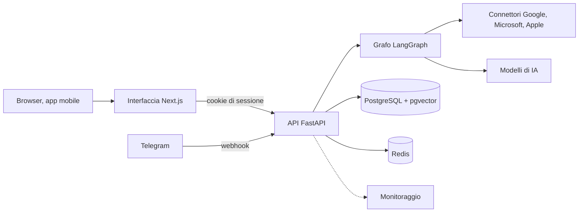
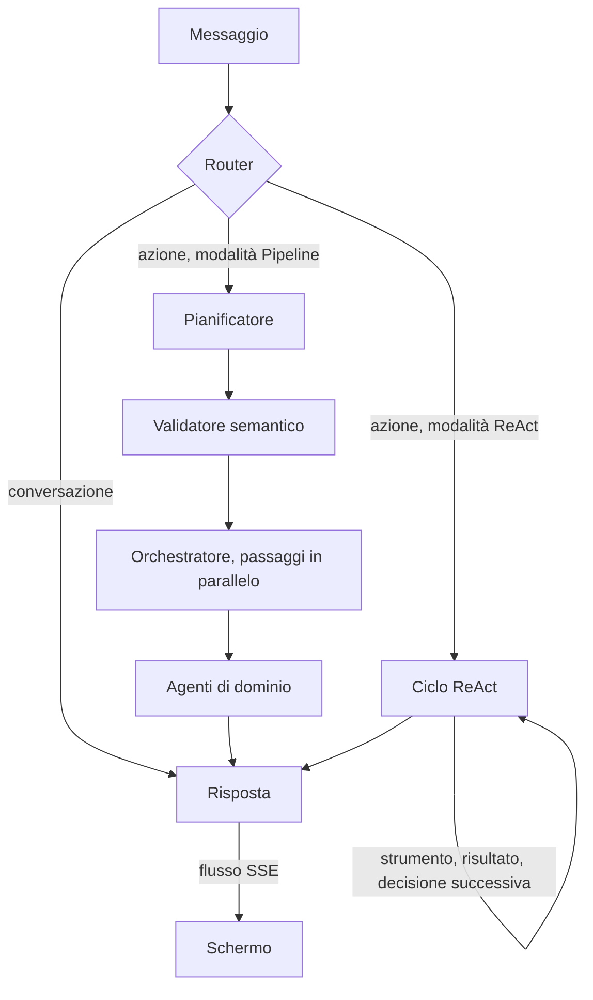
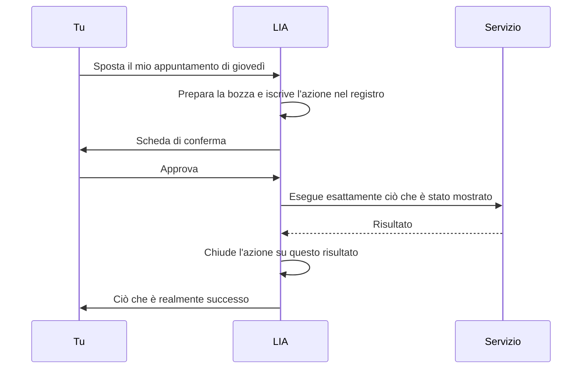
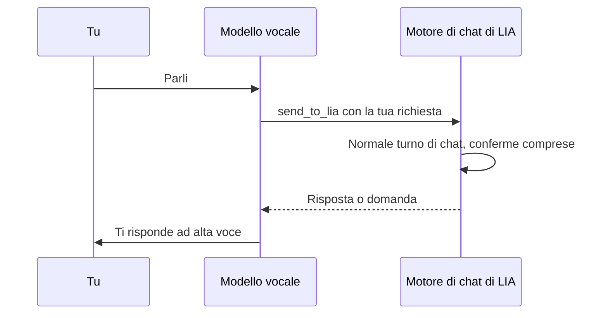

# LIA — Guida tecnica

> Come è costruita LIA, a grandi linee. Il dettaglio è nel codice, negli ADR e nella documentazione del repository.

**Versione**: 6.0
**Data**: 2026-10-23
**Applicazione**: LIA v4.2.0
**Licenza**: AGPL-3.0 (Open Source)

---

## Indice

1. [Panoramica](#1-panoramica)
2. [Un backend suddiviso per domini](#2-un-backend-suddiviso-per-domini)
3. [Il percorso di un messaggio](#3-il-percorso-di-un-messaggio)
4. [Agire con prudenza](#4-agire-con-prudenza)
5. [Memoria e contesto](#5-memoria-e-contesto)
6. [I modelli](#6-i-modelli)
7. [Connettori e strumenti](#7-connettori-e-strumenti)
8. [Voce, modalità Live e telefono](#8-voce-modalità-live-e-telefono)
9. [L'iniziativa](#9-liniziativa)
10. [Sicurezza e privacy](#10-sicurezza-e-privacy)
11. [Osservare e misurare](#11-osservare-e-misurare)
12. [Le interfacce](#12-le-interfacce)
13. [Come è mantenuto questo codice](#13-come-è-mantenuto-questo-codice)
14. [Per approfondire](#14-per-approfondire)

---

## 1. Panoramica

Ho progettato LIA perché giri a casa tua, su hardware modesto. La piattaforma di riferimento è un Raspberry Pi 5 (ARM64), e tutto ciò che segue ne deriva: una sola macchina, un database PostgreSQL e un Redis locali, nessun database ospitato altrove. Le credenziali e le chiavi dei fornitori sono archiviate cifrate.

Tre principi guidano il resto. Prima di tutto **la trasparenza**: l'osservabilità fa parte dell'architettura fin dall'inizio, e ogni token consumato è tracciato con il suo costo. Poi **la difesa in profondità**: quote, conferme e protezioni contro le allucinazioni sono livelli indipendenti. Infine **l'indipendenza dai fornitori**: ogni ruolo del sistema può essere affidato a un modello diverso, il che mi protegge tanto da un aumento di prezzo quanto da un guasto.

Lo stack è volutamente classico:

| Livello | Scelta |
| --- | --- |
| Backend | Python 3.14, FastAPI, asincrono da cima a fondo |
| Orchestrazione degli agenti | LangGraph 1.x |
| Dati | PostgreSQL con pgvector: dati, checkpoint del grafo e ricerca vettoriale |
| Cache e coordinamento | Redis: cache, sessioni, limiti di frequenza, elezione di un leader |
| Frontend | Next.js 16 (App Router), React 19, TypeScript strict |
| Modelli | OpenAI, Anthropic, Google Gemini, DeepSeek, Perplexity, Qwen, e qualsiasi modello locale tramite Ollama |
| Log | JSON strutturato, dati personali filtrati |

Un modello locale gira senza costi di API, interamente a casa tua. L'API gira su più worker; un'elezione del leader in Redis riserva le attività pianificate a uno solo di essi. Ogni sottosistema opzionale si attiva con un flag, e la configurazione segue un'unica cascata: ciò che l'amministratore imposta nell'applicazione prevale sull'ambiente, che prevale sulle costanti del codice. Ho voluto un'unica cascata perché una costante che diverge in silenzio dalla configurazione reale produce i bug più difficili da vedere.

Un installer guidato fa qualche domanda, crea l'account amministratore senza scrivere segreti in chiaro, verifica che l'installazione funzioni davvero e sa riconfigurarla più tardi senza chiedere di nuovo le chiavi ([installare LIA](/it/faq#faq-self_hosting)).

In ordini di grandezza: più di 350 ADR, centinaia di metriche Prometheus, decine di migliaia di test automatici, un'interfaccia in sei lingue (francese, inglese, tedesco, spagnolo, italiano, cinese).

*Per approfondire: [architettura generale](https://github.com/jgouviergmail/LIA-Assistant/blob/main/docs/ARCHITECTURE.md) · [self-hosting](https://github.com/jgouviergmail/LIA-Assistant/blob/main/docs/guides/GUIDE_SELF_HOSTING.md) · [fornitori di modelli](https://github.com/jgouviergmail/LIA-Assistant/blob/main/docs/technical/LLM_PROVIDERS.md) · [capacità amministrabili](https://github.com/jgouviergmail/LIA-Assistant/blob/main/docs/architecture/ADR-217-Capacites-Administrables.md)*

## 2. Un backend suddiviso per domini

Il backend segue il Domain-Driven Design. Ogni dominio di business (agenti, connettori, voce, memoria, promemoria, conversazioni…) è un contesto isolato in `src/domains/`, suddiviso allo stesso modo: router, servizio, repository, modello, schema. Accanto, un nucleo trasversale (`core`) porta la configurazione e le regole comuni, e un livello di infrastruttura condiviso raggruppa ciò di cui tutti hanno bisogno: la factory dei modelli, la cache, il client MCP, il browser, i limiti di frequenza, lo scheduler delle attività, l'osservabilità.

Ho scelto un'architettura esagonale per i servizi esterni. Gli strumenti conoscono solo protocolli Python (le porte), e i client Google, Microsoft, Apple o Philips Hue li implementano (gli adattatori). Aggiungere un fornitore non tocca quindi il codice che lo chiama.

Il repository è un monorepo: `apps/api` per il backend, `apps/web` per l'interfaccia, `infrastructure/` per Docker e il monitoraggio, `docs/` per la documentazione. Un amministratore che cambia un modello nell'interfaccia lo vede applicato subito, senza ridistribuzione, perché la configurazione viva è nel database.

*Per approfondire: [creare un connettore](https://github.com/jgouviergmail/LIA-Assistant/blob/main/docs/guides/GUIDE_CONNECTOR_IMPLEMENTATION.md) · [creare un agente](https://github.com/jgouviergmail/LIA-Assistant/blob/main/docs/guides/GUIDE_AGENT_CREATION.md) · [creare uno strumento](https://github.com/jgouviergmail/LIA-Assistant/blob/main/docs/guides/GUIDE_TOOL_CREATION.md) · [aggiungere un canale](https://github.com/jgouviergmail/LIA-Assistant/blob/main/docs/templates/NEW_CHANNEL_CHECKLIST.md) · [aggiungere un fornitore di modelli](https://github.com/jgouviergmail/LIA-Assistant/blob/main/docs/technical/LLM_PROVIDER_CONSTRAINTS.md) · [aggiungere un'attività proattiva](https://github.com/jgouviergmail/LIA-Assistant/blob/main/docs/templates/NEW_PROACTIVE_TASK_CHECKLIST.md)*

## 3. Il percorso di un messaggio

Ho scelto LangGraph per orchestrare gli agenti perché offriva tre cose di cui avevo bisogno: uno stato persistito in checkpoint su PostgreSQL, i cicli, e `interrupt()`, che permette di sospendere un turno per chiedere una conferma e poi riprenderlo esattamente da dove si era fermato. Senza questo meccanismo, non c'è una conferma umana seria.

Ogni messaggio passa prima da un **router**, che lo classifica come semplice conversazione o come richiesta che chiama un'azione. Una conversazione va dritta alla risposta. Un'azione segue la modalità scelta nell'intestazione della chat.

In modalità **Pipeline**, quella predefinita, il pianificatore scrive prima di qualsiasi esecuzione un `ExecutionPlan`: un piano in JSON i cui passaggi sono collegati dalle loro dipendenze. Un secondo modello, distinto dal pianificatore, convalida questo piano, per evitare che un modello giudichi il proprio lavoro. L'orchestratore esegue poi i passaggi per ondate parallele. La modalità **ReAct**, al contrario, lascia che il modello chiami uno strumento, legga il risultato e decida il seguito, passo dopo passo.

Le ho tenute entrambe perché rispondono a due bisogni. La Pipeline pianifica, parallelizza, si controlla e prevede il suo costo: una chiamata al pianificatore e una alla risposta, contro una chiamata per iterazione per ReAct, ossia da 4 a 8 volte meno token. ReAct si adatta a ogni risultato, il che è meglio per una ricerca esplorativa o una richiesta ambigua. Le due modalità condividono il registro degli strumenti, le conferme, il nodo di risposta e l'osservabilità.

La scelta dei domini e degli strumenti passa da un **router semantico** a embeddings anziché da parole chiave o dal solo modello: costa meno e sbaglia meno. Ogni strumento dichiara un manifesto (parametri, output, costo, permessi, parole chiave in più lingue) che leggono il pianificatore, il router e il costruttore di agenti, e ogni agente si dichiara una sola volta in un registro centrale. Gli Smart Services riducono ancora il consumo mettendo in cache l'analisi delle richieste e imparando i piani ricorrenti. Dopo un turno che richiede un'azione, un nodo di iniziativa guarda, in sola lettura, cosa implica il risultato altrove: una pioggia prevista rimanda alle attività all'aperto della tua agenda.

Alcune regole mantengono onesto l'insieme. Una richiesta senza intenzione di agire non può produrre un piano che modifichi alcunché, ed è una regola deterministica, verificata prima di qualsiasi chiamata al modello. Un piano di modifica che esaurisce i suoi tentativi di correzione non viene eseguito: LIA fa una domanda piuttosto che scrivere un dato sbagliato. Un rifiuto o un fallimento non viene mai presentato come un'azione compiuta, e una volta eseguito il piano, nulla viene rieseguito alle tue spalle: la risposta dice ogni fallimento, quale strumento, perché, e il totale esatto. Per una modalità che si corregge strada facendo, c'è ReAct.

La risposta arriva token per token in SSE. La generazione è disaccoppiata dalla connessione: un produttore distaccato pubblica in un flusso Redis proprio del turno, e la pagina ne è solo un abbonato. Chiudere la scheda quindi non ferma nulla, e la risposta ti aspetta.

*Per approfondire: [le due modalità](https://github.com/jgouviergmail/LIA-Assistant/blob/main/docs/architecture/ADR-070-ReAct-Execution-Mode.md) · [la scelta di LangGraph](https://github.com/jgouviergmail/LIA-Assistant/blob/main/docs/architecture/ADR-001-LangGraph-Orchestration.md) · [il grafo nel dettaglio](https://github.com/jgouviergmail/LIA-Assistant/blob/main/docs/ARCHITECTURE_LANGRAPH.md) · [il router](https://github.com/jgouviergmail/LIA-Assistant/blob/main/docs/technical/ROUTER.md) · [il piano e la sua esecuzione parallela](https://github.com/jgouviergmail/LIA-Assistant/blob/main/docs/architecture/ADR-014-ExecutionPlan-Parallel-Executor.md) · [il pianificatore e le operazioni in blocco](https://github.com/jgouviergmail/LIA-Assistant/blob/main/docs/technical/PLANNER.md) · [il router semantico](https://github.com/jgouviergmail/LIA-Assistant/blob/main/docs/architecture/ADR-048-Semantic-Tool-Router.md) · [i manifesti degli strumenti](https://github.com/jgouviergmail/LIA-Assistant/blob/main/docs/architecture/ADR-019-Agent-Manifest-Catalogue-System.md) · [un fallimento della pipeline viene detto, mai rieseguito](https://github.com/jgouviergmail/LIA-Assistant/blob/main/docs/architecture/ADR-346-Advisory-Replanner-Retired-A-Pipeline-Failure-Is-Said-Never-Replayed.md) · [la restituzione dei fallimenti degli strumenti](https://github.com/jgouviergmail/LIA-Assistant/blob/main/docs/architecture/ADR-303-Tool-Failure-Restitution.md) · [i turni che sopravvivono alla scheda](https://github.com/jgouviergmail/LIA-Assistant/blob/main/docs/architecture/ADR-117-Background-Chat-Runs.md) · [la modalità ReAct](https://github.com/jgouviergmail/LIA-Assistant/blob/main/docs/technical/REACT_EXECUTION_MODE.md)*

## 4. Agire con prudenza

LIA chiede conferma prima di ciò che sta per accadere davvero: ogni bozza (un'email, un evento, una cancellazione), ogni operazione in blocco che modifica almeno un elemento, ogni strumento che dichiara di dovere una conferma. La conferma si chiede azione per azione, là dove l'azione si prepara, e non sull'intero piano. Al contrario, un'azione che nulla può deviare non chiede nulla: un'email che mandi a te stesso parte direttamente.

Ciò che confermi è esattamente l'ultimo contenuto mostrato, e ogni modifica viene eseguita una sola volta. Più bozze di uno stesso turno vengono riviste una per una. Puoi rispondere in linguaggio libero: un modello classifica la tua risposta come consenso, rifiuto o richiesta di modifica. Fuori dalla conversazione, un ticket chiede la sua conferma sul ticket stesso, e una routine che gira senza nessuno davanti allo schermo non fa domande: rifiuta l'azione e lo dice, altrimenti il tuo messaggio successivo passerebbe per una risposta. Un comando dato alla chat («mostra le mie risposte come schede») segue la stessa regola, e quando richiede di collegare un account, inserire una chiave o scegliere un file, quel passaggio avviene nel browser autenticato. LIA verifica il risultato richiesto su ciò che può osservare, ma una delega a uno strumento non prova da sola tutti i suoi effetti interni. Allo stesso modo, un lock impedisce una doppia esecuzione senza poter garantire che un fornitore esterno agisca una sola volta.

Anche la risposta è vincolata: il modello scrive solo a partire dai risultati reali degli strumenti. E tutto ciò che LIA fa è iscritto in tre **registri** distinti: le azioni, le consultazioni e i turni. I loro totali non si sommano, perché un turno può consultare cinque fonti senza cambiare nulla. Un'azione viene iscritta prima di avvenire e chiusa solo su un risultato esplicito. Cancellare una conversazione rimuove i file che vi hai inviato, non quelli che LIA ha prodotto per te.

*Per approfondire: [le conferme](https://github.com/jgouviergmail/LIA-Assistant/blob/main/docs/technical/HITL.md) · [la catena di autorità e i registri](https://github.com/jgouviergmail/LIA-Assistant/blob/main/docs/architecture/ADR-263-Execution-Authority-Chain-And-Effect-Register.md) · [i registri lato utente](/it/faq#faq-registers) · [i ticket](https://github.com/jgouviergmail/LIA-Assistant/blob/main/docs/technical/WORKBOARD.md) · [i comandi applicativi](https://github.com/jgouviergmail/LIA-Assistant/blob/main/docs/technical/APPLICATION_COMMANDS.md) · [ciò che una delega prova](https://github.com/jgouviergmail/LIA-Assistant/blob/main/docs/architecture/ADR-336-Requested-Outcomes-Checked-Against-Canonical-Observations.md) · [esempi di strumenti, email a sé stessi e bozze](https://github.com/jgouviergmail/LIA-Assistant/blob/main/docs/knowledge/05_tool_examples.md) · [la sintesi della risposta](https://github.com/jgouviergmail/LIA-Assistant/blob/main/docs/technical/RESPONSE.md)*

## 5. Memoria e contesto

Lo stato di una conversazione è un `MessagesState` di cui LangGraph salva un checkpoint in PostgreSQL dopo ogni nodo. È ciò che permette di riprendere un turno dopo una conferma, anche ore dopo. I risultati degli strumenti non vivono nella cronologia dei messaggi ma in un registro di dati a parte, così sopravvivono quando la cronologia viene troncata. Oltre una soglia, gli scambi più vecchi vengono riassunti; un indicatore mostra il riempimento del contesto, e `/resume` avvia questo riassunto su richiesta. In modalità ReAct, ciò che un ciclo ha già letto viene salvato in un checkpoint e riutilizzato nel turno; un arresto prima di quel checkpoint può far rileggere una fonte.

La memoria a lungo termine, gli spazi di conoscenza e il contesto degli strumenti vivono nello stesso database, con pgvector. Dopo ogni scambio, un'attività in background estrae i ricordi dall'ultimo messaggio; i ricordi vicini alla domanda tornano nel contesto successivo, e la memoria è anche uno strumento che il pianificatore e ReAct consultano. Un'istruzione duratura («rispondi più breve») è fissata e visibile. Quando si tocca un argomento sensibile, una direttiva vieta di scherzare o di minimizzare.

Attorno a questa memoria, ho aggiunto diversi livelli. I **diari** sono i taccuini di LIA, in prima persona; ne emerge un ritratto della persona, con le fonti che l'hanno alimentato, che si corregge solo tramite leve indirette. Il **Psyche Engine** dà a LIA uno stato psicologico che evolve a ogni scambio e traspare nel suo stile senza essere annunciato; impara anche, ambito per ambito, dove lei è affidabile, a partire da prove; è un progetto pilota, per ora senza alcun guadagno rivendicato. Ha un limite dichiarato: non riporta quasi mai un'emozione calma e poco intensa, e questa parte della sua attivazione resta bloccata. Gli **interessi** vengono rilevati nelle tue richieste e alimentati da più fonti. Le **abitudini**, infine, vengono apprese senza un modello addestrato, con test statistici, e avevo tre ragioni, ciascuna sufficiente: un Raspberry Pi non ha un budget di addestramento, una formula si può rendere nota alla persona che riguarda, e su volumi così piccoli un modello imparerebbe soprattutto il rumore.

*Per approfondire: [i checkpoint](https://github.com/jgouviergmail/LIA-Assistant/blob/main/docs/architecture/ADR-022-LangGraph-State-Checkpointing.md) · [il registro dei dati](https://github.com/jgouviergmail/LIA-Assistant/blob/main/docs/architecture/ADR-012-Data-Registry-StandardToolOutput-Pattern.md) · [la compattazione](https://github.com/jgouviergmail/LIA-Assistant/blob/main/docs/technical/COMPACTION_v2.md) · [le letture con checkpoint di ReAct](https://github.com/jgouviergmail/LIA-Assistant/blob/main/docs/architecture/ADR-337-Checkpointed-ReAct-Read-Segments-And-Turn-Local-Reuse.md) · [la memoria in PostgreSQL](https://github.com/jgouviergmail/LIA-Assistant/blob/main/docs/architecture/ADR-066-Memory-PostgreSQL-Migration.md) · [la memoria a lungo termine](https://github.com/jgouviergmail/LIA-Assistant/blob/main/docs/technical/LONG_TERM_MEMORY.md) · [la memoria come strumento di ricerca](https://github.com/jgouviergmail/LIA-Assistant/blob/main/docs/architecture/ADR-313-Long-Term-Memory-As-An-Active-Lookup.md) · [le regole durature](https://github.com/jgouviergmail/LIA-Assistant/blob/main/docs/architecture/ADR-236-procedural-memory.md) · [i diari e il ritratto](https://github.com/jgouviergmail/LIA-Assistant/blob/main/docs/technical/JOURNALS.md) · [il Psyche Engine](https://github.com/jgouviergmail/LIA-Assistant/blob/main/docs/technical/PSYCHE_ENGINE.md) · [il suo limite misurato](https://github.com/jgouviergmail/LIA-Assistant/blob/main/docs/architecture/ADR-142-Psyche-Observability-And-Dominance-Recentering.md) · [la psiche lato utente](https://github.com/jgouviergmail/LIA-Assistant/blob/main/docs/knowledge/22_psyche.md) · [l'efficacia appresa dalle prove](https://github.com/jgouviergmail/LIA-Assistant/blob/main/docs/architecture/ADR-348-Efficacy-Learned-From-Evidence-Results-And-Usefulness-Kept-Apart.md) · [gli interessi](https://github.com/jgouviergmail/LIA-Assistant/blob/main/docs/technical/INTERESTS.md) · [le abitudini](https://github.com/jgouviergmail/LIA-Assistant/blob/main/docs/knowledge/28_habits.md) · [la ricerca nei diari e nei registri](https://github.com/jgouviergmail/LIA-Assistant/blob/main/docs/architecture/ADR-318-Assistant-Tools-Exact-Answers-And-Own-Records.md)*

## 6. I modelli

Un'unica factory istanzia il modello di qualsiasi fornitore supportato e gli applica il suo adattatore. Ogni ruolo ha il suo slot di modello (la conversazione, la pianificazione, l'immagine, la trascrizione, la sintesi vocale…), impostato nell'amministrazione senza ridistribuzione. Il catalogo dei modelli vive nel database e dichiara, modello per modello, le sue capacità, i parametri che accetta e la scala di ragionamento che conosce; la schermata di configurazione offre così solo ciò che l'API del modello accetta davvero.

Alcuni compiti non sono generazioni ma decisioni delimitate: scegliere un formato, qualificare un'email. Possono essere affidati a un motore decisionale nativo, ciascuno dietro il proprio interruttore e un interruttore generale. Una decisione incerta ricade sull'elaborazione abituale, e né i diritti né le conferme gli vengono delegati. Un parere di qualificazione non autentica alcun mittente, e un guadagno misurato su un corpus di test non vale come promessa per ogni richiesta.

Ogni chiamata a un modello, nella pipeline come nelle attività in background, è tracciata e valorizzata in base alle tariffe nel database, poi raggruppata per turno. Per il costo, il risparmio principale viene dalla cache dei fornitori. Ogni prompt mette il suo contenuto stabile prima di un marcatore e il contenuto proprio della richiesta dopo, e l'infrastruttura traduce questo marcatore nel meccanismo di cache di ciascun fornitore. Poiché ogni slot può cambiare modello, non regolo questa cache per un modello in particolare: punto alla media migliore, e un modello senza cache non paga nulla di più. Gli studi condotti su altri motori locali (oMLX, llama.cpp, LM Studio) sono qualificazioni, non integrazioni consegnate: contano solo i fornitori che l'istanza propone.

*Per approfondire: [la selezione dei modelli](https://github.com/jgouviergmail/LIA-Assistant/blob/main/docs/architecture/ADR-026-LLM-Model-Selection-Strategy.md) · [il catalogo nel database](https://github.com/jgouviergmail/LIA-Assistant/blob/main/docs/architecture/ADR-078-LLM-Catalogue-DB-Source-Of-Truth.md) · [la schermata di configurazione](https://github.com/jgouviergmail/LIA-Assistant/blob/main/docs/technical/LLM_CONFIG_ADMIN.md) · [le decisioni native](https://github.com/jgouviergmail/LIA-Assistant/blob/main/docs/architecture/ADR-325-JEV-Bounded-Decisions-With-Hot-Switches-And-Accounted-Fallbacks.md) · [la loro integrazione](https://github.com/jgouviergmail/LIA-Assistant/blob/main/docs/technical/JEV_INTEGRATION.md) · [la qualificazione delle email](https://github.com/jgouviergmail/LIA-Assistant/blob/main/docs/technical/EMAIL_EVENT_CLASSIFICATION.md) · [un layout per tutte le cache](https://github.com/jgouviergmail/LIA-Assistant/blob/main/docs/architecture/ADR-309-One-Prompt-Layout-For-Every-Cache-Mechanism.md) · [il filtraggio del catalogo degli strumenti](https://github.com/jgouviergmail/LIA-Assistant/blob/main/docs/architecture/ADR-003-Multi-Domain-Dynamic-Filtering.md) · [i motori locali studiati](https://github.com/jgouviergmail/LIA-Assistant/blob/main/docs/knowledge/16_other.md)*

## 7. Connettori e strumenti

Ogni categoria di connettori (email, agenda, contatti, attività, file, casa) è un protocollo Python. Un solo fornitore è attivo alla volta per categoria, e il consenso OAuth si dà una volta per account Google o Microsoft. I servizi che non chiedono nulla alla persona (Wikipedia, la lettura di pagine, i luoghi, il meteo) appartengono all'istanza e sono attivi per tutti. Sul fronte email, ogni messaggio si riassume una volta e poi si riutilizza, un allegato si legge come testo o tramite un modello di visione, e un invio non viene mai ritentato dopo una conferma di ricezione persa.

Gli strumenti poggiano su cinque livelli componibili: una base comune di connettore (OAuth, cache, iniezione), un decoratore, dei formattatori per dominio, il manifesto letto dal pianificatore e un caricatore di catalogo. Gli strumenti **MCP** vengono convertiti in normali strumenti LangChain ed entrano nello stesso catalogo, conservato da un messaggio all'altro perché di solito un messaggio non aspetti nessun server; un server MCP deve essere in HTTPS, le sue credenziali sono cifrate, e LIA crede a un'annotazione che annuncia una modifica, mai a una che pretende di essere in sola lettura. I **plugin** in formato Agent Plugins si installano in un blocco unico, senza server locale. Le **skills** dello standard agentskills.io possono mostrare una piccola applicazione nella chat o eseguire i propri comandi in una copia della loro cartella; una skill venuta da fuori gira isolata e non riceve mai il token di un connettore.

Quando un passaggio richiede un vero calcolo, la modalità ReAct può scrivere un breve script Python ed eseguirlo in un container usa e getta. Questo script raggiunge il web solo attraverso un proxy unico, non vede la chiave della persona (il proxy la sostituisce solo sull'host autorizzato), e per un host sconosciuto viene posta una domanda con tre risposte possibili. Nelle due modalità, i calcoli, le durate e le conversioni di valuta passano da strumenti esatti anziché dal modello. Un agente sa anche pilotare un browser (Playwright) o convertire una pagina in testo.

I documenti degli **spazi di conoscenza** vengono suddivisi, vettorizzati e archiviati in PostgreSQL anziché in un database vettoriale esterno, poi ritrovati con una ricerca ibrida, semantica e lessicale. Uno spazio può seguire una cartella Drive con le sue sottocartelle o un'etichetta Gmail, senza indicizzare tutta la casella. Non c'è riconoscimento dei caratteri: un PDF scansionato non viene indicizzato così com'è. I dati inviati dall'esterno (SMS, numero di passi, frequenza cardiaca, da un iPhone, un Android o qualsiasi sistema capace di inviare JSON) entrano da endpoint autenticati con un token a portata limitata e revocabile, distinto dalla sessione.

Per un compito complesso, LIA delega a sub-agenti effimeri, in sola lettura. Produce anche file: documenti, immagini, screenshot, archiviati in una galleria, conservati, inviati per email o, per un'immagine, condivisi con una persona collegata all'istanza.

*Per approfondire: [i pattern dei connettori](https://github.com/jgouviergmail/LIA-Assistant/blob/main/docs/technical/CONNECTORS_PATTERNS.md) · [il consenso OAuth raggruppato](https://github.com/jgouviergmail/LIA-Assistant/blob/main/docs/architecture/ADR-302-OAuth-Grant-Par-Compte-Et-Consentement-Groupe.md) · [i servizi dell'istanza](https://github.com/jgouviergmail/LIA-Assistant/blob/main/docs/architecture/ADR-307-Keyless-Connectors-Belong-To-The-Instance.md) · [i connettori lato utente](/it/faq#faq-connectors) · [le email e i loro riassunti](https://github.com/jgouviergmail/LIA-Assistant/blob/main/docs/architecture/ADR-287-Email-Content-First-Detail-Levels-Digests-And-Neutral-Message.md) · [gli allegati](https://github.com/jgouviergmail/LIA-Assistant/blob/main/docs/architecture/ADR-296-Mail-Attachments-Read-By-Text-Or-Vision.md) · [i timeout per slot](https://github.com/jgouviergmail/LIA-Assistant/blob/main/docs/architecture/ADR-221-Timeout-Par-Emplacement-Applique.md) · [la base degli strumenti](https://github.com/jgouviergmail/LIA-Assistant/blob/main/docs/architecture/ADR-015-ConnectorTool-Base-Class-Pattern.md) · [MCP](https://github.com/jgouviergmail/LIA-Assistant/blob/main/docs/technical/MCP_INTEGRATION.md) · [lo standard Agent Plugins](https://github.com/jgouviergmail/LIA-Assistant/blob/main/docs/architecture/ADR-225-Standard-Agent-Plugins-v1.md) · [i plugin](https://github.com/jgouviergmail/LIA-Assistant/blob/main/docs/technical/PLUGINS_INTEGRATION.md) · [le skills](https://github.com/jgouviergmail/LIA-Assistant/blob/main/docs/technical/SKILLS_INTEGRATION.md) · [le skills lato utente](https://github.com/jgouviergmail/LIA-Assistant/blob/main/docs/knowledge/12_skills.md) · [le skills di terze parti](https://github.com/jgouviergmail/LIA-Assistant/blob/main/docs/architecture/ADR-327-Skill-Library-And-Third-Party-Skills.md) · [modificare una skill](https://github.com/jgouviergmail/LIA-Assistant/blob/main/docs/architecture/ADR-165-Skill-Editing-By-Regeneration.md) · [condividere una capacità](https://github.com/jgouviergmail/LIA-Assistant/blob/main/docs/technical/PEER_CAPABILITY_TRANSFERS.md) · [il Python effimero](https://github.com/jgouviergmail/LIA-Assistant/blob/main/docs/architecture/ADR-249-Ephemeral-Python-In-The-Existing-Sandbox.md) · [l'uscita di rete della sandbox](https://github.com/jgouviergmail/LIA-Assistant/blob/main/docs/architecture/ADR-298-Sandbox-Egress-Toolbox.md) · [le risposte calcolate](https://github.com/jgouviergmail/LIA-Assistant/blob/main/docs/knowledge/35_computed_answers.md) · [il browser](https://github.com/jgouviergmail/LIA-Assistant/blob/main/docs/technical/BROWSER_CONTROL.md) · [la lettura di pagine](https://github.com/jgouviergmail/LIA-Assistant/blob/main/docs/technical/WEB_FETCH.md) · [gli spazi di conoscenza](https://github.com/jgouviergmail/LIA-Assistant/blob/main/docs/architecture/ADR-055-RAG-Spaces-Architecture.md) · [la loro guida](https://github.com/jgouviergmail/LIA-Assistant/blob/main/docs/guides/GUIDE_RAG_SPACES.md) · [il loro uso](https://github.com/jgouviergmail/LIA-Assistant/blob/main/docs/knowledge/14_rag_spaces.md) · [una cartella Drive è un albero](https://github.com/jgouviergmail/LIA-Assistant/blob/main/docs/architecture/ADR-297-Drive-Folder-Is-A-Tree-And-The-Count-Is-Exact.md) · [un'etichetta Gmail come fonte](https://github.com/jgouviergmail/LIA-Assistant/blob/main/docs/architecture/ADR-262-Opt-In-Mail-Label-RAG-Source.md) · [la FAQ integrata](https://github.com/jgouviergmail/LIA-Assistant/blob/main/docs/architecture/ADR-058-System-RAG-Spaces.md) · [allegare un documento di uno spazio](https://github.com/jgouviergmail/LIA-Assistant/blob/main/docs/architecture/ADR-295-Knowledge-Documents-As-Message-Attachments.md) · [i sub-agenti](https://github.com/jgouviergmail/LIA-Assistant/blob/main/docs/knowledge/13_sub_agents.md) · [i dati sanitari](https://github.com/jgouviergmail/LIA-Assistant/blob/main/docs/technical/HEALTH_METRICS.md) · [la loro acquisizione](https://github.com/jgouviergmail/LIA-Assistant/blob/main/docs/architecture/ADR-076-Health-Metrics-Ingestion.md) · [la salute lato utente](https://github.com/jgouviergmail/LIA-Assistant/blob/main/docs/knowledge/23_health_metrics.md) · [gli SMS](https://github.com/jgouviergmail/LIA-Assistant/blob/main/docs/technical/SMS_INGESTION.md) · [la generazione di documenti](https://github.com/jgouviergmail/LIA-Assistant/blob/main/docs/technical/DOCUMENT_GENERATION.md) · [i documenti lato utente](https://github.com/jgouviergmail/LIA-Assistant/blob/main/docs/knowledge/32_document_generation.md) · [le immagini](https://github.com/jgouviergmail/LIA-Assistant/blob/main/docs/knowledge/21_image_generation.md) · [i file generati](https://github.com/jgouviergmail/LIA-Assistant/blob/main/docs/knowledge/39_generated_files.md) · [conservare un file](https://github.com/jgouviergmail/LIA-Assistant/blob/main/docs/architecture/ADR-319-A-Generated-File-Can-Be-Kept.md) · [inviare per email](https://github.com/jgouviergmail/LIA-Assistant/blob/main/docs/architecture/ADR-321-A-File-Or-An-Answer-Sent-By-E-Mail.md) · [gli allegati del compositore](https://github.com/jgouviergmail/LIA-Assistant/blob/main/docs/technical/ATTACHMENTS_INTEGRATION.md) · [le risposte conservate](https://github.com/jgouviergmail/LIA-Assistant/blob/main/docs/knowledge/40_bookmarks.md)*

## 8. Voce, modalità Live e telefono

La voce classica è fatta di componenti indipendenti. La parola di attivazione «Dis LIA» viene rilevata nel browser e non invia nulla prima di essere sentita; per ora viene fornito solo il modello francese, in beta. La dettatura viene trascritta nella lingua dell'account, sul server e offline con Whisper, oppure da un motore remoto secondo l'impostazione. La sintesi vocale ha più fornitori, Edge gratuito come predefinito, e la risposta inizia a essere letta frase per frase mentre il seguito viene scritto. Un avatar parlante sperimentale può aggiungersi, sulla chiave Simli della persona, che fattura anche i silenzi finché la connessione resta aperta.

La **modalità Live** è una vera conversazione da voce a voce. Ci ho messo due intelligenze e una sola cucitura: il modello vocale tiene la conversazione, e ogni richiesta di dati o di azione passa al motore della chat attraverso una sola funzione, `send_to_lia`. La richiesta diventa un normale turno di chat, con le sue conferme, i suoi registri e le sue quote. La voce non possiede né strumenti, né credenziali, né una memoria propria.

Una sessione Live si addormenta invece di morire: durante lo standby, la connessione con il fornitore è chiusa e nulla viene fatturato. La spesa del fornitore Live è pagata dalla chiave della persona e non viene mai registrata da LIA. In Live diretto, la voce legge da sé i tuoi dati senza modificare nulla.

Il **telefono** riprende le stesse due modalità. LIA può chiamare un terzo per te dopo conferma, o chiamare te su un numero verificato, e allora al telefono hai i tuoi dati e tutte le sue funzioni, come nella chat. Quando LIA chiama un terzo, l'agente di chiamata ha solo uno strumento libero/occupato in sola lettura: la protezione della tua agenda è strutturale, non dipende da un'istruzione in un prompt. Al telefono, la modalità Live esiste solo se il fornitore può raggiungere la tua istanza.

Una riunione si registra dal browser: l'audio parte in piccoli segmenti, poi viene trascritto e riassunto in un verbale strutturato, archiviato in uno spazio di conoscenza. La radio personale, infine, produce solo durante una sessione di ascolto e non conserva nulla per un riascolto.

*Per approfondire: [la voce lato utente](/it/faq#faq-voice_mode) · [lo standby Live e la parola di attivazione](https://github.com/jgouviergmail/LIA-Assistant/blob/main/docs/architecture/ADR-329-Live-Standby-And-Multilingual-Wake-Word.md) · [le voci e la sintesi](https://github.com/jgouviergmail/LIA-Assistant/blob/main/docs/architecture/ADR-345-Fish-Audio-Served-Whole-One-Door-One-Allowance-Cues-Each-Engine-Reads.md) · [l'avatar parlante](https://github.com/jgouviergmail/LIA-Assistant/blob/main/docs/technical/SPEAKING_AVATAR.md) · [la modalità Live](https://github.com/jgouviergmail/LIA-Assistant/blob/main/docs/architecture/ADR-299-Live-Voice-Mode-Two-Intelligences-One-Seam.md) · [la telefonia lato utente](/it/faq#faq-telephony) · [il telefono come canale](https://github.com/jgouviergmail/LIA-Assistant/blob/main/docs/architecture/ADR-290-Phone-As-A-Channel-Owner-Calls.md) · [la radio](/it/faq#faq-radio) · [le riunioni](https://github.com/jgouviergmail/LIA-Assistant/blob/main/docs/technical/MEETINGS.md) · [il verbale strutturato](https://github.com/jgouviergmail/LIA-Assistant/blob/main/docs/architecture/ADR-258-Meeting-Recording-And-Structured-Minutes.md) · [i modelli di verbale](https://github.com/jgouviergmail/LIA-Assistant/blob/main/docs/architecture/ADR-259-Meeting-Template-Library-And-Reformatting.md)*

## 9. L'iniziativa

LIA prende iniziative in tre forme. Un **heartbeat** periodico guarda le tue fonti e ti scrive solo se un segnale lo giustifica, nominando uno o due fatti verificati. Essere collegati a una fonte e accettare di esserne interrotti sono due decisioni separate. Una notifica push di Google può risvegliare questo heartbeat per una sola persona, e un **momento** (la fine di una riunione, l'arrivo di una mail attesa) viene servito al minuto anziché al passaggio successivo. Le **discussioni proattive**, infine, chiedono una risposta, con una propria politica: orari, massimo al giorno, argomenti sensibili tenuti privati, spesa riservata prima che avvenga.

Le **routine** si attivano su un calendario o su una condizione, non su entrambi, e una vista della settimana mostra ciò che è realmente successo. Un promemoria può ripetersi. La **lavagna dei ticket** dà a un compito un ciclo di vita, un titolare e un risultato.

Due regole delimitano tutto ciò. L'iniziativa si limita a leggere: una scrittura viene proposta, mai eseguita da sola. E un nuovo tentativo di una stessa esecuzione viene rifiutato non appena il registro degli effetti mostra l'azione già fatta. La pagina Attività mostra in un unico posto tutto ciò che LIA ha intrapreso da sola, con totali esatti.

*Per approfondire: [il heartbeat](https://github.com/jgouviergmail/LIA-Assistant/blob/main/docs/technical/HEARTBEAT_AUTONOME.md) · [il permesso di interrompere](https://github.com/jgouviergmail/LIA-Assistant/blob/main/docs/architecture/ADR-197-Interrupt-Permission-Is-Not-Connection.md) · [il risveglio tramite push](https://github.com/jgouviergmail/LIA-Assistant/blob/main/docs/architecture/ADR-261-Push-Driven-Heartbeat-Wake-And-Incremental-Drive-Sync.md) · [i momenti e le vigilanze](https://github.com/jgouviergmail/LIA-Assistant/blob/main/docs/architecture/ADR-281-Anticipated-Moments-And-Mail-Watches.md) · [le discussioni proattive](https://github.com/jgouviergmail/LIA-Assistant/blob/main/docs/technical/PROACTIVE_DISCUSSIONS.md) · [la loro consegna](https://github.com/jgouviergmail/LIA-Assistant/blob/main/docs/architecture/ADR-358-Independent-Proactive-Discussions-And-Native-Delivery.md) · [il loro contesto](https://github.com/jgouviergmail/LIA-Assistant/blob/main/docs/architecture/ADR-359-Longitudinal-Discussion-Context-And-User-Control.md) · [il loro budget](https://github.com/jgouviergmail/LIA-Assistant/blob/main/docs/architecture/ADR-360-Bounded-Discussion-Research-And-Accounted-Abstention.md) · [le routine](https://github.com/jgouviergmail/LIA-Assistant/blob/main/docs/knowledge/10_scheduled_actions.md) · [la settimana delle routine](https://github.com/jgouviergmail/LIA-Assistant/blob/main/docs/architecture/ADR-265-Routine-Week-Timeline-And-Run-History.md) · [i promemoria](https://github.com/jgouviergmail/LIA-Assistant/blob/main/docs/knowledge/07_reminders.md) · [un promemoria che ha sempre un testo](https://github.com/jgouviergmail/LIA-Assistant/blob/main/docs/architecture/ADR-285-Short-Answer-Without-Reasoning-And-One-Family-Declaration.md) · [l'iniziativa in sola lettura](https://github.com/jgouviergmail/LIA-Assistant/blob/main/docs/architecture/ADR-062-Agent-Initiative-Phase.md) · [la lavagna dei ticket](https://github.com/jgouviergmail/LIA-Assistant/blob/main/docs/architecture/ADR-276-Workboard.md) · [la pagina Attività](https://github.com/jgouviergmail/LIA-Assistant/blob/main/docs/architecture/ADR-234-activity-timeline.md) · [valutare una notifica](https://github.com/jgouviergmail/LIA-Assistant/blob/main/docs/knowledge/09_proactive_notifications.md)*

## 10. Sicurezza e privacy

La sicurezza è pensata a livelli indipendenti, e ogni tipo di attacco ha la propria protezione. Gli account si collegano tramite OAuth 2.1 e i diritti seguono dei ruoli. Per le sessioni, ho scelto il pattern BFF: un cookie HTTP-only e una sessione in Redis anziché un token JWT, che sarebbe esposto allo XSS se vivesse nel browser, pesante da trasportare e impossibile da revocare. Un account può proteggersi con passkey e un secondo fattore, ogni dispositivo collegato si può revocare, e collegare un'identità Google non cambia mai lo stato di un account. I limiti di utilizzo si applicano a tutte le porte d'ingresso, routine comprese.

Tutto ciò che viene eseguito per la persona è trattato come ostile: il codice delle skills gira in un container usa e getta, e un compito su un server remoto viene preparato e poi confermato. Allo stesso modo, ciò che LIA legge resta un dato e non diventa un'istruzione. La provenienza è una proprietà del dato: ogni tipo di contenuto viene classificato una volta, un tipo sconosciuto è trattato come esterno, e un tipo che nessuno ha classificato impedisce all'applicazione di avviarsi.

Al di sopra del livello debug, una riga di log porta fatti (numeri, identificativi, codici, l'host di un indirizzo), non ciò che hai scritto né ciò che un modello ha scritto su di te. Due riserve: il messaggio d'errore di un servizio esterno in un formato sconosciuto può ancora citarne un frammento, e il livello debug, disattivato in produzione, ne conserva di più. Il database viene salvato automaticamente: con le impostazioni predefinite si può perdere al massimo una giornata di dati. La copia fuori sede e gli allegati restano esclusi da questi backup.

Ci sono due limiti da conoscere. Queste misure non dimostrano da sole la conformità al GDPR di un deployment. E cancellare le misurazioni grezze, come i tuoi dati sanitari, non cancella i ricordi che ne derivano, che hanno i propri controlli.

*Per approfondire: [la sicurezza](https://github.com/jgouviergmail/LIA-Assistant/blob/main/docs/technical/SECURITY.md) · [l'autenticazione BFF](https://github.com/jgouviergmail/LIA-Assistant/blob/main/docs/architecture/ADR-002-BFF-Pattern-Authentication.md) · [le passkey](https://github.com/jgouviergmail/LIA-Assistant/blob/main/docs/architecture/ADR-143-Strong-Authentication-Passkeys.md) · [i dispositivi](https://github.com/jgouviergmail/LIA-Assistant/blob/main/docs/architecture/ADR-144-Device-Sessions.md) · [i limiti di utilizzo](https://github.com/jgouviergmail/LIA-Assistant/blob/main/docs/technical/USAGE_LIMITS.md) · [la sandbox](https://github.com/jgouviergmail/LIA-Assistant/blob/main/docs/architecture/ADR-149-Security-Remediation-Wave-1.md) · [la provenienza dei contenuti](https://github.com/jgouviergmail/LIA-Assistant/blob/main/docs/architecture/ADR-167-Content-Trust-Registry.md) · [la privacy lato utente](/it/faq#faq-privacy) · [log senza dati personali](https://github.com/jgouviergmail/LIA-Assistant/blob/main/docs/technical/PII_LOGGING_SECURITY.md) · [una riga di log porta fatti](https://github.com/jgouviergmail/LIA-Assistant/blob/main/docs/architecture/ADR-317-A-Log-Line-Carries-Facts-Never-The-Words.md) · [i backup](https://github.com/jgouviergmail/LIA-Assistant/blob/main/docs/architecture/ADR-109-PostgreSQL-Backup-Strategy.md) · [la provenienza di un ricordo](https://github.com/jgouviergmail/LIA-Assistant/blob/main/docs/architecture/ADR-201-Provenance-Is-A-Bounded-Reference.md)*

## 11. Osservare e misurare

Il monitoraggio è integrato nel deployment: Prometheus e Grafana per le metriche, Loki per i log, Tempo per le tracce, Langfuse per le chiamate ai modelli, Alertmanager per gli alert. Il codice definisce centinaia di metriche, una trentina di dashboard sono fornite pronte all'uso, e l'emissione delle metriche è difensiva: una metrica che fallisce non fa cadere una richiesta.

Ho messo anche il debug nell'interfaccia, perché un agente è difficile da debuggare: il pannello di debug mostra per ogni scambio l'intenzione, il piano, ogni strumento e ogni chiamata al modello, e si vede perché una richiesta è costata cara o perché è stato scelto un certo dominio senza aprire Grafana.

Sul fronte dei costi, ogni euro che la piattaforma paga per una persona è tracciato, mostrato, attribuito e conteggiato per lei, qualunque sia il modo in cui è stato speso. Accanto alle quote per account esiste un tetto di spesa dell'istanza, perché più account moltiplicati per la loro quota restano una spesa senza limite. Un operatore spegne una capacità senza ridistribuire: ciò che il deployment autorizza e ciò che l'operatore sceglie si combinano, e prevale il più piccolo dei due limiti.

LIA legge anche la propria telemetria per autodiagnosticarsi: ogni alert vitale viene inviato per email con la sua procedura e diventa un incidente, e le sue raccomandazioni restano proposte. Un amministratore può persino pilotare Claude Code CLI dalla chat per esaminare il suo server.

Una precisazione sulle prestazioni: le latenze misurate sono quelle dell'infrastruttura. Il tempo di risposta che percepisci dipende soprattutto dalla sequenza di chiamate ai modelli, da qualche secondo a diverse decine secondo la richiesta e l'hardware. E la scalabilità oltre una sola macchina (più nodi, repliche, Redis in cluster) resta un'evoluzione possibile, non una realtà. Restano aperte due questioni: la crescita della memoria di un worker su più giorni e la conservazione dei punti di ripresa di LangGraph.

*Per approfondire: [lo stack di osservabilità](https://github.com/jgouviergmail/LIA-Assistant/blob/main/docs/architecture/ADR-020-Observability-Stack.md) · [il pannello di debug](https://github.com/jgouviergmail/LIA-Assistant/blob/main/docs/technical/DEBUG_PANEL.md) · [la sua architettura](https://github.com/jgouviergmail/LIA-Assistant/blob/main/docs/technical/DEBUG_PANEL_ARCHITECTURE.md) · [il tetto dell'istanza](https://github.com/jgouviergmail/LIA-Assistant/blob/main/docs/architecture/ADR-216-Plafond-De-Depense-D-Instance.md) · [ogni spesa risponde a due tetti](https://github.com/jgouviergmail/LIA-Assistant/blob/main/docs/architecture/ADR-272-Every-Platform-Paid-Token-Answers-To-Both-Ceilings.md) · [l'amministrazione tramite foglio di calcolo](https://github.com/jgouviergmail/LIA-Assistant/blob/main/docs/technical/TABULAR_ADMIN_IO.md) · [gli annunci mirati](https://github.com/jgouviergmail/LIA-Assistant/blob/main/docs/architecture/ADR-312-A-Broadcast-Says-Who-It-Was-Addressed-To.md) · [l'istanza dimostrativa](https://github.com/jgouviergmail/LIA-Assistant/blob/main/docs/technical/DEMO_INSTANCE.md) · [l'autodiagnosi](https://github.com/jgouviergmail/LIA-Assistant/blob/main/docs/technical/DIAGNOSTICS_DOMAIN.md) · [gli alert e la loro resilienza](https://github.com/jgouviergmail/LIA-Assistant/blob/main/docs/architecture/ADR-247-Self-Diagnostics-And-Answer-Resilience.md) · [Claude CLI dalla chat](https://github.com/jgouviergmail/LIA-Assistant/blob/main/docs/guides/GUIDE_DEVOPS_CLAUDE_CLI.md) · [l'anatomia di un worker](https://github.com/jgouviergmail/LIA-Assistant/blob/main/docs/architecture/ADR-283-Worker-Memory-Anatomy.md) · [le estrazioni complete dei registri](https://github.com/jgouviergmail/LIA-Assistant/blob/main/docs/architecture/ADR-273-Complete-Register-Extractions.md) · [l'organizzazione delle attività in background](https://github.com/jgouviergmail/LIA-Assistant/blob/main/docs/architecture/ADR-046-Background-Job-Scheduling.md)*

## 12. Le interfacce

L'interfaccia web è un'applicazione Next.js che si installa come un'app (PWA). La chat aggiorna la conversazione senza ricaricare, visualizza le formule matematiche e il codice colorato, conserva una bozza per account, ed è ricercabile; le impostazioni hanno una propria ricerca, un tema nero assoluto per gli schermi OLED e una dimensione del testo regolabile.

Nella visualizzazione a schede, una delle tre modalità a scelta insieme all'HTML semplice e al Markdown, una risposta che porta dati non viene formattata dal modello: il server la rende in **schede** HTML deterministiche, indipendenti dal modello e dalla modalità, archiviate con il messaggio. Una scheda mostra per intero un fatto ricevuto e non inventa nulla, e un'azione da una scheda prepara una richiesta invece di agire. Per mantenere coerente l'interfaccia, ho scritto regole che vengono verificate da test: uno stato prende il suo tono da un'unica tabella, un'azione ha un livello di importanza, e una riga di elenco espone le sue azioni in un solo modo. I test di browser e di accessibilità puntano al livello WCAG AA, senza certificare la resa su un dispositivo fisico né la fedeltà delle traduzioni.

Le app mobili sono shell native pubblicate una sola volta per store. Caricano l'indirizzo del server inserito al primo avvio e non duplicano l'interfaccia, perché una sola app deve servire tutti quelli che ospitano LIA. Su Android, le notifiche passano dal progetto Firebase del tuo server; su iOS, dove solo l'editore di un'app può inviare notifiche, un relay minimale sveglia il telefono. Condividere un testo o un link verso LIA dal telefono prepara una bozza di chat, che non parte da sola.

Attorno alla chat, un compagno dagli occhi espressivi reagisce a tutto il ciclo di una risposta, e ogni risposta porta un piccolo avatar d'umore. Il **mondo di LIA** è un'altra interfaccia: una casa e un giardino condivisi in cui si passeggia, senza che nessuna stanza conceda diritti aggiuntivi. La voce tra persone e la federazione tra istanze non vi sono implementate. Il video di presentazione, invece, mostra repliche dell'interfaccia e dati dimostrativi.

Due persone di una stessa istanza possono collegare i loro assistenti perché si trasmettano dei messaggi, e la pagina Relazioni riunisce ciò che riguarda ciascuna persona, con un debriefing redatto dal modello.

*Per approfondire: [la chat lato utente](https://github.com/jgouviergmail/LIA-Assistant/blob/main/docs/knowledge/02_chat.md) · [le impostazioni](https://github.com/jgouviergmail/LIA-Assistant/blob/main/docs/knowledge/03_settings.md) · [la ricerca nelle impostazioni](https://github.com/jgouviergmail/LIA-Assistant/blob/main/docs/architecture/ADR-172-Settings-Quick-Search.md) · [i primi passi](https://github.com/jgouviergmail/LIA-Assistant/blob/main/docs/knowledge/01_getting_started.md) · [la chat che segue il server](https://github.com/jgouviergmail/LIA-Assistant/blob/main/docs/architecture/ADR-320-The-Chat-Follows-The-Server-Without-A-Reload.md) · [le schede](https://github.com/jgouviergmail/LIA-Assistant/blob/main/docs/architecture/ADR-332-Deterministic-Cards-Received-Facts-And-Message-Owned-Actions.md) · [la loro resa](https://github.com/jgouviergmail/LIA-Assistant/blob/main/docs/technical/HTML_CARDS.md) · [i luoghi e i percorsi](https://github.com/jgouviergmail/LIA-Assistant/blob/main/docs/architecture/ADR-355-Acquired-Place-Details-And-Accounted-Selected-Routes.md) · [la posizione nota](https://github.com/jgouviergmail/LIA-Assistant/blob/main/docs/architecture/ADR-219-Derniere-Position-Connue-Generalisee.md) · [le primitive e il loro contratto](https://github.com/jgouviergmail/LIA-Assistant/blob/main/docs/architecture/ADR-206-A-Primitive-Owns-Its-Contract.md) · [l'app Android](https://github.com/jgouviergmail/LIA-Assistant/blob/main/docs/guides/GUIDE_MOBILE_ANDROID.md) · [le notifiche native](https://github.com/jgouviergmail/LIA-Assistant/blob/main/docs/architecture/ADR-246-Native-Push-And-Wake-Relay.md) · [le app lato utente](https://github.com/jgouviergmail/LIA-Assistant/blob/main/docs/knowledge/33_native_apps.md) · [gli occhi espressivi](https://github.com/jgouviergmail/LIA-Assistant/blob/main/docs/architecture/ADR-240-expressive-eyes-widget.md) · [i compagni nativi](https://github.com/jgouviergmail/LIA-Assistant/blob/main/docs/technical/NATIVE_AVATAR_VOLUME.md) · [il video di presentazione](https://github.com/jgouviergmail/LIA-Assistant/blob/main/docs/architecture/ADR-341-Editable-Motion-Production-And-Exclusive-Presentation.md) · [la mappa delle capacità](https://github.com/jgouviergmail/LIA-Assistant/blob/main/docs/knowledge/30_platform_capabilities.md) · [il mondo](/it/faq#faq-world) · [il suo prototipo](https://github.com/jgouviergmail/LIA-Assistant/blob/main/docs/technical/WORLD_PROTOTYPE.md) · [le connessioni tra assistenti](https://github.com/jgouviergmail/LIA-Assistant/blob/main/docs/knowledge/26_peer_connections.md) · [le relazioni](https://github.com/jgouviergmail/LIA-Assistant/blob/main/docs/knowledge/27_relations.md) · [il debriefing di una relazione](https://github.com/jgouviergmail/LIA-Assistant/blob/main/docs/architecture/ADR-269-Relationship-Debrief.md) · [Telegram](https://github.com/jgouviergmail/LIA-Assistant/blob/main/docs/knowledge/18_telegram.md)*

## 13. Come è mantenuto questo codice

Ogni modifica passa dei controlli locali (prima del commit, prima del push) e poi l'integrazione continua su GitHub Actions, che chiama esattamente gli stessi comandi di uno sviluppatore. Le dipendenze Python sono manifesti di intenti compilati in file di lock universali che portano l'impronta di ogni pacchetto: uno stesso commit installa sempre le stesse versioni, verificate, su ogni architettura.

Le regole del progetto non poggiano sulla memoria di chi rivede: le mantengono delle guardie automatiche. Diverse di esse ricalcolano la protezione dalla fonte di verità (il codice stesso, le route realmente montate, il registro dei connettori) invece di fissare un elenco scritto a mano, e sono state volutamente messe in fallo per verificare che falliscano davvero. Altrove, degli elenchi di riferimento possono solo restringersi, perché nessun debito cresca in silenzio. I prompt sono file di testo versionati, uno per prompt, letti da un solo caricatore. Più di 350 ADR descrivono le decisioni, le alternative scartate e i compromessi accettati, e decine di migliaia di test, l'integrazione continua e la tipizzazione rigorosa permettono di far evolvere il sistema senza regressioni.

Un audit tecnico completo, a 360 gradi, è pubblicato nel repository con il suo protocollo, perché chiunque possa ripeterlo. Il modo in cui questo codice è stato scritto, quasi interamente da un'IA diretta e controllata, è raccontato nel [resoconto di esperienza](/it/story).

*Per approfondire: [l'integrazione continua](https://github.com/jgouviergmail/LIA-Assistant/blob/main/docs/technical/CI_CD.md) · [il lock delle dipendenze](https://github.com/jgouviergmail/LIA-Assistant/blob/main/docs/architecture/ADR-112-Python-Dependency-Locking.md) · [i prompt versionati](https://github.com/jgouviergmail/LIA-Assistant/blob/main/docs/architecture/ADR-025-Prompt-Engineering-Versioning.md) · [l'audit pubblico](https://github.com/jgouviergmail/LIA-Assistant/blob/main/docs/audit/README.md)*

## 14. Per approfondire

Questa guida si basa sul codice, su più di 800 documenti tecnici e sugli ADR. Per approfondire:

- l'[indice della documentazione](https://github.com/jgouviergmail/LIA-Assistant/blob/main/docs/INDEX.md) e l'[indice degli ADR](https://github.com/jgouviergmail/LIA-Assistant/blob/main/docs/architecture/ADR_INDEX.md);
- l'[architettura degli agenti](https://github.com/jgouviergmail/LIA-Assistant/blob/main/docs/ARCHITECTURE_AGENT.md) e il [grafo LangGraph](https://github.com/jgouviergmail/LIA-Assistant/blob/main/docs/ARCHITECTURE_LANGRAPH.md);
- le [mappe vive](/it/maps), che mostrano le funzioni, la tecnica e la storia delle decisioni;
- la [FAQ](/it/faq) per l'uso quotidiano, e il [resoconto di esperienza](/it/story) per il metodo.

Il codice è sotto AGPL-3.0, su [GitHub](https://github.com/jgouviergmail/LIA-Assistant).
