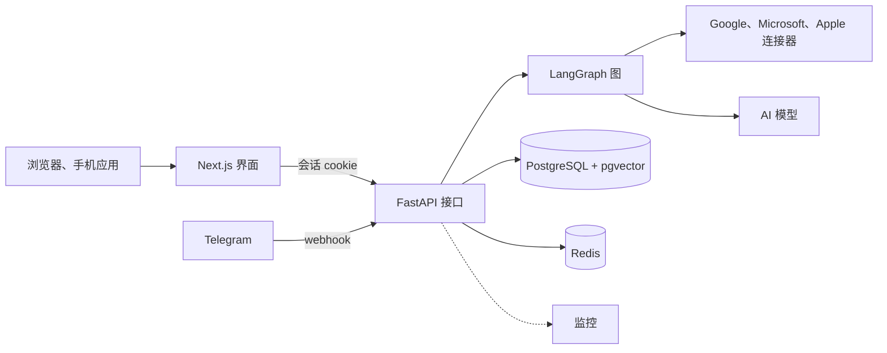
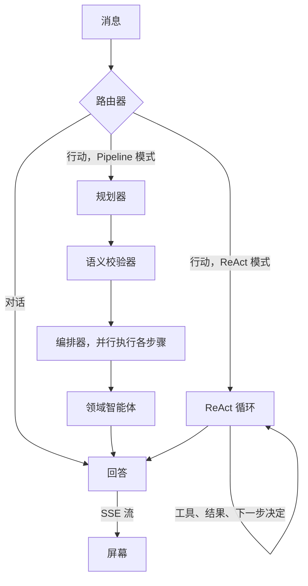
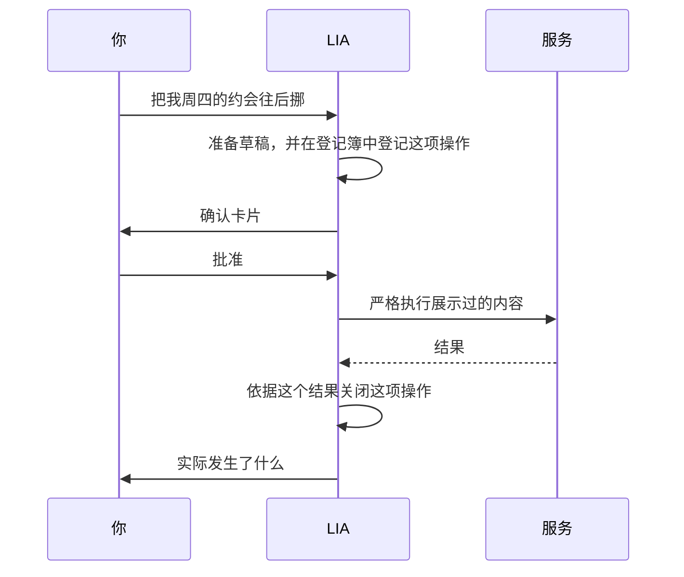
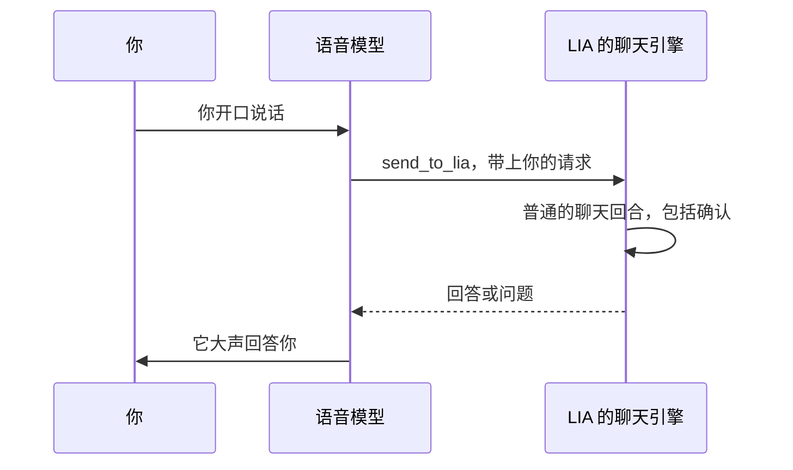

# LIA — 技术指南

> LIA 是怎样构建的，这里只讲主要脉络。细节在代码、ADR 和仓库的文档里。

**版本**：6.0
**日期**：2026-10-23
**应用**：LIA v4.2.0
**许可证**：AGPL-3.0（开源）

---

## 目录

1. [总览](#1-总览)
2. [按领域划分的后端](#2-按领域划分的后端)
3. [一条消息的旅程](#3-一条消息的旅程)
4. [谨慎行事](#4-谨慎行事)
5. [记忆与上下文](#5-记忆与上下文)
6. [模型](#6-模型)
7. [连接器与工具](#7-连接器与工具)
8. [语音、Live 模式与电话](#8-语音live-模式与电话)
9. [主动性](#9-主动性)
10. [安全与隐私](#10-安全与隐私)
11. [观测与度量](#11-观测与度量)
12. [界面](#12-界面)
13. [代码如何维护](#13-代码如何维护)
14. [延伸阅读](#14-延伸阅读)

---

## 1. 总览

我设计 LIA，是为了让她在你自己家里、在普通的硬件上运行。参考平台是一台 Raspberry Pi 5（ARM64），下面的一切都由此而来：只有一台机器，本地的 PostgreSQL 数据库和 Redis，没有任何托管在别处的数据库。凭据和服务商的密钥都加密存储。

其余的一切由三条原则引导。首先是**透明**：可观测性从一开始就是架构的一部分，消耗的每一个 token 都连同其费用一起被追踪。其次是**纵深防御**：配额、确认和防幻觉的护栏是彼此独立的几层。最后是**不依赖服务商**：系统中的每个角色都可以交给不同的模型，这让我既不怕涨价，也不怕宕机。

技术栈刻意选得很常规：

| 层 | 选择 |
| --- | --- |
| 后端 | Python 3.14、FastAPI，全程异步 |
| 智能体编排 | LangGraph 1.x |
| 数据 | PostgreSQL 加 pgvector：数据、图的检查点和向量检索 |
| 缓存与协调 | Redis：缓存、会话、速率限制、领导者选举 |
| 前端 | Next.js 16（App Router）、React 19、严格模式的 TypeScript |
| 模型 | OpenAI、Anthropic、Google Gemini、DeepSeek、Perplexity、Qwen，以及通过 Ollama 运行的任何本地模型 |
| 日志 | 结构化 JSON，过滤个人数据 |

本地模型运行时没有 API 费用，完全在你自己那里运行。API 以多个 worker 运行；借助 Redis 中的领导者选举，计划任务只交给其中一个 worker。每个可选子系统都由一个开关启用，配置只遵循一条层级链：管理员在应用里的设置优先于环境变量，环境变量又优先于代码里的常量。我之所以只要一条层级链，是因为一个悄悄偏离实际配置的常量，会造成最难发现的 bug。

引导式安装程序会问几个问题，创建管理员账户时不以明文写下任何机密，检查安装是否真的能正常工作，日后还能重新配置，而无需再次索要密钥（[安装 LIA](/zh/faq#faq-self_hosting)）。

规模大致如下：350 多份 ADR，数百个 Prometheus 指标，数万个自动化测试，界面支持六种语言（法语、英语、德语、西班牙语、意大利语、中文）。

*延伸阅读：[总体架构](https://github.com/jgouviergmail/LIA-Assistant/blob/main/docs/ARCHITECTURE.md) · [自托管](https://github.com/jgouviergmail/LIA-Assistant/blob/main/docs/guides/GUIDE_SELF_HOSTING.md) · [模型服务商](https://github.com/jgouviergmail/LIA-Assistant/blob/main/docs/technical/LLM_PROVIDERS.md) · [可管理的能力](https://github.com/jgouviergmail/LIA-Assistant/blob/main/docs/architecture/ADR-217-Capacites-Administrables.md)*

## 2. 按领域划分的后端

后端遵循 Domain-Driven Design（领域驱动设计）。每个业务领域（智能体、连接器、语音、记忆、提醒、对话……）都是 `src/domains/` 下一个独立的上下文，拆分方式都一样：路由、服务、仓储、模型、schema。此外，一个横切的核心（`core`）承载配置和公共规则，一个共享的基础设施层汇集了各领域都需要的东西：模型工厂、缓存、MCP 客户端、浏览器、速率限制、任务调度器、可观测性。

对外部服务，我选择了六边形架构。工具只认识 Python 协议（端口），由 Google、Microsoft、Apple 或 Philips Hue 的客户端来实现它们（适配器）。因此，新增一个服务商不会动到调用它的代码。

仓库是一个 monorepo：`apps/api` 放后端，`apps/web` 放界面，`infrastructure/` 放 Docker 和监控，`docs/` 放文档。管理员在界面里换了一个模型，会立刻生效，无需重新部署，因为运行中的配置存放在数据库里。

*延伸阅读：[创建连接器](https://github.com/jgouviergmail/LIA-Assistant/blob/main/docs/guides/GUIDE_CONNECTOR_IMPLEMENTATION.md) · [创建智能体](https://github.com/jgouviergmail/LIA-Assistant/blob/main/docs/guides/GUIDE_AGENT_CREATION.md) · [创建工具](https://github.com/jgouviergmail/LIA-Assistant/blob/main/docs/guides/GUIDE_TOOL_CREATION.md) · [添加渠道](https://github.com/jgouviergmail/LIA-Assistant/blob/main/docs/templates/NEW_CHANNEL_CHECKLIST.md) · [添加模型服务商](https://github.com/jgouviergmail/LIA-Assistant/blob/main/docs/technical/LLM_PROVIDER_CONSTRAINTS.md) · [添加主动任务](https://github.com/jgouviergmail/LIA-Assistant/blob/main/docs/templates/NEW_PROACTIVE_TASK_CHECKLIST.md)*

## 3. 一条消息的旅程

我选择 LangGraph 来编排智能体，是因为它提供了我需要的三样东西：以检查点形式持久化到 PostgreSQL 的状态、循环，以及 `interrupt()`。`interrupt()` 可以暂停一个回合去请求确认，然后从中断的地方原样继续。没有这种机制，就谈不上像样的人工确认。

每条消息先经过一个**路由器**，它把消息归为普通对话，或需要采取行动的请求。普通对话直接进入回答。需要行动的请求则按聊天页顶部选定的模式处理。

在默认的 **Pipeline** 模式下，规划器会在任何执行之前写出一份 `ExecutionPlan`：一份 JSON 计划，各步骤通过依赖关系相连。另一个独立于规划器的模型负责校验这份计划，以免模型自己评判自己的工作。随后，编排器分批并行执行这些步骤。**ReAct** 模式则相反，让模型一步一步地调用工具、读取结果、决定下一步。

两种模式我都保留了，因为它们满足两种不同的需要。Pipeline 会规划、并行、自我检查，成本也可预估：调用一次规划器，再调用一次生成回答，而 ReAct 每次迭代都要调用一次，因此 token 用量少 4 到 8 倍。ReAct 会根据每个结果灵活调整，更适合探索性的搜索或含糊的请求。两种模式共用工具注册表、确认机制、回答节点和可观测性。

领域和工具的选择交给一个基于 embedding 的**语义路由器**，而不是靠关键词，也不是单靠模型：它更便宜，出错也更少。每个工具都声明一份清单（参数、输出、成本、权限、多种语言的关键词），供规划器、路由器和智能体构建器读取；每个智能体只在一个中央注册表里声明一次。Smart Services 会缓存对请求的分析、学习反复出现的计划，从而进一步降低消耗。在一个需要行动的回合之后，一个主动性节点会以只读方式查看这个结果在别处意味着什么：预报有雨，就会联系到你日程里的户外活动。

有几条规则让整个系统保持诚实。没有行动意图的请求，不可能生成会修改任何东西的计划，这是一条确定性的规则，在调用模型之前就会检查。一个修改计划如果用完了所有修正尝试，就不会被执行：LIA 宁可问你一个问题，也不写入错误的数据。拒绝或失败绝不会被说成已完成的操作；计划执行之后，也不会背着你重新执行任何东西：回答会说明每一次失败、是哪个工具、为什么失败，以及确切的总数。需要在途中自我修正时，可以用 ReAct 模式。

回答通过 SSE 一个 token 一个 token 地送达。生成过程与连接是解耦的：一个独立的生产者把内容发布到该回合专属的 Redis 流中，页面只是它的一个订阅者。所以关掉标签页并不会中止任何东西，回答会等着你。

*延伸阅读：[两种模式](https://github.com/jgouviergmail/LIA-Assistant/blob/main/docs/architecture/ADR-070-ReAct-Execution-Mode.md) · [为什么选择 LangGraph](https://github.com/jgouviergmail/LIA-Assistant/blob/main/docs/architecture/ADR-001-LangGraph-Orchestration.md) · [图的细节](https://github.com/jgouviergmail/LIA-Assistant/blob/main/docs/ARCHITECTURE_LANGRAPH.md) · [路由器](https://github.com/jgouviergmail/LIA-Assistant/blob/main/docs/technical/ROUTER.md) · [计划及其并行执行](https://github.com/jgouviergmail/LIA-Assistant/blob/main/docs/architecture/ADR-014-ExecutionPlan-Parallel-Executor.md) · [规划器与批量操作](https://github.com/jgouviergmail/LIA-Assistant/blob/main/docs/technical/PLANNER.md) · [语义路由器](https://github.com/jgouviergmail/LIA-Assistant/blob/main/docs/architecture/ADR-048-Semantic-Tool-Router.md) · [工具清单](https://github.com/jgouviergmail/LIA-Assistant/blob/main/docs/architecture/ADR-019-Agent-Manifest-Catalogue-System.md) · [流水线的失败会被说明，绝不重放](https://github.com/jgouviergmail/LIA-Assistant/blob/main/docs/architecture/ADR-346-Advisory-Replanner-Retired-A-Pipeline-Failure-Is-Said-Never-Replayed.md) · [如实反馈工具失败](https://github.com/jgouviergmail/LIA-Assistant/blob/main/docs/architecture/ADR-303-Tool-Failure-Restitution.md) · [关掉标签页后依然继续的回合](https://github.com/jgouviergmail/LIA-Assistant/blob/main/docs/architecture/ADR-117-Background-Chat-Runs.md) · [ReAct 模式](https://github.com/jgouviergmail/LIA-Assistant/blob/main/docs/technical/REACT_EXECUTION_MODE.md)*

## 4. 谨慎行事

凡是真正会发生的事，LIA 都会先问你：每一份草稿（一封邮件、一个日程、一次删除），每一项至少会修改一个条目的批量操作，每一个声明需要确认的工具。确认是逐项请求的，在操作准备好的地方提出，而不是针对整个计划。反过来，一个不可能被挪作他用的操作就什么也不问：你发给自己的邮件会直接发出。

你确认的，正是最后一次显示的内容；每项修改只执行一次。同一回合里的多份草稿会逐一审阅。你可以用自由的语言回复：一个模型会把你的回复归类为同意、拒绝或要求修改。在对话之外，工单在工单本身上请求确认；而一个无人值守、自动运行的例程不会提问：它会拒绝执行这项操作并说明，否则你的下一条消息就会被当成回答。通过聊天下达的命令（「把我的回答改成卡片」）遵循同样的规则；命令若需要连接账户、输入密钥或选择文件，这一步会在已认证的浏览器中完成。LIA 会依据她能观察到的情况核实所要求的结果，但仅凭把任务委托给一个工具，并不能证明它所有的内部效果。同样，一把锁可以防止重复执行，却无法保证外部服务商只会执行一次。

回答本身也有约束：模型只根据工具的真实结果来撰写。LIA 所做的一切都记录在三本各自独立的**登记簿**里：操作、查阅和回合。它们的总数不能相加，因为一个回合可能查阅了五个来源却什么也没改。一项操作在发生之前就被登记，只有拿到明确的结果才会关闭。删除一段对话会移除你在其中发送的文件，但不会移除 LIA 为你生成的文件。

*延伸阅读：[确认机制](https://github.com/jgouviergmail/LIA-Assistant/blob/main/docs/technical/HITL.md) · [授权链与登记簿](https://github.com/jgouviergmail/LIA-Assistant/blob/main/docs/architecture/ADR-263-Execution-Authority-Chain-And-Effect-Register.md) · [用户视角的登记簿](/zh/faq#faq-registers) · [工单](https://github.com/jgouviergmail/LIA-Assistant/blob/main/docs/technical/WORKBOARD.md) · [应用命令](https://github.com/jgouviergmail/LIA-Assistant/blob/main/docs/technical/APPLICATION_COMMANDS.md) · [委托能证明什么](https://github.com/jgouviergmail/LIA-Assistant/blob/main/docs/architecture/ADR-336-Requested-Outcomes-Checked-Against-Canonical-Observations.md) · [工具示例、发给自己的邮件与草稿](https://github.com/jgouviergmail/LIA-Assistant/blob/main/docs/knowledge/05_tool_examples.md) · [回答的合成](https://github.com/jgouviergmail/LIA-Assistant/blob/main/docs/technical/RESPONSE.md)*

## 5. 记忆与上下文

对话的状态是一个 `MessagesState`，LangGraph 在每个节点之后把它作为检查点写入 PostgreSQL。正因如此，确认之后才能接着继续一个回合，哪怕隔了几个小时。工具的结果不存放在消息历史里，而是放在一个单独的数据注册表中，因此即使历史被截断，它们也能保留下来。超过某个阈值后，较早的交流会被总结；一个小徽标显示上下文的占用程度，`/resume` 可以按需触发这种总结。在 ReAct 模式下，一个循环已经读过的内容会写入检查点，并在本回合内复用；如果在这个检查点之前就中止，可能需要重新读取某个来源。

长期记忆、知识空间和工具上下文都存放在同一个数据库里，借助 pgvector。每次交流之后，一个后台任务会从最后一条消息中提取记忆；与问题相近的记忆会回到下一次的上下文中，而记忆本身也是一个工具，规划器和 ReAct 都可以查询。一条长期有效的指示（「回答短一点」）会被置顶，并且可见。当触及敏感话题时，一条指令会禁止开玩笑或轻描淡写。

围绕这份记忆，我又加了几层。**日记**是 LIA 以第一人称写的笔记；从中会浮现出一幅关于这个人的画像，并附上为它提供素材的来源，这幅画像只能通过间接的手段来修正。**Psyche Engine** 赋予 LIA 一种随每次交流而变化的心理状态，这种状态会透过她的风格流露出来，而不会被直接说出；它还会按领域学习她在哪些方面靠得住，依据的是证据；这还只是一项试点，目前并不宣称带来了任何提升。它有一个坦然承认的局限：它几乎从不报告平静、低强度的情绪，它在这部分的激活始终处于锁定状态。**兴趣**从你的请求中识别出来，并由多个来源充实。最后，**习惯**是通过统计检验学到的，而不是靠训练出来的模型；我这样做有三个理由，每一个都足够充分：Raspberry Pi 没有训练的预算；一个公式可以公开给它所涉及的那个人看；而在这么小的数据量上，模型学到的主要会是噪声。

*延伸阅读：[检查点](https://github.com/jgouviergmail/LIA-Assistant/blob/main/docs/architecture/ADR-022-LangGraph-State-Checkpointing.md) · [数据注册表](https://github.com/jgouviergmail/LIA-Assistant/blob/main/docs/architecture/ADR-012-Data-Registry-StandardToolOutput-Pattern.md) · [上下文压缩](https://github.com/jgouviergmail/LIA-Assistant/blob/main/docs/technical/COMPACTION_v2.md) · [ReAct 的检查点读取](https://github.com/jgouviergmail/LIA-Assistant/blob/main/docs/architecture/ADR-337-Checkpointed-ReAct-Read-Segments-And-Turn-Local-Reuse.md) · [PostgreSQL 中的记忆](https://github.com/jgouviergmail/LIA-Assistant/blob/main/docs/architecture/ADR-066-Memory-PostgreSQL-Migration.md) · [长期记忆](https://github.com/jgouviergmail/LIA-Assistant/blob/main/docs/technical/LONG_TERM_MEMORY.md) · [作为检索工具的记忆](https://github.com/jgouviergmail/LIA-Assistant/blob/main/docs/architecture/ADR-313-Long-Term-Memory-As-An-Active-Lookup.md) · [长期规则](https://github.com/jgouviergmail/LIA-Assistant/blob/main/docs/architecture/ADR-236-procedural-memory.md) · [日记与画像](https://github.com/jgouviergmail/LIA-Assistant/blob/main/docs/technical/JOURNALS.md) · [Psyche Engine](https://github.com/jgouviergmail/LIA-Assistant/blob/main/docs/technical/PSYCHE_ENGINE.md) · [它经过测量的局限](https://github.com/jgouviergmail/LIA-Assistant/blob/main/docs/architecture/ADR-142-Psyche-Observability-And-Dominance-Recentering.md) · [用户视角的心理状态](https://github.com/jgouviergmail/LIA-Assistant/blob/main/docs/knowledge/22_psyche.md) · [基于证据习得的效能](https://github.com/jgouviergmail/LIA-Assistant/blob/main/docs/architecture/ADR-348-Efficacy-Learned-From-Evidence-Results-And-Usefulness-Kept-Apart.md) · [兴趣](https://github.com/jgouviergmail/LIA-Assistant/blob/main/docs/technical/INTERESTS.md) · [习惯](https://github.com/jgouviergmail/LIA-Assistant/blob/main/docs/knowledge/28_habits.md) · [在日记和登记簿中检索](https://github.com/jgouviergmail/LIA-Assistant/blob/main/docs/architecture/ADR-318-Assistant-Tools-Exact-Answers-And-Own-Records.md)*

## 6. 模型

一个统一的工厂负责实例化任何受支持服务商的模型，并为它套上对应的适配器。每个角色都有自己的模型槽位（对话、规划、图像、转写、语音合成……），在管理界面里设置，无需重新部署。模型目录存放在数据库里，逐个模型声明它的能力、它接受的参数以及它所支持的思考等级；这样，配置界面只会提供模型 API 真正接受的选项。

有些任务不是生成，而是有边界的决策：选择一种格式，给一封邮件定性。这些任务可以交给一个原生决策引擎，每一项都有自己的开关，另外还有一个总开关。不确定的决策会退回常规处理流程，权限和确认都不会交给它。一个定性结论并不能认证任何发件人；在测试语料上测得的提升，也不等于对每一个请求的承诺。

每一次模型调用，无论是在对话流程中还是在后台任务里，都会被追踪，并根据数据库中的价格计算费用，再按回合汇总。在成本上，最大的节省来自服务商的缓存。每个 prompt 都把稳定的内容放在一个标记之前，把本次请求特有的内容放在标记之后，基础设施再把这个标记转换成每家服务商各自的缓存机制。由于每个槽位都可以更换模型，我不会针对某一个模型去调这个缓存：我追求的是最好的平均效果，而没有缓存的模型也不会因此多付一分钱。针对其他本地引擎（oMLX、llama.cpp、LM Studio）所做的研究只是评估，并不是已经交付的集成：真正算数的只有实例提供的那些服务商。

*延伸阅读：[模型选择](https://github.com/jgouviergmail/LIA-Assistant/blob/main/docs/architecture/ADR-026-LLM-Model-Selection-Strategy.md) · [数据库中的目录](https://github.com/jgouviergmail/LIA-Assistant/blob/main/docs/architecture/ADR-078-LLM-Catalogue-DB-Source-Of-Truth.md) · [配置界面](https://github.com/jgouviergmail/LIA-Assistant/blob/main/docs/technical/LLM_CONFIG_ADMIN.md) · [原生决策](https://github.com/jgouviergmail/LIA-Assistant/blob/main/docs/architecture/ADR-325-JEV-Bounded-Decisions-With-Hot-Switches-And-Accounted-Fallbacks.md) · [它们的集成](https://github.com/jgouviergmail/LIA-Assistant/blob/main/docs/technical/JEV_INTEGRATION.md) · [邮件定性](https://github.com/jgouviergmail/LIA-Assistant/blob/main/docs/technical/EMAIL_EVENT_CLASSIFICATION.md) · [适用于所有缓存的同一种布局](https://github.com/jgouviergmail/LIA-Assistant/blob/main/docs/architecture/ADR-309-One-Prompt-Layout-For-Every-Cache-Mechanism.md) · [工具目录的筛选](https://github.com/jgouviergmail/LIA-Assistant/blob/main/docs/architecture/ADR-003-Multi-Domain-Dynamic-Filtering.md) · [研究过的本地引擎](https://github.com/jgouviergmail/LIA-Assistant/blob/main/docs/knowledge/16_other.md)*

## 7. 连接器与工具

每一类连接器（邮件、日程、联系人、任务、文件、家居）都是一个 Python 协议。每一类同一时间只有一个服务商处于启用状态，OAuth 授权每个 Google 或 Microsoft 账户只需给一次。不需要用户提供任何东西的服务（维基百科、网页阅读、地点、天气）属于实例，对所有人都启用。在邮件方面，每封邮件只总结一次，之后反复使用；附件或者按文本读取，或者交给视觉模型来读；如果发送回执丢失了，就绝不重新发送。

工具建立在五个可组合的层之上：一个公共的连接器基类（OAuth、缓存、注入），一个装饰器，按领域划分的格式化器，供规划器读取的清单，以及一个目录加载器。**MCP** 工具会被转换成普通的 LangChain 工具，进入同一个目录，并在一条条消息之间保留，因此消息通常不必等待任何服务器；MCP 服务器必须使用 HTTPS，其凭据加密存储；如果一条注解声明会修改数据，LIA 会相信它，而一条声称只读的注解，LIA 永远不会采信。Agent Plugins 格式的**插件**整体安装，不需要本地服务器。遵循 agentskills.io 标准的 **skills** 可以在聊天里渲染一个小应用，也可以在自己文件夹的副本里执行它们自己的命令；来自别处的 skill 会隔离运行，永远拿不到任何连接器的令牌。

当某一步需要真正的计算时，ReAct 模式可以写一个简短的 Python 脚本，放进一个用完即弃的容器里执行。这个脚本只能经由唯一的代理访问网络，看不到用户的密钥（代理只在获准的那台主机上把密钥替换进去）；遇到未知的主机，会向用户提问，并给出三种可选的回答。在两种模式下，计算、时长和货币换算都交给精确的工具，而不是交给模型。还有一个智能体能够操控浏览器（Playwright），或把网页转换成文本。

**知识空间**中的文档会被切分、向量化，并存进 PostgreSQL，而不是外部的向量数据库，之后通过语义与词法结合的混合检索找回。一个空间可以跟随一个 Drive 文件夹（连同它的子文件夹）或一个 Gmail 标签，而不必为整个邮箱建立索引。这里没有文字识别：扫描版的 PDF 不会按原样编入索引。从外部发送来的数据（短信、步数、心率，来自 iPhone、Android 或任何能发送 JSON 的系统）通过专门的接入端点进入，这些端点用一个范围受限、可撤销、且独立于会话的令牌来认证。

遇到复杂的任务，LIA 会委派给临时的、只读的子智能体。她还会生成文件：文档、图片、截图，它们都归入一个图库，可以保留，可以通过邮件发送，图片还可以分享给同一实例上与你建立了连接的某个人。

*延伸阅读：[连接器模式](https://github.com/jgouviergmail/LIA-Assistant/blob/main/docs/technical/CONNECTORS_PATTERNS.md) · [合并的 OAuth 授权](https://github.com/jgouviergmail/LIA-Assistant/blob/main/docs/architecture/ADR-302-OAuth-Grant-Par-Compte-Et-Consentement-Groupe.md) · [实例级服务](https://github.com/jgouviergmail/LIA-Assistant/blob/main/docs/architecture/ADR-307-Keyless-Connectors-Belong-To-The-Instance.md) · [用户视角的连接器](/zh/faq#faq-connectors) · [邮件及其摘要](https://github.com/jgouviergmail/LIA-Assistant/blob/main/docs/architecture/ADR-287-Email-Content-First-Detail-Levels-Digests-And-Neutral-Message.md) · [附件](https://github.com/jgouviergmail/LIA-Assistant/blob/main/docs/architecture/ADR-296-Mail-Attachments-Read-By-Text-Or-Vision.md) · [按槽位设定的超时](https://github.com/jgouviergmail/LIA-Assistant/blob/main/docs/architecture/ADR-221-Timeout-Par-Emplacement-Applique.md) · [工具基类](https://github.com/jgouviergmail/LIA-Assistant/blob/main/docs/architecture/ADR-015-ConnectorTool-Base-Class-Pattern.md) · [MCP](https://github.com/jgouviergmail/LIA-Assistant/blob/main/docs/technical/MCP_INTEGRATION.md) · [Agent Plugins 标准](https://github.com/jgouviergmail/LIA-Assistant/blob/main/docs/architecture/ADR-225-Standard-Agent-Plugins-v1.md) · [插件](https://github.com/jgouviergmail/LIA-Assistant/blob/main/docs/technical/PLUGINS_INTEGRATION.md) · [skills](https://github.com/jgouviergmail/LIA-Assistant/blob/main/docs/technical/SKILLS_INTEGRATION.md) · [用户视角的 skills](https://github.com/jgouviergmail/LIA-Assistant/blob/main/docs/knowledge/12_skills.md) · [第三方 skills](https://github.com/jgouviergmail/LIA-Assistant/blob/main/docs/architecture/ADR-327-Skill-Library-And-Third-Party-Skills.md) · [修改 skill](https://github.com/jgouviergmail/LIA-Assistant/blob/main/docs/architecture/ADR-165-Skill-Editing-By-Regeneration.md) · [分享一项能力](https://github.com/jgouviergmail/LIA-Assistant/blob/main/docs/technical/PEER_CAPABILITY_TRANSFERS.md) · [临时 Python](https://github.com/jgouviergmail/LIA-Assistant/blob/main/docs/architecture/ADR-249-Ephemeral-Python-In-The-Existing-Sandbox.md) · [沙箱的网络出口](https://github.com/jgouviergmail/LIA-Assistant/blob/main/docs/architecture/ADR-298-Sandbox-Egress-Toolbox.md) · [计算得出的回答](https://github.com/jgouviergmail/LIA-Assistant/blob/main/docs/knowledge/35_computed_answers.md) · [浏览器](https://github.com/jgouviergmail/LIA-Assistant/blob/main/docs/technical/BROWSER_CONTROL.md) · [网页阅读](https://github.com/jgouviergmail/LIA-Assistant/blob/main/docs/technical/WEB_FETCH.md) · [知识空间](https://github.com/jgouviergmail/LIA-Assistant/blob/main/docs/architecture/ADR-055-RAG-Spaces-Architecture.md) · [知识空间指南](https://github.com/jgouviergmail/LIA-Assistant/blob/main/docs/guides/GUIDE_RAG_SPACES.md) · [知识空间的用法](https://github.com/jgouviergmail/LIA-Assistant/blob/main/docs/knowledge/14_rag_spaces.md) · [Drive 文件夹是一棵树](https://github.com/jgouviergmail/LIA-Assistant/blob/main/docs/architecture/ADR-297-Drive-Folder-Is-A-Tree-And-The-Count-Is-Exact.md) · [以 Gmail 标签为来源](https://github.com/jgouviergmail/LIA-Assistant/blob/main/docs/architecture/ADR-262-Opt-In-Mail-Label-RAG-Source.md) · [内置 FAQ](https://github.com/jgouviergmail/LIA-Assistant/blob/main/docs/architecture/ADR-058-System-RAG-Spaces.md) · [附上空间中的文档](https://github.com/jgouviergmail/LIA-Assistant/blob/main/docs/architecture/ADR-295-Knowledge-Documents-As-Message-Attachments.md) · [子智能体](https://github.com/jgouviergmail/LIA-Assistant/blob/main/docs/knowledge/13_sub_agents.md) · [健康数据](https://github.com/jgouviergmail/LIA-Assistant/blob/main/docs/technical/HEALTH_METRICS.md) · [健康数据的接入](https://github.com/jgouviergmail/LIA-Assistant/blob/main/docs/architecture/ADR-076-Health-Metrics-Ingestion.md) · [用户视角的健康数据](https://github.com/jgouviergmail/LIA-Assistant/blob/main/docs/knowledge/23_health_metrics.md) · [短信](https://github.com/jgouviergmail/LIA-Assistant/blob/main/docs/technical/SMS_INGESTION.md) · [文档生成](https://github.com/jgouviergmail/LIA-Assistant/blob/main/docs/technical/DOCUMENT_GENERATION.md) · [用户视角的文档](https://github.com/jgouviergmail/LIA-Assistant/blob/main/docs/knowledge/32_document_generation.md) · [图片](https://github.com/jgouviergmail/LIA-Assistant/blob/main/docs/knowledge/21_image_generation.md) · [生成的文件](https://github.com/jgouviergmail/LIA-Assistant/blob/main/docs/knowledge/39_generated_files.md) · [保留文件](https://github.com/jgouviergmail/LIA-Assistant/blob/main/docs/architecture/ADR-319-A-Generated-File-Can-Be-Kept.md) · [通过邮件发送](https://github.com/jgouviergmail/LIA-Assistant/blob/main/docs/architecture/ADR-321-A-File-Or-An-Answer-Sent-By-E-Mail.md) · [输入框中的附件](https://github.com/jgouviergmail/LIA-Assistant/blob/main/docs/technical/ATTACHMENTS_INTEGRATION.md) · [收藏的回答](https://github.com/jgouviergmail/LIA-Assistant/blob/main/docs/knowledge/40_bookmarks.md)*

## 8. 语音、Live 模式与电话

经典的语音功能由彼此独立的组件构成。唤醒词「Dis LIA」在浏览器中检测，听到它之前不会发送任何东西；目前只提供法语模型，处于测试阶段。口述内容按账户的语言转写：或者在服务器上用 Whisper 离线完成，或者按照设置交给一个远程引擎。语音合成有多家服务商，默认是免费的 Edge；回答还在往下写的时候，前面的句子就已经开始逐句朗读了。还可以加上一个实验性的说话头像，使用的是用户自己的 Simli 密钥；只要连接保持打开，Simli 连沉默的时段也会计费。

**Live 模式**是一场真正的语音对语音的对话。我在里面放了两个智能，只用一道接缝相连：语音模型负责对话，每一个数据或操作请求都通过唯一的函数 `send_to_lia` 交给聊天引擎。请求会变成一个普通的聊天回合，带着它的确认、登记簿和配额。语音模型自己没有任何工具、凭据或记忆。

Live 会话不会就此结束，而是进入休眠：待机期间，与服务商的连接会关闭，不产生任何费用。Live 服务商的费用由用户自己的密钥支付，LIA 从不记录。使用 Live 直连 时，语音模型自己读取你的数据，但不做任何修改。

**电话**沿用同样的两种模式。经你确认后，LIA 可以替你打给第三方；她也可以打给你本人，拨打的是你已验证的号码，这时你在电话上就能用上自己的数据和她的全部功能，和在聊天中一样。当 LIA 打给第三方时，打电话的智能体只有一个只读的「空闲／忙碌」工具：对你日程的保护是结构性的，并不依赖 prompt 里的某条指示。在电话上，只有当服务商能够连接到你的实例时，才有 Live 模式。

会议可以直接在浏览器里录音：音频分成小段陆续发送，然后被转写并总结成一份结构化的纪要，归档到一个知识空间里。最后，个人电台只在收听期间制作节目，也不保留任何内容供重听。

*延伸阅读：[用户视角的语音](/zh/faq#faq-voice_mode) · [Live 待机与唤醒词](https://github.com/jgouviergmail/LIA-Assistant/blob/main/docs/architecture/ADR-329-Live-Standby-And-Multilingual-Wake-Word.md) · [声音与语音合成](https://github.com/jgouviergmail/LIA-Assistant/blob/main/docs/architecture/ADR-345-Fish-Audio-Served-Whole-One-Door-One-Allowance-Cues-Each-Engine-Reads.md) · [说话头像](https://github.com/jgouviergmail/LIA-Assistant/blob/main/docs/technical/SPEAKING_AVATAR.md) · [Live 模式](https://github.com/jgouviergmail/LIA-Assistant/blob/main/docs/architecture/ADR-299-Live-Voice-Mode-Two-Intelligences-One-Seam.md) · [用户视角的电话功能](/zh/faq#faq-telephony) · [以电话为渠道](https://github.com/jgouviergmail/LIA-Assistant/blob/main/docs/architecture/ADR-290-Phone-As-A-Channel-Owner-Calls.md) · [电台](/zh/faq#faq-radio) · [会议](https://github.com/jgouviergmail/LIA-Assistant/blob/main/docs/technical/MEETINGS.md) · [结构化纪要](https://github.com/jgouviergmail/LIA-Assistant/blob/main/docs/architecture/ADR-258-Meeting-Recording-And-Structured-Minutes.md) · [纪要模板](https://github.com/jgouviergmail/LIA-Assistant/blob/main/docs/architecture/ADR-259-Meeting-Template-Library-And-Reformatting.md)*

## 9. 主动性

LIA 主动出手有三种形式。周期性的 **heartbeat**（心跳）会查看你的各个来源，只有在某个信号值得时才给你发消息，并点明一两个经过核实的事实。连接一个来源，和同意被它打扰，是两个分开的决定。来自 Google 的一条推送通知可以只为某一个人唤醒这个心跳；而一个**时刻**（一场会议结束、一封等待中的邮件到达）会在当下这一分钟就得到处理，而不是等到下一轮。最后，**主动讨论**需要你回应，它们有自己的规则：时段、每日上限、敏感话题保持私密、费用在发生之前预先预留。

**例程**按日程表或按条件触发，二者只能选其一；一周视图会显示实际发生了什么。提醒可以重复。**工单看板**让一项任务拥有生命周期、负责人和结果。

这一切受两条规则约束。主动性只读不写：一次写入只会被提议，绝不会自行执行。而且，一旦效果登记簿显示这项操作已经完成，同一次执行的再次尝试就会被拒绝。「活动」页面把 LIA 独自着手的一切集中在一处显示，并给出确切的总数。

*延伸阅读：[heartbeat](https://github.com/jgouviergmail/LIA-Assistant/blob/main/docs/technical/HEARTBEAT_AUTONOME.md) · [打扰的许可](https://github.com/jgouviergmail/LIA-Assistant/blob/main/docs/architecture/ADR-197-Interrupt-Permission-Is-Not-Connection.md) · [推送唤醒](https://github.com/jgouviergmail/LIA-Assistant/blob/main/docs/architecture/ADR-261-Push-Driven-Heartbeat-Wake-And-Incremental-Drive-Sync.md) · [时刻与监看](https://github.com/jgouviergmail/LIA-Assistant/blob/main/docs/architecture/ADR-281-Anticipated-Moments-And-Mail-Watches.md) · [主动讨论](https://github.com/jgouviergmail/LIA-Assistant/blob/main/docs/technical/PROACTIVE_DISCUSSIONS.md) · [主动讨论的送达](https://github.com/jgouviergmail/LIA-Assistant/blob/main/docs/architecture/ADR-358-Independent-Proactive-Discussions-And-Native-Delivery.md) · [主动讨论的上下文](https://github.com/jgouviergmail/LIA-Assistant/blob/main/docs/architecture/ADR-359-Longitudinal-Discussion-Context-And-User-Control.md) · [主动讨论的预算](https://github.com/jgouviergmail/LIA-Assistant/blob/main/docs/architecture/ADR-360-Bounded-Discussion-Research-And-Accounted-Abstention.md) · [例程](https://github.com/jgouviergmail/LIA-Assistant/blob/main/docs/knowledge/10_scheduled_actions.md) · [例程的一周视图](https://github.com/jgouviergmail/LIA-Assistant/blob/main/docs/architecture/ADR-265-Routine-Week-Timeline-And-Run-History.md) · [提醒](https://github.com/jgouviergmail/LIA-Assistant/blob/main/docs/knowledge/07_reminders.md) · [永远有文字内容的提醒](https://github.com/jgouviergmail/LIA-Assistant/blob/main/docs/architecture/ADR-285-Short-Answer-Without-Reasoning-And-One-Family-Declaration.md) · [只读的主动性](https://github.com/jgouviergmail/LIA-Assistant/blob/main/docs/architecture/ADR-062-Agent-Initiative-Phase.md) · [工单看板](https://github.com/jgouviergmail/LIA-Assistant/blob/main/docs/architecture/ADR-276-Workboard.md) · [「活动」页面](https://github.com/jgouviergmail/LIA-Assistant/blob/main/docs/architecture/ADR-234-activity-timeline.md) · [为通知打分](https://github.com/jgouviergmail/LIA-Assistant/blob/main/docs/knowledge/09_proactive_notifications.md)*

## 10. 安全与隐私

安全按彼此独立的层来设计，每一类攻击都有专门的防护。账户通过 OAuth 2.1 连接，权限按角色分配。会话方面，我选择了 BFF 模式：一个 HTTP-only cookie 加上存放在 Redis 里的会话，而不是 JWT 令牌；JWT 如果存在浏览器里就会暴露在 XSS 之下，传输起来笨重，而且无法撤销。账户可以用通行密钥（passkey）和第二因素来保护，每一台已登录的设备都可以撤销，而绑定一个 Google 身份绝不会改变账户的状态。使用限额适用于所有入口，例程也不例外。

凡是替用户执行的东西都被当作有敌意的来对待：skill 的代码在用完即弃的容器里运行，远程服务器上的任务要先准备、再确认。同样，LIA 读到的内容始终是数据，不会变成指令。来源是数据本身的一个属性：每一种内容类型只分类一次，未知的类型被当作外部内容处理，而一个没人分类过的类型会让应用无法启动。

在 debug 级别之上，一行日志只记录事实（数字、标识符、代码、网址的主机名），不记录你写的内容，也不记录模型写下的关于你的内容。有两点保留：外部服务的错误信息如果采用未知的格式，仍可能引用这些内容的一个片段；而 debug 级别会保留更多内容，它在生产环境中是关闭的。数据库会自动备份：在默认设置下，最多只会丢失一天的数据。异地副本和附件都不包含在这些备份里。

有两个局限需要了解。仅凭这些措施，并不能证明一套部署符合 GDPR。另外，删除原始的测量数据（比如你的健康数据），并不会删除由它们衍生出来的记忆，这些记忆有自己单独的管理方式。

*延伸阅读：[安全](https://github.com/jgouviergmail/LIA-Assistant/blob/main/docs/technical/SECURITY.md) · [BFF 认证](https://github.com/jgouviergmail/LIA-Assistant/blob/main/docs/architecture/ADR-002-BFF-Pattern-Authentication.md) · [通行密钥](https://github.com/jgouviergmail/LIA-Assistant/blob/main/docs/architecture/ADR-143-Strong-Authentication-Passkeys.md) · [设备](https://github.com/jgouviergmail/LIA-Assistant/blob/main/docs/architecture/ADR-144-Device-Sessions.md) · [使用限额](https://github.com/jgouviergmail/LIA-Assistant/blob/main/docs/technical/USAGE_LIMITS.md) · [沙箱](https://github.com/jgouviergmail/LIA-Assistant/blob/main/docs/architecture/ADR-149-Security-Remediation-Wave-1.md) · [内容来源](https://github.com/jgouviergmail/LIA-Assistant/blob/main/docs/architecture/ADR-167-Content-Trust-Registry.md) · [用户视角的隐私](/zh/faq#faq-privacy) · [不含个人数据的日志](https://github.com/jgouviergmail/LIA-Assistant/blob/main/docs/technical/PII_LOGGING_SECURITY.md) · [一行日志只记录事实](https://github.com/jgouviergmail/LIA-Assistant/blob/main/docs/architecture/ADR-317-A-Log-Line-Carries-Facts-Never-The-Words.md) · [备份](https://github.com/jgouviergmail/LIA-Assistant/blob/main/docs/architecture/ADR-109-PostgreSQL-Backup-Strategy.md) · [记忆的来源](https://github.com/jgouviergmail/LIA-Assistant/blob/main/docs/architecture/ADR-201-Provenance-Is-A-Bounded-Reference.md)*

## 11. 观测与度量

监控直接内置在部署之中：Prometheus 和 Grafana 负责指标，Loki 负责日志，Tempo 负责链路追踪，Langfuse 负责模型调用，Alertmanager 负责告警。代码中定义了数百个指标，随附三十来个开箱即用的仪表盘，而且指标的上报是防御式的：某个指标出错，不会拖垮一个请求。

我还把调试功能放进了界面里，因为智能体很难调试：调试面板会为每一次交流显示意图、计划、每个工具和每次模型调用；不用打开 Grafana，就能看出一个请求为什么花了这么多钱，或者为什么选中了某个领域。

在成本方面，平台为某个人支付的每一欧元，都会被追踪、显示、归属并计入这个人的用量，无论这笔钱是以什么方式花掉的。除了每个账户的配额之外，还有一个实例级的支出上限，因为多个账户乘以各自的配额，仍然是一笔没有上限的支出。运营者无需重新部署就能关闭某项能力：部署所允许的和运营者所选择的会叠加起作用，两个上限中较小的那个说了算。

LIA 也会读取她自己的遥测数据来进行自我诊断：每一条关键告警都会连同处理流程通过邮件发出，并成为一个事件；而她给出的建议始终只是建议。管理员甚至可以在聊天里操控 Claude Code CLI 来检查自己的服务器。

关于性能，需要说明一点：测得的延迟是基础设施的延迟。你实际感受到的响应时间，主要取决于一连串的模型调用，视请求和硬件不同，从几秒到几十秒不等。至于超出单台机器的扩展（多节点、副本、Redis 集群），目前仍只是一种可能的演进方向，而非现实。还有两个问题悬而未决：一个 worker 的内存在数天内的增长，以及 LangGraph 检查点的保留。

*延伸阅读：[可观测性技术栈](https://github.com/jgouviergmail/LIA-Assistant/blob/main/docs/architecture/ADR-020-Observability-Stack.md) · [调试面板](https://github.com/jgouviergmail/LIA-Assistant/blob/main/docs/technical/DEBUG_PANEL.md) · [调试面板的架构](https://github.com/jgouviergmail/LIA-Assistant/blob/main/docs/technical/DEBUG_PANEL_ARCHITECTURE.md) · [实例上限](https://github.com/jgouviergmail/LIA-Assistant/blob/main/docs/architecture/ADR-216-Plafond-De-Depense-D-Instance.md) · [每一笔支出都受两个上限约束](https://github.com/jgouviergmail/LIA-Assistant/blob/main/docs/architecture/ADR-272-Every-Platform-Paid-Token-Answers-To-Both-Ceilings.md) · [用工作簿管理](https://github.com/jgouviergmail/LIA-Assistant/blob/main/docs/technical/TABULAR_ADMIN_IO.md) · [定向公告](https://github.com/jgouviergmail/LIA-Assistant/blob/main/docs/architecture/ADR-312-A-Broadcast-Says-Who-It-Was-Addressed-To.md) · [演示实例](https://github.com/jgouviergmail/LIA-Assistant/blob/main/docs/technical/DEMO_INSTANCE.md) · [自我诊断](https://github.com/jgouviergmail/LIA-Assistant/blob/main/docs/technical/DIAGNOSTICS_DOMAIN.md) · [告警及其韧性](https://github.com/jgouviergmail/LIA-Assistant/blob/main/docs/architecture/ADR-247-Self-Diagnostics-And-Answer-Resilience.md) · [在聊天中使用 Claude CLI](https://github.com/jgouviergmail/LIA-Assistant/blob/main/docs/guides/GUIDE_DEVOPS_CLAUDE_CLI.md) · [一个 worker 的内存剖析](https://github.com/jgouviergmail/LIA-Assistant/blob/main/docs/architecture/ADR-283-Worker-Memory-Anatomy.md) · [登记簿的完整导出](https://github.com/jgouviergmail/LIA-Assistant/blob/main/docs/architecture/ADR-273-Complete-Register-Extractions.md) · [后台任务的组织](https://github.com/jgouviergmail/LIA-Assistant/blob/main/docs/architecture/ADR-046-Background-Job-Scheduling.md)*

## 12. 界面

网页界面是一个可以像应用一样安装的 Next.js 应用（PWA）。聊天无需刷新就能更新对话，能渲染数学公式和带语法高亮的代码，每个账户保留一份草稿，并且可以搜索；设置有自己的搜索功能、一款为 OLED 屏幕准备的纯黑主题，以及可调的文字大小。

在卡片显示模式下（这是三种可选模式之一，另外两种是简单 HTML 和 Markdown），带数据的回答不由模型来排版：服务器把它渲染成确定性的 HTML **卡片**，与模型和模式无关，并随消息一起存档。卡片完整地展示收到的事实，不捏造任何东西；从卡片发起的操作只会准备一个请求，而不会直接执行。为了让界面保持一致，我写下了一些由测试来验证的规则：一个状态的色调从唯一的一张表中取得，一个操作有它的重要程度，列表中的一行只用一种方式展示它的操作。浏览器测试和无障碍测试以 WCAG AA 级为目标，但不对实体设备上的显示效果和译文的忠实度作出认证。

手机应用是原生外壳，每个应用商店只发布一次。它们加载首次启动时输入的服务器地址，不复制界面，因为一个应用必须服务于所有自己托管 LIA 的人。在 Android 上，通知通过你自己服务器的 Firebase 项目发送；在 iOS 上，只有应用的发布者才能发送通知，因此由一个最小化的中继来唤醒手机。从手机上把一段文字或一个链接分享给 LIA，会生成一份聊天草稿，它不会自己发出去。

在聊天周围，一个有着生动眼睛的伙伴会对一个回答的整个过程作出反应，每个回答还带有一个表示心情的小头像。**LIA 的世界**是另一种界面：一座共享的房子和花园，大家可以在里面散步，但没有哪个房间会授予额外的权限。人与人之间的语音以及实例之间的联邦，目前都没有实现。至于介绍视频，它展示的是界面的仿制画面和演示数据。

同一个实例上的两个人可以把各自的助手连接起来，让它们互相转达消息；「人际关系」页面则汇集了与每个人有关的内容，并附有一份由模型撰写的复盘。

*延伸阅读：[用户视角的聊天](https://github.com/jgouviergmail/LIA-Assistant/blob/main/docs/knowledge/02_chat.md) · [设置](https://github.com/jgouviergmail/LIA-Assistant/blob/main/docs/knowledge/03_settings.md) · [设置中的搜索](https://github.com/jgouviergmail/LIA-Assistant/blob/main/docs/architecture/ADR-172-Settings-Quick-Search.md) · [入门](https://github.com/jgouviergmail/LIA-Assistant/blob/main/docs/knowledge/01_getting_started.md) · [与服务器同步的聊天](https://github.com/jgouviergmail/LIA-Assistant/blob/main/docs/architecture/ADR-320-The-Chat-Follows-The-Server-Without-A-Reload.md) · [卡片](https://github.com/jgouviergmail/LIA-Assistant/blob/main/docs/architecture/ADR-332-Deterministic-Cards-Received-Facts-And-Message-Owned-Actions.md) · [卡片的渲染](https://github.com/jgouviergmail/LIA-Assistant/blob/main/docs/technical/HTML_CARDS.md) · [地点与路线](https://github.com/jgouviergmail/LIA-Assistant/blob/main/docs/architecture/ADR-355-Acquired-Place-Details-And-Accounted-Selected-Routes.md) · [已知位置](https://github.com/jgouviergmail/LIA-Assistant/blob/main/docs/architecture/ADR-219-Derniere-Position-Connue-Generalisee.md) · [基础组件及其契约](https://github.com/jgouviergmail/LIA-Assistant/blob/main/docs/architecture/ADR-206-A-Primitive-Owns-Its-Contract.md) · [Android 应用](https://github.com/jgouviergmail/LIA-Assistant/blob/main/docs/guides/GUIDE_MOBILE_ANDROID.md) · [原生通知](https://github.com/jgouviergmail/LIA-Assistant/blob/main/docs/architecture/ADR-246-Native-Push-And-Wake-Relay.md) · [用户视角的应用](https://github.com/jgouviergmail/LIA-Assistant/blob/main/docs/knowledge/33_native_apps.md) · [生动的眼睛](https://github.com/jgouviergmail/LIA-Assistant/blob/main/docs/architecture/ADR-240-expressive-eyes-widget.md) · [原生伙伴](https://github.com/jgouviergmail/LIA-Assistant/blob/main/docs/technical/NATIVE_AVATAR_VOLUME.md) · [介绍视频](https://github.com/jgouviergmail/LIA-Assistant/blob/main/docs/architecture/ADR-341-Editable-Motion-Production-And-Exclusive-Presentation.md) · [能力地图](https://github.com/jgouviergmail/LIA-Assistant/blob/main/docs/knowledge/30_platform_capabilities.md) · [LIA 的世界](/zh/faq#faq-world) · [世界的原型](https://github.com/jgouviergmail/LIA-Assistant/blob/main/docs/technical/WORLD_PROTOTYPE.md) · [助手之间的连接](https://github.com/jgouviergmail/LIA-Assistant/blob/main/docs/knowledge/26_peer_connections.md) · [人际关系](https://github.com/jgouviergmail/LIA-Assistant/blob/main/docs/knowledge/27_relations.md) · [一段关系的复盘](https://github.com/jgouviergmail/LIA-Assistant/blob/main/docs/architecture/ADR-269-Relationship-Debrief.md) · [Telegram](https://github.com/jgouviergmail/LIA-Assistant/blob/main/docs/knowledge/18_telegram.md)*

## 13. 代码如何维护

每一次改动都要先通过本地的关卡（提交前、推送前），再经过 GitHub Actions 上的持续集成，后者调用的命令与开发者运行的完全相同。Python 依赖以表达意图的清单形式编写，再编译成通用的锁定文件，其中记录了每个包的指纹：同一个提交在任何架构上安装的，始终是同样的、经过校验的版本。

项目的规则不依赖审阅者的记忆：有自动化守卫来维持它们。其中好几个守卫会从事实来源重新计算防护（代码本身、实际挂载的路由、连接器注册表），而不是钉死一份手写的列表，而且都曾被故意弄坏，以确认它们确实会失败。在别的地方，一些参考列表只能缩短，好让任何技术债都不会悄悄增长。prompt 是带版本的文本文件，一个 prompt 一个文件，由唯一的加载器读取。350 多份 ADR 记录了各项决策、被否决的备选方案和所接受的取舍；数万个测试、持续集成和严格的类型检查，让系统可以不断演进而不出现回归。

一份 360 度的完整技术审计连同其协议一起发布在仓库里，任何人都可以重新执行。这些代码是怎样写成的（几乎全部由一个受人指挥、受人把关的 AI 完成），讲述在[经验报告](/zh/story)里。

*延伸阅读：[持续集成](https://github.com/jgouviergmail/LIA-Assistant/blob/main/docs/technical/CI_CD.md) · [依赖锁定](https://github.com/jgouviergmail/LIA-Assistant/blob/main/docs/architecture/ADR-112-Python-Dependency-Locking.md) · [带版本的 prompt](https://github.com/jgouviergmail/LIA-Assistant/blob/main/docs/architecture/ADR-025-Prompt-Engineering-Versioning.md) · [公开审计](https://github.com/jgouviergmail/LIA-Assistant/blob/main/docs/audit/README.md)*

## 14. 延伸阅读

本指南以代码、800 多份技术文档和 ADR 为依据。想进一步了解，可以看看：

- [文档索引](https://github.com/jgouviergmail/LIA-Assistant/blob/main/docs/INDEX.md)和 [ADR 索引](https://github.com/jgouviergmail/LIA-Assistant/blob/main/docs/architecture/ADR_INDEX.md)；
- [智能体架构](https://github.com/jgouviergmail/LIA-Assistant/blob/main/docs/ARCHITECTURE_AGENT.md)和 [LangGraph 图](https://github.com/jgouviergmail/LIA-Assistant/blob/main/docs/ARCHITECTURE_LANGRAPH.md)；
- [活地图](/zh/maps)，展示了各项功能、技术实现和决策的历史；
- 日常使用请看 [FAQ](/zh/faq)，方法请看[经验报告](/zh/story)。

代码采用 AGPL-3.0 许可，托管在 [GitHub](https://github.com/jgouviergmail/LIA-Assistant) 上。
