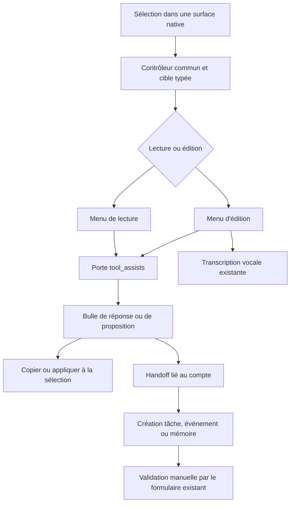

# Ajustements transverses LIA — analyse préalable

Date : 2026-11-08. Statut : **analyse et proposition d'architecture, sans implémentation métier**.

Cette étude répond à la demande de messages peer directs, de thème automatique, de filtres des espaces et alertes, et de deux menus de sélection communs. Travail réalisé inline, sans sous-agent, sans opération Git de modification, sans déploiement, sans appel volontaire à un modèle payant. Le dépôt comporte des travaux concurrents ; les observations décrivent les fichiers lus et les tests exécutés pendant cette session, pas une version publiée.

Le [plan d'exécution TDD](2026-11-08-cross-app-adjustments-plan.md) transforme les décisions ci-dessous en lots. Les chemins proposés dans ce plan sont des destinations de développement, pas des fichiers déjà existants.

## 1. Alignement et décisions de l'utilisateur

| Besoin | Contrat cible |
|---|---|
| Message à un peer | Une demande explicite, un destinataire résolu sans ambiguïté, une mise en file directe, sans carte HITL. Les contrôles d'identité, de connexion, de capacité et de quotas demeurent. |
| Apparence automatique | Cinquième choix de mode, avec **horaires personnalisables**. Clair pendant la plage définie ; noir absolu en dehors. Le mode « système » reste distinct. |
| Espaces | Recherche par nom d'espace ou nom de fichier ; nom par défaut ; récent ; nombre de fichiers décroissant ; actifs d'abord, puis inactifs, par nom dans chaque groupe. |
| Alertes | L'utilisateur a validé recherche dans le texte présenté, filtre de catégorie, récent/ancien pour la chronologie et récent/ancien/nom dans les rubriques Reçues / À suivre. **Conservation des rubriques actuelles**, aucune fusion de pages partielles. |
| Lecture seule | Expliquer, Simplifier, Traduire, Poser une question, En faire une tâche, En faire un événement, Mémoriser. Réponse locale pour les quatre premières ; proposition IA et ouverture du formulaire de création pour les trois dernières. |
| Édition | Corriger, Raccourcir, Plus formel, Plus chaleureux, Traduire, Dicter. Intervention sur la sélection ; proposition applicable par la personne, sans envoi ni sauvegarde automatique. |
| Mutualisation | Un moteur de sélection, un registre d'actions, deux présentations cohérentes, des adaptateurs de cibles. Les composants existants deviennent des consommateurs de cette même infrastructure. |

**Précision reçue pendant l'analyse : toutes les actions des menus sont pilotées par l'IA.** La création ne se fait donc pas par simple copie du passage : l'IA produit les champs proposés, puis l'écran natif correspondant permet de les ajuster. Dicter utilise la reconnaissance vocale existante ; cela n'impose pas d'ajouter une deuxième génération LLM après la transcription.

Décisions techniques retenues pour rendre ce contrat précis :

- Les horaires suivent le fuseau du compte, comme ses autres préférences temporelles. Valeurs initiales proposées : 07:00–20:00, modifiables à la minute. Ce sont des valeurs de produit proposées, pas une préférence déjà exprimée par l'utilisateur.
- « Tâche » désigne la tâche du fournisseur dans Outils → Tâches, comme dans les e-mails. Ce n'est ni un rappel ni un ticket délégué du Workboard. « Événement » ouvre Outils → Agenda.
- Aucun outil « Mémoire » autonome n'existe dans le Workbench inspecté. Mémoriser ouvre **Réglages → Mémoires → création**, avec le même formulaire natif déjà présent. Créer une nouvelle section Outils pour cette seule navigation serait une extension de périmètre inutile.
- « Partout » couvre les surfaces textuelles natives de l'application authentifiée : pages, chat, outils, panneaux et modales, y compris les surfaces World rendues dans le DOM. Les pixels d'un canvas, les PDF sans couche textuelle et les documents d'une iframe opaque ne sont pas des sélections accessibles à la page hôte. Leur alternative est la représentation textuelle existante, pas la levée de leur isolation.
- Aucun nouveau parcours n'est ajouté à la landing ni aux formulaires de connexion. Les champs de secrets, mots de passe et codes d'authentification sont exclus.

Il ne reste pas de décision métier indispensable pour commencer les lots. Les limites techniques et les propositions par défaut sont explicites ; les preuves manquantes sont des critères de qualification, et non des comportements à inventer pendant le développement.

## 2. Méthode et preuves

Lecture des instructions racine et frontend, de la mémoire de projet demandée et des sources propriétaires de chaque comportement. Les ADR et documents d'architecture éclairent les intentions ; le code actuel tranche lorsqu'une documentation a vieilli. Exemples : le thème OLED existe malgré certaines descriptions ne citant que trois modes ; une table d'exécutions des routines existe désormais alors que l'ADR historique de la chronologie disait le contraire.

### 2.1 Inventaire des mécanismes réellement disponibles

| Sujet | Source vérifiée | Ce qu'elle prouve / sa limite |
|---|---|---|
| Confirmation peer | [manifestes peer](../../../apps/api/src/domains/agents/peer/catalogue_manifests.py), [outil peer](../../../apps/api/src/domains/agents/tools/peers_tools.py) | `mutation_policy="draft"` ; le tool fabrique un brouillon ; son exécuteur met en file après confirmation. `hitl_required` est déjà faux : le changer seul ne résout rien. |
| Autorité d'exécution | [catalogue](../../../apps/api/src/domains/agents/registry/catalogue.py), [gate](../../../apps/api/src/domains/agents/effects/gate.py), [préapprobation](../../../apps/api/src/domains/agents/effects/preapproval.py) | Politique, journalisation et confirmation sont séparées. La préapprobation actuelle est spécifique aux MCP, pas un raccourci utilisable tel quel pour les peers. |
| Livraison peer | [repository](../../../apps/api/src/domains/peers/repository.py), [modèles](../../../apps/api/src/domains/peers/models.py) | File durable, quotas quotidiens, claim SQL, statuts et rétention. L'insertion et les claims ne portent pas la clé d'effet et le jeton propriétaire nécessaires aux scénarios de reprise décrits plus loin. |
| Thème | [mode](../../../apps/web/src/lib/theme-mode.ts), [hook](../../../apps/web/src/hooks/useThemeMode.ts), [sélecteur](../../../apps/web/src/components/settings/DisplayModeSelector.tsx), [initialisation](../../../apps/web/src/components/theme-init-script.tsx) | `light/dark/system` pour next-themes ; OLED ajoute `data-oled`. Préférence compte, cache local et initialisation avant peinture existent. Pas de mode horaire. |
| Contrat du profil | [colonnes](../../../apps/api/src/domains/users/display_preferences_columns.py), [schemas users](../../../apps/api/src/domains/users/schemas.py), [validateurs partagés](../../../apps/api/src/domains/shared/schemas.py), [projection assistant](../../../apps/api/src/domains/agents/application/schema_projection.py) | `theme` est stocké comme chaîne, mais validé par `VALID_THEMES` et publié aux commandes applicatives. Les horaires nécessitent de nouvelles données validées. |
| Modèle visuel des filtres | [relations](../../../apps/web/src/components/relations/RelationCardList.tsx) | Recherche normalisée et tris sur les lignes déjà chargées ; la liste reconnaît sa coupe. Ce n'est pas un moteur générique de recherche paginée. |
| Espaces | [manager](../../../apps/web/src/components/spaces/SpacesManager.tsx), [hook](../../../apps/web/src/hooks/useSpaces.ts), [service](../../../apps/api/src/domains/rag_spaces/service.py), [repository](../../../apps/api/src/domains/rag_spaces/repository.py) | Liste entière des espaces utilisateur, stats demandées espace par espace, pas de noms de fichiers dans le contrat de liste. Le catalogue de pièces jointes ne comprend que les documents prêts. |
| Chronologie | [service](../../../apps/api/src/domains/activity/service.py), [repository](../../../apps/api/src/domains/activity/repository.py), [fusion](../../../apps/api/src/domains/activity/timeline.py), [hook](../../../apps/web/src/hooks/useActivityTimeline.ts) | Sources plafonnées avant fusion ; compteurs exacts séparés ; ordre récent ; erreurs partielles explicites. Un filtre frontend seul serait faux. |
| Alertes par rubriques | [hub](../../../apps/web/src/components/notifications/NotificationsHub.tsx), [pagination](../../../apps/web/src/hooks/usePagedSection.ts), [compteurs](../../../apps/api/src/domains/notifications/hub_counts.py) | Chargements indépendants et paresseux ; plusieurs API et deux types de pagination. Un échec de certains compteurs est actuellement ramené à zéro. |
| SMS | [lecteur](../../../apps/api/src/domains/sms/reads.py), [schémas](../../../apps/api/src/domains/sms/read_schemas.py), [repository](../../../apps/api/src/domains/sms/repository.py) | Contenu chiffré, recherche à index aveugle puis vérification, curseur avec borne temporelle/révision. Recherche trop large refusée, pas un `ILIKE` sur le corps chiffré. |
| Sélection chat | Ancien `SelectionActions` et lecteur de sélection (retirés au lot 8 ; [moteur commun actuel](../../../apps/web/src/hooks/useSelectionAssistTarget.ts)) | Périmètre assistant balisé. Plusieurs actions exécutent déjà un tour de chat ; seule la question est préremplie. Le souvenir fonctionnel « tout préremplit » ne décrit pas exactement le code actuel. |
| Sélection outils | Ancien `SelectionAssist` (retiré au lot 8 ; [session commune actuelle](../../../apps/web/src/components/selection-assist/SelectionSession.tsx)), [positionnement](../../../apps/web/src/hooks/useSelectionMenuPosition.ts) | Bulle locale, réponse, coût, annulation, question. Dépend des bornes du Workbench, des scopes mail/fichier et d'un portal dans `body`. |
| Écriture | [FieldAssist](../../../apps/web/src/components/workbench/assist/FieldAssist.tsx), [WritingAssist](../../../apps/web/src/components/workbench/assist/WritingAssist.tsx), [actions](../../../apps/web/src/components/workbench/assist/writingLines.ts), [RichBody](../../../apps/web/src/components/workbench/mail/RichBody.tsx) | Réécriture/traduction/proposition déjà présentes. Les helpers de champ travaillent sur le champ entier ; ils ne garantissent pas le remplacement de la seule plage sélectionnée. |
| Passage entre écrans | [handoff](../../../apps/web/src/lib/workbench/handoff.ts), [bridges](../../../apps/web/src/components/workbench/useToolBridges.ts), [revue de tâche](../../../apps/web/src/components/workbench/tasks/HandedTaskReview.tsx) | Proposition en mémoire, jamais dans l'URL, prise une fois, perdue au rechargement. La case globale actuelle n'est pas liée à un compte et n'a pas de variante mémoire. |
| Porte IA | [router](../../../apps/api/src/domains/tool_assists/router.py), [door](../../../apps/api/src/domains/tool_assists/door.py), [LLM](../../../apps/api/src/domains/tool_assists/llm.py), [actions](../../../apps/api/src/domains/tool_assists/actions.py) | Appel structuré, quotas, coût utilisateur, consultations déclarées, prompts versionnés ; propositions uniquement. Les routes exigent actuellement WORKBENCH et TOOL_ASSISTS ensemble. |
| Mémoire | [formulaire](../../../apps/web/src/components/settings/MemoryFormFields.tsx), [écran](../../../apps/web/src/components/settings/MemorySettings.tsx), [API](../../../apps/api/src/domains/memories/router.py), [service](../../../apps/api/src/domains/memories/service.py) | CRUD existant, bornes et catégories, embeddings à la création. Aucune proposition de mémoire issue d'une sélection n'est câblée. |

### 2.2 Vérifications exécutées

| Vérification | Résultat constaté | Portée |
|---|---|---|
| Frontend ciblé | **192 tests, 14 fichiers, exit 0**, 24,88 s | Thème, initialisation, hooks, sélection chat/outils, écriture, appels IA, hub, chronologie, espaces. |
| Backend ciblé | **374 tests, exit 0**, 5,64 s de tests | tool_assists, activity, outils/manifestes peer, livraison/repository peer, service espaces. |
| Probe navigateurs synthétique | **18 contrôles vrais**, six dans chacun des trois moteurs ; exit 0 | Chromium 156.0.8078.4, Firefox 157.0, WebKit 27.2 ; texte DOM, offsets des champs, champ non compatible, focus modal, iframe opaque, insertion riche/undo. |
| Contre-exemples de pagination | Exit 0 | Sur sept événements fictifs et un pool plafonné à trois : le filtre de la page trouve zéro résultat alors que le corpus en contient un ; inverser le pool récent ne trouve pas le vrai plus ancien. Utilise `merge_timeline` actuel. |
| Comptage de tokens synthétique | Exit 0 | Même longueur de 8 000 caractères : 1 437 tokens FR, 1 482 EN, 4 666 ZH, 13 334 pour l'échantillon d'emojis, avec `o200k_base`. C'est une démonstration de variabilité, pas la mesure d'un slot déployé. |
| Documentation, preview | `task lint:docs:preview`, **exit 0** | Aucun lien cassé ni chemin obsolète dans les documents vivants, aucun orphelin vivant ; faits sans dérive, cartes à jour, langue conforme. Les avertissements historiques du dépôt restent affichés ; ils ne constituent pas des défauts de ces nouveaux livrables. Ce preview ne remplace pas `task lint` complet. |

Aucun avertissement de test n'apparaît dans les résumés des deux suites réussies. Ce constat ne vaut pas exécution de toutes les gates du dépôt. La première tentative backend a été interrompue pendant son initialisation sans verdict ; la relance a terminé. Le plugin navigateur était occupé : aucun navigateur tiers n'a été fermé. La probe a utilisé des processus headless séparés, sans trafic applicatif, avec les dépendances E2E déjà installées. Les premiers lancements sandbox n'avaient pas accès aux exécutables/cache ; les relances autorisées hors sandbox ont produit les résultats ci-dessus.

Ces premières preuves ne constituaient ni une qualification E2E des fonctions futures, ni une preuve d'atomicité PostgreSQL, ni une certification mobile physique. La contre-revue a depuis ajouté des intégrations sur PostgreSQL jetable et des expériences avec les vrais composants React ; leur périmètre et leurs résultats sont consignés séparément. L'API de développement était signalée unhealthy lors de l'inventaire Docker ; aucun résultat d'intégration n'est déduit de son existence.

Reproduction des tests et probes : annexe du [plan](2026-11-08-cross-app-adjustments-plan.md#commandes-et-preuves). Les probes locales sont sous `output/playwright/analysis-20261108/` ; leurs résultats essentiels sont transcrits ici pour que ce dossier reste lisible sans ces artefacts de travail.

## 3. Messages peer : retirer la confirmation, conserver l'autorité

La [contre-revue des trois points sensibles](2026-11-08-cross-app-adjustments-counter-review.md) complète les preuves initiales : composants React réels sur trois moteurs, lectures sur PostgreSQL jetable, reproduction d'une clôture par un ancien livreur et contrats d'alertes précisés. Les arbitrages ci-dessous intègrent cette contre-revue.

### 3.1 Flux cible

Demande utilisateur → résolution du peer → contrôle connexion/blocages/capacité → quota atomique et insertion idempotente → résultat « pris en charge » → livraison existante → notification explicite de livraison ou d'échec.

« Direct » signifie **sans étape HITL**, pas livraison synchrone ni disparition de la file. Le destinataire continue à recevoir le message par son assistant selon la politique de langue/personnalité existante. Il n'est pas demandé de transformer ce relais en messagerie humaine verbatim ni de modifier les dialogues privés World.

### 3.2 Choix d'architecture

Ajouter une politique native explicite `direct`, avec justification obligatoire, dans le vocabulaire central. Elle appartient aux politiques d'action journalisées et pas aux politiques qui demandent une confirmation. Première utilisation : le seul tool d'envoi peer. L'autorisation de ce produit est déclarée, pas inférée de la faible gravité supposée d'un message.

Alternatives écartées :

- `read` ou `draft` sans brouillon : perdrait l'enregistrement correct d'un effet.
- `reversible` : son contrat actuel dit qu'un appel annule l'effet ; on ne peut pas retirer ce qu'un peer a déjà lu.
- `confirm` + `approved_in_advance` : la porte actuelle ne reconnaît cette préapprobation que pour les manifestes MCP. Généraliser implicitement son sens créerait une autorité cachée.
- Enlever le nœud HITL ou ajouter une liste d'exceptions dans ReAct : divergence Pipeline/ReAct et contournement du catalogue unique.

Tous les lecteurs du vocabulaire sont concernés : sets du catalogue, gate, affirmation de complétude, confirmation, restitution des actions effectuées, expressivité, tests des politiques, publication des manifestes et documentation d'autorité. Un guard doit refuser une politique sans lecteur. Les autres outils conservent leur politique.

### 3.3 Service d'envoi et garanties

Extraire une seule commande d'enqueue propriétaire du domaine peers. Le tool direct et l'exécuteur des anciens brouillons l'utilisent. Le destinataire est redérivé de la connexion acceptée ; on ne croit pas un `recipient_id` historique indépendamment de cette connexion.

- Résolution ambiguë : clarification conservée, jamais premier résultat choisi silencieusement. Supprimer une confirmation d'envoi ne supprime pas une question d'identité.
- Idempotence : **réutiliser le claim du registre d'effets**, ses identités Pipeline/ReAct et son résultat conservé. Ne pas ajouter une deuxième clé d'effet à PeerMessage pour ce besoin. `_serve_lost_claim` ne rejoue déjà ni un résultat perdu ni une tentative abandonnée. Pour `direct`, imposer un scope identifié et un claim gagné ; l'absence de claim refuse l'envoi. Le comportement actuel de `_unrecorded_or_refused` laisse passer les politiques autres que `confirm` : il faut donc ajouter explicitement ce cas, sans changer les exemptions historiques des autres politiques. Deux appels réellement distincts restent deux messages légitimes.
- Quotas : lecture et insertion dans une transaction sous le **verrou de paire existant `lock_peer_pair`**, qui verrouille les deux comptes en ordre canonique et sérialise donc aussi deux envois du même émetteur à des peers différents. Puis verrouiller/revalider la connexion. Ne pas inventer un nouveau verrou d'émetteur pris dans un ordre incompatible. Aucun modèle/Redis/réseau pendant ces verrous.
- Blocage/déconnexion/course de suppression : relecture sous le verrou de connexion utilisé par les mutations de connexion ; le lot doit prouver qu'un blocage concurrent ne passe pas entre le contrôle et l'enqueue.
- Résultat structuré : identifiant et état d'enqueue. La synthèse ne dit pas « livré » avant le résultat durable du livreur.
- Les brouillons PEER_MESSAGE déjà persistés restent lisibles et exécutables selon leur décision explicite. Aucun checkpoint ancien n'est auto-confirmé lors de la migration.

### 3.4 Risques de livraison déjà visibles

Le repository actuel conditionne la clôture à `status=delivering`, sans jeton d'une tentative ; une reprise peut réattribuer cette même valeur à un autre worker. Le scénario worker A retardé → récupération → worker B → retour A a été **reproduit sur PostgreSQL jetable avec le repository réel** : A clôture avec succès, puis B perd sa clôture. Cela prouve la perte d'autorité de tentative, pas l'envoi d'un doublon réel à une personne.

Le lot de fiabilisation doit donner au claim un propriétaire et une génération, conditionner heartbeat, libération, succès et échec, et lire le booléen de transition. La notification utilise déjà `require_durable=True` : le dispatcher refuse une livraison non durable. Il serait faux de diagnostiquer une réussite inconditionnelle uniquement parce que l'appel ne lit pas un booléen.

La frontière « notification durable réussie, transaction de statut non commitée » demande une clé de livraison stable et une reprise fondée sur la trace durable. Une perte de réponse d'un modèle ne doit pas être traitée comme permission de générer à nouveau. **Ce correctif de livraison préexistant est un sous-lot distinct du retrait du HITL** : il n'impose pas une migration d'idempotence d'enqueue et ne bloque pas les autres lots. Il reste requis avant d'affirmer la fiabilité de livraison de bout en bout ; aucune promesse d'exactly-once n'est faite pour un canal externe qui ne le permet pas.

Le changement ne doit pas élargir implicitement les initiatives : déclarer `initiative_eligible=False` (aujourd'hui le refus découle de la catégorie `create`). La politique `direct` conserve le prédicat unattended existant, avec un refus spécifique d'autorité et sans créer une carte promise à personne ; le chat, la délégation vocale et un ticket porteur suivent leur contexte réel. Un scope absent est refusé. Les sources et cas déjà approuvés sont couverts par la matrice centrale ; aucune approbation ne doit être fabriquée. La probe démontre qu'ajouter seulement la chaîne `direct` laisserait actuellement passer les trois cas attended, scheduled et sans scope : l'enum seul ne suffit pas.

Un plan mixte peut encore demander confirmation pour un autre acte qui la requiert. Les confirmations de lots FOR_EACH, lorsqu'elles sont dues au volume ou à d'autres effets, doivent être testées séparément : la suppression de la carte du message peer unique n'autorise pas à retirer tous les contrôles d'un plan composite.

## 4. Thème automatique personnalisable

### 4.1 Données et sémantique

Conserver `users.theme`, étendre son vocabulaire avec `auto`. Ajouter deux colonnes de minutes locales, par exemple `theme_light_start_minute` et `theme_dark_start_minute`, dans le mixin de préférences d'affichage. Entiers stricts entre 0 et 1 439, non égaux. Valeurs par défaut centralisées, contraintes en base et validation de l'état fusionné sur PATCH ; un PATCH ne modifiant qu'une borne doit être comparé à la borne déjà stockée.

Ce choix évite un JSON libre pour deux valeurs fixes. Migration additive, anciennes préférences inchangées ; les horaires restent mémorisés si la personne choisit ensuite un autre mode. Mettre à jour UserProfile/UserBase, types frontend, snapshots de session et projection des schémas applicatifs. Ne pas modifier AGENTS.md directement.

La plage claire est semi-ouverte `[début clair, début noir[`. Si elle traverse minuit, le prédicat est un OU sur les deux côtés de minuit. Des heures égales sont refusées : ni mode « toujours clair » implicite ni division par zéro. Les modes fixes couvrent déjà les choix permanents.

L'instant courant est converti dans le fuseau IANA du compte ; pas de décalage UTC constant. Lors d'une heure inexistante au printemps, le premier instant civil existant au-delà de la borne applique le mode attendu. Lors d'une heure répétée en automne, la règle reste celle de l'heure civile affichée ; elle peut repasser dans une plage courte située dans l'heure répétée. Cette convention est déterministe et doit être testée, plutôt que masquée par un timeout de 24 heures.

### 4.2 Un seul propriétaire du thème

Un provider commun distingue **intention persistée** (`auto`) et **rendu** (`light` ou `dark` + OLED). Les instances du hook de réglage et du bouton d'en-tête consomment ce provider ; elles n'installent pas chacune un timer et une file d'écriture.

- Next-themes continue à recevoir ses modes reconnus ; ni `auto` ni `oled` ne lui sont transmis comme une classe inconnue.
- Une horloge unique vérifie la règle à la minute et à la reprise de visibilité/focus ; la réévaluation n'entraîne aucun PATCH ni appel réseau. Retirer le timer hors auto et au démontage.
- Les modifications compte/fuseau et les événements de stockage local réévaluent le rendu. Les réponses tardives d'un ancien compte ne peuvent pas restaurer sa préférence.
- La préférence temporaire saisie dans le formulaire n'est envoyée qu'à validation des deux horaires. Une erreur conserve les valeurs modifiables et dit que l'enregistrement a échoué.
- Le bootstrap avant peinture et le provider utilisent une règle commune sérialisable. Le bootstrap lit un cache validé du fuseau/des horaires ; le profil authentifié est ensuite autoritaire. Aucun accès au profil avant qu'il existe.
- En l'absence de compte, utiliser seulement les préférences de l'appareil ; invalider les données de compte au logout. Un cache invalide revient au comportement sûr existant et n'envoie pas de PATCH de réparation.
- Le bouton cyclique d'en-tête affiche le rendu courant ; un clic choisit explicitement le prochain mode manuel et quitte auto, comme il quitte déjà system. Le retour vers auto reste dans les réglages.
- La bascule horaire est instantanée et respecte `prefers-reduced-motion`. Les graphes, iframes natives et surfaces World qui lisent `resolvedTheme` voient le changement normal.

## 5. Espaces : recherche complète sur les métadonnées

### 5.1 UX et ordre

Toolbar visible dès qu'il y a un espace, et conservée lorsqu'un filtre ne trouve rien. Un champ de recherche, un sélecteur « Nom de l'espace / Nom de fichier », un sélecteur de tri et une remise à zéro. Pas de seuil de neuf éléments repris aveuglément des relations.

| Tri | Ordre complet |
|---|---|
| Nom, défaut | nom normalisé croissant, nom original, id |
| Plus récent | `created_at DESC`, nom, id |
| Plus de fichiers | `document_count DESC`, nom, id |
| Actifs | `is_active DESC`, nom, id |

« Fichiers » compte tous les documents de l'espace, comme le compteur existant, pas seulement ceux dont l'indexation est prête. La recherche par fichier comprend aussi ceux en traitement ou en erreur et les sources synchronisées ; elle porte sur le nom de document présenté, pas sur les chunks ni le texte intégral. Les espaces gérés, dont les réponses conservées, restent soumis à leurs règles de gestion ; les espaces système exclus de cette liste le restent.

### 5.2 Lecture backend et réutilisation

Étendre la lecture de liste par critères facultatifs typés (`q`, `field=name|filename`, `sort=name|newest|files|active`). Le manager partagé page/réglages choisit `name` par défaut. Les consommateurs historiques sans critères conservent leur contrat ; les écrans de pièces jointes ne changent pas de signification.

La recherche réutilise le contrat `normalizeSearchText(...).includes(...)` de Relations, via une porte backend jumelle et un corpus de parité. Ce contrat diffère de `fold_name` (identité) ; ne pas les interchanger, notamment pour apostrophes, espaces typographiques et ß. Pour les fichiers, une lecture serveur des seules métadonnées autorisées permet d'appliquer le même prédicat sans transférer tous les noms au navigateur. Filtrer les ids d'espaces puis produire leurs statistiques par agrégation groupée, en une lecture de liste cohérente : pas de jointure multipliant les compteurs ni de N+1 par carte. Pas de coupe silencieuse de métadonnées ; si une borne de traitement devient nécessaire, elle doit être exposée/refusée.

Ce choix privilégie une lecture de métadonnées bornée par les capacités du produit, sans migration de tous les producteurs de documents pour inventer un index normalisé. Mesurer au plafond configuré et sur un compte historique dépassant ce plafond ; si la mesure l'exige, l'indexation de recherche devient un sous-lot explicite avec tous ses writers, pas un `ILIKE` plus restrictif que le prédicat final.

Les statistiques globales (`activeCount`, quota de création, liste des destinations) ne doivent jamais être recalculées sur la liste filtrée. Séparer l'état de listing de `useSpaces` ou ajouter un reader dédié dont les critères font partie de la clé de cache. Après ajout, déplacement, suppression, renommage ou synchronisation de document, invalider le listing et ses stats ; une carte peut légitimement changer de place ou disparaître du filtre, avec focus préservé.

## 6. Alertes : deux surfaces, un langage de filtres

### 6.1 Chronologie d'activité

Étendre `GET /activity/timeline` par `q`, `kinds`, `sort=newest|oldest` et une borne `as_of` renvoyée au client. La fenêtre reste celle que le serveur publie. Les textes sont recherchés dans les champs de projection visibles, sans ouvrir des sources externes ni demander une interprétation LLM.

| Source | Projection / date à conserver |
|---|---|
| Heartbeat | contenu de notification / date de création |
| Intérêts | contenu / date de création |
| Journaux | titre des entrées automatiques actives / date de création |
| Habitudes | clé affichée / date de détection |
| Boucles ouvertes | sujet / événement créé ou clos, traités comme deux événements distincts |
| Routines | titre / dernière exécution telle que la vue la montre actuellement |

Ordre global : date dans le sens demandé, `kind`, `ref_id`. Chaque source applique **le filtre et le sens de tri avant son plafond**, avec une clé primaire de départage. Les deux événements d'une boucle ne peuvent pas être plafonnés sur `updated_at` puis découpés après : leurs lectures doivent respecter chacune l'ordre de leur événement.

Compteurs et lignes partagent les mêmes critères et la même borne ; `truncated`, `has_more` et `failed_kinds` gardent des sens distincts. `has_more` décrit le pool réellement paginable, pas un total dont la source a déjà coupé les lignes. Une source indisponible n'est pas une catégorie vide. La date du jour est groupée dans le fuseau du compte, avec l'année lorsque nécessaire.

La borne temporelle stabilise l'arrivée de nouvelles lignes. Elle ne constitue pas une photographie immuable des mises à jour/suppressions : le client déduplique `(kind, ref_id)`, et un rafraîchissement explicite repart du début. Une garantie de snapshot historique complet demanderait une autre architecture, hors de ce besoin.

### 6.2 Reçues / À suivre

Les décisions/offres existantes restent à leur place. Les rubriques Reçues / À suivre conservent leurs sections et leurs ouvertures paresseuses. Un même état de critères contrôle les sections concernées ; **l'ordre s'applique dans chaque section**, jamais sur l'union de leurs pages.

| Section actuelle | Recherche / clé « Nom » | Clé de date |
|---|---|---|
| Messages peer | nom du peer + texte visible pour le lecteur ; nom du peer | date du relais présenté |
| Notifications proactives | contenu présenté ; ce même intitulé textuel normalisé | date de création |
| Intérêts | `topic` et contenu présentés ; `topic`, sinon contenu | date de notification |
| Discussions | texte d'ouverture visible ; ce texte | date d'ouverture visible |
| SMS | expéditeur présenté et corps, avec le lecteur chiffré existant ; expéditeur présenté | réception |
| Rappels | texte du rappel ; texte | date prévue de déclenchement |
| Routines | titre et `schedule_display` présentés ; titre | prochaine occurrence, valeur absente en dernier |
| Workboard « besoin de moi » | **titre uniquement** (pas la description absente de cette carte) ; titre | échéance, valeur absente en dernier |

Les libellés « plus récent / plus ancien » sont accompagnés, dans À suivre, d'une aide disant que la date est celle de l'échéance/prochaine occurrence. Une date absente se classe toujours après les dates connues ; `id` départage les égalités. Aucun ordre ne change les ACL propriétaire/porteur ni la définition métier de « besoin de moi ».

Chaque endpoint paginé est étendu de manière additive, avec valeur par défaut conservant son ancien comportement hors du hub. Pour les routines réellement renvoyées en totalité, le filtrage/tri client sur **toute** la collection reste suffisant ; cette exception est déclarée. Les compteurs filtrés proviennent des mêmes lectures que les lignes. Pendant une recherche, une section fermée non évaluée affiche un compte inconnu, jamais son total général présenté comme filtré : ne pas résoudre tous les contacts SMS pour des sections fermées. Le contrat source par source et la distinction texte métier/libellés d'interface sont fixés dans la contre-revue.

### 6.3 Cas SMS et fiabilité de pagination

Le contrat SMS est spécifique : ne pas utiliser une requête SQL sur du chiffré, ni déchiffrer le corpus sans borne. Étendre `SmsQuery` et son curseur (ordre + empreinte des critères + compte + révision + `as_of`) ; réutiliser la vérification et les budgets de `SmsReadService`.

- Recherche textuelle : le contrat retenu est la présence du fragment normalisé dans **un des champs métier affichés**. Le moteur lexical actuel ne convient pas (`fact` ne trouve pas `facture`, reproduit sur PostgreSQL). Ajouter un mode de recherche d'affichage distinct ; conserver le contrat lexical des outils existants. Le corps chiffré demande un index de candidats par fragments aveugles, puis une vérification exacte déchiffrée. L'index n'est jamais le verdict ; absence, version ancienne et index incomplet restent candidats. Le sous-lot dédié, ses writers, sa reconstruction atomique et son coût de stockage sont décrits dans la contre-revue.
- Tri par nom : résoudre **les expéditeurs distincts**, pas tous les corps. Produire leur ordre par `fold_name(display_name)`, joindre leur rang aux `sender_hash` autorisés, puis trier/paginer les messages en SQL. Une archive de plus de `sms_search_max_candidates` messages provenant de deux expéditeurs ne doit pas être refusée pour cette seule raison. Réutiliser `resolve_senders`/`validate_resolutions`, leurs caches et la libération de transaction avant tout appel connecteur.
- Les budgets restent explicites, mais portent sur le travail réel : candidats à vérifier pour le texte ; expéditeurs distincts pour les noms. Une recherche trop large retourne `QUERY_TOO_BROAD` avec moyen de restreindre la période déjà acceptée par SmsQuery ; jamais un résultat partiel. Ne pas introduire de nom ou corps en clair dans un index durable.
- Le curseur de tri par nom lie aussi la génération d'identités et l'empreinte du mapping de noms utilisé. Une résolution/alias modifié invalide le curseur ; la page repart du début sans doubler les lignes. Il n'est pas permis de réinterpréter silencieusement un ancien curseur de date comme un curseur alphabétique.
- Les critères ne doivent pas être consignés dans les logs d'accès. Pour les routes GET, appliquer la redaction des query strings prévue par l'infrastructure ; la recherche SMS conserve son POST dédié.

`usePagedSection` doit recevoir une identité de requête explicite. Changement de recherche/catégorie/tri/compte : remise à la première page, annulation ou invalidation de la réponse précédente. Les lignes conservées pendant un refresh restent associées à leurs anciens critères, pas étiquetées comme une nouvelle réponse. Même règle pour l'accumulation de `useActivityTimeline`.

## 7. Menus de sélection communs

### 7.1 Architecture retenue

Réutiliser le domaine **tool_assists**, son slot et sa porte comptable. Ne pas créer un mini-agent LangGraph, un deuxième historique de chat ou un nouveau moteur d'actions.

Composants proposés sous `components/selection-assist/`, sans dépendance au WorkbenchShell. Logique pure sous `lib/selection-assist/`. Réutilisation du positionnement existant, d'InstructionForm, de l'affichage d'attente/refus/coût et du recorder. Les wrappers spécialisés de composition d'e-mail gardent leurs actions métier (réponse, objet, etc.), mais appellent le même moteur pour les actions communes.

Le registre exhaustif associe chaque action à ses modes, traduction, icône, contrat d'entrée/sortie, capacité requise et destination. Un union discriminé distingue une réponse texte, une proposition task/event/memory et une transcription. Ajouter une action demande une entrée de registre + sa fonction/projection + ses tests, pas un `if` dans chaque écran.

### 7.2 Détection, cibles et portée

Un abonnement de sélection par racine applicative authentifiée. Lecture DOM par `Range`, saisie native par `selectionStart/selectionEnd`, édition riche via un adaptateur explicite. Les modes sont exclusifs : un champ readOnly utilise la lecture ; un champ disabled/secret ne déclenche pas d'assistance ; une sélection traversant plusieurs propriétaires ou un champ et un texte est refusée sans perdre la sélection native.

La cible transporte : compte, id opaque de surface, mode, origine, version du contenu, plage exacte, texte original et ancre visuelle. Aucun texte n'est mis en localStorage, URL, log ou métrique. Les attributs DOM servent au routage UX, jamais à autoriser un accès backend.

Les primitives Input/Textarea enregistrent leurs adaptateurs et leurs mutations React contrôlées ; les rares contrôles natifs hors primitives doivent être recensés et intégrés. Les contenteditable sont explicitement inscrits, en commençant par RichBody. Ne pas assigner `.value` à n'importe quel élément puis fabriquer un événement supposé reproduire le state React.

Une sélection non blanche d'un seul caractère peut être significative en chinois : abandonner le seuil général de trois caractères comme critère de pertinence. Le menu n'exécute rien tant qu'aucune action n'est pressée. Les résultats des bulles peuvent être sélectionnés, sans ouvrir récursivement une nouvelle assistance dans son propre éditeur de question ; l'exclusion de la surface active appartient au contrôleur.

### 7.3 Réponses et création

| Action | Appel / destination |
|---|---|
| Expliquer / Simplifier | Passage versionné, réponse dans la bulle, copier/fermer. |
| Traduire en lecture | Par défaut langue de lecture déclarée du compte, comme aujourd'hui ; cible explicitement modifiable via le contrôle de traduction commun. |
| Poser une question | Question saisie ou dictée, un appel sur passage + question, réponse locale. Pas d'envoi du chat complet. |
| En faire une tâche | Proposition structurée sur la sélection ; handoff existant enrichi ; ouverture TasksTool/NewTaskDialog, listes chargées avant résolution finale. |
| En faire un événement | Proposition structurée sur la sélection et l'horloge du compte ; handoff vers le formulaire agenda. Les champs inconnus restent inconnus/modifiables. |
| Mémoriser | Nouvelle proposition IA typée selon MemoryCreate ; ouverture de MemorySettings en création. Aucun embedding ni mémoire persistée avant Enregistrer. |
| Corriger / Raccourcir / Formel / Chaleureux | Réutiliser les quatre tons existants ; proposer le texte de remplacement de la seule sélection. |
| Traduire en édition | Cible linguistique demandée, suggestions existantes ; remplacer uniquement la sélection après application. |
| Dicter | Micro ouvert au clic, transcription par la chaîne existante ; aperçu puis remplacement de la sélection, sans autre LLM imposé. |

Pour les passages provenant d'un e-mail, les fonctions spécialisées qui relisent le message peuvent rester utilisées lorsqu'une action de la fiche a besoin du contexte complet. **Le menu générique de sélection lit seulement le passage choisi** ; un identifiant de message ne donne pas implicitement permission de relire tout le fil ou ses pièces jointes. Les extractions task/event réutilisent les validateurs et projections actuels, avec un nouveau contrat de source non fiable plutôt qu'en faisant passer le passage pour une instruction rédigée par la personne.

La proposition mémoire ne transforme pas une phrase d'un tiers en fait autobiographique. Son prompt garde l'attribution, la négation, l'incertitude et la temporalité ; il refuse une invention de sens. Aucun poids émotionnel ou importance extrême déduit sans texte probant. Une proposition non admissible produit un refus expliqué, pas un formulaire rempli de valeurs inventées.

### 7.4 Handoff et cycle de vie

Faire évoluer le mécanisme en mémoire existant vers un contrat de destination partagé : tâche, événement, mémoire. Le payload est lié à l'id du compte, à un identifiant de proposition et à une durée de validité ; consommation unique. Réinitialisation au logout/changement de compte. Pas de copie parallèle dans une nouvelle variable globale.

Les endpoints produisent une proposition ; la navigation se fait **après** succès. Une erreur laisse le passage et la possibilité de réessayer. Le formulaire prend le payload lorsqu'il est prêt, ne l'applique pas sur un brouillon non vide déjà édité et ne le consomme pas deux fois sous Strict Mode. Sur la route déjà ouverte, le signal de handoff doit encore ouvrir le formulaire : un effet dépendant uniquement du montage est insuffisant.

Ce dernier cas est désormais reproduit avec le vrai `useHandoff` : une proposition publiée après que `ready` est déjà vrai n'est pas consommée, même après un re-render ; elle ne l'est qu'après un changement de `ready`. Faire évoluer le handoff en petit store mémoire observable, lié à `ownerId` et `proposalId`, avec abonnement via `useSyncExternalStore`, lecture stable et consommation atomique. Une proposition n'est retirée qu'une fois la destination prête et libre de la recevoir ; un formulaire modifié ne se fait pas écraser. Purger au logout/changement de compte, expirer après dix minutes via une constante UX commune ; aucun stockage navigateur persistant ni contenu dans l'URL.

Un rechargement perd la proposition non enregistrée, comme aujourd'hui. Aucun mécanisme de sauvegarde de brouillon persistant n'est ajouté implicitement. Revenir en arrière ne crée rien et ne rejoue pas la génération. Les capacités de destination et connecteurs sont vérifiés avant l'appel coûteux, puis à l'ouverture/enregistrement ; une révocation entre les deux produit un état explicite, pas une destination fantôme.

### 7.5 Édition sûre et gestion de concurrence

Au clic, figer la sélection et sa version ; ne pas recalculer les offsets au retour du modèle. Application autorisée seulement si le compte, la cible et sa version sont identiques. Si la personne a écrit entretemps : garder la proposition copiable, refuser le remplacement obsolète, ne pas écraser sa saisie.

Préserver exactement le préfixe et le suffixe, les sauts de ligne et les espaces hors sélection. Ne pas appliquer `trim()` aux offsets. Les offsets natifs sont en unités UTF-16 ; respecter paires de substitution, accents combinés, emojis et sélection inversée. Ne pas intervenir pendant une composition IME. L'adaptateur riche insère du texte sans injecter du HTML modèle et conserve la mise en forme hors plage ainsi que l'historique undo.

La probe montre que `document.getSelection().toString()` peut contenir le texte d'un textarea alors que sa Range est effondrée dans BODY sur les trois moteurs. Elle montre aussi que Firefox peut normaliser un espace en espace insécable dans un contenteditable. Il faut donc tester le contenu et le comportement undo, pas imposer une égalité HTML intermédiaire entre moteurs.

La contre-revue a aussi testé les vrais Input/Textarea contrôlés et RichBody : `insertText` met à jour leur état et l'undo restaure le texte/HTML initial sur les trois moteurs. Réutiliser la porte d'édition native déjà présente dans RichBody, derrière un adaptateur, en vérifiant le résultat de l'opération. Ne pas généraliser une affectation DOM ou `setRangeText` sans événements à un champ React. Une cible/commande non compatible conserve Copier ; aucune application silencieuse sans mise à jour du state.

`useAssistCall` élimine correctement une réponse tardive après changement de scope, mais `last.current` garde la requête précédente : la sonde constate qu'un `retry()` sous le nouveau scope renvoie l'ancien texte. Corriger l'identité du retry synchroniquement (`last.scope === scope`), effacer son payload à l'arrêt/changement de propriétaire et faire porter le scope sur compte + cible + révision de sélection. L'abort réseau ne remplace pas ce contrôle. La proposition ne peut naviguer ou s'appliquer qu'après une dernière vérification de cette même identité.

### 7.6 Modales, clavier, mobile et accessibilité

- L'état reste central, mais la bulle est **rendue sous le host React de sa surface**, dans un Dialog non modal imbriqué utilisant le portail DOM vers `body`. Ce détail est fonctionnel : portail brut hors modale → focus refusé ; portail DOM dans la modale transformée → coordonnées fausses ; Dialog frère rendu à la racine globale → clic fermant le parent. Les trois défauts sont reproduits sur les trois moteurs. L'imbrication React conserve la modale et le positionnement viewport ; le provider ne doit pas centraliser le rendu au prix de cette relation.
- L'action s'ouvre après stabilisation de la sélection, sans supprimer les poignées ni les commandes Copier du navigateur. Aucun `preventDefault` global sur contextmenu/touchstart.
- Équivalent clavier : accès explicite « Actions LIA sur la sélection » et navigation par boutons natifs. Escape ferme l'assistance la plus haute, pas le lecteur sous-jacent ; retour du focus à la cible ou à un repli déterministe si elle a disparu.
- Toolbar/bulle : nom accessible traduit, état busy/refus/résultat annoncé sobrement, aucun formulaire imbriqué qui soumet l'e-mail ou le chat en appuyant sur Entrée.
- Recalcul sur scroll, zoom, resize et visualViewport, avec cleanup. Sur petit écran, actions repliables et bulle/panneau bornés à la zone réellement visible au-dessus du clavier. Cibles tactiles conformes aux primitives du dépôt ; texte de saisie à la taille mobile existante.
- Une seule prise de micro : coordonner avec chat vocal, Live, radio/recorders concernés ; arrêt/abort au changement de route, révocation ou démontage. La permission navigateur demeure nécessaire au clic ; un menu visible ne l'ouvre pas.
- Les mises à jour SSE du chat ne doivent pas déplacer une sélection figée ni remplacer la cible lors de l'application. Référencer l'identité du message/surface, jamais sa position dans la liste.

Références de plateforme confrontées aux probes : [sélections des inputs](https://developer.mozilla.org/en-US/docs/Web/API/HTMLInputElement/selectionStart), [historique undo et execCommand](https://developer.mozilla.org/en-US/docs/Web/API/Document/execCommand), [modalité et container Radix](https://www.radix-ui.com/primitives/docs/components/dialog), [événements React des portals](https://react.dev/reference/react-dom/createPortal). `execCommand` est déprécié ; sa présence actuelle dans RichBody justifie un adaptateur testé, pas une généralisation aveugle.

## 8. API, prompts, quotas, registres et données

### 8.1 Contrats applicatifs

| Surface | Évolution proposée | Compatibilité |
|---|---|---|
| Profil utilisateur | `theme=auto` + deux horaires stricts | Migration additive ; anciennes valeurs conservées. Validation et schéma publiés mis à jour ensemble. |
| Liste espaces | Critères facultatifs et statistiques cohérentes | Les readers non filtrés et catalogue d'attachements gardent leur rôle. |
| Timeline | Recherche, catégories, ordre, borne temporelle | Champs ajoutés ; anciennes requêtes gardent récent. |
| Rubriques alertes | Critères par reader, compteurs filtrés/états indisponibles | Ne pas remplacer leurs modèles métier par une fausse notification universelle. |
| Assists génériques | Métadonnées de capacités/bornes ; passages étendus ; propositions task/event/memory | Garder les anciennes routes mail/fichier. Séparer leurs dépendances WORKBENCH de la capacité générique TOOL_ASSISTS. |
| Peer tool | Succès d'enqueue structuré et politique direct | Anciennes cartes restent compatibles ; consommateurs de résultat mis à jour. |

La configuration générique ne doit pas dépendre d'une consultation des connecteurs. Une route légère de capacités/bornes d'assistance suffit ; les destinations task/event demandent ensuite leur disponibilité réelle. Le backend conserve ses propres guards, même si le bouton n'est pas affiché. `TOOL_ASSISTS` étend son sens aux surfaces natives ; pas de second switch concurrent désactivant la même capacité. Les opérations spécialisées Workbench restent conditionnées par WORKBENCH.

### 8.2 Coût et dimensionnement

Une action textuelle = au plus un appel structuré, sauf la chaîne vocale propre à Dicter. Aucun préfetch LLM, aucun appel au déplacement de sélection, aucun retry automatique après résultat inconnu. Désactiver le double-clic pendant une demande ; l'annulation client n'est pas une promesse d'annuler la facture fournisseur. Toute dépense capturée doit survivre à l'abandon.

Réutiliser `run_assist`, `ask_slot`, le slot `tool_assist`, `short_answer_config`, `single_call_messages`, la politique centrale de retry et les limites d'usage. Les modèles, tarifs, limites et timeouts viennent des propriétaires runtime ; aucun prix ou modèle de production n'est supposé dans cette étude.

Budget d'entrée : tokens du prompt statique + provenance/instruction + sélection + question/contraintes + schéma de sortie + réserve de sortie ≤ fenêtre effective du slot. La limite de caractères protège la taille HTTP ; elle ne garantit pas la fenêtre de tokens, comme le montre la probe. Compter au niveau de la porte avec le mécanisme existant, publier la limite effective, refuser avant facturation quand le passage ne tient pas. Une coupe éventuelle est annoncée **avant** l'action ; jamais de troncature invisible lors d'une création task/event/memory.

La dépense est le tarif runtime des tokens d'entrée, sortie, lecture/écriture de cache, plus STT/embeddings lorsqu'ils existent. Pas de total inventé à partir du seul texte retourné. Afficher l'usage réel de la génération dans la bulle puis le conserver lors du passage au formulaire. Les plafonds utilisateur **et** instance s'appliquent à toute dépense plateforme ; les rate limits restent côté serveur et partagés entre surfaces.

Deux points à traiter explicitement :

1. `useAssistCall` porte un timeout client fixe qui doit être confronté à la durée publiée du slot et à la limite transport/proxy. Le nouveau reader de capacités doit publier un budget cohérent ; une annulation locale ne doit pas relancer l'appel. Un timeout d'un commentaire ne prouve pas la configuration effective du proxy.
2. La route manuelle de création mémoire inspectée n'installe ni `embedding_context` ni garde d'usage autour de ses embeddings, contrairement à [memory_creation_embeddings](../../../apps/api/src/domains/memories/creation_embeddings.py). La persistance de coût dépend d'un contexte dans [embedding_context](../../../apps/api/src/infrastructure/llm/embedding_context.py). Réutiliser/extracter cette préparation comptabilisée vers une couche partagée du domaine mémoire pour la création manuelle ; ne pas importer `agents/application` depuis le domaine mémoire. Ce défaut de câblage doit avoir un test qui observe l'attribution réelle, pas seulement un mock d'embedding réussi.

### 8.3 Registres et mémoire applicative

| Acte | Preuve / persistance attendue |
|---|---|
| Génération d'une explication/réécriture/proposition | Dépense utilisateur et décision selon la porte d'assistance ; aucune action de création prétendue. |
| Lecture du seul payload sélectionné | Pas de faux traitement de consultation d'une source qui n'a pas été ouverte. |
| Relecture autorisée d'une source par une action spécialisée | Consultation déclarée par `AssistRun.reading`, même si partiellement échouée. |
| Enregistrer une tâche/événement prérempli | Acte manuel existant Workbench ; pas un second effet agent inventé parce que l'IA a proposé les champs. |
| Enregistrer une mémoire | CRUD mémoire existant, embeddings comptabilisés et absence de transaction pendant leur appel ; les règles de protection/catégorie restent centrales. |
| Envoi peer | Effet agent revendiqué avant enqueue, résultat explicite, ligne de livraison indépendante ; ni approbation humaine factice ni confusion enqueue/livraison. |
| Ouvrir ou fermer un menu, filtrer, trier, changer de thème | Aucun appel LLM, aucun effet/consultation agent. |

La bulle n'alimente pas automatiquement l'historique du chat, l'extracteur de mémoire, le portrait ou les espaces RAG. Elle est éphémère. Mémoriser demeure une intention explicite suivie du formulaire ; un passage lu n'est pas une donnée autobiographique validée.

### 8.4 Sécurité et observabilité

Tous les passages sont des données non fiables, même issus du chat assistant. Prompts versionnés et `mark_untrusted_data`/équivalent existant ; aucune instruction sélectionnée ne donne accès à un outil, un connecteur, un autre compte ou un réseau. Sorties structurées bornées et validées ; texte affiché comme texte, pas `dangerouslySetInnerHTML`.

Les logs ne portent que compte opaque, action, id de run, tailles, durée et codes ; aucun extrait, nom de fichier, texte de sélection ni query string brute. Les nouvelles valeurs de métriques restent dans les vocabulaires fermés de tool_assists. Toute nouvelle métrique doit avoir son consommateur Grafana/règle, sans hausser le baseline. Les nouveaux fichiers appelant un LLM ou ouvrant une source sont déclarés dans les registres de spend/consultation/decision appropriés, avec tests de complétude.

## 9. Cartographie des impacts et risques

| Risque | Impact | Mesure concrète / preuve de sortie |
|---|---|---|
| Mauvais peer ou message envoyé deux fois | Élevé | Résolution ambiguë conservée, contrôle connexion courant, clé d'effet unique, quota atomique, test PostgreSQL à deux acteurs. |
| Politique direct élargit les routines ou contourne un autre HITL | Élevé | Vocabulaire central exhaustif, restriction unattended explicite, matrice Pipeline/ReAct/ticket/routine/MCP. |
| Ancien worker clôture une nouvelle tentative | Élevé | Jeton + génération de claim, transitions conditionnées, perte de lease testée avant tout effet ultérieur. |
| Un filtre cache des résultats non chargés | Élevé | Filtrer/ordonner avant pagination ou plafond ; compte exact ; contre-exemple reproductible fourni. |
| Un filtre transforme une panne en zéro résultat | Élevé | Compteur absent/état unavailable, retry par source, état vide distinct. |
| Recherche peer révèle le texte destiné à l'autre côté | Élevé | Même projection propriétaire pour affichage/recherche/count ; tests croisés de deux comptes. |
| Recherche SMS casse le chiffrement ou bloque la base | Élevé | Lecteur propriétaire réutilisé, budgets/timeout, refus explicite, pas de noms persistés en clair. |
| Réponse IA remplace une saisie modifiée | Élevé | Version de cible et plage figées, application conditionnelle, proposition récupérable. |
| Handoff traverse logout/changement de compte | Élevé | Payload account-scoped, consommation unique, purge, cible vérifiée avant navigation et application. |
| Bulle inaccessible en modale/mobile | Élevé | Hôte de portal modal, gestion de focus/Escape, tests Playwright et appareils physiques. |
| Mode auto perd sa préférence à chaque bascule | Moyen | Séparer intention/rendu ; un provider ; zéro PATCH d'horloge ; simulation DST/onglets. |
| Flash clair/OLED incorrect au chargement | Moyen | Bootstrap commun au runtime, cache validé, test première peinture + hydratation. |
| Quota IA contourné ou dépenses perdues | Élevé | Porte unique, plafond compte+instance, token capture sur annulation/échec, embeddings mémoire contextualisés. |
| Génération tronquée utilisée comme proposition valide | Élevé | Refus output-truncated ; contrôle du budget total ; aucun remplissage partiel silencieux. |
| Nombre d'espaces actifs/quotas réduit par un filtre | Moyen | Conserver stats globales séparées et invalidation après chaque mutation documentaire. |
| Dette structurelle/complexité déplacée | Moyen | Modules cohésifs, type unions précis, pas de cast double/Any, ratchets mesurés et seulement diminués. |
| Travaux concurrents écrasés ou preuve devenue périmée | Élevé | Relecture des fichiers avant chaque lot ; aucun reset/stash/commit ; revalidation si les sources ont changé. |

Impacts base : préférences horaires et fiabilisation de file peer. Pas de table d'historique d'assistance, pas de duplication de mémoire, pas de refonte de l'index vectoriel. Impacts front : provider d'apparence, primitives de champs, overlays, chat, outils et managers concernés. Impacts backend : lecture filtrée par domaine, porte d'assistance, politique d'effet et préparation mémoire. Impacts LLM : prompts de sélection/proposition, budget, usage et tests de refus ; filtres et thème restent déterministes.

## 10. Plan directeur de tests

| Domaine | TU / composants | Intégration réelle | Parcours navigateur |
|---|---|---|---|
| Peer | Nouvelle politique, résolution, erreurs, états déclarés, anciennes cartes | PostgreSQL : doublon d'effet, deux demandes légitimes, dernier quota concurrent, blocage concurrent, crash après enqueue, lease expirée/reprise, durable puis commit perdu | Pipeline et ReAct sans carte ; ambiguïté demande une précision ; échec nommé ; aucun envoi réel à un utilisateur. |
| Thème | Bornes minute, égalité, plage traversant minuit, timezone absente/invalide, DST, sérialisation, provider unique | Migration upgrade/downgrade cible jetable ; PATCH partiel/equal/null/boolean/refus, profil relu | Première peinture, veille/reprise, changement fuseau/compte, deux onglets, bouton d'en-tête, hors ligne, zoom et reduced motion. |
| Espaces | Quatre ordres, égalités, normalisation, reset et états vides | SQL propriétaire, fichier non prêt, plusieurs fichiers matchant un espace, compteurs non gonflés, modification concurrente, absence N+1 | Page + réglages, recherche pendant refresh, upload/renommage/move/delete change le résultat, stats globales inchangées. |
| Timeline | Fusion deux sens, borne, catégories, dates nulles, compte partiel | Résultat au-delà du cap récent, loops créés/clos, source en panne, compte+page même prédicat, égalités d'horodatage | Changer de filtre après plusieurs pages, réponse ancienne retardée, rien trouvé vs panne, reprise, groupement fuseau. |
| Rubriques | Contrats de colonnes de recherche/tri, date contextuelle, reset par query key | Chaque source : owner/holder, exact totals, hidden/deleted, disabled, SMS chiffré et QUERY_TOO_BROAD | Rubriques conservées, catégories, sections fermées sans fetch de lignes, retry local, pagination cohérente. |
| Sélection lecture | Un caractère ZH, plusieurs nodes, scope, sélection blanche/croisée, provenance | Chaque action : bon contrat/prompt/guard, payload malformé, pas de source ouverte implicitement | Chat assistant/utilisateur, panneau, tableau, document texte, modale, sélection clavier/tactile. |
| Sélection édition | Préfixe/suffixe, offsets Unicode, IME, version obsolète, controlled state, maxlength | Réécriture/traduction/vocal, quota, cancellation, modèle tronqué ; aucun write provider | Textarea/Input/RichBody, undo/redo, changement pendant appel, formulaire non soumis, fermeture parent non déclenchée. |
| Création depuis sélection | Schémas task/event/memory, champs absents/refus, catégories, négation/attribution | Pas de création avant Save ; une seule création ensuite ; coût proposition/embeddings séparé et attribué | Navigation même route/autre route, listes non prêtes, destination désactivée, back/reload, compte changé, proposition non écrasée. |
| Transverse | Parité six langues, absence de fallback de prompt, registres exhaustifs | Aucun verrou/transaction pendant modèle, taux/quota utilisateur+instance, pas de fuite PII, cleanup ressources | Chromium/Firefox/WebKit, 320 px, zoom 200/400 %, clavier, lecteurs d'écran, Android/iOS réels. |

Simulations d'échec obligatoires : abort avant réponse et après facturation ; perte réseau après création effective ; provider 429, 5xx, timeout après départ, résultat vide/tronqué ; réponse hors schéma ; sélection détruite par navigation/SSE ; permission micro refusée/révoquée ; transcription vide ; calendrier/listes retirés pendant la génération ; localStorage indisponible/corrompu ; horloge/fuseau changé ; source SQL lente ou morte ; query contenant `%`, `_`, apostrophe, accents, CJK et emojis ; suppression/retrait de capacité pendant pagination ; ancien client avec nouveau serveur et ancien brouillon avec nouveau tool.

Les tests sont comportementaux. Pas de snapshots CSS comme preuve de focus, pas de Mock retournant une coroutine non attendue, pas de test PostgreSQL remplacé par une compilation SQL lorsqu'une course est en jeu. Les tests de coût utilisent des réponses fournisseur simulées avec usage connu, jamais une clé payante implicite.

## 11. Auto-évaluation formelle

| Question | Verdict honnête |
|---|---|
| Analyse complète à 100 %, sans aucun aléa possible ? | **Non, une certitude absolue serait injustifiée.** Les frontières, décisions et risques connus sont cadrés ; les comportements futurs, les courses réelles et le mobile physique restent à qualifier. |
| Les trois réserves de la première relecture ont-elles été traitées ? | **Oui.** Claim central et périmètre du correctif peer distingués ; contrats de lecteurs et écarts SMS résolus dans le plan ; édition, topologie modale, retry et handoff confrontés aux composants réels. La contre-revue contient les contre-exemples et les preuves PostgreSQL/navigateur. |
| Hypothèses confrontées au code ? | **Oui pour les faits structurants documentés.** Les mécanismes proposés sont distingués des mécanismes existants. Les preuves expérimentales ne sont pas présentées comme des tests de fonctions encore inexistantes. |
| Tokens/coûts et registres cadrés ? | **Oui au niveau du contrat et des points de contrôle.** La mesure financière dépendra du slot effectivement configuré ; le trou d'attribution des embeddings manuels est identifié et inclus au plan. |
| Responsive/mobile cadré ? | **Oui en critères et architecture.** Les trois moteurs ont été sondés sur des fixtures ; une validation native/physique reste requise. |
| Peut-on démarrer immédiatement ? | **Oui, par les lots de contrats et de qualification du plan.** Aucune écriture métier n'a été engagée par cette étude. Les lots à risque ont leurs preuves bloquantes avant intégration, sans attendre une décision produit supplémentaire. |
| Les ratchets doivent-ils être relevés ? | **Non.** Mesurer le delta, extraire une responsabilité cohérente si nécessaire, diminuer les baselines seulement lorsque la dette mesurée baisse. |

Les documents de fonctionnement, FAQ et cartes ne sont pas réécrits comme si ces fonctions existaient déjà. Le plan prévoit leurs mises à jour avec l'implémentation, ainsi que les amendements d'ADR et les gates applicables.
