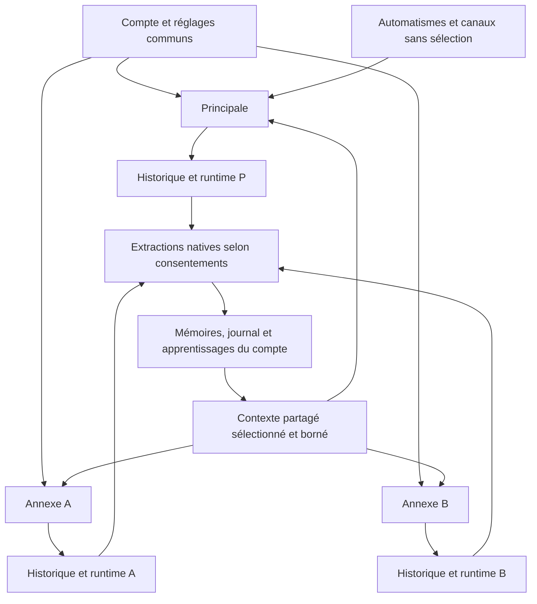

# Discussions annexes — analyse fonctionnelle et technique

Date : 2026-11-09, Europe/Paris. Statut : **proposition préalable ; aucune implémentation métier**.

Périmètre examiné : sources présentes dans le workspace pendant cette analyse. Travail strictement inline, sans sous-agent, sans mutation Git, sans migration ni modification de données applicatives. Les tests utilisent leurs doubles ou une base jetable. Les chantiers concurrents sont préservés.

Le [plan d'exécution TDD](2026-11-09-secondary-conversations-plan.md) et la [contre-revue des trois arbitrages](2026-11-09-secondary-conversations-counter-review.md) font partie du dossier. La contre-revue documente les alternatives éprouvées, les 23 sondes supplémentaires et le protocole précis de persistance/nettoyage. Les décisions ci-dessous sont des propositions d'architecture, pas des propriétés déjà disponibles. Les constats de la section 3 sont, eux, vérifiés dans le code.

## 1. Conclusion et périmètre cible

L'évolution est réalisable, mais ne se réduit pas à ajouter un sélecteur. Le modèle, plusieurs portes d'entrée et certains nettoyages reposent sur « un compte = une conversation ». Enlever seulement la contrainte SQL provoquerait des erreurs de consolidation, des changements de destination des automatismes et des purges trop larges.

Le contrat cible est : **plusieurs historiques de conversation, une seule identité LIA par compte**. Les annexes servent à séparer les échanges et les tâches en cours. Elles ne sont ni des espaces privés vis-à-vis de la mémoire de LIA, ni des personnalités indépendantes.

| Surface | Contrat cible |
|---|---|
| Principale | Toujours proposée en premier, libellé traduit, identité stable, jamais supprimable. Destination des notifications et des exécutions autonomes. |
| Annexe | Titre obligatoire fourni par la personne ; historique et contexte de travail propres ; sélection et suppression explicites. |
| Barre du chat | Petit bouton de type badge dans le groupe central, titre courant tronqué visuellement et nom accessible complet. Ouvre le gestionnaire des discussions. |
| Réinitialiser | Vide la discussion affichée, conserve son identité ; conserve le titre d'une annexe. « Supprimer » devient « Réinitialiser » dans la barre. |
| Supprimer une annexe | Supprime son historique et son état de travail ; retire la ligne du gestionnaire ; ne supprime pas les autres discussions. Confirmation distincte de la réinitialisation. |
| Mémoire et apprentissages | Les échanges humains des annexes empruntent les mêmes extracteurs, consentements, budgets et mécanismes de consolidation que ceux de Principale. |
| Paramétrages | Préférences du compte et préférences locales existantes réutilisées : mode d'affichage, langue, personnalité, exécution, voix, espaces actifs, mémoire, etc. Aucune copie par discussion. |
| Automatismes | Routines, rappels, tickets exécutés, proactivité, notifications et canaux externes continuent à cibler Principale. La sélection d'une annexe ne les détourne jamais. |

La suppression d'un historique **ne signifie pas « tout oublier »**. Les souvenirs déjà extraits, le journal, les autres apprentissages, les réponses conservées et les fichiers générés suivent leurs politiques existantes. Les liens vers une source disparue deviennent indisponibles ; ils ne reconstituent pas le texte supprimé. Le dialogue de confirmation doit le dire en termes simples.

Hors périmètre initial : renommer une annexe après création, archiver/restaurer des annexes, dupliquer ou déplacer des messages, partager une discussion, créer un groupe, rechercher dans tous les historiques depuis la recherche du chat, personnaliser LIA par discussion. Les conversations sociales du World et le domaine `proactive_discussions` ne deviennent pas des annexes : ce sont des concepts différents.

## 2. Arbitrages explicites

### 2.1 Identité, sélection et comportement

1. **Principale est un rôle, jamais un titre utilisé comme identifiant.** Les anciennes conversations gardent leur UUID et leur historique. Leur affichage devient « Principale » indépendamment de leur ancien titre automatique. Une annexe nommée « Principale » reste identifiable comme annexe grâce au marqueur de rôle ; aucun traitement métier ne compare les titres.
2. **Sélection locale à la surface et à l'onglet.** La page chat porte `?conversation=<uuid>`. Sans paramètre, elle ouvre Principale. Le panneau World réutilise le même contrôleur avec une sélection locale, sans naviguer hors du World. Aucun champ `active_conversation_id` sur le compte ne pilote les producteurs.
3. **Création paresseuse de Principale préservée.** Pour un compte neuf, le badge présente une Principale vide même si la ligne n'existe pas encore. Le premier tour ou la première création d'annexe assure atomiquement son existence. Un GET ne crée rien. Le cache de résolution historique reste un cache de Principale.
4. **Création déterministe et gratuite en LLM.** Titre saisi, validé et stocké ; aucun modèle ne le génère. Les doublons de titre sont autorisés, l'UUID tranche l'identité. Une même tentative réseau rejouée avec son identifiant ne crée pas deux annexes.
5. **Un tour de graphe actif par compte pour cette première version.** C'est un choix conservateur de périmètre, pas une garantie générale du code actuel : son verrou est par conversation, conditionnel et incomplet au premier message. Les historiques multiples n'ajoutent pas un mode de générations parallèles. Lancer une autre génération pendant une exécution active renvoie un état occupé et permet de rejoindre sa discussion. Notifications simplement archivées et jobs indépendants ne deviennent pas une file globale. L'admission durable est détaillée dans la contre-revue ; chaque runner garde un traitement explicite de l'occupation.
6. **Une confirmation en attente appartient à son annexe.** Naviguer n'approuve ni ne refuse rien. Plusieurs attentes peuvent subsister ; elles ne constituent pas des verrous conservés pendant une attente humaine. Une reprise nomme la discussion, sa révision et la carte. Les autorisations et quotas sont revérifiés.
7. **Réinitialisation et suppression refusées pendant une exécution ou une session Live rattachée à la cible.** La personne peut arrêter l'activité par son contrôle habituel puis recommencer. Une confirmation HITL simplement en attente est explicitement abandonnée par la confirmation de suppression/réinitialisation ; aucune action n'est exécutée pour la clore.
8. **Suppression de l'annexe affichée : retour à Principale après acceptation durable de son retrait.** Supprimer une autre annexe ne change pas la vue. Une erreur avant commit conserve la sélection et le contenu ; une panne de nettoyage après commit garde l'opération en attente et ne ressuscite pas l'annexe. Une suppression reçue d'un autre onglet rend le brouillon local récupérable et affiche l'indisponibilité ; elle ne l'envoie jamais automatiquement dans Principale.
9. **Les préférences changent pour toutes les discussions.** Un tour déjà lancé conserve le snapshot de configuration qu'il a reçu ; le suivant lit les réglages courants. La réouverture d'une annexe ne restaure pas des préférences anciennes.

Ces choix permettent d'avancer sans décision métier bloquante. Le parallélisme de générations et le renommage pourraient faire l'objet d'évolutions séparées ; ils ne sont pas implicitement promis ici.

### 2.2 Bornes et données affichées

Propositions de configuration, **non présentes dans le code aujourd'hui** : création d'annexes derrière `CONVERSATIONS_SECONDARY_ENABLED`, page de liste par défaut de 30 éléments et maximum de 100. **Aucun plafond du nombre total d'annexes : le plafond initial de 100 est retiré après contre-revue.** Pagination, requêtes indexées et rate limit de création bornent le travail. Les API publient les bornes de réponse réellement appliquées et les compteurs exacts, sans inventer de quota commercial ou de stockage.

Le titre réutilise la capacité de la colonne existante : 500 caractères au maximum, validation serveur après suppression des espaces de bord, au moins un caractère visible, sans troncature silencieuse. Le comptage frontend doit correspondre aux points de code comptés côté Python, y compris emoji/CJK ; la saisie IME n'est pas validée au milieu de sa composition. Le rendu reste du texte. Aucun titre ou extrait de message ne part dans un log au-dessus de DEBUG ni dans un label de métrique.

Liste : Principale séparée et épinglée, puis annexes par date de création décroissante et UUID comme départage stable. Ce choix évite qu'une notification réordonne le gestionnaire pendant une sélection. Pagination serveur explicite, compte exact des annexes, absence de faux total déduit d'une page. La recherche de messages reste limitée à la discussion courante.

## 3. Ce que les sources établissent

Les lignes indiquées sont des repères du snapshot lu, pas une garantie de stabilité après des modifications concurrentes. Les liens mènent aux sources propriétaires.

| Réf. | Source et point vérifié | Constat et conséquence |
|---|---|---|
| E01 | [Modèle](../../../apps/api/src/domains/conversations/models.py), `Conversation`, ligne 86 | `uq_conversations_user_id` impose une seule ligne par compte, y compris une ligne soft-deleted. Le titre est nullable et la relation message → conversation est CASCADE. |
| E02 | [Repository](../../../apps/api/src/domains/conversations/repository.py), `get_active_for_user` 68, `create_with_audit` 497 | La sélection prend la plus récente, sans rôle ; la création force `id=user_id`. Lever l'unicité seule détournerait les appels implicites vers l'annexe la plus récente et la création conserverait une collision de clé primaire. |
| E03 | [Routes](../../../apps/api/src/domains/conversations/router.py) et [schémas](../../../apps/api/src/domains/conversations/schemas.py) | API centrée sur `/me`, pas de CRUD multi-conversation. `/me` peut répondre null avant le premier message. Les méthodes basses de lecture/purge savent déjà prendre un UUID de conversation. |
| E04 | [Requête de chat](../../../apps/api/src/domains/agents/api/schemas.py), `ChatRequest` 147 ; [orchestrateur](../../../apps/api/src/domains/agents/services/conversation_orchestrator.py), `setup_conversation` 94 | La requête n'a pas de `conversation_id` ; l'orchestrateur résout toujours par compte. C'est une porte d'entrée à rendre explicite, pas un deuxième graphe à construire. |
| E05 | [Route de streaming](../../../apps/api/src/domains/agents/api/router.py), blocs 438 et 499 ; [cache](../../../apps/api/src/infrastructure/cache/conversation_cache.py) | Résolutions répétées par utilisateur pour admission, HITL et exécution. Le verrou préalable n'est pris que si le cache trouve une conversation existante : le premier tour doit aussi entrer dans l'admission. |
| E06 | [Orchestration](../../../apps/api/src/domains/agents/services/orchestration/service.py), 765–826 ; [contexte typé](../../../apps/api/src/domains/agents/context/runtime_context.py) | Le graphe sait distinguer `user_id` et `conversation_id`. Le checkpoint reçoit actuellement `thread_id=conversation_id`. Les réglages sont injectés dans un contexte immuable de tour. Réutilisation native possible. |
| E07 | [Contextes outils](../../../apps/api/src/domains/agents/context/manager.py), `_build_namespace` 124 | Le namespace contient compte + session + domaine. Il peut isoler des discussions si tous ses appelants lui passent la bonne identité runtime. |
| E08 | [Broker](../../../apps/api/src/infrastructure/streaming/run_stream_broker.py), `register_active_run` 308 et `active_run_lease` 452 ; [runner](../../../apps/api/src/domains/agents/api/background_runner.py) | Verrou et reprise par conversation, avec jeton propriétaire ; R04 confirme que deux discussions peuvent l'acquérir. Le heartbeat réacquiert une clé expirée et réessaie sur panne Redis. Il n'est ni une admission compte ni une preuve de quiescence. |
| E09 | [Réinitialisation](../../../apps/api/src/domains/conversations/service.py), `reset_conversation` 200–561 | Supprime les messages de la conversation, mais les uploads de tout le compte, des entrées Store contenant le compte, des caches utilisateur et tout `llm_cache:*`. La purge checkpoint est best-effort avant le commit final. Le helper fichiers appelé committe lui-même (E33). Ce n'est ni une opération isolée ni une transaction unique prête à réutiliser telle quelle. |
| E10 | [Familles Redis](../../../apps/api/src/infrastructure/cache/key_families.py), `scan_patterns_for` 308 ; [purge](../../../apps/api/src/domains/conversations/reset_purge.py) | Le scope décrit le droit de purger, pas la position de l'identité dans une clé. Scanner aussi le compte atteint la Principale dont l'UUID vaut celui du compte. La sonde S03 le reproduit. |
| E11 | [Signal après commit](../../../apps/api/src/domains/conversations/sync_signal.py), `arm_conversation_signal` 66 | Le payload contient la conversation, mais le dictionnaire de coalescence est indexé par utilisateur seul. Deux discussions modifiées dans une transaction perdent un signal. S01/S02 le reproduisent. |
| E12 | [Notifications front](../../../apps/web/src/hooks/useNotifications.ts), `ConversationSignal` ; [sync chat](../../../apps/web/src/hooks/useChatServerSync.ts) | Le frontend réduit le signal à son type et abandonne son `conversation_id`. Un reset reçu peut vider la vue sans vérifier la cible. |
| E13 | [Hook de conversation](../../../apps/web/src/hooks/useConversation.ts) ; [synchronisation](../../../apps/web/src/hooks/useConversationSync.ts) | Routes `/me` figées, identifiant de la page lu pour le log puis perdu, lifecycle attaché au propriétaire. Une annexe inaccessible ne doit pas être assimilée à une Principale encore absente. |
| E14 | [Hook chat](../../../apps/web/src/hooks/useChat.ts), 679 ; [client SSE](../../../apps/web/src/lib/api/chat.ts) ; [handlers](../../../apps/web/src/lib/sse-handlers/index.ts), 112 | Session frontend liée au compte, client SSE singleton, tampons de tokens au niveau module. Un simple changement de `key` React ne garantit ni l'isolation des callbacks tardifs ni celle des flushs différés. |
| E15 | [Workspace](../../../apps/web/src/components/chat/ChatWorkspace.tsx), 840–980 ; [panneau World](../../../apps/web/src/features/world/WorldNativePanel.tsx) | Même workspace pour le chat complet et le chat LIA embarqué. Trois colonnes en flux avec groupe central déjà occupé par voix, contexte et espaces. Ajouter un contrôle sans reflow est risqué sur petit écran. |
| E16 | [Extraction post-réponse](../../../apps/api/src/domains/agents/nodes/post_response_extractions.py) | Six familles : mémoire, intérêts, boucles ouvertes, journal, psyché, récurrence. L'admission dépend du caractère humain/automatique et des réglages, pas du rôle de la discussion. Une annexe ne doit pas être marquée comme source automatique. |
| E17 | [Consolidation du journal](../../../apps/api/src/domains/journals/consolidation_service.py), `_build_usage_patterns_section` 148, `_load_conversation_history` 365 | Deux lectures sélectionnent une conversation par compte avec `scalar_one_or_none`. Dès qu'il y en a plusieurs, elles ne sont plus valides. À remplacer par des lectures transversales bornées, pas par « prendre la première ». |
| E18 | [Activité humaine](../../../apps/api/src/domains/conversations/activity_probe.py) ; [source proactive](../../../apps/api/src/infrastructure/proactive/conversation_source.py) | Les jointures par propriétaire savent déjà couvrir plusieurs conversations et excluent les lignes qui ne représentent pas une parole humaine. Ne pas réinventer ces lecteurs. |
| E19 | [Invalidation proactive](../../../apps/api/src/infrastructure/discussion_invalidation.py) ; [réponses aux ouvertures](../../../apps/api/src/domains/proactive_discussions/replies.py), `_reply_to` 75 | L'invalidation des sources conversationnelles est actuellement globale au compte. En revanche, une réponse à une ouverture est déjà attachée à sa conversation : une annexe ne doit pas engager une ouverture de Principale. |
| E20 | [Bookmarks](../../../apps/api/src/domains/bookmarks/repository.py), `latest_visible_assistant_message` 46 ; [résolution implicite](../../../apps/api/src/domains/agents/application/bookmark_keep_scope.py), 63 | « Garde cette réponse » sans UUID prend la dernière réponse visible du compte, ce qui devient ambigu. Les actions portant un message explicite peuvent réutiliser leur contrôle de propriété existant. |
| E21 | [Provenance](../../../apps/api/src/domains/shared/provenance_repository.py) ; [export compte](../../../apps/api/src/domains/account_export/builder.py) | Les lectures par propriétaire et références de message sont largement réutilisables. Une source disparue peut être rendue comme indisponible. Les liens de navigation doivent cependant ouvrir la bonne discussion. |
| E22 | [Suppression du compte](../../../apps/api/src/domains/users/account_deletion_service.py), `_load_conversation` 465 | Une lecture singleton et une seule purge de checkpoint subsistent, même si les requêtes SQL de suppression des messages utilisent déjà toutes les conversations. Il faut énumérer tous les runtimes, y compris les cibles de nettoyage retirées. |
| E23 | [Modèle fichier](../../../apps/api/src/domains/attachments/models.py), 161 ; [service fichiers](../../../apps/api/src/domains/attachments/service.py) ; [upload](../../../apps/api/src/domains/attachments/router.py) | `conversation_id` est nullable, FK SET NULL. L'upload ne reçoit pas de discussion. Une pièce propriétaire peut être utilisée dans plusieurs messages. Cette colonne de provenance ne prouve pas qu'un fichier appartient exclusivement à une discussion. |
| E24 | [Résumé de tokens](../../../apps/api/src/domains/chat/models.py), 209 ; [registres](../../../apps/api/src/domains/agents/effects/models.py), 646–652 | Références de conversation/message détachables. Le coût historique et les actes ne doivent pas disparaître lors d'une suppression de discussion. Les resets de compteur d'écran ne réinitialisent pas les dépenses du compte. |
| E25 | [Live](../../../apps/api/src/domains/live/service.py), `_conversation_id` 166 ; [store](../../../apps/api/src/domains/live/session_store.py) ; [fin](../../../apps/api/src/domains/live/session_end.py) ; [veille](../../../apps/api/src/domains/live/standby.py) | Le record Live ne conserve pas l'UUID LIA cible ; plusieurs étapes le résolvent par compte. `provider_conversation_ids` désigne les conversations du fournisseur, pas celles de LIA. La cible doit être capturée au démarrage. |
| E26 | [Voix commune](../../../apps/api/src/domains/voice_sessions/session.py) ; [tour hors chat](../../../apps/api/src/infrastructure/scheduler/out_of_turn_run.py), `StreamRequest` 197 | La représentation commune de session vocale connaît déjà une conversation. La requête du runner ne la porte pas encore : elle doit la transporter pour les relais d'un Live lancé depuis une annexe. |
| E27 | [Quotas](../../../apps/api/src/domains/usage_limits/service.py), `check_user_allowed` ; [payeurs](../../../apps/api/src/domains/usage_limits/cost_bearers.py) | Plafonds compte et instance, distinction clés plateforme/clés personnelles déjà déclarée. Plusieurs discussions ne doivent créer ni plusieurs allowances ni une facturation différente. Le check n'est pas une réservation monétaire atomique de toutes les dépenses concurrentes. |
| E28 | [Cache LLM](../../../apps/api/src/infrastructure/cache/llm_cache.py), `_generate_cache_key` 163 | La clé utilise le compte et les arguments, exclut `config`. Le commentaire du reset disant que toutes les clés sont globales est périmé. Une dépendance au contexte runtime doit apparaître dans la clé ; ajouter seulement l'UUID à `config` ne suffit pas. |
| E29 | [Identité des fichiers produits](../../../apps/api/src/domains/attachments/thread_id.py), `conversation_uuid` ; [lecteurs de messages](../../../apps/api/src/domains/conversations/message_readers.py) | Plusieurs producteurs assimilent encore le thread de graphe à l'UUID métier. Le registre de lecteurs contrôle visible/record, pas courant/principale/compte. Ce sont deux dimensions distinctes à traiter explicitement. |
| E30 | [Brouillon](../../../apps/web/src/hooks/useInputDraft.ts), `draftStorageKey`, `seedInputDraft`, `clearInputDraft` | Le brouillon texte/composition est déjà persisté en localStorage, par compte seul, avec flush différé au démontage ; le dernier onglet qui écrit gagne. Ajouter une sélection sans étendre cette clé mélangerait les brouillons. Réutiliser ce mécanisme et son nettoyage de logout. |
| E31 | [Intents](../../../apps/web/src/hooks/useAutoSendIntent.ts) et [paramètres de navigation](../../../apps/web/src/hooks/useDeepLinkParams.ts) | L'exécution attend auth/API/disponibilité, le quota transforme la demande en brouillon et un ledger interdit de rejouer un iid consommé. Le World embedded laisse l'URL de son hôte intacte. Ces garanties doivent inclure la cible résolue avant consommation. |
| E32 | [Repository des mémoires](../../../apps/api/src/domains/memories/repository.py), introduction et requêtes | Les mémoires canoniques sont désormais en tables PostgreSQL dédiées, pas dans l'ancien namespace LangGraph Store. La purge trop large du Store ne doit donc pas être décrite, sans preuve, comme un effacement actuel des mémoires canoniques. Elle menace bien les contextes de travail des autres discussions. |
| E33 | [Service fichiers](../../../apps/api/src/domains/attachments/service.py), `delete_all_for_user`, commit interne | Appelé pendant le reset, il committe avant ses suppressions filesystem. R05 démontre qu'un rollback extérieur ne couvre plus les écritures antérieures. Phase lifecycle à recomposer sans ce helper committant. |
| E34 | [Attente des tâches](../../../apps/api/src/infrastructure/async_utils.py), `await_run_id_tasks` | Retire l'entrée par run avant l'attente ; après timeout, des enfants restent vivants. R17 le reproduit. La fin du flux n'est pas une preuve de drainage. |
| E35 | [Saver](../../../apps/api/src/domains/conversations/instrumented_checkpointer.py), `aput` et méthode native héritée `aput_writes` | Pas de fence de génération métier. R01–R03 et R19–R22 sur bibliothèques installées motivent rotation et validation/écriture sur une même transaction native. |
| E36 | [Store](../../../apps/api/src/domains/agents/context/store.py), [writers de contextes](../../../apps/api/src/domains/agents/context/manager.py), [consentements](../../../apps/api/src/domains/users/extraction_consent.py) | Le Store peut être sémantique ; ne pas placer ses embeddings sous verrou. Les namespaces de travail se clôturent séparément. Le helper de consentement nomme trois familles, pas six ; préserver les politiques réelles des autres. |

Les expressions `get_active_for_user` trouvées dans d'autres domaines ne désignent pas toutes des conversations : les résultats textuels ont été contrôlés par leurs imports et leurs appels. Cette analyse ne demande pas de remplacer aveuglément toutes les occurrences.

## 4. Architecture proposée

### 4.1 Modèle et migration

Étendre le domaine existant `conversations`, sans nouveau moteur de chat.



| Donnée proposée | Rôle et invariant |
|---|---|
| `Conversation.kind` | Enum `main` / `secondary`, obligatoire. Toutes les lignes existantes deviennent `main`. |
| Unicité de Principale | Index unique partiel sur `user_id WHERE kind='main'`, sans filtre `deleted_at`, afin de ne pas recréer une seconde Principale lors d'une réactivation. |
| `Conversation.id` | UUID métier stable. Anciennes valeurs inchangées ; UUID aléatoire serveur pour une annexe. |
| `Conversation.revision` | Entier monotone pour réinitialisation et retrait ; refuse les réponses, cartes et écritures d'un ancien état. |
| `Conversation.runtime_id` | UUID de l'état de travail, initialisé à `id` pour préserver les checkpoints existants. Change lors d'un reset. Le nouveau tour ne peut ainsi relire un ancien checkpoint même si sa purge physique échoue. |
| Titre | Obligatoire et non blanc pour `secondary`, vérifié par schéma et CHECK SQL ; Principale n'utilise pas son ancien titre comme identité. |
| Création | Identifiant de tentative unique par propriétaire ; reçu minimal conservé pendant la vie du compte. Une répétition retourne la même annexe ou son retrait, un autre titre sous le même id est un conflit. |
| Admission durable | Activité `graph` ou réservation de cible `live`, cible/propriétaire immuables, état running/draining/recovering/closed. Unicité partielle compte des graphes encore occupés ; Live garde sa propre exclusivité existante et réserve sa cible avant appel fournisseur. Un TTL Redis ne libère pas ces droits. |
| Nettoyage durable | Une opération propre au domaine, propriétaire + empreinte idempotente + cible + runtime retiré + révision + type reset/delete + phases/claim/fence/erreur bornée. Aucun contenu de messages. |
| Usage des pièces jointes | Relation explicite entre fichier et conversation, unique sur la paire, pour prouver les usages partagés avant de supprimer un upload. |

Un index unique exprime « au plus une Principale », pas « au moins une ». L'assurance d'existence se fait dans la porte `ensure_primary`, sérialisée par le verrou transactionnel propriétaire existant, avec relecture/UPSERT. La migration ne crée pas des conversations vides pour tous les comptes. Elle contrôle les anomalies avant transformation et ne déduit jamais un rôle d'un titre.

Le soft-delete historique concerne uniquement la réactivation de Principale. Une annexe supprimée ne doit jamais être ressuscitée par `get_soft_deleted_for_user`. La suppression physique intervient une fois sa cible de nettoyage enregistrée durablement.

La rotation du runtime est volontairement explicite : `conversation_id` reste l'identité des archives, fichiers, coûts et décisions ; `runtime_id` est l'identité du checkpoint, du contexte d'outils et des interruptions. Ne pas encoder une révision dans une chaîne que les producteurs convertissent aujourd'hui en UUID métier. Migrer leurs lectures vers `LiaRuntimeContext.conversation_id`, en gardant `thread_id` pour la plomberie LangGraph. Le recensement AST ciblé trouve 40 sites dans 24 modules ; il doit être complété par les autres formes d'accès et les paires de producteurs/consommateurs, pas traité comme un recensement universel.

La contre-revue compare les alternatives : `checkpoint_ns` n'est pas une révision racine transparente (R01), et delete puis écriture tardive ressuscite le même thread (R02). La rotation protège le nouveau contexte mais pas l'effacement physique. Une porte de persistance vérifie le runtime sous verrou de ligne et exécute `aput`/`aput_writes` sur la même connexion/transaction native ; R19–R22 éprouvent cette composition et son rollback. Les contextes Store de travail non indexés suivent la même règle (R23), sans entourer d'une transaction un batch sémantique susceptible d'appeler un fournisseur. Aucun fork ni trigger sur les tables de la bibliothèque.

### 4.2 Contrats API

Conserver les routes `/conversations/me/*` comme alias **Principale**, et les anciens clients sans `conversation_id` comme demandes à Principale. Ne jamais leur donner « la dernière annexe utilisée ».

| Porte proposée | Contrat |
|---|---|
| `GET /conversations` | Page de métadonnées avec Principale en premier lorsqu'elle existe, total exact des lignes persistées, limit/offset bornés et publiés. Le client présente une Principale virtuelle si le compte n'a encore aucune ligne ; la lecture ne crée rien. |
| `POST /conversations` | `{title, request_id}` ; crée une annexe, assure Principale, aucun appel modèle. Réponse 200 avec identité et `replayed` pour distinguer création et répétition identique. |
| `GET /conversations/{id}` | Métadonnées appartenant à la personne, rôle et révision. |
| `GET /conversations/{id}/messages` | Page de la cible, recherche locale, ordre `(created_at,id)`, curseur composite opaque. |
| `GET /conversations/{id}/stats` et `/totals` | Compteurs de cette discussion et budget de son checkpoint courant. |
| `POST /conversations/{id}/reset` | `{operation_id, expected_revision}` ; conserve UUID métier et titre annexe, retire l'ancien runtime. |
| `DELETE /conversations/{id}` | `operation_id` et `expected_revision` en paramètres typés ; refuse `main` côté service, même en contournant l'UI. |
| `GET /conversations/operations/{operation_id}` | État de l'opération possédée, utile après réponse réseau perdue ; aucune réexécution aveugle. Route statique déclarée avant `/{id}`. |
| Chat / run actif / interruption / annulation / reprise SSE | `conversation_id` explicite et révision attendue du nouveau client, résolus en une seule `ConversationRef` ; requête préparée avant reset refusée après, contrôle de l'identité du run. |

Les resets/deletes peuvent répondre 202 tant que leur nettoyage est en cours, avec `logical_applied` et la nouvelle révision, puis un résultat terminal vérifiable. Après commit, le nouveau runtime est utilisable pendant la purge de l'ancien ; le navigateur suit l'opération sans annoncer son achèvement physique. Une erreur SQL avant commit n'annonce aucune suppression. Une réponse perdue après commit se résout avec `operation_id`. Un replay identique relit son résultat avant de contrôler la révision ; une autre empreinte sous le même identifiant ou une nouvelle tentative sur une révision périmée reçoit un conflit.

Les alias historiques gardent leur forme de réponse de succès, émise après résultat complet du même service. À la borne d'attente, ils renvoient une erreur typée avec identifiant d'opération et nécessité de réconciliation, sans faux succès. Le nouveau client utilise les contrats idempotents explicites. Un ancien client sans identifiant d'opération ne bénéficie pas magiquement d'une garantie de dédoublonnage après une réponse inconnue : aucune couche HTTP ne doit rejouer automatiquement ses mutations.

Authentification existante, contrôle de propriété `hide_existence=True`, schémas request/response distincts, validateurs et exceptions centraux. UUID malformé → validation ; cible inexistante ou étrangère → même refus ; Principale non supprimable → refus métier explicite. Le streaming s'authentifie sans retenir une session SQL pendant le SSE. Les permissions des pièces jointes et cartes sont vérifiées aussi, pas seulement celles de la conversation.

### 4.3 Résolution du tour, concurrence et reprise

La porte centrale retourne un objet immuable `ConversationRef(owner_id, id, kind, revision, runtime_id)`. Le routeur, le service et les runners transmettent ce même objet ; aucun ne refait une sélection « active » en cours de tour.

L'admission est une autorité PostgreSQL, sérialisée avec le lifecycle sous le même ordre de verrous courts ; Redis garde son rôle de transport/présence. Propriétaire unique, token, phases running/draining/recovering/closed et unicité partielle compte interdisent un démarrage concurrent. Un TTL expiré ou un `done` SSE ne libère rien sans arrêt établi. Les chemins browser, canal, routine et voix passent tous par cette porte ; un runner déjà admis transmet son admission interne typée, pas un booléen de contournement fourni par un client. Les notifications qui se contentent d'archiver ne deviennent pas des tours de graphe. Leurs contrats d'occupation/report sont conservés et testés individuellement.

La première demande crée/résout sa Principale **avant** l'admission, évitant le trou du premier message. Aucun verrou de base, transaction ou connexion n'est conservé pendant un appel LLM, une attente réseau ou une validation humaine. Les doublons de reprise rejoignent le run existant ; ils ne rappellent pas le fournisseur. La perte de réponse d'un appel payant reste soumise à la politique de retry actuelle.

Avec les background runs activés, changer de discussion détache le lecteur SSE et laisse la génération autorisée continuer ; revenir réattache au flux ou réconcilie l'historique. Avec ce mode désactivé, le sélecteur empêche de quitter une exécution active et explique qu'il faut attendre ou arrêter : on ne promet pas une continuation que le serveur n'offre pas.

### 4.4 Mémoire, contextes et lecteurs

| Périmètre | Ce qui s'y rattache |
|---|---|
| Compte | Consentements, mémoire long terme, journal de LIA, portrait, psyché, intérêts, habitudes/récurrences, boucles ouvertes, connecteurs, capacités, réglages, quotas et données des espaces. |
| Discussion | Messages visibles et cachés, recherche locale, compteurs de vue, sources des cartes, sélection explicite d'une réponse. |
| Runtime de discussion | Checkpoints, résumé/compaction de travail, références d'entités, listes de contexte outils, confirmations/drafts en attente, état de reprise. |
| Tour | `run_id`, budget/usage du tour, catalogue offert, snapshots de préférences, provenance, collecte des traitements et des décisions. |

Une annexe alimente les six extractions par le chemin ordinaire des paroles humaines. Leurs règles et consentements respectifs restent applicables : « exactement comme Principale » ne signifie pas « contourner une mémoire désactivée ». Le helper de consentement commun déclare actuellement mémoire/journal/psyché, pas six valeurs ; sa variante de révision sert aux autres sources concernées. Une référence ajoute discussion et révision pour refuser une extraction tardive après reset/delete sans invalider les autres discussions. Le timeout de `await_run_id_tasks` ne prouve pas la fin des enfants (R17) ; leur supervision doit conserver l'identité des tâches encore vivantes.

La vérification de cette révision et l'écriture du résultat doivent appartenir à la même transaction courte, avec verrou de ligne ou écriture conditionnelle. Un `source_is_current()` consulté avant un appel réseau puis oublié ne protège pas contre la suppression concurrente. Même exigence pour l'archivage tardif : le résultat d'un ancien runtime peut être comptabilisé comme travail payé sans redevenir un message de la génération courante.

Le journal agrège les conversations admissibles du compte avec **une seule enveloppe** de lignes et de tokens, un tri temporel stable et une coupe annoncée. Ne pas prendre une limite par conversation puis concaténer : le coût et le prompt grossiraient avec leur nombre. Le texte récent est groupé par discussion afin de ne pas présenter une question de A et une réponse de B comme un échange. Une annexe vide ne déclenche ni extraction ni modèle.

Le contexte offert à un nouveau tour contient son propre historique et les connaissances partagées sélectionnées par les mécanismes existants. Il ne concatène pas les historiques bruts des autres discussions. Leur contribution passe par les souvenirs/journaux/lectures déclarées. C'est la distinction entre continuité de connaissance et contamination du contexte de travail.

Le registre des lecteurs doit distinguer le **périmètre conversationnel** (`CURRENT`, `PRIMARY`, `ACCOUNT`) de la **visibilité** (`VISIBLE_ONLY`, `WHOLE_RECORD`). Pour un module mixte, déclarer le point d'entrée/fonction, pas une valeur trompeuse unique. La garde recense les appels SQL et les résolveurs ; une fixture fautive prouve qu'elle détecte réellement un oubli. Les lecteurs déjà transversaux E18/E21 restent transversaux ; les bookmarks implicites deviennent courants ; les destinations autonomes deviennent explicitement principales.

L'invalidation des contextes proactifs lors d'une suppression retire les supports issus des messages supprimés. Le mécanisme global de fencing du rebuild peut être réutilisé pour publier un remplacement cohérent, mais ce n'est pas une autorisation de supprimer les souvenirs canoniques ou les supports provenant d'autres discussions. Les lecteurs qui rencontrent une source supprimée répondent indisponible, jamais « cette source n'a rien trouvé ».

### 4.5 Réinitialisation, fichiers et suppression de compte

Un nettoyage comprend plusieurs stockages ; une transaction SQL ne rend pas Redis, LangGraph Store et le filesystem transactionnels. Il faut rendre la transition **atomique pour la visibilité et explicitement reprenable pour la purge**.

Séquence proposée :

1. Dans une transaction courte, retrouver un éventuel replay, contrôler propriétaire/rôle/révision/activité durable et Live, puis enregistrer opération/manifeste, invalider la génération, retirer messages/compteurs/usages et armer le signal après commit. Le reset choisit un nouveau runtime, le delete retire la discussion des listes actives. Un seul commit est permis : le helper fichiers actuel qui committe (R05) est remplacé par des opérations repository sans commit.
2. Clore les portes d'écriture runtime : même transaction pour les stores SQL ; autorisation propriétaire/génération requise pour Redis, fermée atomiquement avec sa purge ; callbacks locaux/front invalidés. Un ancien producteur ne peut recréer l'autorisation. Admission et retrait ne peuvent se croiser sans le contrôle durable commun.
3. Après commit, purger les cibles immuables du manifeste : ancien checkpoint via la porte native, Store exactement nommé, interruptions, membres Redis et seuls uploads orphelins. Aucune suppression par substring compte ni invalidation globale `llm_cache:*`. Un index partagé perd ses seuls membres ciblés. Aucun chemin fichier n'est réutilisé pour une nouvelle génération.
4. Chaque I/O se fait sans transaction ouverte ; son résultat se persiste sous token et fence. Reprendre après crash/timeout, vérifier l'absence après un unlink déjà effectué ; une erreur reste en attente. L'opération n'est `succeeded` qu'après toutes les phases et les clôtures effectives, jamais après un simple TTL ou `done`. Le run dont l'arrêt est inconnu reste en récupération. Aucun résultat fournisseur inconnu n'est rejoué et aucun effet déjà parti n'est prétendu annulé.

L'opération durable constitue une petite responsabilité du domaine, pas un nouveau framework générique de jobs. Son stockage ne doit pas disparaître en cascade avant ses cibles : après retrait d'un compte, seuls les identifiants techniques nécessaires au nettoyage subsistent, sans contenu, avec état publié. La rétention bornée du tombstone commence après succès ; une opération incomplète ne disparaît pas par expiration, elle reste réparable et alertée. Le contrat est déclaré dans `user_data_map` et le registre des modèles. L'ordre des verrous, les états, la récupération et la clôture sont spécifiés dans la contre-revue.

Pour les uploads, ajouter un lien d'usage au moment de l'attachement accepté et à l'archivage, sous la même autorité de propriétaire. Les fichiers générés restent des actifs du compte. À la suppression d'une discussion : retirer ses liens puis ne purger que les uploads sans autre usage ; verrouiller la vérification et la transition pour éviter qu'un autre tour attache le fichier entre les deux. Un fichier déjà en suppression est refusé à un nouvel attachement. Les brouillons d'upload non envoyés ont leur propre échéance ; ils ne sont pas attribués arbitrairement à Principale.

Le backfill lit les références réelles des messages et la provenance fiable. Un ancien upload sans rattachement démontrable reste sous sa politique d'expiration ; on ne l'efface pas par supposition. Si l'archivage précoce a échoué, l'association d'usage ne peut pas être perdue silencieusement. Les uploads en vol possèdent une cible temporaire suivie, nettoyée si leur publication est refusée. Le nettoyage périodique lit la même règle d'orphelin ; les usages partagés n'allongent pas la durée de vie actuelle d'un upload.

La suppression d'annexe ne supprime pas les rappels, routines, tickets, documents, événements ou autres objets que son échange a créés. Leurs exécutions futures arrivent dans Principale. Leurs références de provenance deviennent indisponibles si nécessaire.

La suppression du **compte** reste globale : énumérer toutes les conversations, tous les runtimes actuels et retirés, tous les usages de fichiers, tous les états Redis concernés. Les dépenses conservées et registres suivent les exceptions de rétention déjà établies. Les CHECK multi-colonnes sensibles aux actions de FK et les `JSONB null` restent soumis aux règles du dépôt.

### 4.6 Coûts, tokens, caches et registres

Créer, lister, sélectionner, réinitialiser et supprimer une discussion ne demande aucun LLM. Changer de discussion charge des métadonnées/pages et son état de contexte, pas une synthèse de tous les fils.

Pour un tour, l'enveloppe reste celle du slot résolu en base : historique courant + instructions + contexte partagé sélectionné + résultats outils + réserve de sortie/raisonnement. Ni le nombre d'annexes ni leur titre ne multiplient cette enveloppe. Les réglages de compaction, les seuils publiés, les timeouts et les garde-fous de sortie restent ceux des portes actuelles. Le compteur de contexte visible change avec la discussion ; le plafond de dépenses reste au compte et à l'instance.

Une reprise, un polling, un cache hit et une reconnexion SSE ne facturent pas un nouveau tour. Les extractions post-réponse conservent leur road de dépense et leur rattachement au même run. Tout fallback réellement payé compte. Une clé propre à la personne continue à suivre le contrat de son connecteur ; ouvrir une annexe ne convertit jamais une clé plateforme en clé personnelle.

Le verrou compte évite d'introduire N tours de graphe simultanés ; il ne garantit pas une réservation atomique de toutes les modalités et de tous les jobs existants. Le dépassement résiduel dû à du travail déjà admis doit être mesuré dans les tests de quota, et non présenté comme une impossibilité nouvelle.

Pour le cache LLM applicatif, déclarer ce qui dépend du runtime/révision dans une clé centrale ; ne pas compter sur `config`, actuellement exclu. Conserver le partage quand tous les inputs sémantiques sont égaux et le scope le permet. Pour le cache natif des fournisseurs, conserver les politiques de préfixe/historique existantes ; ne pas injecter le titre dans le préfixe stable ni multiplier des clés arbitrairement. Mesurer tokens entrants/cache lus/cache écrits sur deux discussions avec préfixe identique et historiques différents, en partant des adaptateurs déjà testés.

Les décisions et effets conservent l'UUID **métier** de la discussion et le run ; le runtime retiré ne devient pas l'identité métier d'un acte. Après suppression, les liens vers messages peuvent être nuls, les faits de registre et montants restent. Ne pas recalculer le coût historique au tarif courant, ne pas réécrire une chaîne scellée. Les clics de CRUD exécutés directement par la personne utilisent l'audit applicatif ; ils ne créent pas artificiellement des actes d'IA.

### 4.7 Voice, canaux, notifications et navigation

Live démarré depuis une annexe : vérifier la révision affichée, réserver durablement la cible avant l'appel fournisseur, puis conserver cette liaison en veille, réveil, délégation, archive et clôture. L'absence momentanée d'un record Redis ne peut autoriser un reset au milieu du start. Ouverture/fin de résultat inconnu restent en récupération ; le relay achevé précède la libération. Le fournisseur garde ses propres identifiants. La navigation ne déplace pas la session ; son bandeau rejoint sa discussion. Le host Live reste au niveau compte pour qu'un remount ne termine pas le microphone.

Téléphonie, Telegram et autres portes sans sélection explicite : Principale. Une action explicitement demandée depuis une annexe conserve l'attribution de son tour et de ses effets ; les callbacks autonomes continuent au point d'entrée principal. On ne transporte pas une sélection navigateur dans un webhook. Une évolution permettant des canaux externes multi-discussions serait un autre contrat.

Les notifications continuent à apparaître dans l'application pendant la lecture d'une annexe, mais leur archivage et leur ouverture ciblent Principale. Une publication indépendante `CurrentPrimaryPublication` résout Principale au moment d'archiver ; une réponse `PinnedRunPublication` garde la révision de son tour. La première peut légitimement arriver après reset, la seconde ne peut pas se rebinder pour contourner un retrait. Les signaux restent sur le canal utilisateur existant, avec conversation/révision/type et coalescence par paire. Un événement non affiché invalide la ligne de liste, sans fusionner ses messages dans l'écran actif.

Les liens existants `?intent=...` et leurs identifiants conservent leur consommation une seule fois. Un lien vers un message/provenance porte sa discussion ou la résout côté serveur avec contrôle de propriété. Un identifiant inexistant ne doit pas envoyer le texte de l'intent dans une autre discussion par repli silencieux. Sans cible explicite, la destination reste Principale.

### 4.8 Frontend et accessibilité

Réutiliser [Dialog](../../../apps/web/src/components/ui/dialog.tsx), [FieldFrame](../../../apps/web/src/components/ui/field.tsx), [Input](../../../apps/web/src/components/ui/input.tsx), [RowActions](../../../apps/web/src/components/ui/row-actions.tsx), les boutons et l'[AlertDialog du reset](../../../apps/web/src/components/chat/ResetConversationConfirm.tsx). Le référentiel visuel local `.claude/skills/lia-design` et les directives frontend gouvernent les tokens, espacements, états et surfaces. Aucun nouveau kit UI.

Le gestionnaire contient une ligne Principale, la liste paginée des annexes et « Nouvelle discussion ». Une ligne possède une action de sélection et une action de suppression séparées, sans bouton imbriqué. La création utilise un formulaire avec titre, validation en ligne, soumission Enter, annulation Escape et focus rendu au badge ou à la nouvelle ligne. La suppression ne se déclenche pas en sélectionnant une ligne.

La barre conserve les trois colonnes en flux. Sur mobile, le titre du badge est borné ; si les contrôles chargés ne tiennent pas, le groupe central prend une ligne dédiée plutôt que de recouvrir recherche, voix, contexte, espaces ou reset. Vérifier la géométrie des boutons, pas seulement l'absence de scroll horizontal, car le shell peut masquer un débordement. Les ancres de positionnement du compagnon et le clavier virtuel doivent suivre ce reflow.

Le nom accessible du badge comprend le titre courant et l'action « Discussions » ; la sélection est déclarée avec `aria-current`. Les états de chargement sont annoncés sobrement, les erreurs restent visibles et récupérables, le pending conserve un focus déterministe. Respecter la typographie d'input adaptée au mobile, les cibles tactiles, le safe-area, les thèmes clair/sombre/OLED et les six langues.

État frontend indexé par `(ownerId, conversationId, revision)` : historique, pagination, recherche, totaux, debug, flux et drafts. Le client SSE et ses buffers appartiennent à un contrôleur de stream, pas à des variables module partagées. Un identifiant de génération de vue empêche un GET, token, flush, `done` ou callback de l'ancienne vue d'écrire dans la nouvelle. Un changement de compte nettoie aussi les brouillons et la sélection.

Le brouillon saisi et les uploads non envoyés restent associés à leur discussion pendant la navigation. Réutiliser `useInputDraft` pour le texte/composition : clé compte + discussion, migration de l'ancienne clé vers Principale uniquement, même survie au refresh qu'aujourd'hui. Deux onglets éditant la même discussion conservent leur état en mémoire et le comportement existant de dernière écriture persistée ; une autre discussion ne peut pas l'écraser. Le flush capture sa cible avant démontage. Les uploads en cours restent sous leur gestion locale existante, sans sérialiser de nouveaux fichiers ou secrets dans localStorage.

`seedInputDraft` sans cible continue à préparer Principale ; une nouvelle surcharge ciblée ne résout pas une sélection globale. Le logout purge toutes les clés de brouillon de ce compte. Un reset confirmé efface le brouillon de sa cible ; une erreur ne l'efface pas. Les réglages compte/appareil restent dans leurs stores actuels, hors du remount du workspace. La remontée ↑/↓ de l'historique envoyé lit les messages de la discussion affichée via `sentHistoryOf`.

## 5. Cartographie des impacts et risques

| Risque | Gravité | Mitigation et preuve attendue |
|---|---|---|
| Une routine écrit dans l'annexe la plus récente | Critique | Porte Principale explicite, anciens appels compatibles, test avec dates trompeuses et sélection différente dans deux onglets. |
| Fuite de messages ou d'une confirmation entre annexes | Critique | `ConversationRef`, ownership partout, HITL attaché à cible/révision/carte, clients/buffers SSE isolés ; tests d'événements tardifs et doubles reprises. |
| Reset annexe détruit principale ou apprentissages | Critique | Purge par identité et famille déclarées, runtime séparé, aucune recherche substring compte, tests Redis/Store réels avec plusieurs discussions et un autre compte. |
| Upload partagé effacé | Critique | Lien d'usage et décision d'orphelin atomique ; test attach-vs-delete avec deux transactions. |
| Ancien checkpoint relu après reset partiellement raté | Élevée | Rotation runtime, génération de vue, nettoyage durable et reprise ; injection panne/crash puis ancien producteur. |
| Journal ou suppression de compte en erreur avec plusieurs lignes | Élevée | Retirer les singleton documentés, agrégation/enumeration selon fonction ; vrai PostgreSQL. |
| Automatismes identifiés comme réponses humaines | Élevée | Conserver hidden/is_automated_source, sources de consultation et `_reply_to` ; mêmes tests dans les deux modes. |
| Dépenses multipliées ou remise à zéro des quotas | Élevée | Admission compte, mêmes garde-fous, aucune boucle N discussions dans le prompt, comptabilité run ; compte bloqué reste bloqué après création/reset. |
| Live archive dans une autre discussion après navigation | Élevée | Snapshot cible sérialisé, relay typé, host hors du workspace, cas veille/réveil/fin après changement de vue. |
| Réponse conservée venant du mauvais historique | Élevée | Résolution implicite dans la discussion courante, carte explicite vérifiée, aucun « latest du compte ». |
| Retrait de compte oublie un runtime annexe | Élevée | Enumération active/retirée et manifest de purge, aucun seul `scalar_one_or_none`. |
| Course de stats ou pagination saute des messages | Moyenne | Incréments SQL atomiques, cursor `(created_at,id)`, bornes de page, notification et réponse au même instant. |
| Événements de deux discussions coalescés en un | Moyenne | Clé composée backend, payload conservé frontend, tests commit/rollback et multi-cible. |
| Interface inaccessible à 320 px | Élevée | Reflow en flux, noms traduits, contrôles mesurés en état chargé, focus/IME/tactile/zoom et World. |
| Création dupliquée après timeout | Moyenne | Reçu idempotent persisté par compte, conflit sur payload différent, unicité vérifiée sous verrou ; aucun plafond de nombre inventé. |
| Succès de purge annoncé avec writer encore vivant | Critique | Admission durable, distinction graphe/extractions/affichage, clôtures des écritures natives et phases explicites ; R17–R23 à convertir en tests d'intégration. |
| Helper avec commit interne brise le rollback | Critique | Un seul propriétaire du commit lifecycle, repositories sans commit, test d'injection d'échec avant commit ; défaut reproduit par R05. |
| Coupure Redis interprétée comme disponibilité | Critique | Autorité SQL, reprise conditionnelle par propriétaire, état recovering visible, aucun takeover de graphe déduit d'un TTL. |
| Ancien client ou vieux worker interprète mal les lignes | Élevée | Migration additive, compatibilité Principale, activation seulement après remplacement de tous les consommateurs ; aucun rollback destructif. |
| Métriques explosent en cardinalité / logs contiennent des titres | Moyenne | Labels fermés (rôle/opération/résultat), IDs en logs factuels, aucun contenu dans labels. |
| Faux sentiment de qualification à partir des tests actuels | Élevée | Les succès de référence ne prouvent pas la fonctionnalité future ; matrice multi-discussions obligatoire avant activation. |

Effets indirects à inclure dans la revue : cache de catalogue et préférences, sources de journal/portrait, attention proactive, résolutions de cartes et bookmarks, uploads/générations, navigation mobile et native, export/suppression du compte, retention des registres, alertes de purge et runbooks. Les modèles LLM, leurs tarifs et les autorisations connecteurs ne changent pas par cette fonctionnalité.

## 6. Plan de tests directeur

Fixture canonique : deux comptes U/V ; pour U, Principale P et annexes A/B avec UUID tous distincts du compte sauf P historique ; titres identiques autorisés ; dates de création et de message volontairement contradictoires ; message humain, caché, automatisé, réponse avec carte et fichier partagé. Aucun test ne doit passer uniquement parce que `conversation_id == user_id`.

| ID | Niveau | Scénarios et oracle |
|---|---|---|
| T01 | SQL / migration | Vieille base → une Principale même UUID ; contraintes directes ; deux créations concurrentes ne font qu'une Principale ; doublons de titre permis. |
| T02 | API / intégration | Liste vide, virtuelle Principale, plusieurs pages sans plafond total, pagination stable et total exact ; limites de page publiées ; activation off conserve les lectures existantes. |
| T03 | API / TU | Titre absent/null/blanc/invisible/trop long, emoji/CJK/IME, payload inconnu ; aucune création sur validation échouée. |
| T04 | PostgreSQL | Retry création même request id, deux requêtes simultanées, titre différent sous même id, retry après suppression de l'annexe ; pas de doublon ni résurrection. |
| T05 | API sécurité | Lire/modifier/supprimer/stream/reprendre/annuler discussion de V, UUID invalide, cible absente, opération étrangère ; refus sans fuite d'existence. |
| T06 | Flux graph | Pipeline et ReAct dans A puis B puis A : pas d'historique/référence/draft provenant de B ; connaissances communes disponibles via les portes habituelles. |
| T07 | Admission / PostgreSQL + Redis réels | Premier tour simultané, deux workers, run A + demande B, expiration Redis, reprise du même propriétaire, recovering, ancien finalizer ; une admission SQL valide, aucun takeover par TTL. |
| T08 | HITL | A et B en attente, mauvais message id, révision périmée, double clic, reprise cross-tab, droits changés ; aucune action non confirmée ou répétée. |
| T09 | SSE front/back | Switch A→B→A pendant tokens, ancien `done`, flush différé, abort/reconnect, `Last-Event-ID`, flux fini absent de Redis ; messages toujours dans la cible. |
| T10 | Front TU | GET A retardé après B, compte changé, annexe 404/410, métadonnées et totaux distincts, cache invalide ; jamais d'envoi implicite à Principale. |
| T11 | Sync | Deux discussions dans un commit, reset+update, rollback, événement dupliqué/désordonné, perte de signal puis foreground ; convergence sans mélange. |
| T12 | Automations | Rappel/routine/notification/proactivité/ticket/Telegram pendant affichage A ; archives dans P, attention compte correcte, popup sans injection dans A. |
| T13 | Apprentissages | Six familles depuis A et P, flags désactivés, message trivial, source automatique, erreur partielle, extraction déjà comptée ; parité des admissions et de l'attribution. |
| T14 | Source tardive | Reset/delete A pendant extraction, consentement retiré, résultat payé tardif ; coût tracé, aucune nouvelle écriture depuis une source retirée, B intacte. |
| T15 | Journal/portrait | Plusieurs discussions, aucune/une/beaucoup de lignes, mêmes timestamps, budget saturé, source indisponible ; agrégats corrects, coupe annoncée, pas de faux dialogue entre fils. |
| T16 | Proactivité | Une parole de A n'engage pas une ouverture de P ; suppression de A retire ses supports, garde ceux de B ; rebuild annulé perd sa fence. |
| T17 | Reset/delete SQL | Reset P/A garde identité, reset A garde titre, delete P interdit ; rollback, concurrence réponse/notification, révision obsolète ; cibles non visées identiques. |
| T18 | Nettoyage multi-stockages | Pannes DB/Redis/Store/checkpointer/filesystem, crash avant/après chaque phase, réponse HTTP perdue, claim repris, ancien producteur ; progression reprenable sans résurrection. |
| T19 | Fichiers | Upload seulement A, partagé A/B, draft non envoyé, provenance inconnue, fichier généré/kept, attach concurrent ; seuls orphelins démontrés purgés. |
| T20 | Registres et coûts | Source supprimée, FK SET NULL, export/chaîne scellée, rejouage sans nouveau coût ; dépenses compte/instance et actes inchangés. |
| T21 | Quotas | Plateforme sans clé utilisateur, propre clé connecteur, blocage compte, blocage instance, reset/create répétés, 429, appel payé dont réponse perdue ; mêmes plafonds/retry. |
| T22 | Cache/prompt | Même texte dans A/B mais contexte différent, reset même discussion, contexte identique réutilisable, cache fournisseur lu/écrit ; bonne réponse et budget non multiplié. |
| T23 | Live | Start/reset concurrents dans les deux ordres, réservation avant fournisseur, start échoué/inconnu, navigation B, délégation, direct relay, veille/réveil, fin distante, reconnect, JSON ancien/nouveau ; cible immuable et retrait refusé tant que non libérée. |
| T24 | Téléphonie/canaux | Callback pendant navigation, confirmation Telegram périmée, appel initié depuis A et retour autonome P ; identité/provenance et destination conformes. |
| T25 | Cartes et liens | Bookmark implicite A alors que dernière réponse du compte dans B ; action de carte forgée ; provenance supprimée ; intent sans/avec cible consommé une fois. |
| T26 | Suppression compte/export | P+A+B+runtime retiré, caches et fichiers ; export complet, purge globale ciblée U, V intact, rétention légitime publiée. |
| T27 | Front UX | Create→switch→reset→delete ; titre vide/error/retry ; confirmation annexe active/inactive ; brouillons préservés, refus principal, focus rendu. |
| T28 | Browser responsive | 320/390/768/1024 px + desktop, état chargé, longs titres, six langues, clair/sombre/OLED, zoom/reflow, clavier tactile, World embedded, compagnon. |
| T29 | Accessibilité | Clavier seul, Tab/Enter/Escape, noms stables, erreur liée au champ, annonce loading, absence de boutons imbriqués ; axe plus examen de focus et lecteur d'écran. |
| T30 | Compatibilité | Anciennes requêtes sans cible, aliases `/me`, ancien record Live, version flag off, tous les workers compatibles avant activation ; downgrade sans perte refusé si annexes. |
| T31 | Charge | Liste de nombreuses annexes sans chargement des messages/checkpoints, queries indexées, pas de N+1 ; deux onglets et bursts de notifications, latence/SLI inchangées. |
| T32 | Guards | Lecteur sans scope, clé sans identité déclarée, writer oubliant runtime/révision, import cycle, fichier/hotspot grossi ; fixture fautive réellement refusée. |
| T33 | LangGraph réel | Root namespace caractérisé ; ancienne identité après reset ; writer avant/après transition ; blobs et pending writes, lecture/HITL/subgraphe et round-trip. Aucune recréation par la porte retirée. |
| T34 | PostgreSQL + services | Helper qui committe injecté, échec après retrait de messages mais avant commit, rollback complet du lifecycle ; transaction et intention de nettoyage inséparables. |
| T35 | Async / deux workers | Timeout du wait avec enfant vivant, cancel pendant drainage, crash propriétaire, ancienne tâche suspendue puis reprise ; aucune conclusion idle depuis done/TTL, aucun nouveau graphe tant que l'arrêt est inconnu. |
| T36 | Redis/Store réels | Fermeture d'autorisation vs écriture, réarmement ancien refusé, Redis vide/indisponible, Store batch indexé/non indexé ; aucun embedding sous transaction et aucune recréation après clôture. |
| T37 | Flux notifications | Publication indépendante à Principale après reset acceptée ; réponse d'ancien run refusée ; audit/coût conservés, aucun faux événement perdu ou réassigné. |
| T38 | Cycle de vie complet | Même operation_id avant/après réponse perdue, autre empreinte, retry après révision changée, panne physique, succès partiel, vieillissement d'une opération incomplète ; aucun succès prématuré ni expiration de la dette. |
| T39 | Capacité / UX | Nombre d'annexes supérieur à plusieurs pages et à l'ancien plafond proposé ; liste indexée et exacte, création sans LLM, occupation explicite sans nouvelle file cachée, chaque runner autonome préserve son contrat. |
| T40 | Fichiers + callbacks | Upload en vol pendant reset/delete, création temporaire puis crash, lien partagé vs dernier retrait dans les deux ordres, ancien worker après reprise ; aucun fichier partagé effacé ni temporaire abandonné. |

Les doubles conviennent aux branchements et aux événements UI. Les contraintes, l'orphelin de fichier, les claims et rollbacks se prouvent sur PostgreSQL/Redis réels jetables. Les parcours navigateur utilisent des API/SSE hermétiques. Une fixture qui court-circuite le résolveur ou conserve toujours la même conversation ne constitue pas une preuve.

## 7. Vérifications effectivement réalisées

### 7.1 Suites de référence

Backend, depuis `apps/api`, Python du venv :

```powershell
.\.venv\Scripts\python.exe -m pytest tests/unit/domains/conversations/test_reset_purge.py tests/unit/domains/conversations/test_message_reads.py tests/unit/domains/conversations/test_messages_pagination.py tests/unit/domains/conversations/test_messages_with_tokens.py tests/unit/domains/agents/services/test_conversation_orchestrator.py tests/unit/infrastructure/streaming/test_run_stream_broker.py tests/unit/domains/users/test_account_deletion_redis.py -q --no-cov -p no:cacheprovider -o faulthandler_timeout=60
```

Résultat : **exit 0, 57 passed, 5,50 s**. Les cas de pagination ont lancé leur PostgreSQL jetable via testcontainers. Aucun avertissement pytest ni erreur de ressource après le résumé. Des logs WARNING sont émis par les scénarios de reset du Store et de panne Redis attendue ; ils ne sont pas un résultat de qualification des futurs nettoyages.

Premier essai dans le sandbox Windows : exit 1 après le faulthandler à 600 s, bloqué dans `socket._fallback_socketpair` à la construction de la boucle asyncio, avant l'assertion du premier test. La relance hors de cette restriction, mêmes tests et borne diagnostique plus courte, a passé. Le premier essai n'est pas présenté comme un échec métier ni comme un succès.

Frontend, depuis la racine :

```powershell
task test:frontend -- src/hooks/__tests__/useConversation.api.test.ts src/hooks/__tests__/useConversation.pagination.test.ts src/hooks/__tests__/useChatServerSync.test.ts src/hooks/__tests__/useConversationSync.test.tsx src/components/chat/__tests__/ResetConversationConfirm.test.tsx src/lib/__tests__/chat-sync.test.ts src/lib/__tests__/chat-merge.test.ts
```

Résultat : **exit 0, 7 fichiers, 90 tests passés, 4,41 s**, aucun avertissement remonté. Le task neutralise les variables publiques d'API et de télémétrie conformément au dépôt.

Documentation : `task lint:docs:preview`, **exit 0** ; zéro lien cassé, chemin périmé ou orphelin dans les documents vivants, zéro dérive de faits, cartes vivantes et contrôle de langue conformes. L'outil rapporte aussi des références historiques périmées hors de ces livrables, sans échec du gate ; elles n'ont pas été modifiées. Les liens locaux des deux nouveaux documents ont été vérifiés directement.

### 7.2 Sondes de conception

PostgreSQL isolé : conteneur éphémère `lia-annex-analysis-20261109`, image locale de la famille `pgvector/pgvector:0.8.6-pg16-bookworm` résolue en ID immuable, `--network none`, aucun volume applicatif. SQL synthétique reprenant uniquement les contraintes étudiées. **Six assertions passées, exit 0** :

| Sonde | Résultat observé |
|---|---|
| P01 | L'unicité actuelle du compte refuse une seconde discussion. |
| P02 | Après remplacement par l'index partiel, Principale garde son UUID et deux annexes de même titre coexistent. |
| P03 | Une seconde Principale est refusée. |
| P04 | Un titre annexe composé d'espaces est refusé par CHECK. |
| P05 | Un delete suivi de rollback restitue les messages. |
| P06 | Supprimer A enlève ses messages seuls ; P/B restent, références conservées de fichier/décision deviennent nulles. |

Le conteneur a été retiré après la sonde. Cette preuve établit la faisabilité SQL de ces invariants ; elle **n'est pas** le replay d'une migration réelle ni une preuve sur tous les modèles de LIA.

Sondes Python sur les **fonctions actuelles** : `arm_conversation_signal` extrait par AST avec un faux émetteur d'événements ; registre de clés chargé par `runpy` sans application ni réseau. **Exit 0, trois assertions de défaut reproduit** :

| Sonde | Résultat observé |
|---|---|
| S01 | Deux updates pour un compte et deux discussions → une seule entrée pending ; la seconde cible est perdue. |
| S02 | Un reset de la seconde discussion remplace l'update de la première dans ce dictionnaire. |
| S03 | Les patterns de reset d'une annexe sélectionnent `chat:active_run:{user_id}` et la famille l'autorise à la suppression : le run principal serait atteint. Une autre annexe d'UUID aléatoire n'est pas sélectionnée par ce seul motif. |

Mesure via `scripts/audit/measure_sloc.py::code_lines` : service conversations **674** SLOC logiques, repository conversations **682**, routeur agents **765**, service API agents **975**, suppression compte **539**. Ces mesures sont des observations datées, pas de nouvelles limites. Les quatre premiers sont déjà au-delà du cap par défaut : extraire les responsabilités cohérentes touchées et faire baisser leur dette, sans rehausser un baseline.

### 7.3 Contre-revue complémentaire

La [contre-revue](2026-11-09-secondary-conversations-counter-review.md) donne les commandes et oracles : **23 sondes R01–R23, exit 0**, puis **33 tests ciblés de l'existant, exit 0, 1,03 s**. Elles valident les choix de primitives et reproduisent les limites du code présent. Elles ne sont pas une qualification de l'application multi-discussions. Le recensement d'identité et les résultats machine sont conservés dans les artefacts locaux indiqués dans ce document.

### 7.4 Limites des preuves

Aucune nouvelle fonctionnalité n'existe encore. Aucun parcours multi-discussions de bout en bout, aucune maquette rendue du nouveau badge, aucune qualification de téléphone physique, aucune mesure de coût fournisseur réelle et aucun test de migration complète n'ont donc été validés. Les scénarios correspondants sont des portes de sortie du plan, pas des promesses acquises. Aucun appel LLM payant n'a été effectué pour cette analyse.

Les tests actuels passent précisément avec le contrat singleton ; ils ne couvrent pas les défauts de cardinalité révélés ici. Les sondes S01–S03 et R01–R23 devront devenir les tests de régression/intégration pertinents des lots concernés ; les protocoles réduits ne sont pas recopiés comme s'ils constituaient le code métier.

## 8. Livraison, documentation et exploitation

Déploiement en étapes : schéma additif et code compatible avec une seule conversation ; migration/backfill contrôlé ; remplacement de tous les workers API/scheduler/consommateurs ; activation de la création seulement après qualification. Ne pas autoriser des annexes alors qu'un ancien worker utilise encore les lectures singleton. Prévoir une fenêtre de drainage des tours et des anciennes sessions Live selon la stratégie de version retenue.

Après création de la première annexe, revenir à l'ancien index unique est une opération potentiellement destructrice. Le downgrade refuse cette situation avec un diagnostic ; le retour opérationnel désactive la création tout en conservant l'accès aux données, puis applique un correctif forward. Pas de fusion silencieuse des historiques.

Observabilité : réutiliser les métriques sync/run existantes, ajouter uniquement les résultats de création/refus/nettoyage nécessaires avec labels fermés. Une file de purge en erreur ou trop ancienne doit être visible dans un panneau/alerte et disposer d'un runbook. Pas d'UUID/titre en labels et pas de contenu utilisateur dans les erreurs. L'indicateur de latence utilisateur garde son sens, sans ajouter les nettoyages de fond à son dénominateur.

Documentation à mettre à jour à l'implémentation : ADR de l'identité et du cycle de vie, schémas API, architecture agent/LangGraph et compte, guides chat et mémoire, politique de reset/fichiers, Live, traçabilité, FAQ dans les six locales, README si description utilisateur concernée, index et cartes vivantes. Ne pas recopier les plafonds dans plusieurs documents. Corriger les commentaires/tests disant encore qu'un reset supprime tous les fichiers générés. `CLAUDE.md` ne reçoit qu'une règle courte nécessaire ; `AGENTS.md` est régénéré, jamais édité à la main.

## 9. Auto-évaluation contradictoire

| Critère demandé | Verdict honnête |
|---|---|
| Analyse complète, robuste, viable « à 100 % » ? | **Architecture viable et aucun arbitrage métier bloquant dans le périmètre retenu ; pas de certification absolue à 100 %.** La correction d'une implémentation future et tous les timings distribués ne se prouvent pas par un document. Les conditions de validation sont nommées. |
| Hypothèses confrontées au code ? | **Oui pour les constats sur l'existant retenus dans le dossier révisé.** La contre-revue a corrigé trois faux acquis : portée du verrou, atomicité du reset, fin des extracteurs. E01–E36 et les sondes distinguent faits, choix et futurs critères. |
| Tokens/coûts, registres et mobile cadrés ? | **Oui au niveau conception et critères d'acceptation.** Budgets non multipliés, attribution stable, rétention, isolation frontend, reflow et voix définis. Mesures fournisseur et tests physiques restent à exécuter si requis pour la qualification de livraison. |
| Plan prêt pour développement ? | **Oui pour démarrer les lots TDD ordonnés.** Activation conditionnée aux portes de sortie. La migration réelle doit partir de la tête Alembic courante au moment du travail, et les fichiers concurrents être relus avant édition. |
| Reste-t-il une question métier indispensable ? | **Non avec ces defaults conservateurs.** Tout changement de parallélisme, de politique d'oubli, de routage externe ou de personnalisation par fil modifierait explicitement le périmètre. |

Contre-revue effectuée inline : alternatives d'identité sur dépendances réelles, clôture des écritures, admission durable, callbacks et extractions tardifs, transactions imbriquées, uploads partagés et reprise des nettoyeurs. Le plafond d'annexes injustifié est retiré. Le plan couvre T01–T40 ; aucune affirmation de déploiement, d'implémentation ou de qualification globale n'est faite.
