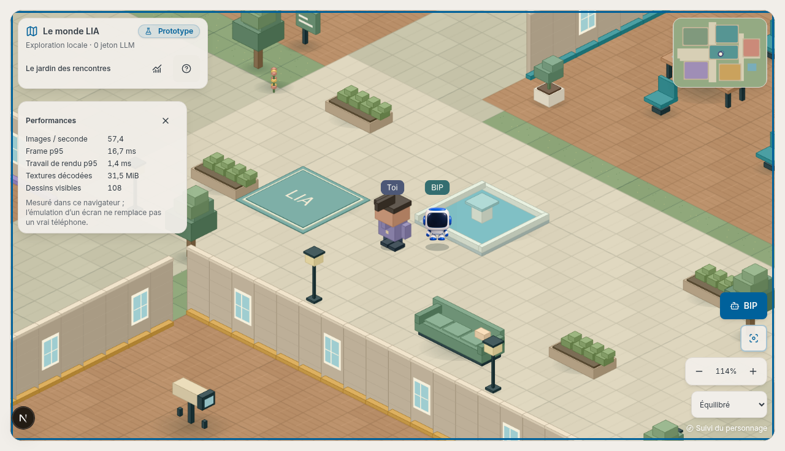
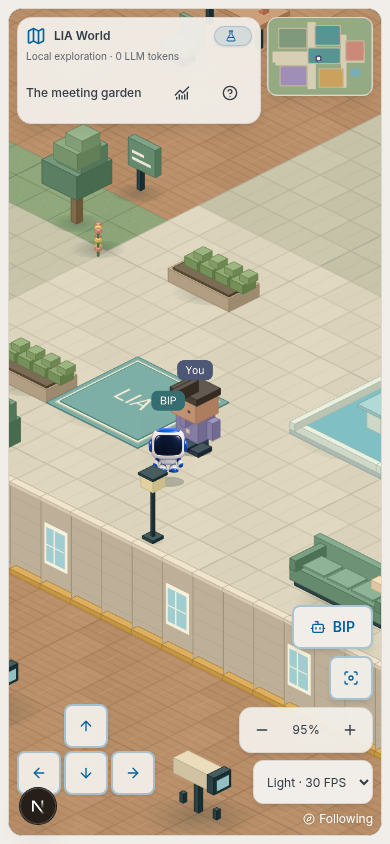

# SDD ledger — plan: docs/superpowers/plans/2026-10-23-lia-world-playable-prototype.md

Base: main ccd4688c015dcc1458997fd72630416ee291a6d2. Worktree: C:/Users/jgouv/LIA-worktrees/lia-world-prototype, branch codex/lia-world-prototype.

Owner authorized a durable first playable foundation, strictly inline, outside synchronized D:/Developpement. Existing audit/v14-wave worktree is unrelated and preserved.

Setup: clean worktree, three verified dependency junctions, Docker mount/runtime inspected. No application dependency installation or main checkout edit. E2E dependencies were installed only inside the owned browser container, then copied into ignored qualification scratch space for strict E2E compilation. No paid call. Native UI attachment refused an unmanaged worktree; no effect on Git validity.

Ruling: use original Canvas 2D sprite art with separate pure world/simulation/camera and owned renderer rather than add a dependency through shared node_modules — enables isolated prototype qualification without mutating shared environments. Existing Phaser reference remains the appearance/mechanics baseline.

Tasks 1–3: implemented. Pure world/navigation/simulation/camera, original cached Canvas art, BIP, owned input/runtime, lazy app route and six-language HUD. No model call or account operation. The development-only account-free preview exercises the same lazy prototype.

Cold review fixes reproduced by regression tests: initialization failure now releases partially acquired resources; disposed commands cannot act; preference changes reapply to a replacement owner runtime; visible long frames remain in p95 evidence. Core tests also cover collision, bounded route search, frame-rate independent travel, invalid input, focus transfer and BIP patrol/follow.

First browser proof: three Chromium journeys passed (desktop, phone layout/pointer controls, authenticated shell route). Native screenshots inspected. This run preceded the final polish and is intermediate evidence only.

Qualification harness diagnosis: the old mute development HMR socket prevented Next client hydration. Controlled browser comparison reproduced the failure. A fixed, loopback-only HMR bridge forwards text and binary synchronization, with bounded pending data; API interception, outbound proxy guard and provider blocking stay active. The three-engine run includes the existing API-isolation suite.

Task 4: complete for the local prototype scope. Browser qualification, documentation, FAQ and isolated launch workflow are implemented. Physical phone GPU/thermal behaviour and Raspberry Pi combined application load are not established by browser emulation.

## Cold adversarial review — findings and resolutions

- Partial initialization, stale owner callbacks and retained commands: owned cleanup stack, idempotent teardown, account lifetime guard and preference replay. Fault-injection tests exercise failures, not just successful mounting.
- Frame-rate differences, stalled tabs and held inputs: fixed-step simulation, bounded catch-up, collision subdivision, bounded search, focus/contact ownership and hidden-tab suspension.
- An off-centre click path could cut an obstacle corner: reproduce then align inside the starting cell. Path completion and representative place reachability are checked.
- First pinch movement was lost: establish the two-contact baseline on contact-down. Tap, drag, pinch, cancellation and wheel bounds have behavioral tests; Chromium CDP drives actual native multi-touch input.
- Continuous camera events published React state per event: reproduce a burst of 60 publications, then keep gesture rendering outside the bounded HUD snapshot tick. Discrete UI commands still acknowledge immediately.
- A wide fountain could incorrectly cover a foreground BIP: replace scalar actor insertion with footprint-aware alpha masks on one reusable actor surface. Separate masks omit drop shadows; a mask cannot double-darken the floor. Front faces, behind/distant props, ground decorations and all four layer bounds have tests. Corrected native capture inspected.
- Culling underestimated the front of deep props: use conservative projected depth in the viewport bounds.
- Route additions exposed indirect registries: declare the development preview in the 401/public-index/player classifiers; production rejects it before rendering. The explicit world navigation request updates the prior destination-count guard. Extract scene presentation from the shared layout to preserve its complexity ratchet.
- Initial browser test matched Next's route announcer as an error alert: scope the assertion to the actual localized fallback. Strict E2E TypeScript compilation also caught an un-narrowed DOM element; use an HTMLCanvasElement guard.
- Initial Windows helper rehearsal exposed argument-array binding and absent-container handling: corrected and exercised on an owned temporary container. Match the existing dev API certificate trust; shared dependencies and certificates are read-only. No TLS-verification bypass.

Two qualification failures were environmental/operator issues, not hidden successes:
an overloaded full run timed out on an unchanged changelog test; a concurrent scoped
coverage probe removed temporary files from another coverage run. Subsequent measures
use separate report directories. The default-concurrency final run repeated the
unchanged changelog timeout; its own process tree was identified and stopped, then
the complete suite passed with four workers. No timeout,
threshold, rule or baseline was weakened to absorb either issue.

## Final command results

- `task lint:frontend`: passed, including a11y, hooks, complexity and non-incremental TypeScript. Existing hook/complexity debt did not increase; no baseline was raised.
- Complete coverage command: `pnpm test:coverage --maxWorkers=4` in `apps/web`, with `NEXT_PUBLIC_API_URL` and `NEXT_PUBLIC_PRODUCT_TELEMETRY` blank exactly as in the Task recipe. **13,992 tests passed**, including the 41 prototype tests. Aggregate coverage: 86.97% statements, 81.40% branches, 84.84% functions, 88.48% lines. All existing global/scoped floors and the new world floor passed.
- Docker browser combined regression: **58 passed, 2 intentional CDP-only skips**, Chromium/Firefox/WebKit. Separate fresh-server navigation matrix: **1 passed**, six languages, meetings enabled, eight destinations at both 1280 and 1536 px.
- Entire E2E package strict TypeScript: passed. i18n parity: passed. Documentation preview: passed; no new unresolved documentation links.
- Windows PowerShell helper: Start, Sync, Status and Stop rehearsed on an owned temporary container; the final web container was recreated by Start and responds on the preview route. Source hash matches the worktree. Dependency and certificate mounts verified read-only. No shared service was restarted.

## Verification matrix

| Layer | Evidence |
|---|---|
| Pure model | Geometry round trips and anchoring; bounded routes/collisions; all places reachable; invalid inputs; independent frame rates; click completion; BIP patrol/follow; foreground masks. |
| DOM/runtime ownership | Held source composition, focus transfer, cancellation, lifecycle/visibility, pause, renderer/observer faults, StrictMode teardown, owner replacement, stale notification rejection, retry and bounded HUD publication. |
| Application integration | Shared nav, native menu tests, six-language desktop header geometry with meetings enabled, retained notification owner, preview route classifiers and non-development refusal. Six dictionaries/FAQ entries have exact key parity. |
| Real browser | Chromium, Firefox, WebKit: keyboard/tap movement, camera-only minimap, zoom, BIP, help/focus, small layouts, anonymous preview, authenticated shell, context recovery and three SPA exit/re-entry cycles. Old canvas backing becomes 1 px on teardown. |
| Accessibility | German controls scanned with the existing axe WCAG A/AA helper: no serious/critical violations. Native controls remain reachable; phone target sizes checked. This is not a claim of complete manual assistive-technology certification. |
| Network isolation | The full combined run includes API catch-all, pending reads/SSE, unload, CONNECT and WebSocket rejection across all three engines. No backend/model is used by these journeys. |
| Static gates | ESLint, a11y/hook/complexity ratchets, non-incremental frontend TypeScript; entire E2E package compiled in Docker; i18n parity and docs preview. |

The prototype has 41 focused tests. Geometry/navigation/simulation/occlusion measured
98.27% statements, 94.89% branches, 100% functions and 99.31% lines in the isolated
scope probe; its new scoped ratchet retains the repository margin. Rendering and
input remain in the global measured pool. The existing global floors are unchanged.

Backend suites were not rerun for this frontend graphics slice: backend source,
API contracts, schema, prompts and billing paths are unchanged. No integration
test reset a shared DB. A production build/release is outside this local qualification.

## Native visual and performance evidence

The final values are archived in [browser-evidence.json](assets/world-prototype-2026-10-23/browser-evidence.json).
They are observed in headless Linux Docker, not a Raspberry Pi/physical phone claim.
Warm interval p95 and synchronous drawing p95 are separate; decoded textures exclude
the main canvas, complete browser heap, compositor/driver and process RSS.

| Profile | Observed FPS | Frame p95 | JavaScript drawing p95 |
|---|---:|---:|---:|
| Chromium, desktop | 57.4 | 16.7 ms | 1.4 ms |
| Firefox, desktop | 57.1 | 17.2 ms | 13.1 ms |
| WebKit, desktop | 25.0 | 59 ms | 1.0 ms |
| Chromium, phone viewport, light tier, CPU slowdown ×4 | 28.1 | 50 ms | 6.1 ms |

The corrected desktop capture reports roughly 30 MiB of decoded graphics caches.
WebKit's slower frame pacing is a material target-device qualification item,
despite its low synchronous drawing time. No supported-device FPS guarantee is made.

## Acceptance self-review

| Criterion | Verdict |
|---|---|
| Approved local prototype scope and maintainable boundaries | Implemented; original art, independent model/input/runtime/renderer/HUD, no engine/dependency fork. |
| Existing LIA integration, privacy and accounting | Existing shell/auth/lifetime retained; no personal data projection, new model call or alternate quota path. No prompts required. |
| Known adverse paths | Automated behavioral/fault tests plus real browser walkthroughs; the review findings above are fixed. Exhaustive absence of all possible defects is not asserted. |
| Desktop and emulated phone use | Functional evidence in all three engines, with recorded performance and touch proof. |
| Real phone and Pi under normal LIA load | Not qualified here. WebKit headless frame pacing remains slower and must be checked on target Safari/iOS hardware. |
| Complete social world / production readiness | Outside this lot. No claim of multiplayer, real private stations, persistence, translation or production deployment. |

The engineering verdict is approval of this **first graphical foundation for user
validation**, with those measured limits. A universal 100% quality/performance
guarantee would not be supported by the available evidence.
