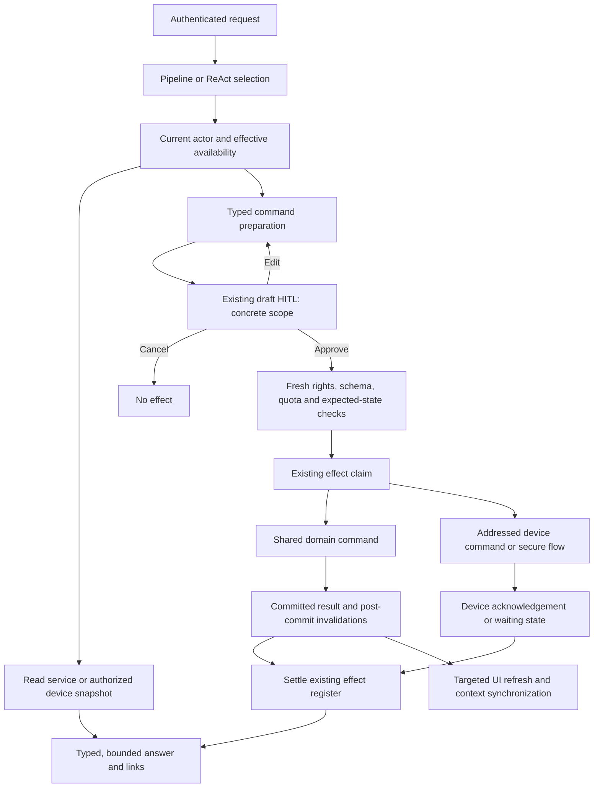

# LIA application tools: functional and technical design

**Status:** Approved design; implementation is in progress. The non-administrator scope remains incomplete.
**Date:** 2026-10-06.
**Execution:** Inline source inspection, without subagents, provider calls or production access.
**Scope owner:** The user requesting conversational control of the LIA application.

**Scope revision — 2026-10-08:** Account password, MFA, passkey, recovery and telephone-verification workflows are explicitly excluded by the user. No new tools or secure forms for those purposes are required. Inventory coverage applies to the revised scope; these exclusions must be recorded separately from delivered or technically unsupported affordances. Existing mandatory authentication and human confirmation for other operations are preserved. Administrator tools follow only after completion of the non-administrator lot and the requested pause.

Read this together with the [source inventory](2026-10-06-lia-application-interface-inventory.md), its [JSON evidence](2026-10-06-lia-application-interface-inventory.json), and the [sequenced TDD plan](../plans/2026-10-06-lia-application-tools.md).

## 1. Alignment and interpretation

LIA must let an authenticated person inspect the information available in their application and request any business operation the application offers them. An administrator additionally gets the administrative operations they are authorized to perform. Every assistant-requested action requires confirmation of its concrete scope before its effect occurs. Read-only consultations do not require confirmation.

This is an application capability surface over existing business services, plus a controlled device interaction surface. It is larger than a settings getter/setter and smaller than arbitrary HTTP, SQL, filesystem or browser automation. It includes the settings sections, dashboard, chat controls, actions, activity, notifications, radio, meetings and templates, knowledge spaces and documents, relations, workboard and generated/kept files. Administrative features include their read surfaces, filters, exports, configuration changes, jobs and broadcasts.

The useful outcome is parity of business behavior: asking LIA to make a change must enforce the same validation, permissions, quotas, lifecycle and side effects as making it through the UI. A result must distinguish saved configuration, effective capability, a requested device operation, and a verified completion. The assistant must also explain unavailable operations and offer the application's existing secure flow when human or device participation is required.

### Binding requirements

| ID | Requirement | Acceptance condition |
|---|---|---|
| F01 | Read the caller's application information | Values come from current services or an identified device snapshot; filters, time range, exact totals and freshness are stated. |
| F02 | Cover every application business affordance | Every declared section and authenticated page has an operation mapping; each operation is implemented, delegated to a secure interaction, or technically unavailable with a precise reason. |
| F03 | Confirm every assistant-requested action | No business effect occurs before approval; reversible actions, explicit requests and administrative actions are included. |
| F04 | Administrative access only for administrators | No administrative values are disclosed to ordinary users; direct invocation and delayed confirmation both enforce current server-side rights. |
| F05 | Preserve ownership | Actor identity is injected; resources, targets, files and devices are checked independently of model arguments. |
| F06 | Reuse the application | UI and tools reach the same business implementation; no second settings database, shadow configuration or arbitrary endpoint dispatcher. |
| F07 | Truthful completion | Explicit negative results, timeouts, partial outcomes and missing device acknowledgements never become success. |
| F08 | All existing execution paths obey the contract | Pipeline, ReAct, delegated voice, channel replay and carried workboard confirmations share the action policy. Unattended calls cannot authorize themselves. |
| F09 | Keep cost and quotas complete | All platform-paid work is attributed and bounded; personal-key costs follow the existing bearer rules. |
| F10 | Maintain accessible mobile UX | Existing cards/primitives and native interaction flows are reused; rehydration, keyboard/focus, narrow layouts and device limitations are tested. |

### Scope decisions made from the request

- Confirmation applies to actions performed through LIA's tools. Existing direct UI controls retain their own confirmation/security behavior; this request does not require placing a second conversational HITL on every manual switch click.
- A batch can receive one confirmation only when every operation, target, change and consequential effect is shown. Adding or editing a member invalidates the approval. Cross-domain effects are not represented as one atomic transaction.
- A user's request is intent, not approval of a draft they have not seen. Natural-language acceptance remains supported by the existing classifier, bound to the current draft.
- Scheduled actions and proactive initiative cannot change application settings without an actual confirmation carried to the user. A prior approval permits only the exact matching operation, according to the existing digest mechanism. Routine creation does not grant blanket authority to change later settings.
- Automatic extraction, housekeeping, stream acknowledgements and lease heartbeats retain their existing technical/consent contracts. They are not exposed as model-selectable UI actions. Explicit management requests through tools are confirmed.
- The assistant can report credential presence/status and masked metadata. It cannot receive passwords, API keys, session cookies, OTP secrets, backup codes, raw ingestion tokens or WebAuthn material in model context, drafts or chat history. Operations needing such material use the secure form on the person's device.
- Public marketing pages and unauthenticated registration/password recovery are not authenticated management capabilities. An authenticated help/navigation handoff may open their existing routes. Internal webhooks, health probes, telemetry, media chunks, provider callbacks and arbitrary MCP widget RPC are not automatically promoted into application tools.

No business answer is required to start the foundational lots. These interpretations are explicit and reviewable. A request to let the assistant receive credentials, write in Live direct, or treat scheduled intent as blanket confirmation would change security/product boundaries and requires a separate decision.

## 2. What the current source proves

The inventory records all declared settings sections and backend route declarations inspected on this date. Counts are a snapshot, not an installed-instance capability count. Conditional mounts in [routes.py](../../../apps/api/src/api/v1/routes.py) and effective switches decide what a particular deployment offers. No deployed configuration or database content was inferred from source defaults.

| Evidence | Observation and counter-check | Consequence |
|---|---|---|
| E01 | [settings-sections.ts](../../../apps/web/src/lib/settings-sections.ts), [component registry](../../../apps/web/src/components/settings/settings-section-registry.tsx), [availability hook](../../../apps/web/src/hooks/useSettingsAvailability.ts) and [search gates](../../../apps/web/src/lib/settings-search.ts) describe different parts of the same shell. Components can still render nothing after a token resolves. | A URL token alone is not proof that an operation is available. Reuse the stable tokens and describe effective availability separately. |
| E02 | [UserUpdate](../../../apps/api/src/domains/users/schemas.py) exposes only part of the preferences. [auth/router.py](../../../apps/api/src/domains/auth/router.py), [heartbeat](../../../apps/api/src/domains/heartbeat/router.py), [live](../../../apps/api/src/domains/live/router.py), [radio](../../../apps/api/src/domains/radio/router.py) and other domain routers own additional writes. | One generic PATCH to User cannot cover the request. Extract shared command functions where rules still live in handlers. |
| E03 | [EyesStyleSettings](../../../apps/web/src/components/settings/EyesStyleSettings.tsx) uses a persisted client store; [HapticsSettings](../../../apps/web/src/components/settings/HapticsSettings.tsx) calls the device capability/storage functions. In contrast [briefing preferences](../../../apps/web/src/hooks/useBriefingPreferences.ts) and [chat shortcuts](../../../apps/web/src/hooks/useChatShortcuts.ts) are server-persisted. | Do not infer persistence from appearance. Device settings need a device bridge; briefing and shortcuts need server adapters. |
| E04 | [useThemeMode](../../../apps/web/src/hooks/useThemeMode.ts) applies DOM/storage state and saves to User. [theme-mode.ts](../../../apps/web/src/lib/theme-mode.ts) encodes OLED as `oled` while keeping the DOM in dark mode. The hook tolerates persistence errors. | Distinguish local application from successful account save. Preserve the actual persisted vocabulary, rather than trusting a shortened schema description. |
| E05 | [approval_gate_node](../../../apps/api/src/domains/agents/nodes/approval_gate_node.py) is not the mandatory tool confirmation. [gate.py](../../../apps/api/src/domains/agents/effects/gate.py) passes `draft` until its executor, requires scope for `confirm`, and permits separately justified `reversible`/`artefact` policies. | Plan approval or changing `hitl_required` everywhere cannot implement the requirement. Native action drafts are the reuse point. |
| E06 | [workboard manifests](../../../apps/api/src/domains/agents/workboard/catalogue_manifests.py) allow several reversible mutations without HITL; deletion has a native draft. [automation manifests](../../../apps/api/src/domains/agents/automation/catalogue_manifests.py) similarly exempt toggle. | Existing in-scope tools must be aligned; adding confirmed alternatives while retaining an unconfirmed native route is a bypass. |
| E07 | `allowed_roles` is consumed by [PlanValidator](../../../apps/api/src/domains/agents/orchestration/validator.py). The current [planner](../../../apps/api/src/domains/agents/nodes/planner_node_v3.py) does not populate `user_roles` in that context. [routing](../../../apps/api/src/domains/agents/nodes/routing.py) does not turn every rejected validation verdict into a hard execution stop. | Declarative roles are discoverability/validation metadata, not the security boundary. Authorize at read/preparation and execution time. |
| E08 | [request manifest construction](../../../apps/api/src/core/context.py) merges/filter MCP availability, without a general role gate. [diagnostics tools](../../../apps/api/src/domains/agents/tools/diagnostics_tools.py) use [admin_gate](../../../apps/api/src/domains/agents/tools/admin_gate.py) at call time. That helper checks the superuser flag, not the whole active-account/session/step-up contract. | Reuse the pattern while supplying current active actor and ownership checks. Filter administration before semantic selection and still enforce it inside adapters. |
| E09 | [mcp/admin-servers](../../../apps/api/src/domains/user_mcp/admin_router.py) authenticates an active user, lists shared servers and toggles only that user's disabled list; its [component](../../../apps/web/src/components/settings/AdminMCPServersSettings.tsx) is in Features. | “Admin-configured” does not mean an administrative operation. Preserve ordinary-user opt-in to shared servers. Global configuration remains administrative. |
| E10 | [generic TOOL_CALL replay](../../../apps/api/src/domains/agents/effects/confirmation.py) invokes the saved tool args without injecting a native ToolRuntime. [delete_ticket_tool](../../../apps/api/src/domains/agents/tools/workboard_tools.py) explains and uses a native executor with fresh rights checks. | Use a native `APPLICATION_ACTION` draft/executor for new application operations; do not assume generic MCP replay is suitable. |
| E11 | [draft_executor](../../../apps/api/src/domains/agents/services/draft_executor.py) returns `DraftExecutionResult(success=True)` after a normally returned dictionary. [gated_executor](../../../apps/api/src/domains/agents/effects/runtime.py) settles its ledger from the result but returns that dictionary. [ticket deletion](../../../apps/api/src/domains/agents/tools/workboard_tools.py) can return `success=False`. | A source-level negative-result propagation gap must be characterized and corrected before using this seam broadly. This is not a claim of an observed production failure. |
| E12 | [typed runtime](../../../apps/api/src/domains/agents/context/runtime_context.py) is frozen and not checkpointed. [post-response extractions](../../../apps/api/src/domains/agents/nodes/post_response_extractions.py) read opt-ins from that runtime snapshot. | A setting changed inside a turn must affect the relevant finalization gates; do not mutate the frozen context or assume saving User changes its earlier snapshot. |
| E13 | [UserService](../../../apps/api/src/domains/users/service.py) handles timezone propagation, preference cache invalidation and personality synchronization, with explicit commits and additional side effects. | Direct row assignment loses behavior. “Same service” does not prove a multi-setting change is atomic; command boundaries must own transactions and post-commit work explicitly. |
| E14 | [Live tool door](../../../apps/api/src/domains/live/tool_door.py) and [direct mandate](../../../apps/api/src/domains/live/direct_mandate.py) intentionally admit read-only lookups. | Do not add administrative/application writes to direct voice lookup. Delegate actions to the chat confirmation flow and expose the waiting result accurately. |
| E15 | [session management](../../../apps/api/src/domains/auth/sessions_router.py) and [step-up](../../../apps/api/src/core/session_dependencies.py) use the actual authenticated session. [account export](../../../apps/api/src/domains/account_export/router.py) requires fresh step-up. | A model “yes” is not re-authentication. Sensitive flows require a secure device/session handoff. |
| E16 | [effect gate](../../../apps/api/src/domains/agents/effects/runtime.py), [repository](../../../apps/api/src/domains/agents/effects/repository.py) and [draft preapproval](../../../apps/api/src/domains/agents/nodes/draft_preapproval.py) already provide claims, owner-conditioned settlement, replay identity and single-use matching. | Extend these seams, retain one effect record and distinguish claim, committed state and external completion. |
| E17 | [action_sink](../../../apps/api/src/domains/shared/action_sink.py) already records selected direct UI actions such as sharing. Its contract intentionally differs from the confirmed-tool gate. | Avoid double recording when a tool reuses a service already instrumented through the sink; do not inherit its best-effort authority behavior. |
| E18 | [ReAct selector](../../../apps/api/src/domains/agents/services/react_tool_selector.py) measures bound schema tokens and preserves binding units/domain coverage. [result projection](../../../apps/api/src/domains/agents/tools/react_tool_wrapper.py) budgets items and marks untrusted data. | Reuse the measured budgets and selection infrastructure; the feature is not one enormous schema bound on every turn. |
| E19 | [usage guard](../../../apps/api/src/infrastructure/llm/usage_guard.py), [enforcement](../../../apps/api/src/domains/usage_limits/enforcement.py) and [cost bearers](../../../apps/api/src/domains/usage_limits/cost_bearers.py) distinguish instance/account ceilings and platform/personal keys. | A request without a personal key still pays platform LLM costs. Reads that synthesize or call a paid source are not computationally free. |
| E20 | [current pending HITL helper](../../../apps/api/src/domains/agents/api/hitl_pending.py), [action_requests](../../../apps/api/src/domains/agents/services/hitl/action_requests.py) and the client HITL reducers/hooks are locally modified in this working tree. | Treat rehydration as a moving local integration point; inspect its final merged version and rerun the lifecycle suite before implementation. |
| E21 | [User](../../../apps/api/src/domains/users/models.py) has active/verified/deleted facts but no dedicated first-activation history. [email verification](../../../apps/api/src/domains/auth/service.py) leaves a verified account inactive pending admin approval outside demo mode; admin deactivation also sets it inactive. [admin search](../../../apps/api/src/domains/users/router.py) filters the flags and [repository sorting](../../../apps/api/src/domains/users/repository.py) uses creation time plus a stable id tie-break. Admin audit rows exist but their absence does not prove an account was never activated. | “Latest account awaiting activation” requires an explicit eligible-state projection, not merely `is_active=False`. Add authoritative activation-history provenance; classify unreconstructable legacy provenance as unknown. |

## 3. Functional coverage matrix

The following matrix enumerates all tokens in the current section registry. Their exact components and declared routes/signatures are linked in the inventory. “Action” below always means a confirmed assistant action. It does not authorize arbitrary mutation of a model column merely because that column exists.

### Preferences

| Section token | Information to read | Operations to cover | Execution boundary |
|---|---|---|---|
| `language` | Saved account language; current UI language | Change account language and synchronize localized navigation | User service + client locale transition |
| `timezone` | Saved IANA zone and supported choices | Change zone, including dependent schedule recalculation | User service and existing timezone propagation |
| `location` | Home location, remembered location, opt-in, origin/freshness | Set/clear home; enable/disable remembering; request current location | Server preferences; secure device geolocation; no fabricated coordinates |
| `theme` | Persisted mode/accent and resolved device mode/OLED | Set mode/accent/OLED | Server save + existing theme hook; explicit two-stage result |
| `font` | Saved family and supported choices | Select family | User service + preference synchronization |
| `font-size` | Saved text size, effective current-device size when available, and published bounds | Set, increase/decrease by the UI step or explicit amount, reset | Strict integer schema, concrete target before HITL, existing scaling, no silent boundary clamp |
| `eyes-style` | Device style, widget visibility/geometry where offered | Select style; exposed widget show/hide/geometry commands | Current-device store, not User persistence |
| `display-mode` | Response rendering preference and available modes | Change response rendering | Auth preference; do not change rendering of archived answers by replay |
| `usage-preferences` | Stored/effective exchange rhythm | Select or reset the offered rhythm | User preference; new turn uses its selection policy |
| `haptics` | Supported capability and local opt-in | Enable/disable | Current device; unsupported is not false configuration |
| `briefing-grid` | Ordered/hidden dashboard cards | Move/reorder/show/hide cards | Existing full-list preference; compare expected collection before replacement |
| `chat-shortcuts` | Own shortcut ids/text and current limits | Create/edit/remove/reorder as offered | Existing JSONB preference; enforce static-command collision rules on server too |
| `my-shortcuts` | Pinned settings entries and cap | Pin/unpin/reorder; local dock geometry if offered | Server list plus device geometry; never pin an unauthorized admin target |
| `notifications` | App notification preferences, token/device metadata, browser permission | Change prefs; register/unregister/revoke device; send test | Server token registry + native/browser enrollment; no raw token in LLM |
| `channels` | Binding status/list | Generate secure linking handoff, enable/disable, unlink | Existing OTP/channel flow; code goes to secure UI, not model context |
| `security-auth` | Existing non-secret status projection only | New password, MFA, passkey and recovery workflows excluded by the user on 2026-10-08 | Existing authentication safeguards remain required by other in-scope operations |
| `security-devices` | Display ids, current flag, coarse device/session metadata | Revoke one, others or logout where offered | Real session-bound command; current-session revocation can interrupt delivery |
| `security-export` | Export readiness/current request status | Request/download account archive | Secure step-up; complete stream, not rows pasted into context |
| `voice-mode` | Account wake/STT opt-ins and effective remote availability | Set opt-ins/STT mode | Auth preferences; device microphone state remains separate |
| `live-mode` | Saved mode, duration/budget, interruptions, end-of-speech, result delivery, connector model/voice choices | Change offered preferences and connector non-secret choices | Existing live/connector services; active session and next-session config distinguished |
| `avatar` | Account opt-in, available/private faces, active lease status | Set opt-in/face; exposed window commands | Account service + device window; tokens/ICE credentials excluded |
| `radio` | Saved formats, cadence, verification, voices, public/personal sources, source lists, budget, heard-state metadata | Change preferences; preview/add/edit/remove source; clear heard history | Radio schema/services; source fetches use existing URL safety; start/play is device-assisted |
| `image-generation` | Saved preferences and effective configured model options | Enable/disable and set quality/size/format/enhancement | User service + options endpoint; published choices depend on current slot |
| `generated-assets` | Generated files, kept answers, filters, exact totals and accessible metadata | Keep/unkeep/delete singly/bulk, download/open, share/email as offered | Gallery/bookmark services; file ids owned; secure download/share handoff |
| `connectors` | Types, status/health, metadata and non-secret preferences | Activate/reconnect/refresh/test/disable/delete; choose calendars/task lists, rotate key through form; bulk reconnect | Provider resolver, preference validators, OAuth/native navigation and secret forms |
| `telephony-calls` | Own history, outcome, platform cost | Exposed history/detail/callback controls | Reuse history tools and confirmed phone actions; bearer rules unchanged |
| `telephony-identity` | Declared/verified number and rich-context/domain choices | Edit/clear declared number and offered context choices; telephone verification excluded by the user on 2026-10-08 | Existing identity/settings source; no new verification flow |
| `debug-panel` | Own opt-in and whether operator permits access | Enable/disable and device panel controls | User preference and device geometry; no access to admin configuration |

### Features

| Section token | Information to read | Operations to cover | Execution boundary |
|---|---|---|---|
| `personality` | Current/default personality and offered choices | Select/reset | Existing personality/User service, including trait synchronization |
| `psyche` | Opt-ins, state/history/summary and their freshness | Change offered settings; reset | Psyche service; summary generation cost is accounted |
| `memories` | Opt-in, paged memories/categories/provenance/pins | Create/edit/pin/delete, delete all, export, toggle opt-in | Actual memory service/store; explicit management does not become automatic extraction |
| `interests` | Settings, categories, entries, weight/explanations/provenance, notification history | Create/edit/delete/all, reactivate, feedback, prefs, export | Existing domain guards and learning/cache semantics |
| `open-loops` | Commitments, deadlines and lifecycle | Edit/close; supported chat follow-up | Existing lifecycle; temporal values normalized in user's zone |
| `habits` | Settings, learned habits, explanations | Toggle settings, recompute, accept/reject offered status, delete/all | Domain services; do not synthesize reading presence as a user interaction |
| `peer-connections` | Discovery state, requests, connections, shares, blocks/access logs | Change visibility, search, invite/respond, disconnect, set/revoke shares, block/unblock, share offered image | Current actor and peer relationship checked; no peer account credentials/data outside grants |
| `heartbeat` | Saved/effective opt-in, source availability/dependencies, quiet window, moments, offers/history | Change settings/refusal switches; history feedback | Existing sanitizers and strict source vocabulary; do not create a second proactive scheduler |
| `scheduled-actions` | Own routines, rules, timezone, mode, next/last run, usage/history where offered | Create/edit/delete/enable/disable/run-now | Reuse native tools and service; align reversible toggles with mandatory HITL |
| `reminders` | Own pending/detail lists and recurrence | Create/edit/cancel, exposed card follow-up | Reuse reminders; existing unconfirmed creates need scope alignment |
| `journals` | Opt-ins/themes/entries/provenance/portrait | Create/edit/delete/all, consolidate, portrait feedback, export, prefs | Domain/store semantics; consolidation/regeneration are confirmed work |
| `health-metrics` | Samples/aggregates/ingestion-token metadata and opt-ins | Delete by kind/all, generate/revoke ingestion credential, change agent use | Existing health guards; generated raw token shown only in secure UI |
| `skills` | Visible skills, provenance, enabled state, previews/library updates | Import/upload/URL/library install/update, edit allowed metadata, toggle/delete/download, install a chat proposal | Current account scope and immutable preview commit; third-party content remains untrusted |
| `plugins` | Own plugin imports and installed constituents | Import/uninstall through offered flows | Plugin service; present the complete skill/MCP constituent effects before confirmation |
| `admin-mcp-servers` | Shared instance-provided server metadata and user's opt-out | Set user's enabled state | User-scoped use of a shared server; not global administration |
| `mcp-servers` | Own server metadata/status/tools/apps | Create/edit/test/enable/disable/delete, generate description, OAuth connect/disconnect | Existing service and URL guards; auth material through secure form |
| `sandbox-egress` | Own current grants, hosts and validity | Revoke and supported grant confirmation | Existing scoped egress HITL; never a wildcard grant invented from a URL |
| `rag-spaces` | Own spaces, documents, sources, quotas, sync/index job state | Create/edit/delete/toggle; upload/move/delete docs; link/unlink/sync source; download archive/document | Existing durable jobs, ownership, MIME/size guards and last-good index |
| `meetings` | Recording defaults/retention, recordings, templates, reports/transcripts and job state | Preference changes; recording lifecycle; edit/reset report; retry/regenerate/reformat, delete/transcript/bulk, templates CRUD/duplicate, email/download | Recording needs selected device and microphone; server report/job actions use existing services |
| `workboard` | Settings, board/ticket/comments/children/counts/results/costs | Create/edit/move/assign/follow/comment/delete/run-now | Reuse native tools; confirm all manual mutations and preserve carried confirmation digests |
| `user-consumption-export` | Own statistics/billing windows/usage limits/export choices | Generate/download offered extracts | Existing complete export streams; read summaries without materializing full export in prompt |

### Administration

Every row below is superuser-only at discovery, read, draft preparation, replay and result access. An administrator targeting another account retains their own actor identity; target identity is a separate explicitly confirmed field.

| Section token | Read surface | Confirmed actions and important restrictions |
|---|---|---|
| `admin-users` | Paged/filter/sort search, statistics, activation/deletion state and exact totals; latest eligible pending account by creation time | Exposed activation, account purge and GDPR removal. Distinguish verified pending registration from deactivated, deleted and unverified accounts before automatic target selection. Do not add role promotion, account creation or arbitrary User fields absent from the UI contract. Preserve different purge meanings. |
| `admin-usage-limits` | Account limits/usage/blocking, instance budget/reset | Set/reset offered limits, block/unblock and daily instance budget. A quota-exhausted assistant cannot promise to raise its own quota; direct admin UI remains usable. |
| `admin-consumption-export` | Cross-account filters and consumption | Complete exports with authorized scope and period; no unmasked bulk contents in prompt. |
| `admin-broadcast` | Audience/filter choices and prior broadcasts | Preview exact recipient scope then send; user-authored content untrusted as data; delivery result/partial failure explicit. |
| `admin-connectors` | Instance availability configuration | Set offered global connector switches; do not edit arbitrary environment variables. |
| `admin-llm-pricing` | Catalogue/model metadata, prices, pricing sheet, capability provenance/status and reasoning family | Existing create/update/deactivate/reload and sheet import/export workflows. Respect verified/imported capability authority and structured-output invariants. No network catalogue sync masquerading as a UI action. |
| `admin-google-api-pricing` | SKU tariffs and metadata | Create/update/deactivate/reload and offered exports; publish invalidation after successful commit. |
| `admin-image-pricing` | Model tariffs/options | Create/update/deactivate/reload; cache parity across workers. |
| `admin-llm-config` | Actual per-slot overrides, provider presence/masked key, derived reasoning metadata, allowed voices/models | Change/reset offered slot settings; provider-key replacement/deletion through secure form. Capability and reasoning validators stay authoritative; new config applies at defined next operation boundary. |
| `admin-jev` | General/per-usage switches and effective bounded-decision configuration | Set offered switches/settings; preview affected usages; preserve uncertain fallback and paid-failure accounting. |
| `admin-personalities` | All personalities, translations and active state | Create/edit/delete/translate as offered; no prompts executed as instructions merely because stored in a personality record. |
| `admin-skills` | System skill metadata/provenance/visibility | Import/edit description/toggle/delete/reload/translate/download. Reuse system scope; do not resolve deletion by ambiguous name. |
| `rag-spaces-admin` | System spaces/staleness/reindex status | Start offered reindex jobs; preserve serving generation until atomic successful replacement, expose job rather than synchronous “indexed”. |
| `admin-capabilities` | Ceilings, operator switches and effective state/reason | Set offered capability switches. Turning off the executing capability affects subsequent operations; no reinterpretation of an in-flight confirmed action. |
| `admin-public-demo-link` | Current published link/configuration | Validate/set/reset offered link; reuse URL validation and invalidation. |
| `admin-registers` | Masked actions/consultations/decisions, statistics, seal status and source completeness | Existing exports/verification and audited unmasking only. No edit, deletion or hash-chain repair capability. User data visibility remains masked unless explicitly audited. |
| `admin-diagnostics` | Health, incident list/detail, bounded evidence/log/metric queries | Reuse existing read tools and offered diagnostic actions. No free PromQL/LogQL or remote shell. Distinguish stored diagnosis from generation that consumes a budget. |
| `debug-settings` | Instance debug availability/access and own opt-in | Change existing instance/user debug switches; client panel geometry separately scoped. |

### Authenticated screens beyond settings

| Surface | Read | Confirmed action/control coverage |
|---|---|---|
| Home/briefing | Current cards, summaries, counts, cost and source freshness | Refresh/generate where explicitly requested, layout actions, deep-link navigation. Ordinary existing read aggregation retains its accounting. |
| Chat/history | Authorized history/search, selected answer, assistant activity/results/cost | Clear/reset history as offered, execution/TTS/token/debug preferences, keep/unkeep/share/export answer, cancel current act, attach selected existing file, navigate. Cancellation requested by a tool follows confirmation; the existing direct Stop control remains immediate. |
| Actions/activity | Reminders/routines/commitments, action/consultation/decision registers | Existing detail/filter/export/follow-up affordances; no invented register mutation. |
| Notifications | Own delivered notifications, unread/count state and current device readiness | Mark read/dismiss if offered, test/enrollment, open existing target. Ambient delivery events are not selectable management commands. |
| Radio/player | Session, active segment/transcript/source links/budget and playhead snapshot | Start/stop/pause/resume, timer/public mode and offered source/article controls. Server session creation does not prove audible playback. |
| Meetings/templates/detail | List/filter, active recording, report/transcript/template/job status | Full supported lifecycle, templates and report actions described above; reuse recorder/store rather than simulate audio segments. |
| Spaces/documents/detail | Space/doc metadata, document content/provenance, indexing status | All supported upload/move/delete/download/sync and document preview controls. A tool references owned uploaded bytes, never a host path. |
| Relations | Overview/detail/context/favorites/debrief with exact totals | Favorite/unfavorite, merge/split, prefs/scope, debrief generation, offered contact/task/calendar follow-up; preserve canonical name folding. |
| Workboard/ticket | Board, filters/columns/needs-me, exact totals, ticket/comments/run result | Same commands as settings; card/detail/board routes use the same command implementations. |
| Capabilities/FAQ/help/design-system | Authorized capability map and help content | Internal localized navigation and offered shortcuts; diagnostic/design specimens do not authorize administrative operations. |

UI micro-interactions (scroll, opening a disclosure, moving focus, selecting a filter) need not become individual provider tools. The assistant reads with equivalent query parameters and performs meaningful named commands. Deliberate “open this page” requests are device commands; simply returning a link in an answer is a read result.

### Concrete conversational acceptance examples

**Read and increase the interface font size.** The account's `font_size` is the persisted authority; the current-device snapshot can additionally describe the applied size or an unsaved preview. [FontSizeSettings](../../../apps/web/src/components/settings/FontSizeSettings.tsx) increases/decreases by one whole CSS pixel, [useFontSizeSave](../../../apps/web/src/hooks/useFontSizeSave.ts) saves through User, and [font constants](../../../apps/web/src/constants/fonts.ts) are mirrored and checked against backend constants. Therefore “increase it” without an amount means the same single step the UI offers, stated before approval. An illustrative reply is “Your saved size is 16; increase it to 17?”; those example values are not a reading of the caller's account. An explicit amount/absolute value is validated against the existing strict bounds. At the maximum, explain the limit without creating a fictitious change. After approval, recheck the affected field, commit once, refresh User and apply the current font-context owner. If the field changed meanwhile, produce a fresh preview rather than recalculating a different approved target. Saving and current-device application are reported separately if one fails.

**Find and activate the latest account awaiting initial approval.** Interpret latest as greatest `created_at`, matching the admin listing's current default, with its stable id tie-break. Filter eligibility before pagination/limit: verified, inactive, non-deleted and known never activated. A previously deactivated account is a reactivation candidate, not silently a pending registration. The current source does not persist sufficient provenance for this distinction in every case. Add a small authoritative, monotonic account fact for activation history (`never_activated`, `activated`, `unknown` for unreconstructable legacy records), rather than a second independently writable active state. Initialize it on registration and set it on every actual activation path, including demo verification, native auth activation and administrative activation. Backfill only from reliable evidence; current active accounts are activated, whereas absence of an audit row is not proof of never-activation. Unknown legacy accounts remain identified as inactive with unknown origin; they can be explicitly selected through the existing administration flow, but must not be misrepresented as confirmed pending registrations.

The admin query returns the selected account's id, display identity and creation date, or a truthful empty/unknown result. The activation preview names that exact account and the existing notification-email consequence. The target id is frozen at preview: a newer registration during HITL must not replace it. At execution recheck current administrator rights, target eligibility and expected state, then reuse the activation command. Report account activation and notification delivery separately; a failed email does not mean the committed activation failed. A second confirmation cannot send the same email again. Ordinary users cannot discover, read or execute this operation.

## 4. Architecture decision

### Options

| Option | Advantages | Failure modes / reason not selected |
|---|---|---|
| LIA operates its own UI through a browser tool | Superficially broad coverage | Separate browser/session, selectors, mobile divergence, opaque diffs, no native transaction/role boundaries, high loop cost; does not control the person's device. |
| Generic HTTP/path/method/body tool | Small initial wrapper | Exposes internal/auth/streaming routes, arbitrary JSON, lost Depends authorization, hidden schemas and secrets, very large API prompt; HTTP method is not business intent. |
| Independent assistant settings model/services | Easy isolated implementation | Two authorities, missing caches/schedulers/quota validation, stale UI and permanent drift. |
| Typed native operations over current services + device bridge | Same business rules, explicit authority, native drafts/ledger, bounded schemas, testable client state | Requires extracting handler-local rules and implementing a real device completion protocol. **Selected.** |

### Units and dependency direction

Proposed names below describe new interfaces; they are not existing code.

1. `domains/agents/application/` is an agent-side composition family, like the existing workboard/program families. Its per-family operation declarations reference existing domain commands/query services and describe actor requirements, input/output schemas, availability, effect policy, sensitive-field projection, context behavior and UI origins. Domain services never import this family back.
2. `ApplicationOperationSpec` declares `operation_id`, `tool_name`, `surface_tokens`, request/response Pydantic models, authorization level, query/command kind, execution modes, availability predicate, cost family/road, context/update strategy and command adapter. The registry is an explicit reviewed allowlist, never discovered from all routers. The schema owns valid fields/ranges/enums; renderer/manifest adapters publish that same authority.
3. Typed tool entry points use the existing read/write/registered-tool presets, metrics and settings-driven rate limits, and emit `UnifiedToolOutput`. The operation registry does not replace the tool registry, domain taxonomy or existing registries: it generates/references their declarations and enforces parity at boot. Keep genuinely reusable existing tools, extending them when their semantics match.
4. Add the singular `setting` domain through `program_domain_configs.py` for account/device preferences; add `administration` for actual administrative operations. Existing resource domains keep their tools, with appropriate `serves_domains` for management requests. Register tools/manifests through current startup/program loaders. No additional graph node or LLM slot is needed.
5. Per-request selection filters application/admin manifests against the current actor and instance ceilings/operator state before semantic ranking, ordinary and panic selection, ReAct binding, initiative and nested execution. This reduces disclosure and useless offers; it does not replace adapter authorization.
6. Existing domain services are authoritative. Where a handler owns the rule, extract a small typed command/query service used by that handler and the tool. Do not call FastAPI handlers as ordinary functions: Depends, cookies, rate limits and transport assumptions would not execute.
7. A native `DraftType.APPLICATION_ACTION` carries the concrete operation, validated intent, resource/device identity, expected-state fingerprint, schema/catalogue version and bounded before/after description. Its native executor receives actor/dependencies through the existing executor seam and resolves a registry operation, rather than calling saved arbitrary HTTP or an arbitrary function name.
8. A device bridge carries a typed finite command to the exact originating client and receives a bounded authenticated completion acknowledgement. It calls existing hooks, stores, native adapters and safe navigation. It never evaluates JS, selects arbitrary DOM, reads arbitrary localStorage or calls an arbitrary URL. Device state remains on the device.

### Example tool boundaries

The exact operation set is derived from the coverage matrix in implementation; these names establish the intended granularity:

- `get_lia_preferences_tool` / `update_lia_preferences_tool`: non-secret account personalization with a closed validated patch.
- `get_lia_voice_settings_tool` / `update_lia_voice_settings_tool`: TTS/wake/STT account choices, distinct from Live choices and current microphone state.
- `get_lia_heartbeat_settings_tool` / `update_lia_heartbeat_settings_tool`, equivalent family tools for radio, notifications, journals, and other settings.
- `get_lia_device_settings_tool` / `update_lia_device_settings_tool`: finite current-device preferences, capability/freshness labeled.
- `get_lia_admin_llm_config_tool` / `update_lia_admin_llm_config_tool`: current per-slot values, typed update/reset; credential replacement is a secure handoff.
- `open_lia_section_tool`, supported playback/recording commands, and secure-flow handoffs: finite internal route/command ids, always with action confirmation.

Avoid both one tool per DOM control and one giant discriminated union spanning the whole application. Generate/refine bounded family schemas from existing request types. Administrative and personal schemas remain separate, so a normal user's patch cannot acquire global fields. Omitted, explicit null, reset and clear remain distinct; unknown fields are refused by the tool schema even when a legacy API ignores extras. Read projections never include credential-bearing session/start payloads.

## 5. Authorization, confirmation and lifecycle

### Actor and resource authority

Actor identity always comes from `LiaRuntimeContext.user_id`; neither a target id nor a client acknowledgement can change it. Load the actor's current account state at read/draft preparation and at execution. Administrative operations require current `is_superuser`, active/non-deleted account and the relevant existing authorization helper. Private resource misses remain hidden; shared resources follow their existing access contracts. Human identity, provider OAuth scopes, application role and feature availability are four separate checks.

Do not persist an `is_admin=True` boolean as authority in the draft. A downgrade, account block/deletion, connector revocation, resource reassignment, feature switch change, expired step-up or changed skill preview invalidates execution as appropriate. Session-bound operations use a host-injected authentication context identifying the current session server-side. They cannot fabricate a Cookie or a recent step-up from a user id. This context stays off LLM schemas/checkpoints; a secure handoff returns only an operation-scoped server-verified proof.

Existing guard helpers are reusable but do not all express the complete new contract. In particular the diagnostic superuser helper alone is insufficient for active-account or step-up checks, and the plan validator is not an authorization gate.

Administrative projections retain their operation/sensitivity provenance through drafts, pending-card hydration, command status and context records. Those read paths reauthorize the current actor before serving administrative values, including after a role downgrade. Filter restricted application projections before a later turn's context assembly; possession of an old command/draft id is not authority. Do not silently delete or rewrite unrelated chat history. This is an extension to the proposed family, not a claim that the current generic history/pending endpoints already enforce such sensitivity. Test the later-turn and pending-read paths explicitly, as well as execution.

### Preparation and exact approval

The prepare phase validates identity/schema/availability, resolves ambiguous references, reads the affected values and builds a diff. It causes no requested business effect. Read-only provider preflight/discovery can consume a declared budget and must not be retried unboundedly. The preview states target, account/device scope, before/after, deletion/share/delivery consequences, dependent schedules, cost-bearing job where relevant, and whether a secure interaction remains necessary.

Confirmation is bound to operation id, actor, target(s), canonical validated intent, expected state, device binding and catalogue/schema version. Values repaired by existing mechanical validators are shown in the repaired form before confirmation; invalid enums/types and guessed intent remain errors. Edit and capability/schema changes require a new preview. Approval is single-use; a stored standing preference is not a substitute.

**Batch policy:** default one draft per independent aggregate. An explicit multi-change request may show one composite draft if its complete ordered members and counts are visible. Same-domain database writes can be transactional when the command's service actually supports it. Otherwise execute ordered members, stop dependent members after a failed prerequisite, report each settled outcome and do not automatically undo successful changes. Undo is a new confirmed command.

### State conflicts and retries

- Fingerprint the fields/collection actually being changed, not the whole User row; unrelated writes should not create artificial conflicts.
- Check that fingerprint at the final write boundary under the domain's short transaction/lock or a compare-and-set version. The plain UI must use the same command boundary. A separate SELECT before an arbitrary committing service call is not a compare-and-set.
- Full-list PUTs (shortcuts, grid order, disabled-source lists) require expected collection state or named item operations; never overwrite a newer unrelated member from a stale list.
- Deletion targets are frozen ids resolved before approval. Newly appearing rows never silently enter “delete all”. Changed target set/consequences produce a new preview.
- Internal state-setting commands are idempotent. Create/send/start operations use stable request identity through the domain/provider where supported. The effect ledger suppresses duplicate calls but cannot prove external exactly-once delivery after a crash.
- Timeout/cancellation/crash after an external effect but before settlement is unknown/abandoned until an authoritative status query reconciles it. Do not resend, restart audio or regenerate a paid job automatically on reconnect. Retry requires a verified safe state or a new confirmation.
- A draft refusal is typed, and its result stays failure through the draft engine, model response, card, metrics and register. No non-empty dictionary or “no exception” heuristic.

### Native drafts and traceability

Extend DraftType's display/preview/summary/result/action-taxonomy/executor mappings and their boot completeness assertions. Reuse draft sequencing, explicit batch membership, pending-store rehydration and workboard digest preapproval. Do not set `permissions.hitl_required=True` on a native draft-producing tool merely to add a second interruption; current consistency tests deliberately distinguish pre-call approval from draft critique.

One executed application command produces one effect row. Preparation is a consultation, not an accomplished action. Services already using `recorded_action` must join the existing claim via a typed scope/port, or the tool executor must delegate recording to that single recorder with a tested declaration. It must not emit both a synthetic UI act and an unrelated tool act for the same effect. Read-only operations extend treatment-domain vocabulary and bounded display/i18n/metric mappings.

The existing confirmed-draft gate has a best-effort ledger-failure branch. For these mandatory-confirmation application commands, approval verification and a durable claim are prerequisites: missing authority/claim refuses execution. Do this via an explicit per-draft policy in the existing gate, not by changing all historic draft semantics incidentally. Lost/failed settlement after a real effect still reports the verified effect plus an integrity event; missing audit completion does not erase reality.

## 6. Device commands and secure interaction

Server reads cannot know which eyes style, resolved system theme, local volume, active recorder, notification permission or floating-window position the person currently sees. The same applies to current page filters, selection and unsaved form values. A validated snapshot is identified by user, authenticated client instance, capability set, captured-at and expiry. Only requested, allowlisted non-secret values are collected; unsaved input is explicitly labeled device draft state and never substitutes for a committed setting. Absence is `unavailable`/`unknown`, not a guessed default. Client-supplied state is untrusted evidence about that device, never server authorization or proof of an administrator role.

Bind commands to the client that originated the request; multiple tabs must not all perform them. A carried confirmation answered on another device explicitly selects/re-previews the device target. Never retarget a disconnected phone to the next connected laptop silently. A short-lived command id and version drive claim/ack/status. A tab that is inactive, closed, offline, navigated away or signed out reports waiting/expired/unavailable. It does not produce a successful device action merely because an SSE event was sent.

For reconnectable operation state, use a small `ApplicationCommand` execution record in the existing agents family (new proposed model), linked to the existing draft/effect identities. It is a transport/idempotency record, not a second audit ledger. It holds a schema version, actor, target/client binding, validated non-secret intent, expected-state digest, phase, expiry, unique request id, owner/fencing fields where claimed, and bounded result/error code. Encrypt PII; cascade on account deletion; keep payload only for the pending/recovery interval, retaining audit in the existing ledger. Declare Redis runtime keys by family when connection presence/notification fanout requires them.

Persisting server setting changes and device commands are distinct operations/phases. A device acknowledgement can confirm “applied on this device”, not “saved in account”, “sound was audible” or “provider billing stopped” unless the relevant owner reports that fact. For set-state commands, reconnect may re-read and apply the same desired state idempotently. For non-idempotent launch/record/play/send commands, unknown completion is reconciled, not replayed.

Secure flows preserve existing modules: `useStepUpGuard`, TOTP/WebAuthn, file selection/upload, `navigateToAuthorizationUrl`, native push enrollment, geolocation/microphone permissions, clipboard/share and download URLs. The bridge returns a finite handoff status and an internal link/form capability. It does not create a general URL opener. Browser/native gestures may still require the person to press a displayed button after HITL; that button is a platform requirement, not another model approval.

Use the existing notification transport for addressed delivery when its lifecycle can carry it, and expose authenticated polling/status as recovery. Do not hold a database session open during SSE, device acknowledgement, provider/model work or human waiting. Fresh transport integration must test cookie auth, cross-worker fanout, native shells and cancellation. The current source has no general application device-command protocol; this is required new infrastructure, not claimed reuse.

## 7. Persistence, contexts, caches and settings taking effect

Existing settings stay in their current User/domain/store columns. The new command record is needed for execution and device handoff, not a new preference model. All JSONB writes create a fresh value; counters/claims use database atomic operations. New model registration follows the single database registry and one Alembic head; replay upgrade/downgrade on a disposable target.

Reads have an operation-specific typed projection: saved value, effective value, unavailable reason, scope, observed-at, field labels, domain/resource ids and paging information. Nullable/absent/unsupported/error states are distinct. Custom objects checkpoint as dicts and reconstruct with complete round-trip tests. Introduce a `SETTING` registry/context only for data that must support later references; arbitrary configuration dumps do not become long-term memories. Reuse resource RegistryItemTypes for existing resources. A new context requires the enum, ContextTypeDefinition, registry_updates and context_key together.

On confirmed state change:

1. Commit the domain change and command outcome under their explicit transaction contract.
2. Publish the domain's existing cache invalidation only after commit. Pricing/configuration caches must converge across workers, not only in the current process.
3. Emit a typed `application_state_changed` descriptor with affected projections/resources and current revision, rather than all secrets/data.
4. Refresh active queries and authenticated User state through existing hooks. Preserve typed drafts, focus, current filter and populated content; refresh uses aria-busy, not subtree unmount.
5. Update/invalidate the relevant TCM snapshot, current item/list and ephemeral device snapshot. A rejected/failed command does none of this.

**Effect-time rule:** saved language/timezone/display/model/execution preferences govern subsequent operations/turns according to their owner. The current graph mode or already-open live session does not switch in the middle of its execution. Opt-out of memory/journal/psyche/recording must be respected before further applicable extraction/write work, including after confirmation in this turn. Reload the authoritative flags at finalization/worker write boundaries or use a typed committed-setting-change overlay in declared MessagesState; never mutate frozen runtime fields. Pending background tasks also re-check their consent before writing. Test that deletion/reset is not immediately repopulated from the management turn itself; mark successful destructive management in a declared turn-scoped guard rather than by text heuristics.

Removing a connector/skill/MCP server can invalidate tools already selected this turn. Every subsequent operation checks current capability before effect; results and existing archived history remain readable under their existing rules. Feature switch ceilings and operator opt-in are distinct from a user preference. History reset purges only declared conversation-cache families, preserving grants, recurrence state and other non-conversation authority according to current contracts.

## 8. LLM tokens, cost and rate limits

### Prompt and tool budget

Do not derive behavior or savings from a particular model/provider default. Runtime slots and their derived capabilities/windows are the authority. Use the existing token counter, bound schema measurement, per-slot effective-window helpers, compact catalogue, semantic ranking, domain coverage, binding units and result item budget.

Adding all UI operations can affect every ReAct call, even a chat request unrelated to settings. Measure before/after schema and assembled prompt tokens on the same corpus and configured capability/window classes. Separate message tokens, schema tokens, cache read/write tokens, tool-result tokens, total paid usage, model calls, retries, latency and consultation count. A static catalogue estimate is not measured billing. No savings percentage is asserted in this analysis.

Use bounded aggregate tools, compact English technical descriptions, request-specific authorized manifests, existing embeddings and exact paging. Keep all useful operations reachable; do not lower history/tool coverage or omit semantic constraints to reduce costs. If a small configured window cannot fit the chosen authorized set, use explicit family discovery/routing under the same schema authority and test reachability. Do not silently bind a half of a required read/action pair. Metadata and result values must remain separated: repeat no full API inventory, OpenAPI, credentials, binary/base64/audio, full exports or source code in prompts.

Result pages state exact totals, returned count, cursor/has-more, applied filters and cut reasons. Existing budget projection keeps item boundaries; a requested precise setting/value is served whole or reported unavailable. A displayed configuration list must not be shortened silently or summarized into invented options. Long free-text descriptions and names remain untrusted external data under the current wrapper.

### Cost ownership and ceilings

- Internal configuration reads/writes need no new LLM in their adapter. Routing, planning, clarification, draft editing/question generation, response/TTS and any relevant semantic embedding still incur their existing costs.
- Caller-requested provider discovery, geo resolution, source preview, syntheses, translations, journal consolidation, diagnostic generation, embeddings/reindexing, media samples and report regeneration use their current accountant. Reuse cache/freshness semantics rather than automatically opening a paid source to explain a switch.
- Platform-paid calls answer to both account and instance ceilings. Personal-key provider costs are not duplicated into platform billing/history. Missing personal key is distinguishable from missing platform configuration; a saved opt-in can be ineffective while the instance denies the capability.
- Every paid call, including a failed call followed by fallback, remains attributed to the correct actor/run. Admin-targeted changes are initiated by the admin; costs of resulting target-owned jobs follow the existing named accountant and must be stated, rather than silently charged to a guessed account.
- Approval does not reserve future budget. Re-check the current budget before each paid execution. Refusal returns its structured reason/reset/retry time. Pure settings UI and secure confirmation remain accessible during exhaustion; the assistant cannot bypass the guard to change budgets or finish a new LLM response.
- Use current settings-driven `@rate_limit`/metrics presets, per-user read/write/expensive categories and appropriate instance limiting for global jobs/broadcast/import/reindex. Repeated acknowledgements are deduplicated before business effects and spend. Provider limits use existing typed retry/shaper policy; no automatic retry of a non-idempotent effect on 429/timeout.

Qualification records are required before delivery: assembled prompts and schemas for normal/admin/small-window/every-tool modes; no irrelevant-turn context regression; complete platform spend ledger/display; zero personal-key double billing; all read/write/job quotas; and actual two-worker cache consistency. Performance numbers and tunable TTL/batch/window limits come from measurements/settings, not invented constants in this design.

## 9. UX, localization and accessible mobile behavior

Reuse the current native draft card, `DraftDisplayRegistry`, preview/summary/result renderers and the chat's available-actions vocabulary. The new preview is a readable before/after list with scope and consequences, not raw JSON. It exposes Confirm, Edit and Cancel; read results can include a localized deep link through `settingsSectionHref`. Use the existing native primitives, FormSection, Disclosure, RowActions, SectionToolbar, FieldFrame, EmptyState, Skeleton/LoadingAnnouncement, semantic status tones and theme tokens.

No new global settings screen is required. A bounded client interaction card can appear when an operation needs a secure form, device selection or gesture. Confirmation and device waiting persist across reconnect/reload without replaying archived commands. The pending card states pending, processing, completed, cancelled, expired, conflict, forbidden, unavailable or failed as its actual producer supports; do not introduce an enum member with no reader/producer. Keep result vocabulary coherent with existing ToolErrorCode and AgentResultStatus rather than adding uncontrolled strings.

Mobile: wrap long labels, ids and before/after values; avoid horizontal scroll for forms/cards; keep action controls reachable on narrow screens and after the keyboard opens. Preserve focus/typed input across targeted refresh. Announce validation errors and state changes, return dialog focus correctly, retain keyboard parity and disabled guards. Test light/dark/OLED and reduced motion; do not replay expressive-avatar success animation for a proposed, failed or restored action.

All user-visible labels, errors, handoff instructions and accessible names use existing six-language mechanisms. Frontend `zh` and backend `zh-CN` pass through the existing normalization seam. English technical model instructions remain versioned files; no inline fallback prompts and every placeholder has a producer. The management turn may change language: preview reflects the request/confirmation locale, stored new locale applies on subsequent UI/turn state without losing the approved payload. Time previews use the person's IANA zone; persisted dates are aware UTC and DST ambiguous/nonexistent values follow the existing explicit validation rule.

Native WebViews: preserve cookie BFF auth, native OAuth departure, push asymmetry and unavailable browser APIs. A web permission setting does not grant OS microphone/location/notifications. Runtime validation uses Docker dev plus hermetic browser mocks; real-device tests are necessary for OS gestures and media behavior but are a separate qualification, not paid production experiments on the owner's account.

## 10. Impact and risk matrix

| Risk | Impact / severity | Concrete mitigation | Required evidence |
|---|---|---|---|
| Administrative values leak through read/catalogue/result cache | Confidentiality, critical | Filter before ranking; current active superuser gate in each adapter/result access; actor-scoped cache key; no mixed personal/admin schema | User/admin direct invocation, downgrade on resume, two simultaneous users, cached discovery |
| Existing reversible tool bypasses mandatory HITL | Unauthorized effect, critical | Migrate in-scope existing entry points to native drafts; guard every registered application mutation; no confirmation-free stand-in | Pipeline/ReAct/raw coroutine/ainvoke/nested/unattended contract tests |
| “Yes” authorizes changed target/payload | Wrong destructive/global action, critical | Immutable canonical draft, target/expected-state/catalogue digest; edit/replay single-use | Tamper, resource reassignment, renamed enum, changed preview commit, batch membership |
| FastAPI guards disappear during service reuse | Authorization/session/step-up bypass, critical | Explicit command authorization port; secure session-bound flow; no direct route calls | Negative role/ownership/session/step-up matrix |
| Credential appears in model/draft/ledger/traces | Secret disclosure, critical | Allowlisted projections and secure forms; no arbitrary JSON/start response | Planted secrets in all input/output paths, checkpoints, logs/telemetry |
| Negative executor result becomes success | Wrong answer/register/UX, high | Characterize current draft engine gap; use explicit_success and typed application outcomes | Returned failure without exception across engine/card/metrics/register |
| Lost update/full-list replacement | Data corruption, high | Expected affected-state CAS inside write transaction; list/item boundaries shared with UI | Concurrent UI/tool writes and two-worker tests against PostgreSQL |
| Commit succeeded but cache/propagation failed | Inconsistent schedules/config, high | Explicit transaction and resumable post-commit effects; invalidation only after commit; read-back revision | Crash at each phase, multiple commits characterization, two-worker cache checks |
| Device command delivered twice/wrong tab | Wrong device action/spend/privacy, high | Origin binding, stable command id, atomic owner/fencing, idempotent set-state, no launch replay | Multiple tabs/devices, takeover, offline/reconnect/crash-before-ACK |
| Device “requested” reported “audible/recording” | False success/provider leak, high | Completion facts from actual owner; bounded waiting/unknown state | Autoplay denial, microphone denied, background WebView, stale ACK |
| State reset/opt-out repopulated at turn end | Consent/data lifecycle regression, high | Re-read opt-ins at extraction write; declared management guard; no raw sensitive memory | Confirm disable/delete + pending extraction + next turn |
| API/UI and tools diverge | Hidden validation/side-effect gaps, high | Shared service/schema; coverage-to-affordance guard and red cross-entry parity tests | Same before/after/invalid input through both entries |
| Tool schema growth inflates every model turn | Cost/latency/window overflow, high | Bounded family schemas, authorized set, measured schema tokens, existing ranking/coverage | Matched corpus and small-window/every-tool/panic benchmarks |
| Quota refusal after confirmation leads to retry/spend loop | Cost/exhaustion, high | Current dual gate, typed refusal; retry only safe/provider-bounded; keep secure UI reachable | Account/instance boundary, failed paid call/fallback, concurrent near-limit calls |
| Global cache only updated on one worker | Incorrect pricing or capability, high | Existing publish invalidation after commit/rebuild | Two independently initialized workers, rollback/publish failure |
| Existing direct action sink causes two effects | Incorrect transparency/idempotency, high | One recorder through typed shared scope; explicit recording owner | Tool/UI email/image/proposal sharing exactly one row |
| New command persistence leaks/never expires | Privacy/storage growth, medium/high | Encrypt PII, cascade, bounded pending retention, registry keys by family | Deletion/expiry/reset/export contract, migration replay |
| GET/POST name misclassifies semantic effect | False permission/HITL policy, high | Explicit reviewed operation semantics; exclude callbacks/chunks/telemetry | Mount/action inventory diff and classification tests |
| Feature withdrawn after draft | Dead/partially executed action, medium/high | Re-check effective state/schema; phase snapshot for running operation | Operator disable, connector/key deletion and code upgrade between approve/execute |
| Native/mobile/browser APIs differ | Unreachable action or wrong defaults, medium/high | Existing native hooks; supported/unknown states; secure handoff | WebKit/Chromium plus Android/iOS real-device qualification |
| Cross-domain batches falsely atomic | Partial loss or false rollback, high | Per-aggregate transaction, ordered outcomes, dependent-stop and explicit new undo | Third member failure, mixed provider/database/device batch |
| Existing pending-HITL changes collide | Chat lifecycle regression, high | Preserve concurrent tree; integrate final local contract; characterize rehydration | Pending endpoint, restored buttons, stale decisions, reload/channel tests |

Direct changes concern tools/manifests/drafts, touched domain commands/queries, account-context synchronization, new command persistence, addressed device protocol and client refetch. Indirect impacts include selection/index caches, proactive eligibility, voice/channel origins, job accounting, scheduler timezone changes, ledger exports/statistics, feature availability, native shells and docs/living maps. No infrastructure deployment or paid provider change is authorized by this analysis.

## 11. Director test plan

### Coverage matrix

| Layer | Business oracle | Simulation / real boundary |
|---|---|---|
| Unit: operation registry | Every mapped affordance has schema, authority, policy, availability, cost owner and execution mode; no unsafe route | Full registry and deliberate missing/duplicate/unknown declarations |
| Unit: schema/preview | Exact before/after/target; unknown fields/type/enum refused; omitted/null/reset preserved | Real Pydantic models, boundary values, Unicode, long text, injection bait |
| Unit: authorization | Current actor/role/ownership, not prompt or persisted role | Real authorization function with repo fixture; direct adapter invocation |
| Unit: HITL engine | No effect before confirm; edit/cancel/stale; returned failure stays failure | Existing executor/dispatcher/gate with service fake, not a mocked end result |
| Unit: context/extraction | Changes survive checkpoint; opt-out/reset respected; references updated only on success | Real reducer/serialization/finalization helper; clock/task control |
| Backend integration | UI and tool paths yield identical durable values, side effects and permissions | Disposable PostgreSQL/Redis; actual repositories/sessions, mocked external providers |
| Backend integration: reliability | Claims/CAS/outbox/ACK atomic, fencing and rollback | Two independent actors/workers; crash barriers before/after each commit |
| Backend flow | Pipeline/ReAct/resume/nested/voice/channel/workboard do not bypass | Deterministic model tool-call fixtures; actual graph/gate/draft paths |
| Frontend integration | Real card/reducer/query/store state, refresh/focus and secure handoff | Typed API/SSE mocks; current hooks/primitives, not wholly mocked hooks |
| Browser E2E | User/admin normal/failure/reload/device outcomes are visible and accessible | Hermetic intercepted API/SSE; no production/paid provider |
| Native qualification | Permission/gesture/OAuth/push/audio boundary works on actual device | Dedicated test account; no owner's radio/live session replacement |
| Token/cost qualification | Reachability preserved and all platform costs counted | Fixed labeled corpus, configured window classes, tracking/cache/shaper fixtures |
| Static/quality gates | Types/registries/markers/docs/i18n/cycles/size/metrics true | Existing Taskfile commands and shrink-only ratchets |

### Explicit scenario catalogue

| ID | Scenario and expected behavior | Primary lot |
|---|---|---|
| T01 | Own settings read returns current saved/effective values; no write/draft | 1, 3 |
| T02 | Non-admin forced admin read/action/result/discovery, pending hydration or later-turn application context returns forbidden/redacted without values; old draft ids grant no authority | 1, 2, 7, 9 |
| T03 | Admin demoted/deleted/inactive after preview cannot execute; same for reassigned private resource | 1, 2, 7 |
| T04 | Raw coroutine, ainvoke, ReAct, pipeline and nested entry cannot mutate before HITL | 1, 2 |
| T05 | Cancel/decline causes no effect/cache invalidation; editing displays a fresh exact preview | 2 |
| T06 | Returned `success=False`, not an exception, remains failed in response/card/metrics/ledger | 0, 2 |
| T07 | Duplicate confirm from two tabs/workers performs one effect, serves the recorded result | 2, 8 |
| T08 | Stale/expired/tampered draft id/digest/schema/version is refused; arbitrary “yes” does not select another draft | 2 |
| T09 | Approving a partial displayed batch never executes hidden members; changed ordered members require reconfirmation | 2 |
| T10 | Two concurrent edits to same field conflict; different fields commute; collection PUT cannot lose a new member | 2, 3, 4 |
| T11 | Toggle replay does not invert twice; same desired state is a truthful no-op | 3–7 |
| T12 | Payload extras, string/bool integer, non-finite float, invalid UUID/enum, explicit null and missing field obey published schema | 1, 3–7 |
| T13 | UI-only reserved shortcut id is also refused through tools/backend | 3 |
| T14 | OLED saved/resolved state, theme account save failure, font size bounds and hydration stay coherent | 3, 8 |
| T15 | Zone change recalculates dependent schedules; DST gap/fold/end-of-day preview and result correct | 3, 4 |
| T16 | Change language including zh/zh-CN; current preview preserved, next UI/turn locale correct, all accessible names localized | 3, 9 |
| T17 | Disable/delete memory/journal/psyche during confirmation; no later forbidden extraction write/repopulation | 3, 5 |
| T18 | Empty, unavailable, disabled, stale and failure reads are distinguishable; totals exact with page filters | 1, 3–7 |
| T19 | Source/provenance descriptions containing instructions or HTML remain external data; planted secrets absent everywhere | 1, 5–7, 9 |
| T20 | Read shared admin-configured MCP as normal user, set only own opt-out, reject global admin config | 4, 6 |
| T21 | Connector OAuth/key/Apple/Hue/native flow uses secure forms; no credentials in model/draft | 4, 8 |
| T22 | Removed key/connector/tool/capability after preview refuses safely; no stale successful setting claim | 2, 4, 7 |
| T23 | Step-up absent/expired/for another session cannot execute sensitive operation; secure interaction resumes exact command | 4, 8 |
| T24 | Revoke current device/logout/purge can terminate stream; result verified later from command/audit, not inferred from connection loss | 4, 7, 8 |
| T25 | Every memory/interest/journal/health create/edit/pin/status/delete/export and provenance path matches UI ownership/rules | 5 |
| T26 | “Delete all” freezes eligible ids/counts; new row after preview never silently deleted | 2, 5–7 |
| T27 | Routine/reminder/workboard existing reversible actions now ask; unattended run produces no effect or a carried question | 4, 5, 9 |
| T28 | Workboard matching approved draft executes once; modified draft asks again; peer holder cannot execute owner-only action | 5, 9 |
| T29 | Knowledge-space move/upload/delete/sync/reindex preserves quotas, job recovery and last-good generation | 6, 7 |
| T30 | Skill library preview commit changed; install/update stays pinned or re-previews, correct account/system scope | 6 |
| T31 | Plugin import fails midway; partial constituents/rollback reported; no hidden global modification | 6 |
| T32 | MCP URL redirects/internal address rejected by existing URL boundary; apps proxy is not generic management RPC | 4, 6 |
| T33 | Regenerate report/consolidate/debrief/translate/discover hits account and instance budget; failed paid call counted | 5–7, 10 |
| T34 | Admin pricing/config writes update two worker caches after commit; rollback publishes nothing | 7 |
| T35 | Administrative LLM reasoning/capability validation publishes exactly offered choices, no raw secret | 7 |
| T36 | Broadcast exact audience and partial delivery failure, no automatic resend | 7 |
| T37 | Masked register export, audited unmasking, complete source totals, no repair/edit operation | 7 |
| T38 | Multi-device snapshot has correct target/scope/freshness; disconnected originating device not retargeted | 8 |
| T39 | Duplicate/delayed/forged ACK from wrong actor/client/version is refused; state-setting replay safe | 8 |
| T40 | Client applied setting then crashed before ACK; reconcile value, never repeat a non-idempotent launch | 8 |
| T41 | Autoplay/mic/location/notifications/clipboard permission denied; action waiting/failed, never invented OS grant | 8 |
| T42 | WebView lacks SW/Push/Notification/browser feature; existing native adapter or explicit unsupported result | 8, 9 |
| T43 | Radio/Live/meeting active session stop/start/lease conflict uses real owner; mode change applies at declared next boundary | 8 |
| T44 | Current panel refresh preserves input/focus/filter; late response from old endpoint cannot undo newer state | 3–9 |
| T45 | Reload pending card retains actions/ids; already-settled command cannot run from archived SSE replay | 2, 8, 9 |
| T46 | Network/Redis/database unavailable during preparation/authority/claim refuses effect; settlement interruption records integrity | 2, 8 |
| T47 | Timeout/CancelledError/shutdown during execution closes owner claim as abandoned; later actor cannot settle stale token | 2, 8 |
| T48 | Cross-domain batch fails after one success; dependent commands stop and exact per-member outcome displayed | 2, 9 |
| T49 | App reset/account deletion/expiry cleans command keys/payloads without deleting unrelated grants/learning | 2, 8 |
| T50 | Same service already recorded direct sharing yields one effect row when invoked through a tool | 6, 9 |
| T51 | Small/unknown context window, semantic failure/panic, frequent/occasional modes keep authorized operations reachable | 1, 10 |
| T52 | Irrelevant conversation has no unbounded schema/context growth; parameter constraints stay present | 10 |
| T53 | No personal provider key versus instance key missing are distinct; platform ledger complete, personal costs not persisted | 4, 10 |
| T54 | Quota exhausted after confirm; deterministic refusal and secure UI still available, no spending retry loop | 2, 10 |
| T55 | Narrow viewport, long translated values, zoom/reflow, dark/OLED/reduced motion, keyboard and screen-reader announcements | 9 |
| T56 | Migration upgrade/downgrade, duplicate registry declaration, missing executor/display/i18n/context/metric consumer fail loud | 1, 2, 8, 10 |
| T57 | Read font size, relative increase by the actual UI step, explicit amount/reset, maximum refusal, stale-field re-preview and account/device convergence after confirmation | 3, 8, 9 |
| T58 | Latest pending registration filters before limit; excludes unverified/deactivated/deleted/unknown-history accounts; stable creation-time tie, empty result, frozen target during HITL, admin downgrade, duplicate execution and activation-success/email-failure are truthful | 0, 2, 7, 9 |

Tests use existing deterministic fixtures for model/tool emissions, external-provider clients, clocks, Redis readiness, network status, permission APIs and media completion. Database concurrency tests use real PostgreSQL transactions and independent sessions; mocks cannot certify them. Native tests must explicitly report what is measured (transport, device state, audible output, provider release or billing), without substituting one for another.

## 12. Sequencing and delivery criteria

The [plan](../plans/2026-10-06-lia-application-tools.md) defines atomic reviewable work in this order: characterization; operation authority/catalogue; native drafts/reliable command boundary; profile/display; communication/security/automation; learning/workboard; extensions/data/media; administration; device bridge; integration/UX; cost/qualification. Per-family lots can subdivide but no advertised operation may be left unwired. Each slice includes read, write/handoff, authorization, HITL, service parity, invalidation, context, tests and docs.

Before implementation, refresh this snapshot against concurrent changes, then preserve unrelated edits. Do not edit generated AGENTS.md, perform Git delivery, deploy, change environment values, install dependencies or run paid measurements as part of this analysis. During implementation follow Taskfile gates, registry smoke, backend agents, disposable DB/Redis, frontend coverage and hermetic browser suites; each lot gets an inline cold review of all its source/test/doc changes.

Ratchets remain shrink-only: file size, complexity, cycles, MyPy debt, hooks, accessibility, coverage and metric visibility. Extend a guard's universe when adding an operation, not its debt allowance. Add no framework/runtime dependency by default. Future architectural ADR is Proposed until reviewed, and its new domain/infra entries must be covered by six-language maps before commit. This analysis itself introduces no runtime domain or ADR.

## 13. Formal self-evaluation and limits

| Requested criterion | Assessment | Evidence / remaining qualification |
|---|---|---|
| Functional target and indirect scope explicit | Yes for the declared source surface | Complete token matrix and authenticated-page matrix; operation mapping must also traverse nested/imported UI controls during each slice. |
| Assumptions checked against real code | Structural claims yes; deployed/runtime claims deliberately unasserted | Evidence table gives source and counter-check; route declarations are not runtime availability. No prod instance/real-device/model behavior was measured. |
| Permissions/HITL robust and viable | Viable design, with identified prerequisites | Native draft reuse, fresh server rights, strict claim rule and sensitive session handoff; source-level gaps characterized in lot 0. |
| Tokens/costs/registries/mobile fully addressed | Contracts and measurement plan specified | Existing budget/accounting/context/UI paths named; no invented reduction or performance guarantee. Real-device and configured-model qualification remain gates. |
| Plan and tests sufficient to start | Yes for foundation and ordered slices | Exact ownership boundaries, file anchors, interfaces, assertions and exit gates in the linked plan. Operation adapters require per-family schema/body characterization, not speculative mass generation. |
| 100% certainty of no hidden issue | **No absolute guarantee claimed** | Static analysis cannot establish every installed flag, concurrency interleaving, provider failure or browser gesture. Those uncertainties have explicit executable gates, not silent assumptions. |
| Business questions blocking the first lots | None under the stated scope decisions | Changes to credential handling, direct Live mutation or unattended blanket approval require a separate business/security decision. |

The analysis is comprehensive at the architecture and declared-surface level, not a certificate that unimplemented behavior already works. Completion of the implementation requires closing the listed tests and empirical qualification gates. No application behavior was changed or tested by this document.
