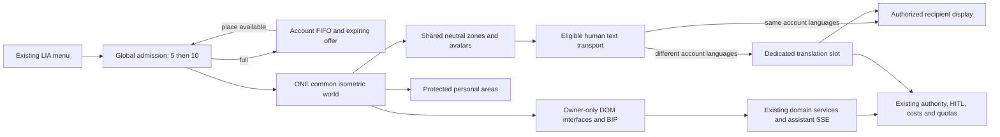

# LIA isometric world: functional and technical analysis

Date: 2026-10-09. Status: proposed analysis, not an accepted architecture or implementation.

Release-scope decision: the owner has accepted the [smaller V1 and its generic foundation requirement](2026-10-09-lia-isometric-world-v1-scope.md), with progressive later enrichment. That document governs the first release; the complete inventory/visit/shared-manipulation/ten-account program below remains the future target. Scope acceptance does not certify the future implementation or turn planning objectives into guaranteed delivery dates.

Current source-backed refinements: the [global architecture and game-quality review](2026-10-09-lia-isometric-world-global-review.md) governs translation attempt ownership, quota limitations, socket authentication, movement/camera behavior and measurable qualification where initial wording below was less precise. Its additional scenarios extend the director matrix from 72 to 96 requirements; these are not 96 passed implementation tests.

This dossier answers the owner's request for a systemic analysis before business implementation. Work was performed inline, without subagents. No application code, dependency, migration, environment configuration or Git history was changed for this analysis. Isolated characterization scripts and concept artwork were subsequently produced; their narrowly scoped runtime probes are recorded separately.

## 1. Decision summary and evidence boundary

The proposed extension is an optional first-class application surface: a welcoming, finely authored isometric environment for using one's own LIA and meeting other users of the same instance. It combines spatial navigation, personal expression and direct social interaction. The existing application remains the source of business truth. There is ONE shared world per instance, with thematic physical areas and access-controlled personal homes; there are no separate multiplayer rooms, copies or matchmaking shards.

The viable design separates three things:

1. Shared spatial state: admitted participants, movement, neutral scenery and explicitly shared interactions.
2. Private application state: each account's assistant, data, commands, approvals, costs and domain interfaces.
3. Personal representation: bounded decorative projections with provenance and an independently sanitized visitor view.

The isometric renderer runs in the user's browser or native WebView on desktop or phone. The Pi hosts LIA, authenticates, authorizes and synchronizes; it does not render and stream video. Server RAM, browser GPU capacity and network latency are separate constraints. Rendering inside a browser on the Pi itself is an optional additional client target, not an owner requirement.

Provisional technical direction: a polished simulated 2.5D isometric world using PixiJS, authored sprite atlases, fixed camera orientation, grid-based floor navigation and lightweight collision footprints. Original low-poly assets may be authored in 3D offline and exported as sprites; they need not be rendered as 3D meshes in the browser. Isolated Pixi and lightweight Three probes both rendered a simple scene successfully on the available powerful desktop GPU; this does not prove a performance winner or modest-device suitability. Compare equivalent representative art on real minimum devices before selecting the engine in L1. Keep FastAPI, PostgreSQL and Redis; add a bounded world domain and a dedicated world WebSocket protocol. Existing SSE remains the assistant transport. No new game server service is justified before the load prototype.

Zero automatic LLM calls remain a design requirement for entering, walking, moving scenery, presence, cached ambient weather, lighting and BIP locomotion. Direct human text transport is model-free, but the owner subsequently requested faithful translation before display when participants have different LIA languages: this is a separately accounted use of a dedicated translation LLM. Actual assistant requests use the same LIA execution paths and accounting as the ordinary application. Initial personalization uses deterministic projections and explicit choices; generative personalization is a separately authorized future capability.

### Snapshot qualification

Inspected checkout: branch codex/lia-application-tools, HEAD 39152fad2f26d23ecd21121a43c3eac1056edd70. The working tree is extensively modified. HEAD alone does not identify the analyzed implementation. Several relevant application-command and invalidation modules are untracked; the BIP manifest is untracked; peers service and journal portrait builder are modified. These are current source evidence, not proof of release availability or completed qualification.

Confirmed owner clarifications: Pi as LIA server; access through a new application menu entry; desktop and mobile preferred; simulated isometric 2.5D is satisfactory; ONE common world for all users of an instance; text first and human voice later; no multi-LIA federation. The owner accepts starting at five simultaneous users instead of ten. Retain a configurable global launch cap of five admitted accounts, with a waiting queue for the sixth; increase to ten only after mixed-load qualification, then the eleventh waits. This is a product capacity limit, not evidence that the Pi cannot serve ten. Offline/computer proxies and BIP do not consume admission slots.

At the initial analysis stage no production session, database, provider or paid API was used, and no new code tests or hardware benchmarks had been run. The subsequent [validation report](2026-10-09-lia-isometric-world-validation.md) records targeted existing tests, isolated Redis/rendering probes, read-only Pi resource observations and a bounded synthetic CPU probe on the Pi. These proofs are explicitly scoped; final mobile performance, art quality, full WebSocket behavior and mixed-load capacity remain qualification gates.

At the initial documentation check, the local links then present resolved and task lint:docs:preview found no living broken links, stale living paths, orphans or quoted-fact drift. It exited with failure on six existing technical-map coverage gaps for unrelated infrastructure modules. The final validation report records the refreshed check after adding the artwork and translation requirement. Unrelated working-tree changes are preserved. Written world test scenarios below are not executed world-feature test results.

## 2. Verified reuse map and counter-checks

Links below identify actual inspected sources. A named hook, route or registry is not assumed to cover more than its implementation.

| Area | Current evidence | What can be reused | What is missing or must not be inferred |
|---|---|---|---|
| Repository rules | [Root guidance](../../../CLAUDE.md), [frontend guidance](../../../apps/web/CLAUDE.md), [Taskfile](../../../Taskfile.yml) | DDD, typed contracts, localized routing, gates, Docker runtime validation | Rules and ratchets apply equally to a game surface; generated AGENTS is not an editable source |
| Existing peer graph | [Models](../../../apps/api/src/domains/peers/models.py), [service](../../../apps/api/src/domains/peers/service.py), [hook](../../../apps/web/src/hooks/usePeerConnections.ts) | Accepted relationships, discovery choices, blocks, removal and limited calendar/task shares | Pairs refer to local users in the same database; no inspected cross-instance identity/federation contract. The connection DTO has no live online/game presence |
| Asynchronous relay | [Peer tools](../../../apps/api/src/domains/agents/tools/peers_tools.py), [delivery engine](../../../apps/api/src/infrastructure/scheduler/peer_message_delivery.py) | Draft, confirmation, quota checks, revalidation, durable delivery, sender cost attribution | This is an assistant-mediated rewrite and delivery path. It is not a direct chat transport and does consume model tokens |
| Activity presence | [Habit presence](../../../apps/api/src/domains/habits/presence.py), [session authentication](../../../apps/api/src/core/session_dependencies.py), [session store](../../../apps/api/src/infrastructure/cache/session_store.py) | Respect the existing consent and learning lifecycle | Habit signals bank hours and track last activity. Session last-seen refresh is coarse. Neither proves a live connection. Do not overload the existing presence Redis family |
| Assistant requests | [Chat schema](../../../apps/api/src/domains/agents/api/schemas.py), [chat router](../../../apps/api/src/domains/agents/api/router.py), [useChat](../../../apps/web/src/hooks/useChat.ts) | Pipeline/ReAct, streaming, cancellation, pending approvals, attachments, usage display and active-run conflict handling | BrowserContext currently has no world-room contract. The chat page cannot simply be mounted repeatedly inside rooms |
| Typed application operations | [Operation contract](../../../apps/api/src/domains/agents/application/operation_spec.py), [registry](../../../apps/api/src/domains/agents/application/registry.py), [authorization](../../../apps/api/src/domains/agents/application/authorization.py) | Reviewed operation identities, strict input/output types, authority and secure/browser continuations where present | Work in progress, not a universal REST command gateway. Reuse domain services and existing routes; do not make the world depend on every operation being tool-enabled |
| Application invalidations | [Producer](../../../apps/api/src/domains/agents/application/state_changes.py), [consumer](../../../apps/web/src/hooks/useApplicationStateSync.ts), [resource bus](../../../apps/web/src/lib/application-resources.ts) | Addressed resource hints, owner-lifetime checks and coalesced authenticated rereads | The producer returns when no matching running turn/side channel exists. The bus is browser-process-local. It is not a durable universal event feed for manual/background/multi-tab changes |
| Functional surface map | [Settings section identities](../../../apps/web/src/lib/settings-sections.ts), [section renderers](../../../apps/web/src/components/settings/settings-section-registry.tsx), [availability](../../../apps/web/src/hooks/useSettingsAvailability.ts), [existing inventory](2026-10-06-lia-application-interface-inventory.md) | Stable section links, registered components, current visibility, feature inventory as a routing aid | A settings token, operator capability and agent domain have different meanings. No one existing registry is the complete world-room catalog |
| Feature gates | [Capability registry](../../../apps/api/src/domains/feature_switches/registry.py), [route assembly](../../../apps/api/src/api/v1/routes.py) | Deployment ceiling, operator switch, account preferences and existing service/route guards | Hiding a world object grants no authority. Disabled production and consultation of existing records need the same distinction as the original surface |
| Real weather | [Companion route](../../../apps/api/src/domains/briefing/router.py), [projection](../../../apps/api/src/domains/briefing/companion.py), [environment owner](../../../apps/web/src/components/eyes/useCompanionEnvironment.ts) | Fresh cached weather, timestamps, expiry and account timezone without coordinates | Cache-only: no provider refresh and no weather when the snapshot is stale/missing. The current frontend owner is page-bound. Calling the full briefing to decorate a world would read unrelated sources and may generate synthesis |
| Memories | [Model](../../../apps/api/src/domains/memories/models.py), [repository](../../../apps/api/src/domains/memories/repository.py), [service](../../../apps/api/src/domains/memories/service.py), [router](../../../apps/api/src/domains/memories/router.py) | Per-owner facts, importance, pinning, active-set predicate, supersession and CRUD | A category is not an information-sharing classification. A pinned procedural directive is not a decoration. Ordinary semantic retrieval can affect usage/retention; visual projection must use a read-only selector |
| Interests | [Interest model](../../../apps/api/src/domains/interests/models.py) | Topics, category, active/blocked/dormant state, existing embeddings | Free-text topics/subjects are not asset identifiers. An automatic representation of every topic is impossible; missing mappings must remain explicit omissions |
| User profile | [Account projection](../../../apps/api/src/domains/users/profile_projection.py), [memory profile builder](../../../apps/api/src/domains/agents/middleware/memory_injection.py), [journal portrait builder](../../../apps/api/src/domains/journals/portrait_builder.py) | Trusted account preferences and current, consented personal context | The psychological memory profile is built for a query; the journal portrait is prose with permission/lineage checks. Neither is a ready-made room blueprint |
| Psyche | [Psyche model](../../../apps/api/src/domains/psyche/models.py), [service](../../../apps/api/src/domains/psyche/service.py) | Private BIP expression can follow the assistant's existing state | This is LIA's psyche for an account, including traits from the selected assistant personality. It is not a measurement of the human user's personality |
| BIP | [Asset manifest](../../../apps/web/public/avatars/bip/v1/manifest.json), [acting profiles](../../../apps/web/src/components/eyes/rig/acting-profile.ts), [layout profiles](../../../apps/web/src/components/eyes/layout-profiles.ts) | Visual identity and behavioral intent | Current assets are WebP body illustrations and a DOM/CSS facial rig. No inspected ready-to-use skeletal 3D BIP model or walk animation |
| Authentication and sockets | [Session dependencies](../../../apps/api/src/core/session_dependencies.py), [voice transport](../../../apps/api/src/domains/voice/router.py) | HTTP-only BFF session and short-lived single-use socket-ticket pattern | The voice ticket is purpose-specific. New world tickets must bind purpose, session and scope and recheck ongoing authority; long-lived sockets do not inherit per-request revocation automatically |
| Costs and limits | [Cost bearers](../../../apps/api/src/domains/usage_limits/cost_bearers.py), [enforcement](../../../apps/api/src/domains/usage_limits/enforcement.py), [spend roads](../../../apps/api/src/infrastructure/llm/spend_roads.py) | User/instance ceiling distinction, modality attribution and refusals | A new out-of-turn generation would need a declared accounting road, owner, ceiling and visible receipt. Cosmetic automation must not accidentally open one |
| Language and translation | [Stored account language](../../../apps/api/src/domains/users/models.py), [normalization](../../../apps/api/src/core/i18n.py), [language settings](../../../apps/web/src/components/settings/LanguageSettings.tsx), [header selector](../../../apps/web/src/components/LanguageSelector.tsx), [LLM registry/defaults](../../../apps/api/src/domains/llm_config/constants.py), [radio translation precedent](../../../apps/api/src/domains/radio/articles.py) | Six-locale UI, stored account preference, canonical zh/zh-CN handling, versioned translation prompts, structured bound calls, tracking and single-flight pattern | No existing human-world translator. The header selector can change the URL even when preference persistence fails: world bootstrap/translation must reconcile the stored preference and avoid silently using another participant's request language. Radio's article schema, long timeout and original-text-on-error behavior are not a chat contract |
| Lifetime and privacy | [Data map](../../../apps/api/src/domains/users/user_data_map.py), [account deletion](../../../apps/api/src/domains/users/account_deletion_service.py), [export builder](../../../apps/api/src/domains/account_export/builder.py), [Redis families](../../../apps/api/src/infrastructure/cache/key_families.py) | Explicit table classification, two-party export filtering, soft-delete purge and reset scopes | User-row soft deletion does not fire foreign-key CASCADE. Every new table/cache/derived representation must be explicitly covered |
| Shell and native clients | [Dashboard shell](../../../apps/web/src/app/[lng]/dashboard/layout.tsx), [CSP builders](../../../apps/web/src/lib/csp.ts), [frontend rules](../../../apps/web/CLAUDE.md) | Shared navigation, Radix primitives, native WebView remote-origin model, existing radio/recording controls | World screen must coexist with fixed overlays and banners. No requirement for SharedArrayBuffer, native GPU bridge, browser notification APIs or an iOS service worker |
| Deployment | [Production compose](../../../docker-compose.prod.yml), [development compose](../../../docker-compose.dev.yml), [production example](../../../.env.prod.example) | Current API/Redis/PostgreSQL, multiworker configuration and public Cloudflare entry | Process-local multiplayer state is insufficient. The example config declares multiple workers; actual target environment and available capacity were not measured |

This map avoids both false reuse and unnecessary reinvention: authentication, ordinary assistant behavior and business operations already exist; a world renderer, live peer presence, spatial synchronization, visitor grants and safe decorative projections do not.

## 3. Functional contract and acceptance rules

### 3.1 Product scope

Use the working name “LIA world” until branding is chosen. It is optional, discoverable from the dashboard and settings shortcuts, and can be disabled by the instance operator. A user may enter alone without peers or spend time in social areas without issuing an assistant request.

The owner confirmed the product should behave like a social game that gamifies LIA use. Its acceptance is not a compact decorative dashboard: the map is larger than a viewport, circulation is generous, avatars and props retain normal gameplay scale, and spatial interactions lead to genuinely adapted functional interfaces. Keep one shared geometry, not an entire world compressed to fit a screen. No points, competitive ranking or incentives to spend tokens are inferred from the word gamification.

Each functional area receives a distinct authored physical zone or explicitly named space within the common world. The owner's clarification excludes separate multiplayer rooms; physical bedrooms, studios and alcoves remain spatial decoration and permission areas in the same world. Transverse controls live in an illustrated HUD with ordinary accessible interfaces. A separate space is not required for every API route, setting toggle or tool. Validate the functional inventory before art production; it must not become an implicit excuse to merge several requested areas into one.

World chunks and nearby zone assets load on demand without creating different multiplayer sessions. A district map and fast travel keep the full feature set reachable without forcing long walks. Every spatial interaction has a direct accessible equivalent. No function becomes exclusive to the canvas. All admitted accounts remain in the same global population, including while inside a personal home.

### 3.2 Movement and interaction

Desktop: configurable directional keys, including AZERTY/QWERTY equivalence and arrows; click-to-walk; click or a translated keyboard action to interact. No pointer lock is necessary. A fixed isometric direction is the default, with automatic camera following/edge scrolling during movement, zoom in/out, free camera panning and a recenter/follow-avatar control. Quarter-turn rotation is deferred: a sprite world would need matching directional scenery exports, not merely rotating the camera.

Mobile: drag/tap navigation and an optional thumbstick, a separate interaction button, pinch zoom within readable bounds and a complete touch-only editor. No essential action depends on hover, a right click, long press or simultaneous two-finger precision. Movement is suspended while an input, modal, social composer or private assistant panel has focus. Opening the software keyboard must not keep a movement key held.

An upper-right minimap shows the larger authorized world, the visible camera region and the user's position. Selecting/dragging it explores the map without teleporting or moving the avatar; choosing recenter restores follow. Separate avatar-control and camera-control input modes, with pointer capture/cancel and explicit touch gesture arbitration. Pan/zoom occur inside the canvas; the HUD and ordinary page layout remain fixed. World-to-screen picking uses the full inverse camera transform. Clamp camera bounds/zoom, preserve accessibility, and never widen server visibility because a user pans into another account's private area. Asset culling/prefetch follows camera interest within authority; public avatar position stays independent of the camera.

Objects declare one of four interaction classes: decorative, movable, functional station or social affordance. Moving a desk never sends an email, deletes a memory or triggers an automation. Functional effects require an explicit labeled command through the existing business boundary.

Personal furniture layouts persist per account. Public-zone toy/furniture changes are temporary, server-authorized and restored after inactivity or when the common world becomes vacant. A visitor may use designated harmless temporary props, but cannot rewrite the owner's permanent arrangement. Personal home decoration is projected separately to its owner and admitted guests with compatible collision footprints. Permanent collaborative editing is a later separately specified permission model.

Player avatars do not block one another. Static geometry and movable furniture have lightweight floor colliders. Entrances, exits and station access corridors are reserved; no user can trap another person or make a function unreachable. Reset, undo and restore-default are visible operations.

### 3.3 Peer presentation and presence

Presence is a server-derived, consented session aggregate, not a statement about real sleep or availability:

| Effective state | Presentation | Available interaction |
|---|---|---|
| No live application lease | Neutral bedroom proxy at rest; labeled offline | Explicit “send through LIA” using the existing relay |
| Live application lease, no active world controller | Neutral bedroom proxy at the computer | Same asynchronous relay |
| Live world controller, foreground/active | User-controlled avatar in the common world | Direct text to eligible admitted users; explicit LIA relay remains a different action |
| World open but hidden, idle or reconnecting | Away/reconnecting pose and label, under a grace period | Direct delivery only while the recipient has an eligible active session |
| Presence disabled or authority unknown | Availability unavailable; no invented online/offline claim | Existing authorized relay, if the peer relationship permits it |

A remembered login cookie is not a live presence. A background tab cannot claim foreground activity indefinitely. Network partitions cannot distinguish offline from unreachable with certainty; timeout transitions must carry that limitation.

One account has one controllable avatar, even with multiple tabs/devices. A second device can observe or explicitly take control. An owner token and generation fence prevent the old tab from continuing to move the avatar or release the new controller's lease. Presence is aggregated across app sessions; world control is separate.

Offline/computer proxies are viewer-local neutral representations of accepted peers. They do not expose the peer's actual bedroom or private decoration. An admitted peer has one actual avatar in the common world, not a duplicate bedroom proxy; its public-zone position can be shown subject to visibility policy. Personal-home occupancy and private function results are not broadcast to outsiders. Large peer lists use paged facades/asset culling; offline proxies do not increase the active-player limit or require a permanent simulation tick for every registered account.

### 3.4 Social topology

Initial release has one same-instance common world, open to all authenticated, active instance accounts that have the effective world capability and explicitly enter. Cross-instance federation is excluded. Existing accepted-peer relationships still authorize asynchronous relay, private-home invitation and existing domain shares; they are not an admission prerequisite to the common world. Two admitted users can meet without first being connected peers. No calendar/task/profile/memory access is added by meeting.

Before first entry, explain that the chosen public alias/avatar and public movement are visible to other admitted instance users. Publish only that allowlisted identity, not account email, real profile, peer graph or the list of inactive instance accounts. This explicit world visibility is a NEW consent and server contract; the existing peer discovery model cannot be treated as its implementation. A user who declines can use ordinary LIA and private feature panels without entering the shared simulation. Provide an explicit authorized connection-request action when useful, following the existing peer service rather than auto-connecting people who meet.

Either-direction blocks suppress pairwise avatar/identity projection and direct routing, and terminate related visits, without creating another world. Existing peer removal ends accepted-peer relay/share/visit permissions; it does not eject an otherwise eligible account from the common world. Account deactivation and world-feature removal revoke admission. Client feedback stays neutral and does not identify a blocker. Fast revocation signals are supported by current-policy checks and short authorization leases, so a lost Pub/Sub message cannot preserve access. Blocks prevent system disclosure and interaction, but cannot promise absence of all social inference from third-party conversations or shared neutral prop effects in one common world; those effects carry no blocked actor identity.

### 3.5 Global capacity and waiting

The cap applies once per admitted account across the ENTIRE instance world, not per zone, socket, browser, tab or home. All spectators inside the world count; queued accounts receive no world participant stream. Static peer proxies and private BIP are not admitted human accounts. A visitor already in the world keeps the same slot on entering a home. A queued guest must first obtain normal world admission; an invitation does not jump the queue or create a second slot.

Use atomic Redis admission/queue operations across API workers: one active lease or one queue entry per account, stable FIFO order and generation-fenced release. Active admissions PLUS unexpired reservations must never exceed the cap. Show queue position and an accessible leave-waiting action, without exposing identities or a guessed waiting time. When a place opens, offer a short expiring reservation to the next still-eligible waiting account. Recheck session/capability at reservation acceptance, then enter; a disconnected/no-response candidate expires and the next is offered. Proposal: a 30-second offer and a 60-second queue reconnection lease, separately configurable. Prune expired reservations atomically during admission as well as in bounded maintenance; do not depend solely on Redis key-expiry notifications.

Foreground/visible heartbeats hold an admission lease. Proposed initial defaults: 45 seconds of connection/background grace and 10 minutes of genuine user inactivity, with a 30-second accessible warning before idle release. Chat typing/interactions count as human activity; automatic animation/heartbeats do not. These timeouts are engineering proposals to measure on suspended phones, not existing LIA values. Preserve the user's private draft/layout. A brief reconnect can reclaim its existing slot until the same deadline, with no automatic TTL extension by an old controller. App-only presence remains independently available after world eviction. Queue reconnect preserves place only within its existing lease; a new tab does not duplicate or improve it. A change from ten to five stops new admissions until occupancy reaches five rather than silently expelling arbitrary users. Redis/authorization failure closes new admission; do not fall back to an inconsistent process-local count. Limit queue length and endpoint rate independently of the five/ten admitted-player cap.

### 3.6 Direct discussion

Direct discussion uses the LIA server as a transport while keeping the conversational assistant outside the exchange. Preserve the immutable original verbatim. It is never rewritten in the assistant's personality, summarized, indexed, embedded, extracted into memory or added to assistant history automatically. Under the owner's added requirement, a dedicated LLM faithfully translates it into each recipient's effective LIA language before first display when languages differ. This explicit translation is the only model processing in the direct-text path; HTML and scripts remain escaped text.

Recommended first delivery: one-to-one direct text between eligible admitted users, respecting blocks even when no accepted peer connection exists. An optional explicitly selected common-world discussion has a visible recipient scope; proximity is never silently treated as message permission. Typed statuses distinguish server accepted, delivered to an eligible client and optionally read; none implies human attention without evidence. Message identifiers make retries idempotent. If a recipient leaves, preserve the draft; offer the existing LIA relay only when an accepted unblocked connection permits it. Do not convert a direct message silently or invent offline delivery for a stranger.

Recommended default retention: ephemeral direct conversation, with a short bounded server replay buffer for reconnect and no durable history. Proposed starting bounds: two minutes, 100 messages and 100 kB per admitted account, whichever limit is reached first; the revised initial text bound is 1,000 Unicode code points plus 4 KiB UTF-8, model-token/output-expansion limits and configured anti-flood protection. These are proposed values to characterize, not inherited peer-relay limits. A reconnect that outlives replay clearly states that earlier text is unavailable. A durable social inbox is a business decision, not a property of WebSocket. If the owner chooses history, add encrypted message storage, retention/deletion/export semantics and acknowledged durable delivery in the dedicated lot. Its cost and privacy scope must be visible before implementation.

Human voice chat is a distinct optional phase. It would use peer media or an SFU/TURN design, not a voice LLM, STT or TTS by default. It requires microphone consent, mute/block controls, signaling, network traversal, bandwidth limits and native WebView measurements. “No model tokens” does not mean “no infrastructure cost.” Never open or mix a user's private LIA microphone/output into a peer channel. Mesh versus SFU remains a decision driven by actual voice attendance and deployment constraints.

### 3.7 Personal localization and faithful human-text translation

All chrome, stations, minimap labels, object hints, accessibility names, errors and receipts use the user's LIA locale through existing dictionaries. Authored art uses neutral icons and separate localized labels rather than French text baked into textures. The stored account language is normalized through the existing canonical helpers (including frontend zh/backend zh-CN); world bootstrap and private routes reconcile it with UI routing. A failed persistence request cannot silently produce an English world that receives French translations. Unknown/malformed languages use the application's configured fallback, never the sender's language by accident. Mid-session changes update UI and invalidate pending recipient translations by language revision.

Proposed dedicated slot: world_message_translator in the existing specialized LLM category, added together to metadata/defaults, the strict LLMType vocabulary, DB configuration/migrations where required and six-locale administrative labels. Configuration uses the existing model capability and provider/accounting mechanisms; no fixed model name is assumed to represent the deployment. Require schema-bound text output, a short versioned faithful-translation prompt and bounded timeout/output tokens. Reuse structured-call, untrusted-content wrapping and TrackingContext/TokenTrackingCallback infrastructure. Reuse owned claim primitives with a dedicated strict attempt lifecycle, not the existing shared_flight fallback policy: that helper builds on missing Redis, claim errors or waiter timeout and cannot guarantee paid-call deduplication. The radio's article schema and long interaction budget are also unsuitable.

The inspected [administrative broadcast translator](../../../apps/api/src/domains/notifications/broadcast_service.py) already groups recipients by target language and records actual deployment-funded calls. Its instance billing, free-form output and automatic original fallback do not meet this account-initiated before-display chat contract. Reuse the infrastructure/grouping pattern without coupling social messages to administrative broadcasts. Keep asynchronous LIA-mediated peer delivery on its existing recipient-assistant language/voice path and characterize that boundary during station integration; do not add redundant translation spend by assumption.

Delivery sequence: validate sender/admission/block/recipient scope; obtain current authorized source/target account languages; store the immutable original and message sequence within the chosen retention; compute unique required target languages; apply both sender and instance ceilings; translate each required language under an owned flight; validate complete output; recheck recipients, block/visit and language revision; emit only the eligible localized variant. Same canonical language needs no model call. A recipient initially sees a localized pending indicator, then translated text, never an automatic wrong-language substitute. Offer an explicit “show original” action, label translated content and retain original authorship, message order and timestamps. A later message finishing translation first must not silently reorder the conversation.

Proposed billing owner is the sender, consistent with the existing peer relay and preventing an interlocutor from silently exhausting another account's quota. Show this before first translated sending and attach actual aggregate usage to the sender's message receipt. Eligible recipients sharing a target language reuse its variant. Stable request/attempt identities and valid ownership prevent intentional parallel duplicate dispatch; reconnect/cache reuse does not start another attempt. External provider completion may nevertheless be uncertain after a crash or timeout, so universal exactly-once vendor execution is not guaranteed. Preserve that uncertainty and prohibit automatic repeat while unresolved; an explicit permitted retry states its possible additional cost. Record every actually paid attempt/failure/fallback with available usage. A recipient locale change does not silently trigger another sender-funded translation. An alternative recipient-pays policy is a business override requiring explicit opt-in and different attempt/owner keys.

Existing user quota checks include a cached allowed verdict and a database-error fail-open branch; they are not atomic future-cost reservations. Reuse the native policy without silently changing it for all of LIA. Bound the world's added dispatch concurrency/output and refuse when required actor authority, attempt ownership or outcome is unavailable; see the global review for the exact separation between quota policy and world safety.

Flight/cache keys bind random message identity, sender/billing owner, original revision/digest, target canonical language, prompt version and translator configuration snapshot. Results remain private and expire with the message lifecycle, not in the radio's shared article cache. No message body in cache keys, metrics or ordinary logs. No unrelated profile, memory, chat history or peer graph reaches the translator. The message is untrusted data; the translator has no tools and cannot obey embedded action instructions. Preserve names, links, numbers, negation, code and Unicode with semantic-corpus tests; reject truncated/malformed/empty output instead of silently shortening a person's words.

Proposed initial interaction bounds: an immediate pending indicator, translated display p95 around three seconds and a configurable total hard deadline around eight seconds, to qualify against the configured provider. The revised default is one paid attempt per request, with all application/provider/repair retries audited together and no automatic retry for an unresolved attempt. Enforce sender flood limits, bounded source UTF-8/token size, concurrent-attempt/queue limits and maximum unique target languages. If the source exceeds the slot window, reject before spending rather than trimming the message. On timeout/provider failure/quota refusal, show an accurate localized unavailable state; retain the original and offer deliberate original viewing/retry as permitted. Navigation remains available. All translated, failed, pending, replayed and explicit-original views retain current routing authority. The later human-voice phase does not silently gain STT/TTS/voice translation from this text requirement.

## 4. Spatial functional inventory and art direction

The art direction is an original, warm, low-poly diorama with voxel-inspired silhouettes, more precise proportions, bevels and small authored details. Do not implement a cube object per voxel, infinite terrain, realistic physics or arbitrary building mechanics. Do not copy Minecraft assets or character designs. Every distributed asset needs provenance and license metadata compatible with the project's distribution policy.

Isometric view: consistent projected scale, partial walls/roofs and intentional occlusion treatment. Details should communicate the function at the camera's normal zoom: mail slots, readable silhouettes, plants, books, equipment and subtle working animations. Richness comes from composition, color, props and authored lighting before expensive postprocessing. The preferred sprite world reproduces volumetric low-poly/voxel-inspired art in a fixed view; it remains freely navigable on its floor, with selectable and movable props.

The table is the proposed target inventory. Existing service/route semantics remain authoritative; some areas already have full pages, others principally have chat tools and settings. Their new interfaces are explicitly part of the work.

| Functional space | Authored ambience and stations | Functional binding |
|---|---|---|
| Arrival / Today | Atrium, clock, day desk, district model | Briefing cards; synthesis/readout only on intentional activation |
| Assistant exchange | Comfortable conversation lounge | Existing private chat, Pipeline/ReAct, attachments and approvals |
| Email | Post office, sorting desk, envelopes | Current email tools/cards; explicit drafts/confirmation for writes |
| Calendar | Planning observatory, clock wall | Calendar operations and provider constraints |
| Tasks | Organized workshop, task board | Existing task operations, drafts and filters |
| Contacts | Address-book salon | Authorized contact lookup/edit paths; no public names on scene textures |
| Relations | Quiet relationship gallery | Existing CRM lens, favorites and explicit debrief generation |
| Files / drive | Archive shelves and document desk | Provider file tools; authorized resource URLs and download paths |
| Knowledge spaces | Library with room portals | Space/document management and retrieval, preserving existing access |
| Saved answers / generated assets | Collection gallery | Existing bookmarks and image/document/screenshot galleries, retaining their own deadlines |
| Reminders | Bell tower or reminder desk | Reminder lifecycle, timezone and schedules |
| Scheduled actions | Clockwork room | Existing schedules, next-run interpretation and execution mode |
| Workboard | Project atelier | Existing ticket ownership, assignments, comments and approvals |
| Journals | Writing studio | Entries, provenance, edits and explicit consolidation |
| Memories | Personal archive alcove | Original memory list/edit/pin/delete UI; private facts never on shared props |
| Interests | Curiosity greenhouse | Active interests, feedback, settings and authorized consultation |
| Habits | Rhythm conservatory | Existing observations and controls; game idling is not a new learning signal |
| Open loops | Commitment cabinet | Current open-loop lifecycle and return-to-chat actions |
| Heartbeat / moments | Quiet lookout | Existing history/preferences and currently offered moment capabilities |
| Health | Calm wellness studio | Health settings/records/consents; no public biometric animation |
| Radio | Small broadcast studio | Existing personal radio and newsroom; private playback by default |
| Meetings | Meeting studio | Templates, recordings, sessions and existing recorder lifecycle |
| Telephony / live | Communications booth | Existing phone/live connectors and workflows; no human-peer voice shortcut into a provider LLM |
| Weather | Weather observatory | Current weather query capabilities; decoration consumes the separate cache projection |
| Places / routes | Cartography studio | Existing place/route tools with their real provider costs |
| Web research / browser | Research atelier | Search/browser capabilities, trusted URL boundaries and current results |
| Smart home | Small control pavilion | Actual supported connectors/tools; destructive/device effects remain explicit |
| Skills / library / plugins / MCP | Extensible makers' district with separate named booths/spaces | Existing installed capabilities and sandboxed widgets, never arbitrary scene code |
| Peers | Social plaza and neutral peer-bedroom facades | Connections, blocks, relay, presence, direct text and invitations |
| Personal home | Owner-specific private diorama and visitor vestibule | Account preferences, selected memories/interests, current portrait where permitted |

Profile editing, assistant personality/psyche, notifications, theme/language/accessibility, cost/quotas, connectors, device/security/export and administrative features are transverse illustrated controls or private panels. Administrative controls never appear to non-administrators. The spatial manifest records every inventory item as a physical zone, a named subspace, a transverse panel or a deferred feature with a written reason. These are placements within the same world. Completeness is checked against current pages, settings identities, effective capabilities and functional tools; it is not inferred from area count. Each installed extensible feature receives a safe authored station/booth or explicit transverse classification, not an arbitrary scene script from its description.

Personal home is an additional contextual way into the same memory/interest/profile features, not a duplicate data model or a second authority. Each room requires a signed-off art sheet: layout, palette, prop inventory, navigation grid, interaction anchors, camera/occlusion, ambient animation, sound, mobile view, guest privacy view and resource budget.

BIP gets a coherent masculine appearance matching its current identity and a small deliberate animation set: rest, walk, turn, sit/work, greet, listen, think, speak, point and reconnect. For 2.5D, author a reusable rig offline and export bounded directional sprite animations, or produce equivalent original directional art. The existing frontal WebP/DOM rig is not a ready walk atlas. A true 3D alternative would use the model/rig directly. The requested masculine representation is a world appearance choice; it must not silently overwrite the account's assistant voice/gender preferences.

## 5. Confidentiality and invitations

### 5.1 Information-flow classes

| Class | Examples | Recipients and authority |
|---|---|---|
| Public immutable assets | Generic chair, empty monitor, neutral room geometry | Static asset delivery; no per-account facts |
| Consented social state | Chosen public avatar/alias and approved public-world position | Currently admitted, pairwise unblocked participants under world consent; no peer graph |
| Owner private state | Messages to LIA, cards, files, calendar items, memory text, profile, costs, weather/location | Authenticated owner only, even at a common-world station |
| Personal derived decoration | Motifs selected from interests/memories or portrait | Owner only until explicitly approved for a visitor projection |
| Visitor-safe home view | Neutral decor or individually approved motifs | Specific visit grant and current relationship; no source facts/identifiers |

Privacy is enforced before serialization and routing. Sending private data and hiding it with CSS or an invisible 3D layer is a disclosure. Server recipient projection is allowlisted and schema-tested. Private panel results never enter shared world messages, analytics payloads, texture labels or public object metadata.

World admission, being a peer, entering a home, sharing a calendar and being an administrator are distinct permissions. A visit grant adds no application-data access and does not change existing domain shares. An owner-facing object that opens a memory becomes a neutral nonfunctional object for a guest. Its ID does not resolve the underlying memory. Personal homes are permission areas within the same world, not additional multiplayer instances; stable authored footprints and authorization-aware entrances prevent visibility or collision tricks from crossing their boundary.

### 5.2 Decoration can disclose personal information

A flag, medical aid, family photograph, religious object or rare hobby can reveal a profile even if no settings panel is accessible. Therefore strict interpretation of the owner's requirement needs a separate guest-safe blueprint, not simply disabled buttons.

Default visitor view: neutral authored decoration. Sharing one motif is an explicit, revocable choice with a preview of what guests see. Shared geometry must remain collision-compatible: a private prop may be replaced by a neutral prop of the same footprint, or occupy a nonblocking decorative slot. Invisible walls and differing navigation state are unacceptable. If the owner wants visitors to see automatically personalized decor, that is an informed scope change to the confidentiality rule.

Other admitted users cannot see exact timezone, weather location, function results, unread badges, budgets, scene source IDs or BIP responses/expressions driven by private actions. Each client can have different lighting/weather on the same shared geometry. Coarse presence in a visible public thematic zone is necessarily observable and can imply an interest in that function; do not claim that public movement hides which studio an avatar visits. Station activation, results and operation notifications stay private, and sensitive functions can also be opened from private HUD panels without moving to a public station. Personal-home positions are projected only to authorized occupants.

### 5.3 Time-limited visits

Proposed invitation lifecycle: issued, accepted, active, expired/revoked. A grant binds owner, guest, accepted connection, common-world private area ID, visitor projection version, permitted social interactions and absolute UTC expiry. Suggested starting duration is 15 minutes, with a configurable ceiling of one hour. These are proposed defaults, not existing LIA values. Both users must have normal world admission before activating the visit; start its timed occupancy at authorized entry, with a separate bounded invitation acceptance deadline, so waiting does not consume the visit. No invite bypasses the global queue.

Recheck admission at acceptance and on every authoritative transition, sensitive event and grant-bound command. The host can revoke immediately. Blocking, relationship removal, account deletion, operator disable and host departure end the visit; a short network reconnection grace can preserve it only until the original deadline. Renewal is an explicit new grant; loading or reconnecting never extends expiry automatically.

At expiry, move the guest to a neutral authorized public location within the same world, clear the visitor payload, close any grant-scoped discussion routing and announce the result accessibly. Ordinary eligible direct chat can remain available under its own authorization. The check is server-time-based. A missing client timer, hidden tab, slow browser, missed invalidation or worker restart cannot keep a visitor admitted to the private area. Its existing world slot is retained only under normal admission rules. A replayed invite cannot create a second visit.

## 6. Proposed architecture

The world is a bounded context, tentatively domains/world, assembled through existing configuration, model registration, routes and lifespan patterns. It depends on narrow peer/account/domain ports and shared infrastructure. Domain modules do not import the agents graph back into a cycle. The composition layer binds assistant interactions to the existing graph.

### 6.1 Transport separation

- Authenticated REST: bootstrap, authored-zone manifest, capacity/wait status, owner layout, projected personalization, visit issue/accept/revoke and durable layout updates.
- World WebSocket: short-lived authenticated session admission, presence, movement intents, shared prop intents, eligible direct messages, snapshots and acknowledgments.
- Existing domain REST/hooks: data consultation and explicit structured edits.
- Existing assistant SSE: natural-language requests, Pipeline/ReAct, tools, HITL, cost receipts, cancellation and reattachment.

The WebSocket is never an arbitrary dispatcher accepting a tool name, URL, owner_id or SQL-like operation. No scene event can bypass business authorization.

### 6.2 Client composition

Add a localized dashboard/world route with client-only lazy canvas loading and a new existing-shell menu entry on desktop and mobile. The renderer, loader/codec workers and world assets must not enter the ordinary chat/dashboard bundle. Use the existing UI primitives and theme tokens for the HUD and panels. Pixi rendering owns one private ticker/runtime; typed mutable movement state updates in its frame loop, while React owns discrete UI transitions and accessible panels. Do not rerender the entire scene tree at movement-frame rate. A measured compatible @pixi/react bridge is optional; direct Pixi ownership behind a React component is also valid.

Separate modules own input, navigation/collision, rendering, network, room transitions, personalization and functional station panels. One owner closes each socket, animation loop, loader, audio resource, listener and timer. Account switch/unmount aborts requests, releases controller claims and clears private stores. Never reuse an old owner's in-flight response.

The current dashboard already mounts companions, avatar runtime, radio and meeting recorder controls. World mode needs an explicit presentation policy for avoiding duplicate BIP/2D companions and overlapping docks. Preserve recorder/radio visibility and stopping controls. Reuse a private assistant presentation rather than duplicating a full chat page per room; extract only the composition required, with characterization tests for the existing page.

### 6.3 Authoritative spatial state

Clients send intent, sequence and controller generation, not trusted coordinates. Server validates finite values, speeds, time steps, global admission, private-area membership, collision grid and interaction distances. Quantized floor positions and deterministic wall/furniture footprints keep the cross-language contract small. Floor simulation is independent of whether its isometric art uses sprites or 3D meshes; stairs are authored links/transitions, not a full rigid-body physics world.

Proposed prototype cadence: 10 movement-intent messages per second per active player; 10-15 authoritative updates per second, with interpolated browser rendering. These rates are configuration hypotheses and must be measured. Stop transmitting unchanged input where possible. Clamp elapsed simulation time after a stall; do not replay minutes of movement on resume.

Use one lazily allocated simulation authority owner for the ONE common world of the instance, with Redis lease ownership and fencing. API workers can each host sockets and route to that owner; no process-local player count or queue is authoritative. It manages global admissions, public zones and protected personal areas with recipient projections. A stale owner cannot publish a valid generation, release a new owner's slot or commit layout changes after takeover. Owner failure causes a fresh snapshot and bounded reconnection, not duplicate avatars. Prototype this choice before creating a separate realtime service; split the service only if measured API interference warrants it. Do not assume that the scheduler's existing leader automatically owns this new lifecycle.

World state has an epoch plus sequence, with visibility-scoped snapshots. A join/rejoin subscribes and obtains a coherent authorized snapshot/cursor; buffered newer eligible deltas are applied after it. A gap, epoch change or missed transition triggers resnapshot. A snapshot without a subscribe/race protocol is insufficient. Authorization changes invalidate affected recipient projections; movement into a protected area never sends its contents to unauthorized subscribers. Zone manifests and static collision data are immutable versioned assets shared between client and server.

Durable changes go through repository transactions with expected revision and stable idempotency identifiers. Temporary prop manipulation uses one exclusive expiring lease per prop, ownership/fencing, placement validation and a completion acknowledgment. Disconnect releases only the actor's own claim. No row locks or database sessions are held over socket lifetime, movement loops, provider calls or human approval waits.

### 6.4 Redis delivery and durability

Redis Pub/Sub is appropriate for replaceable movement deltas and invalidation hints. It does not guarantee delivery; disconnections can lose messages. Snapshot/resync provides recovery for spatial state. It is insufficient as the sole carrier for a business mutation, visit revocation or a message advertised as durably stored. Redis database numbers do not isolate Pub/Sub: channels require deployment/instance/purpose prefixes and server-selected authorization scopes. [Redis delivery and scoping semantics](https://redis.io/docs/latest/develop/pubsub/).

Use bounded owner-addressed reliable command/ack handling or Redis Streams when the world-authority command cannot be recovered from a fresh state read. Stream consumers must broadcast to all eligible recipients; a consumer group that load-balances one event among socket workers does not implement fan-out. Durable business operations remain in PostgreSQL with idempotent receipts. No claim of exactly-once delivery is made; idempotent effects and observable acknowledgments define the guarantee.

Browser bufferedAmount and bounded server queues prevent slow clients from accumulating memory. Replace unsent movement with the newest state. Preserve or explicitly refuse reliable commands; never drop them silently. Enforce message size/rate, the global admitted-account cap, per-account sockets, admission-queue length, text length and replay-buffer bytes separately. [Browser queue semantics](https://developer.mozilla.org/en-US/docs/Web/API/WebSocket/bufferedAmount).

### 6.5 Socket security

Issue a world-specific ticket through the BFF session; bind account, underlying session identity, purpose, expiration and scope. Consume once. Revalidate session/account/capability at admission, on durable operations and periodically during the socket lease. Validate Origin against configured application origins, including the native remote-origin deployment. Prevent cross-site socket use and scope replay.

The selected transport is a first WSS authentication frame containing a short-lived, single-use world ticket held only in browser memory; no ticket in the URL query. Origin is checked before accepting the connection, with a bounded unauthenticated connection count and authentication deadline. Before successful consumption/session binding, send no private state and grant no admission. Ticket/authentication-frame material never enters ordinary logs or durable browser storage; the HttpOnly session secret remains inaccessible to JavaScript. Reuse the ticket primitive, not the voice-specific credential/transport contract. Authentication failure and authority-store failure cannot grant participation. World presence cannot resurrect a revoked session.

Use immutable same-origin asset manifests and approved asset IDs. Model/payload text never selects an arbitrary asset URL, shader, script, HTML panel or plugin code. Third-party skill/MCP widgets stay in their existing sandboxed frames; opening one is not permission to execute inside the canvas runtime.

## 7. Data, registries and lifecycle

Proposed persistent entities are deliberately minimal:

| Entity | Purpose | Lifecycle and constraints |
|---|---|---|
| World preferences | Social presence consent, input/accessibility choices, visual preferences | Owner-scoped; account export/purge; visual choices do not rewrite assistant preferences |
| Owner room layout | Asset placements and manual locks | Versioned, bounded, expected-revision writes, schema migration, owner-only edits |
| Personal projection | Selected motifs, asset IDs, provenance and source fingerprint | Derived private data; invalidate on relevant source/consent/asset changes; never a second memory store |
| Guest decoration approval | Approved motif subset and publication revision | Explicit owner choice; revocation invalidates existing grants/projections |
| Visit grant | One timed invitation and accepted visit | Two-account ownership; expiry and revocation; metadata retention defined separately from secret token |
| Direct-message history | Only if durable history is chosen | Separate two-party retention/export/purge and encryption contract; not PeerMessage or conversation_messages |

Authored zone/prop catalogs are repository assets, not per-user database rows by default. Online leases, admissions/reservations, the unique-account FIFO queue, controllers, positions, world snapshots, temporary prop claims and ephemeral message replay are Redis runtime state with TTL. Slot acquisition/reservation/expiry/release is atomic and fenced; global queue keys and per-account entries must both be cleaned on revocation/deletion. Every family is declared with its actual lifecycle in key_families; do not use the existing learning family named presence. User-derived blueprints belong to private cache/learning scope as appropriate, not the conversation's reset state.

The WorldFeaturePlacement registry is a presentation mapping referring to existing functional identities, not a new list of business capabilities. Each entry declares room/space or transverse panel, label keys, authored asset version, trusted interaction identifiers, capabilities and privacy projection. Add boot/CI completeness assertions over the declared inventory and server/client schema equality. Never hand-copy all agent domains into this table or introduce a competing domain vocabulary.

New models register through infrastructure/database/registry.py. New user tables/columns register in the existing data/column classification maps; export builders enforce two-sided ownership. Soft deletion purges them explicitly, including runtime keys, invitations, derived decorations and message buffers. Hard deletion is a separate path with tested foreign-key behavior. Conversation reset preserves furniture/preferences, while “forget” removes derived personal decorations and source approvals without deleting independently chosen manual furniture. Billing records retain only the existing policy's permitted facts.

Store aware UTC deadlines, resolve the user's display timezone through existing helpers and serialize strict versioned Pydantic/TypeScript shapes. JSONB writes assign new values. Round-trip tests include every field, privacy scope and version. Reject unknown commands, nonfinite positions, oversized lists, unsupported schema versions and malformed UUIDs before changing state.

## 8. Personalization at load and after change

### 8.1 Selection policy

Render a curated subset, not all memories or interests. Initial suggested budgets: 8 interest motifs, 8 explicitly selected memory motifs and 4 profile/visual motifs, under an overall scene-slot budget. These are proposed configurable ceilings. The room remains composed and attractive with zero eligible facts.

Automatic inputs: explicit visual preferences and active interests mapped through curated category/tag aliases. Use the current active-set and consent rules. Blocked/dormant interests, invalidated/superseded memories and disabled-source permissions do not contribute. A plain category such as personal, event or preference is not proof that a memory is safe for automatic public representation.

Memories are represented only after an explicit per-item choice in the initial design. Sensitive, relationship, health and procedural content is excluded from automatic motif selection. Pinning does not imply representability or permission to display. A negative memory is not converted into a cheerful object; no algorithm materializes trauma or intimate facts to make a room “personal.”

The existing journal portrait may inform a later bounded compiler only after its current permission/lineage checks and an approved interpretation contract. Its prose is not parsed as trusted world instructions. The assistant's Psyche can drive BIP's private expression, but cannot become a human-trait room classifier.

Each selected motif records its source, mapping version, confidence of the mapping, display scope and user override. In the owner interface explain “why this object” without exposing that explanation to guests. Support remove, replace, lock, preview/rebuild and disable-personalization. List omitted/unmapped sources in an owner-only explanation; their omission is not a failure of LIA memory.

### 8.2 Deterministic mapping and unsupported topics

Use a curated asset catalog with a small multilingual alias/category mapping and explicit motif picker. Existing structured interest categories provide broad themes; a literal topic is not always representable. Unknown or ambiguous material keeps a neutral slot. Do not invent personalized relevance.

This provides safe useful personalization without prompt spend. If semantic automatic classification is later required, pre-existing embeddings may assist only under a validated matching contract and threshold; their mere presence does not prove a match. Any new model classification requires a dedicated declared slot/road, exact structured output, consent, caching, quotas and cost display. It is not included in the initial automatic load path.

### 8.3 Load algorithm

1. Authenticate the owner; read current source permissions, manual decoration choices and relevant source candidates through short sessions.
2. Select eligible candidates with deterministic ordering and a stable ID tie-breaker; read current active facts, not a stale compiled portrait or a max(updated_at) shortcut.
3. Compute a canonical digest over the selected, representation-relevant source fields and IDs, effective consent, manual overrides, mapping/catalog/blueprint schema versions. Include removals and source validity. Exclude last-access times, read counters and unrelated billing/assistant mood churn.
4. Reuse the validated projection if this digest matches. A change outside the selected representation need not rebuild it; a newly important eligible item must be picked up by the fresh selector and can change the digest.
5. If it differs, build a candidate using approved assets/slots, preserving manual locks, placement safety and navigation.
6. Validate budgets, source lineage/authority, asset existence and guest sanitization. Apply with an expected layout/source revision; if sources changed during the build, discard/reselect within a bounded retry policy.
7. Atomically replace the projection. Show the last validated version only when its source authority remains valid. On permission removal, deletion or unverified authorization use a neutral view instead of preserving a stale private derivative.
8. Deliver only the owner projection to the owner. Guests receive a separately compiled allowlisted projection under the current publication/grant version.

Always perform the current selector/digest check at world entry and after reconnect. Existing application resource hints can request this same check; they do not replace it. Manual in-world edits reread after successful mutation. Background changes, another tab, a missed hint and a source deletion must be detected on the next authoritative load. While active, coalesce hints and perform bounded visible-session reconciliation at a configurable cadence; never recompile per animation frame.

Large accounts: query only relevant candidate windows, page the owner management UI, publish exact totals separately and state visual selection ceilings. Do not send all memory text to the browser merely to choose 16 motifs. Shared single-flight may coalesce concurrent identical deterministic, unpaid projection requests across workers, but its fallback policy can permit duplicate computation; a completed flight is not a long-lived cache. Correctness must therefore depend on deterministic projection/version checks and expected-revision writes, not exclusive computation. Load two tabs concurrently and verify identical outcomes with no conflicting writes or paid work.

Visual consultation must not call memory usage-count increment, interest mention/signal reinforcement, journal extraction or habits learning. Otherwise simply walking around would distort retention and the user's model. All profile/memory/interest edits still use their original services and validation.

## 9. Time, weather and BIP autonomy

Real civil time in the account timezone drives the default day/night cycle. Account timezone differs from a location; exact astronomical sunrise is not currently provided by the companion contract. Use explicitly civil lighting bands and a readable nighttime floor. A separately chosen simulated cycle must be labeled as an ambience setting rather than real time.

Bootstrap supplies server UTC time and the effective account timezone; the client anchors relative animation/countdowns to a monotonic clock and reconciles after sleep/reconnect. Device clock changes cannot extend reservations or visits. The server remains authoritative for deadlines; civil timezone/DST conversion affects presentation only.

Weather initially borrows the fresh account-specific companion cache. A missing/stale snapshot yields a neutral unspecified ambience, not invented real sunshine. Weather expiry is retained from the source; opening another room does not renew it. Personal atmospheric effects change rendering only, not collision/navigation or other users' environment.

To satisfy the requested real-weather behavior during long world sessions, provide a narrowly scoped, visible-session refresh using the existing weather provider resolution and accounting, after reusing any fresh companion cache. Its enabled state/source/location follow the user's authorized application preferences; any new recurring paid refresh is explained and enabled explicitly, with existing cost/ceiling rules. Do not call the full briefing cards/synthesis path. Coalesce account requests, cap cadence, handle missing personal connector/platform budget and reuse a single fresh snapshot. An OpenWeatherMap personal key and a deployment-paid Google Weather path have different cost bearers; each must follow its existing rule. No weather provider call per peer or per frame. A stale/denied/unconfigured source remains visibly unknown, even if the decorative world itself stays usable.

BIP autonomy is a client-side behavior state machine: idle, wander, approach, listen, think/speak, point, return. BIP may roam freely through the user's authorized walkable zones, with authored points of interest and no blocking of other actors; default proximity/follow behavior and a summon control keep it useful. Offscreen travel can use a low-frequency logical position without loading every distant asset. Freeze/decrease motion under reduced motion, hidden tab, private typing and modal focus. Calling BIP and opening one's private assistant are always possible, independent of its visual position.

Wandering never triggers a provider call, new assistant turn, social disclosure or domain action. Existing thinking/speech signals can animate BIP during a real private request. Do not directly reuse the DOM rig as a directional walk-animation system or let two animation owners fight over one character. BIP's position, appearance and reactions are viewer-local; they must not reveal private intent to other admitted users. Private BIP is not a second shared multiplayer avatar or an admission slot.

## 10. LLM, prompts, quotas and operational cost

| World activity | Model tokens by design | Accounting/limits |
|---|---|---|
| Entry, movement, camera, furniture, presence, visits | None | CPU/network/socket/room limits; normal auth and permissions |
| Deterministic decoration and BIP wandering | None | Bounded source reads and projection work; no retention reinforcement |
| Borrow cached weather/time | None | No new external spend |
| Explicit weather refresh | No LLM required | Existing provider bearer, request rates and platform accounting when applicable |
| Direct human text transport / same-language display | None | Anti-flood/size/recipient/retention limits; no assistant history ingestion |
| Cross-language human text | Dedicated translation LLM | Proposed sender billing, both ceilings, one call per target language, actual usage receipt; no persona/history/tools |
| Ask one's LIA | Same chain as ordinary LIA | Existing turn, both ceilings, cost display, approvals and cancellation |
| Relay via LIA | Existing sender/relay chain | Existing message quotas, confirmation, sender attribution and delivery checks |
| Explicit radio, synthesis, debrief, generation | Existing modality chain | Original accounting, switches, provider rates and visible receipt |
| Future generative decoration | Separate optional model run | Consent, declared road/owner, bounded prompt/output, both ceilings and visible receipt |
| Future peer human voice | No model by default | Media bandwidth/TURN/SFU costs and retention policy; no silent STT |

The world is another origin/presentation of the same assistant. It does not create an independent assistant conversation history to avoid locks or quotas. A chat tab and world request must observe the existing active-run semantics; choose reattachment or a clear busy state instead of launching parallel turns in the account's thread. Keep the existing psychological memory, journal portrait and tool context behavior in both Pipeline and ReAct.

If a room contextualizes a request, extend the typed BrowserContext with a small versioned trusted station reference after validation. Example meaning: the user intentionally invoked calendar consultation in the calendar station. Do not send a scene screenshot, movement trace, private peer chat or all decorative source facts to the model. The existing conversation context is not trimmed to pay for this UI extension. Quantify incremental context tokens and repeated static prefix overhead using the existing token-count/slot-window mechanisms before setting a budget. A zero-token ambient loop is enforced by an integration oracle that observes provider-call and accounting boundaries, not by mocks of a world wrapper.

A quota refusal leaves free navigation and eligible untranslated/same-language text available; cross-language delivery shows its translation refusal and explicit original-view option under the above contract. It disables the paid request in accordance with the current account/instance policy. Administrative account deactivation or session revocation still prevents participation. Expose actual costs in private panels/receipts using existing meters; avoid a guessed per-minute “game fee.” Do not register or rebill personal-key provider costs in platform ledgers. Infrastructure capacity budgets remain separate from token ceilings.

Any new direct paid/read capability must declare its consultation surface, decision/action filing, spend road and metric coverage as required by root guidance. Reusing a cache is not a new provider consultation. HUD engagement metrics must not carry message bodies, source facts, coordinates or private room usage.

## 11. Rendering, performance and Raspberry Pi qualification

### 11.1 Technology choice

| Option | Fit and tradeoff | Recommendation |
|---|---|---|
| PixiJS isometric sprites, optional @pixi/react | GPU-backed 2D renderer, directional animation atlases and mouse/touch support; application owns simulation, sorting and networking | Preferred 2.5D prototype because the owner accepts simulated depth; React bridge has declared React 19/Pixi v8 compatibility |
| Three.js + React Three Fiber | True geometry, camera rotation and dynamic lighting are simpler; deliberate game/network ownership and client GPU budgets remain necessary | Lightweight true-3D comparison if the authored sprite prototype cannot meet visual/occlusion goals; not required merely to meet the term isometric |
| Three.js directly | Fewer React renderer dependencies; more lifecycle/UI bridge code to maintain | Valid alternative if true 3D wins the measured prototype and the wrapper adds material integration cost |
| Babylon.js | Integrated cameras, picking, collision and animation features; a broader separate scene/runtime model | Credible true-3D alternative; no unsupported blanket claim that it is slower |
| Exported standalone game runtime | Separate pipeline, loading and authentication/UI composition to integrate | Not justified by the current browser-first application contract |

PixiJS is a 2D renderer with WebGL/WebGPU and mouse/touch support, not a complete multiplayer/isometric game engine. Its official React adapter declares compatibility with React 19 and PixiJS v8, matching the existing application's React generation at the compatibility-family level. Pin and frozen-install a verified set during L1; no engine is currently installed in this checkout. Favor a validated WebGL backend rather than requiring WebGPU. Do not advertise the recent Canvas backend as an already-proven complete fallback; the reliable functional fallback is the ordinary DOM interface. [PixiJS introduction](https://pixijs.com/8.x/guides/getting-started/intro), [official React adapter](https://github.com/pixijs/pixi-react).

If true 3D is chosen, current Three WebGLRenderer requires WebGL 2; WebGL 1 is not a fallback with that renderer. Use an audited stable React-compatible line, not an alpha WebGPU dependency. [Three renderer](https://threejs.org/docs/pages/WebGLRenderer.html), [R3F compatibility](https://r3f.docs.pmnd.rs/getting-started/introduction), [Babylon capabilities](https://www.babylonjs.com/specifications/).

The Pi's 16 GB RAM/NVMe concern LIA hosting and asset service; client fluidity primarily concerns each desktop/phone's renderer. A Pi browser is an optional additional client. If tested, its documented GPU APIs do not establish browser support or frame rate for a particular OS/driver. Hardware headroom is a hypothesis until measured with the existing services. [Raspberry Pi hardware reference](https://www.raspberrypi.com/news/introducing-raspberry-pi-5/).

### 11.2 Asset and renderer discipline

- For 2.5D, export authored scenery and directional avatar/BIP animations into bounded texture atlases; retain source models/art for reproducible export. Split large walls/props into render layers where needed for correct depth ordering. Floor coordinates, height/footprint and interaction anchors remain explicit metadata, independent of image pixels.
- Sort by foot position/depth with deliberate foreground/wall occlusion. Test tall furniture, overlapping players, editing previews and stairs. Runtime free camera rotation is excluded; changing view direction would multiply art and sorting work. Texture storage/alpha overdraw can outweigh mesh savings, so 2.5D is not an automatic performance guarantee.
- Keep sprite batches coherent, limit masks/filters and use measured culling; bound transparent overlap and particles. Prefer DOM for private text and controls, avoiding per-frame texture updates. These choices follow the renderer's published constraints. [PixiJS performance guidance](https://pixijs.com/8.x/guides/concepts/performance-tips).
- Authored shadows/ambient occlusion and a limited tint/overlay implement readable day/night and weather. Do not add a full-screen expensive lighting/filter stack to simulate realism. If true 3D wins, use modular glTF/GLB, common materials, instancing, baked lighting and small dynamic-light budgets; self-host any required decoder. [Three instancing](https://threejs.org/docs/pages/InstancedMesh.html), [glTF format](https://www.khronos.org/gltf/).
- Cap pixel ratio/resolution independently of CSS size. Adaptive quality has hysteresis and reduces particles/detail before readability. Load nearby chunks and release atlas/GPU resources through explicit owners; changing zones/account cannot leak private metadata or retained assets.
- Stop the owned ticker while hidden. Render quiet/reduced-motion scenes on demand where compatible with visible activity. A hidden tab also loses its world slot after the admission grace; reducing draw work alone does not enforce capacity.

### 11.3 Proposed acceptance budgets, not measured results

| Metric | Initial target to characterize | Method |
|---|---|---|
| Client fluidity | At least 30 FPS sustained on the chosen minimum device, aiming at 60 on desktop | Frame-time median/p95, jank and thermal soak in representative detailed room |
| Frame budget | Proposed p95 around 33-35 ms for the minimum profile and 17-20 ms for the desktop target, alongside sustained FPS and jank limits | Measure active walking, furniture editing, chat panel and particles together; these are tuning objectives, not weakened existing gates |
| 2.5D scene cost | Start below about 100 draw batches, with bounded masks/filters and alpha layers; target about 64 MB of decoded resident textures on the minimum profile and 128 MB on desktop | GPU/frame profiling and actual decoded atlas allocation; tuning ceilings, not universal promises |
| Optional true-3D scene cost | If selected, initially about 150 draw calls and 200k visible triangles in minimum profile | Renderer counters and actual target GPU; compare identical visual complexity |
| Initial assets | Initial playable zone below about 8 MB compressed; incremental zones below about 3 MB each | Transfer/decode/upload timings, animation-atlas footprint and cache-hit/miss tests |
| Client memory | Explicit measured plateau after 30 zone transitions and a 30-minute session | Browser heap/context indicators plus process memory; GPU estimates are separate |
| Spatial latency | Proposed p95 authoritative acknowledgment within 250-300 ms at imposed 150 ms RTT; responsive local movement is measured separately | Controlled 50/150/300 ms RTT scenarios, jitter and reconnect; do not promise acknowledgment faster than a 300 ms network RTT |
| Presence | Graceful failure convergence within about 45 seconds | Clock-controlled lease expiry and background suspension tests |
| Server interference | No more than a proposed 10% p95 regression in unrelated API/SSE workloads at target attendance | Baseline versus world-enabled run on the same workload/hardware |
| Resource reserve | About 25% measured CPU/RAM headroom under target combined load | Container/host metrics; memory limits are not measured free capacity |

Do not label “30 FPS average” a pass when the 95th percentile hitches badly. Measure the compressed asset's actual decoded GPU footprint: small disk textures can occupy much more memory on the GPU. Cold/warm load, resize, screen density, tab return and context-loss recovery belong in the protocol.

The modest-device profile starts at pixel ratio one and a 30 FPS render target, with authored shadows, reduced ambient animation/particles, no stacked full-screen filters, nearby-zone loading and an explicit quality override. DOM text and interaction labels retain native readability. Higher resolution/detail are optional measured upgrades, not requirements for entering the world. Select an actual modest Android phone, an older still-supported iPhone/Safari and an integrated-GPU desktop for L1; a narrow desktop viewport is not a phone performance test. The current probe observations, including an initially slow Pixi run, are retained in the validation report.

Bandwidth grows with interested participants even in one world: N players times update rate times eligible recipients times delta bytes. At five players and 10 updates/s, each update sent to four others yields 200 deliveries/s; at ten, to nine others, 900 deliveries/s. An illustrative 150-byte delta gives about 30/135 kB/s aggregate payload respectively before framing/TLS, snapshots and chat. This is an order-of-magnitude calculation, not a measured packet size or a server capacity proof. Recipient visibility, viewport interest where useful, coalescing and delta batches reduce traffic without sharding the world. Profile both five and ten with existing LIA workloads; queue the sixth/eleventh under the configured cap.

Production composition already allocates constrained resources to API, database, Redis and observability. World state must be bounded by bytes and TTL, especially in Redis; do not assume the whole 16 GB is free. Local STT, radio, LLM inference and unrelated jobs can contend with synchronization. Measure on the actual Pi with representative existing services, active cooling/power configuration and the chosen public network path.

Cloudflare supports WebSockets but documents idle closures and possible disconnects during network deployments. Heartbeat and reconnect/resnapshot are mandatory; no perpetual socket guarantee is assumed. [Cloudflare WebSocket behavior](https://developers.cloudflare.com/network/websockets/).

## 12. UX, accessibility and application coherence

Use the application's actual tokens/components; the project design skill is guidance, not a replacement UI library. Current source wins over historical design screenshots. Theme/font/language changes affect the HUD without rebuilding the simulation. Day/night world lighting never reduces HUD contrast or makes stations unreadable.

The isometric canvas has a DOM companion interface: zone list, visible station list, eligible nearby users, interaction description and action buttons. Screen-reader users can enter spaces, use functions, invite and chat without navigating pixels, under the same admission and privacy contracts. The waiting interface is also accessible. Decorative animations are hidden from assistive technology; meaningful state is announced once rather than at frame rate.

Keyboard support includes camera/navigation equivalence, deterministic focus entering/leaving panels, Escape/cancel and shortcut conflict handling. Keep focus and typed drafts through background refreshes. Honor reduced motion, avoid flashing/lightning effects, maintain readable nighttime lighting and provide pause/quality/audio controls. Use accessible translated names in English/French tests and all six locale files.

Touch targets, safe-area insets, portrait/landscape orientation, browser zoom, visualViewport changes and software keyboard are explicit contracts. Avoid covering the selected station or the private chat with docks or avatar windows. Viewport height follows the visible usable area, not a fixed fullscreen assumption. The extension works within the native shell without requiring a new native implementation of the UI.

Audio categories are independent: ambience, radio/meeting recorder, private LIA speech and future peer voice. Opening the world cannot start all of them. Keep private TTS muted from peer microphones; headphones are a useful UX suggestion, but technical routing must prevent software mixing. No ambient auto-spend or auto-microphone permissions.

On unsupported renderer/backend, GPU context loss, asset failure or excessive resource pressure, offer a neutral lightweight view and complete DOM feature access. A later true-3D renderer would additionally require WebGL 2. Clearly label rendering/network degradation while preserving drafts and existing business availability. Recreate the renderer after context restoration only through its resource owner. A rendering crash must not corrupt a pending LIA action. A feature-only fallback need not hold a world slot if it receives no multiplayer state.

## 13. Impact and risk matrix

Severity is qualitative and concerns the proposed change; likelihood is a design assessment, not incident statistics.

| Risk | Severity / exposure | Direct and indirect impact | Required mitigation and oracle |
|---|---|---|---|
| Cross-account data in broadcast | Critical / high | Frontend, socket projection, logs and privacy | Separate schemas/channels; two-account wire-level negative tests; source IDs/text never serialized to guests |
| Decor infers private facts | Critical / high | Personalization, visits, profile/journal sources | Neutral visitor blueprint; explicit sharing preview; collision-compatible replacements; revoked source removes derivatives |
| Common world exceeds existing identity consent | High / high | Peers, discoverability, non-peer users and private activity | Explicit world visibility, chosen alias only, recipient filtering, no inactive-account directory; acknowledge observable public movement and indirect social inference |
| In-flight revocation lost | Critical / medium | Sockets, visit grants, sessions and operators | Current authorization at effect/routing boundary plus bounded auth lease; dropped-hint and worker-restart tests |
| Two workers control world/avatar | High / high | Redis, simulation and duplicate effects | One common-world owner, leases/generations/fences; two-process takeover/stale-write tests |
| Last slot allocated twice or queue bypassed | High / high | Global cap, multi-tab fairness, invitations and reconnect | Atomic unique-account admissions/reservations; FIFO/deadline/fence tests across workers; queue without participant stream |
| Duplicate/reordered commands | High / high | Furniture, direct message and business writes | Idempotency IDs, expected revision, acks and snapshot/epoch protocol; crash-after-effect tests |
| Game endpoint bypasses HITL | Critical / medium | Agents, connectors and mutation policies | Existing domain/assistant paths; explicit intent and normal preview/step-up; UI request-to-side-effect tests |
| Hidden ongoing model spend | High / high | Entry, personalization, NPC and weather | Ambient provider-call oracle expects zero; explicit paid paths retain both ceilings and visible receipts |
| Translation alters intent or executes hostile content | High / high | Human trust, model boundary and display | Dedicated faithful translator, untrusted source wrapper, no tools/context, strict schema, fidelity corpus and original access |
| Translation fan-out duplicates spend or leaks a private variant | High / high | Sender/instance quota, caches and blocks | One owned flight/receipt per message/target language, bounded target set, scoped cache, authority recheck and counted paid failures |
| UI locale differs from stored account language | Medium / high | Header persistence, translation routing and delayed replies | Canonical account preference, failed-save reconciliation and locale revision checks before display |
| Visual read changes memory retention | High / medium | Memory usage, interests/habits and user model | Read-only projection; repeated-load tests assert unchanged counters and no extraction |
| Invalidation overclaimed | High / high | Multi-tab/background changes and stale personalization | Fresh selector/digest at load/reconnect; active reconcile; manual/background/delete tests |
| Unqualified operation-tool dependencies | High / high | Existing uncommitted application-tool program | Snapshot/integration prerequisite; reuse native routes/services independently; no mass registry retrofit |
| API/SSE slowdown under movement | High / high | LIA responsiveness, DB pools and scheduler | No per-frame DB sessions, bounded tick owner/queues; baseline comparison at mixed load |
| Client GPU/memory/thermal failure | High / high | Mobile/Pi browsers, navigation and battery | Representative assets, adaptive quality, context recovery, thermal soak and leak testing |
| Redis exhausts budget | High / medium | Sessions, quota checks and all application caches | Per-family byte/TTL caps, global admissions/queue limits, bounded replay and metrics; pressure tests |
| Collision/layout disagreement | Medium / high | Navigation, hidden walls and guest views | Shared immutable collision schema, quantization, reserved corridors; differential and property tests |
| Privacy expiry extended by reconnect | High / medium | Visitor grants and borrowed personal snapshots | Absolute server deadlines; hidden-tab/clock-skew/rejoin tests |
| Account deletion leaves derivatives | Critical / medium | PG, Redis, exports, guest permissions | Existing data-map registration plus explicit soft-delete purge; real PG and runtime tests |
| Cross-party export leaks blocks or words | High / medium | Account export and optional direct history | Two-sided per-column filter; distinct conversation history; real exporter tests |
| XSS or arbitrary scene resources | Critical / medium | Text chat, names, asset paths, widgets | Escaped text, allowlisted asset IDs, strict schemas and existing iframe isolation |
| Native shell/CSP/decoder failures | High / medium | iOS/Android, loaders, WASM and socket origin | Same-origin immutable assets; actual native probes; no isolation assumption |
| Input/focus regression | Medium / high | Existing layout, private forms and chat | One input mode FSM, pause on focus/IME/modal, focus-return and draft-preservation tests |
| Audio privacy/resource conflict | High / medium | TTS, live, radio, recorder and peer voice | Explicit independent audio ownership; no private stream mixing; controlled routing tests |
| Art catalog grows beyond device budget | Medium / high | Bundle, atlases, loading and long-term maintenance | Per-zone sheets/manifests; immutable versions, measured batching/culling and automatic decoded-asset budget checks |
| Sprite depth/alpha rendering fails | Medium / high | Occlusion, movable props, lighting and mobile GPU | Authored layers/footprints, depth-order fixtures, real overlap/fill-rate measurements; compare lightweight 3D if needed |
| Feature flag hides owned records | High / medium | Memory/interest/gallery consultation | Preserve current route/service semantics; creation-off/consultation-on tests where existing contracts allow it |
| Incomplete rooms/inventory drift | Medium / high | Product scope and future features | Referenced placement registry, completeness guard, explicit transverse/deferred reasons |
| Analytics reconstruct private activity | High / medium | Observability and retention | Counts/codes only, bounded metric labels, no private room/topic/source dimensions |

## 14. Director test plan and TDD oracles

Test the boundary that can fail. A world wrapper mocked end-to-end proves neither authority nor actual business effects. Existing tests provide fixture/pattern starting points. A targeted subset of existing tests was subsequently executed, as recorded in the validation report; it does not implement or exercise the new world feature.

### 14.1 Coverage matrix

| Family | Unit/property tests | Real integration | Frontend/browser/flow evidence |
|---|---|---|---|
| Registry and contracts | Manifest completeness, enum exhaustiveness, schema/serialization round trips, unknown version | Startup and registered routes/models | Client/server contract parity; all placements reachable |
| Admission, queue, presence and controllers | Five/six and ten/eleven, FIFO/reservation/timeout, aggregation, hidden/idle, sequence/fence | Real Redis with independent workers, atomic final-slot contention and session revocation | Multi-tab single slot, accessible waiting, resume/leave and app-without-world state |
| Movement/collision | Grid bounds, finite inputs, speed cap, monotonic sequence, path fallback and placement properties | Two workers, authoritative epochs and takeover | Keyboard/mouse/touch equivalence, interpolation, occlusion and reconnect |
| Prop editing | Ownership, lease lifecycle, corridors, revision/idempotency | PG rollback/concurrency plus Redis lease takeover | Undo/reset, stale edit conflict, no traps, visitor permission |
| Social authorization | World consent for non-peers, alias-only projection, block both directions, private-area membership | Actual peer services, common-world admission and visibility; remove/block while admitted | Nontransitive graph can coexist; no new domain shares, relay or private-home permissions |
| Direct text | Length/escaping, recipient scopes, dedup, status vocabulary | Bounded replay/ack semantics; real PG if history chosen | Verbatim delivery, failed-recipient draft kept, explicit relay switch |
| Localization / translated text | Canonical locales, source fidelity corpus, strict output, translation order and unique-language grouping | Existing configuration/tracking boundaries; flight contention, quota failure and authority/language changes during call | Per-user UI, before-display translation, original toggle, sender receipt, failure/retry and all supported directions |
| Visits | Expiry, guest projection allowlist, publication revision | Server-time expiry/revoke, block/removal/delete, worker restart | Host/guest views and live expiry while hidden or suspended |
| Personalization | Selection/digest, omissions, provenance, manual lock, consent and active predicate | Current memory/interest sources, deletion/supersession and atomic replacement | Changed reload, failure/neutral fallback, stale account responses |
| Domain function binding | Trusted station action and correct scope | Actual service effects and ownership; no mock-only business outcome | Consultation/edit success/failure for every room; app/world round-trip |
| LIA and costs | Context bounds, no ambient calls, refusals | Original tracker/usage/effect/consultation boundaries; Pipeline and ReAct | Approve/refuse/edit/cancel/reload/resume; private cost display |
| Weather/time/BIP | Timezone/DST, expiry and unknown fallback; NPC FSM | Existing weather resolver/accounting for explicit refresh | Different accounts' environments; reduced motion; no paid call on wandering |
| Lifecycle/privacy | Purge/export/reset classification, private store owner | PG soft/hard deletion and Redis cleanup; export filtering | Logout, account switch, suspended tab and denied endpoint fallback |
| Performance/compatibility | Pure algorithm budgets and bounded queues | Controlled load on real Pi plus API/SSE baseline | Real assets on mobile/Pi/browser/WebView; thermal/context/memory soak |

### 14.2 Explicit mandatory scenarios

1. New account, no interests/memories/peers/connectors: attractive usable neutral world, no provider call.
2. Enter/exit/reenter every room and invoke its function; cross-check results in the ordinary application.
3. Edit an owned memory/interest/profile through the world; original validation, errors, pinning and deletion hold.
4. Open the same functional station as two accounts; responses, counts, badges and errors remain owner-only on the wire.
5. Inject another owner/resource ID into a command, projection URL, invite or frame; reject without leaking existence.
6. A-B and A-C accepted, B-C not connected; all three may meet in the common world under explicit visibility consent. No email, peer graph, domain share, relay permission or private-home access is inferred; no second world is created.
7. Block either direction during movement/direct delivery/invitation/visit; suppress pairwise routing/projection and revoke the visit. Remove a peer relationship: end peer permissions while preserving otherwise eligible common-world admission.
8. Account/session/capability revoked after ticket creation and during a live socket; no continued admitted activity.
9. Ticket replay, wrong purpose, wrong Origin, stale session and malicious unknown/oversized message; no state change.
10. Socket owner crashes, API worker restarts, Redis restarts/partitions; no duplicate control and neutral degraded state.
11. Lease expires, new owner takes over, old owner renews/releases/sends late frames; every stale operation is ineffective.
12. Two tabs and a phone control one account; explicit takeover, independent app presence and correct logout aggregation.
13. Background/hidden tab, mobile lock, lost focus, IME composition and stuck pointer/key; movement and activity stop correctly.
14. World peer leaves during direct send; preserve draft/error, no silent LIA relay or offline inbox claim.
15. Direct text containing HTML, scripts, unusual Unicode, bidi control characters and very long content stays bounded escaped text; UI remains readable.
16. Duplicate direct message ID, reordered ack, reconnect gap and replay expiry; no duplicated displayed message or invented delivery/read receipt.
17. Slow socket and saturated client/server queues; recent movement coalesces, reliable commands receive explicit outcome.
18. Snapshot races with subscribe/delta, zone/private-area transitions and world-epoch takeover; coherent eligible positions and membership, no private-area payload to outsiders.
19. Invalid movement: NaN/infinity, huge vector, teleport, future/old sequence and interaction across a wall; no unauthorized position/effect.
20. Two users grab the same prop; one lease wins; loser can recover without corrupting layout.
21. Placement blocks a door/station or intersects forbidden space; deterministic refusal/preview and accessible recovery.
22. Disconnect while dragging, timeout during persist and crash after effect before response; revision/idempotency prevents double change.
23. Visit expires while guest tab is hidden, timer disabled, device clock skewed or server ownership changes; authoritative eviction still happens.
24. Invite replay, acceptance after peer removal, capacity exceeded, host disconnect/rejoin and revoked publication; no revived visit.
25. Guest sees neutral assets, compatible colliders and no personal source IDs, text, topics, labels, costs or functional private links.
26. Sensitive/procedural/pinned/negative memory is not automatically represented; invalidated/superseded facts disappear from eligibility.
27. More sources than visual slots; exact management counts coexist with stated bounded selection and stable ordering.
28. Change a represented fact without changing count; delete it; replace it at the same timestamp; change a mapping/catalog version; digest catches meaningful change.
29. Increment memory usage/last-access or change unrelated assistant mood/billing; no spurious room rebuild or feedback into learning.
30. Change source in another tab or background process without an SSE hint; next load/reconnect/reconcile uses current evidence.
31. Concurrent rebuilds plus a manual furniture lock/update; no lost override and bounded retry/last-good semantics.
32. Forget/delete source consent while a rebuild completes; stale candidate cannot be published or remain visitor-visible.
33. World rendering loads repeatedly; no memory usage reinforcement, embedding call, journal extraction, habit hour banking from idle loops or provider spend.
34. Missing portrait, disabled journals, stale portrait lineage and unmapped topic; neutral faithful omissions, no fabricated personality.
35. Different timezones, DST changes, midnight, invalid timezone and device clock error; proper civil-time and deadline behavior.
36. Weather absent, stale, future-dated, malformed, denied connector and quota refusal; no invented real conditions or unrelated briefing fetch.
37. Refresh genuine weather simultaneously in two views/workers; coalesce appropriately and attribute every paid request once through existing accounting.
38. BIP walks, is called, listens, speaks, returns and encounters unreachable geometry; no provider call until an explicit assistant act.
39. Both Pipeline and ReAct: consultation, draft, confirm, refuse, edit, pending approval reload and active-run reattachment; same real result and accounting.
40. Chat tab and world send concurrently; existing busy/active-run semantics survive, no second history or quota bypass.
41. User ceiling reached, instance daily ceiling reached, operator disables a paid capability and a provider rate-limits; accurate private refusal and free-world availability where authorized.
42. Own-key versus platform-key services; platform accounting never records the own-key provider bill; real costs remain visible under existing policies.
43. Security-sensitive device/connector/export interaction needs step-up/native OAuth/file continuation; world uses the original secure flow.
44. Disabled creation capability with retained owned records; world consultation follows the same original authority, not a blanket hide or accidental exposure.
45. Radio/meeting recorder/live/ordinary avatar while entering world and navigating; stopping controls and audio ownership remain correct.
46. Account switches during bootstrap, asset load, projection, socket reconnect and SSE reply; old owner data never reaches the new scene.
47. Soft-delete account, hard-delete account, conversation reset and explicit forget; each removes exactly its declared world data/permissions.
48. Export both sides of a connection and optional direct history; no blocked-by identity, visit secret, other owner's private words or motif source leak.
49. All six locales, long German labels, user fonts, light/dark/OLED, zoom/reflow, keyboard and screen reader; functional access has a DOM equivalent.
50. Touch-only portrait/landscape, safe areas, software keyboard and visual viewport shrink; controls remain reachable and reading unobstructed.
51. Reduced motion and pause; BIP/particles/camera motion decrease while essential state remains perceivable.
52. Preferred renderer/backend unavailable, context lost/restored, atlas/model/decoder missing and unsupported schema; recover or expose complete DOM access without losing a business draft. Optional true-3D branch separately checks WebGL 2.
53. Cold/warm load, first texture decode/upload and optional shader compile, 30 zone transitions, 30-minute active session and thermal stress; budgets, alpha overlap, sorting and leaks assessed on real devices.
54. Five and ten simulated admitted accounts with queued sixth/eleventh; combined radio/STT/assistant/SSE load, slow clients and reconnection storm on the Pi. Never exceed the configured cap to make a benchmark pass.
55. Public tunnel disconnect/idle path and native Android/iOS WebViews under real CSP/COEP; no assumption from a desktop-only smoke pass.
56. New metric producers reach a dashboard/rule/alert with bounded labels and privacy-safe values; all new tables, settings, routes, prompts and assets are declared and wired.
57. Several workers race for the final slot; one wins, the others queue in stable order; an unexpired reservation consumes capacity.
58. Ten tabs/devices from one account, duplicate admission retries and invite acceptance; one slot or queue entry only, no priority gain and no second controllable avatar.
59. Queue head closes its tab, loses authorization or ignores an offer; deadline releases the reservation and serves the next eligible account without starvation.
60. Queue reconnect within/outside its original deadline, stale controller release and lost expiry event; no resurrected priority or oversubscribed capacity.
61. Change capacity five to ten and back under load; atomically admit in order, then pause new admission rather than arbitrarily ejecting users. Operator-off removes runtime access while preserving layouts.
62. Enter/exit personal home and timed visit; no extra admission slot, queue bypass or multiplayer instance. Visit timer starts at eligible entry and absolute expiry survives reconnect.
63. Phone hidden/locked, idle warning and continued direct/private typing; distinguish real activity from automatic frames, release abandoned slots, preserve drafts and restore app-only presence.
64. Read queue status without admission or decline world visibility; no active-user identity, position or private area stream. A queued user can use normal LIA without receiving multiplayer state.
65. Auto-follow, edge scrolling, wheel/pinch zoom, pointer/touch camera pan, minimap exploration and recenter: avatar position/authority are unaffected by camera movement; no page scroll or unreachable HUD.
66. Pan/zoom beyond visible chunks or into a non-granted home; recipient projection and station interaction-distance checks still hold, including camera transform/picking round trips.
67. Each supported LIA locale and all differing-language directions: localized UI and labels, no baked French art, zh/zh-CN equivalence, long translations and RTL/bidi-safe message display where text requires it.
68. Account language persistence fails or changes while a translation is pending; coherent effective language, no stale variant or other participant's task-language contamination.
69. Several recipients share one target language; one paid physical call/receipt, cross-worker retry/reconnect dedup, no private result served outside the authorized recipient set.
70. Negation, names, numbers, links, code, mixed-language text and embedded hostile instructions remain faithful untrusted text; no model tools, assistant personality or automatic memory ingestion.
71. Translator timeout, truncated/empty/invalid output, provider rate limit, sender/instance quota refusal, disconnect and block mid-call: accurate localized state, no default wrong-language display, bounded retry and actual paid-failure accounting.
72. Model/prompt configuration changes, message lifecycle expiry/deletion/export and original viewing: coherent snapshot/version, privacy-safe keys/metrics and no duplicated cost on cache reuse.

### 14.3 Simulations and real-boundary requirements

Use deterministic UTC/monotonic clocks, seeded avatar motion, tiny grid fixtures and account fixtures with known sensitive/innocuous sources. Simulate network delay, jitter, loss of replaceable deltas, duplicate/reordered reliable messages, full buffers, tab visibility and context-loss events. Reliable WebSocket runs over TCP; packet loss is exercised through delay/disconnect behavior or intentionally dropped application deltas, not by pretending TCP randomly reorders frames within one connection.

Use real disposable PostgreSQL for revision/CAS, rollback, row locks, table purge/export, FK effects and grants. Use real Redis and independent actors/processes for single-use tickets, TTL, room/controller/prop claims, takeover and delivery recovery. Mock paid provider SDKs at their actual boundary, and assert invocation/accounting records. Do not contact production or a paid service in E2E. Separate a later explicitly budgeted real-provider check if needed.

E2E social/privacy cases use isolated browser contexts for multiple accounts; ordinary single-page mocks are insufficient. Browser automation can show functional correctness, but real hardware/native performance and screen-reader evidence remain distinct qualification artifacts. Label outcomes passed, failed, not exercised or not testable; never use “tested” for a written scenario only.

## 15. Sequenced implementation lots

Every lot starts with the highest-risk failing behavior tests, implements the smallest vertical slice, then receives an inline adversarial review and fresh relevant evidence. Art progress and source qualification are dependencies, not invisible implementation assumptions.

| Lot | Atomic deliverable and prerequisites | First TDD/qualification oracle | Exit gate | Indicative engineering effort |
|---|---|---|---|---|
| L0 | Freeze evidence snapshot; finalize feature placements and proposed retention/guest defaults; record confirmed one-world/text/desktop/mobile/five-to-ten scope | Inventory completeness and explicit missing bindings; repeat source checks after current changes integrate | Accepted scope, source revision and risk/device matrix; no presumed application-tool completeness | 2-4 days |
| L1 | Representative detailed zone + BIP directional-art prototype; assess Pixi 2.5D and lightweight 3D only where warranted | Real desktop/phone frame/load/memory measurements at five and ten animated users plus local BIP/effects | Visual direction, depth/footprint contract and practical budget validated; renderer selected | 4-7 days, plus art |
| L2 | Lazy localized world shell, DOM alternative, camera and deterministic single-user input/navigation | Keyboard/mouse/touch/focus/context-loss failures | Usable offline-neutral scene without new provider calls or ordinary-route bundle growth | 5-8 days |
| L3 | New world config/capability/model wiring, typed bootstrap and owner preferences/layout | Ownership, schema version, CAS/rollback, reset/purge/export tests | Strict registered persistence and secure first usable owner layout | 4-6 days |
| L4 | BFF world ticket, global five/ten admission/FIFO queue and app/world/controller leases | Final-slot contention, reservation expiry, multi-tab fairness, ticket replay and revocation | Correct bounded admission and presence plus away/unknown; no learning pollution or queue identity leaks | 6-9 days |
| L5 | One common-world multiworker authority, movement, recipient projection, snapshot/resync and backpressure | Two-process stale owner, unauthorized private-area snapshot, dropped delta and subscribe race | Multiple accounts share the same neutral world with bounded authoritative state and protected areas | 7-11 days |
| L6 | Temporary shared props and durable owner editor | Two-grab conflict, door obstruction, stale CAS and crash retry | Safe reversible manipulation with declared scope and clean lease teardown | 4-6 days |
| L7 | Eligible admitted-user direct text, peer connection action and explicit accepted-peer relay affordance | Verbatim transport/dedup/delivery failure, non-peer permissions and zero-model-spend for same-language text | Text conversation works, retention choice implemented, blocks effective; no automatic peer relationship | 4-6 days; durable history adds scope |
| L7b | Dedicated translator slot, localized before-display variants, owned flights and sender accounting; depends on L7 and confirmed language/billing contract | Canonical language, fidelity corpus, strict refusal, cross-worker single-flight, order and paid-failure receipt | Multilingual human messages remain faithful, private, bounded and accounted; no assistant-history ingestion | 4-7 additional days, provisional |
| L8 | Visitor-safe home projection and limited invitations | Expiry hidden-tab/worker-restart, source leak and block/removal tests | Timed visits reveal only approved social/neutral data | 4-7 days |
| L9 | Personal motif selector/digest/provenance, overrides and load reconciliation | Same-count edit/deletion, source invalidation and lock preservation | Faithful bounded personalization with zero automatic model spend | 6-10 days |
| L10 | Reusable private station panels and assistant presentation; complete all room bindings in small functional sublots | Actual service side effects and app/world parity for each surface, both assistant modes | Every inventory item has its declared room/space/panel and current authority; no fake stations | 10-18 days, dependent on inventory gaps |
| L11 | Weather owner/time cycle and autonomous BIP polish; audio/overlay composition | Expiry/timezone/reduced-motion, duplicate companion, no-spend loops and audio isolation | Complete ambient behavior with private LIA interaction and stable accessibility | 4-7 days, plus art |
| L12 | Mixed-load Pi at five then ten, real clients/WebViews, privacy adversarial review, docs/rollout/rollback | Entire director matrix, admission/queue storms and old critical journeys | Fresh scoped evidence, launch cap five and measured permission to raise it; release gates and safe operator-off rollback | 6-10 days |

The base ranges sum to roughly 66-109 engineering days; the added multilingual-text lot brings this to roughly 70-116 before later human voice or generative decoration. This is a provisional complexity estimate, not a delivery promise. Camera/navigation scope is integrated into L1/L2 and requires refinement after the representative prototype. Original art/directional animation and detailed zone dressing are a separate workstream: allow roughly 20-40 specialist days, refine after the first zone. Parallel art/engineering may reduce elapsed time; one person doing both takes longer. Stabilizing unrelated current checkout work is not silently included. After L0/L1, revise estimates using measured source gaps, target devices and signed-off art sheets. Reducing attendance from ten to five reduces operational risk; it does not remove the functional/privacy/integration work that dominates this estimate.

Do not build all room assets before L1 establishes device/resource budgets. Do not postpone privacy until after a public shared world exists. Deliver vertical functional sublots under L10 rather than a large decorative release whose stations have no real effects. Human peer voice and generative decoration are explicit additional programs if selected, not hidden “small finishing tasks.”

## 16. Repository integration and release gates

Implementation must preserve strict type checking, domain import direction, logical-SLOC and complexity caps, coverage, React hooks, accessibility and metric ratchets. No baseline increase, rule disable or business-code exclusion is justified by adding a renderer. Pure simulator/projection tests are meaningful; trivial implementation-mirroring tests are not a substitute.

Add settings through the composed Settings modules, centralized constants and required example/demo environments. Use a real optional world capability with environment/operator enforcement and explicit world visibility consent. Set a configurable GLOBAL admitted-account cap, initially five with a characterized upper target of ten, and separate bounded queue/socket/timeout settings. Existing accepted-peer operations still require their effective peers capability; common-world admission must not acquire a hidden accepted-peer prerequisite. Add optional human voice capability only when it actually ships. A disabled extension must stop runtime allocation/new admission and revoke grants; re-enabling should preserve authorized owner layouts.

Pin imported dependencies and decoder artifacts explicitly. Synchronize host/container lockfiles through the documented workflow, qualify a clean frozen install and production ARM64 build. Avoid unneeded native physics/WASM/multithread dependencies. Resource assets have immutable versions/checksums and reproducible export/validation steps.

New contracts/routes/models register through existing registries and startup steps; owned async resources close before teardown. New metrics need dashboard/rule/alert expressions, not only code declarations. Suggested telemetry: admitted/reserved accounts, queue length/offer expiry, active sockets, auth refusal codes, sequence gaps/resyncs, controller/prop takeover failures, buffer drops by class, tick lag, projection duration/cache result and build validation failure. No account IDs, private zone names, topics, coordinates or message bodies as metric labels; no PII above DEBUG.

Add risk-driven tests to the existing Taskfile tasks. The workflow orchestrates tasks; it does not acquire bespoke inline test logic. Add relevant test markers, integration fixtures and hermetic browser journeys. Hardware/load tasks are separate reproducible tasks if not already available; do not pretend a service-free CI gate exercises them.

Minimum planned checks: task lint; targeted backend and frontend tests; task test:backend:unit:coverage and task test:frontend:coverage where relevant; task test:markers; migration replay for model changes; relevant real PostgreSQL/Redis integration; hermetic multi-account E2E; Docker dev runtime; native mobile probes if CSP/engine paths change; clean ARM64 production build and measured Pi mixed load. Before an authorized push, task ci:fast; hooks remain enabled. No exhaustive backend suite is prescribed by default.

Documentation: proposed/accepted ADRs at implementation decisions, technical world contract, user guide for privacy/presence/costs, asset procedure, performance protocol, operating/incident/rollback runbook, INDEX and six-language living maps for new domains/ADRs. AGENTS stays generated from CLAUDE. This dossier does not reserve an ADR number or change accepted architecture.

Rollout: operator flag off initially; single-user characterization, then the same one world capped at five admitted accounts, then ten only after qualification. Include non-peer and blocked-pair privacy cases; do not roll out multiple multiplayer worlds. Control the global account cap, queue and quality profiles. Rollback disables admission, closes sessions/grants and clears queue/reservations while preserving ordinary LIA plus compatible owner layouts. Schema evolution is additive/versioned before later cleanup; asset manifest versions remain recoverable. Backup/restore treats personal layouts as user data, not static art.

## 17. Residual decisions and qualification blockers

### Owner decisions

Already resolved by the owner: Pi hosts LIA; browser rendering accepted with modest-device constraints; menu integration; desktop/mobile preferred; simulated 2.5D accepted; spacious world larger than the viewport with follow/scroll, zoom, exploration and an upper-right minimap; one common world for all instance users; launch at five with a target of ten and waiting when full; text first, voice later; per-user LIA language and cross-language translation before display through a dedicated LLM; no federation. These questions must not be asked again.

1. Direct text retention: proposed default is ephemeral with a bounded reconnect buffer; existing relay history remains unchanged. Durable history expands the lifecycle lot if chosen.
2. Guest decoration visibility: proposed strict default is neutral with individually approved motifs. Showing automatically personalized motifs is a confidentiality tradeoff requiring an explicit owner change.
3. First-release grouping is resolved by the accepted V1: five-to-six authored places expose grouped functions through existing dedicated panels and transverse controls. Detailed labels/art/bindings are implementation inputs, not a new owner approval blocker. The expanded future taxonomy remains a later content lot; grouping cannot remove the function's actual authority or interface.
4. Cross-language cost attribution: proposed sender billing, consistent with initiated peer relay, with one actual charge per physical translation and unique target language. This is an explicit product default, not a claim that the existing recipient-billed radio translator dictates world policy. An owner change requires updating quota/fan-out behavior before L7b.

These are concrete business/art scope defaults, not unresolved engineering techniques. They do not block characterization or foundation TDD; do not ask the owner to select token counters, Redis APIs, a renderer wrapper or routine collision algorithms. Qualification device models and asset quality are engineering/art evidence to collect, without reopening the confirmed mobile target.

### Technical gates with owners in engineering/art

- Recheck all changed source contracts against the actual integration snapshot before writing dependent business code.
- Measure the representative detailed zone on modest desktop/phone clients and mixed Pi hosting workload at five and ten. Isolated desktop/CPU/admission observations exist; complete capacity and target-device fluency remain unqualified. A Pi browser is optional.
- Qualify faithful translation, bounded latency, all supported language directions and actual configured model accounting on a controlled corpus; mocked precedent tests are not a live translator-quality result.
- Validate original BIP directional animations and detailed zone/atlas budgets with the art prototype.
- Demonstrate multiworker authorization/ownership, snapshot races and guest projection on a small complete slice.
- In the confirmed later voice phase, separately qualify media topology, network traversal and private/public audio isolation on real mobile shells.

These can begin as characterization/prototype lots. A long list of unknowns should not stop that work, but none is made “resolved” by omitting it from a delivery statement.

## 18. Formal self-assessment

| Requested criterion | Honest verdict | Evidence or remaining work |
|---|---|---|
| Fully aligned target and value | Yes, at proposed-design level | Product contract, functional inventory and explicit proposal boundaries |
| Existing-capability assumptions confronted with source | Yes for the reuse claims documented here | Concrete routes/models/hooks/registries; false positives identified for presence, Psyche, BIP 3D and invalidation universality |
| Every future hypothesis empirically proved | No | Target performance, asset quality, concurrency and WebView behavior need L0/L1/L5/L12; future code cannot be validated by reading current code |
| Tokens/costs/quotas framed end-to-end | Yes for the proposed architecture | Zero ambient calls; same assistant/relay gates and own-key frontier; dedicated multilingual-text accounting; future paid personalization isolated |
| Persistence/registries/lifetimes framed | Yes for a TDD start | Proposed entities, reset/forget/export/delete scopes, ownership/fencing and schema completeness |
| Mobile/responsive/accessibility framed | Yes for design; runtime unqualified | Input/focus/viewport/DOM alternative/native constraints; actual device measurements required |
| Precise implementation and test sequence | Yes for starting characterization and foundation TDD | Atomic lots, first oracles, exit gates and explicit simulations |
| 100% certainty of complete implementation readiness without blocking ambiguity | No | V1 grouping is accepted; empirical hardware/art, translation and complete wire-privacy gates remain. Claiming absolute certainty would be unsupported |

The analysis is sufficiently concrete to approve a bounded program and begin L0/L1. It does not justify starting the entire business implementation with a claimed guarantee of smooth rendering, unlimited capacity or fully completed privacy proof.

The accepted [V1 scope and extensible foundation](2026-10-09-lia-isometric-world-v1-scope.md) distinguish conventional specialist effort from unmeasured Codex-assisted throughput, specify the first-release concessions and define tested extension boundaries. They preserve this complete future target without marking deferred functionality as delivered.
