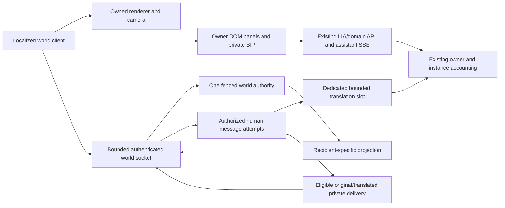

# LIA world V1: global architecture, integration and game-quality review

Date: 2026-10-09. Status: inline re-audit of the accepted V1, with revised implementation contracts and qualification gates. No business code, dependencies, migrations, deployment, paid model requests or production changes were made in this pass.

This review consolidates the [accepted V1](2026-10-09-lia-isometric-world-v1-scope.md), [complete future target](2026-10-09-lia-isometric-world-analysis.md) and [previous characterization](2026-10-09-lia-isometric-world-validation.md). It governs the refinements below where earlier wording was stronger or less precise. The first-release scope is preserved: one world, five admitted accounts, five-to-six grouped places, owner homes, bounded anchored editing, direct translated text, private LIA functions/BIP, desktop and touch. Visits, shared furniture dragging, human voice and ten-account qualification remain later lots.

Evidence snapshot: current branch codex/lia-application-tools, HEAD 39152fad2f26d23ecd21121a43c3eac1056edd70, extensively modified/untracked working tree. These sources are not a released baseline. The current instructions in CLAUDE.md and apps/web/CLAUDE.md were rechecked, along with relevant local memory routing. Existing code was inspected directly; historical guidance was not used as present-state proof. No subagent was used.

## 1. Executive verdict and material corrections

The accepted V1 remains viable and well proportioned. FastAPI/Redis/PostgreSQL can host its bounded authoritative logic; the browser renders the world. The useful/friendly experience depends on responsive movement, readable scenery and real private LIA functions, not simply the number of places. Narrow typed extension contracts remain justified. No extra general game platform, physics engine, plugin SDK or multiplayer shard system is warranted.

This pass identifies important implementation refinements:

| Finding | Revised contract | Why it matters |
|---|---|---|
| Existing shared_flight intentionally builds on Redis failure or waiter timeout | Use its underlying owned-claim primitives, with a dedicated strict translation-attempt lifecycle; do not reuse its fallback policy | A coalescing convenience is not a paid-call dedup guarantee |
| External provider completion can be uncertain after cancellation/crash | No universal exactly-once model-call guarantee; record attempts, preserve uncertainty, prohibit automatic duplicate retry during an unresolved attempt | A network timeout does not prove the provider did no work |
| Existing user quota service has a database-error fail-open branch and a cached allowed verdict | Reuse the native policy honestly; bound additional world concurrency/output, and refuse a translation whose ownership/attempt/required authority cannot be established | Existing preflight checks do not constitute an atomic spend reservation |
| A server update stream alone cannot make local walking responsive | Predict only reversible local movement, reconcile to authoritative sequence/state and interpolate remote avatars | Smooth rendering and authoritative simulation are separate loops |
| Existing app shell mounts animated backgrounds, companions and persistent controls | Explicit world presentation ownership must suspend replaced decorative loops while preserving recording/radio/assistant lifetimes | Hiding a layer with CSS does not establish its resource teardown |
| Existing invalidation registry is local to the mounted browser runtime | Use current authenticated reads on load/reconnect and scoped reconciliation; hints alone do not prove cross-tab/background freshness | A shared module is not a durable cross-device event bus |
| Voice/usage WebSocket tickets carry subsystem-specific data | New world ticket purpose, browser-session binding, language/bootstrap and consumption checks; first-frame authentication recommended | The pattern is reusable, the existing ticket is not a world credential |
| Added navigation makes an already dense localized header wider | Extend the one desktop/mobile destination registry and icon/availability types; qualify narrow widths and long locales | Adding only a desktop button creates drift/overflow |
| Avatar count does not bound offline peer-proxy count | Static/paged nearby proxy representations, separate from admitted authoritative actors | A five-player cap does not automatically bound every client entity |
| Recipient language changes can create unintended sender-funded retrials | No automatic retranslations charged to the original sender on a locale change; explicit retranslation is a separately initiated accounted action | Locale changes must not create an invisible spend loop |

These refinements do not increase the product scope. They make the accepted foundation implementable with honest failure semantics. The provisional one-to-two-week representative slice and four-to-six-week assisted-work objectives are still planning objectives, not measured forecasts. Re-estimate after real art/device/authority evidence.

## 2. Refreshed source integration map

| Boundary | Current inspected source | Reuse and verified limit |
|---|---|---|
| Entry/navigation | [Destinations](../../../apps/web/src/lib/dashboard-nav.ts), [dashboard shell](../../../apps/web/src/app/[lng]/dashboard/layout.tsx) | One typed destination family feeds desktop/mobile; add world, effective availability and icon together. Current union has no world destination |
| Functional presentation | [Settings identities](../../../apps/web/src/lib/settings-sections.ts), [panel registry](../../../apps/web/src/components/settings/settings-section-registry.tsx), [availability](../../../apps/web/src/hooks/useSettingsAvailability.ts) | Stable bindings and existing components; actual availability differs from simply reading every config flag. Administrative sections retain role checks; embedding has context/focus costs |
| API/domain wiring | [Routes](../../../apps/api/src/api/v1/routes.py), [startup registries](../../../apps/api/src/infrastructure/startup/registries.py) | Existing assembly patterns. No world bounded context/route/config was found in the inspected surfaces |
| Browser session authority | [Session binding](../../../apps/api/src/infrastructure/application_sessions.py), [stream authentication](../../../apps/api/src/core/session_dependencies.py) | Current authenticated cookie binding and detached-user stream pattern. Never hold a request AsyncSession over a WebSocket/provider/approval wait |
| Ticket precedent | [Voice ticket store](../../../apps/api/src/domains/voice/ticket_store.py) | Short-lived transactional consume pattern. Its user/language/STT fields do not bind a world purpose/browser session; its query-string transport is not selected for the new world |
| UI account isolation | [Account lifetime](../../../apps/web/src/hooks/useApplicationAccountLifetime.ts), [account query](../../../apps/web/src/hooks/useApplicationAccountQuery.ts) | Returning to an account creates a new lifetime; obsolete work cannot publish. Apply the same rule to initialization, textures, sockets, projections and drafts |
| Invalidation | [Resource bus](../../../apps/web/src/lib/application-resources.ts), [resource sync](../../../apps/web/src/hooks/useApplicationResourceSync.ts), [state sync](../../../apps/web/src/hooks/useApplicationStateSync.ts) | Owner-scoped hints trigger authenticated reads and coalescing. Hints carry identities/field names, not values; bus is process/page-local and not universal mutation coverage |
| Business authority | [Application authorization](../../../apps/api/src/domains/agents/application/authorization.py), [operation registry](../../../apps/api/src/domains/agents/application/registry.py) | Current actor/role/owner boundaries where present. Do not require every function to be application-tool-enabled or introduce an arbitrary operation dispatcher |
| Personal atmosphere | [Companion route](../../../apps/api/src/domains/briefing/router.py), [briefing service](../../../apps/api/src/domains/briefing/service.py) | The companion-context endpoint reads only current account fresh cached weather. A full briefing build is broader and can perform paid/provider work |
| Claims and coalescing | [Owned Redis claims](../../../apps/api/src/infrastructure/locks/redis_claim.py), [shared flight](../../../apps/api/src/infrastructure/utils/shared_flight.py), [radio translator/flights](../../../apps/api/src/domains/radio/articles.py) | Claim primitive propagates failure; common flight intentionally falls back to building. Held claims have bounded renewal/cancellation; stale writers still need fencing |
| LLM gate/accounting | [Usage guard](../../../apps/api/src/infrastructure/llm/usage_guard.py), [spend roads](../../../apps/api/src/infrastructure/llm/spend_roads.py), [usage service](../../../apps/api/src/domains/usage_limits/service.py), [structured output](../../../apps/api/src/infrastructure/llm/structured_output.py) | Common paid doors and declared ownership. User quota failure policy is not universally fail-closed; no atomic future-spend reservation was established by this inspection |
| Translation configuration | [Slot registry/defaults](../../../apps/api/src/domains/llm_config/constants.py), [factory vocabulary](../../../apps/api/src/infrastructure/llm/factory.py), [radio binding](../../../apps/api/src/domains/radio/adapters.py) | Add a dedicated world slot consistently; bind actual model/provider/configuration once. Radio uses the inner structured door, not an automatic repair loop by requirement |
| Canonical language | [Account model](../../../apps/api/src/domains/users/models.py), [core i18n](../../../apps/api/src/core/i18n.py), [selector](../../../apps/web/src/components/LanguageSelector.tsx) | Persisted preference/task-local context. Header can navigate after a failed save; reconcile canonical preference rather than assuming URL equals storage |
| Peer permission | [Peers service](../../../apps/api/src/domains/peers/service.py), [pair fence](../../../apps/api/src/domains/peers/pair_fence.py) | Accepted relations/blocks/shares remain distinct. Pair fence locks canonical parent rows for short database work; it is not a lock to hold over socket/model waits |
| Assets/companion | [BIP manifest](../../../apps/web/public/avatars/bip/v1/manifest.json), [application background](../../../apps/web/src/components/landing/cosmic/AppCosmos.tsx) | Current BIP visual identity, not a ready game walk rig. The current authenticated shell really mounts cosmic decorative layers; preserve its DOM theme while replacing redundant world background work |
| Persistence/lifecycle | [Data map](../../../apps/api/src/domains/users/user_data_map.py), [model registry](../../../apps/api/src/infrastructure/database/registry.py), [Redis families](../../../apps/api/src/infrastructure/cache/key_families.py), [export builder](../../../apps/api/src/domains/account_export/builder.py) | Explicit new records/columns/cache lifetimes and export/purge wiring; soft deletion is not FK cascading and conversation reset is not account deletion |

## 3. Architecture and authoritative state

Choose one production renderer after equivalent-art minimum-device evidence. Pixi 2.5D is the provisional direction; neither prior RTX probe proves its superiority. Keep input/navigation/coordinates/assets independent of renderer internals, without maintaining two implementations or importing a second complete game engine. [Pixi application lifecycle](https://pixijs.com/8.x/guides/components/application).

One instance has one common-world authority. API workers are connection owners/projection consumers, not independent simulators. The existing leader for another subsystem does not establish world ownership. Use a unique owner, monotonic fence where stale commits are possible, world epoch, sequence and bounded claim renewal. State loss/restart creates a fresh epoch; reject old controllers/commands and resnapshot. If a Redis counter can be reset, do not describe it as a durable monotonic fence across restarts; durable effects retain database revision/idempotency/current authority. [Redis locking guidance](https://redis.io/docs/latest/develop/clients/patterns/distributed-locks/).

Publish replaceable position deltas and hints through scoped Pub/Sub if useful, with coherent snapshot/subscription recovery. Use acknowledged bounded command ownership/replay for human messages and mutations, and current domain transactions for durable effects. Pub/Sub may lose messages and is not scoped by Redis database number: prefix channels by deployment/instance/purpose, not only by DB selection. No subscription to client-selected channel names. [Redis delivery/scoping](https://redis.io/docs/latest/develop/pubsub/).

Use separate bounded outbound lanes or equivalent priorities: control/revocation, reliable outcomes/messages and coalesced spatial state. A slow client cannot cause unbounded arrays. bufferedAmount is an outgoing indicator, not an incoming backpressure mechanism; aggregate replaceable updates at the server and cap client parsing/work queues. Close/resync a client that cannot keep up rather than retain unlimited history. [WebSocket buffering](https://developer.mozilla.org/en-US/docs/Web/API/WebSocket/bufferedAmount), [WebSocket backpressure limitation](https://developer.mozilla.org/en-US/docs/Web/API/WebSocket).

## 4. Game mechanics and interaction feel

### Movement and simulation

Use a fixed authoritative update step, provisionally around 10 Hz for this non-combat social world, independent of client render cadence. Clamp accumulated elapsed work/catch-up, stop stale intents, and prioritize a new snapshot after a stall. Do not advance by frame count or allow arbitrary caller-provided delta time. Use monotonic time for active simulation and aware server UTC for persisted deadlines/timezone display. This follows fixed-step practice; the chosen cadence is a LIA proposal to measure, not a source prescription. [Fixed timestep rationale](https://gafferongames.com/post/fix_your_timestep/).

Send normalized direction/intents and sequences; the server validates speed, bounds, collisions and interaction eligibility. Predict the local reversible walk with a bounded unacknowledged-input history, correct to current server epoch/sequence and replay eligible inputs. Small rendering corrections can ease visually; unauthorized coordinates cannot remain the logical interaction position. Interpolate remote avatars from received states, with bounded stale-state handling; no indefinite extrapolation through walls. Business actions/paid calls are never speculative movement effects. [Local prediction/reconciliation](https://www.gabrielgambetta.com/client-side-prediction-server-reconciliation.html), [remote interpolation](https://www.gabrielgambetta.com/entity-interpolation.html).

V1 has walkable ground planes, authored static footprints and anchored owner furniture; elaborate stairs/jumping/rigid-body physics are deferred. Normalize diagonal speed, prevent corner cutting, retain safe door/station corridors and provide a reachable reset/spawn. Other avatars do not form physical blockers in V1, preventing doorway grief and reducing collision unpredictability. Vertical art/occlusion metadata may exist without introducing unsupported traversable levels.

Click/tap navigation can use bounded A* over the same authored grid/footprints. Limit visited nodes/replans, collapse repeated destination clicks and distinguish unreachable targets from valid nearest interaction anchors. Replan on relevant layout-version changes, not every rendered frame. Keyboard/joystick control interrupts an old auto-path immediately. [Pathfinding foundations](https://www.redblobgames.com/pathfinding/a-star/introduction.html).

### Camera, picking and gestures

Camera states are follow, free exploration and explicit recenter. A small follow dead zone and time-based easing reduce jitter; bounds and zoom remain explicit. Zoom around the pointer/gesture anchor, preserve the inverse screen/world transform and show authorized static navigation markers plus the owner's camera/position. Camera movement never moves the avatar or grants a private-area subscription. Follow comfort is adapted from standard camera practice, not a reason to import Phaser. [Camera follow/dead-zone concepts](https://docs.phaser.io/phaser/concepts/cameras).

Distinguish tap-to-walk, drag-to-pan, pinch zoom and owner editing by a small input state machine with movement thresholds and pointer capture/cancel. Clear pressed keys/paths on blur, visibility loss, text/IME focus, modal/confirmation and account/controller change. Consume only events owned by the canvas/control; keep native form interaction, page zoom and text selection available. With Pixi, use the documented global move/pointer-up-outside/cancel behavior where required; assuming pointermove arrives outside hit objects can produce stuck drags. [Pointer event lifecycle](https://developer.mozilla.org/en-US/docs/Web/API/Pointer_events), [Pixi event modes](https://pixijs.com/8.x/guides/components/events).

The HUD remains outside canvas zoom. Account for VisualViewport, safe areas, dynamic viewport height, orientation and the on-screen keyboard. A drawer may occlude part of the scene, but input/send/close/recenter cannot become unreachable. Reduced motion uses restrained camera/ambient animation; avoid shake, flashes and blur. [Visual viewport](https://developer.mozilla.org/en-US/docs/Web/API/VisualViewport), [Microsoft game-motion guidance](https://learn.microsoft.com/en-us/xbox/accessibility/xbox-accessibility-guidelines/117).

### Social and functional mechanics

Default V1 direct conversation is an explicitly private two-participant scope between eligible admitted users. No public chat bubble or broadcast is inferred from sending a DM. Maintain authored aliases rather than expose account emails, private peer graphs, sources or location. Blocking and current eligibility affect future routing/projection; data already legitimately delivered cannot be retroactively made unreadable. Public/group chat would require an explicit later audience contract.

Offline/app-only peer proxies are recipient-scoped neutral representations, not admitted simulation actors. Render nearby/static proxies with paging/chunk limits and suppress a duplicate when that account has an eligible live avatar. Bed/desk poses express the known LIA presence state; unknown/away must not claim a live connection. Private owner home contents are never fetched to draw a peer vignette. A large registered-peer population is a separate stress fixture from five active players.

Interactions have a clear affordance/translated label, distance rule, pending feedback and explicit outcome. Owner furniture uses valid anchored previews, commit/cancel/reset and expected revision; editing does not trigger a business action. BIP patrols/follows/listens through bounded deterministic states and the owner's actual assistant/activity signals. Plans/drafts/history replay do not prove completed action; speaking animation requires real playback evidence. BIP, time and weather personalization are not broadcast as another user's private LIA state.

Use generous paths, recognizable landmarks and a short first-use navigation hint. A function remains directly reachable through the HUD/DOM alternative, so using LIA never requires a tedious walk. Optional fast navigation must use authorized reachable destinations and server acceptance; minimap exploration alone is not teleportation. No score/competition/token-spend reward is added.

## 5. Integration and resource lifetimes

Add a lazy localized dashboard route through the shared desktop/mobile nav identity, effective feature metadata, icon mapping and six-locale labels. Qualify the longest labels at actual breakpoints. Load the renderer and assets from a client boundary; ordinary chat/settings routes should not acquire the world code. [Next lazy loading](https://nextjs.org/docs/app/guides/lazy-loading).

Mount owner domain panels using current services/hooks and availability. Preserve recent step-up/OAuth/native/file continuations, Pipeline/ReAct, pending approvals and active-run behavior. A game station is not a second implementation of an application operation. Direct consultation uses its ordinary authenticated API rather than calling a model just to open a panel. Natural-language assistant acts remain explicit. Leaving the world does not invent cancellation/rollback of an already accepted native job; show its outcome in the existing LIA path.

Assign one owner to renderer/ticker, socket, listeners, loader/worker, controller and private store. Handle the race where initialization completes after unmount/account switch: dispose the new resource immediately without publishing it. Shared neutral immutable assets have reference ownership; private metadata/textures cannot live in another account's cache. React development setup/cleanup cycles must not create two loops/sockets. [React effect lifecycle](https://react.dev/reference/react/useEffect).

World mode replaces redundant decorative background/companion presentation and pauses their owned loops. It preserves recording/radio stop controls and active media providers. Do not unmount the global audio/session owner to hide a duplicate companion. Restore ordinary presentation on exit and test transition with live media/pending approvals.

Treat app invalidations as owner-scoped hints. Apply active-set/provenance selectors and current digest on load/reconnect/panel entry; coalesce changes and preserve manual overrides/focus/drafts. New motifs may not increment memory usage, interests learning, habits or journal extraction. Do not repurpose a learning-family key named presence. Cached weather is read through the narrow companion route; no full briefing/model fetch is performed just to animate clouds.

Background timers/rAF are throttled, so slot cleanup relies on server leases, not unload messages. Stop local movement immediately, preserve drafts and permit a bounded reconnect/reservation grace. Release truly hidden/abandoned participation and keep queued clients outside world-state delivery. Activity includes real typing/forms/navigation, not ticker/heartbeat/model-output churn. Idle warnings and deadlines are configurable, with an accessible continuation action; do not log out the ordinary LIA session. [Background behavior](https://developer.mozilla.org/en-US/docs/Web/API/Page_Visibility_API).

## 6. Translation, spend and failure strategy

Add world_message_translator as a separate specialized slot through metadata/defaults, factory vocabulary, capability/config validation and six-locale admin labels. Use the actual resolved model/provider/reasoning/prompt/pricing snapshot, not a named model or repository default. Translation has a small versioned prompt, untrusted source wrapper, schema-bound text, current authority, existing paid chokepoint and declared ACCOUNTED/CALLER spend road. Do not import radio-specific semantics into the world domain; bind shared infrastructure through a narrow world adapter.

The default original remains immutable. Authorize sender/recipient, determine canonical language, sequence the message, check limits and acquire one owned attempt for the required variant. Acknowledge the sender and show a localized recipient placeholder immediately. Publish translated text only after validation and a current permission/locale check. Same-language text uses no translator. New default policy is one paid attempt per translation request; application/provider/repair retries must be audited and bounded together, not multiplied silently.

The existing shared-flight facade is unsuitable for a strict paid job: Redis loss and waiter timeout can start another builder. Reuse owner-token claim/cancellation primitives with a dedicated attempt state machine: claimed/running/succeeded/failed/uncertain. Persist minimal request/attempt identity and idempotency tombstones where needed for the crash horizon, separately from ephemeral body content and existing usage receipts. No database transaction/row lock spans a provider wait. Cancellation/failed renewal ends ownership; stale completion cannot publish a variant. Waiters do not launch an unowned alternative call. A finished eligible variant can be reused without another receipt.

The guarantee is idempotent world request/effect handling and no intentional parallel duplicate dispatch while ownership is valid, not universal exactly-once vendor execution. Provider work can finish after a connection/worker disappears. Mark unknown outcomes honestly and prohibit automatic repeat until resolved or an explicit retry acknowledges a possible additional call. Record actual available usage under stable attempt/run identities; absent metadata is not proof of zero supplier cost. Existing tracking closes in finally/cancellation paths and never substitutes invented usage.

Keep the proposed initiator-pays policy: ordinary incoming translation is initiated/billed by the sender. A recipient locale change invalidates a pending wrong-language display but does not silently create extra sender-funded calls. Reuse a valid authorized cached variant if available; otherwise expose a localized unavailable/retranslate action. Explicit retranslation is a new action initiated by that recipient, with its own limits/receipt. Snapshot and cache identities include authorized message scope/version, language and relevant prompt/model configuration; they contain no raw text in logs/metric labels.

The existing UsageLimitService first asks the instance ceiling but can cache an allowed account verdict and allow on a database-error branch. Do not claim atomic spend reservation or universal fail-closed behavior from it. Apply ordinary LIA policy while bounding additional world dispatch (provisionally one active attempt per initiator and two across the world, with bounded fair waiting). A new translation whose ownership, durable attempt or required current actor authority cannot be established is unavailable; no change to the global quota policy is hidden in this extension. Test simultaneous chat/world spending and document the remaining native preflight overshoot frontier.

Provisional input cap: 1,000 Unicode code points and 4 KiB UTF-8, plus actual model token/context-window checks. Output limits allow translation expansion and fit the slot window; reject oversized source before spending rather than trim it. Track source/target/request/attempt internally, without automatic assistant-history/memory ingestion, tools or link preview fetches. Structured validation is not a fidelity proof: qualify negation, names, dates/numbers, links/code, mixed-language text and hostile instructions across all supported directions. Target translated display p95 around three seconds on the qualified configuration; around eight seconds is a proposed total hard deadline, not a confirmed provider latency.

## 7. Privacy, security and graceful degradation

Use a short-lived single-use world-purpose ticket obtained through the authenticated HTTP-only-cookie/BFF path. Bind the underlying browser session and active account/capability. Keep the derived ticket only in memory and send it in the first WSS authentication frame, avoiding URL/access-log exposure. Validate Origin before accepting, cap unauthenticated connections, accept only bounded authentication input within a short deadline, and allocate no admitted slot/private stream until completion. Revalidate session/account/operator state at meaningful actions and lease renewal. Existing voice tickets are refused. [OWASP WebSocket controls](https://cheatsheetseries.owasp.org/cheatsheets/WebSocket_Security_Cheat_Sheet.html), [credential transport tradeoffs](https://websockets.readthedocs.io/en/stable/topics/authentication.html).

World-only JSON/frame/rate limits must not blindly become global Uvicorn limits that break voice binary streams or usage sockets. Application-level rejection occurs after some transport allocation; qualify the actual server/proxy upper bound and all existing socket paths if changing it. Keep compression off for small world messages unless a measured compatible need justifies it. Filter/redact authentication frames and private text; no dynamic data selects executable assets/shaders/scripts or bypasses widget sandboxing.

Separate public/owner/direct-recipient schemas. A single world does not mean a single broadcast payload. Do not send owner data then hide it; do not reveal private home interiors/coordinates/source motifs in world/minimap metadata. Future guest grants will enter the same projection boundary, but are not live V1 roles. New models/columns/Redis families/tombstones must join account export, soft/hard deletion, forgetting/reset, backup/restore and retention tests. Privacy applies to derivative decor, cache keys, logs, traces and initial snapshots as well as panels.

Use explicit states for offline, reconnecting, queueing, stale snapshot, owner change, quota refusal, translation pending/failed/uncertain and unavailable graphics. Drop stale input, retain typed drafts and re-enter through current admission/authority rather than replay unacknowledged business effects blindly. If the extension fails, offer the ordinary LIA route when its own dependencies remain available; do not claim normal LIA stays usable through a failure of its shared authentication/database dependencies. Cloudflare may close idle/restarting sockets; heartbeat/reconnect/resnapshot are required. [Cloudflare behavior](https://developers.cloudflare.com/network/websockets/).

## 8. Genericity and optimizations

Keep the accepted typed zone/prop/function/motif/quality catalogues, stable IDs, asset/layout versions and narrow handlers. Shared geometry is not keyed by a browser locale; labels belong to localized presentation. Map each station to the existing function identity and authority, never duplicate the business vocabulary. New behavior still requires a reviewed handler, lifecycle and tests. No arbitrary JSON/code-driven plugin engine or dormant visit/voice tables are built merely to anticipate later lots.

Use a modular art kit with shared materials/shadows and strict foot anchors/occlusion layers. Retain source assets, provenance/licence, checksums, compressed/decoded sizes and reproducible export. Trim alpha padding, split foreground/tall objects where sorting requires it, batch compatible sprites/materials and avoid full-screen stacked filters. Measure culling: it can help GPU-bound scenes and hurt CPU-bound ones. [Pixi performance guidance](https://pixijs.com/8.x/guides/concepts/performance-tips).

Start modest devices at resolution ratio one, limited nearby atlases and restrained ambient effects; keep DOM text at native readability. Track decoded texture allocations plus render buffers rather than equating compressed download size with memory. WebGL offers no portable maximum-VRAM query. Quality adaptation uses hysteresis and an explicit override, reduces detail/effects before controls/readability, and never changes shared collision or visibility rights. [WebGL resource guidance](https://developer.mozilla.org/en-US/docs/Web/API/WebGL_API/WebGL_best_practices).

Send compact batched position changes, skip unchanged neutral state, and never read the whole profile/peer graph/database each tick. Cache authored navigation/metadata by version; invalidate only affected owner projections. Cap path search, socket queues, pending messages/translation jobs, replay bytes and queue population independently of the five-account cap. Reuse cached projections/weather only under actual freshness/authority rules. Throttle optional reconciliation with jitter/coalescing, without weakening authorization/paid limits.

Provide a coherent owner dock on desktop and an accessible mobile drawer. Important touch controls target about 44 CSS pixels as a product comfort goal. This is not the WCAG AA minimum: the relevant minimum criterion is 24 CSS pixels with exceptions. Functional panels reflow independently of the two-dimensional game/map, retain keyboard/browser zoom and expose translated names/loading/errors. [W3C target size](https://www.w3.org/WAI/WCAG22/Understanding/target-size-minimum.html), [reflow and game/map exception scope](https://www.w3.org/WAI/WCAG22/Understanding/reflow.html).

## 9. Risk register and concrete detection

| Risk / impact | Mitigation | Evidence that must detect a regression |
|---|---|---|
| Critical: another account receives private data | Recipient schemas, current scope checks, owner lifetimes and no public personalized asset metadata | Two-account raw REST/WS/snapshot/cache/log negative oracle |
| High: parallel/uncertain paid translations | Strict owned attempts, idempotent receipts, no fail-open waiter dispatch and explicit retry | Two workers, store outage, expiry, cancellation, crash after provider result before commit |
| High: locale change causes wrong display or unwanted spend | Canonical preference, version check and no automatic sender-funded retrial | Failed preference save, in-flight/replay locale changes and repeated toggles |
| High: stale world owner/controller commits | Epoch/fence/TTL/current-owner checks; no database wait held by socket | Expiry/takeover/Redis restart/stale stop or publish with independent actors |
| High: client is fluent on RTX but stalls on phone | Equivalent detailed assets, resolution/atlas bounds, device soak | Actual Android/Safari/integrated GPU, cold/warm/detail/chat/weather together |
| High: hidden decorative layers compete with world | Explicit presentation/ticker ownership, persistent media separation | Route transition, recording/radio/voice active, loop/context/listener census |
| High: socket/queue storm exhausts shared resources | Separate account/socket/queue/frame/path/bytes limits and fair work | Slow consumer, oversized auth/frame, 100 pending joins and many offline peers |
| High: world harms ordinary API/SSE | Bounded tick work, no graph/database per frame, limited translation dispatch | Same Pi workload baseline versus world-enabled p95/resources |
| High: replay mistakes change real data twice | Native idempotency/approval path and honest outcomes | Crash/retry/duplicate request, active-run transition in both assistant modes |
| High: source deletion leaves decoration/message derivative | Provenance, catalog version reconciliation and explicit lifecycle maps | Real database export/delete/reset/forget plus runtime teardown |
| Medium: player gets stuck or moves while typing | Input FSM, normalized physics, bounded path and safe reset | Frame-rate/diagonal/corner/IME/focus/pointercancel/hidden return fixtures |
| Medium: over-generic design expands V1 | Only delivered seams/catalogues/versioning, no future runtime services | Add fixture zone/move binding/migrate saved layout without simulator branches |
| High: evolving concurrent code makes old proof stale | Explicit integration snapshot and source evidence manifest | Recheck changed contracts before dependent implementation; fresh task gates |

## 10. Quality objectives and launch oracles

All numerical values below are proposed characterization/acceptance objectives. They are not achieved-world measurements. Freeze minimum device and network profiles after the representative slice; retain the full measurements, including failures.

| Quality dimension | Proposed objective | Proof boundary |
|---|---|---|
| Playability | Sustained target 30 FPS on minimum profile; frame p95 around 33-35 ms, desktop 60 FPS aim with p95 around 17-20 ms | Detailed native-device run including walking, panel/chat, weather and 30-minute thermal soak |
| Input feel | Local visible movement p95 within about 100 ms; normalized speed independent of 30/60/high-refresh render rate | Event/render timestamps and deterministic cross-language geometry fixtures |
| Spatial authority | At imposed 150 ms RTT, controlled jitter and normal load, ack/correction p95 around 250-300 ms | Real socket multi-account run; test 50/150/300 ms separately, never demand 250 ms over a 300 ms RTT |
| Privacy/authority | Zero unauthorized fields/effects in the explicit negative corpus | Inspect serialized bytes and current session/role/block/owner transitions, not only DOM |
| Spend | Zero ambient/model invocations at entry, movement, BIP locomotion, decor and cached atmosphere; actual explicit attempts/receipts accounted | Provider-boundary doubles, spend-road/usage guards, per-attempt records and quota/degradation cases |
| Translation | Qualified faithful critical corpus; target p95 around three seconds, bounded total deadline around eight | Actual configured model corpus later under a controlled budget, plus deterministic offline failures; no claim of fidelity from schema alone |
| Graphics resources | Initial playable assets roughly below 8 MB; nearby increments roughly below 3 MB; decoded resident atlases roughly 64 MB minimum/128 MB desktop | Transfer/decode/upload and own allocation accounting; total app/GPU buffers also measured |
| Lifetime stability | One effective owner per resource; no ongoing private work after owner teardown; bounded plateau after 30 transitions | Listener/task/socket/context census plus heap/process/texture trends, not unreliable VRAM maximum queries |
| Accessibility | Functional keyboard/DOM alternative, native names, focus/drafts preserved; panels usable at 320 CSS pixels/zoom | Hermetic browser flow, WebKit/Firefox and NVDA/VoiceOver evidence later; game exception does not exempt text panels |
| Pi non-regression | Proposed ordinary API/SSE p95 degradation no more than about 10%, with approximately 25% measured reserve at combined launch workload | Baseline versus five-user run plus normal LIA/media and translation; prior CPU-only probe is not this proof |
| Evolution | Add a fixture zone/prop, move a function and migrate old layout under existing contracts | Typed validation and compatibility/integration tests with actual saved records |
| Art/usefulness | Consistent scale/materials/BIP, clear paths/interactions, no fake functions; no forced walk for an essential app task | Owner visual review of a playable zone plus complete station-to-ordinary-LIA side-effect journeys |

Reject unsupported graphics clearly and offer ordinary LIA; do not silently promise every old device can render. Context-loss recovery and reduced-quality re-entry preserve authorizations/drafts. Minimum profile qualification is a release decision, not the current narrow RTX viewport result.

## 11. Director test additions and staged execution

Retain the complete dossier's 72 scenarios, with visits/shared dragging/ten-account qualification explicitly deferred for V1. Add the following 24 scoped oracles rather than replacing the earlier matrix:

73. Compare normalized walking/collision at 30/60/high-refresh render rates; bound accumulated delta after a pause and stop stale intent.
74. Reconcile local input with ack sequence/epoch under jitter, reconnect and duplicated application commands; no speculative business side effect.
75. Interpolate remote avatars, handle stale/gap states and block transitions without indefinite wall-crossing extrapolation.
76. A* unreachable/corner/rapid-click cases, manual interruption, node budget and relevant layout-version replan.
77. Multiple avatars at a door/station cannot block each other; server proximity remains separate from cosmetic overlap.
78. Camera dead-zone/free/recenter/pointer-anchored zoom, inverse picking, minimap authority and reduced-motion comfort.
79. Many offline peers with only five active accounts; bounded nearby proxy rendering and no duplicate/live or private graph exposure.
80. Hint loss/background edit/cross-tab/account return and failed preference save; fresh owner reads reconcile without losing drafts/locks.
81. First-frame auth timeout/replay/wrong-purpose/wrong-Origin/revoked browser session; no pre-auth slot/private stream.
82. World JSON limits versus actual listener allocation and existing voice binary/usage sockets; no global limit regression.
83. World owner/control lease restart/expiry/stale renew/release/publish; fresh epoch invalidates old clients and snapshots.
84. Strict translation dispatch under Redis failure/wait expiry/takeover; common shared-flight fallback is not used as the oracle.
85. Cancel/crash after provider work before receipt/publication; uncertain status and explicit retry do not fabricate zero cost or exactly-once execution.
86. Locale oscillation during delivery/replay; no automatic retranslation charged to the original sender, correct explicit initiator receipt.
87. Schema-valid but semantically wrong translation, names/numbers/negation/links/code/mixed languages and hostile instructions.
88. Same message nonce with altered body, config/prompt snapshot change, authorized cached variants and bounded per-initiator/global concurrency.
89. Async renderer/asset init completes after unmount/account switch; no duplicate loop, private cache reuse or leaked GPU resource.
90. World entry/exit with background, companion, recording/radio, pending approval and active assistant run; preserve actual resource owners.
91. Native availability/role/creation-versus-owned-consultation semantics in reused panels; source operation remains authoritative.
92. Pub/Sub environment/instance channel isolation across Redis DB numbers; no client-chosen arbitrary subscription.
93. Old saved anchored layouts plus removed/updated assets; preserve object identity/manual locks and safe fallback.
94. Changed floor/catalogue/source consent after a cached projection; no obsolete private geometry or motif publication.
95. Native touch/keyboard/address-bar/VisualViewport/orientation and screen-reader paths; released input and reachable recovery controls.
96. ARM64 frozen build/CSP/native engines plus full combined Pi/client soak; evidence comes from the implemented slice, not art or generic samples.

Implementation order: freeze snapshot/catalogue/acceptance fixtures; representative art/navigation slice; authenticated owner shell/private/native-function integration; five-account authority/projection/admission; strict direct/translation lifecycle; remaining grouped bindings and polish; full minimum-device/Pi/security/evolution acceptance. Begin high-risk authority/serialization tests with the first server slice, not after filling the map. Each lot needs current red-to-green behavioral evidence and inline adversarial review. New code obeys MyPy/TypeScript strict, one async owner, versioned prompts, central constants/settings, i18n, metrics/privacy, dependency locks and shrink-only ratchets. Do not invent disabled future controls or weaken a gate to finish a lot.

The execution units below refine the accepted V1 lots. Dependencies define readiness, not a mandate to build all interfaces before confronting authority/performance. Each function binding and each lifecycle migration within a unit is its own reviewable change, with a failing behavior oracle before business implementation.

| Unit / dependency | Concrete output | Entry-to-exit oracle |
|---|---|---|
| F0: current snapshot | Relevant contract fingerprints, five-user baseline fixture, minimum-device candidates, source-to-station inventory and representative art brief | Source facts are current, every V1 function has a declared placement, no deferred capability is advertised |
| F1 after F0: typed foundation | Bounded versioned protocol and zone/asset/function catalogues, public/owner/DM serialization shapes, configuration/locale identities | Unknown/version/owner forgery rejected; client/server fixture parity and six-locale completeness |
| F2 after F1: representative client | One detailed playable place, BIP art, camera/input/pathing, owned renderer lifecycle and quality tiers | Real modest device proves rendering/input comfort; teardown/context-loss/late-init and occlusion tests pass |
| F3 after F1: authority | World ticket, account admission/queue/controller, owner election/fencing, snapshots/deltas/recovery | Five independent actors, duplicate tabs, sixth waiter, two-worker takeover, blocked/revoked sessions and raw-byte privacy |
| F4 after F1/F3: private home | Source selector/digest, bounded motif/layout schema, anchored edit transaction, lifecycle/data-map registration | Relevant-source changes reconcile; manual locks survive; delete/forget/export and unauthorized-home cases exercise real persistence |
| F5 after F2/F3: one function per change | Trusted station opens existing owner panel; consultation/edit/native continuation retains its original contracts | Same real outcome/cost/approval in ordinary LIA and world; stale owner, denied role and pending-run exit remain correct |
| F6 after F3: direct text then translation | First prove scoped same-language delivery; then translator slot, strict attempts, bounded waiting, variants and receipts | Zero same-language calls; ordering/block/reconnect/uncertain attempt/malformed output cases pass before a bounded real-model fidelity run |
| F7 after F2/F4/F5: content and polish | Remaining grouped bindings, transverse controls, art kit, deterministic private BIP and restrained cached atmosphere | Entire V1 inventory is usable; no ambient spend/learning, duplicate presentation or interruption of persistent media |
| F8 after all delivered units: launch | Mixed-load Pi/minimum-client soak, accessibility/security/evolution acceptance, operator-off/rollback and documentation | Agreed measurable goals and existing Taskfile gates pass; scope truthfully reports five users and deferred capabilities |

F2 and F3 are early risk gates: a renderer failure revises the presentation before mass asset production, while an authority failure revises the protocol before adding functions. Under the owner's inline directive the engineer executes these units sequentially; the dependency graph does not authorize subagents. Reserve is assessed independently for sustained CPU, memory, I/O and temperature alongside latency, rather than treating one free-RAM snapshot as proof of overall capacity.

## 12. Fresh checks, limits and formal self-review

This pass executed six existing backend files covering shared-flight fallback, active-run leases, Redis key scopes, stream transaction lifetime, paid chokepoints and canonical language: 140 passed, exit zero; collection independently confirmed 140. Five existing frontend files covering owner query lifetime, resource invalidation, nav registry, section registry and language selector passed in Docker dev: 88 passed, exit zero. The expected offline simulation logs an error inside its test; no failed suite or unclosed-resource warning was observed. These 228 are a fresh targeted set and overlap the prior 443: do not add them as unique coverage. No new world test or physical-device/full-network/provider-quality proof was executed.

Exact backend selection: tests/unit/infrastructure/utils/test_shared_flight.py; tests/unit/infrastructure/streaming/test_active_run_lease.py; tests/unit/infrastructure/cache/test_key_families.py; tests/unit/test_streaming_routes_hold_no_session_guard.py; tests/unit/infrastructure/llm/test_usage_guard_at_every_chokepoint.py; tests/unit/core/test_i18n_declared_language.py. Run through the current venv with --no-cov -q -o log_cli=false. Frontend selection: useApplicationAccountQuery.test.tsx; useApplicationResourceSync.test.tsx; dashboard-nav.test.ts; settings-section-registry.test.tsx; LanguageSelector.test.tsx, through docker exec -e NEXT_PUBLIC_API_URL= lia-web-dev pnpm exec vitest run ... --reporter=dot. These commands are evidence selections, not replacements for the future Taskfile CI/coverage/integration gates.

Current production was not contacted during this pass. Earlier Pi snapshots/CPU and Redis/browser fixtures retain their dated narrow scope; they do not become mixed-load proofs. The current branch still has broad unrelated work; no staging/commit/push was performed. The [fresh evidence manifest](assets/2026-10-09-lia-world/evidence/global-review-evidence.json) records the selections, baseline and hashes of 76 referenced application sources. The first scoped local-reference pass checked 160 references without a missing target. The final follow-up checked 163 references, found no missing target/trailing whitespace and confirmed no referenced application-source drift since the recorded snapshot.

The refreshed task lint:docs:preview reports zero broken living links, stale living paths, living orphans and quoted-fact drift. It remains unsuccessful on six pre-existing technical-map gaps: account_export_downloads, application_sessions, file_transfer, phone_history, phone_number_preferences and phone_preferences. No gate/baseline or unrelated source was changed to make this analysis appear green. Historical/roadmap diagnostics are separate; this is not a complete clean-documentation or full-CI claim.

| Self-review criterion | Verdict |
|---|---|
| Accepted product intent and deferred scope preserved | Yes |
| Existing reuse and hidden limits confronted with current source | Yes for documented claims, with coalescing/quota/ticket/lifetime overclaims corrected |
| Relevant primary web research completed and applied | Yes; sources are linked beside the derived practices, proposed LIA values are labeled |
| Genericity/implementation/recovery contracts actionable | Yes at design/TDD level; actual future code still requires its stated oracles |
| Costs, retention, private projection, registries and mobile framed | Yes; no unknown vendor outcome is presented as free/exactly-once, no canvas-only usability promise |
| All future hypotheses empirically proved / 100% guaranteed result | No; representative assets, minimum devices, full multi-account wire privacy, translator fidelity and mixed load remain explicit engineering gates |
| Ready to start controlled foundation implementation from this design | Yes, subject to the existing integration snapshot and the user's implementation instruction; this review itself adds no business code |

The design is stronger after this pass because it identifies specific policies to adapt, removes false guarantees and ties quality to observable boundaries. Its remaining uncertainty is measurable rather than concealed.
