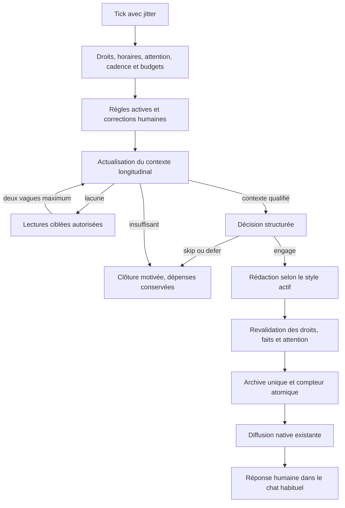

# Discussions proactives — analyse fonctionnelle et technique

Date : 19 octobre 2026. Révision 2 après validation et précisions de la personne.
Statut : cadrage approuvé, conception du contexte longitudinal approfondie ;
aucune implémentation métier dans cette étude.

Étude strictement INLINE, sans sous-agent. Lecture du répertoire de travail sur
`main`, HEAD `4b8016fba`, comprenant de nombreux changements concurrents déjà
présents. Ces changements n'ont pas été modifiés. Les conclusions sur l'existant
reposent sur le code consulté, pas sur un déploiement ni sur une lecture des
données personnelles réelles. Aucun appel fournisseur payant n'a été effectué.

Plan associé : [plan TDD](../plans/2026-10-19-proactive-discussions.md).

## 1. Alignement fonctionnel

LIA doit pouvoir ouvrir une conversation personnelle parce qu'elle a quelque
chose de pertinent à partager ou une question attentionnée à poser. Une urgence,
une information nouvelle ou une action utile ne sont pas nécessaires. La qualité
recherchée est celle d'une présence attentive : suivre ce qui compte pour la
personne, faire des rapprochements mesurés, partager une curiosité, encourager,
prendre des nouvelles ou simplement discuter.

Deux finalités coexistent et gardent leurs réglages et leur logique :

| Fonction | Déclencheur et objectif |
|---|---|
| Notifications proactives actuelles | Un signal mérite d'alerter ou d'informer ; conserver le comportement existant |
| Discussions proactives nouvelles | Le moment et le sujet rendent une initiative personnelle bienvenue, même sans utilité pratique |

Le style actif, la langue et les préférences de la personne s'appliquent à la
formulation. Le style sarcastique ne donne pas une autorisation de plaisanter
sur un sujet douloureux. Le portrait aide à ajuster la manière d'aborder un
sujet ; il ne prouve pas un état psychologique actuel.

Décision explicitement reçue pendant cette étude : **même diffusion que les
notifications proactives actuelles**. Réutiliser le chat archivé, SSE et les
canaux externes éligibles du dispatcher, sous les autorisations existantes.
Ne pas imposer un nouveau mode « push générique » ni un canal distinct.

Décisions complémentaires reçues : toutes les recommandations de la première
analyse sont acceptées, avec une correction explicite : **« Comment LIA te
perçoit » est une source autonome, utilisée ou désactivée en bloc**. Ses supports
ne sont pas filtrés en fonction des autres interrupteurs des discussions.
La compréhension longitudinale des contenus est une exigence centrale ; une base
de contexte spécifique peut être créée pour éviter les recherches répétitives.
Les corrections conservées dans « Règles et directives » doivent gouverner les
initiatives suivantes. La fonctionnalité et ses réglages font partie du périmètre
des tools internes, dans les deux modes de conversation.
La personne demande aussi une interface de consultation de cette base, sa purge
et la possibilité de marquer des éléments comme **« Non utilisables »**.

### Exemples de la différence recherchée

- Après un entretien effectivement passé : « Tu avais beaucoup préparé cet
  entretien. Comment tu l'as vécu ? » si la préparation est attestée et si une
  autre surface n'a pas déjà posé la question.
- À propos d'un projet personnel évoqué : « Tu avais envie de reprendre la
  photo. Qu'est-ce qui te donnerait envie de ressortir ton appareil ? »
- Après une étape réellement annoncée par la personne : souligner ce qu'elle
  a accompli, puis laisser une ouverture sans transformer le message en tâche.
- Un centre d'intérêt et un moment propice peuvent suffire à une conversation
  légère. Aucun changement météo ni retard de tâche n'est requis.

Ces exemples sont des intentions éditoriales, pas des textes à déclencher
automatiquement. Un rendez-vous inscrit ne prouve ni participation, ni réussite,
ni inquiétude ; une tâche terminée ne prouve pas une émotion.

## 2. État réel et limites vérifiées

Les liens ci-dessous désignent des fichiers existants consultés. Les noms de
modules futurs, plus loin, sont des propositions.

| Constat vérifié | Preuve dans le code | Conséquence |
|---|---|---|
| Le heartbeat est déjà un flux complet : éligibilité, contexte, décision, rédaction, diffusion, facturation | [scheduler](../../../apps/api/src/infrastructure/scheduler/heartbeat_notification.py), [tâche](../../../apps/api/src/domains/heartbeat/proactive_task.py) | Réutiliser les infrastructures ; ne pas remplacer ce flux |
| Le prompt actuel trie les interruptions par urgence et impose un format très court ; il comprend aussi quelques questions et sujets personnels | [prompt de décision](../../../apps/api/src/domains/agents/prompts/v1/heartbeat_decision_prompt.txt) | « Notifications » et « discussions » ne sont pas déjà deux moteurs séparés ; protéger les cas de chevauchement |
| Il n'y a plus de plafond quotidien sur le heartbeat, conformément à ADR-328 | [checker construit pour le heartbeat](../../../apps/api/src/infrastructure/scheduler/heartbeat_notification.py), [UI actuelle](../../../apps/web/src/components/settings/HeartbeatSettings.tsx) | La limitation facultative des discussions est nouvelle ; ne pas rétablir un quota d'alertes |
| Les sources heartbeat sont une liste fermée ; les refus sont appliqués avant création de la coroutine de lecture | [politique](../../../apps/api/src/domains/heartbeat/source_policy.py), [agrégateur](../../../apps/api/src/domains/heartbeat/context_aggregator.py) | Bon principe ; les préférences et les adaptateurs des discussions doivent être indépendants |
| Agenda prospectif, tâches non terminées, emails du jour non lus et extraits courts de mémoires | [agrégateur](../../../apps/api/src/domains/heartbeat/context_aggregator.py) | Ce contexte ne représente ni tout l'historique, ni les contenus détaillés, ni les actions accomplies |
| La seconde passe actuelle fabrique une requête déterministe à partir du contexte puis recherche journal et mémoires | [requête](../../../apps/api/src/domains/heartbeat/second_pass_query.py) | Ce n'est pas une décision libre du modèle d'enquêter dans toutes les sources |
| Les mémoires sont dans PostgreSQL/pgvector ; certains commentaires parlent encore de LangGraph Store | [modèle](../../../apps/api/src/domains/memories/models.py), [lecture actuelle](../../../apps/api/src/domains/heartbeat/context_aggregator.py) | Suivre les appels exécutés, pas les anciens commentaires |
| La rédaction heartbeat connaît déjà le style actif, Psyché et le portrait bref | [rédaction](../../../apps/api/src/domains/heartbeat/prompts.py), [personnalité](../../../apps/api/src/domains/heartbeat/proactive_task.py) | Réutiliser les builders ; ne pas recréer un style ou un profil concurrent |
| Le portrait compile journal, mémoires, intérêts, habitudes, débriefs de relations, engagements, workboard, routines, rappels et réponses conservées | [registre](../../../apps/api/src/domains/shared/portrait_sources.py), [provenance](../../../apps/api/src/domains/journals/schemas.py) | Par décision de la personne, il reste une source autonome autorisée en bloc ; ne pas analyser ses supports pour appliquer les autres interrupteurs |
| Le builder ambiant sert un portrait daté, sans recalcul de sa fraîcheur par source à chaque lecture | [builder](../../../apps/api/src/domains/journals/portrait_builder.py) | La date doit rester visible au modèle ; ne pas utiliser le portrait comme preuve d'un événement récent |
| Les claims du portrait portent des supports ; leur admission technique ne revendique pas de preuve sémantique absolue | [claims et validation](../../../apps/api/src/domains/journals/consolidation_output.py) | Séparer preuve de provenance et vérité de l'interprétation |
| Les mémoires ne portent pas une généalogie exhaustive de leurs sources externes | [modèle mémoire](../../../apps/api/src/domains/memories/models.py) | Impossible de promettre une exclusion rétroactive parfaite de toute influence d'un ancien email dans une mémoire |
| Les relations sont une agrégation avec résolution d'identité ; leur point 360° est une opération délimitée | [service](../../../apps/api/src/domains/relations/service.py), [scope](../../../apps/api/src/domains/relations/overview_scope.py) | Ne pas lancer un point 360° complet à chaque tick ; conserver les distinctions d'identité et de direction |
| Les messages peers conservent le texte propre à chaque côté, sous rétention | [pont relations/peers](../../../apps/api/src/domains/relations/peer_messages.py) | Ni accès au compte du peer, ni reconstitution d'un texte expiré |
| Les réunions possèdent des comptes rendus courants et une recherche par champs permis | [recherche](../../../apps/api/src/domains/meetings/search.py), [repository](../../../apps/api/src/domains/meetings/repository.py) | Distinguer agenda, réunion enregistrée, rapport final, audio et transcription brute |
| Les moments anticipés détectent déjà des fins de réunion, revalident l'événement et évitent certains doublons | [détecteur](../../../apps/api/src/domains/moments/detectors/event_followup.py) | Ne pas inventer un second détecteur identique ni changer le consommateur existant |
| Le briefing offre une lecture de sections choisies avec réutilisation des caches | [read_selected_cards](../../../apps/api/src/domains/briefing/service.py) | Réutilisation possible, en passant la sélection autorisée ; ne jamais appeler tout le briefing puis filtrer |
| Les notifications sont archivées avant diffusion ; le succès du dispatcher peut être l'archive seule | [dispatcher](../../../apps/api/src/infrastructure/proactive/notification.py) | Distinguer message durable, canal accepté, réception et lecture réelles |
| Les messages `proactive_*` archivés rejoignent le prochain tour comme messages assistant | [injection](../../../apps/api/src/domains/agents/services/orchestration/service.py), [conversion](../../../apps/api/src/domains/agents/services/orchestration/out_of_graph.py) | Bonne continuité native ; vérifier déduplication et référence explicite pour une réponse tardive |
| Le bail de conversation existe ; la vérification de consentement fraîche du runner est actuellement spécifique au heartbeat | [bail](../../../apps/api/src/infrastructure/streaming/run_stream_broker.py), [runner](../../../apps/api/src/infrastructure/proactive/runner.py), [autorité](../../../apps/api/src/domains/heartbeat/delivery_guard.py) | Ajouter explicitement les garanties au nouveau flux ; elles ne sont pas héritées par un nouveau `task_type` |
| Le checker générique couple bornes quotidiennes et pacing vers une quantité cible | [éligibilité](../../../apps/api/src/infrastructure/proactive/eligibility.py) | Ne pas l'utiliser tel quel pour un simple maximum facultatif : aucune obligation de remplir un quota de conversations |
| Les SMS sont un projet d'analyse présent dans le worktree ; aucun domaine SMS d'ingestion n'a été trouvé dans `src/domains` lors de cette étude | [étude SMS](2026-10-19-phone-ingestion-sms-design.md) | Dépendance explicite, ne pas annoncer une source déjà utilisable |
| Le ledger de récurrence reconnaît surtout la forme des demandes faites à LIA ; le rythme concerne la présence et l'usage | [ledger](../../../apps/api/src/domains/agents/services/recurrence_ledger.py), [rythme](../../../apps/api/src/domains/habits/rhythm.py) | Ces briques ne constituent pas une compréhension longitudinale des rendez-vous, projets et contenus personnels |
| Google développe les occurrences ; Microsoft développe calendarView mais ne publie pas actuellement toutes les identités de série ; le normaliseur Apple ne conserve pas RRULE/RECURRENCE-ID | [Google](../../../apps/api/src/domains/connectors/clients/google_calendar_client.py), [Microsoft](../../../apps/api/src/domains/connectors/clients/microsoft_calendar_client.py), [normaliseur Microsoft](../../../apps/api/src/domains/connectors/clients/normalizers/microsoft_calendar_normalizer.py), [normaliseur Apple](../../../apps/api/src/domains/connectors/clients/normalizers/calendar_normalizer.py) | Définir un contrat de série et d'occurrence, tester les trois fournisseurs ; ne jamais compter l'UID Apple seul comme une occurrence |
| Les règles explicites sont des mémoires `procedural`, épinglées à la création ; le rappel actuel repose sur top-k sémantique ou récence | [création](../../../apps/api/src/domains/memories/service.py), [protection](../../../apps/api/src/domains/memories/protection.py), [rappel](../../../apps/api/src/domains/agents/middleware/memory_injection.py) | Épinglage n'est pas injection garantie : lecture dédiée des règles actives pour le nouveau moteur |
| `get_by_category` est plafonné et l'extracteur refuse la modification automatique d'une mémoire épinglée | [repository](../../../apps/api/src/domains/memories/repository.py), [extracteur](../../../apps/api/src/domains/agents/services/memory_extractor.py) | Ne pas présenter une première page de règles comme l'ensemble ; prévoir correction explicite et traitement des contradictions |
| Les tools heartbeat sont câblés de la fonction native jusqu'au catalogue, à l'opération et au dispatcher de préférences | [tools](../../../apps/api/src/domains/agents/tools/application_heartbeat_tools.py), [registre](../../../apps/api/src/domains/agents/application/registry.py), [confirmation](../../../apps/api/src/domains/agents/application/confirmation_policy.py) | Une simple route API ne suffit pas ; tous les producteurs et lecteurs du contrat applicatif doivent être étendus |

La mémoire de travail historique a servi d'orientation pour le portrait. Le code
actuel a été relu : l'ancien module de revue mentionné dans ces notes n'est plus
présent à ce chemin. Aucun résultat de test ancien n'est utilisé comme preuve de
la présente étude.

## 3. Compléments fonctionnels recommandés

### 3.1 Une initiative qui sait rester silencieuse

La décision d'engagement peut être `skip`, `engage` ou `defer`. La construction
du contexte peut auparavant demander `research`. `skip` est une réussite normale.
Ne jamais imposer un minimum quotidien ni fabriquer une raison
de parler pour consommer une fréquence. « Sans limite quotidienne » supprime le
plafond de nombre choisi par la personne ; les horaires, le respect de son
attention, les quotas de dépense et les bornes techniques restent applicables.

Le compteur porte sur les **ouvertures effectivement archivées**, pas sur les
analyses, recherches, pushes par appareil, réponses de l'utilisateur ou tours qui
suivent. L'interface doit dire « nouvelles discussions par jour ».

### 3.2 Des intentions variées

Prévoir un vocabulaire éditorial fermé : prendre des nouvelles, revenir sur un
sujet laissé ouvert, encourager ou célébrer, explorer un intérêt, partager une
curiosité, proposer une réflexion personnelle légère. Ces intentions ne sont
pas de nouveaux domaines de données ni des obligations de couverture.

La sélection évalue ensemble ancrage réel, intérêt pour cette personne,
opportunité du moment, fraîcheur, nouveauté, délicatesse et facilité à répondre.
L'utilité pratique est facultative. Une récurrence ne devient un fait que si ses
occurrences sont identifiées et sa couverture suffisante ; un échantillon tronqué
ne permet pas de conclure à une absence ou à une habitude.

### 3.3 Une sollicitation légère

Un seul sujet et au plus une vraie question ouverte. La question n'est pas
obligatoire pour une petite marque d'attention. Pas de questionnaire, de bilan
automatique, de demandes d'action systématiques, ni d'insistance culpabilisante.
Ne pas prétendre ressentir une émotion humaine ou surveiller la personne en
continu. L'absence de réponse ne prouve ni détresse, ni rejet, ni désintérêt.

Pour qualification initiale : proposer une longueur de 25 à 80 mots, un maximum
de deux ouvertures par jour par défaut et une fenêtre initiale 09 h–20 h, tous
présentés comme **valeurs proposées**, modifiables avant développement. Une
activation ouvre le réglage des sources ; elle ne réutilise pas silencieusement
les refus du heartbeat.

### 3.4 Du contrôle simple, sans régler un moteur

- Fonction désactivée par défaut ; activation explicite.
- Fenêtre locale, y compris un intervalle traversant minuit. Le helper existant
  considère début égal à fin comme une fenêtre vide : refuser cette égalité à
  l'écriture avec une erreur explicite, sans changer le helper partagé.
- Maximum quotidien entier positif ou `null` pour « sans limite quotidienne ».
  Aucun `0` ambigu : le bouton principal désactive la fonctionnalité.
- Sources explicites, disponibilité et dépendances visibles. Nouvelle source
  ajoutée ultérieurement désactivée jusqu'au choix de la personne.
- « Pas maintenant » : suspend les discussions jusqu'à la fin de la fenêtre
  locale en cours, sans désactiver les alertes et sans créer un rappel.
- « Ce sujet ne me convient pas » : refus persistant de ce sujet dans ce flux,
  réversible depuis les réglages. Ne pas supprimer une mémoire par déduction.
- Explication « Pourquoi ce sujet ? » : courte provenance factuelle accessible
  sur demande ; pas de raisonnement interne du modèle ni de déballage des sources.

Un seul engagement encore en attente dans le moteur à un instant donné. Son
ouverture expire pour l'ordonnancement après 24 h proposées, sans effacer le
message du chat. Ne pas empiler des questions après une longue absence. Une
discussion répondue peut continuer librement dans le chat normal.

Proposition de délai minimal de quatre heures entre ouvertures, avec un délai
supplémentaire après une sollicitation ignorée et un plafond de ce délai. Ces
valeurs relèvent d'une calibration produit, pas d'une propriété démontrée.

### 3.5 Sujets délicats

Proposer un accord distinct pour aborder spontanément la santé, les conflits,
le deuil, la sexualité, les finances et les autres sujets intimes, même si une
source connectée est autorisée. La permission d'une source et la permission
d'ouvrir un sujet sensible sont deux contrôles différents. Respecter
`usage_nuance`, les sensibilités et les corrections explicites.

Même avec accord, aucune interprétation clinique, aucune inférence sur l'humeur
à partir d'un silence, d'une localisation ou de données incomplètes. Pour un
sujet délicat autorisé : formulation sobre et liberté explicite de ne pas
répondre. La diffusion ayant été choisie identique à l'existant, ce filtre
intervient **avant** génération finale et envoi ; le texte peut apparaître sur
un écran verrouillé ou un canal externe autorisé.

## 4. Cartographie des sources et de leurs droits

Chaque famille ci-dessous possède sa permission propre. Le registre d'exécution
doit aussi publier son état : `ok`, `empty`, `disabled`, `unavailable`, `stale`,
`truncated`, ses bornes de couverture et ses dépendances. Une liste vide n'est
jamais une preuve d'absence si la source est inaccessible ou tronquée.

| Donnée demandée | Socle réutilisable | Lecture à construire pour ce flux |
|---|---|---|
| RDV | `connectors/calendar_access.py`, moments | Passé récent et futur ; revalidation des annulations, refus et déplacements |
| Emails | Clients actifs normalisés, providers relations | Aperçu récent puis contenu ciblé d'un message ou fil ; reçus et envoyés distingués |
| Contacts | Annuaire et résolution d'identité des relations | Personnes liées à un candidat, sans scan exhaustif à chaque tick |
| Tâches | Clients actifs et préférences de listes | En cours et accomplies pertinentes ; une échéance n'est pas une date de réalisation |
| Météo | Sections briefing, clients météo | Conditions fraîches d'un lieu permis ; jamais prétexte automatique à parler |
| Localisation | `users/user_location_service.py` | Permission dédiée intersectée avec le consentement existant ; ville utile plutôt que coordonnées dans les prompts |
| Mémoires | Repository pgvector, cycle d'invalidation | Faits actifs, nuances et sensibilités ; ne pas ressusciter un fait invalidé |
| Journal de LIA | Recherche et règles de journal | Entrées pertinentes autorisées, distinguées des faits déclarés par la personne |
| Comment LIA te perçoit | Builder portrait existant | Source autonome, format bref complet daté, ou entier omis si son budget ne permet pas l'admission ; aucun filtrage des supports selon les autres sources |
| Engagements | Domaine `open_loops` | État courant, qui doit quoi à qui, réponse déjà donnée et échéance |
| Habitudes | Domaine `habits` | Rythmes et récurrences qualifiés ; pas de mise à jour d'apprentissage parce que le moteur a lu un signal |
| Relations | Identité, favoris et débriefs | Synthèse ciblée déjà disponible, datée et sous permissions de ses constituants |
| Santé | `heartbeat/health_context.py`, health_metrics | Agrégats, écarts et fraîcheur, sous accord d'intégration et accord de sujet ; pas de capteurs bruts |
| Échanges récents | Repository conversations et visibilité | Tours humains et réponses visibles, en excluant les faux messages utilisateur des runs automatiques |
| Réunions | Repository et recherche des minutes | Rapport courant final disponible ; pas de lecture brute de l'audio ni des versions supprimées |
| Peers | Profils et connexions acceptées | Seulement ce que le compte possède ou peut lire actuellement ; aucune exploration du compte tiers |
| Messages avec peers | Ledger et pont relations | Texte du côté autorisé, statut livré et rétention ; contenu expiré explicitement indisponible |
| Centres d'intérêt | Échantillonnage varié et repository | Sujets actifs et nouveautés éventuelles ; pas de répétition du même intérêt dominant |
| Rappels | Repository des rappels | Consulter ce qui compte et ce qui a déjà sonné ; ne pas réémettre l'alerte |
| Actions planifiées | Repository des routines et résultats | Intentions, prochain horaire et résultats distingués ; aucun déclenchement autonome de routine |
| Tickets workboard | Prédicats de visibilité et repository | État actuel, réponses demandées et accomplissements ; aucune exécution de ticket |
| SMS | Dépendance au projet SMS | Seulement messages effectivement ingérés et autorisés, après livraison de cette brique ; pas la boîte complète du téléphone |

### Droits effectifs et sources dérivées

L'autorité effective est l'intersection : compte actif, capability opérateur,
fonction activée, permission de la source pour ce flux, consentement du domaine,
connecteur/scopes actifs, droits de l'objet et politique de sujet. Appliquer
cette intersection avant tout accès, y compris cache, aperçu, recherche et
contrôle d'agenda « occupé ». Un agenda refusé n'est pas rouvert pour savoir si
la personne est disponible. Les métadonnées internes de cadence et de doublon
ne deviennent pas un sujet de conversation.
Pour la base dérivée, ajouter le statut d'utilisation de chaque élément et de
ses supports à cette autorité : un élément « Non utilisable » n'entre dans aucun
prompt, recherche sémantique, comptage de patterns ou rapprochement du moteur.

Les registres et ports existants restent les autorités de chaque domaine.
Un registre de sources du nouveau flux décrit leurs capacités de lecture et
leurs besoins ; il ne duplique pas la taxonomie métier `DOMAIN_REGISTRY`.

**Exception explicite du portrait :** si sa source est autorisée et les droits
propres du domaine journal le permettent, utiliser le bloc produit par son
builder, avec sa date. `emails=false` ou `habits=false` n'en retire aucune phrase.
Si `portrait=false`, aucun accès à ce portrait ni réutilisation de ses projections
dans la base de contexte. Désactiver le journal comme source des discussions
n'éteint pas automatiquement le portrait ; désactiver globalement le domaine
journal reste une autorité existante à respecter. Aucun nouveau compilateur du
portrait global ni programme de filtrage de ses supports n'est requis.

Pour les **nouvelles connaissances dérivées par cette fonctionnalité**, conserver
la liste exacte des sources effectivement utilisées, avec le portrait comme
une racine autonome. Un épisode issu directement d'un email interdit ne peut
revenir depuis le cache ; un épisode issu du portrait autorisé reste admissible
sans expansion des sources historiques du portrait. La politique de sujet
intime s'applique au message final dans tous les cas.

Les mémoires historiques n'offrent pas une généalogie exhaustive. La V1 ne
promet pas une exclusion transitive absolue de leurs influences. Cette extension
n'est plus un arbitrage bloquant ni un lot de la fonctionnalité demandée.

## 5. Architecture recommandée

### Options confrontées aux patterns en place

| Option | Appréciation |
|---|---|
| Modifier le prompt heartbeat pour ajouter un mode relationnel | Peu de code initial, mais change la décision existante, ses priorités et son budget ; ne respecte pas l'isolement souhaité |
| Faire tourner un ReAct complet sur tous les outils à chaque tick | Recherche souple, mais coût et surface de mutations trop larges pour une simple ouverture ; interférence avec la conversation et ses HITL |
| Domaine dédié et orchestration bornée, avec ports de lecture et infrastructures partagées | Recommandé : permissions et cadence propres, recherches décidées par le modèle mais bornées par le serveur, continuité native du chat |

Créer `domains/proactive_discussions/`. L'orchestration suit le pattern des
agrégations hors LangGraph : lectures concurrentes indépendantes, chacune avec
session courte propre, aucune session SQL autour d'un appel réseau ou modèle.
Les ports évitent les cycles entre `agents`, `journals`, `relations` et ce
domaine. L'infrastructure compose les adaptateurs et les services partagés.

Le runner générique est réutilisable partiellement, mais ses limites ont été
vérifiées : extraction de champs de préférences connue à l'avance, pacing
quantitatif, autorité fraîche spécifique au heartbeat. Ne pas les contourner
par des noms de champs trompeurs. Prévoir des extensions étroites par stratégie
avec implémentations historiques inchangées, ou un petit orchestrateur dédié
composant les helpers communs lorsque cela évite de modifier ce runner gelé.
Le plan retient la seconde voie, sans copier le code de facturation/diffusion.

### Compréhension longitudinale : un socle de contexte persistant

Le contexte doit répondre à « qu'est-ce qui se joue pour cette personne ? », pas
seulement lister ses derniers événements. La V1 approfondie comporte une base
de contexte dédiée, interne à `proactive_discussions`, sur PostgreSQL existant.
Elle matérialise un petit graphe de faits et d'épisodes en tables relationnelles,
avec payloads JSONB validés et recherche pgvector si utile. Aucun serveur de
graphe supplémentaire, aucun espace RAG utilisateur créé silencieusement, aucun
double du portrait ou du dépôt général des mémoires.

Une base uniquement vectorielle ne sait pas compter des occurrences distinctes,
traiter une exception de série ou retirer exactement une hypothèse invalidée.
Un simple graphe de liens ne donne pas, à lui seul, le sens personnel des
événements. Associer **identités et chronologie structurées**, **liens de preuves**
et **synthèse sémantique bornée**. Une relation calculée reste une hypothèse
qualifiée, jamais une vérité clinique ou émotionnelle.

Les droits sur les données source restent en lecture seule. Les écritures de
cette base sont des projections internes : elles ne modifient ni rendez-vous,
ni email, ni mémoire générale, ni journal, ni habitude existante.

| Objet interne | Contenu et rôle |
|---|---|
| `ContextObservation` | Objet source/version et occurrence propres, entités résolues, dates de fait et d'observation, prévu/annulé/décliné/achevé déclaré, éléments sémantiques minimaux autorisés |
| `ContextEpisode` | Fil personnel : projet, série de rendez-vous, attente d'une nouvelle, activité reprise ; éléments connus, corrections, état et points encore inconnus |
| `ContextPattern` | Motif qualifié : récurrence déclarée, observée ou simplement possible ; période, variabilité, exceptions, couverture, confirmations et contradictions |
| `ContextEvidenceLink` | Supports exacts de chaque observation/épisode/pattern ; rôle support ou contradiction ; source autorisée et délai de validité |
| `SourceCoverage` | Période effectivement lue, pagination achevée ou non, curseur valable s'il existe, dernière vérification, prochain contrôle nécessaire |
| `ContextPublication` | Génération validée, versions des entrées, révision de politique et version du modèle de contexte ; ancienne génération conservée jusqu'à publication atomique de la suivante |

Les identités externes incluent le fournisseur et le compte connecteur. Une
occurrence d'une série inclut son ancrage d'origine ; une exception déplacée
remplace cette occurrence au lieu d'en créer une seconde. Les occurrences
planifiées et réellement passées restent distinctes. « La date est passée »
ne devient jamais « tu y es allé » sans preuve supplémentaire.

Le schéma des liens est fermé : `supports`, `contradicts`, `same_episode`,
`part_of_series`, `concerns`. L'identité d'une personne vient des résolveurs
existants ; un prénom, un titre similaire ou un score vectoriel seul ne fusionne
pas deux personnes ou deux événements. Les nouveaux enregistrements sont tous
owner-scoped et ne portent aucun identifiant de ressource d'un autre compte.

### Mise à jour progressive et recherche utile

1. Au premier usage, lire les données récentes permises et les faits durables
   autorisés. Le démarrage n'exige pas d'aspirer tout l'historique. Si un sujet
   semble avoir un passé pertinent, rechercher autour de ce sujet, de ses
   entités ou de sa série ; fenêtre d'amorçage ciblé proposée de six mois passés
   et trente jours futurs pour qualifier une répétition mensuelle.
2. Aux ticks suivants, comparer versions, dates de modification et curseurs
   effectivement supportés. Relire seulement la plage changée ou devenue trop
   ancienne pour être fiable. Aucun delta universel n'est présumé disponible :
   sans curseur fiable, relire une fenêtre bornée avec chevauchement et upsert
   idempotent, puis marquer la couverture exacte.
3. Réutiliser les interprétations attachées à `(source, objet, version,
   version_interpréteur)`. Un document inchangé ne repaie pas son analyse à
   chaque discussion. Un résumé email existant peut être réutilisé s'il est
   déjà en cache et autorisé ; une absence ne déclenche pas secrètement un LLM
   `email_digest` en plus de l'enveloppe de ce flux.
4. Une passe sémantique par lot modifié propose les sujets et épisodes,
   rapprochements, contradictions et lacunes, chacun avec ses références.
   Compter les occurrences, calculer les écarts et appliquer une récurrence
   déclarée sont des opérations déterministes, pas du calcul demandé au modèle.
5. Le contexte peut demander au plus deux vagues de recherches, quatre
   opérations par vague. La limite de requêtes physiques tient compte des
   pages et sous-appels ; pas de pagination cachée non bornée. Les demandes
   identiques déjà satisfaites réutilisent le résultat tant qu'il est valide.
6. Après chaque vague, enrichir la même génération candidate. Si un point reste
   inconnu, le qualifier et ne pas fonder l'ouverture sur cette inconnue. Après
   la seconde vague, conclure avec l'état obtenu ou rester silencieux.
7. Vérifier toutes les références et contraintes avant publication atomique
   de la génération. Une reconstruction qui échoue laisse l'ancienne génération
   valide servir ; une politique révoquée l'interdit immédiatement même si une
   purge physique est encore en cours. Pas de session SQL ouverte autour du LLM.

La lecture n'est pas répétée sans raison, mais un fait critique devenu périmé
est contrôlé avant d'être dit. Le rythme des contrôles dépend de la source,
du prochain événement et des invalidations fiables reçues. L'absence de push
d'un connecteur ne prouve jamais que l'objet n'a pas changé.

### Exemple directeur : rendez-vous médical isolé ou mensuel

| Contexte observé | Interprétation admissible | Effet sur la discussion |
|---|---|---|
| Un rendez-vous médical dont la date vient de passer, historique inconnu | Rendez-vous passé dans l'agenda, résultat et participation inconnus | Aucun diagnostic ni phrase sur un suivi régulier ; question délicate seulement si le sujet est autorisé et bienvenu |
| Une série mensuelle déclarée dans l'agenda | Fréquence planifiée connue, rendez-vous effectivement honorés inconnus | Ajuster le sujet au caractère habituel, éviter le même débrief automatique à chaque occurrence |
| Plusieurs rendez-vous indépendants liés au même contexte sur des mois distincts | Fréquence observée, avec ses écarts et sa couverture ; ne pas inventer une règle de calendrier | Rechercher une précision utile si nécessaire et éviter de traiter la prochaine occurrence comme un événement inédit |
| La personne explique « c'est un contrôle de routine » | Qualification explicite de la personne, plus forte qu'une interprétation du titre | Ton plus léger ; ne pas manifester une inquiétude répétitive |
| Une occurrence est déplacée ou annulée | Exception à une série ; aucun accomplissement prouvé | Mettre à jour l'occurrence et ses hypothèses ; pas de double comptage ni relance sur une date périmée |
| Les données concernent son enfant ou un contact | Sujet distinct de la personne ; identité attestée ou incertaine | Ne jamais attribuer le rendez-vous ou la situation médicale à l'utilisateur par simple proximité |
| Les mois antérieurs ne sont pas disponibles | Récurrence inconnue, pas « rendez-vous isolé » | Rester prudent, chercher si pertinent, ou choisir un autre sujet |

Les trois fournisseurs demandent une qualification réelle. Google utilise
`singleEvents`; Microsoft `calendarView` développe les occurrences mais les
champs de parent/type doivent être conservés ; Apple doit publier les propriétés
de série et d'exception qu'il possède. Une projection additive évite de changer
les cartes et tools existants. Les cas mensuels utilisent le calendrier civil
et ses fins de mois, pas une approximation de trente jours en secondes.

Contrats fournisseurs vérifiés : Google identifie une occurrence par
`recurringEventId` et son `originalStartTime`, y compris après déplacement ;
Microsoft expose `seriesMasterId`, `type` et `originalStart`. Les projections
proposées s'appuient sur ces champs documentés :
[Google Calendar — Events](https://developers.google.com/workspace/calendar/api/v3/reference/events),
[Microsoft Graph v1.0 — Event](https://learn.microsoft.com/en-us/graph/api/resources/event?view=graph-rest-1.0).
Leur disponibilité dans les payloads réels de chaque chemin LIA reste à éprouver
par fixtures et tests d'adaptateur ; la documentation fournisseur seule ne la prouve pas.

Cette intelligence dépasse l'agenda : distinguer un projet commencé d'un projet
achevé, une demande répétée d'un fil email cité trois fois, une inquiétude
exprimée d'une hypothèse, un événement planifié d'un engagement tenu, une reprise
d'intérêt d'un rappel automatique. Une question de LIA n'est jamais la preuve
de la réalité qu'elle suggère. Les liens validés doivent soutenir une vraie
variation de l'angle de conversation, pas seulement alimenter un dédoublonnage.

### Règles et directives : contraintes avant les sujets

Lire spécifiquement les mémoires actives `procedural` avant la construction du
contexte, à la décision et à la publication. Ne pas dépendre du top-k sémantique
du profil général ni de la première page plafonnée de `get_by_category`.
Une pagination propriétaire cohérente et une version de contenu constituent
l'instantané complet ; un usage_count ou last_accessed_at ne l'invalide pas.

Les règles sont des contraintes de comportement, pas des sujets à évoquer. Le
refus de la source factuelle « Mémoires » des discussions ne les fait donc pas
disparaître. En revanche, le consentement global du domaine mémoire reste
respecté : mémoire long terme globalement coupée, aucune lecture de ces règles
et aucun apprentissage promis ; les réglages explicites du nouveau flux restent
applicables et l'UI explique cette limite.

Les interdictions structurables, par exemple ne pas solliciter un sujet ou
une période, deviennent des contraintes dérivées, toujours liées à l'ID et à
la révision de la règle canonique. Les autres consignes rejoignent les prompts
en texte intact. Ce cache de contraintes est reconstruit à chaque correction,
suppression ou reclassement ; il n'est pas une seconde mémoire autonome.
Si l'ensemble applicable ne tient pas dans son budget, ne pas ignorer une règle
silencieusement : limiter les candidats ou différer la discussion.

Une réaction humaine est lue dans le tour courant, puis suit le pipeline
d'extraction existant si le consentement le permet. « Pas maintenant » est
temporaire ; « ne me parle plus de mes rendez-vous médicaux » est une directive
durable ; un pouce négatif seul ne permet pas d'inventer cette directive.
La correction explicite invalide immédiatement les candidats concernés au
moyen du retour relié au message et d'un garde transitoire, sans attendre que
l'extraction asynchrone soit terminée. Ce garde n'écrit pas une nouvelle mémoire.
Si le sens durable reste ambigu, différer ce sujet jusqu'à clarification humaine
ou disponibilité d'une règle, plutôt que stocker une interdiction devinée.

Le reçu d'extraction, quand il existe, rattache ensuite la règle réellement
persistée et remplace le garde transitoire. Un échec ne doit pas être annoncé
comme « retenu pour toujours ». Les nouvelles directives restent épinglées par
le mécanisme natif. Une directive épinglée contradictoire ne sera pas modifiée
automatiquement : correction manuelle ou tool mémoire avec sa confirmation
existante. La consigne humaine explicite la plus récente s'applique au tour et
empêche une initiative contradictoire ; les contraintes incompatibles non
résolues font différer le sujet. Pas de changement global silencieux du moteur
de mémoires pour contourner cette protection.

### Vie de la base de contexte

L'état dérivé est visible et explicable sur demande : épisodes compris,
patterns qualifiés, période observée et sources actuelles ; aucun graphe privé
opaque prétendant connaître la personne avec certitude. Proposer une action
explicite « Réinitialiser le contexte des discussions », distincte du reset
du chat, et une correction/oubli d'un épisode ; les sources originales et les
mémoires générales restent sous leurs commandes propres.

Horizon technique initial proposé : douze mois glissants d'observations
minimales et d'épisodes soutenus, assez pour les rythmes mensuels ; l'audit des
décisions conserve sa rétention séparée de trente jours. Un contenu source
soumis à une rétention plus courte ne survit pas dans un résumé dérivé. Les
observations gardent des références et états minimaux, pas une copie intégrale
des emails/SMS. Une permission retirée, un texte expiré ou une source supprimée
rend immédiatement ses dérivés inutilisables, puis purge/recalcule les supports
concernés. Le portrait reste une racine autonome conformément au choix reçu.

Une réinitialisation explicite incrémente une génération d'oubli pour empêcher
les workers en vol de restaurer l'ancien contexte. Un reset du chat invalide
les supports issus des messages supprimés ; il ne supprime pas arbitrairement
les épisodes encore soutenus par d'autres sources autorisées. Export et
suppression du compte incluent la base, les contraintes dérivées et leurs clés.

Les choix d'usage sont persistés séparément des générations reconstruites :
`ContextUseExclusion` référence l'identité stable d'une observation, d'un épisode
ou d'un pattern. Une modification du résumé, de l'ID de génération ou de la
version source ne lève pas ce refus. Ses dérivés sont recalculés sans ce support
et ne peuvent pas réintroduire la même connaissance par un autre chemin déjà
identifié. L'élément exclu reste consultable par la personne dans la gestion
de sa base, avec son statut et ses droits actuels, mais pas par le modèle
d'initiative. Une interdiction générale d'un sujet reste un contrôle distinct.

Un bloc source indivisible qui réintroduirait un élément explicitement exclu
est omis en entier pour le calcul concerné. Cela vaut aussi pour une projection
issue du portrait : ne pas en découper les phrases, ne pas examiner ses supports
historiques, et expliquer l'omission dans l'état effectif de la base. Cette règle
respecte à la fois le portrait pris comme un tout et le contrôle manuel des
éléments « Non utilisables ». Les autres sources ne sont pas bannies d'un sujet
par une déduction implicite ; le refus de sujet fournit ce contrôle plus large.

La purge supprime les connaissances sélectionnées ou toute la base, ferme les
candidats dépendants et invalide les travaux en vol. Elle conserve les choix
« Non utilisables » sous forme de références d'exclusion minimales sans copie
du contenu purgé. Elle ne déclenche pas un réimport immédiat de l'ancien
historique : un marqueur de reprise borne la nouvelle alimentation aux données
récentes réellement nouvelles ou changées ; une reconstruction historique
requiert l'action explicite « Actualiser/reconstruire ». Les exclusions restent
appliquées pendant cette reconstruction. Leur remise en utilisation est
toujours un geste explicite et réversible de la personne.

Précision du 21 octobre : le clic sur « Reconstruire le contexte », ou son
équivalent confirmé par un outil interne, déclenche immédiatement une tâche
native en arrière-plan après le commit. Il n'attend pas le passage périodique,
les horaires de discussion, le quota de messages ou les délais d'attention.
Cette tâche construit uniquement le contexte et n'engage aucune discussion.
L'activation personnelle, les permissions, les exclusions, les budgets et les
fences de concurrence restent applicables. Le passage périodique sert de
reprise pour une demande persistée dont le worker aurait été perdu.

### Étapes et limites de l'orchestration

1. Choisir équitablement les comptes éligibles, avec pagination/budget de lot,
   leadership et jitter ; ne pas scanner les contenus de tous les comptes.
2. Vérifier avant dépense : compte et capability, opt-in, fenêtre, pause,
   maximum éventuel, engagement en attente, activité humaine, run actif/HITL
   en cours, avertissement récent et plafonds financiers.
3. Lire les règles procédurales applicables et actualiser le contexte durable
   avec un temps de référence UTC et la timezone du compte. Point de départ
   proposé : 72 h passées et sept jours à venir, plus les faits durables et
   épisodes pertinents déjà construits. Cette fenêtre n'est pas l'horizon de
   compréhension : le passé ciblé peut être approfondi.
   La date de collecte ne remplace jamais la
   date de l'événement. Lire les sources permises et utiles, par priorité,
   sous un nombre d'items et un budget communs.
4. Réserver des places aux sources différentes : pas de budget entièrement
   consommé par les emails. Signaler les coupes, garder les unités de sens
   entières ; refuser un item trop grand pour son enveloppe plutôt que lui
   attribuer une conclusion après coupe silencieuse.
5. Résolution structurée du contexte : événements et épisodes, patterns
   qualifiés, contradictions, lacunes et éventuellement demandes de lecture.
   `research` produit une liste fermée et bornée, pas du code ni un nom d'outil
   arbitraire. Les références appartiennent aux lectures ou à la génération
   valide de ce compte. Chaque proposition du modèle passe la validation serveur.
6. Le serveur autorise les lectures : objet, filtre, période ISO, permission,
   pagination, timeout et quota. Deux vagues complémentaires au maximum,
   quatre opérations par vague, sous une borne de requêtes physiques ; aucune
   mutation ni outil MCP arbitraire. Recherche dans
   l'ancien ou le futur sans tout charger : les dates peuvent être lointaines
   si la source les conserve, la quantité lue reste bornée.
7. Après construction du contexte qualifié, décision `skip|defer|engage` sur un
   sujet et un angle personnels, avec preuves et opportunité. Cette décision ne
   rouvre pas une nouvelle boucle d'enquête. Pas de recherche Internet d'une
   personne. Un enrichissement
   public d'un intérêt ne transmet aucune donnée privée et exige un connecteur
   autorisé et son propre budget ; il peut être différé après le socle personnel.
8. Générer seulement si `engage`, à partir des preuves admises et du style actif.
   Les emails, SMS, messages et documents sont des données non fiables, séparées
   des instructions ; une injonction qu'ils contiennent n'est jamais exécutée.
9. Revalider avant archive : consentement courant, état des objets déterminants,
   révision des directives, statut d'usage et epoch de la base, fraîcheur,
   créneau, quotas, absence de doublon et de nouvelle activité. Si le
   fait a changé, abandonner la génération, conserver son coût et ne pas raconter
   une autre histoire à partir d'un ancien brouillon.
10. Archiver une seule ouverture et diffuser par les mécanismes existants. Un
    succès SSE ne prouve pas une lecture ; un push accepté ne prouve pas sa
    réception. Les tentatives par canal sont séparées de la création du message.

Les limites sont déclarées dans settings et publiées en métadonnées lorsque
l'UI ou le modèle doit les respecter. Aucun nombre configurable n'est recopié
en dur dans le prompt.

### Priorité des alertes et de l'utilisateur

Le nouveau moteur cède aux notifications existantes. Il lit leur historique et
leurs sujets pour attendre ; les alertes ne prennent pas un nouveau cooldown
parce qu'une discussion vient de s'ouvrir. Cette asymétrie protège le
fonctionnement demandé. Les deux flux peuvent parler d'un même événement à
des instants différents seulement si l'angle est réellement nouveau.

Les fins de réunion sont déjà un cas du heartbeat. Le nouveau moteur ne reprend
pas leurs claims ni ne consomme leurs files de moments. Les détecteurs purs
peuvent être partagés ; les réservations et le ledger restent distincts.

Ne pas bloquer le chat pendant l'analyse. Le bail actif existant est utilisé
sur la courte phase de publication seulement, avec relecture de l'activité
humaine et du reset après acquisition. S'il est pris, différer et revalider
plus tard ; ne jamais voler un bail. Si Redis est indisponible, pas de nouvelle
publication par ce flux discrétionnaire. Un signal de frappe n'est pas
présumé disponible dans le backend : ne pas promettre cette détection.

La sonde `conversation_has_pending_hitl` existante peut retourner
`(False, None)` sur erreur : son absence d'identifiant indique alors un verdict
inconnu, pas une conversation libre. Le nouveau moteur diffère sur cet état,
sans changer la politique fail-open des routines qui utilisent cette sonde.

La petite course entre deux systèmes n'est pas magiquement résolue par un
cooldown : tester le démarrage simultané d'une alerte et d'une discussion.
L'alerte doit toujours pouvoir passer ; une discussion dont la publication est
encore annulable cède, sinon elle reste comptée et aucun doublon n'est ajouté.

## 6. Contrats, persistance et continuité

### Formes strictes proposées

- `DiscussionPolicy` : activation, heures, timezone résolue, maximum nullable,
  sources explicitement autorisées, accord de sujets sensibles, pause et révision.
- `SourceSnapshot` : source fermée, statut, date de lecture, période couverte,
  exhaustivité, items typés et provenance. Pas de sac `dict[str, Any]` propagé.
- `DiscussionEvidence` : référence, domaine canonique, objet propriétaire,
  date de fait, aperçu borné, caractère dérivé et référence de version.
- `ResearchRequest` : source permise, opération de lecture fermée, références
  ou requête bornée, dates explicites ; sorties validées et `extra=forbid`.
- `ContextResolution` : `ready|research|insufficient`, patch proposé de la
  génération, preuves et lacunes ; `research` exige au moins une lecture.
- `DiscussionDecision` : union discriminée par action ; `engage` exige sujet et
  preuves, `skip` ne peut porter un message. Aucune action `research` à ce stade.
- `DiscussionOpening` : identifiant stable, message assistant, décision résumée,
  sources et références autorisées, version de politique, coûts et états de flux.

Pas de nouvel état LangGraph permanent pour le moteur d'ouverture. Au prochain
tour, utiliser l'injection native des messages hors graphe. Une référence
explicite au message pour « Répondre » doit être vérifiée côté serveur comme
message visible appartenant au compte, sans modifier les usages ordinaires de
`?intent=`. Si une référence temporaire doit traverser un HITL, elle suit le
contrat de `query_intelligence` et le test de round-trip ; aucun champ ad hoc
non déclaré de `MessagesState`.

Une ouverture est un message assistant. Ne jamais archiver une pseudo-demande
humaine telle que « prends de mes nouvelles ». La réponse humaine suit le mode
pipeline/ReAct habituel. Une question sociale n'est pas une interaction HITL
et ne préapprouve aucune action. Toute action ultérieure garde les gates serveur
existantes. L'ouverture ne déclenche pas d'extraction de souvenirs sur ses
propres suppositions ; les réponses humaines suivent le cycle mémoire normal.

### Données nouvelles

La base contextuelle décrite en section 5 ajoute observations, épisodes,
patterns, liens de preuves, couvertures et générations versionnées. Les
contraintes procédurales compilées restent des projections des mémoires actives,
pas un nouveau dépôt de consignes. Leurs statuts sont produits et consommés
explicitement, avec test de sérialisation complet des champs persistés.

Une table de préférences par compte évite d'accumuler un nouveau bloc de colonnes
sur `User`, déjà très large. Un bootstrap idempotent garantit une politique
désactivée pour un ancien compte. Tables dédiées pour ouvertures, refus de sujets
et claim d'exécution par compte ; table/outbox de tentatives de diffusion si les
garanties nécessaires ne sont pas déjà offertes au niveau canal.

États distincts : run `claimed|completed|skipped|failed|abandoned` ; ouverture
`pending|engaged|dismissed|expired`. La diffusion par canal porte ses propres
résultats. Le texte n'est dit « lu » que sur preuve de lecture disponible, sinon
cette information reste inconnue. Un tour utilisateur quelconque ne clôt pas
automatiquement une ouverture : référence explicite ou rattachement qualifié,
sans classifier LLM payant sur tous les messages.

Concurrence : claim durable court, propriétaire et fencing token, unique actif
par compte, reprises conditionnées au propriétaire. La transaction d'archive
vérifie à nouveau le maximum du jour local, réserve l'ouverture, écrit le message
et marque l'outbox ensemble. Un crash après commit relance les canaux avec la
même clé ; jamais une nouvelle génération ou un nouveau message. Pas de promesse
« exactement une push » si le fournisseur ne dédoublonne pas une acceptation
dont l'acquittement a été perdu. En état incertain, ne pas réémettre aveuglément.

Le choix de la table de préférences exclut un branchement direct sur
`build_candidate_users_query(enabled_field=...)`, qui attend une colonne User :
prévoir une requête de candidats dédiée et indexée, sans dupliquer l'authentification.

### Rétention et effacement proposés

- Aucun stockage durable du snapshot brut complet ni des corps de messages
  source. Les observations minimales et synthèses de contexte dérivées ont
  l'horizon, les droits, invalidations et outils de réinitialisation de la section 5.
- Le message envoyé reste dans l'historique selon le cycle de vie du chat.
- Conserver pendant 30 jours proposés la décision opérationnelle courte, les
  références, fingerprints de sujets et retours nécessaires au dédoublonnage.
  Pas de chain of thought ni de citation privée intégrale dans l'audit.
- Conserver les préférences et exclusions réversibles jusqu'à suppression par
  la personne ; les dépenses et registres suivent leurs politiques existantes.
- Sur désactivation : annuler claims et futurs envois, vider les caches du flux,
  sans effacer les messages déjà envoyés par surprise.
- Sur reset conversation : invalider les ouvertures en attente et l'ancienne
  génération de conversation ; retirer les supports liés aux messages effacés,
  conserver les épisodes soutenus par d'autres sources, préférences et refus. Une suppression
  de source interdit sa réutilisation, sans prétendre annuler une push déjà partie.
- Export personnel, suppression du compte et purge Redis déclarée par famille
  incluent toutes les nouvelles données. Les tombstones ne conservent aucun
  texte source. Une source expirée n'est jamais reconstruite depuis l'audit.

## 7. LLM, coûts, tokens et quotas

### Autorités actuelles

Le LLM utilise les clés de déploiement : `provider_api_keys` n'a pas de
propriétaire utilisateur. Le modèle « BYOK LLM personnel disponible » n'est donc
pas présumé. Certains connecteurs de recherche et météo sont personnels et leurs
coûts ne doivent pas être facturés une seconde fois au quota plateforme.
Autorité : [cost_bearers](../../../apps/api/src/domains/usage_limits/cost_bearers.py).

Réutiliser `UsageLimitService` et le plafond d'instance, la factory, les overrides
DB et le catalogue de capacités. Ne pas geler un nom de modèle dans un test ou
supposer que DEV et PROD utilisent le même. Trois slots proposés :
`discussion_context`, `discussion_decision` et `discussion_message`, dans
`LLM_TYPES_REGISTRY` et `LLM_DEFAULTS`, avec validation
de leurs capacités, raisonnement ordinal et sortie maximale effective.

L'absence de réponse n'est pas l'absence de dépense. Décision `skip`, recherche
vide, génération refusée, timeout après usage reçu, annulation et consentement
révoqué après génération conservent tous leurs coûts connus. Réutiliser les
captures de facturation et le `TrackingContext` ambiant du run, y compris les
embeddings, recherches et lectures Google facturées. Séparer appels LLM du run
et coût des réponses humaines ultérieures.

### Enveloppes de qualification proposées

| Phase | Plafond d'entrée proposé, prompt complet compris | Sortie proposée |
|---|---:|---:|
| Interprétation du contexte modifié, par passe | 8 000 tokens | 1 200 tokens |
| Décision d'engagement sur contexte qualifié | 6 000 tokens | 600 tokens |
| Rédaction | 2 000 tokens | 250 tokens |

Ce sont des budgets de conception à mesurer, pas les settings actuels. Les
enveloppes réelles prennent le minimum avec la fenêtre et la sortie disponibles
du slot ; réserver schéma structuré, instructions, style, portrait admis et
marge de tokenisation. Les tokens de raisonnement obéissent au profil et au
plafond de sortie du fournisseur. Un budget trop petit conduit à `skip`, jamais
à une conclusion fondée sur une preuve coupée.

Cette révision remplace la borne initiale de trois appels : une compréhension
contextuelle dédiée a un coût explicite. Contexte valide réutilisé : au plus
deux appels pour décider puis rédiger ; contexte modifié sans recherche : trois ;
construction avec deux vagues de recherches : au plus cinq, dont trois passes
du slot contexte, une décision et une rédaction. Une décision silencieuse
supprime la rédaction ; un contexte insuffisant peut éviter aussi la décision.
Zéro avant éligibilité, sans matière, ou pendant une période de non-réévaluation.

La borne technique de ce dernier chemin est donc 32 000 tokens d'entrée et
4 450 de sortie configurée avant réduction par les plafonds réels des slots,
à titre d'enveloppe de qualification, jamais comme consommation systématique.
Les instructions procédurales, schémas et autres blocs entrent dans ces bornes.
Pas de modèle par document : lots de delta, cache par version et règles relues
sans réinterprétation quand elles ne changent pas. Embeddings éventuellement
facturés et sous-appels fournisseur restent inclus dans la réservation du run.
Le compteur réel du fournisseur reste l'autorité de facturation.
La compilation des contraintes et la synthèse des épisodes, lorsqu'elles
nécessitent le modèle, font partie des passes `discussion_context` déjà bornées,
jamais d'un appel supplémentaire non déclaré.

Le coût quotidien est la somme des tentatives de décision, de rédaction,
d'interprétation ou maintenance contextuelle, d'embedding et d'enrichissement
facturables, qu'un message soit émis ou non.
Il ne peut être déduit du seul maximum d'ouvertures. Les prix viennent de la
pricing cache au moment du run ; sans lecture du slot et de ses tarifs effectifs,
aucun montant en euros fiable n'est annoncé.

### Maîtrise de charge

Tick initial proposé de trente minutes avec jitter. Après premier contexte,
fingerprint des faits, version de politique et fenêtre d'opportunité : ne pas
réanalyser à chaque tick un état identique. Autoriser une réévaluation différée
quand le moment change, pas seulement quand un objet change. Cache de résultats
vides avec TTL, invalidation sur consentement, bounded single-flight par compte,
priorité aux travaux interactifs et limitation de concurrence par fournisseur.

Ajouter une enveloppe financière discrétionnaire propre à ce flux, par compte
et par instance, sous les plafonds globaux. L'opérateur la configure et la
métadonnée expose son existence. Réservations atomiques bornées sur estimation
avant appels, settlement sur coût réel, expiration/reprise propriétaire des
réservations après crash. Une limite de dépense n'est pas une garantie absolue
de facture fournisseur avant retour des usages : conserver une marge pour
écart de tokenisation et appels déjà en vol. Ne pas prétendre que le contrôle
actuel sur cumul terminé fournit à lui seul cette réservation.

Si budget/autorité indisponibles : suspendre ce flux volontaire, sans changer la
politique des autres fonctions. 429 : respecter le `Retry-After` et différer
avec jitter ; aucune boucle de retry multipliant silencieusement les appels de
décision. Une tentative supplémentaire éventuelle doit rester dans l'enveloppe
du run et être comptée. Le plan initial prévoit aucune répétition automatique
d'un appel modèle échoué ; le tick suivant peut repartir après le délai permis.

JEV n'est pas requis pour la V1 : l'appréciation relationnelle porte sur du texte
riche. Un classement borné de candidats qualifiés pourrait l'utiliser plus tard,
via son registre natif, après mesure ; jamais comme adaptateur chat.

## 8. Frontend et contrats transverses

Nouvelle section « Discussions proactives », près des notifications existantes,
enregistrée dans `settings-sections.ts` et `settings-section-registry.tsx`, avec
capability propre. Réutiliser `SettingsSection`, `FormSection`, `HourWindow`,
`Disclosure`, `RefusalSwitches`, `FieldFrame`, `EmptyState`, `SectionToolbar`
et `RowActions`. Le choix nullable de maximum demande un contrôle explicite ;
le contrôle historique min/max des intérêts ne fournit pas ce contrat.

Nouveau hook typé avec la même protection de durée de vie du compte que
`useHeartbeatSettings` : sérialiser les modifications rapides, ignorer les
réponses périmées et annuler les lectures au changement de compte. Rafraîchir ne
démonte pas le formulaire ni n'efface une saisie. Conserver le focus pendant
une écriture, annoncer `aria-busy` et les erreurs.

Dans le chat, un nouveau type `proactive_discussion` garde les transports et
l'archive natifs. Prévoir une présentation chaleureuse dans le thème plutôt
qu'hériter automatiquement de la teinte rouge de toutes les alertes
`proactive_*`. Les préférences de feedback ne sont actuellement typées que
pour `interest|heartbeat` : le nouveau parcours exige sa stratégie et ses tests,
pas un cast. Extraire les helpers adaptés si `ChatMessage.tsx` touche son ratchet.

La réponse explicite cible l'ouverture avec son identifiant, sans perdre le
brouillon du chat. Le retour ou le menu ne déclenche pas un envoi implicite.
Un refresh, un doublon SSE/FCM, un second onglet ou l'hydratation d'historique
ne reproduit ni message ni animation. Ne pas lancer automatiquement la voix.
Les notifications natives et leurs liens profonds continuent via les modules
existants ; aucune nouvelle API navigateur supposée disponible en WebView.

Mobile : colonne unique, menus utilisables au pouce, labels complets, pas de
hauteur fixe ni défilement horizontal à 320 CSS px. Contrôler zoom/reflow,
clavier et safe areas. Tests de noms accessibles en français et anglais,
parité des six locales, touches Tab/Entrée/Espace, fermeture Escape et retour
du focus. Dialogues et messages utilisent les primitives existantes.

### Interface de gestion de la base

L'accès est visible depuis « Discussions proactives » via « Ce que LIA a compris
pour nos discussions ». La consultation reste accessible lorsque les discussions
sont désactivées. Réutiliser les listes, filtres, pagination et détails existants
plutôt qu'un graphe interactif lourd imposé sur mobile.

Afficher les observations, épisodes et récurrences avec titre lisible, résumé
borné, période, état prévu/observé/hypothèse, degré de qualification expliqué,
sources autorisées, dernière mise à jour et statut **Utilisable / Non utilisable**.
Ne pas remplacer une absence de données par une fausse certitude. Si les droits
de la source ne permettent plus d'en montrer les détails, afficher la raison
d'indisponibilité et les actions possibles, sans ressusciter le contenu.

Filtres : type d'élément, source, période, qualification et statut d'usage ;
recherche textuelle propriétaire, page et total cohérents. Les détails exposent
les faits qui soutiennent un épisode ou pattern, sans chain of thought.

Actions par élément : consulter, marquer « Non utilisable », remettre en
utilisation et purger. Actions de sélection ou globales : mêmes opérations
avec portée et décompte exacts. Confirmer la purge et annoncer l'impact : base
dédiée seulement, sources et mémoires générales conservées, exclusions d'usage
préservées. Aucun effet positif affiché avant acquittement de commit.

Employer `RowActions` et `SectionToolbar`, une action destructive identifiée,
focus conservé pendant mutations/refetch, cases de sélection nommées, état
annoncé par les technologies d'assistance, détails et menus utilisables à
320 CSS px. Le label « Non utilisable » exprime un vrai contrôle serveur et
ne doit jamais être un simple filtre d'affichage. Tests avec un modèle espion
pour prouver l'absence de l'élément dans le contexte consommé.

### Tools internes : couverture explicite et complète

La fonctionnalité doit être utilisable par demande naturelle à LIA, dans les
modes pipeline et ReAct, avec la même autorité métier que l'UI. La présence d'une
route REST ne vaut pas présence d'un tool. Le périmètre comprend :

| Opération proposée | Contrat |
|---|---|
| `get_lia_discussion_preferences_tool` | Réglages enregistrés, état effectif, sources disponibles et limites ; aucune lecture fournisseur |
| `update_lia_discussion_preferences_tool` | Activation, créneau, maximum nullable, sources, accord sujets intimes ; patch exact, état attendu et contrôle serveur |
| `list_lia_discussions_tool` | Ouvertures avec état, date et pagination/total cohérents |
| `get_lia_discussion_details_tool` | Message et raison factuelle courte, provenance actuellement autorisée ; aucun raisonnement interne |
| `pause_lia_discussions_tool` | Suspension bornée du nouveau flux, sans rappel ni routine |
| `set_lia_discussion_topic_tool` | Ajouter ou lever un refus réversible de sujet, sans modifier les mémoires ni l'alerte heartbeat |
| `get_lia_discussion_context_tool` | Épisodes et récurrences compris, certitude, couverture et références autorisées ; pas de dump des sources |
| `set_lia_discussion_context_usage_tool` | Marquer des éléments comme non utilisables ou les remettre en utilisation ; état souhaité explicite et contrôle de révision |
| `forget_lia_discussion_context_tool` | Purger une sélection ou toute la base dérivée, portée exacte confirmée, exclusions conservées et génération d'oubli |
| `refresh_lia_discussion_context_tool` | Reconstruction ou actualisation demandée, dépense annoncée, job borné ; « accepté » ne signifie pas « terminé », aucun engagement forcé |

Les corrections de règles elles-mêmes passent par les tools mémoires existants,
avec leurs protections. Ne pas créer un tool de directives concurrent. Les
retours de discussion, les refus de sujets et les règles générales sont trois
objets différents, reliés quand la personne exprime réellement une consigne.

Câblage requis : fonctions natives `application_discussion_tools.py`, schémas,
manifests, `ApplicationOperationSpec`, import du catalogue, registre des tools,
préparation, édition/confirmation de draft, dispatch de commandes, rendu des
résultats et `state_resources`/ressources frontend. Les modes pipeline et ReAct
consomment la déclaration canonique, avec tests de démarrage à froid et parité.
Identité du compte injectée par runtime, jamais acceptée comme paramètre du
modèle. Administration et budgets de plateforme restent réservés à l'opérateur.

Réutiliser les commandes du domaine pour UI et tools ; aucun appel de route
arbitraire. Conserver les contrôles de propriété, de version et de droits lors
de la confirmation, pas seulement à la préparation. Les nouvelles écritures
restent derrière la politique de confirmation serveur, sans ajouter d'exception
à `confirmation_policy` pour accélérer cette fonctionnalité.

Le contrat nullable est particulier : pour le maximum quotidien, champ absent
signifie « ne pas modifier », champ présent à `null` signifie « sans limite ».
Le schéma de tool ne doit pas supprimer cette alternative `null` en recopiant
le schéma heartbeat qui refuse tous les nulls explicites. Les tableaux de
sources remplacés doivent préserver les éléments non concernés par la demande.
Toute lecture distingue le réglage sauvegardé du fonctionnement effectif.

Les lectures, la correction et l'effacement de l'état restent accessibles
lorsque la production de nouvelles discussions est coupée par l'opérateur.
Les commandes de refresh payantes, elles, respectent capability et budgets au
moment d'exécution. Aucun de ces tools d'écriture n'est offert au constructeur
de contexte autonome, qui dispose uniquement de ses ports de lecture bornés.

### API proposée

- `GET/PATCH /proactive-discussions/settings` : politique validée, révision,
  sources publiées, disponibilités, dépendances et limites effectives.
- `GET /proactive-discussions/openings` : historique paginé et total issus du
  même prédicat, ordre stable terminant par ID ; accès par propriétaire.
- `POST /proactive-discussions/openings/{id}/feedback` : verdict fermé,
  idempotence et écriture des métadonnées du message dans la même transaction.
- `POST /proactive-discussions/pause` : suspension bornée et réversible.
- `GET /proactive-discussions/topic-exclusions` et
  `DELETE /proactive-discussions/topic-exclusions/{id}` : liste et correction
  manuelle des exclusions ; pas de suppression de données source.
- `GET /proactive-discussions/context` : épisodes et patterns autorisés,
  observations, fraîcheur, couverture, statut d'usage, filtres et pagination.
- `PATCH /proactive-discussions/context/items/{id}/usage` et commande de sélection
  : statut d'utilisation explicite, précondition de révision et propagation.
- `POST /proactive-discussions/context/reset` : réinitialisation confirmée du
  dérivé seulement ; `DELETE /proactive-discussions/context/items/{id}` ou
  commande de sélection pour une purge ciblée.
- `POST /proactive-discussions/context/refresh` : job accepté, statut et résultat
  consultables, contrôle du coût et aucune ouverture imposée.

Les commandes de réglage demandées à LIA suivent le catalogue applicatif et
les gates serveur existants. Une phrase générée par le moteur n'autorise aucune
modification. Les routes gardent l'authentification BFF, les protections CSRF et
les contrôles de propriété existants. Le switch opérateur arrête la production,
pas la lecture/suppression des archives personnelles.

## 9. Impacts directs, indirects et matrice de risques

| Surface / risque | Niveau | Mesure concrète |
|---|---|---|
| Changement du comportement des alertes actuelles | Critique | Domaine, prompts, quotas et préférences séparés ; tests contractuels des tick/push/moments historiques |
| Deux sollicitations pour la même fin de réunion | Élevé | Lecture des ouvertures/alertes récentes, sujet et objet stables ; ne pas consommer la file moments du heartbeat |
| Source refusée réintroduite par cache ou base contextuelle | Critique | Gates avant lecture et projection ; retrait des dérivés de cette source ; portrait traité comme source autonome, sans inspection de ses supports |
| Compte, peer ou objet appartenant à autrui | Critique | Owner à chaque port et référence ; droits actuels, rétention et connexion peers vérifiés |
| Harcèlement, répétition ou question malvenue | Élevé | Un sujet, pending unique, cadence, pause, exclusion réversible, pas de minimum ni relance culpabilisante |
| Inférence intime ou affirmation émotionnelle inventée | Élevé | Accord par sujet, sensibilités, preuves actuelles et formulation incertaine ; corpus évalué humainement |
| Contenu intime exposé par push/canal | Élevé | Même diffusion choisie, filtrage du sujet et du message avant envoi ; tests des payloads de chaque canal |
| Injection dans un email, SMS ou message peer | Critique | Contenu externe balisé, schémas de lecture fermés et aucune capacité de mutation |
| Explosion du coût des décisions silencieuses | Élevé | Budgets de contexte et d'évaluations, fingerprints, enveloppes financières réservées et ledger complet |
| Surcharge API et refus 429 | Élevé | Cache par source, single-flight, batch équitable, concurrence bornée, backoff structurel et absence de retry modèle automatique |
| Session SQL tenue durant appels externes | Élevé | Sessions courtes par lecture et mesurer `pg_stat_activity` pendant une simulation lente |
| Crash, takeover ou double-worker | Critique | Claim/fencing, compteur/archivage atomiques, outbox et clé stable, annulation propriétaire testée |
| Apparition d'une discussion pendant tour/HITL/reset | Élevé | Revalidation fraîche, courte lease de publication, génération de conversation et absence de vol de bail |
| Horaires DST, fuseau modifié, fenêtre traversant minuit | Élevé | UTC pour stockage, timezone compte pour jour civil, même helper de fenêtre, tests frontières et double tick DST |
| Pollution de mémoire, habitudes ou portrait par les propres questions de LIA | Élevé | Ouverture assistant, aucune extraction automatique du seul brouillon, provenance des faits et feedback humain distincts |
| Dérive des registres et facturation silencieuse | Élevé | Déclarations complètes au boot, tests bidirectionnels de vocabulaires, spend roads et consultations |
| UI lente, focus perdu, écriture sur mauvais compte | Élevé | Durée de vie du compte, queue de mutations, abort, refresh conservant les champs et oracles comportementaux |
| Suppression incomplète et résurrection après expiration | Élevé | Export/purge/rétention, interdiction de reconstituer depuis audit, invalidation par politique et reset |
| « Source SMS » affichée comme fonctionnelle avant sa livraison | Moyen | Adaptateur non installé/non disponible tant que le projet SMS n'est pas livré ; aucun faux succès |
| Dette déplacée dans les hotspots du runner ou du chat | Moyen | Extensions par petits modules cohérents ; aucun relèvement de baseline ni nouveau cycle |
| RDV isolé confondu avec suivi mensuel, ou absence de preuve lue comme événement unique | Élevé | Identité série/occurrence, historique ciblé, couverture explicite et calcul civil ; corpus longitudinal obligatoire |
| Graphe dérivé donnant une permanence à une hypothèse ou à un contenu effacé | Critique | Supports versionnés, statut d'hypothèse, invalidation et purge ; expiration des dérivés au plus tard avec leurs sources |
| Directive épinglée mais absente du top-k ou masquée par une autre source | Critique | Lecture complète dédiée des règles, contraintes séparées des sujets, revalidation de révision avant publication |
| Correction humaine perdue entre réponse et extraction asynchrone | Élevé | Garde transitoire lié au message ; invalidation immédiate du candidat ; rattachement à la règle persistée ou correction explicite, pas d'accusé de mémorisation fictif |
| Contexte renseigné mais tools non découverts ou maximum null effacé | Élevé | Parité catalogue/fonction/opération, tests pipeline/ReAct et de JSON schema, commandes métier communes UI/tools |

Impacts indirects à traiter explicitement : accueil et Radio relisent des
notifications et peuvent reparler de la même ouverture ; vues Alertes/activité,
compteurs de messages, feedback, coûts, export et cartes de capacités lisent des
vocabulaires fermés ou des familles `proactive_*`. Pour ces surfaces, déclarer
si les discussions apparaissent, plutôt que laisser le prefix décider :
**elles restent dans le chat et l'activité, mais ne deviennent pas un contenu
à réciter automatiquement dans Radio ou le briefing**. Les requêtes de lecture
et leurs tests doivent garantir cette décision sans supprimer les alertes.

## 10. Plan de test directeur

| Domaine | TU | Intégration réelle / flux | Front / E2E |
|---|---|---|---|
| Réglages et droits | Valeurs invalides, null, inconnus, source future, tout désactivé | PostgreSQL, deux PATCH concurrents, compte désactivé, changement de policy pendant recherche | Ordre API des sources, distinction indisponible/refusé, rollback, changement de compte |
| Horaires et cadence | Début/fin, égalité refusée, overnight, DST, pause, compteur initiations | Deux claims à minuit local, changement timezone, max atteint pendant génération | Saisie et annonce du mode sans limite, fenêtre mobile |
| Sources | Projection de tous les champs, empty/unavailable/stale/truncated, dates factuelles | Adaptateurs normalisés Google/Apple/Microsoft avec faux serveurs ; scopes retirés et rétention peers | Disponibilité et dépendances expliquées |
| Dérivés | Source refusée retirée de la base, portrait autorisé entier, mémoire invalidée, sensibilité | Suppression de support pendant lecture, portrait changé, source révoquée après cache | Pourquoi ce sujet sans preuve privée ni raisonnement interne |
| Recherche | Références inventées, dates relatives refusées, borne d'appels, surplus de champs | Timeout partiel, 401/403/429, résultat énorme, échec embeddings, recherche historique vide | Message de disponibilité sans exposition technique |
| LLM | Unions distinctes contexte ready/research/insufficient et engagement skip/defer/engage ; format/locale/style | Sortie malformée, vide/tronquée, modèle sans capacité, annulation après usage, vagues bornées | Rendu texte sûr, pas de HTML exécutable |
| Coûts | Entrée totale, sortie/raisonnement, prix inconnu et frais multi-familles | Réservation concurrente, quota usager/instance, crash, coût réel > estimation, registre même sur skip | Coûts liés au run et absence de double facturation |
| Publication | Clé stable, droits frais, timestamp et identité du message | Deux workers, rollback, takeover, crash avant/après commit, outbox, perte d'acquittement canal | SSE+FCM+reconnect, deux onglets, archive puis retour historique sans doublon |
| Reprise humaine | Assistant et non HumanMessage, refus d'un message étranger | Réponse explicite tardive, nouvelle question indépendante, injection hors graphe, HITL puis reprise et round-trip | Répondre sans effacer brouillon, focus stable |
| Non-régression | Anciennes éligibilités et drafts inchangés | Tick heartbeat, push wake, moment, intérêts, rappels et routine conservent leur chemin | Réglages/feedback alertes, notification native et liens profonds |
| Cycle de vie | Tombstones sans texte, familles TTL et invalidation | Désactivation, reset pendant génération, export, suppression compte, rétention | Historique vide, suppression d'exclusion, anciennes bulles conservées |
| Contexte longitudinal | Identité d'occurrence, exceptions, calcul mensuel, pattern observé/déclaré, contradiction et personne concernée | Deux reconstructions concurrentes, reprise sur delta, mutation pendant interprétation, génération d'oubli, ancienne génération valide | Consultation, correction/oubli et reset sans toucher aux mémoires générales |
| Règles et directives | Hors top-k, plus de 200 règles, consigne temporaire/durable, contradiction avec une règle épinglée, budget saturé | Extraction retardée/échouée, mémoire globale off, suppression/édition d'une règle durant génération | Consigne respectée sur les prochains sujets et état réel de mémorisation expliqué |
| Tools internes | Patch absent/null distinct, vocabulaire, fonctions/manifests/opérations complets | Pipeline et ReAct, runtime owner, draft périmé, confirmation, capability coupée et refresh payant | Réglages modifiés par tool synchronisés avec le formulaire ouvert |

### Corpus de simulations obligatoire

Personas entièrement fictifs, calendrier et horloge injectés, fournisseurs
simulés : agenda vide ; journée surchargée ; rendez-vous annulé/décliné ; trois
réunions enchaînées ; minutes déjà livrées ; accomplissement confirmé ; projet
ancien repris ; intérêt stable ; vacances ; déplacement et position périmée ;
absence d'un mois ; fuseau changé ; deuil ou conflit explicitement sensible ;
mémoire contredite ; même prénom pour deux contacts ; message peer expiré ;
SMS OTP exclu en amont par son domaine futur ; doublon entre SMS et email ;
contenu injectant des instructions ; API partiellement indisponibles ; source
ajoutée après consentement ; objet supprimé pendant un appel modèle ; compte
retiré de la plateforme avant diffusion ; style changé durant génération.

Évaluer séparément la pertinence personnelle, le moment, la naturalité, la
justesse des faits, la diversité, le respect des refus et le ressenti d'intrusion.
Le taux de réponse ne suffit pas et ne doit pas devenir l'objectif à maximiser.
Un modèle jugeant un autre modèle ne remplace pas la revue humaine de ce corpus.
Les contraintes déterministes doivent toutes passer ; les seuils éditoriaux sont
à fixer sur le corpus avant le pilote. Ne pas annoncer un score non mesuré.

### Validation d'exécution

Pendant le développement : RED puis GREEN par lot, PostgreSQL jetable pour les
transitions, pas de vraie boîte mail ni de fournisseur payant dans la CI.
Scénarios Playwright hermétiques, Chromium sur les parcours modifiés, puis
Firefox/WebKit et contrôles zoom/reflow/assistive technology ciblés. Validation
runtime frontend dans Docker DEV, jamais `pnpm dev/build` host improvisé.

Portes du dépôt : `task lint`, suites ciblées, `task test:markers`,
`task test:frontend:coverage`, `task test:e2e`, puis `task ci:fast` avant livraison.
Pour changements de background, exécuter le fast xdist et le coverage séquentiel
backend. Vérifier types sans cache et ratchets selon `apps/web/CLAUDE.md`.
`task lint:docs:preview` différencie l'index des nouveaux documents non stagés.
Ni seuil de couverture ni baseline de taille/a11y/complexité ne sont relevés
pour absorber ce travail. Le plan associé détaille les fichiers et oracles.

Un probe LLM réel, court et sans retry, avec compte de preuve et fixtures
fictives, ne vient qu'après validation de la conception et autorisation de son
coût ; il distingue sortie réelle, livraison et ressenti humain. Aucune
production ni démonstration sur les données réelles n'est nécessaire pour cette
analyse.

## 11. Décisions validées et cadrage consolidé

**Acquis** : flux nouveau ; alertes préservées ; sources personnelles étendues ;
recherche complémentaire possible ; style actif ; activation, fenêtre, limite
facultative et permissions par source ; diffusion identique à l'existant.

**Choix techniques retenus** : domaine distinct ; orchestration directe et
bornée ; lecture seule des sources ; base contextuelle dérivée, caches et ports
existants ; archive et continuation
chat natives ; état, outbox, comptage et droits explicitement atomiques ;
enveloppe financière séparée ; aucune boucle ReAct ouverte en arrière-plan.

**Validation reçue** : accord distinct pour les sujets intimes, valeurs initiales
et recommandations précédentes acceptés. Le portrait est une source autonome,
sans filtrage de ses supports. La base contextuelle et la priorité aux directives
répondent à l'approfondissement demandé ; aucune exclusion transitive absolue
du portrait ou des mémoires historiques n'est requise.

La V1 comprend donc la construction incrémentale du contexte, ses épisodes et
récurrences, leur correction et leurs tools internes. Ce n'est pas une simple
collection de snippets suivie d'une rédaction. La source SMS reste conditionnée
à la livraison de son propre domaine, sans bloquer les autres sources.

Pas de nouvelle question métier bloquante à ce stade. La calibration des
seuils de récurrence, la mesure du coût des slots et le montant des enveloppes
discrétionnaires restent des portes techniques avant activation, pas une
demande de revalider les choix déjà approuvés. La borne accrue de contexte et
les horizons techniques de cette révision sont des paramètres de qualification,
à mesurer sur le corpus et à publier dans les métadonnées effectives.

## 12. Auto-évaluation contradictoire

| Critère demandé | Verdict formel |
|---|---|
| Complétude et absence de toute incertitude à 100 % | **Non revendiquée.** Choix produit clarifiés et architecture viable ; qualité contextuelle, acceptabilité relationnelle et calibration à éprouver sur corpus longitudinal |
| Hypothèses confrontées au code réel | Oui pour les capacités existantes citées ; écarts identifiés explicitement. Les contrats nouveaux sont des propositions, pas des faits vérifiés |
| Tokens, coûts, quotas et rate limits cadrés | Oui au niveau architecture, enveloppes et tests ; aucun coût ou débit réel prétendu mesuré |
| Registres, typage, provenance et cycle de vie cadrés | Oui : base contextuelle, règles et tools déclarés ; portrait autonome, trous historiques explicités et autorité fraîche |
| Frontend et mobile cadrés | Oui pour intégration, primitives, durée de vie compte, accessibilité et matrice de preuve ; rendu réel à valider après réalisation |
| Démarrage immédiat possible | Oui : choix métier reçus, lots de contexte et de directives ajoutés ; activation après preuves techniques et qualification humaine |
| Tests ou runtime de la nouvelle fonction validés | Non : aucune implémentation métier ni suite de test de cette fonction n'existe à cette étape |

La relecture a spécifiquement cherché les faux acquis : un plafond heartbeat
qui n'existe plus, une seconde passe qui n'est pas un agent enquêteur, un
dispatcher dont le succès n'est pas une lecture humaine, une provenance portrait
qui n'est pas une généalogie complète des mémoires, et une source SMS qui reste
à construire. Ces écarts sont intégrés dans l'architecture et les lots de tests.
La seconde relecture ajoute l'écart entre épinglage et injection des directives,
entre récurrence d'usage et récurrence de la vie personnelle, ainsi que la perte
d'identité des séries dans certains normaliseurs actuels.
