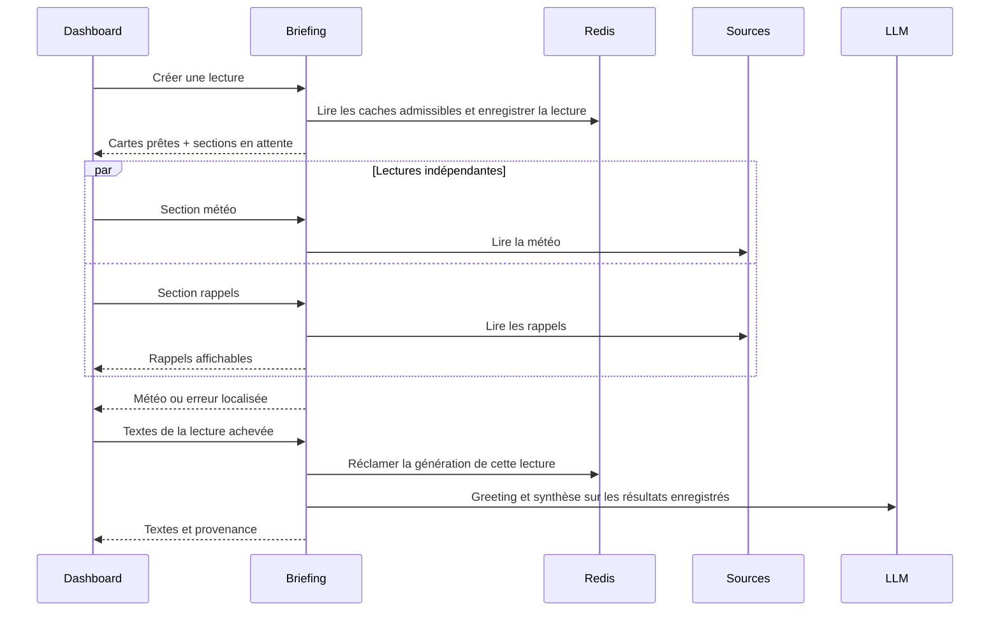

# Dashboard et MCP : analyse systémique des latences

Date : 20 octobre 2026. Statut : analyse préalable, aucun code métier implémenté.

Exécution de ce cadrage strictement inline. Les instructions de `CLAUDE.md`, de
`apps/web/CLAUDE.md` et les changements concurrents du dépôt priment sur les
exemples historiques. Le [plan TDD associé](../plans/2026-10-20-dashboard-mcp-latency.md)
constitue le découpage exécutable de cette proposition.

## 1. Alignement et décisions

L'objectif est de rendre rapidement utilisables le dashboard et le chat, sans
appauvrir les capacités que le routeur connaît, contourner les consentements,
multiplier les lectures externes ou les générations facturées. Afficher une
animation plus tôt ne suffit pas : il faut retirer les dépendances inutiles du
chemin critique et mesurer le délai jusqu'au premier résultat utile.

Les trois demandes sont pertinentes, avec deux précisions : les fetchers du
dashboard sont déjà parallèles mais leur publication attend le plus lent ; le
transport d'exécution d'un outil MCP personnel est déjà ouvert à la demande,
alors que son catalogue est découvert en amont du routage. Ces deux phases MCP
doivent être distinguées.

| Sujet | Décision proposée | Justification |
|---|---|---|
| Dashboard | Publication indépendante par carte, puis synthèse sur les mêmes lectures | Retire la barrière globale et les doubles fetchs observés |
| Orchestration dashboard | Domaine briefing natif, HTTP court et état de lecture éphémère Redis | Réutilise les requêtes authentifiées et la protection de compte existantes ; pas de LangGraph supplémentaire |
| MCP personnels | Préparation parallèle bornée ; catalogue persistant vérifié réutilisable sans réseau | Indépendance des serveurs, capacités toujours connues du routeur |
| MCP à froid | Découverte parallèle bornée avant de figer le catalogue du tour | Sans catalogue connu, découvrir seulement après sélection peut rendre le serveur introuvable |
| MCP partagés au démarrage | Pas de parallélisation mécanique dans ce chantier | Durée de vie des sessions et cancel scopes AnyIO différente du chemin personnel mesuré |
| Avertissement | Notification non modale, informative, sans action de désactivation | **Choix explicite de l'utilisateur : avertissement seul** |
| Configuration des modèles | Aucun changement de modèle ou de reasoning dans ce chantier | Les observations ne les désignent pas comme cause dominante de l'attente initiale |
| Réseau de production | Diagnostic séparé, borné, avant toute correction d'infrastructure | Les délais DNS/TCP sont observés ; leur équipement ou segment responsable reste indéterminé |

Il ne reste pas de décision métier bloquante pour écrire les lots du plan.
Les valeurs nouvelles proposées ci-dessous sont des paramètres d'ingénierie
initiaux à valider par les tests et les mesures, pas des propriétés actuelles.
Ce document n'autorise ni implémentation métier ni déploiement.

Alternatives examinées pour le dashboard :

| Option | Intérêt | Limite et arbitrage |
|---|---|---|
| Garder le bundle, afficher seulement le cache plus tôt | Petit changement, utile à chaud | Ne libère pas les cartes sans cache et ne suffit pas à supprimer la double collecte ; insuffisant seul |
| Flux SSE de cartes puis textes | Une connexion et un snapshot serveur naturellement commun | Faisable, mais impose un cycle de flux/replay/reconnexion spécifique au dashboard et des règles de refresh par carte ; alternative valide, non retenue dans ce plan |
| HTTP par section avec lecture serveur liée | Réutilise les requêtes et lifetimes de compte, refresh et erreur localisés | Plus de petites requêtes et état éphémère à borner ; retenu avec coordination explicite et validation du nombre d'appels |

Le coût de la solution HTTP est assumé : elle n'est pas une simple
parallélisation de `fetch`. Les lots séparent ses contrats, sa coordination et
son rendu pour éviter un framework d'orchestration générique. Si les essais
de charge révèlent un surcoût dominant de ces requêtes sur la cible, comparer
le transport SSE sur les mêmes invariants avant de livrer ; ne pas prétendre
avoir mesuré un avantage de transport durant cette analyse.

## 2. Preuves, provenance et limites

### 2.1 Mesures de production déjà recueillies dans cette conversation

Les mesures datent du 20 octobre, après le démarrage du conteneur API à 15 h 38
heure de Paris. Le conteneur déclaré et le dépôt local avaient le commit
`89d10bc97c3e2776c6a0b450976b2c9b136da2a7`. Les fichiers déterminants ont été
comparés par empreinte ; les configurations LLM effectives ont été lues dans la
base et les valeurs par défaut **du conteneur**, pas déduites du dépôt local.
Ce sont des observations datées, pas une garantie sur un état ultérieur.

| Observation | Conséquence démontrée | Ce qu'elle ne démontre pas |
|---|---|---|
| Sur neuf tours terminés, délai avant graphe de 0,51 à 125,39 s ; premier texte de 11,08 à 152 s | L'attente existe avant les appels du graphe ; environ 62 % de la somme des délais au premier texte se situe avant le routeur | Distribution générale de tous les utilisateurs ou performance navigateur |
| Routeur démarré 95 à 184 ms après `user_mcp_session_ready` | La préparation MCP est sur le chemin critique de ces tours | Que chaque seconde avant graphe est exclusivement imputable au transport MCP |
| Météo médiane 17,111 s, maximum 24,200 s ; mails médiane 8,762 s | Des sources de cartes externes dominent la construction du bundle | Que toutes les cartes sont lentes : rappels et workboard étaient beaucoup plus rapides |
| Deuxième collecte lancée après environ dix secondes pendant que la première météo attendait encore ; synthèse totale autour de 33 s sur cet exemple | La coordination ne garantit pas une seule lecture lorsque l'attente dépasse son budget | Que toutes les requêtes sont systématiquement dupliquées |
| 43 reprises de connecteurs : 41 `ConnectTimeout`, deux `ReadTimeout` | Les reprises de connexion amplifient la latence | Des reprises LLM : ce compteur concerne les connecteurs |
| DNS et connexion sortante de plusieurs secondes, TLS ensuite rapide sur certains sondages | Un problème réseau contribue aux délais applicatifs | Une panne prouvée du Wi-Fi, d'IPv6 ou d'un équipement particulier |
| Pas de verrou PostgreSQL ni attente de pool à l'instant sondé | Pas de preuve de saturation DB sur cet instant | Absence de saturation historique ou future |

Dans l'échantillon LLM observé : analyseur moyen 2,246 s, agent ReAct moyen
4,264 s, réponse moyenne 5,981 s. Un autre appel plus ancien a été beaucoup plus
lent ; un modèle peut donc contribuer ponctuellement. La configuration briefing
et son timeout doivent être conservés dans l'instrumentation. Changer les modèles
ne corrigerait ni les connexions séquentielles MCP ni les collectes dupliquées.

Les fichiers de preuve locaux sont conservés dans
`.tmp/prod-latency-20261020/`, dont `rapport-root-cause.md`. Ils sont des artefacts
de diagnostic ignorés par Git, pas une dépendance d'exécution ou une archive
publique. Les sondages étaient bornés, non authentifiés ; aucun benchmark de
génération payant n'a été lancé pour cette étude.

### 2.2 Contrats relus dans le code courant

| Contrat réel | Source et limite vérifiée |
|---|---|
| `/cards` attend toutes les sections ; `/synthesis` peut reconstruire les cartes manquantes | `domains/briefing/router.py`, `BriefingService._gather_cards`, `build_text` |
| `/refresh-cards` reconstruit un bundle, même pour une section demandée | `router.py`, `service.py:build_cards` ; ne pas le considérer comme une lecture réellement isolée |
| Coordination locale protégée de l'annulation d'un waiter ; coordination Redis avec attente finie puis reconstruction possible | `infrastructure/utils/single_flight.py`, `shared_flight.py` ; ni résultat d'erreur durable par lecture, ni garantie d'unicité des générations |
| Plan canonique des sections, règles cachées, TTL et fallback déjà présents | `BriefingService._build_plan`, `_section`, `constants.py` ; les réutiliser |
| Absence de cache représentée par des placeholders dans un lecteur interne | `cached_cards.py` ; ces placeholders ne prouvent pas `NOT_CONFIGURED` à l'écran |
| Provenance cache en partie déduite de l'âge de génération | `cache_state.py`, `_fetch_and_map` ; l'horodatage est posé avant l'attente externe, donc âge et provenance ne sont pas équivalents |
| Rappels/workboard toujours relus ; SMS toujours vivant | `constants.py`, `_build_plan`, `sms_context.py` ; pas de bootstrap aveugle de ces cartes depuis Redis |
| Protection contre réponses d'un autre compte, révisions, mutations pendant les lectures et barrières SMS | `useApplicationAccountQuery.ts`, `useBriefing.ts`, `application-resources.ts` ; conserver ces protections |
| Préparation séquentielle des MCP personnels avant graphe | `agents/api/service.py`, `infrastructure/mcp/user_context.py:setup_user_mcp_tools` |
| Pool MCP personnel local au worker ; découverte et appel éphémères distincts | `user_pool.py:get_or_connect`, `_discover_tools`, `call_tool`, `read_resource` ; le TTL de découverte est distinct de l'éviction d'inactivité |
| Catalogue persistant existant mais insuffisant pour une réutilisation sûre automatique | `user_mcp/models.py`, `service.py`, `projection.py` ; absence de preuve complète de fraîcheur/configuration, anciens formats liste et dictionnaire |
| Embeddings réutilisables et LRU float32 ; calcul parfois attendu dans le tour | `user_context.py:_usable_tool_embeddings`, `tool_vectors.py` ; ne pas remplacer par un recalcul systématique |
| Catalogue du tour figé une fois pour routeur/planner/ReAct/autres lecteurs | `agents/services/turn_catalogue.py` ; pas de publication partielle changeant pendant le tour |
| Autorisations, OAuth, HITL et noms MCP déjà contractualisés | `shared_access.py`, `personal_state.py`, `oauth_refresh.py`, `registration.py`, adaptateurs et tests des arguments réservés |
| Événements SSE non terminaux, replay et notifications déjà présents | `agents/api/schemas.py`, `background_runner.py`, `sse-handlers/handlers.ts` ; le canal actuel démarre trop tard pour signaler toute la préparation |

Les chemins backend de ce tableau sont relatifs à `apps/api/src/`, les chemins
frontend à `apps/web/src/`. Le plan donne les fichiers nouveaux explicitement.

## 3. Dashboard : parcours cible et contrats

### Correction d'attribution après revue du code non commité

La relecture demandée par l'utilisateur a identifié une régression précise,
effectivement déployée : `_published_bundle` demande désormais les aperçus SMS
à chaque vérification inter-workers, y compris lorsqu'une autre section est
encore absente. Cette lecture peut résoudre les noms auprès des contacts.
Le même chemin dans HEAD ne lisait que les métadonnées SMS. Une reproduction
A/B exécutant les méthodes réelles avec ports factices confirme six lectures
d'aperçus pour six vérifications, contre zéro dans HEAD ; ce n'est pas un
benchmark de latence réelle. Il faut corriger ce surcoût avant de justifier
une refonte par les seuls délais observés.

Les empreintes relues en production prouvent la présence de plusieurs fichiers
non commités, malgré le commit déclaré par l'image. Les chemins de préparation
MCP avant graphe, fetchers et transports OAuth/météo sont, eux, ceux de HEAD.
Le détail et les preuves sont conservés dans
`.tmp/prod-latency-20261020/rapport-attribution-non-commite.md`. Le lot 00 bis
du plan place ce correctif ciblé avant les optimisations structurelles.

### 3.1 Chargement progressif sans seconde collecte pour la synthèse

1. L'authentification utilise une session courte ; charger les préférences et les
   preuves d'éligibilité natives. Aucune connexion de fournisseur pour déterminer
   si une carte est autorisée. Une carte masquée ne déclenche aucun fetch.
2. Créer une lecture éphémère identifiée, renvoyer les cartes en cache encore
   valides **pour ce contexte et ces autorisations**, et la liste des sections à
   lire. Un cache absent devient `pending`, jamais un faux `NOT_CONFIGURED`.
3. Le navigateur demande les sections manquantes indépendamment. Chaque réponse
   remplit uniquement son emplacement. Une météo bloquée n'empêche ni les rappels,
   ni les mails déjà prêts, ni les accès rapides/radio d'être utilisables.
4. Une fois les sections arrivées à un état terminal, demander les textes sur
   cette même lecture serveur. Aucun payload arbitraire de cartes venant du
   navigateur n'est accepté comme contexte LLM. Aucun nouveau fetch global.
5. Une génération au plus par clé de textes : un greeting et une synthèse au
   maximum selon les règles actuelles. Une section en erreur est explicitement
   indisponible ; son absence ne devient pas une affirmation qu'il n'y a rien.

La synthèse attend les seules sections autorisées prévues par cette lecture,
avec le timeout existant de chaque fournisseur et un résultat terminal sur
échec. Un cache acceptable permet d'afficher une carte immédiatement ; un
rafraîchissement explicite relit seulement la section concernée. V1 ne génère
pas automatiquement une synthèse partielle puis une seconde complète : cela
modifierait le coût et la cohérence du texte sans nécessité métier.

### 3.2 API additive proposée

Les routes existantes gardent leur contrat pour les autres consommateurs. Les
nouvelles routes restent dans le bounded context briefing et sous
`PrivateApplicationInputRoute`, authentification, validation et `no-store`.

| Route proposée | Entrée | Sortie et invariants |
|---|---|---|
| `POST /briefing/loads` | UUID d'idempotence client, scope `normal`, `all` ou section précise | `BriefingLoad`: identifiant opaque, expiration, ordre, `context_revision`, cartes admissibles, états par section ; aucune lecture fournisseur ni génération |
| `GET /briefing/loads/{id}/sections/{section}` | Propriétaire authentifié, nom de la déclaration canonique | `SectionReadResult` terminal ou `202` avec `Retry-After` ; lit exactement cette section, partage l'opération en cours et son résultat, y compris l'erreur |
| `POST /briefing/loads/{id}/text` | Identifiant de lecture et révision attendue | Texte réutilisé/généré, ou `409` si collecte non terminée/contexte périmé ; aucune reconstruction implicite du bundle |

Les schemas comprennent deux dimensions distinctes : état de chargement
`pending/running/settled` et contenu `CardSection` utilisant les statuts natifs.
Un `settled` en erreur est terminal pour cette tentative. Le client effectue au
plus trois reprises de consultation d'une opération déjà en cours, avec le
`Retry-After` borné ; ensuite il affiche l'attente et propose une nouvelle
tentative explicite. Ces consultations ne relancent jamais le fournisseur.
L'expiration retourne `410`, un mauvais propriétaire `404`, une révision
dépassée `409` et un stockage indisponible `503` avec information utilisateur.

Une nouvelle tentative explicite crée une nouvelle lecture ; elle ne transforme
pas une erreur terminale précédente en une boucle sans fin. Pour un refresh de
section, les autres cartes restent affichées et leurs requêtes ne sont pas
réémises. Les réponses tardives de l'ancienne lecture ne peuvent plus écraser
la nouvelle révision du front ou le cache serveur récent.

### 3.3 Identité, stockage et concurrence

- État Redis éphémère, classé dans les familles natives de clés, lié au compte,
  jamais une table de conversations. Valeurs initiales proposées : expiration
  de dix minutes après création, quatre lectures actives par compte. Une
  nouvelle lecture n'expulse pas une opération facturée en cours : répondre
  explicitement à la limite et réutiliser la lecture active admissible.
  Limiter aussi les manifestes terminés retenus : proposition de seize
  manifestes au total par compte, éviction des plus anciens terminés seulement.
  Une lecture évincée retourne `410`, sans relance facturée automatique.
  Les résultats partagés et les tombstones d'issue inconnue ont leurs propres
  bornes ; l'éviction d'un manifeste ne libère jamais un claim en cours.
- Le manifeste garde les références de résultats de section, pas une copie de
  tous les payloads dans une seule grande valeur. Chaque payload conserve les
  bornes des schemas natifs ; appliquer une limite de sérialisation configurée,
  validée sur les fixtures maximales. Un dépassement produit une erreur locale
  typée ; aucune troncature aveugle d'objet métier ou de schéma.
- Le contexte inclut propriétaire, langue, fuseau, jour local, préférences,
  sources actives, paramètres de localisation, consentements et révisions
  disponibles. Les fenêtres temporelles sont figées à la création. Un
  changement affectant ces données invalide la réutilisation ; le client
  crée une lecture neuve. Le texte fige en plus les versions de prompts,
  la configuration effective du slot et ses paramètres pertinents.
- Les caches de section existants doivent acquérir une enveloppe de version et
  un témoin de contexte ; les anciens caches sans preuve deviennent des miss.
  Une date récente seule ne prouve ni l'éligibilité ni la bonne localisation.
  L'autorité des droits reste une lecture native fraîche, pas Redis.
  Tous leurs lecteurs et writers, y compris les anciennes routes et les
  surfaces sélectionnées, passent par le même codec et le même contrôle de
  publication. Une conversion limitée aux nouvelles routes serait incomplète.
- Réutiliser `run_single_flight` localement. Pour la coordination inter-workers,
  réutiliser les primitives d'ownership Redis avec résultat publié et contrôle
  du token à la publication. Ne pas changer globalement `shared_flight` : son
  fallback « reconstruire après attente » reste utile à d'autres lecteurs mais
  ne convient pas à cette génération payante.
- Une génération de source monotone, réservée atomiquement avant un refresh ou
  une invalidation push, interdit à un ancien writer de republier son résultat.
  Les lecteurs de cache et les invalidateurs partagent le même constructeur de
  clé. Les erreurs sont mémorisées seulement pour la tentative, sans remplacer
  un last-good par une erreur. Le fallback last-good reste réservé à un échec
  vivant, avec statut et âge visibles.
- Les quotas d'appels source ne sont pas remis à zéro par un nouveau `load_id` :
  single-flight et cooldown de section sont indexés aussi par compte, contexte,
  section et génération de source. Un refresh forcé simultané est coalescé.
  Les lectures locales rapides ne passent pas derrière une file réseau externe.
- La clé d'une génération de textes est une empreinte canonique du contenu utile,
  des preuves de source, des fenêtres, du contexte personnel pertinent et de la
  configuration LLM ; elle n'est pas uniquement le `load_id`. Deux onglets sur
  un état équivalent partagent la génération. Les horodatages de transport ne
  créent pas artificiellement une nouvelle intention. Un refresh explicite de
  texte réserve une nouvelle génération sans annuler une tentative facturée.

### 3.4 Confidentialité et changements pendant le chargement

Le cache ne constitue jamais un droit d'accès. Factoriser les règles natives
d'éligibilité des fetchers pour qu'elles servent aussi au bootstrap, sans créer
un second registre de politiques. Vérifier les règles à la lecture puis avant
publication. Les révocations, suppressions et changements de compte invalident
immédiatement les résultats en vol et le texte affiché concerné.

Cas SMS : la carte personnelle peut être lisible alors que son emploi par le
modèle ne l'est pas. Conserver `sms_card_current`, les preuves de source et les
contrôles avant/après génération de `sms_for_prompt`. **Ni corps SMS ni preuve
interne ne sont copiés dans le stockage générique des lectures**. Le résultat
SMS est rendu directement avec les contrôles natifs ; le manifeste n'en garde
que l'état et le témoin non sensible nécessaire. Lors de la génération, utiliser
un snapshot éphémère via l'API SMS native, avec les mêmes bornes et témoins, puis
le revérifier avant restitution. Une nouvelle extraction incompatible impose
une nouvelle lecture, pas l'emploi silencieux d'autres messages.

Un texte peut lui-même révéler une donnée révoquée. Un résultat ayant utilisé
les SMS ne rejoint donc pas le cache générique de textes : son stockage et sa
restitution éphémères sont possédés par le domaine SMS, sous les mêmes témoins
et contrôles de consentement. Cette petite porte spécialisée permet aux
waiters inter-workers de recevoir la génération commune sans recopier les
sources SMS dans les lectures génériques. Elle stocke seulement le résultat
nécessaire, jamais les messages source, et vérifie la preuve fraîche à chaque
restitution ; invalidation et purge rejoignent les chemins natifs SMS. Le
résultat peut lui-même citer une donnée sensible et est classé en conséquence.
Un résultat terminé n'est pas régénéré automatiquement sur retry : si sa
restitution sûre n'est plus possible, renvoyer `expired/explicit_retry_required`.
Les textes sans source sensible requérant cette restriction peuvent être
conservés pour la durée de la lecture, avec contrôle frais des droits au retour.
Ne pas mettre de données du dashboard dans `localStorage`, un service worker ou
un cache public. La déconnexion détruit l'état mémoire du compte côté client.

Les notifications de modification ordinaires marquent la synthèse datée ; elles
ne déclenchent pas une nouvelle facturation. Une modification de confidentialité
efface immédiatement le texte concerné et arrête sa lecture TTS. La TTS reste
liée au texte effectivement visible et à sa révision, jamais à un texte voisin.

### 3.5 Coûts, tokens et défaillance de coordination

Le découpage HTTP ne doit pas faire disparaître la comptabilité des lectures.
Aujourd'hui `build_cards` ouvre `consultation_collector` et
`out_of_turn_spend` autour de l'owner : appeler seulement `_section` ferait
perdre cette enveloppe. La lecture progressive réserve un `read_act_id` commun
dans son manifeste ; chaque owner de section ouvre ces portes avec cet acte,
les waiters et cache hits n'enregistrent pas de consultation supplémentaire.
L'addition des dépenses de sections concurrentes utilise le suivi natif par
tentative physique et son UPSERT additif, à éprouver sur PostgreSQL réel.

La décision associée aux lectures reste unique, via la porte native
`record_decision_once` : une livraison terminale ayant effectivement consulté
une source peut la déposer ; les suivantes ne simulent pas des reprises HITL
en incrémentant `segments`. Les événements de sections gardent leurs durées et
résultats ; la durée complète de page vient de la mesure de parcours, pas de
la première décision déposée. Si deux lectures partagent une source en vol,
la consultation appartient à son owner et les autres en référencent la
provenance. La génération des textes conserve son acte natif distinct et sa
vérification SMS ; elle ne fabrique pas une seconde collecte de connecteurs.
Les écritures connues survivent à l'annulation avec les helpers existants.

`briefing/llm.py` reste l'unique porte LLM : `spend_blocked`, quotas compte et
plateforme, capture des tokens et du coût connu sur échec/annulation, snapshot
tarifaire et suivi des consultations sont conservés. Seul l'owner de l'opération
facture la tentative physique. Un waiter ou l'affichage d'un cache ne crée pas
une seconde dépense ; `usage` décrit la génération originale avec `reused`.

Figer réellement la configuration, pas seulement son nom dans la clé : une
copie du `LLMAgentConfig` effectif est passée à la porte existante
`get_llm(..., config_override=...)`. Les deux textes utilisent le même snapshot
de personnalité et d'horloge locale ; leurs prompts restent les fichiers
versionnés. Les anciens appelants sans snapshot conservent leur comportement.
Si le jour local ou les permissions ont changé depuis la lecture des cartes,
le contexte est périmé avant envoi, pas corrigé en mélangeant deux journées.
La capture du coût conserve le modèle réellement déclaré par le fournisseur.

Conserver les projections compactes de `prompt_cards.py` et ajouter un budget
total local tenant compte de la fenêtre effective du slot, du système, de la
personnalité, du budget de sortie et d'une marge. Réduire par éléments entiers
avec couverture explicite des sections omises, pas en coupant du JSON. Utiliser
`count_external_tokens` local ; aucun compteur SDK synchrone distant sur le
chemin asynchrone. Les contenus externes restent non fiables et encapsulés.

La réclamation Redis renouvelable n'est pas une garantie « exactement une
fois » chez un fournisseur. Si un owner meurt, perd son bail ou reçoit un
timeout après envoi LLM, l'issue peut être inconnue : résultat `uncertain`,
comptabilisation de ce qui est connu, aucune génération automatique par un
autre worker. Le retry explicite porte une nouvelle intention et prévient
qu'une première tentative a pu être facturée. Si Redis est indisponible avant
réclamation, ne pas lancer de génération ; le dashboard conserve ses cartes
visibles et son greeting local de secours. Aucun fallback automatique vers une
double collecte historique ou une génération non coordonnée.

## 4. MCP : préparer en parallèle sans modifier les capacités

### 4.1 Cycle de vie proposé

Le chemin personnel est découpé en quatre opérations explicites :

1. Lire en transaction courte les serveurs admissibles du compte et leurs
   configurations ; réserver les préfixes déterministes dans le parent.
2. Préparer indépendamment chaque serveur : catalogue persistant valide ou
   découverte bornée, puis embeddings admissibles. Les enfants renvoient des
   résultats typés ; aucun n'installe le `ContextVar` global du tour.
3. Assembler dans le parent, dans l'ordre stable initial, les outils/manifests,
   les références et les erreurs. Installer une seule fois le contexte et figer
   le catalogue du tour. Nettoyer le token dans le même parent en `finally`.
4. À l'exécution d'un outil ou d'une ressource, revérifier les droits et la
   configuration ; ouvrir le transport uniquement pour l'appel requis.

Limiter initialement à **quatre préparations réseau simultanées par processus**,
avec un sémaphore commun au pool, pas un sémaphore neuf par requête. Ce n'est
pas une limite globale de quatre : plusieurs workers peuvent préparer des
serveurs différents simultanément. Ajouter une réclamation inter-workers par
compte/serveur/configuration pour partager une découverte et son résultat.
Redis indisponible : borne locale maintenue, pas de garantie de déduplication
inter-workers ; réutiliser les caches admissibles et éviter tout recalcul
d'embeddings payant non coordonné. Respecter les rate limits natifs.

Un serveur en erreur ne doit pas annuler les autres. Une annulation du tour
ferme les transports et les tâches propriétaires ; un simple waiter annulé ne
détruit pas une préparation partagée encore attendue ailleurs. Aucun
`AsyncSession` n'est partagé entre enfants ni gardé ouvert pendant le réseau.
Le service chat doit aussi terminer sa transaction préparatoire avant cette
attente ; vérifier la composition et les écritures de conversation avant de
placer la frontière de commit. Ce risque de rétention est démontré par le
scope du code, pas par une saturation DB mesurée en production.

### 4.2 Catalogue persistant réutilisable

Réutiliser `UserMCPServer.discovered_tools_cache` avec une enveloppe JSONB
versionnée et un parseur unique. Il n'est pas nécessaire de créer une autre
table pour ce catalogue. Les projections UI et `generate_description` doivent
comprendre l'enveloppe tout en lisant les anciens formats.

L'enveloppe porte : version, instant de découverte UTC, empreinte de
configuration, empreinte de catalogue, outils normalisés, référence éventuelle
et métadonnées nécessaires à sa validation. L'empreinte de configuration
réutilise `catalogue_fingerprint.py` : URL, identité d'authentification, headers,
timeout et paramètres pertinents. Elle ne stocke jamais le secret en clair.
Le renouvellement normal d'un access token OAuth ne rend pas le catalogue
différent ; changer serveur, compte OAuth, scopes, credentials statiques ou
capacité d'authentification impose une revalidation.

L'empreinte de transport n'est pas une preuve complète de politique. Conserver
séparément un témoin runtime couvrant activation, statut, droit effectif,
mode itératif et politique HITL. Un changement de politique entre sélection,
approbation et exécution impose un refus/recalcul explicite même si l'URL et
les outils n'ont pas changé. Le digest complet des commandes de gestion reste
leur contrat CAS ; ne pas le remplacer par l'empreinte réduite du transport.

Validité : format et tailles conformes aux bornes natives, configuration
identique, âge inférieur au TTL de découverte configuré, serveur toujours
admissible. Un ancien cache sans ces preuves est un miss. Un statut `ERROR`,
`AUTH_REQUIRED`, une désactivation ou une permission retirée ne redeviennent
pas actifs parce qu'un cache contient encore des outils. Une publication
arrivée après modification/suppression du serveur est refusée par CAS.

Hydrater les métadonnées du pool sans réseau à partir du catalogue valide ;
sinon `call_tool` ne pourrait pas utiliser son transport éphémère car il exige
une entrée du pool. Conserver `output_schema`, annotations, titres, visibilité
MCP Apps, URI, alias d'arguments et préfixes. Ne pas substituer une chaîne de
description à un schéma typé complet. Les données persistées restent externes
et non fiables ; aucune annotation ne peut diminuer le niveau HITL.

Le cache d'embeddings garde son modèle, son empreinte de catalogue et son LRU
float32. Coalescer un calcul manquant ; réutiliser les contrôles de coût/quota de
`connection_embeddings.py` au lieu d'ajouter un calcul non suivi. Une absence
d'embeddings doit garder le fallback de pertinence existant explicitement
testé, sans supprimer les outils du registre. Ne pas appeler `test_connection`
depuis le chat : il peut aussi produire une description avec un LLM.

### 4.3 Pourquoi le lazy intégral n'est pas retenu en V1

Le routeur doit connaître les capacités pour sélectionner un MCP. Avec un
catalogue valide, aucune découverte réseau n'est nécessaire pour ce tour et
un serveur inutilisé n'est pas contacté. À froid ou après expiration, sans
capacités vérifiées, reporter toute découverte après sélection crée une
dépendance circulaire. Deviner les domaines depuis le nom du serveur ou
proposer uniquement les serveurs déjà chauds diminuerait les capacités.

V1 garde donc une découverte à froid parallèle et bornée par le timeout
configuré de chaque serveur. Un avertissement doux ne devient pas un timeout
caché. Les timeouts d'appels d'outils ne sont pas raccourcis. Une future
stratégie de routage en deux phases serait un autre chantier avec replanning,
mesure de qualité et coûts propres. Le démarrage des MCP partagés reste
séparé : leurs sessions persistantes et `AsyncExitStack` imposent de conserver
un propriétaire de tâche pour l'ouverture et la fermeture des cancel scopes.

### 4.4 Autorisations et intégrité du tour

- Ajouter un contrôle runtime personnel frais, distinct du droit de gérer les
  applications : propriétaire, activation, statut, capacité et configuration.
  Ne pas réutiliser aveuglément une garde d'administration pour l'exécution.
- Garder le contrôle frais des MCP partagés, l'opt-out personnel et les CAS des
  commandes natives ; aucune modification globale d'un serveur partagé.
- Respecter les protections OAuth et le renouvellement sous verrou existants,
  les pauses après échec, `Retry-After` et leur portée compte/serveur.
- Figer le catalogue du tour ; si configuration/droits changent avant exécution,
  refuser l'appel avec un résultat structuré. Ne pas exécuter un schéma différent
  sous une ancienne approbation et ne pas relancer une mutation automatiquement.
- Préserver pipeline, ReAct, itératif, MCP Apps, `read_resource`, composition de
  cartes, initiatives et sous-agents **de l'application**. L'interdiction de
  sous-agents pour cette étude ne supprime pas les fonctions du produit.
- Une réponse tardive ou un timeout d'une mutation peut avoir un résultat
  inconnu chez le fournisseur. Pas de retry automatique d'écriture, pas de
  promesse que l'outil n'a rien fait parce que le transport a expiré.
- Aucun état de progression n'entre dans `MessagesState`, les messages,
  la mémoire personnelle ou les embeddings conversationnels.
- Une révocation bloque les appels suivants et la restitution de données
  concernées ; elle ne peut pas annuler avec certitude un effet déjà accepté
  par un serveur distant. Le contrôle frais est placé avant l'envoi, sans
  verrou DB maintenu sur la durée du réseau.

## 5. Avertissement utilisateur

### 5.1 Déclenchement et contenu

Paramètre initial proposé : avertir après dix secondes de préparation d'un MCP
sur le chemin critique d'une demande interactive. Mesurer l'attente réelle de
ce serveur, y compris une préparation partagée attendue, sans lui attribuer une
simple attente dans le sémaphore comme une connexion réseau déjà commencée.
L'événement distingue `queued`, `discovering`, `embeddings`, `ready`, `failed`.
Une initialisation rapide, un cache valide ou un travail de fond autonome ne
produisent pas cet avertissement.

Texte de principe, décliné dans les langues du produit :

> Le serveur MCP « XXX » met du temps à se préparer et retarde le démarrage de
> la réponse. Le désactiver temporairement dans les réglages peut réduire cette
> attente. Les outils qu'il fournit ne seront alors plus disponibles.

« Peut réduire » est volontaire : un autre serveur, le réseau ou le modèle
peut aussi ralentir le tour. Le produit ne garantit pas une résolution complète
par désactivation. **Aucun bouton de désactivation ou de suspension**, aucune
table, durée automatique, relance ou commande applicative n'est ajoutée.
Le toast peut être fermé comme les notifications existantes.

### 5.2 Transport et ergonomie

Réutiliser l'enveloppe SSE `execution_step` avec métadonnées typées, par exemple
`step_type=mcp_initialization`, `run_id`, identifiant du serveur, nom public,
phase, durée et révision. Ne pas utiliser `error`, qui signifie une fin de flux.
Créer la file et son producteur avant la préparation MCP puis intercaler les
événements pendant l'attente ; envoyer l'information seulement après `await
setup_user_mcp_tools()` arriverait trop tard. Le producteur de background runs
publie ces chunks comme les autres, y compris avant les premiers événements du
graphe. Son annulation et son heartbeat gardent leur comportement.

Le handler suit le précédent de la notification de compaction et des notices
de connecteur : identifiant stable par tour/serveur, mise à jour au retour à la
normale ou à l'échec, pas de nouveau toast à chaque chunk/replay. Pas de popup
historique au chargement d'une conversation ni de push pour une routine sans
personne en attente. Les autres canaux peuvent consommer l'état technique sans
recevoir un texte de progression dans la réponse finale.

Utiliser le toaster Sonner existant : notification non modale, fermeture
accessible, annonce `aria-live=polite` une fois par changement pertinent, pas
de vol du focus ni de répétition permanente. Grouper les serveurs lents au-delà
de la capacité visible du toaster. Nom rendu comme texte échappé, borné pour
l'affichage ; ni URL, header, credential, réponse serveur ou détail OAuth.
Vérifier écran étroit, safe areas, clavier, lecteur d'écran, zoom, mouvement
réduit, thèmes et contraste. Les boutons de refresh de carte conservent leur
focus et leur garde `aria-disabled` pendant l'attente.

## 6. Cartographie des impacts et risques

| Périmètre | Impact direct/indirect | Régression possible | Mesure de maîtrise |
|---|---|---|---|
| API briefing | Routes additives, sessions courtes, schemas de lecture | Confondre manque de données et absence de configuration | État de chargement séparé et validation exhaustive de la déclaration des sections |
| Fetchers | Lecture isolée, politique native réutilisée | Changer les cartes ou perdre une source | Même `_build_plan`, mêmes normalizers, tests des paramètres utilisateur |
| Caches | Enveloppes versionnées, révisions de source, ownership | Ancien writer après invalidation ; cache autre contexte | CAS publication, témoins, refus des anciens formats non prouvés |
| Redis | Résultats éphémères et claims | Duplications après timeout, fuite mémoire | TTL, bornes, résultat terminal, pas de fallback payant automatique |
| PostgreSQL | Nouveau format JSONB MCP, transactions écourtées | Session partagée, overwrite de configuration | Parseur/version/CAS, vraies sessions séparées, test multi-workers |
| Schéma DB | Pas de nouvelle table attendue | Migration inutile ou statut incohérent | Réutiliser la colonne catalogue, aucun mécanisme de suspension |
| SMS et consentements | Preuves vivantes, texte potentiellement sensible | Fuite après révocation, consentement modèle confondu avec lecture personnelle | Contrôles natifs avant/après, pas de corps dans le stockage de lecture, effacement front/TTS |
| Autres connecteurs | Cache bootstrap et fetch vivant | Afficher une donnée déconnectée | Éligibilité fraîche issue des mêmes règles, checks avant publication |
| Coûts plateforme | Générations et embeddings coalescés | Facturation répétée, quota ignoré, dépenses perdues sur annulation | Owner unique connu, capture par tentative physique, traitement explicite des issues inconnues |
| Prompts | Budget total de synthèse | Couper une donnée ou faire croire à une collecte complète | Projection par éléments, couverture explicite et fenêtre du slot |
| MCP runtime | Préparation parallèle et catalogue froid/chaud | Perte de `ContextVar`, collisions, ordre instable | Enfants sans mutation de contexte, assemblage parent déterministe |
| MCP auth/outils | Réutilisation hors connexion | Cache périmé contourne OAuth/HITL/droits | Garde runtime fraîche, CAS et fingerprint ; aucune confiance accrue dans les annotations |
| SSE/background | Notices avant graphe | Notice tardive, terminale, replay répété ou annulation cassée | Tests producteur réel, type non terminal, ID stable et nettoyage |
| Front | Cartes indépendantes et notices | Ancien compte/révision réapparaît ; focus perdu | Lifetimes existants, IDs de lecture, tests de course et accessibilité |
| Préférences | Masquage, réordonnancement, cartes ajoutées | Synthèse avec une carte masquée entre deux appels | Révision du contexte, annulation logique et nouvelle lecture |
| Registres | Catalogue tour, familles Redis, clés/projections | Nouvelle vérité parallèle ou cache non purgé | Une seule déclaration par contrat, classification/export/purge explicites |
| Mémoire applicative | Pool/LRU/catalogues + lectures Redis | Multiplication des objets par worker, références sans borne | Schémas bornés, TTL, éviction active-safe, mesures RSS et taille JSON |
| Exploitation | Nouvelles mesures par phase | UUID/noms en labels à forte cardinalité ou secrets | Labels bornés, identifiants seulement dans logs techniques assainis |
| Réseau | Latence sortante persistante | Faire croire que le parallélisme répare le réseau | Mesure séparée DNS/TCP/TLS et comparaison après changements autorisés |

Priorisation des risques de la solution, avant mitigation :

| Risque | Gravité | Exposition plausible | Gate avant livraison |
|---|---|---|---|
| Donnée restituée après révocation/changement de compte | Critique | Courses réalistes de lecture et de cache | D07/D08/M08, aucune tolérance de fuite |
| Mutation MCP sous une politique/approbation ancienne | Critique | Modification de configuration pendant le tour | M04/M08, refus frais sur toutes les portes |
| Nouvelle génération après perte de bail/timeout | Élevée | Crash, coupure Redis et retries client | D04/D09, résultat inconnu sans reprise implicite |
| Outils perdus ou contexte MCP installé dans un enfant | Élevée | Refactor asyncio et cache ancien | M01/M02/M03/M07, parité de catalogue |
| Ancien résultat republié après invalidation | Élevée | Push, refresh et changement de préférences | D05/D06, contrôle à la publication et au rendu |
| Saturation après parallélisation | Élevée | Plusieurs workers et comptes simultanés | M01/M05/M09/X02, bornes effectives et charge contrôlée |
| Notice répétée ou premier contenu mal mesuré | Modérée | Replay, reconnexion, tâches autonomes | N01–N04, horloge et producteur réels |

Ces expositions ne sont pas des probabilités chiffrées mesurées ; elles fixent
la priorité des contrôles selon les mécanismes de course identifiés.

Optimisations adjacentes justifiées : la météo attend actuellement ses
enrichissements air/pollen avant d'autres requêtes ; les rendre indépendants
avec un budget doux permet de conserver la donnée principale si un supplément
échoue. Les détails de mails sont parfois lus séquentiellement lorsque la
source ne fournit que des IDs : mesurer puis borner leur parallélisme selon
le quota fournisseur. Ces optimisations viennent après la publication
progressive ; ne pas ajouter de retries pour masquer un délai de connexion.

## 7. Observabilité et critères d'acceptation

La mesure autoritaire du parcours commence à l'entrée API (`JourneyTiming`),
avant la préparation MCP. Les métriques historiques de streaming démarrant
après cette préparation ne doivent pas servir seules à conclure. Préserver la
garde `a_person_is_waiting` : routine, ticket autonome ou replay ne sont pas un
utilisateur attendant une réponse. Un événement de progression n'est jamais
un premier token utile. Éviter tout double comptage lors d'un HITL/resume.

Mesures : bootstrap dashboard ; première carte utile ; par section, cache/
réseau/erreur/fallback ; collecte complète ; délai texte et tentatives LLM ;
attente de réclamation ; MCP queue/découverte/embeddings/cache ; préparation
totale avant graphe ; premier contenu utile ; répétitions évitées et résultat
incertain. Lier par trace/run, sans nom libre de serveur en label Prometheus.

| Critère | Oracle de validation |
|---|---|
| Carte rapide indépendante | Avec météo tenue par une barrière de test, une carte locale termine et se rend avant libération de la météo |
| Bootstrap chaud | Aucun appel fournisseur/LLM/embeddings ; contenu admissible immédiatement exploitable |
| Une section rafraîchie | Aucun appel aux fetchers des autres sections ; anciennes réponses incapables d'écraser le résultat |
| Synthèse cohérente | Aucun fetch source supplémentaire et au plus la paire LLM native pour l'intention |
| MCP chaud | Catalogue identique, aucun réseau de découverte pour un serveur inutilisé |
| MCP froid | Appels réellement superposés dans la borne, ordre final stable et outils identiques au nominal |
| Avertissement | Émis à l'échéance contrôlée avant graphe ; informatif, sans mutation, sans répétition au replay |
| Droits | Révocation avant restitution interdit carte, outil et texte concernés même si le cache est chaud |
| Dégradation | Une source défaillante n'efface pas les autres résultats ; issue payante inconnue sans retry automatique |

Les seuils de performance sur matériel réel sont des objectifs à mesurer dans
Docker dev puis sur la cible autorisée, pas des garanties de latence internet.
En test contrôlé, une météo bloquée plusieurs dizaines de secondes ne doit pas
retarder la carte locale ; le seuil de notification proposé est dix secondes.
Comparer à charge équivalente, cache froid puis chaud, nouveaux et anciens
processus ; rapporter médiane, queue de distribution et taille d'échantillon.

Livraison future : backend additif avant la bascule du frontend ; rollback
frontend avant retrait des nouvelles routes. Tester la coexistence de formats
cache : un ancien worker qui ne comprend pas une enveloppe doit faire un miss,
pas servir des données incohérentes. Les anciens writers peuvent provoquer des
miss supplémentaires pendant transition ; ce n'est pas une preuve de cache
chaud stable. Les protections de droits requièrent tous les workers de la
version qualifiée. Aucun changement de DNS, de modèle ou de base de production
n'est intégré implicitement à cette séquence.

## 8. Plan directeur de tests

Les IDs ci-dessous servent de traçabilité au plan. Les tests de concurrence
utilisent des barrières/horloges contrôlées et des compteurs d'appels ; des
assertions de durée seule ne prouvent ni parallélisme ni unicité.

| ID | Couverture et simulations | Niveau / oracle |
|---|---|---|
| D01 | Cache froid/chaud, manquant, corrompu, ancienne version, payload trop grand, `EMPTY/ERROR/NOT_CONFIGURED/HIDDEN` | TU schemas/services : état et appels exacts, aucun faux non-configuré |
| D02 | Source lente bloquée, source locale prête, exception, timeout, last-good disponible/absent | TU + front : publication indépendante, fallback après échec seulement |
| D03 | Deux onglets, plusieurs workers, refresh simultané, doublon d'idempotence, erreur terminale | Intégration Redis : un fetch par génération/section, erreurs partagées, refresh ciblé |
| D04 | Bail perdu, expiration, mort d'owner, panne Redis avant/après envoi, réponse fournisseur ambiguë | Intégration + faux LLM : publication clôturée, `uncertain`, pas de seconde génération automatique |
| D05 | Changement de langue/fuseau/localisation, minuit et DST, ordre/masquage, connexion/déconnexion source | TU + intégration : témoin invalide, nouvelles fenêtres, pas de données d'un ancien contexte |
| D06 | Invalidation push/refresh pendant fetch ; ancienne réponse après nouvelle révision | Redis + front : CAS refuse l'ancien writer, l'UI ignore l'ancien `load_id` |
| D07 | Deux comptes, logout/login, onglet inactif/reconnexion, unmount et annulation | Front + API : aucun résultat croisé, nettoyages et messages d'erreur typés |
| D08 | SMS lecture personnelle sans consentement modèle, révocation avant/pendant/après génération, extraction/suppression concurrente | TU + intégration : preuves natives, absence de corps en Redis/log, texte/TTS supprimé à la révocation |
| D09 | Quota compte/plateforme nul, mode sans clé utilisateur, refus fournisseur, usage connu après erreur/annulation | TU LLM + comptabilité : zéro appel si bloqué, une écriture par tentative physique, aucune dépense de waiter |
| D10 | Gros prompts, tokens spéciaux, slot à petite fenêtre, configuration modifiée, texte périmé | TU budget : projection par éléments, marge sortie, usage et couverture honnêtes |
| D11 | Refresh et invalidations de données après synthèse ; lecture audio pendant remplacement | Front + flux : pas de génération automatique, audio exactement lié au texte visible |
| D12 | Enrichissement météo lent/absent, mails IDs seulement, limites/quota fournisseur | TU fetchers : données principales préservées, concurrence bornée et aucun retry supplémentaire |
| M01 | Serveurs indépendants tenus par barrières, file pleine, un échec parmi des succès | TU pool : chevauchement réel, borne par processus, tous les résultats nominaux conservés |
| M02 | Enfants `ContextVar`, préfixes en collision, noms identiques, annulation et cleanup | TU contexte : parent unique, ordre déterministe, aucune fuite au tour suivant |
| M03 | Catalogue liste/dict/null/version inconnue/malformé/trop gros, round-trip JSONB réel | TU + PostgreSQL : parseur unique, miss sûr, champs exacts après persistance |
| M04 | URL/headers/scopes/credentials modifiés, rotation OAuth, suppression pendant découverte | Intégration : fingerprint et CAS corrects, ancien résultat rejeté, refresh OAuth non dupliqué |
| M05 | Plusieurs workers, Redis en panne, embeddings périmés/quota bloqué, pool évincé | Redis + TU : découverte partagée quand possible, fallback borné, pool hydraté sans réseau |
| M06 | Cooldown 429, `Retry-After`, pauses après échec, test manuel et reprise | TU existants + intégration : aucune remise à zéro indue, pas de tempête de connexions |
| M07 | Pipeline/ReAct/itératif/MCP Apps/ressources/composition/initiative/sous-agent produit | Tests de flux : mêmes manifests, annotations, références choisies et contrats d'arguments réservés |
| M08 | Appel approuvé puis permissions/configuration changées, toutes portes d'invocation, mutation timeout | TU + flux HITL : refus frais, jamais de retry d'écriture ni exécution sous une ancienne approbation |
| M09 | Pool plein, outil actif, arrêt/shutdown pendant découverte ou appel | Intégration : pas d'éviction d'un appel actif, fermeture dans la tâche propriétaire |
| N01 | Temps contrôlé avant graphe, cache chaud, serveur juste sous/au-dessus du seuil | TU producteur : événement à l'heure et seulement si demande interactive réellement retardée |
| N02 | Reconnexion SSE, replay, notices multiples, fin normale/erreur, toast fermé | Front + producteur Redis : ID stable, pas de duplication ni d'erreur terminale artificielle |
| N03 | Nom hostile/long/Unicode/RTL, langues du produit, mobile étroit/zoom, clavier/screen reader/thèmes | TU + E2E/axe + revue visuelle Docker : texte échappé, focus conservé, annonce sobre |
| N04 | Voice, canal distant, routine/ticket autonome, HITL/resume, contenu vide puis utile | Flux + métriques : pas de pollution des messages, notices non facturées, TTFT et gating corrects |
| X01 | Transaction DB pendant MCP/fetch/LLM ; deux sessions concurrentes | PostgreSQL : aucune transaction inactive durant le réseau, sessions jamais partagées |
| X02 | Purge/reset/export compte, expiration des clés et anciens caches, volumes par worker | TU registres + Redis : familles déclarées, pas de corps sensibles exportés par inadvertance, mémoire bornée |
| X03 | DNS/TCP/TLS lents simulés, limites de connexion, timeouts natifs | Transport contrôlé : diagnostic attribué à la bonne phase, aucune hypothèse réseau transformée en certitude |
| X04 | Lectures HTTP de sections sur plusieurs workers, attente partagée, cache hit, annulation après lecture et flushs concurrents | PostgreSQL + collecteurs réels : un acte de cartes, consultations seulement pour sources ouvertes, `segments` non multiplié, dépenses additives exactes et clôture survivant à l'annulation |

Les E2E hermétiques vérifient les contrats frontend sans Internet ; les flux
Redis/PostgreSQL utilisent des instances jetables et plusieurs producteurs
réels. Les essais Docker dev valident le streaming proxy et le rendu réel.
Les générations externes et validations de production restent séparées,
bornées et soumises au périmètre expressément autorisé.

Une primitive locale de budget d'appels existe dans `core/read_budget.py`.
Elle est actuellement employée par le gateway de lectures des discussions
proactives ; sa seule présence ne prouve pas une admission distribuée des
appels briefing/MCP. Réutiliser sa mécanique si une borne physique locale est
nécessaire, en testant les vrais funnels concernés, sans l'assimiler aux quotas
fournisseur ou aux plafonds de dépenses plateforme.

## 9. Limites et grille d'auto-évaluation

| Critère demandé | Verdict de l'analyse |
|---|---|
| Périmètre fonctionnel aligné et arbitrages justifiés | Oui ; avertissement seul confirmé, fonctionnement hybride MCP explicité |
| Hypothèses sur l'existant confrontées au code | Oui pour les contrats et chemins listés ; les observations production sont datées et distinguées des propositions |
| Absence de faux positifs majeurs | Lecteurs cache, refresh ciblé, shared-flight et pool ne sont pas assimilés à des garanties qu'ils n'ont pas |
| Tokens/coûts/quotas/clé plateforme | Cadrés : budget local, slot effectif, coût par tentative, états inconnus et absence de refacturation automatique |
| Registres, mémoire, persistance et confidentialité | Cadrés : JSONB versionné, catalogue parent, Redis éphémère, pas d'état de progression en checkpoint, contrôles SMS natifs |
| Responsive/accessibilité/templates | Cadrés sur les composants existants ; validation réelle à effectuer au développement |
| Plan immédiatement exécutable | Oui, lots et tests détaillés dans le document associé ; aucun choix métier ouvert |
| Certitude de robustesse à 100 % avant développement | Non : une analyse ne remplace ni les tests de concurrence, ni le navigateur, ni une preuve sur le réseau cible |

La première tentative de tests existants ciblés avait été interrompue. La
contre-vérification a reproduit un blocage de la socket interne asyncio
Windows sous sandbox avant le probe ; la tentative initiale sans trace reste
non concluante. La relance autorisant cette socket a donné 16 tests SMS/MCP
passés, ainsi que le probe A/B isolé.
Ces résultats ne qualifient pas l'architecture nouvelle ni tous les flux.
Les points restant à prouver sont explicitement attribués : concurrence réelle,
absence de fuite sur révocation, coûts en crash/partition, contraintes du proxy
de streaming et performances sur le matériel cible. Ils ne nécessitent pas de
décision métier, mais conditionnent toute déclaration de correction terminée.

## 10. Références structurantes

- [Briefing natif](../../technical/BRIEFING_DOMAIN.md)
- [Une page, un acte de lecture](../../architecture/ADR-271-One-Page-Load-One-Act-Of-Reading.md)
- [Pas de transaction pendant un appel réseau](../../architecture/ADR-304-No-Transaction-Across-A-Network-Call.md)
- [Familles et purge des clés Redis](../../architecture/ADR-260-Redis-Key-Families-Scope-And-Reset-Purge.md)
- [Invalidation inter-workers](../../architecture/ADR-063-Cross-Worker-Cache-Invalidation.md)
- [Fenêtre de contexte par slot](../../architecture/ADR-278-Per-Slot-Context-Window.md)
- [Catalogue LLM et provenance](../../architecture/ADR-244-LLM-Catalogue-Truth.md)
- [Projection par éléments sous budget](../../architecture/ADR-286-Tool-Result-Projected-Per-Item-Under-A-Token-Budget.md)
- [Disposition des prompts](../../architecture/ADR-309-One-Prompt-Layout-For-Every-Cache-Mechanism.md)
