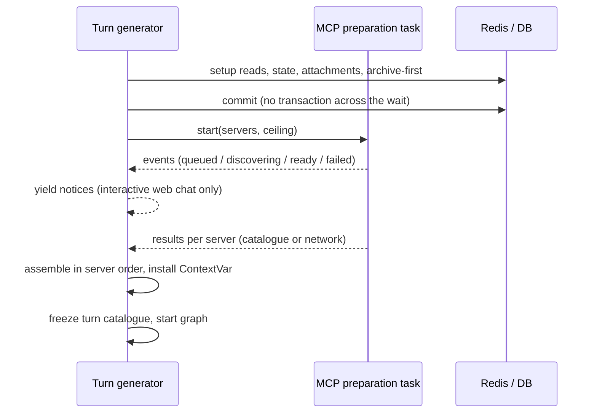

# Chat and dashboard latency — systemic analysis (revision of 2026-10-21)

Date: 21 October 2026. Status: analysis only — no business code written, nothing staged or
committed. Implementation plan: [2026-10-21 plan](../plans/2026-10-21-chat-dashboard-latency.md).

This revision keeps the diagnosis of the
[2026-10-20 study](./2026-10-20-dashboard-mcp-latency-systemic-analysis.md) (a historical document,
left as written) and replaces several of its decisions. §3 lists every change and its reason.

## 0. Method and evidence status

- Every statement about current behaviour cites `file:line` in the working tree of 2026-10-21
  (`main`, HEAD `89d10bc97`, plus ~836 uncommitted changes from concurrent work — some of them in
  files this programme touches, see §6.5). Backend paths are relative to `apps/api/src/`, frontend
  paths to `apps/web/src/`, unless written from the repository root.
- Everything was verified inline by reading code. Two sub-agent reports used earlier the same day
  were re-verified line by line. One implication they suggested — a process-wide shared HTTP client
  for weather — is wrong (§2.4).
- Production evidence: the read-only probes of 2026-10-20 kept in `.tmp/prod-latency-20261020/`
  (gitignored): `rapport-root-cause.md`, `dns.jsonl`, `dns-servers.jsonl`, `transport.jsonl`,
  `details.jsonl`. They are dated observations, not guarantees.
- Reasoning is by **mechanism and slot**, never by model or provider: every LLM slot is
  configurable and the models are interchangeable (owner rule). No decision below depends on which
  model a slot runs.
- **Unverified** items are named and never used as the sole basis of a decision:
  - U1 — whether the turn and dashboard sessions are really idle in transaction during the network
    waits. The code shows the transaction scope; ADR-304 requires measuring it with
    `pg_stat_activity` during the act.
  - U2 — the embedded-DNS forwarding timeout of the installed Docker version. Its historical
    constant is 4 s (moby commit of 2016-04-07); the 4.02 s measurements match it.
  - U3 — why personal-MCP tool embeddings were recomputed three times in 18 minutes on 2026-10-20.
    The logs carry no `reason` value.
  - U4 — per-server preparation durations, which are not logged. The breakdown of the 125 s turn is
    therefore unknown; it is *compatible* with one server reaching the 120 s discovery bound.
  - U5 — whether providers de-duplicate an SDK retry sent after a client-side timeout.

## 1. Functional and technical alignment

### 1.1 Real intent

- **Chat.** A person's wait before anything useful appears must stop depending on the health of
  their personal MCP servers. This must not cost a capability the router knows about, a HITL
  confirmation, a right check or a billed euro.
- **Dashboard.**
  - The first useful card must appear without waiting for the slowest source, and a slow source must
    not freeze the page.
  - The synthesis is written once, from the data that was read, with no second collection and no
    second bill.
  - Refreshing one card reads one card.
- **Transparency.** When a personal MCP server delays a reply, the person is told which one, through
  a non-modal notice that has no action button (owner decision).
- **Measurement.** The figure that matters is what the person lives: from the request's acceptance
  to the first useful content. A progress notice is not useful content.

### 1.2 Implicit constraints made explicit

1. **Every entry point shares the chat preparation.**
   - The callers are the web chat and HITL resumption (`domains/agents/api/router.py:710`, `:838`),
     external channels (`domains/agents/api/channel_gateway.py:22`), out-of-turn runs
     (`infrastructure/scheduler/out_of_turn_run.py:608`) and scheduled actions
     (`infrastructure/scheduler/scheduled_action_executor.py`).
   - Out-of-turn runs include routines, tickets, relays and the phone's delegation, which has a
     vendor response bound (ADR-301).
   - Gains apply to all of them. Notices are for the interactive web chat only.
2. **A HITL approval is a new stream.** It runs the whole preparation again before the approved
   action executes, so a person who clicks « approve » after 15 minutes waits for a rediscovery
   today.
3. **The tool catalogue is a prompt prefix.** Its order and content must be stable across turns
   for cross-turn prompt caching (ADR-308/309), whatever the configured model. Rediscovery can
   change it; a persisted catalogue makes it stable.
4. **Duplicated costs are billed to the person.** The platform pays for Google Weather on its key,
   for the embeddings and for the slot calls, and they are re-billed (owner rule « tout coût
   plateforme tracé, affiché, affecté »). A duplicate is a double charge to the person, not only a
   loss.
5. **One page load is one act of reading** (ADR-271): one consultation batch and one decision row.
   Splitting the dashboard into several requests must keep that property.
6. **Size and complexity ratchets bind the design** (§6.5). The four files at the heart of the
   change are within 2 to 15 logical lines of their caps, so every lot starts with an extraction.
7. **Self-hosters.**
   - Behind a plain reverse proxy, HTTP/1.1 allows about six connections per origin, so fanning a
     page out into many concurrent requests queues them.
   - The same web app runs in the native shells' WebView, where `fetch` streaming works but
     `Notification` and `PushManager` do not.
8. **Shape of user-visible strings.** The backend ships structured data and label keys, never
   translated text (`apps/web/CLAUDE.md`). Six locales, strict parity. Every user-visible feature
   gets its FAQ entry in six languages (owner rule).
9. **Configuration.**
   - Every tunable is a setting with its default in `core/constants.py`.
   - It goes into `.env.example`, `.env.prod.example` and the four demonstrator files (owner rule).
   - `.env.min.prod` only if critical.
10. **The working tree is shared.**
    - Other agents have staged or uncommitted changes in some of the same files: `core/read_budget.py`
      (new), `domains/briefing/cached_cards.py` (new), the SMS identity work.
    - Lots isolate their own changes, never reformat globally, never stage, never commit (owner
      rule).

### 1.3 Facts and assumptions

| Statement | Status | Evidence |
|---|---|---|
| Personal MCP servers are prepared one after another before routing | Fact | `infrastructure/mcp/user_context.py:210-213`, awaited at `domains/agents/api/service.py:682` |
| The catalogue expires 900 s after discovery, even while in use | Fact | `infrastructure/mcp/user_pool.py:309`; the same setting drives idle eviction (`:491-518`) and is documented as idle-only (`core/constants.py:3393`) |
| The discovery bound is the server's tool-call timeout, 120 s by default | Fact | `user_pool.py:246-248` → `_discover_tools(..., timeout_seconds)` `:613`; `core/constants.py:3369`; `domains/user_mcp/schemas.py:93-97` (5–120, « Timeout for tool calls ») |
| The pool cache lives per worker process | Fact | `user_pool.py:188`; production runs 4 workers |
| A persisted catalogue exists but the chat never reads it | Fact | `domains/user_mcp/models.py:188-193` (documented « for fast startup »); written only by the manual test (`domains/user_mcp/service.py:462-467`) |
| The dashboard grid waits for its slowest section | Fact | `domains/briefing/service.py:515-523`; whole-grid skeleton `components/dashboard/TodayBriefing.tsx:273-274` |
| A second worker re-collects after 10 s while the first one still works | Fact | `infrastructure/utils/shared_flight.py:117-126`, `domains/briefing/constants.py:93` |
| A weather duplication was observed (24.20 s and 16.82 s reads for one load) | Observation, 2026-10-20 | `rapport-root-cause.md` §2 |
| DNS delays come from resolver failover after an unanswered query | Strong inference | 4 020 ms in the container, 5 022 ms on the host, failover constants (U2); the gateway answered in 2 ms and Cloudflare in 5 ms (`dns-servers.jsonl`) |
| Which network segment loses the queries | Unknown | Wi-Fi host; ICMP sample too small (`rapport-root-cause.md` §3) |
| The 125 s turn is one server at its 120 s bound | Unverified (U4) | — |

### 1.4 Goals, non-goals, anti-goals

- **Goals**
  - A warm chat turn performs no MCP discovery before routing, on any worker.
  - A cold turn's preparation is bounded by one ceiling.
  - A dashboard card renders as soon as its section is read.
  - The synthesis neither re-collects nor re-bills.
  - The journey is measured from request acceptance.
- **Non-goals**
  - Model or reasoning changes.
  - Startup of the shared (admin) MCP servers.
  - The 38 % of the time to first text spent inside the graph. Only its network share benefits,
    through §5.9 and §5.12.
  - Pre-existing defects listed in §2.6 that are not on the latency path.
- **Anti-goals** (failure even if faster)
  - Tools silently missing from the router.
  - A tool executed under a declaration it no longer has.
  - A card from a disconnected source.
  - A paid generation relaunched after an unknown outcome.
  - A second consultation batch for one page load.
  - A notice counted as a first token.

## 2. Verified current behaviour

### 2.1 Chat, before the graph

Order inside `_stream_with_new_services` (CC 66), all on one session opened at `service.py:528`
(« Extended DB session scope: covers entire graph execution »):

1. Usage-limit gate (`service.py:380-383`), before the journey clock (`start_time`, `JourneyTiming()`
   at `:498-499`).
2. Reads on the turn session: conversation setup `:530`, personality `:543-546`, user `:559-560`,
   skills `:613-615`.
3. **Personal MCP preparation `:682`** — sequential, unbounded in total.
4. Turn catalogue `:691-695`, frozen once per turn (`core/context.py:325-330` appends personal
   manifests in server-name order, `domains/user_mcp/repository.py:93`).
5. State load `:699` (stale HITL decision rejected at `:714-727`), attachments `:732-740`.
6. Archive-first of the person's message `:766-780`, on a session of its own
   (`domains/agents/api/archive_first.py:129-139`).
7. `db.commit()` at `:846-848`, commented « The setup's reads end here (ADR-304) » — **after** the
   MCP preparation. Today the setup reads keep a transaction open across every MCP handshake (U1).
8. Stream start `:852`. The detached producer publishes only what the generator yields
   (`domains/agents/api/background_runner.py:156-165`). Before step 8 the client receives only SSE
   comments (`retry:`, heartbeats).

Consequences:
- A turn that will use no MCP still pays for every server.
- The archive-first guarantee (ADR-117) and the other tabs' view of the message (ADR-320) are
  delayed by the whole preparation.
- No notice can be sent during the wait.

No module reads the MCP context before step 4. The 13 readers are graph-time modules plus
`turn_catalogue.py` — found with `grep user_mcp_tools_ctx`. Steps 5–6 can therefore move before
step 3.

### 2.2 Personal MCP pool and catalogue

- **Discovery** (`user_pool.py:547-617`, CC 17): connect, `list_tools()` once (first page only,
  `:568`), then a **tool call** to `read_me` when the server exposes one (`:590-605`), all under
  `asyncio.wait_for(timeout_seconds)`.
- **`read_me` content (`reference_content`).**
  - Its only reader is the pipeline planner, and only for the domains the router selected, iterative
    servers excluded (`domains/agents/services/planner/mcp_reference.py:57-63`, the sole reader of
    `server_reference_content`).
  - Standard registration drops the `read_me` tool whenever its content was fetched
    (`infrastructure/mcp/user_context.py:309-310`). In ReAct mode a standard server's `read_me` is
    therefore neither injected nor callable — the loop does not know what the pipeline knows
    (pre-existing, E10).
  - The injection matches `name.lower()` against the domain slug minus `mcp_`
    (`mcp_reference.py:59-62`), while the slug replaces every non-alphanumeric character and may
    carry a collision suffix (`domains/agents/registry/mcp_domains.py:15-37`). A server named
    « My Notion » or « GitHub-Perso » never gets its reference (pre-existing, E9). The exact mapping
    exists: `ctx.server_domains[server_name] = domain` (`infrastructure/mcp/user_catalogue.py:64`).
- **Freshness** (`_refresh_reason` `:304-311`): configuration fingerprint change, or age ≥
  `mcp_user_pool_ttl_seconds`. The configuration fingerprint
  (`infrastructure/mcp/catalogue_fingerprint.py:14-27`) covers URL, auth handler, auth identity —
  static credential digest (`infrastructure/mcp/auth.py:85-88`), OAuth endpoint/client/resource/scope
  (`:133-143`), access token excluded —, timeout and headers.
- **Execution** opens an ephemeral connection per call (`:620-658`) and **requires a pool entry**:
  `call_tool` raises without one (`:329-331`), `read_resource` returns `None` (`:378-381`).
- **Failure pause** (`infrastructure/mcp/rate_limit.py:160-217`): Redis-shared, 30 s doubling to
  600 s; while paused the server is skipped (`user_context.py:267-275`).
- **Retry after a pause.** When the pause ends, the next person's turn carries the retry, with the
  120 s bound.
- **Persisted catalogue** (`domains/user_mcp/models.py:188-198`):
  - `discovered_tools_cache` — a list of the normalized tool dicts, without `reference_content` and
    without any fingerprint.
  - `tool_embeddings_cache` — an envelope keyed by catalogue fingerprint and embedding model.
  - Only the manual « Test » writes them (`domains/user_mcp/service.py:462-499`;
    `hooks/useUserMCPServers.ts:270-275`).
  - A non-OAuth server is created ACTIVE without any test (`service.py:99-104`).
  - An edit of URL or credentials leaves the old list in place (`service.py:165-254`).
  - The row, including the JSONB catalogue, is already loaded every turn (embeddings deferred,
    `repository.py:88-93`).
- **Embeddings**:
  - At connection they go through `spend_blocked`, `enforce_usage_limit`, attribution, and are
    bounded to 64 tools and 4 096 bytes (`domains/user_mcp/connection_embeddings.py`).
  - A recompute inside a turn calls `compute_tool_embeddings` directly (`user_context.py:130-132`),
    with full metadata and **without those two gates**.
  - The client is the configured memory-embedding client (`infrastructure/llm/memory_embeddings.py`).
- **Accepted doctrine, ADR-338 §2 and §7.**
  - « Schema age expires independently of connection idle time », and « failed refresh does not
    make an old contract fresh ».
  - The routing description appends « Current discovered capabilities » with a source marker
    `stored+discovered | discovered` (`infrastructure/mcp/user_catalogue.py`).
  - Serving an aged snapshot to the router therefore **amends** this ADR (Q1).
- **Annotations only tighten** (`infrastructure/mcp/registration.py:375-438`).
  - In ReAct, a personal tool asks for confirmation when the server's HITL flag is on *or* it
    declares itself destructive (`domains/agents/services/react_tool_selector.py:814`).
  - The 2026-10-16 production memory records `MCP_HITL_REQUIRED=false` and no per-server flag, so
    there the destructive annotation is the only trigger (not re-verified today).
- **Effect gate.** It still resolves policies from the global registry only
  (`domains/agents/effects/runtime.py:87-117`), so personal MCP tools pass through it outside ReAct
  — a pre-existing defect with its own pending design (§2.6).

### 2.3 Dashboard

- **Frontend.** `/cards` and `/synthesis` start together (`hooks/useBriefing.ts:52-59`).
  `useApplicationAccountQuery(endpoint, name, enabled, options)` already supports `enabled`
  (`hooks/useApplicationAccountQuery.ts:9-14`). The hook carries protections any redesign must
  keep:
  - the account-lifetime guards;
  - read revisions;
  - the SMS barrier, which drops the text and hides SMS items on each `sms` signal (`:166-181`);
  - invalidations queued during the first load (`:136-163`);
  - serialized forced reads (`afterFlight`, `:88-113`);
  - the double-press guard on a paid refresh (`:186-195`).
- **Card states.**
  - A `not_configured` card renders nothing and feeds the setup hint (`BriefingCard.tsx:182`,
    `TodayBriefing.tsx:151-154`), so a pending card must never borrow that status.
  - The cache reader fills absent sections with `NOT_CONFIGURED` placeholders
    (`domains/briefing/cached_cards.py:57-65`).
- **Backend.**
  - Eleven sections (`service.py:384-496`). Reminders, SMS and workboard are always read live
    (local); the eight others use Redis with a TTL each.
  - `_section` (`:682-747`, CC 14) never raises. It caches only OK, EMPTY and NOT_CONFIGURED; an
    ERROR is not cached and gets the last-good copy attached (`:993-1016`).
  - No section has a deadline of its own.
- **Coordination.**
  - Same process: `run_single_flight`.
  - Across workers: `run_shared_flight` (`:292-297`). Its claim TTL is 30 s
    (`shared_flight.py:63`), shorter than a 33 s build, and is never renewed.
  - A waiter polls every 20 ms (`:66`). Each poll re-reads and validates up to ten sections from
    Redis (`cached_cards.py:20-33` → `service.py:928-966`).
  - After 10 s the waiter **builds itself** without checking that the owner still works
    (`:117-126`). That rebuild runs in the waiter's own collector and spend envelope, so consultation
    rows and Google Weather calls are duplicated and billed twice.
  - The three other callers size their wait on a bounded work: contacts directory
    (`connectors/clients/contact_directory.py:191-195`), radio (`radio/articles.py:371-376`, TTL =
    bound + 30), SMS identity (`sms/identity_resolution.py:90-94`).
- **Synthesis** (`service.py:540-613`):
  - It reads the cached bundle and **rebuilds the whole bundle when a section is missing**
    (`:574-582`). An ERROR section is never cached, so a failing source is fetched a second time.
  - Each call then makes up to two slot calls with no de-duplication (`:584-601`).
  - The prompt silently omits non-OK sections (`prompt_cards.py:39-197`).
  - SMS consent is checked before and after the call (`llm.py:152-186`).
- **Acts.**
  - Each `BriefingService` instance has its own run id (`service.py:179`) and files its decision
    with `record_decision` (`:352-383`) when it read something. For one run id, `record_decision`
    merges segments (ADR-263 lot 6); `record_decision_once` exists for one-shot acts
    (`domains/agents/effects/decision_recorder.py:104`).
  - An HMAC-signed `(run id, account)` token is precedent for joining requests to one act
    (`domains/connectors/media_attribution.py`).
- **Other consumers of the same cache.** Chat suggestions (`domains/chat/suggestions.py:101-103`),
  the radio's selected cards — live reads through `_section` (`domains/radio/adapters.py:507`) —
  and the companion's weather borrow (`router.py:54-55`).
- **Cache keys** contain user, language and section, not timezone or location
  (`cache_keys.py:50-61`). Push events delete them (`push_channels/cache_invalidation.py:16`) with
  no fence against a writer already in flight (pre-existing).
- **Authentication.** `/cards` and `/synthesis` authenticate through `get_db`
  (`core/session_dependencies.py:66-67`). The user read opens a transaction that lives until the
  response ends (U1).

### 2.4 Network clients

- **Weather.**
  - A new `httpx.AsyncClient` per request (`connectors/clients/google_weather_client.py:229-240`).
  - The air-quality and pollen extras are awaited **before** the weather calls
    (`briefing/fetchers.py:153-158`).
  - The forecast is up to 5 sequential pages of 24 hours for 120 hours
    (`google_weather_client.py:362-385`, `core/constants.py:119`, `briefing/constants.py:78`).
  - One card is up to nine requests, eight of them on a fresh connection. Each fresh connection pays
    DNS, TCP and TLS, which explains a 17 s median once DNS fails over.
- **Per-account HTTP hooks.**
  - Every source client carries `source_http_hooks(owner)` (`core/read_budget.py:129-148`, staged
    uncommitted work), bound at client creation.
  - A client shared across accounts would therefore break the read budget. Reuse has to be **per
    instance**.
  - Every owner already closes: briefing (`fetchers.py:190-191`), heartbeat
    (`heartbeat/context_aggregator.py`), discussions (`connectors/discussion_weather.py`), and the
    chat at the end of the run (`agents/dependencies.py:338-356`, `agents/api/service.py:1574`).
- **OAuth base client.**
  - One pooled client per instance (`connectors/clients/base_oauth_client.py:135-155`, keep-alive
    30 s) with a single 5 s timeout; DNS falls inside the connect phase.
  - It retries any `httpx.RequestError` for every method (`:908-925`, up to 3 attempts by default,
    `:706`), so a `ReadTimeout` on a POST is resent. Gmail send opts out (`max_retries=1`,
    `google_gmail_client.py:712`); Calendar event creation does not (`google_calendar_client.py:167-172`).
- **Configuration.**
  - No DNS option, no IPv6 setting and no resolver override in any compose file or Dockerfile
    (grep).
  - Nothing forces IPv4.
  - Host `resolv.conf`: 8.8.8.8, 8.8.4.4 and an IPv6 resolver, no `options` line. Container:
    `127.0.0.11`, `ndots:0` (`dns.jsonl`).

### 2.5 Measurement

- `sse_time_to_first_token_seconds` is observed through the single door
  `domains/agents/services/streaming/latency_sli.py`, gated on `a_person_is_waiting()`.
  - Its clock starts **after** the MCP preparation (`streaming/service.py:362`).
  - The first answer token counts (`:468-471`); progress chunks never do.
  - The HITL interrupt return (`:428`) and the cancellation and error branches (~`:654-672`)
    observe nothing. A person who cancels a slow turn before its first token therefore disappears
    from the percentile.
  - The top bucket is 90 s (`infrastructure/observability/metrics_agents.py:49-74`).
  - It is read by dashboards 01 and 26, `alerts-core.yml` (`SSELatencyP95High`), `alerts.yml`,
    `recording_rules.yml` and the promtool tests.
- `JourneyTiming` starts at the top of the generator and includes the preparation, but it only logs
  (`streaming/journey_timing.py`), and `first_preview_ms` is never set.
- `cache_state="warm"` can label a fully live build: `generated_at` is stamped before the fetch
  (`briefing/service.py:787-793`) and compared with a 1.5 s threshold (`briefing/cache_state.py:13-27`).
- No client-side timing exists for chat or dashboard. The product telemetry pipeline exists
  (`lib/product-telemetry.ts:74`).

### 2.6 Pre-existing defects found on the way

None of these is fixed by this programme unless a lot says so; none is made worse.

| # | Defect | Evidence | Treatment |
|---|---|---|---|
| E1 | Effect gate blind to personal MCP tools outside ReAct | `agents/effects/runtime.py:87-117`; memory 2026-10-16 | Separate design already pending; this programme adds no new path around it |
| E2 | The factory leaves each SDK's retry policy at its default. In the two SDK families inspected, the default retries client-side timeouts twice (unknown outcome, U5) | No `max_retries` in `infrastructure/llm/factory.py`; `anthropic/_base_client.py:877-900`, `DEFAULT_MAX_RETRIES = 2` (anthropic and openai) | Mechanism-level, every slot: separate analysis recommended, owner's rule « issue inconnue jamais relancée » |
| E2 (detail) | The slot timeout is a **per-attempt** bound (ADR-221, `factory.py:420-423`, `providers/adapter.py:109-117`). ADR-221 accepted the longer wait, not the bill | A non-streamed call longer than its slot timeout is sent up to three times. Only the attempt whose answer arrives carries usage, so earlier attempts — possibly billed by the provider — reach no ledger and no ceiling | Same separate analysis |
| E3 | Model-retry (3, on any exception) and tool-retry (3, on any exception) middlewares on the domain agents, stacked on the SDK and connector retries | `infrastructure/llm/middleware_config.py:218-228, 392-455, 645-680`; `core/constants.py:2940, 2960`; agents reachable through the orchestrator's legacy routing (`graph.py:703-716`), actual use to measure | Same separate analysis |
| E9 | MCP reference injection matches raw names against slugs | §2.2 | Fixed by A15 (exact domain mapping) |
| E10 | ReAct never receives a standard server's `read_me` | §2.2 | Fixed by A15 (`read_me` offered to ReAct as a tool) |
| E4 | OAuth client resends non-idempotent requests after send-phase errors | §2.4 | Optional lot S1 (reprise sûre) |
| E5 | Push invalidation has no fence against a writer in flight; cache keys omit timezone and location | §2.3 | Not on the latency path; recommended later |
| E6 | Synthesis omits failed sections without saying so | §2.3 | Optional prompt change, versioned (plan D2, step 5) |
| E7 | `list_tools` reads the first page only | `user_pool.py:568` | Kept identical, so the catalogue does not change |
| E8 | The in-turn embedding recompute skips the quota gates | §2.2 | Fixed in M2 (reuse of the existing gates) |

## 3. Decisions

| ID | Decision | Why — pattern reused | Change from 2026-10-20 |
|---|---|---|---|
| A1 | The persisted catalogue is the routing authority while its configuration fingerprint matches; its age only triggers a background revalidation (*stale-while-revalidate*); an aged snapshot is labelled as such, never « current » | Today the router rediscovers every 15 minutes per worker on the critical path; `connection_fingerprint` exists | **Changed.** The study kept « age < TTL » as a validity condition, which keeps the recurrence. **Amends ADR-338 §2 and §7, subject to Q1** |
| A2 | Revalidation runs off the critical path: one claim per account and server across workers, task owned by `safe_fire_and_forget` and drained at shutdown, embeddings through the existing gates | `redis_claim.try_claim`, `infrastructure/async_utils.py`, `connection_embeddings.py` | New |
| A3 | Verify at use. When the catalogue a call relies on is past its revalidation age, the call's own ephemeral session lists the tools. The call is refused with `CONFLICT`, never sent, when the tool is missing, when its arguments no longer validate against the **current** input schema (`build_args_schema`, `infrastructure/mcp/tool_adapter.py:112`), or when its current annotations tighten its policy. Otherwise it proceeds. Any detected change schedules a revalidation | Only an incompatible schema or a *newly* destructive declaration is a risk; a compatible change (added optional parameter, new description) must not cost a call; adapter branch modelled on `RATE_LIMIT_EXCEEDED` (`user_tool_adapter.py:415-431`) | New (refined 2026-10-22 from fingerprint equality) |
| A4 | Cold path: bounded parallel discovery (setting, default 4 per process, semaphore on the pool), a discovery timeout of its own (default 15 s, never above the server's tool timeout) and one ceiling for the whole preparation (default 20 s) | The tool-call timeout (120 s) must stop bounding discovery | **Changed.** The study bounded cold discovery by each server's own timeout |
| A5 | The preparation runs as a task while the generator yields its notices. Children return results; the parent installs the `ContextVar` and freezes the catalogue | A `ContextVar` set in a child task never reaches the parent | Kept |
| A6 | Re-order the turn: state, attachments, archive-first and a `commit` before the MCP preparation | ADR-117 durability, ADR-304, ADR-320 visibility; no reader of the MCP context before the catalogue (§2.1) | New |
| A7 | Notices are structured `execution_step` chunks (`step_type="mcp_preparation"`) with label keys resolved client-side; a Sonner toast past the threshold (default 10 s); web chat only; no button | `apps/web/CLAUDE.md` i18n rule; compaction-toast precedent (`lib/sse-handlers/handlers.ts:536`) | Kept, scoped to the interactive surface |
| A8 | Dashboard first: the synthesis waits for `/cards`; attempt markers make a failed section *settled* rather than missing; opt-in owner liveness in `shared_flight`; cheaper polling | Removes the duplicated collection, the duplicated bill and the re-fetch of failing sources, with no new protocol | **Changed.** The study started with a new protocol. **Amends ADR-271 §3**: coverage includes a recently attempted failure |
| A9 | Progressive dashboard over plain HTTP, stateless. `GET /briefing/cards/initial` returns cached and local sections plus a signed act; one `GET /briefing/sections/{name}` per pending section; `POST /briefing/text` reads the published caches only | Reuses `useApplicationAccountQuery` lifetimes per request; the signed act follows the `media_attribution` precedent; `record_decision_once` keeps one act | **Changed.** No Redis manifest. Also reverses my own same-day recommendation of a single stream: the fetch-stream reader is private to the chat client (`lib/api/chat.ts:408-470`), the notifications channel uses `EventSource` (`hooks/useNotifications.ts:406`), and neither carries the account-lifetime and revision guards every dashboard protection relies on (they live in the query hooks). **Amends ADR-271**: one act across several requests |
| A10 | One text generation per content fingerprint: short-TTL cache plus a claim with owner liveness. A lost lease ends `uncertain`, never relaunched; the SMS witness is part of the key and re-checked at restitution | `shared_flight` with liveness, `sms_signal_current` | Kept in substance, simpler storage |
| A11 | Weather and environment clients reuse one pooled HTTP client per instance; the extras run concurrently with the weather | Per-account hooks (§2.4); `base_oauth_client` precedent | **Changed.** No process-wide client |
| A12 | New measurement: a journey histogram from request acceptance through the latency door, outcomes included; pre-graph phases; per-server MCP preparation; client timings through the product telemetry; each metric wired to a panel | ADR-119 door, metric-coverage ratchet | Kept; existing SLI unchanged, alert migrated only after observation |
| A13 | Network: application mitigations do not depend on the faulty segment; the infrastructure fix follows a read-only measurement protocol and needs its own authorization | Owner rule on production actions | Sharpened (failover fingerprint) |
| A14 | No model, slot, reasoning or prompt-layout change. Every cost argument holds for any configured model | Owner rule (models interchangeable) | Kept |
| A15 | `read_me` is fetched only at real use (owner decision, 2026-10-22). Discovery and revalidation never call it. The pipeline planner fetches it when the router selects that server's domain, matched through the exact domain mapping; the content is kept in the snapshot and refreshed at use when older than the revalidation age (served, then refreshed in the background). ReAct is offered `read_me` as an ordinary ReAct-only tool (`execution_modes={"react"}`) and calls it when it needs it | Discovery gets one tool call shorter; E9 and E10 disappear; the pipeline/ReAct parity of ReAct invariant 3 is restored | New |

## 4. Residual blocking questions

**Q1 — amend ADR-338 §2 and §7 (aged contract offered for routing, live declaration verified at
execution).**

- **Today's accepted rule.** An aged schema expires and must be rediscovered before the turn. That
  rediscovery is the recurring 15-minute cost on the critical path.
- **Proposed amendment.** An aged snapshot is still *offered*:
  - it is labelled `snapshot` and never called current (A1);
  - every call that relies on it is checked against the server's live declaration and refused on
    any difference (A3);
  - a failed revalidation pauses the server as today, so an old contract is never made fresh and is
    not offered while paused.
- **Without the amendment.** The plan keeps lots M1 (writer and parser) and M2's parallel bounded
  preparation, drops A1 and A3, and the warm path still rediscovers every 15 minutes — in parallel
  and bounded instead of sequential and unbounded.
- **Owner answer, 2026-10-22:** accepted **for this case only**, and confirmed the same day after the
  explanation of server-side tool and parameter updates. The amendment therefore covers exactly:
  - the catalogue of **personal** MCP servers;
  - used to **prepare a turn** (routing, planning, binding).
- **What the amendment does not cover:**
  - shared (admin) servers;
  - the execution contract, since the live declaration stays authoritative for every call that
    relies on an aged snapshot;
  - the embeddings, which still follow the current contract fingerprint;
  - any other cache.
- **What the amendment never changes:** a failed refresh never makes an old contract fresh.

**Q2 — answered (a), 2026-10-22:** at the ceiling, the turn continues without the cold server's
tools, the notice says so, and the discovery finishes in the background.

**Q2 (answered above) — a cold server at the ceiling.** This concerns only a server with **no usable catalogue**: a
server created without a test, one whose URL or credentials just changed, or a legacy row on its
first turn after deployment. Each server reaches this state once; the persisted catalogue serves
every later turn (if Q1 is accepted). When its discovery passes the preparation ceiling, there are
two options:

- (a) **Recommended.** The turn continues without its tools. The notice says that they are not used
  for this message, and the discovery finishes in the background so the next turn has them.
- (b) The turn waits for the server up to its discovery timeout. That bounds the wait at 15 s by
  default, instead of 120 s today.

Either option is safe. They trade one turn's latency against one turn's capability, which is a
product choice.

Non-blocking choices taken by default, all reversible:
- the dashboard shows a skeleton, not the last-good copy, while a section is read (§5.8);
- the optional lot S1 (safe retries) and the optional step 5 of D2 (synthesis states unavailable
  sections) are proposed separately.

## 5. Target design

### 5.1 Chat turn before the graph

The extraction goes to `domains/agents/api/turn_preparation.py`. It shrinks
`_stream_with_new_services` (CC 66, 978/992 SLOC) instead of growing it. `setup_user_mcp_tools`
keeps its signature as a wrapper for `user_mcp_session` and the unit tests; the characterization
test's patch target moves to the new seam.

### 5.2 Catalogue snapshot

The `discovered_tools_cache` JSONB becomes a versioned envelope, written by every writer and read
through one parser:

- **Shape:** `{version: 2, discovered_at (UTC ISO), configuration_fingerprint,
  catalogue_fingerprint, tools: [...normalized as today...], has_reference_tool: bool,
  reference_content: str | None, reference_fetched_at: UTC ISO | None}`.
- **`reference_content`** is filled only at real use (A15, §5.5b), and is bounded at the upper bound
  of `mcp_reference_content_max_chars` (50 000).
- **The catalogue fingerprint covers the tools only**, so a fetched `read_me` never changes it, and
  a catalogue change clears the stored reference.
- **Parser:** `parse_catalogue_snapshot(raw) -> CatalogueSnapshotRead` returns `valid`, `legacy`
  (list or older dict) or `invalid`. The UI projection and `generate_description` read `tools`
  from any shape; only `valid` serves the router.
- **Valid for routing** when:
  - the version and shape parse;
  - `configuration_fingerprint == connection_fingerprint(url, auth, timeout, headers)` of the row
    being prepared;
  - the server is ACTIVE and enabled (already filtered by the query);
  - the server is not in failure pause (Redis).
- **Age** (`now - discovered_at ≥ mcp_user_catalogue_revalidate_after_seconds`, default 900)
  schedules a revalidation and never refuses the snapshot.
- **Hydration:** `UserMCPClientPool.hydrate(...) -> PoolEntry` performs no I/O. The entry carries
  `catalogue_verified: bool` (false when past the revalidation age) for §5.5.
- **Provenance (ADR-338 §7).**
  - `UserServerCatalogue.source` gains `stored+snapshot | snapshot` for a hydrated entry.
  - The model-facing phrase « Current discovered capabilities: » becomes « Declared capabilities: »
    for every source. This is one stable wording, true for both sources, and changes the prefix once.
- **Publication** (`publish_catalogue_if_current`), in a short session:
  1. lock the row;
  2. recompute its connection fingerprint;
  3. write a **new** envelope dict (no in-place JSONB mutation) only if the fingerprint equals the
     snapshot's and the row is still ACTIVE and enabled;
  4. otherwise refuse, counted by reason.
- **Writers:** the manual test, the cold path and the revalidation all use that one writer. No
  migration is needed: same column, legacy shapes read forever.

### 5.3 Parallel preparation

`prepare_user_servers(user_id, servers, pool, *, on_event, ceiling_s) -> list[ServerPreparation]`:

- **Children.** One child per server, started through `safe_fire_and_forget`, which gives strong
  ownership and the shutdown drain. Each child holds one slot of the pool's semaphore
  (`mcp_user_preparation_concurrency`).
- **What a child does.** Hydrate a valid snapshot, or discover under
  `min(mcp_user_discovery_timeout_seconds, server.timeout_seconds)` and publish. Then it reads the
  embeddings: worker cache → persisted envelope → a gated recompute.
- **Results.** Each child returns `ready / paused / failed / timed_out` with its source
  (`catalogue | network`) and duration.
- **Parent.** It waits up to `mcp_user_preparation_ceiling_seconds`.
  - Children still running at the ceiling keep running; they are owned by the background set and
    publish for the next turn.
  - The parent treats them per Q2: (a) skipped with a `deferred` outcome, or (b) awaited up to their
    own timeout.
- **Assembly** in the servers' name order, then the per-server registration as today; one
  installation of the `ContextVar`.
- **Isolation.** One server's failure never cancels another. Cancelling the turn stops waiting,
  never the shared children.
- **No shared state.** No `AsyncSession` is shared; no session stays open across the network.

### 5.4 Background revalidation

- **Trigger.** It is scheduled when a turn sees a valid but aged snapshot, or a failed server whose
  pause has expired.
- **Claim.** `try_claim` on `mcp:catalogue:revalidate:{user}:{server}` (new family, `USER_RUNTIME`)
  with an owner token; the claim TTL is the discovery timeout plus a margin; compare-and-delete
  release.
- **Run.**
  1. Discovery with the dedicated timeout: `list_tools` only, never `read_me` (A15).
  2. CAS publication.
  3. Embeddings recomputed only when the catalogue fingerprint changed, through the gates of
     `build_connection_embeddings`, applied to the full metadata of the in-turn path so vectors do
     not change: `spend_blocked`, `enforce_usage_limit` and attribution.
- **Outcomes** (counted): failure → the existing pause; success → the pause is cleared. The worker's
  own pool entry is replaced, and other workers pick up the new snapshot at their next turn.
- **Silent work.** It has no effect on the person's turn and emits no notice.

### 5.5 Verify at use

- **When.** In `call_tool`, only for an entry with `catalogue_verified = False`.
- **How.**
  1. The ephemeral session lists the tools.
  2. It reads the called tool's **current** declaration.
  3. It refuses, raising `MCPDeclarationChangedError(reason)`, when:
     - the tool is missing (`missing`);
     - the call's arguments do not validate against the current input schema, through
       `build_args_schema(current).model_validate(arguments)`, an existing primitive
       (`incompatible`);
     - the current annotations tighten the tool's policy compared with the frozen ones, for example
       newly destructive (`tightened`).
  4. Otherwise it calls, in the same session.
  5. The adapter maps the refusal to `UnifiedToolOutput.failure(error_code="CONFLICT")` with its
     reason.
  6. Any difference, compatible or not, schedules a revalidation. A match marks the entry verified.
- **No send under an incompatible or tightened declaration.** The call is never sent under it, and
  nothing retries it automatically. The model reads a structured failure (ADR-303).
- **`read_resource`** (read-only UI) is not verified.

### 5.5b `read_me` at real use (A15)

- **Discovery.** It stops calling `read_me`; the snapshot records `has_reference_tool`. This also
  lowers `_discover_tools`' CC from 17.
- **Pipeline.**
  - When the planner prepares a turn whose router-selected domains include a standard (not
    iterative) personal server with `has_reference_tool`, an async collector looks up the server
    through `ctx.server_domains` (exact mapping, fixes E9).
  - It serves the stored reference.
  - When there is none, or it is older than `mcp_user_catalogue_revalidate_after_seconds`, it
    fetches the reference once. The fetch goes through the server's ephemeral session, under
    `min(mcp_user_discovery_timeout_seconds, server.timeout_seconds)`, with a claim shared across
    workers.
  - A stored but aged reference is served immediately while the refresh runs in the background.
  - A failed fetch leaves the plan without reference, as when a server has no `read_me`, and is
    counted.
- **ReAct.** A standard server's `read_me` is registered as a ReAct-only tool
  (`execution_modes={"react"}`), so the loop calls it when it needs it (fixes E10). The pipeline
  catalogue keeps hiding it, because the planner receives the injected content instead.
- **Iterative servers** are unchanged: their sub-agent already holds `read_me` as a tool.
- **Storage.** The content goes into the snapshot through `publish_catalogue_if_current` (CAS) and
  is bounded at the setting's upper bound. The planner keeps truncating at
  `mcp_reference_content_max_chars`, line-aware, as today.

### 5.6 Notices

- **Backend.**
  - The preparation's events become `ChatStreamChunk(type="execution_step", metadata={step_type:
    "mcp_preparation", i18n_key, server_key, server_name, phase, elapsed_ms})`.
  - A generic step `chat.progress.preparing_applications` is emitted once when at least one server
    needs the network; a warm turn emits nothing.
  - A server's `slow` phase is emitted at `mcp_user_slow_preparation_notice_seconds`, then its
    terminal phase.
  - Notices are emitted only when `a_person_is_waiting()`, the turn is not automated and the surface
    is the web chat (not `plain_surface_ctx`).
  - They never enter `MessagesState`, messages, memory or archives.
- **Frontend** (`lib/sse-handlers`):
  - **Progress.** The existing step accumulator renders the progress step.
  - **Toast.** The `slow` phase raises a Sonner toast with a stable id `mcp-prep:{run}:{server}`,
    updated on its terminal phase. Several servers are grouped.
  - **Replay.** It never re-raises a toast whose terminal phase was already seen.
  - **Text** (six locales):
    - « « {{name}} » met du temps à se préparer et retarde la réponse. Le désactiver dans les
      réglages peut réduire cette attente ; ses outils ne seraient alors plus disponibles. »
    - Q2 (a) variant: « « {{name}} » n'a pas répondu à temps : ses outils ne sont pas utilisés pour
      ce message. »
  - **Shape.** No button, no link action. The name is rendered as text and bounded. The toast is
    polite (`role="status"`), dismissible, keeps the focus and respects the mobile safe areas.

### 5.7 Dashboard — first step (no new protocol)

1. **The synthesis waits for the cards.** `synthesisQuery` is enabled once the cards query has
   settled (data or error), whatever happens in between. `/synthesis` then finds the published
   bundle.
2. **Attempt markers.**
   - When a live read ends in ERROR, `_section` writes the resulting `CardSection` (stale copy
     included) under `briefing:v2:attempt:{user}:{lang}:{section}`, using the existing `briefing:v2`
     family and its builder in `cache_keys.py`, with TTL `briefing_section_attempt_marker_seconds`
     (default 120).
   - Only the completeness readers consult it (`cached_cards_bundle`, so `/synthesis` and the
     waiters see a failed section as *settled*).
   - `_section`'s own cache read never does, so the next page load retries live. A success deletes
     the marker.
3. **Owner liveness, opt-in** (`run_shared_flight(..., owner_liveness=True)`):
   - **Owner.** It holds the claim through `held_claim`, which renews it and cancels the build when
     the claim is lost.
   - **Waiter.** It polls with backoff from 20 ms to 250 ms. It builds only when the claim
     disappeared without a published result, or when `wait_budget_s` is reached — with liveness on,
     the budget is a hard ceiling, not a timer (setting `briefing_shared_build_max_wait_seconds`,
     default 60).
   - **Briefing only.** The briefing opts in; the three other callers keep today's behaviour.
4. **Cache provenance.** `cache_state` uses `from_cache`, the explicit provenance, instead of age.

### 5.8 Dashboard — progressive

**Routes** (additive; old routes unchanged; `PrivateApplicationInputRoute`, `no-store`):

| Route | Reads | Returns |
|---|---|---|
| `GET /briefing/cards/initial` | Hidden → HIDDEN; reminders, workboard, SMS live (local reads; reminders and workboard measured sub-second on 2026-10-20, SMS not measured — if a measurement shows SMS slower than 1 s it becomes a pending section like the others); cache-eligible: cache hit or **PENDING** | `cards`, `pending`, `windows`, `act` (HMAC of act id, account, context digest, expiry), `act_expires_at` |
| `GET /briefing/sections/{name}?act=` | Exactly that section through `_section`, under a section-level shared flight with owner liveness | `CardSection`; consultations and spend under the act; decision through `record_decision_once` |
| `POST /briefing/text` `{act, force}` | Published caches and attempt markers only — never a fetch; an absent section is *unavailable* | Greeting and synthesis, `reused`, `state: ready / uncertain / sms_stale` |
| `POST /briefing/sections/{name}/refresh` | That section, forced | `CardSection`; text marked stale, never regenerated by itself |

**Contracts:**

- **Act token.**
  - The context digest covers language, timezone, local day and the hidden set.
  - A mismatch or expiry answers `409 briefing_context_changed`, and the client starts a new initial
    load.
  - An unsigned or foreign token is never honoured; following the precedent, the request falls back
    to a fresh run, exact and attributed to the caller.
- **`PENDING`** is a new `CardStatus` member. It is produced only by the initial route and read only
  by the card renderer, as the vocabulary guard requires (ADR-303).
- **Text.**
  - The fingerprint covers the projected sections' content and statuses, the windows, the effective
    slot configuration and the prompt version, plus the SMS witness when SMS were used.
  - The result is cached under `briefing:v2:text:{user}:{lang}:{fingerprint}` with TTL
    `briefing_text_cache_ttl_seconds` (default 300); `force` bypasses the cache.
  - A lost lease answers `uncertain` and relaunches nothing.
- **Frontend.**
  - **Hooks.** `useBriefing` delegates to `useBriefingInitial`, `useBriefingPendingSections` (one
    abortable request per pending section, account-lifetime guards, revisions) and
    `useBriefingText`.
  - **Pending card.** A `<Skeleton>` of the card's geometry, with one `<LoadingAnnouncement/>` for
    the route.
  - **Refresh.** `aria-busy`, never an unmount.
  - **Kept protections.** The SMS barrier, the queued invalidations and the double-press guard keep
    their semantics.

### 5.9 Network clients

- **Weather and environment.**
  - `GoogleWeatherClient` keeps one lazy `httpx.AsyncClient` per instance (same timeout, limits and
    `source_http_hooks(user_id)`), closed by `close()`.
  - `GoogleEnvironmentClient` the same, and its caller closes it.
  - `fetch_weather` runs the extras inside the weather `gather`.
- **Expected effect.** One DNS, TCP and TLS setup per host per card instead of eight.

### 5.10 Safe retries (optional lot S1)

- **Rule.** `BaseOAuthClient._make_request` resends a non-idempotent method (POST) only after a
  connect-phase error (`ConnectError`, `ConnectTimeout`, `PoolTimeout`). After a send-phase error
  (`ReadTimeout`, `WriteTimeout`, `RemoteProtocolError`) the outcome is unknown: the client raises a
  typed failure.
- **Idempotent methods** keep today's policy.
- **Visible effect.** A creation whose answer was lost is reported as uncertain instead of possibly
  duplicated.

### 5.11 Measurement

- **New histograms**, all observed through `latency_sli.py`:
  - `chat_journey_first_token_seconds`, from request acceptance to the first answer token, buckets
    up to 300 s.
  - `chat_journey_unanswered_seconds{outcome}` for turns that end before any answer token
    (`cancelled | error | interrupted`), observed at their exit. Without it, the slowest turns
    leave the percentile by construction.
  - `chat_pre_graph_phase_seconds{phase}`, phases conversation, state, archive, mcp and catalogue.
  - `mcp_user_server_preparation_seconds{source,outcome}`.
- **New counters:** `mcp_user_catalogue_revalidations_total{outcome}`,
  `mcp_user_declaration_checks_total{outcome}`, `briefing_section_attempt_markers_total{outcome}`.
- **Labels** are bounded: no server name, no identifier.
- **Client timings** go through the product telemetry: chat (send → first token rendered) and
  dashboard (first card, all cards, text).
- **Existing metrics.** The existing TTFT keeps its meaning, documented as « graph-only ».
  `SSELatencyP95High` moves to the journey metric only after two weeks of parallel observation.
- **Wiring.** Every metric reaches a panel (metric-coverage ratchet).

### 5.12 Network infrastructure (diagnosis, then authorized fix)

- **Read-only protocol, in this order:**
  1. 200 `getaddrinfo` per host in the container and on the host, for `AF_UNSPEC` and `AF_INET`.
  2. `dig` against the gateway, 1.1.1.1 and 8.8.8.8.
  3. Ten-minute loss series to the gateway, 1.1.1.1 and 8.8.8.8.
  4. Wi-Fi link statistics.
  5. Docker version and its embedded-DNS behaviour.
- **Candidates** (dev first, then an authorized production change with rollback):
  - a caching resolver on the host;
  - fast upstreams;
  - resolver options with short timeouts and rotation;
  - wired Ethernet if the LAN segment loses packets.
- **Constraint.** Nothing is changed in production on supposition.

## 6. Cross-cutting pillars

### 6.1 Tokens, costs, quotas (platform mode without a personal key included)

- **Prompts.** No prompt grows. One model-facing wording changes once (« Declared capabilities: »,
  §5.2). The catalogue the model sees is the same one, but stable
  between revalidations, which favours prompt-cache reuse on every caching mechanism. The optional
  step 5 of plan D2 adds one bounded line naming the unavailable sections, through a versioned
  prompt and a placeholder.
- **Cost removed on every configuration:**
  - duplicated section reads, including platform-key Google Weather calls;
  - duplicated text generations, through the fingerprint cache;
  - discovery `read_me` calls every 15 minutes per worker;
  - in-turn embedding recomputes, which now pass the same gates as at connection.
- **Ceilings.** Every remaining spend keeps both ceilings, account and instance (ADR-272).
  - The background revalidation is a new spend site. It is declared (`LLM_SPEND_ROADS` if it
    reaches a slot; otherwise the embedding attribution context) and gated by `spend_blocked`.
  - The text route keeps `_invoke_and_track`'s gate.
- **Ledger.** Only the owner of an operation bills: waiters, cache hits and joined requests record
  nothing. Concurrent section requests of one act flush their spend under one run id, and the
  additive upsert must be proven on real PostgreSQL.
- **Rate limits.** Discovery concurrency is bounded per process. Revalidation is claimed once
  across workers. Weather requests keep their per-instance pacing. No retry is added anywhere.

### 6.2 Registers, memory, persistence, typing

- **Registers.**
  - One dashboard load stays one act: signed act, `record_decision_once`, joiners record nothing.
  - A cache hit is not a consultation.
  - The chat registers are untouched.
- **No new table, no migration.** The JSONB envelope reuses its column; `PENDING` is a code enum
  member on a non-native column.
- **Redis families** (ADR-260):
  - `mcp:catalogue` (`USER_RUNTIME`, never purged by a reset while a claim is held);
  - `briefing:v2:attempt` and `briefing:v2:text`, under `briefing:v2` (`USER_CACHE`);
  - claims under `shared_flight` (`USER_RUNTIME`).
  - Every key is built by its domain's builder.
- **Worker memory** (ADR-283).
  - The snapshot is parsed once per worker per catalogue fingerprint.
  - The vectors keep their float32 LRU.
  - The text cache lives in Redis, not in the process.
- **Typing.** Frozen dataclasses and discriminated unions; no `Any` crosses a module boundary; one
  parser per JSONB shape; a round-trip test for every serialized object (envelope, act token).
- **Nothing enters a turn's state.** No progress state enters `MessagesState`, checkpoints or
  memories.

### 6.3 Front-end, UX, accessibility, mobile, charter

- **Primitives.** `Skeleton`, `LoadingAnnouncement`, `toaster.tsx` (Sonner) and the step accumulator
  already exist; no new primitive.
- **Card states.**
  - First load uses a skeleton of the card's geometry.
  - A refresh uses `aria-busy` and keeps the card mounted.
  - A busy control takes `aria-disabled` plus a guard.
  - A pending card is never `not_configured`, so no setup hint appears for it.
- **Toasts.** Polite announcements (`role="status"`), at most one per state change, dismissible by
  keyboard, never stealing focus. They respect the safe areas and wrap long names.
- **Visual checks** in Docker dev: narrow screen, desktop, 200 % zoom, reduced motion, both themes,
  six locales.
- **Charter.** One neutral line colour on panels (owner rule of 2026-10-21); title icons in the theme
  colour. No new grey badge for a live state.
- **Native shells.** Nothing depends on `Notification` or `PushManager`.

### 6.4 Configuration, documentation, FAQ

- **New settings**, each with its default in `core/constants.py`, its field and bounds in its config
  module, and an entry in `.env.example`, `.env.prod.example` and the four demonstrator files:
  - `MCP_USER_PREPARATION_CONCURRENCY`;
  - `MCP_USER_DISCOVERY_TIMEOUT_SECONDS`;
  - `MCP_USER_PREPARATION_CEILING_SECONDS`;
  - `MCP_USER_SLOW_PREPARATION_NOTICE_SECONDS`;
  - `MCP_USER_CATALOGUE_REVALIDATE_AFTER_SECONDS`;
  - `BRIEFING_SHARED_BUILD_MAX_WAIT_SECONDS`;
  - `BRIEFING_SECTION_ATTEMPT_MARKER_SECONDS`;
  - `BRIEFING_TEXT_CACHE_TTL_SECONDS`;
  - `BRIEFING_ACT_TOKEN_TTL_SECONDS`.
- **`.env.min.prod`** is not touched.
- **Existing setting.** The `MCP_USER_POOL_TTL_SECONDS` comment is corrected to its idle-eviction
  meaning.
- **Documentation:**
  - an ADR for « catalogue persisted, served while revalidated, verified at use », amending
    ADR-338 §2/§7 (if Q1 is accepted) and referencing ADR-255 and ADR-224;
  - amendments to ADR-271 (stateless act across requests), ADR-119 (journey SLI) and ADR-304
    (pre-graph commit);
  - `docs/technical/BRIEFING_DOMAIN.md` and the MCP technical documentation;
  - the FAQ in six languages: why a reply can wait for an application, what the notice means, how
    the dashboard fills;
  - `docs/knowledge`;
  - a 2–4 line `CLAUDE.md` rule per new systemic rule (owner size rule), then
    `task docs:sync-agents`;
  - living maps at release.

### 6.5 Ratchets that shape the lots

| File | Logical SLOC / cap | Function CC (threshold 15) |
|---|---|---|
| `domains/briefing/service.py` | 598 / 600 | `_section` 14 |
| `domains/user_mcp/service.py` | 596 / 600 | `test_connection` 10 |
| `domains/briefing/fetchers.py` | 589 / 600 | `fetch_weather` 5 |
| `domains/connectors/clients/base_oauth_client.py` | 585 / 600 | `_make_request` 29 (hotspot) |
| `domains/agents/api/service.py` | 978 / 992 | `_stream_with_new_services` 66 (hotspot) |
| `domains/agents/services/streaming/service.py` | 1 293 / 1 303 | `stream_sse_chunks` 50 (hotspot) |
| `infrastructure/mcp/user_pool.py` | 496 / 600 | `_discover_tools` 17 (hotspot) |
| `infrastructure/mcp/user_context.py` | 489 / 600 | `setup_user_mcp_tools` 11 |

Backend CC ratchet: `over` 263, `max` 77, shrink-only (`apps/api/.cc-baseline.json`). Every
addition to the first six files comes with an extraction in the same lot. No baseline is raised;
caps are lowered after a measured decrease (`task ratchet:update`).

## 7. Impact map and risk matrix

### 7.1 Impacts

| Area | Direct | Indirect |
|---|---|---|
| Chat service | Pre-graph extraction and re-order, notices | HITL resume, channels, routines, tickets, phone delegation, scheduled actions — shorter preparation for all |
| MCP | Snapshot, hydration, parallel preparation, revalidation, verify at use | ReAct, iterative mode, MCP Apps (`read_resource` needs a hydrated entry), planner reference content, semantic ranking (vectors unchanged), effect register (unchanged, E1) |
| Personal MCP settings | The test writes the envelope; the UI projection reads both shapes | `generate_description`, account export (does not include the caches — verified by grep) |
| Dashboard backend | Attempt markers, liveness, cache provenance, new routes, text cache | Chat suggestions, the radio's selected cards, the companion weather borrow, push invalidation |
| Dashboard frontend | Hook split, pending card, sequencing | SMS barrier, invalidations, refresh, audio of the synthesis (`/briefing/synthesis/audio` takes the visible text) |
| Network clients | Per-instance pooling | Heartbeat and discussions weather (same client), read budget hooks |
| Observability | New metrics, panels | TTFT alert left unchanged until migrated |
| DB | No migration | JSONB envelope, row locks in short transactions |
| LLM | No change | Fewer generations and embedding calls |

### 7.2 Risks

| # | Risk | Severity | Mitigation | Test IDs |
|---|---|---|---|---|
| R1 | Tool executed under a changed declaration (stale catalogue) | Critical | Verify at use refuses before sending; revalidation; fingerprint CAS | M5, M6 |
| R2 | Tools lost or duplicated by parallel assembly; `ContextVar` set in a child | High | Children return results; parent assembles in name order; parity with today's catalogue | M3, M4 |
| R3 | Catalogue order or content unstable → prompt-cache misses on every model | Medium | Order from the query plus persisted order; fingerprint equality across turns | M4 |
| R4 | Re-ordering the turn breaks archive-first, HITL-stale or limits paths | High | Characterization tests; archive exactly once; stale decision before preparation | C1–C3 |
| R5 | Background task leaks, holds a session, spends without a gate, races another worker | High | `safe_fire_and_forget` (drained), claim with token, short sessions, `build_connection_embeddings` gates | M7, X1 |
| R6 | Notice counted as a first token, replayed, shown on channels or routines | Medium | Typed step, surface filter, stable id, terminal-phase dedupe | N1–N4 |
| R7 | Dashboard text generated twice, or regenerated after a lost lease | High | Fingerprint cache plus claim; `uncertain` never relaunched | D7, D8 |
| R8 | A failed source fetched twice, or a sticky error | Medium | Attempt marker for completeness readers only, short TTL, cleared on success | D2, D3 |
| R9 | Card from a revoked source, or from another account or context | Critical | Native eligibility at every live read; act digest; account-lifetime guards per request | D5, D9 |
| R10 | Act token forged or replayed for another account | Critical | HMAC over account and context, expiry, fresh-run fallback | D4 |
| R11 | Spend of one act lost or double-counted across concurrent requests | High | Additive upsert proven on PostgreSQL; owner-only billing | X2 |
| R12 | `shared_flight` change affects other callers | Medium | Opt-in parameter; default path byte-identical; existing tests unchanged | D3 |
| R13 | Per-instance client never closed | Medium | All owners verified (§2.4); test for unclosed transports | W2 |
| R14 | Ratchet breach (size or CC) | Medium | Extraction first in each lot; measure before and after | every lot |
| R15 | Fan-out on HTTP/1.1 deployments | Low | Local and cached sections in the initial response; only cache-miss external sections are requested | D6 |
| R16 | SMS bodies or proofs stored outside the SMS domain | Critical | SMS always live; text key holds the witness, never bodies; restitution re-checks | D10 |
| R17 | Concurrent uncommitted work overwritten | High | Edit only the lot's lines, re-read files before editing, no global formatter | process |

## 8. Master test plan

Levels: TU (host `.venv`, pure), INT (host + testcontainers, `--no-cov`, never inside
`lia-api-dev`), FE (vitest, `NEXT_PUBLIC_API_URL=` blanked), E2E (hermetic Playwright), RUN (Docker
dev proof). Concurrency tests use events, barriers and an injected clock; a duration alone proves
nothing.

| ID | Scenario and simulations | Level | Oracle |
|---|---|---|---|
| C1 | Turn with zero, one or many servers: archive-first happens before preparation, exactly once; `commit` before the first network await | TU + agents characterization | Call order on fakes; one archived row |
| C2 | Stale HITL decision with slow servers | TU | Rejected before any preparation call |
| C3 | Usage limit, HITL resume, channel, out-of-turn run, phone delegation | Agents characterization | Same chunks as today plus none or only declared notices |
| M1 | Snapshot parser on null, legacy list, legacy dict, v2 valid, unknown version, malformed, oversized | TU + INT (JSONB round-trip) | Discriminated result; legacy never routes |
| M2 | Fingerprint change: URL, headers, static credential, OAuth scope, timeout; access-token rotation | TU | Mismatch exactly when expected |
| M3 | Two servers held on events start together; five servers respect the semaphore of 4; one failure keeps the others | TU | Overlap observed; slot count; results kept |
| M4 | Catalogue parity: warm (hydrated) versus nominal (discovered) | TU | Identical manifests, order and fingerprint |
| M5 | Verify at use: identical, compatible change (added optional parameter, new description), incompatible change (new required parameter, removed or retyped parameter), newly destructive annotation, missing tool | TU | Identical and compatible call the tool (compatible schedules a revalidation); the others return `CONFLICT` with their reason, call nothing and schedule a revalidation |
| M10 | `read_me`: discovery never calls it; pipeline turn with the server's domain selected fetches it once; aged reference served then refreshed; fetch failure plans without reference; ReAct sees `read_me` as a tool, the pipeline catalogue does not | TU | Call counts per phase; injected text; catalogue contents per execution mode |
| M11 | Reference lookup for « My Notion », « GitHub-Perso » and a collision-suffixed slug | TU | Reference injected for each, through the exact domain mapping |
| M6 | ReAct confirmation after hydration: destructive annotation persisted | TU | Same confirmation decision as with discovery |
| M7 | Revalidation: two workers, claim held, owner dies, Redis down, quota blocked, CAS refused after an edit | INT (Redis + PG) | One discovery; no write after an edit; zero embedding spend when blocked |
| M8 | Ceiling: cold server past it (Q2) and warm servers unaffected; cancellation of the turn | TU | Turn continues or waits per Q2; the child keeps running and publishes |
| M9 | Pool entry absent (evicted) during a long turn | TU | Hydrated again, never `No pool entry` |
| N1 | Notice timing: below and above the threshold, warm turn | TU (clock) | Event emitted only above the threshold and only when the network is used |
| N2 | Surfaces: web chat, channel, routine, phone, voice | TU | Notices only on the web chat |
| N3 | Replay and reconnect, terminal phase before replay, account switch | FE | One toast per server per run, updated, never re-raised |
| N4 | Hostile, long or RTL name; six locales; keyboard; narrow screen | FE + E2E + RUN | Escaped text, focus kept, polite announcement |
| D1 | Synthesis enabled only after the cards settle (data or error) | FE | Request order; error path still reads the text |
| D2 | Failed section → marker → `/synthesis` does not rebuild; next `/cards` retries live; success clears the marker | TU + INT | Fetch counts |
| D3 | Liveness: owner slow and alive, owner dead, claim lost, Redis down; other callers unchanged | INT (two processes) | One build while the owner is alive; rebuild only after loss; old tests green |
| D4 | Act token: valid, foreign account, expired, context changed, tampered | TU | Accepted, fresh run or 409 as specified |
| D5 | Section route: hidden, revoked connector during the read, account switch, cache filled meanwhile | TU + INT | No data from a revoked source; cache hit records nothing |
| D6 | Initial response: cache hits, local sections, pending list; nothing marked `not_configured` while pending | TU + FE | Statuses and pending set |
| D7 | Text: two tabs, two workers, the same fingerprint | INT | One generation; second answer `reused` |
| D8 | Text: lost lease after send, Redis down before claim, quota blocked | INT + TU | `uncertain` or the local fallback greeting; zero relaunch |
| D9 | Front: late response after refresh, logout and login, unmount, double press | FE | Old responses never published |
| D10 | SMS: consent revoked before, during and after the text; signal during a load | TU + FE | Text dropped, never served; barrier kept |
| W1 | Weather: extras slow or failing, main call failing, pagination | TU | Main data kept; extras optional; same output shape |
| W2 | Per-instance client reused across nine requests and closed on every path | TU | One client per instance, `aclose` called, no unclosed transport |
| S1 | OAuth: POST with `ConnectTimeout` retried; with `ReadTimeout` not; GET unchanged | TU | Attempt counts |
| O1 | Journey metric observed on answer, cancel, error, HITL; not on routines | TU | Observation per outcome |
| O2 | New metrics wired to panels | Guard (`test_metric_coverage_ratchet_guard.py`) | Green without baseline growth |
| X1 | No transaction open across MCP preparation, a section read or the text call | INT + RUN (`pg_stat_activity`) | No `idle in transaction` during the barrier |
| X2 | Concurrent spend flushes under one act | INT (PostgreSQL) | Sums exact; one decision row |
| X3 | Redis key families declared; reset keeps claims; account deletion removes caches | TU (guards) | Guards green |
| X4 | Runtime proof on Docker dev: warm and cold turns, dashboard cold and warm, notice visible | RUN | Timings and counters reported with sample sizes |

Edge cases to exercise before and during development:

- empty server list;
- a server with 0 or more than `mcp_max_tools_per_server` tools;
- a `read_me` call that fails;
- an OAuth refresh during hydration;
- failure-pause expiry during a turn;
- midnight and DST between the initial and the section requests;
- a section TTL expiring during a load;
- all sections hidden;
- Redis unreachable (every path falls back to today's behaviour, never to a paid relaunch);
- a worker restart mid-load;
- a mobile reconnect.

## 9. Self-evaluation

| Criterion | Verdict |
|---|---|
| Hypotheses confronted with the code | Yes; each cites `file:line`; U1–U5 are named and drive no decision alone |
| False positives or negatives checked | Yes: weather client sharing (wrong, per-account hooks); streaming reader (absent); synthesis rebuild on errors (real); `shared_flight` other callers (sized correctly); persisted catalogue (exists, unused, unfingerprinted) |
| Tokens, costs, quotas, platform mode | Covered by mechanism, independent of the configured models (§6.1); E2/E3 named as separate analyses |
| Registers, memory, persistence | Covered (§6.2) |
| Responsive, accessibility, charter | Covered (§6.3); visual proof pending at implementation |
| Plan and tests ready to start | Yes for every lot: Q1 confirmed (this case only) and Q2 answered (a) on 2026-10-22 |
| Accepted ADRs confronted | ADR-338 (MCP contracts) and ADR-271 (one act per page load) are amended explicitly; ADR-117, ADR-119, ADR-260, ADR-283, ADR-304 are respected |
| 100 % certainty before implementation | No. An analysis does not replace the concurrency tests, the runtime proof, or the production network measurement; the plan makes each a gate |
