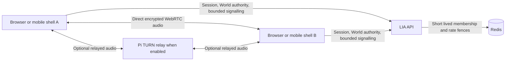

# Direct human voice in LIA World — technical proposal

Date: 2026-10-26. Status: proposal only, requested before implementation.
No microphone flow, signalling endpoint, TURN service or paid account is enabled
by this change. This proposal builds on [ADR-365](../../architecture/ADR-365-Private-Native-LIA-In-An-Authoritative-Isometric-World.md).

Owner refinements: reuse the existing Raspberry Pi 5, with an administrator
control to enable or disable the TURN relay without restarting LIA. Switching
TURN off leaves direct peer-to-peer voice available. Interruptions may end audio;
users manually rejoin. Explicit microphone ownership between human voice,
assistant Live and meetings is sufficient; seamless recovery is outside scope.

## Recommended scope

Use native WebRTC audio with bounded client mesh for the current small World
capacity. Public audio is an explicitly joined room for admitted people outside
their private home. Private audio is a separately accepted invitation between
two currently admitted, mutually unblocked native peers. Being online, opening a
text discussion or accepting a peer relation never opens a microphone.

| Context | Admission and consent | Exit |
| --- | --- | --- |
| Public room | Explicit join, visible participant list, microphone initially muted; blocked pairs cannot share audio | Leave, enter home, idle capacity release, authority loss or unavailable signalling |
| Private call | Accepted native relation, explicit invitation and acceptance, initially muted | Either participant hangs up, blocks, leaves World, loses admission or loses authority |

One audio context per account/controller. Switching between public and private
requires a deliberate action that ends the current context first. A private call
does not silently fall back to public. The home remains a silent boundary in V1;
home calling would require a separate product decision. A visible join/mute/leave
control and text labels accompany any color/speaking indication. No automatic
proximity audio, transcription, recording, translation or assistant integration.

## Transport and deployment

WebRTC supplies media transport; application signalling must exchange the offer,
answer and ICE candidates through an authenticated service. NAT traversal needs
TURN for networks where direct connectivity fails. These are separate paths in
the [WebRTC connection guide](https://webrtc.org/getting-started/peer-connections)
and [TURN guide](https://webrtc.org/getting-started/turn-server).

Allow direct ICE candidates, with TURN available as fallback while the operator
enables it. Do not use relay-only ICE. Direct peers may learn each other's public
network addresses; the owner accepts direct transport between accepted peers.
TURN relays encrypted transport; it still sees network metadata and consumes
bandwidth. Logs must exclude audio, SDP, ICE addresses,
credentials, cookies and message bodies. Short lived TURN credentials are minted
server-side after fresh admission checks, with allocation, duration and bandwidth
limits; never expose a permanent shared relay secret in JavaScript.

The repository's production Compose declares a host-managed Cloudflare Tunnel
and loopback-only application ports. It declares no human voice relay. This is a
repository finding, not an inspection of the deployed host. Provide a separate
publicly reachable TURN hostname, certificate and UDP relay range, plus TCP/TLS
fallback for restrictive networks. An HTTP application tunnel is not evidence
that native browser TURN traffic is reachable. Private network routing products
must not be mistaken for a public browser TURN endpoint.

Run [coturn](https://github.com/coturn/coturn) as a separate bounded service on the
existing Raspberry Pi 5. A second server is not a prerequisite. Give it no access
to application databases, host administration or private network destinations.
Set connection/traffic/resource limits, authenticated short lived credentials
and a bounded published relay port range. Measure its impact alongside real LIA
load before choosing the final limits; no Pi capacity claim has been measured.
A shared SFU is premature at the current capacity.

The one-time network setup still needs a reachable public address/hostname and
appropriate router/firewall rules. Hosting coturn on the Pi does not establish
that the ISP permits incoming traffic; CGNAT and the actual network must be
checked. This document does not authorize changing the production firewall.

## Administrator TURN control and emergency stop

The native World voice capability governs access to human voice as a whole.
Its administrator settings include a separate "TURN relay" switch, initially
disabled, using native superuser-only authorization and auditing. This switch
controls only the relay, independently of direct calling. Show the effective
relay state (running, stopped, transitioning or unavailable), relay allocation
counts and traffic counters. An accepted setting write is not proof that the
relay stopped; report success only after acknowledgement of the actual process
state, and expose an unacknowledged stop as an error.

Disabling TURN stops new TURN credential issuance, removes TURN servers from
new connection configurations, and stops coturn so existing relay allocations
cannot continue consuming Pi resources. Keep signalling, voice membership and
already established direct media links active. Calls using a stopped relay may
drop; users can retry manually with direct candidates only. If direct traversal
fails, show that voice cannot connect on this network while the relay is off.
No seamless migration is required. For a group mesh, losing one relayed link must
not stop unrelated direct links or their shared microphone capture.

Keep STUN address discovery available independently of the stopped coturn service;
otherwise switching off TURN could unnecessarily prevent direct connectivity.
STUN discovers candidate addresses and does not carry conversation audio. Client
configurations retain direct ICE support in both states. Re-enabling TURN makes
it available as fallback for new or manually retried connections, without
restarting LIA, disturbing direct calls or automatically opening microphones.

The API must not receive a Docker socket, root privileges or a general command
execution endpoint. A narrowly scoped local relay supervisor can own its coturn
process and accept only the authenticated desired running/stopped state. Fence
old generations during concurrent on/off actions. A lost control lease or
unverifiable relay-control authority must resolve to relay stopped; the generic capability
reader's deployment fallback cannot serve as the emergency-stop authority.
The existing fresh capability guard supplies voice authorization; the relay's
effective operator state must also be verified before issuing TURN credentials.

Stopping coturn stops its service, not a flood already saturating the ISP link.
If the connection or Pi is unresponsive, the web administrator page may also be
unreachable. Keep a documented local stop path. Initial port forwarding remains
a separate network configuration; the LIA switch does not promise to change the
router or remove firewall rules.

## Application boundaries

Add one explicit native capability and operator switch using the existing complete
feature-switch registry. Reuse native session authentication, one-use World ticket
patterns, controller/epoch fencing, fresh account/peer/block checks and Redis CAS.
Never accept client-selected arbitrary rooms, relay targets or recipient accounts.
Each offer, answer and candidate is bound to a server-issued call generation and
approved participants. Reject unexpected state transitions, oversized frames,
replayed invitations and stale controllers before forwarding; bound invitations,
candidate counts, frame sizes, call lifetime and per-user/per-IP signalling rates.
Serialize invitation acceptance with revocation, and expire orphaned membership.

Use one account-owned audio lifetime and the existing microphone ownership seams
(`useLiveHoldsMicrophone`, meeting capture and voice mode stores). Human voice,
assistant Live, wake-word and meeting capture need explicit arbitration at their
common boundary. Pause/duck radio and assistant playback deliberately, with a
visible reason. Never route human audio to assistant Live/TTS or provider endpoints.
On account replacement, logout, takeover, capability withdrawal, departure or
network interruption, stop every local track, close peer connections, detach audio
and remove timers/listeners. Users explicitly reactivate voice after a cut; no
automatic handover, media restart or background continuity is required.
Receiving a block/revocation closes the affected audio immediately;
peers enforce media teardown as well as server-side membership withdrawal.

## Mobile support and interaction

Microphone access requires a secure context and user permission; denial and absent
devices must leave text usable. See the browser-owned
[getUserMedia contract](https://developer.mozilla.org/en-US/docs/Web/API/MediaDevices/getUserMedia).
An explicit join gesture also initializes remote playback; if playback is blocked,
show a retry/unmute action instead of claiming audible communication.

Support Safari/iOS, Chrome/Android and desktop browsers through the same WebRTC
path, with the existing mobile shell delegating platform permissions at its native
boundary. Treat foreground use as V1 scope. Do not promise lock-screen/background
calling: OS interruption and shell capture behavior require physical testing and
possibly native audio-session work. Include headphones/Bluetooth, speaker echo,
incoming phone calls, permission revocation, device changes, screen lock and
Wi-Fi/mobile handover. Test safe cut-off and manual rejoin rather than seamless
continuity. API availability or a headless WebKit pass cannot certify
audible calls on an iPhone.

## Capacity and cost envelope

For an illustrative five-person room, a full mesh has ten duplex connections and
four outbound streams per person. If every link requires TURN, at an assumed
24 kbit/s encoded audio payload,
all twenty directed streams total 480 kbit/s. That is about 216 MB/hour of relay
egress before RTP/IP/DTLS/TURN overhead, retransmission and vendor billing rules;
relay ingress adds the same payload again. Direct links bypass the Pi's media
relay, so actual Pi media traffic depends on the selected paths. This is sizing arithmetic, not a
measured codec bitrate or supplier quote. Silence, packetization and network loss
change the result. Measure aggregate bandwidth, client CPU, battery and end-to-end
latency with five physical clients before choosing the host allowance.

This feature uses no LLM tokens or transcription quota. Costs are relay hosting,
billable ingress/egress if applicable, monitoring and operator time. A monthly
price needs the selected provider, region, included transfer and expected call
hours; inventing a fixed euro amount before those choices would be misleading.
Implement byte/call-duration metrics and hard per-account concurrency limits,
plus a configurable transport budget and kill switch before opening access.

## Implementation lots and release evidence

1. Protocol and authority: failing tests for consent, invites, blocks, stale
   epochs/controllers, races, quotas, timeout and cleanup; real SQL/Redis fixtures.
2. Bounded signalling and Pi relay provisioning: reproducible disposable coturn
   qualification, expiring credentials, denied unauthenticated allocation,
   denied internal destinations, resource limits, administrator start/stop with
   live allocations, preservation of direct calls during TURN shutdown,
   mixed direct/relayed group calls, independent STUN discovery, stale client
   configurations, control failure and a deployment/local-stop runbook.
3. Native UI/audio owner: mute/leave/focus behavior, public/private exclusivity,
   permission and playback errors, radio/Live/capture arbitration and cleanup.
4. Browser and physical trials: pair calls and five-person room, no paid model
   calls, repeated join/leave/revoke, real iOS/Android/desktop audible output,
   interruptions and degraded networks. Record latency, bytes, CPU and battery.

Perform a cold security/performance/lifetime review after each lot. Authorize
implementation separately, then verify the Pi's public network reachability before
deployment. No service purchase, firewall change or production rollout is implied
by approval of this proposal.
