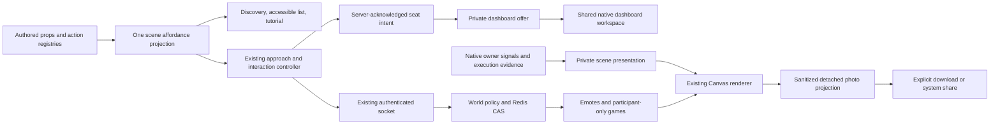

# LIA World: interactions, acting and arcade analysis

Date: 2026-10-27. Status: implemented on 2026-10-27/28, except the discovery, introduction
and decorative-actions controls (R01, R08) that the owner's feedback refinement retired;
the [qualification ledger](../qualification/2026-10-27-world-interactions-and-play.md)
records what shipped. The design text below is kept as written.
Execution of this study is strictly inline. No subagents, business-code changes,
staging, commit, push, service startup or deployment form part of this study.

This analysis implements the owner's selection from the preceding twenty ideas.
The original numbers below are stable requirement identities. The companion
[TDD execution plan](../plans/2026-10-27-world-interactions-and-play.md) defines
the implementation lots. Existing authority remains described by
[ADR-365](../../architecture/ADR-365-Private-Native-LIA-In-An-Authoritative-Isometric-World.md)
and the [World technical guide](../../technical/WORLD_PROTOTYPE.md).

## 1. Alignment and boundaries

The target is a more legible, responsive and sociable World, using its existing
Canvas renderer and native private workspaces. Twelve requirements are selected:

| ID  | Accepted requirement and exact target                                                                                                                                                             |
| --- | ------------------------------------------------------------------------------------------------------------------------------------------------------------------------------------------------- |
| R01 | Discover available interactions in the current room; additions to the authored activity catalogue automatically participate.                                                                      |
| R02 | Display the complete local route; enabled by default, with a saved user switch.                                                                                                                   |
| R03 | Private useful signals on existing objects, plus a small number of new authored supports when a function lacks a suitable object.                                                                 |
| R04 | After a newly acknowledged sitting action at an eligible unassigned table, offer the full personal dashboard. Declining leaves the person seated. Accepting opens the native dashboard privately. |
| R05 | LIA acts from real listening, processing, reading, creating, waiting, failure and completion evidence.                                                                                            |
| R08 | Optional playable introduction after admission: move, use an available object, find LIA.                                                                                                          |
| R09 | Broader short reactive interactions with animals, water, vegetation and room props.                                                                                                               |
| R10 | A bounded vocabulary of visible social gestures.                                                                                                                                                  |
| R11 | Ten curated appearance presets: five masculine and five feminine, all freely selectable and editable.                                                                                             |
| R12 | A composed photo with preview, local download and supported system sharing; useful for voluntary sharing outside LIA.                                                                             |
| R13 | Seasonal decorative variations, independent of actual weather and physics.                                                                                                                        |
| R17 | Three cabinets, three small games; each supports two humans or one human against a deterministic computer opponent.                                                                               |

Ideas 6, 7, 14, 15, 16, 18, 19 and 20 are not selected for this delivery. In
particular, no focus mode, favorites, persistent accomplishment garden, document
quiz, image frame, new camera-follow policy or adaptive-quality project is added.
The photograph has its own composition controls, not a general camera overhaul.

The owner authorized analysis before business code. This document makes technical
recommendations concrete; it does not turn its proposed names into existing APIs.
There is no unresolved business decision preventing implementation of the design
below. Game choices and artistic examples are explicit recommendations that the
owner can change before their lot begins.

## 2. Current evidence and disproved assumptions

Inspection is of the main working tree, initially at Git commit
`3be6294f1c9f4f59083cd35b11b4b58dba964cdb`, with numerous pre-existing concurrent
changes. Those changes must be preserved. Commit identity alone is not a source
snapshot; core source hashes were also compared during this study.

| Evidence                                                                                                                      | Verified current behavior                                                                                                                                                                                     | Consequence                                                                                                                         |
| ----------------------------------------------------------------------------------------------------------------------------- | ------------------------------------------------------------------------------------------------------------------------------------------------------------------------------------------------------------- | ----------------------------------------------------------------------------------------------------------------------------------- |
| E01: `activity-catalogue.ts`, `activity-entry.ts`, `scene-activities.ts`, `WorldFunctionControls.tsx` under the World feature | Closed action vocabulary; per-account capability checks; objects resolve through authored keys; panels are real native components.                                                                            | Extend this authority, not a second hard-coded list of discoverable functions.                                                      |
| E02: `scene-interactions.ts`, `navigation.ts`, `scene-pointer.ts`                                                             | Approach before interaction, pathfinding, cancellation, nearest reachable target and occlusion-aware picking already exist.                                                                                   | Reuse routing and picking; the new route is a visual projection.                                                                    |
| E03: `seat-activity-intent.ts`, `useWorldSession.ts`, backend `poses.py`                                                      | Seat activity follows a matching server acknowledgment, epoch, stream and sequence. Occupancy and reach are server checked.                                                                                   | The dashboard offer must use that exact acknowledgment, not predicted sitting.                                                      |
| E04: `house-furniture.ts`, `house-garden.ts`, `house-authoring.ts`                                                            | Three decorative arcade cabinets; coordinate-derived prop IDs; semantic keys exist for authored activities; no explicit generic seat-to-table relationship.                                                   | Add stable table/cabinet keys and explicit associations. Nearest-table guessing would be wrong.                                     |
| E05: `app/[lng]/dashboard/page.tsx`, `TodayBriefing.tsx`, `UsageStatistics.tsx`                                               | The dashboard is briefing, radio, results and consumption, not just three briefing cards. The page itself owns hooks and auth checks.                                                                         | Extract a shared dashboard workspace; do not import an App Router page into World or copy its markup.                               |
| E06: `useBriefing.ts`, backend `briefing/service.py`, `briefing/llm.py`                                                       | Opening the briefing starts cards and text reads. Text may make greeting and synthesis calls. Spend is guarded and accounted; cards coalesce source fetching.                                                 | A seat or declined offer must not mount the dashboard. Full dashboard acceptance retains native costs.                              |
| E07: `WorldDeviceControls.tsx`, `device-inbox.ts`, `useNotifications.ts`                                                      | SMS and actual reminder arrivals already have owner-scoped signals. Reminder transport lacks a durable occurrence identity; the inbox deduplicates briefly.                                                   | Reuse those signals; do not infer arrival from future reminder counts or claim complete history after an SSE gap.                   |
| E08: `art/lia-atlas.ts`, `eyes/behavior-context.ts`, `expression-engine.ts`, `eyesSignalsStore.ts`, `eyesChatStore.ts`        | LIA has the native face rig, but World currently advances its rest clock without passing application expressions. The shared signal vocabulary already distinguishes prepared, succeeded, failed and waiting. | Use the same expression resolver and evidence; completing an answer is not proof that a requested action succeeded.                 |
| E09: `renderer.ts`, `art/hover.ts`, `world-life.ts`                                                                           | Canvas 2D, bounded sprite caches, public nameplates and speech painted into the scene; ambient cat is synthesized outside static prop picking. Hover is a clipped floor footprint.                            | CSS hiding cannot sanitize a photo. The cat needs an explicit dynamic pick target. Preserve object colors and window artwork.       |
| E10: `protocol.ts`, backend `schemas.py`, `wire_models.py`, `store.py`, `transport.py`                                        | Strict wire schemas; controller/epoch fences; Redis WATCH/EXEC; policy refresh during projection; bounded frames and state. No game or emote commands.                                                        | Shared movement is not a game server. Strict clients need a deliberate socket schema transition.                                    |
| E11: backend `policy.py`, `message_access.py`, `lifecycle.py`, `peers/pair_fence.py`, `peers/service.py`                      | Fresh pair/block policy exists, account locks serialize admission with deletion, and cleanup selectively removes accounts. `block_peer` does not currently take `lock_peer_pair`.                             | Game admission needs its own guarded transition and a common pair lock for block-versus-join races.                                 |
| E12: backend `home.py`, `home_service.py`, `users/models.py`                                                                  | `world_preferences` is a strict palette-only document replaced on save; avatar preferences are separate.                                                                                                      | Do not hide route/tutorial/season fields in home JSON: a palette save would discard them.                                           |
| E13: `avatar-catalogue.ts`, backend `avatar.py`                                                                               | Finite unisex appearance schema, saved using optimistic concurrency and explicit publication consent.                                                                                                         | Presets are catalogue combinations; no inferred or persisted gender field is required.                                              |
| E14: `lib/native/shell.ts`, mobile native `LiaShellPlugin` sources and manifest                                               | Shell can open an external URL but has no image-sharing bridge. Android already declares a FileProvider with broad generated path defaults.                                                                   | Reuse the provider with a dedicated narrow cache directory; add bounded sharing rather than assuming Web Share in a WebView.        |
| E15: `WorkboardPage.tsx`, dashboard cards and `chat-deep-link.ts`                                                             | Embedded workboard supports an initial ticket, but no initial filter prop; dashboard cards contain native links and some explicit auto-sent chat intents.                                                     | Preserve filters and one-shot semantics. Blindly embedding the dashboard would make some clicks leave World or execute incorrectly. |

Source roots: frontend `apps/web/src/features/world/`; backend
`apps/api/src/domains/world/`. Filenames in the evidence table are current files;
new modules listed in the plan are explicitly marked Create.

## 3. Functional contracts

### R01: discovery that follows future features

Create one typed scene-affordance projection from authored objects, pose slots,
the activity catalogue, cosmetic bindings and cabinet definitions. It resolves
availability through the same current policy as actual activation. Each result
contains an authored identity, target, action category, translated title key,
footprint and approach. No callback, user content or executable URL is stored in
authored geometry.

The current-room button shows subtle clipped ground footprints for six seconds
and opens an equivalent DOM list. The list remains available until closed; it is
not removed under keyboard focus by a decorative timeout. Static marks replace
animated emphasis under reduced motion. Decorative objects without an authored
interaction are not advertised. Occupied seats and unavailable capabilities are
excluded or described as unavailable, never offered as working actions.

A new activity with an authored binding and normal availability appears without
editing the discovery component. A catalogue action with no physical object
still appears in the existing function directory, not at an invented position.
This is runtime derivation from registered features, not arbitrary plugin code
injection into Canvas. An exhaustiveness test adds a synthetic future activity
and proves discovery, labels and opening all agree.

### R02: optional route

Draw the current `sim.player.path` in world coordinates, clipped to the viewport,
with fading marks behind the player. Do not recompute navigation or send the
path over the network. Cancellations, direct keyboard movement, unreachable
targets, sitting, scene changes and authority loss clear it naturally. A saved
`show_route=true` default controls only the marks, not movement or destination.
Reduced motion keeps a static dotted line; the switch remains independently
usable. The existing destination marker stays meaningful when the line is off.

### R03: private objects that convey useful state

| Support                                                            | Verified signal to project                                                 | Activation                                                                |
| ------------------------------------------------------------------ | -------------------------------------------------------------------------- | ------------------------------------------------------------------------- |
| Existing alarm                                                     | Actual fired reminder in the owner inbox                                   | Open the matching reminder notice; future schedule is not an arrival.     |
| Existing phone / new small smartphone stand near the public lounge | Owner-qualified SMS signal                                                 | Existing focused SMS reader by message identity.                          |
| Existing private secretary / a small nearby task tray              | Exact native `needs-me` result, including unavailable state                | Embedded workboard narrowed to the selected ticket or waiting-on-me view. |
| Existing generated-output easels                                   | A confirmed resource invalidation followed by an authenticated assets read | Correct native gallery family; no title or thumbnail broadcast.           |

Start with these four families. More supports use the same typed signal-to-action
contract, not a generic polling widget on every prop. Lift the World inbox's
ownership into one hook/store and let the phone and renderer read it. Do not add
another World notification subscription per object. Existing off-chat application
attention is a separate consumer; do not claim the entire app currently has one
EventSource. Changes must not increase the existing subscription count.

Signals use bounded identifiers and static badges, optionally one short attention
beat. They are neither assistant memory nor scene state. A read acknowledgment
clears the same event in both representations. On SSE reconnect, reread resources
that have a durable native read contract; expired/missed reminders remain unknown,
not reconstructed from schedules. Feature withdrawal clears the corresponding
projection. Errors never become a fabricated zero count.

### R04: sitting and the full dashboard

Add explicit `tableKey` associations to authored seats that serve a table. The
predicate is: sitting pose + linked table + neither seat nor table has a specific
activity. This includes diner/terrace seating deliberately associated with tables;
it excludes a sofa away from a table, benches, beds, loungers and the toilet.
Existing meeting, library, memory, drawing and engineering seats keep their
specific functions. Generic table clicks may approach a free linked seat; only
the acknowledged pose can trigger the offer.

The local FSM is `idle -> awaiting_pose -> offered -> dashboard_open | declined`.
Offer text: “Consulter mon dashboard ?”; actions: “Consulter mon dashboard” and
“Rester assis”. Escape, dismissal and refusal all mean decline. The avatar remains
seated in every case. No request to dashboard endpoints occurs before acceptance.
An unchanged/restored seated snapshot never prompts. A genuinely new seating
gesture may prompt once again. After declining, an accessible contextual action
can reopen the choice without standing. Standing, account replacement, lost
controller, stale acknowledgment or removed capability invalidates the offer.

Extract `DashboardWorkspace` from the current route. The route remains thin and
World lazy-loads the same workspace inside the existing private activity host.
It includes the same cards/preferences, radio, results, consumption and errors.
Closing it returns focus to the seated scene without issuing a stand command.

Dashboard navigation is a first-class integration boundary:

- Use a typed host-navigation provider, analogous to `MeetingNavigationProvider`,
  for settings tokens, local chat drafts, workboard filters/tickets, meetings,
  gallery families and registers already embeddable in World.
- Add explicit `initialFilters` to embedded workboard instead of discarding a
  dashboard card's filter. Preserve it in the bounded activity history.
- Existing executable chat intents are not ordinary draft text. Keep their
  original native deep-link/replay guard and use an explicit “Open in Chat”
  transition; do not invent a second embedded auto-send mechanism in this lot.
- Destinations with no embedded surface, such as the full help/capability map,
  retain native navigation with a visible departure indication. External links
  retain the ordinary safe-link policy. No catch-all URL interceptor is added.
- Native route behavior and link keyboard/modifier semantics remain tested.

Closing and reopening the accepted dashboard within the same confirmed seating
keeps its workspace mounted under a suspended/active contract. Its private reads
pause while hidden; no new text generation occurs just from toggling visibility.
The text-read trigger is one-shot per seating lifetime: simply re-enabling the
current `useApiQuery` would otherwise start another synthesis request. If hiding
aborts a text request whose server work already began, reopening shows retained
text or an unavailable/retry state; only explicit retry can buy new text. Queued
resource invalidations resume as cards-only reads.
Standing ends that seating lifetime and disposes it. No content survives an
account change. A read already paid for may finish on the server after closing;
late client responses cannot reopen anything.

### R05: LIA acting

Reuse `deriveExpression`, `readCompanionSignals` and native activity/tone records;
do not mount the DOM eyes widget or its timers in Canvas. Pass a compact private
acting frame to `LiaAtlas`, sample expiry on the existing World clock, and call
`rig.setPose` only when pose inputs change. Bridge embedded chat state explicitly:
the persistent application avatar currently reads chat phases according to route,
which does not describe a chat mounted inside World. Background activity must
have one shared reader, not a second polling loop for this face.

Keep clock domains explicit: native signal records use epoch milliseconds and
are read with the native wall-clock contract; rig integration uses monotonic
frame deltas. Redis game deadlines use their server-time anchor. Never compare
`sim.time` seconds with `eyesSignalsStore` epoch timestamps.

Priority: stale account/authority clears acting; current error and HITL use the
native resolver; recording/voice, current execution and response tone follow that
resolver; short confirmed success accents may play once; ambient curiosity is last.
Prepared drafts get a presentation gesture, not success. Unknown outcomes, a
completed poll, a reattached history or a closed panel never imply success.
Only actual playback drives speaking. No microphone is opened by a visual state.

Animation direction: eyes lead a small head inclination; an anticipation of about
80–120 ms precedes a 300–500 ms main beat; settle over 200–350 ms. These are
proposed artistic ranges, not existing engine constants or measured guarantees.
At sprite scale, prioritize eyes, head silhouette and a modest body inclination.
Current atlas frames do not contain independent articulated arms: a complete arm
wave requires original art or an added bounded body overlay. Back views use a
small body/status cue rather than drawing a face through the head. Error/waiting
must remain distinguishable without color or audio. Reduced motion is static.

### R08: introduction

Start only after avatar consent, active admission and current controller. Offer
“Discover the world” / “Later”; never interrupt a restored conversation. Three
steps use real events: move a short reachable distance, open one currently
available non-paid activity, activate LIA's menu. Opening the menu is enough;
no message, provider request or useful action is required for graduation.

Choose targets through R01; skip/reselect an unavailable or occupied target. Each
step has keyboard/touch/DOM equivalents. Pausing, skipping and replaying from
Help are explicit. Save only a versioned tutorial status, not visited positions
or inferred behavior. A new product feature does not reset a completed tutorial.

When explicitly approached, the local LIA companion waits and faces the owner,
then resumes its prior patrol after opening or cancellation. Other players retain
their movement authority. A server correction may replan an active approach to
its original destination, including after its predicted final segment ended;
unreachable, expired or withdrawn intents cancel instead of opening remotely.

### R09: responsive decoration

Initial authored catalogue: cat glance/purr visual beat, butterflies drifting
aside, bird hop/turn, pond ripple, fountain ripple, plant-leaf sway, brief flower
opening, small billiard-ball nudge and machine indicator/gear response. These
are cosmetic effects, not shared physics, exercise tracking or tool executions.
Jukebox and telescope keep their primary native radio/weather activity; optional
cosmetic feedback accompanies activation rather than stealing its click.

Use existing drawing assets, ground picking and one local effect queue. Add a
dynamic target for the synthesized cat and bounded approach triggers for fauna;
do not mutate static collision geometry. Author stable keys only where interaction
state is needed. At most eight simultaneous cosmetic beats, at most three in low
quality, one activation per target per two seconds; each ends within three seconds.
Far/offscreen triggers do not create particles or sounds. Extra sounds require
deliberate sound enablement and yield to radio/voice under the current audio owner.
The first version can remain visual. No new halos are drawn on windows.

### R10: social emotes

Six initial symbols: wave, thanks/heart, applause, laugh, question/raised hand and
celebration. A compact accessible menu provides labels and keyboard equivalents;
shortcuts operate only while the scene owns focus. A two-second presentation may
include a small posture overlay. Respect sitting/lying contacts, occlusion and
wall masks; running cancels incompatible body gestures. Reduced motion retains
the symbol. No free text, uploaded emoji, translation or model call.

Emotes are server accepted: latest symbol, serial and expiry attached to the
public actor, with one accepted emote per two seconds. Unknown enum, booleans as
numbers, stale epoch/controller, invisible/private-home sender and flooding are
rejected. Public projection inherits visibility/block rules. Home gestures remain
local. No emote history, replay after reconnect or indefinite queue is retained.

### R11: ten presets

Add ten authored combinations of existing `AvatarAppearance` fields: M01–M05
(casual, reader, professional, creative, evening) and F01–F05 with equivalent
variety. Show five masculine and five feminine presentation choices, while
allowing everyone to choose and edit any preset. Distribute the five existing
skin tones across each set; do not infer account gender or select from a profile.

Selecting a preset changes the preview only. Existing Save, revision, consent and
conflict behavior publishes the appearance. Manual changes keep their values;
the preset selection indicator becomes “custom”. No saved preset ID or new avatar
wire field is needed. Test distinguishable silhouettes at normal World scale,
all directions, seats, lies, hats, glasses and both light/dark interfaces.

### R12: photo and voluntary sharing

Compose a still of public authored decor + the owner's chosen avatar + LIA.
Exclude other humans, all names, messages, private notice overlays, navigation
marks, game boards, tutorial, metrics and native DOM panels by construction.
Do not copy live Canvas pixels and attempt to erase text afterwards. Use the same
renderer with an explicit photo projection into a detached bounded surface.
Do not step the live simulation/rig again while rendering the still.

Offer landscape and portrait composition, pan/zoom and one pose from a finite
photo catalogue. Snapshot once before encoding; current World authority keeps
running, while photo controls own input. Account/authority loss cancels the
preview. Returning restores camera and UI, releases object URLs and buffers.
No upload, server photo library, new generated-asset row or assistant memory.

Proposed limits: longest image edge 1600 pixels, at most 2.56 megapixels, JPEG
quality 0.9, encoded output at most 2 MiB, one pending encoding/share. Oversize
gets one bounded downscale to 960 pixels, then a visible local error. Strip
account/instance URLs and location metadata. A small optional LIA wordmark is
on by default; it contains no automatically embedded private instance hostname.

Prepare the file before displaying enabled Download/Share buttons. File sharing
requires a fresh click: asynchronous encoding must not consume the browser's
transient-activation window. Feature-detect `navigator.canShare({files})` and
`navigator.share`; cancellation is a normal result. Download remains available
where file sharing is unsupported. Do not announce a social post as published:
some platforms resolve when the system chooser opens, not after delivery.

For native shells, extend the existing narrow plugin with image bytes, a closed
MIME type and a generated safe filename. No arbitrary path/URL or host-file read.
Validate size, signature and dimensions before native decoding. Android reuses
the existing FileProvider library through a dedicated `.worldshare` authority,
with only its own cache subdirectory and read-only temporary grants. The existing
general provider/camera paths are not replaced. iOS uses
`UIActivityViewController`, including iPad anchoring.
Bound temporary files and expire leftovers on later startup. Modify authored
`apps/mobile/native/` sources, then regenerate through the existing prepare tasks;
do not maintain generated and source copies separately.

Browser constraints are verified against [MDN Web Share](https://developer.mozilla.org/en-US/docs/Web/API/Navigator/share),
[MDN Canvas encoding](https://developer.mozilla.org/en-US/docs/Web/API/HTMLCanvasElement/toBlob)
and the [HTML origin-clean contract](https://html.spec.whatwg.org/multipage/canvas.html).
Native transport uses [Android FileProvider](https://developer.android.com/reference/androidx/core/content/FileProvider)
and [Apple UIActivityViewController](https://developer.apple.com/documentation/uikit/uiactivityviewcontroller/).
No third-party art or sharing SDK is required.

### R13: seasons

Use four authored decorative palettes/variants with a static neutral/off option.
Default to calendar mode for the northern hemisphere, explicitly selectable as
northern/southern in World settings; manual spring/summer/autumn/winter is also
available. This is an artistic calendar choice, never a location inference.
Account civil date determines the season, with southern mode offset by six months.
Use the existing fresh server/timezone anchor; when unavailable, keep neutral
instead of inferring from a browser's possibly wrong date. No GPS/provider read.

Change foliage, flower density and a few non-blocking details. Never alter map
walkability, table/cabinet identity, doors, seat positions or actual rain/snow.
Keep shelter and night readability. Cache by discrete season/quality, invalidate
only affected decorative sprites, and cap live seasonal variants rather than
letting a cache grow with dates or accounts.

### R17: three games and a common table lifecycle

Recommended cabinet mapping: tic-tac-toe (3x3), four-in-a-row (7 columns x 6 rows,
gravity) and Reversi (8x8). All are turn based, keyboard/touch friendly and use
original simple board art. The existing morpion skill emits a sandbox frame; it
does not supply authoritative multiplayer or a reusable server rules engine.
For Reversi, pass is forced only when no move exists; the game ends when neither
side can move, even on a non-full board. See the
[World Othello Federation rules](https://www.worldothello.org/about/about-othello/othello-rules/official-rules/english).

Each cabinet has at most one current table, two human slots, one pending join
request and one short-lived terminal result. One account participates in at most
one table. Interact from the server-confirmed cabinet approach and open the
lazy-loaded native board dialog. Private-home/queued/observer/stale controllers
cannot join or play. A participant remains at the cabinet while the game is open;
walking away or opening an incompatible activity invokes Leave rather than
silently playing remotely. Nobody is teleported.

Lobby choices: play computer immediately, or wait for a human. A waiting table
expires after 60 seconds without a second participant. A second person requests
entry; the first accepts or declines within 20 seconds. No unsolicited social
notification outside World is sent. Computer games can receive a join request,
but the human-versus-human round starts from a fresh board after acceptance;
no one inherits a computer's partial losing/winning position. The first person
is told that accepting starts a new round. Refusal continues the solo round.

FSM: `empty -> waiting | playing_computer -> playing_human -> finished -> empty`;
`suspended` overlays an active round during transport loss. Win, draw, explicit
resignation, unavailable participant and abandonment are distinct terminal reasons.
Rematch requires both humans' consent and a new round ID; starting player alternates.
Computer rematch is explicit. No rankings, currency, daily streak or permanent
competitive history is introduced.

Use server time. Proposed defaults: 30 seconds reconnect grace, 120 seconds
without a legal move ends the round as abandoned without awarding a win, 20
minutes maximum round lifetime, 30 seconds terminal display. A pause begins as
soon as an opponent's connection presence is lost; on resume the remaining turn
time is restored, not reset. An expired actor/admission lease ends membership.
Close-dialog/explicit Leave resigns immediately. Backgrounding suspends input;
leases and grace still apply. A takeover requires explicit rejoin confirmation
within grace. Expired generations never resume.

Server rules own legality, turns, winner, pass, player identity and bot moves.
Client sends a cabinet ID, round ID, action ID, expected round revision and a
small move coordinate; never a board, winner, opponent account ID or random seed.
Each valid move carries the common monotonically increasing socket command
sequence. Every auxiliary sequence-bearing command acknowledges its sequence,
including refusal, and clears stale pose-result data so an emote/game command
cannot accidentally satisfy an old seat intent. Explicit pose acknowledgments
remain correlated with their command; add a command-kind/sequence receipt in v2.

Deduplicate the last 16 operation receipts per cabinet, bound their payload hashes,
and reject an action ID reused with different content. Repeated delivery reads
the same result without a second move. Round revision, not global scene revision,
arbitrates moves: unrelated walking must not invalidate a board click. On conflict
resynchronize and require another deliberate move, never guess/replay a new turn.
Explicit departure is account/controller/round-fenced and accepts a newer
revision of the same round: an opponent's concurrent move cannot prevent exit.
It clears the departing member's rematch consent. Join-consent deadlines are
capped by the host table's remaining lifetime.

Computer opponents use deterministic bounded rules, no LLM: tic-tac-toe minimax
with a hard node allowance and legal-move fallback; four-in-a-row win/block and
bounded tactical evaluation; Reversi legal-move scoring favoring corners/mobility.
Proposed hard budget is 6000 evaluated nodes per answer and fixed deterministic
tie breaks. Compute the complete human-plus-bot transition before CAS, then commit
only if the round revision still matches; CAS retries never redo expensive search
or external effects. No per-match thread, timer, worker election or paid call.
Measure worst-case CPU on the target Pi; reduce search depth, not legal correctness,
if the budget is too expensive.

Store only bounded active state in the existing scene Redis authority: board,
slots, controller fences, deadlines, revision and receipts. Add pure game pruning
beside actor pruning. Account deletion, revocation, leave and expiry clear
membership even if the actor has already disappeared. Scan cleanup predicates
must inspect game members as well as actors/presences/queue. Terminal results omit
deleted identities. Redis loss ends the game honestly; there is no local winner
or process-memory recovery authority. No new SQL match-history table.

Only participants receive board contents. Other eligible visible people receive
a small cabinet availability state; no private panel, result history or hidden
identity. Apply native pair/block filtering both before mutations and projection.
At join/move, hold canonical user locks, recheck active accounts/capability/block
policy and perform only the bounded Redis commit. Add the same canonical pair
lock to `block_peer`/unblock so concurrent joins cannot slip past a committed
block. Keep imports one-directional; peers must not import World. Once a block is
observed, the round ends with generic unavailability, not a disclosure of who
blocked whom. Projection revocation retains the existing bounded native refresh
window; this design does not claim instantaneous revocation across SQL and Redis.
Authenticate the cookie before taking locks, then read the pair's active-account
and block policy through the same locked SQL session. The current `read_policy`
opens its own sessions and cannot simply be called inside those locks: that
could deadlock on another connection. Extract a narrow session-aware reader.
Rate limits and board preparation precede the short locked commit. No provider,
bot search or socket write occurs while SQL row locks are held.

## 4. Architecture, persistence and cross-cutting effects

### Persistent preferences

Add one separate nullable user JSONB field, `world_experience_preferences`, with
version/revision and bounded values: route visibility, tutorial version/status,
season mode and hemisphere. No positions, scene messages, model prompts, game
history or notification bodies. Server defaults handle absent data. Invalid or
unknown versions preserve storage and require explicit repair, as home/avatar do.
PUT uses an expected revision and the existing fresh account row lock. A failed
save leaves the visible local choice usable and clearly unsaved. Concurrent edits
return conflict instead of last-write-wins.

Initial values are `show_route=true`, `tutorial_version=1`,
`tutorial_status=not_started`, `season_mode=calendar`, `hemisphere=north`.
Tutorial statuses are exactly `not_started`, `dismissed`, `completed`; active
step progress is session-local. Season modes are exactly `off`, `calendar`,
`spring`, `summer`, `autumn`, `winter`; hemispheres are `north`, `south`.
Reset is a separate operation: it cannot be mixed with edited values.

This additive migration is intentional: extending the strict home preference
object would create a coupling to every palette save and old reader. Register the
new column in native export/scrubbing maps and account deletion; include real
rollback/re-upgrade tests. Extend `useWorldOwnerPreferences`'s closed resource
union with `experience`, rather than inventing a second API/auth mechanism.

### Socket evolution

Introduce a dedicated socket v2 base model and keep preference/message version-1
models unchanged. `VersionedModel` is shared by existing home, avatar and message
DTOs: changing it globally would be a regression. Socket auth/ready/commands/views
move together to v2, include server-time and typed command receipts, emotes and
bounded game projections. Ticket response remains its current owner-scoped shape.
Increment the authored scene version and regenerate the server catalogue once
for the completed protocol release. Mismatched clients are refused. Updated
clients show a translated reload instruction; an already-shipped old client can
only show its existing unavailable/ended UI until reloaded. Do not claim that a
backend change can add new wording to that old JavaScript. Strict parsing is
never relaxed to ignore unknown private fields.

Stored `WorldState` is an internal schema with tolerant defaults for newly added
bounded fields; it must still decode older scene state for selective account
erasure. Socket version and persisted-state version are different concepts.
Older authorities remain isolated by full instance/scene identity and expire or
are selectively cleaned. Do not rewrite an old active scene into a new one.
Legacy cleanup must round-trip the legacy serialized shape, without injecting
new default fields that its still-running strict reader rejects. Test it by
decoding the cleaned legacy document with the pre-change schema. No generic
`extra=ignore` reader or whole-instance Redis deletion is an acceptable shortcut.

### API and model impact

Direct backend impact: preference route/service, a user column and migration,
socket DTO/dispatch, emote/game pure authority, public projection, fresh pair
policy, account cleanup and bounded metrics. No replacement of FastAPI auth,
LangGraph nodes, tool catalogue, LLM slot, prompt or billing architecture.

Direct frontend impact: authored associations, affordance projection, discovery
UI, route marks, tutorial FSM, private signal owner, acting adapter, presets,
season palette, lazy game panels and photo/share UI. Native dashboard extraction
touches shared cards/navigation and therefore requires ordinary-dashboard
regression testing, not World-only snapshots.

The new preferences and game fields require full Pydantic descriptions and
docstrings through the zero-debt World contract gate. Native platform capability
WORLD remains the access ceiling. Add an operator-controlled `world_arcade_enabled`
deployment subfeature limit, default true beneath WORLD, exposed in existing
config. Changing this environment-backed limit takes a service restart; do not
present it as a new live administrator switch. The existing live WORLD capability
still withdraws access through the native policy path. The child limit is
subordinate to WORLD and enforced on both commands and projections. It does
not become a second admission authority or a new independently billed capability.
Document why it is a child control rather than another top-level registry member.

Add bounded aggregate server metrics for game command outcomes, round duration,
computer-opponent work/duration and emote outcomes. Labels use only declared game,
action and outcome enums, never account/round/action IDs or board content. Frontend
photo outcomes may use existing opt-in product telemetry if already enabled;
sharing adds no always-on telemetry endpoint. Logs contain stable reason codes,
not image bytes, message bodies, cookies, controller tokens or private signals.

### LLM, platform-paid costs and registers

| Path                                                                                                                      | Incremental model/provider spend                                                                 | Authority and accounting                                                                                                                                            |
| ------------------------------------------------------------------------------------------------------------------------- | ------------------------------------------------------------------------------------------------ | ------------------------------------------------------------------------------------------------------------------------------------------------------------------- |
| Walk, discover, route, sit, decline, tutorial, acting, emote, preset, season, decoration, all game/bot moves, local photo | Zero model calls and zero new prompts                                                            | No fake agent effects/treatments/decisions or conversation messages.                                                                                                |
| Accept full dashboard                                                                                                     | Existing source/cache reads; up to the native greeting and synthesis generations when applicable | Existing `spend_blocked` account/instance ceilings, configured briefing slot/output cap, pricing capture, failure-spend accounting and native consultation records. |
| Explicit dashboard refresh / read aloud                                                                                   | Native refresh or TTS behavior                                                                   | Existing quota, limits and receipts. No World-specific retry or second TTS player.                                                                                  |
| Existing native action selected through a prop                                                                            | Ordinary assistant cost if the user then executes it                                             | Existing HITL, execution effects and usage paths, unchanged.                                                                                                        |

Do not copy documents or private inbox text into an animation prompt. No new
prompt needs sizing: none is introduced. Briefing keeps its existing bounded
source projections, current slot limits and pricing; there is no fixed model or
invented euro tariff in this design. Measure incremental dashboard cost per
accepted opening using actual configured pricing before release. A quick series
of seat/decline/open/close actions must not become an automatic paid loop.

Games use dedicated server validation/rate fences, not LLM token quotas. Proposed
bounds: one active match/account, one table/cabinet, one join request/table,
three game commands/second/account in addition to the existing transport ceiling,
one emote/two seconds, and existing socket/frame/state limits unchanged. Configurable
new deadlines/rates belong in constants + settings + active target env/templates;
pure game rule sizes and the fixed cabinet catalogue remain code-owned constants.

Memory and register boundaries: no long-term memory extraction, psyche learning,
habit inference or RAG ingestion from play, emotes, photos or tutorials. Games
produce technical aggregate metrics only. Local photos are retained only if the
user explicitly downloads/shares them. Existing account preferences are exported
and erased normally; live games and symbols are ephemeral and are erased on
account loss. No anonymous leaderboard or retained counterpart identity.

### Rendering, accessibility and mobile

All new UI strings, aria names, statuses and plurals participate in six-locale
parity. Use existing Dialog/Button/menu primitives, scroll containers, focus
return and owner lifetime guards. Small screens get one dominant panel; no extra
permanent toolbar row. Touch targets meet the existing 44px convention. Test
320px portrait, short landscape, enlarged text, soft keyboard, safe-area insets
and rotation. Never interpret game/text-field arrows as avatar movement.

Each board has a DOM semantic alternative: turn/status announcements, row/column
names and legal-move state; Reversi exposes coordinates and forced-pass feedback.
Keyboard navigation is bounded within the board and Escape closes normally.
Reduced motion preserves information and disables nonessential travel/particle
beats. Audio remains optional, subordinate to native voice/radio ownership.

Keep one live requestAnimationFrame loop and the current hidden-tab suspension.
New effects are bounded and offscreen-culled. No React state update per frame.
Proposed acceptance budgets: no more than 10% render-p95 regression versus a fresh
same-device baseline; new effects remain within existing texture/cache ceilings;
serialized snapshots stay under the frontend hard 16KiB limit at maximum configured
capacity and all cabinets active; the Redis authority stays under its existing
128KiB ceiling. These are target gates to measure, not performance already proved.
Photo buffers are separate temporary allocations and must return to zero after
disposal; bound their peak with the declared pixel/byte limits.
The current application CSP already permits local Blob images. Preserve its
central policy and tests; unsupported sharing does not justify weakening CSP or
widget sandbox rules.

## 5. Risk and impact matrix

Severity below is a design risk, not a discovered production incident.

| Risk                                          | Impact                                               | Concrete mitigation / deciding test                                                                   |
| --------------------------------------------- | ---------------------------------------------------- | ----------------------------------------------------------------------------------------------------- |
| R01 discovery and opening diverge             | Misleading affordances; capability exposure          | One resolver; synthetic future action; withdraw capability while list is open.                        |
| Table proximity guessed incorrectly           | Wrong dashboard prompt; specific activity stolen     | Explicit stable associations; full authored inventory predicate tests.                                |
| Old pose ack opens a new panel                | Surprise dashboard / paid request                    | Command-kind/sequence receipt + existing epoch/stream intent; adversarial interleaving tests.         |
| Dashboard mounts before consent               | Provider/LLM costs on decline                        | Network oracle asserts zero dashboard calls before acceptance, including StrictMode.                  |
| Shared dashboard changes ordinary app         | Lost filters, stale intents or unintended navigation | Route-vs-embedded parity; two different consecutive intents; preserved filter tests.                  |
| Repeated close/open buys text again           | Platform cost loop                                   | One workspace per confirmed seating lifetime, suspended reads, explicit manual refresh.               |
| Notification/acting state becomes shared      | Private activity disclosure                          | Forbidden-field DTO tests, two-account browser capture and safe-photo projection oracle.              |
| “Done” animation lies                         | False action assurance                               | Native activity outcomes; prepared/waiting/error/replay tests; success only after terminal evidence.  |
| Stale actor commands play/emote               | Account/takeover violation                           | Existing cookie/epoch/controller checks plus per-command fresh policy.                                |
| Block races with game join/move               | Unwanted interaction                                 | Shared canonical pair lock on both transitions; concurrent SQL/Redis tests.                           |
| Global revision used for game turn            | Normal walking rejects moves                         | Round-level expected revision and interleaved unrelated movement tests.                               |
| Lost acknowledgment repeats move              | Incorrect board/winner                               | Action ID + payload hash + bounded receipts; cancel immediately after Redis EXEC.                     |
| Redis restore/cleanup misses game-only member | Deleted identity retained or match stuck             | Old/new state decode; cleanup predicate includes game membership even without actor.                  |
| Bot search blocks frame/service               | Pi latency/CPU                                       | Bounded deterministic evaluation, outside CAS retries, worst-board CPU measurements.                  |
| Solo-to-human switch is unfair                | Unexpected lost round                                | Explicit acceptance starts a fresh round; no silent mid-board replacement.                            |
| Photo leaks Canvas text                       | Public disclosure                                    | Construct allowlisted still input; names/bubbles/private signals absent before rasterization.         |
| Share API unavailable or activation lost      | Broken viral flow                                    | Pre-encode file, explicit click, download fallback, bounded native bridge.                            |
| Native share exposes arbitrary files          | Host file disclosure                                 | Bytes-only bridge, MIME/signature/size bounds, narrow cache FileProvider path.                        |
| Seasonal sprites alter physics/caches         | Collision regression / memory growth                 | Cosmetic projection only; invariant collision hash and bounded cache rotation tests.                  |
| Account switch leaves private overlays        | Cross-account disclosure                             | Existing lifetime guard; clear stores, abort reads/encoding, dispose scene and native preview.        |
| New art masks exits or controls               | Navigation/accessibility regression                  | Geometry/occlusion tests and close-up browser review in all directions/qualities.                     |
| New tests weaken ratchets                     | False qualification                                  | Shrink-only baselines; no threshold increase, ignores, invented test-only APIs or skip-on-key suites. |

## 6. Director test matrix and simulations

| Area          | Unit / component                                                                                                      | Real integration                                                                      | Hermetic browser / physical                                                                                       |
| ------------- | --------------------------------------------------------------------------------------------------------------------- | ------------------------------------------------------------------------------------- | ----------------------------------------------------------------------------------------------------------------- |
| R01/R02       | Registry exhaustiveness, unavailable/occupied targets, footprint clipping, route toggle/default, empty/cancelled path | Compiled authored catalogue parity                                                    | Desktop/touch discovery, keyboard list, unreachable target, setting survives reopen.                              |
| R03           | Inbox dedup, real reminders, unavailable vs zero, signal-to-action selection                                          | Owner endpoint/capability rejection; resource invalidation                            | Two accounts see different decorations; read acknowledgment clears phone and prop; SSE gap.                       |
| R04           | Seat/table eligibility, offer FSM, refusal and late ack, no mounting on offer                                         | Native pose ownership/reach and preference persistence                                | Accept/decline/Escape; stay seated; full dashboard; card filters; existing meeting import; account change.        |
| R05           | Signal priority, prepared vs success, duplicate/replay/expiry, four directions, reduced motion                        | No new provider path; native events retained                                          | Tool start/finish/HITL/error, actual speech playback, small-scale facial readability.                             |
| R08           | Skip/replay/completion, moving target, missing available action                                                       | Tutorial status conflict/export/erasure                                               | First entry, restored seat, keyboard-only tour, hidden-tab resume, zero paid calls.                               |
| R09/R13       | Effect bounds, no drift after many frames, deterministic clocks/RNG, season boundaries                                | Authoring/collision parity                                                            | Day/night, rain/snow shelter, low quality, hemisphere choice, memory after repeated season switches.              |
| R10           | Enum/frame/time/receipt parsing, rate fence, expiry, no stale pose result                                             | Concurrent commands, blocks, lease/takeover, old state decode                         | Two humans emote; text fields don't trigger shortcuts; reconnect doesn't replay.                                  |
| R11           | Exactly 5+5 valid distinct presets, preview-only changes, custom indicator                                            | Existing revision/publication conflict                                                | Entry and editor; all directions and postures; saved ordinary avatar behavior.                                    |
| R12           | Allowlisted photo input; encoding/null/size failure; cancellation; URL cleanup                                        | Native bridge payload and FileProvider bounds                                         | No names/text/peers in pixels; share unavailable/cancel; real Android/iPhone/iPad chooser and return.             |
| R17 rules     | Legal moves, wins/draws, gravity, forced pass, terminal immutability; bot always legal and bounded                    | Server rejects forged boards/winner/identity and stale revisions                      | Identical rules visible in both clients, DOM keyboard game.                                                       |
| R17 lifecycle | Table FSM, timers, duplicate action, admission/rejoin, generation change                                              | Two API workers with one disposable Redis; SQL block/deletion races; EXEC-then-cancel | Three independent player processes contend for two seats; disconnect/rejoin; solo handover; one account/two tabs. |
| Cross-cutting | Strict types, six locales, no unbounded store, no duplicate subscribers                                               | Migration fresh/up/down/up; export/deletion; feature off mid-round                    | Chromium/Firefox/WebKit; 320px, landscape, zoom/text; NVDA/VoiceOver; Pi/phone performance.                       |

Required deterministic simulations: fake wall and monotonic clocks separately;
Redis time advancing backwards/forward within allowed handling; duplicate/out-of-
order receipts; old stream/epoch/controller; blurred/hidden tab; denied or missing
storage; malformed JSON/NaN/booleans/unknown enum/oversize UTF-8; expired session;
capability removed between offer and accept; two people on the same seat/table;
simultaneous join/leave/rematch; lost socket before/after commit; Redis corruption,
contention and timeout; stale policy after SQL work; deletion with only game state;
network-off during photo encoding and account-off during native chooser.

All provider results are mocked for browser qualification. Real SQL/Redis tests
use disposable targets. Paid calls are not required to prove UI or accounting
contracts. Physical sharing, small-sprite animation quality, Pi CPU and phone
thermal/battery behavior are separate release evidence, never inferred from
headless WebKit or passing unit counts.

## 7. Current study validation and self-evaluation

Fresh existing-code probes during the study:

- `task test:frontend --` with the nine World files listed in the plan: 9 files,
  65 tests passed, exit 0. This verifies selected existing contracts only.
- `node scripts/world-catalogue.cjs --check`: exit 0, no catalogue rewrite.
- The selected backend pytest attempt did not progress beyond its first test
  during the observation window and was interrupted, exit 1. It is not backend
  success evidence; no SQL/Redis integration or new-feature runtime is claimed.
- No current browser, physical-device, production or paid-provider replay was
  performed in this analysis-only phase.

| Evaluation question                                                    | Formal answer                                                                                                                                                                                                                                                         |
| ---------------------------------------------------------------------- | --------------------------------------------------------------------------------------------------------------------------------------------------------------------------------------------------------------------------------------------------------------------- |
| Is every selected requirement assigned an observable contract and lot? | Yes; R01–R17 mapping above and the plan's traceability table cover all twelve accepted items.                                                                                                                                                                         |
| Were reuse assumptions confronted with real code?                      | Yes for the evidence census; false assumptions about full dashboard, seat/table relations, rig signals, strict DTOs, game authority, photo sanitization and native sharing were explicitly corrected. Proposed interfaces are labeled as new, not claimed as present. |
| Are tokens/costs, memory/registers and mobile ownership specified?     | Yes; zero new visual/game LLM path, native dashboard spend retained, state lifetimes and physical validation boundaries explicit.                                                                                                                                     |
| Can development start?                                                 | Yes, lot by lot with the proposed defaults. No missing commercial choice blocks starting the contract/preferences/discovery work.                                                                                                                                     |
| Is the design empirically guaranteed 100% complete and viable?         | No honest static analysis can certify that. The design is sufficiently specified to implement; performance, physical sharing and visual acting are explicit proof gates with fallback/failure behavior.                                                               |
| Are all release environments already qualified?                        | No. The backend probe and physical/runtime limits above remain visible; the plan supplies the required validation before any completion claim.                                                                                                                        |

The main remaining uncertainty is measured delivery cost, particularly for shared
games, full dashboard hosting and native sharing. The earlier small-idea estimates
are not a schedule for this enlarged scope. Implement an early two-client arcade
slice and a safe photo/native-share slice before investing in all game polish or
large asset sets. This is a bounded feasibility gate in the implementation plan,
not a request to buy services or change production networking.
