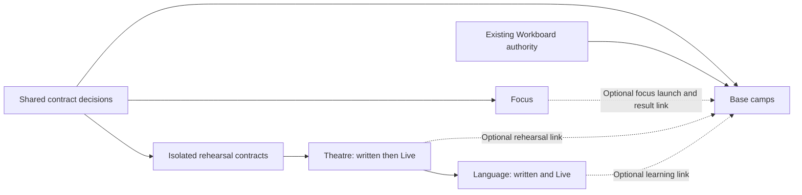

# LIA World experiences — cross-cutting reference dossier

**Status: proposed framing; no feature implementation authorized by this dossier.**  
**Assessment date: 2026-10-29.** Repository evidence is the local working tree on
`main`, starting at `b32961fc98b7dbed89b372a8a92c2b3e889a963d`, including
pre-existing staged and unstaged changes. This is not a production assessment.

## Mandate and reading order

The owner selected four outcomes: accompanied concentration, rehearsal of difficult
conversations in writing and Live, language immersion in writing and Live, and
base camps for real projects. The owner also required reuse of LIA's existing
accounting, limits, registers, authority, memory and architecture contracts.

The owner has **not yet approved** the scope cuts or technical choices below.
Read the dossier in this order:

1. This master plan.
2. [Verified contracts and reuse map](contracts.md).
3. [Shared decisions and owner arbitrations](decisions.md).
4. The four briefs: [focus](01-focus.md), [theatre](02-theatre.md),
   [language](03-language.md), [base camps](04-base-camps.md).
5. [Continuity, qualification and delivery ledger](handoff.md).
6. Launch prompts: [focus](prompts/01-focus.md), [theatre](prompts/02-theatre.md),
   [language](prompts/03-language.md), [base camps](prompts/04-base-camps.md).

New documentation is in English under the repository convention. Product copy
must use the existing localization system; discussion with the owner may remain
in French.

## Product thesis

World earns its place when the spatial and social setting changes what a person
can accomplish: beginning work together, practising in a believable situation,
revisiting a learning route, or seeing the next useful step of a real project.
Walking to another chat box is not an acceptance criterion.

| Experience | Useful loop | Concrete outcome | Spatial or social contribution |
|---|---|---|---|
| Focus | Choose one intention → work for a bounded interval → reflect | A completed work interval and an explicit next step | Voluntary co-presence and a shared rhythm, with private work |
| Theatre | Set a situation → rehearse → inspect feedback → retry a passage | A better opening, boundary or response for a real conversation | A staged situation and a clear separation between acting and coaching |
| Language | Enter a practical scene → communicate → receive selective feedback → revisit | Successful communication of an intention and reusable practice targets | Places organize situations and optional peer practice |
| Base camps | Define an outcome → choose work → produce evidence → review | Real progress supported by native tickets and results | A persistent place to resume a project and launch a focus interval |

These benefits are hypotheses to validate. No retention, learning or productivity
gain is claimed as measured.

## Recommended delivery order and actual dependencies

**Recommended sequence: focus → theatre (written and Live) → language (written
and Live) → base camps.** Begin each with a thin, useful end-to-end slice.

- Focus exercises entry, session lifetime, privacy, bounded optional coaching and
  accounting with a useful deterministic core.
- Theatre establishes isolated rehearsal, scenario state, feedback and the
  training-specific Live lifecycle. Written rehearsal comes first inside this
  workstream, followed by true Live before claiming its selected scope complete.
- Language reuses the qualified rehearsal lifecycle while adding its own pedagogy.
- Base camps can then link these activities to durable outcomes. However, their
  hard dependencies are native Workboard contracts and the optional focus link,
  **not completion of both training experiences**.

The theatre-to-language edge is the recommended reuse sequence, not a reason to
make the theatre feature switch a runtime prerequisite for language. A shared
training implementation must remain independently available to each feature.

## Architecture direction — recommendation, not an existing subsystem

Distinguish three lifetimes:

- **Activity entry:** a World place opens an authorized private native interface.
- **Bounded session:** one focus interval or rehearsal, with its owner,
  participants where applicable, revision, termination and paid attempts.
- **Durable project:** an outcome and references to native work; it outlives visits,
  connections and individual sessions.

World keeps scene, movement and presence authority. Domain services own business
state. PostgreSQL is the proposed authority for durable session receipts, saved
learning and project data; Redis remains appropriate for expiring coordination,
presence and leases. Do not place every project's state in the shared World CAS
document or confuse the existing visual `ExperiencePreferences` with training.

Reuse concrete lifecycle contracts first. Do not begin with a generic game engine,
an agent-per-avatar framework or a new workflow platform. A small shared training
boundary is justified by theatre and language; focus and projects need not inherit
a universal session class. The feature chats must choose actual modules after
checking import boundaries and the current implementation.

## Delivery gates

| Gate | Deliverable and exit evidence | Workstream |
|---|---|---|
| G0 — framing | Owner decisions recorded in [decisions](decisions.md); unknowns assigned; contracts refreshed | This dossier, then each affected chat |
| G1 — focus | Deterministic interval works without an LLM; optional private coaching passes accounting, concurrency and privacy acceptance | Focus |
| G2 — written rehearsal | Isolated scenario, explicit attempts, feedback and zero automatic personal learning; roleplay cannot execute real actions | Theatre |
| G3 — Live rehearsal | Provider-by-provider evidence for isolated startup, transcript handling, standby, failure and closing; personal-key/platform cost split proven | Theatre |
| G4 — learning | Same training contracts support language goals and selective correction in both modes | Language |
| G5 — project continuity | Native ticket authority and actual results remain authoritative; focus links and account lifecycle proven | Base camps |

A gate is not passed by documentation, unit tests alone, or a checkbox in a chat.
See [qualification](handoff.md#qualification-contract).

## Operating the four future chats

Keep this dossier as the common reference. Each workstream gets its own chat,
scope, acceptance IDs and recorded decisions. A chat reads current code and
refreshes the dossier before implementation. It must not assume access to another
chat's history.

The recommended order is sequential implementation, with independent product
refinement allowed earlier. If development later overlaps, each chat must
coordinate ownership of shared files and dependency versions. The first consumer
of a proposed abstraction supplies its concrete proof before the next extends it.

No business code, model calls, runtime mutations, commit, push or deployment is
part of this framing delivery.
