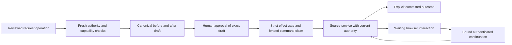

# Conversational application commands

LIA exposes reviewed application operations through the same agent catalogue,
confirmation and effect-accounting seams as its other native tools. The
[operation registry](../../apps/api/src/domains/agents/application/registry.py)
and [native declarations](../../apps/api/src/domains/agents/application/native_operations.py)
are the authority for available operations; the design inventory describes scope
and is not an independent runtime permission list.

See [ADR-339](../architecture/ADR-339-Application-Commands-With-Current-Authority-And-Secure-Continuations.md)
for the architectural decision and
the [source-based design](../superpowers/specs/2026-10-06-lia-application-tools-design.md)
for the feature matrix and integration history.

## Reviewed capabilities

`ApplicationOperationSpec` declares an operation ID, model-facing tool name,
settings/resource sections, strict input/output models, operation kind and
required capabilities. Kinds are read, action, device and secure handoff.
Administrative operations require fresh administrator authority. The current
actor is loaded from the database; identifiers supplied by a model never grant
another person's authority.

The [preference vocabulary](../../apps/api/src/domains/agents/application/preference_fields.py)
declares each shared user-schema field's reviewed surface and writability.
Adding a user field requires declaring its owner. Private authentication input
belongs in its secure form, not a widened model-visible preference schema.

## Preparation, execution and continuation

The [draft contract](../../apps/api/src/domains/agents/application/draft_models.py)
binds command/actor/operation, schema version/fingerprint, canonical intent,
before/after values, expected digest and expiry. Execution validates that exact
approved content against the persisted command and current declaration.
The [availability guard](../../apps/api/src/domains/agents/application/availability.py)
reads the persisted platform capability rather than an outage-tolerant default.
An operator switch or authority failure cannot be bypassed by a cached draft.

[Command storage](../../apps/api/src/domains/agents/application/command_models.py)
keeps encrypted content, result and origin binding, plus finite phases, digest,
expiry and claim token. The repository conditions reads and changes on owner
and phase. Claim-token fencing prevents stale completion from closing a different
attempt. It does not make an external provider's outcome knowable after a lost
response.

The [authenticated router](../../apps/api/src/domains/agents/application/command_router.py)
uses the `/application-commands` prefix below the API version prefix. Browser
origin comes from the actual session cookie and trusted addressed-device header.
Private form, OAuth, upload/download and device operations use their declared
continuation family. The model does not receive credentials or microphone
permission. A recording command requires the browser's own explicit device path.
The [secure continuation](../../apps/api/src/domains/agents/application/secure_continuation.py)
retains original approval, current permission checks and bounded expiry.
Completion uncertainty is observed, not automatically retried as a new mutation.

## Outcome and UI synchronization

The [outcome model](../../apps/api/src/domains/agents/application/outcomes.py)
permits completed success only for `phase=committed` with `committed=true`.
`waiting` carries a pending interaction; `pending`, `claimed` and `resuming`
are command states rather than completed execution results. A form being opened,
a proposed change or a successful request submission is not sufficient evidence
that its awaiting operation committed.

The [state-change publisher](../../apps/api/src/domains/agents/application/state_changes.py)
addresses versioned invalidation hints to the owning account. It publishes
resource names and changed-field identities, not new preference values.
The [frontend schema](../../apps/web/src/types/application-state.ts) validates
the envelope, and
[resource synchronization](../../apps/web/src/hooks/useApplicationResourceSync.ts)
refreshes existing authenticated queries. Source setters and write receipts
retain their own compare-and-set, consent and cache behavior.

## Extension and verification

Add a reviewed declaration and typed schemas, source-service reads/writes,
canonical preparation, authority and continuation contracts, finite outcomes,
and relevant resource invalidation. Do not infer permissions from route
discovery or from decrypted payloads. Do not add a second unconfirmed tool path
to the same conversational mutation.

Test absent/changed approval, role/owner changes, disabled capability, expiry,
schema drift, canonical digest mismatch, replay/claim races and conflicts.
For browser interactions, also test origin/device mismatch, cancellation, late
completion and command observation after a lost response. Frontend tests must
exercise hydration and source-query refresh rather than announcing a local
optimistic value as committed state.

The application suites are under
[`tests/unit/domains/agents/application`](../../apps/api/tests/unit/domains/agents/application).
Strict claim and explicit outcome tests establish local boundaries; device,
provider and real-browser qualification remains separately reported. This guide
does not assert regulatory certification or universal external exactly-once
execution.
