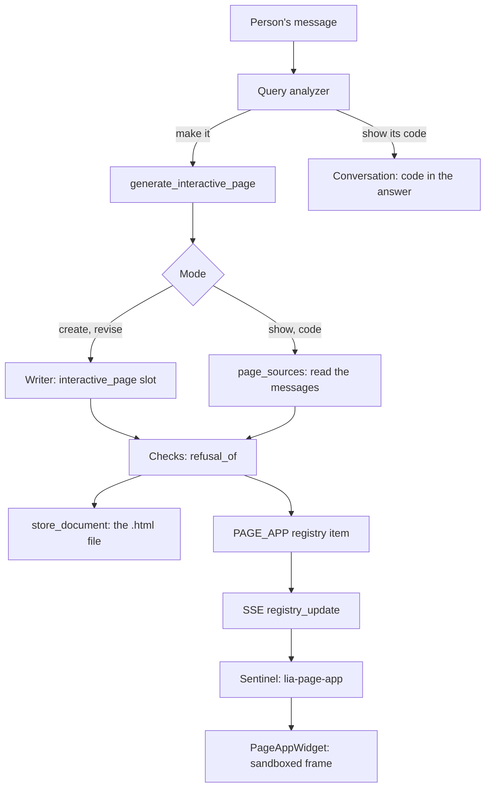

# Interactive pages

A person asks LIA to make something they will use (a game, a quiz, a calculator, a small page) and
gets it running in the conversation, with its `.html` file below it and its source behind one
button. The decisions and their measures are in
[ADR-370](../architecture/ADR-370-A-Page-The-Model-Writes-Runs-In-The-Chat-In-The-Strictest-Frame.md);
this document is the map of the code.

## From a request to a running page



## Backend

| Module | Role |
|---|---|
| `domains/interactive_pages/document.py` | The policy, the frame runtime, the checks; `page_frame`, `page_file`, `refusal_of` |
| `domains/interactive_pages/service.py` | `produce_page`: writes or fetches, checks, files |
| `domains/interactive_pages/schemas.py` | `PageMode`, `PageContent`, `PageSource` |
| `domains/agents/interactive_page/page_sources.py` | Finds the page a mode works from, in the messages |
| `domains/agents/interactive_page/catalogue_manifests.py` | The wording shared by the manifest and the `@tool` schema |
| `domains/agents/tools/interactive_page_tools.py` | The tool: the capability, the inputs, honest failures |
| `domains/agents/nodes/react_context.py` | On a turn making a page, the loop reads no skill catalogue and is told to call the tool |
| `domains/agents/display/components/page_app_sentinel.py` | The empty sentinel the host writes |
| `domains/agents/data_registry/message_widgets.py` | Keeps the page with its message, recomposes it on read |
| `domains/shared/frame_policy.py` | A frame's policy, as a document prefix (pages and skills) |

The writer runs on the `interactive_page` slot: its model, output budget and timeout are set apart
from a document's in admin-llm-config. Its rate limit and step family are those of documents. Its
spend belongs to the turn (`SpendRoad.TURN`); `node_name` tells it apart in the ledger.

## Frontend

| Module | Role |
|---|---|
| `components/chat/PageAppWidget.tsx` | The frame, the poster, the code view, restart |
| `hooks/usePageFrameBridge.ts` | Hears two notifications from one frame, and nothing else |
| `lib/frame-height.ts` | The height a frame reports, bounded; shared with the skills' bridge |
| `lib/message-widgets.ts` | Marks a widget read back from history as `restored` |
| `lib/markdown-source.ts` | Keeps the lines of a `<pre>` through Markdown |
| `lib/remark-literal-html.ts` | A person's HTML stays words |

## The frame's contract

The payload of a `PAGE_APP` item: `title`, `html_content` (policy, runtime, page), `source_offset`
(where the page's own bytes start, ASCII before it) and `initial_view` (`page` or `code`).

The runtime posts `ui/notifications/size-changed` with `{height}` and `ui/notifications/error` with
`{message}`. The host accepts them from `event.origin === 'null'` and from its own frame's window
only, and bounds what it is told.

`apps/api/tests/unit/domains/interactive_pages/page_frame_prefix.json` is the prefix the browser
journey runs. `test_document.py` holds it equal to `page_frame`: after a change to the policy or
the runtime, regenerate it from `page_frame("").document`.

## Configuration

| Setting | Meaning |
|---|---|
| `INTERACTIVE_PAGE_ENABLED` | The deployment offers pages; the administrator's switch is `PlatformCapability.INTERACTIVE_PAGES` |
| `INTERACTIVE_PAGE_MAX_BYTES` | Ceiling of a page, published to the writer |
| `INTERACTIVE_PAGE_SOURCE_LOOKBACK_MESSAGES` | How far back a mode looks for a page |

The writer's model is the **Interactive Page** entry of the LLM configuration, whose code default
is a document's. Its reasoning depth decides how long a person waits: at `high`, two models out of three spent 30,000 output tokens
on a page of 8,000.

## Checking a change

```bash
cd apps/api && .venv/Scripts/pytest tests/unit/domains/interactive_pages tests/unit/domains/agents/interactive_page -v
cd apps/web && npx vitest run src/components/chat/__tests__/PageAppWidget.test.tsx
```

The sandbox, the policy and the layout are the engine's own: `e2e/smoke/chat-page-app.spec.ts`
proves them in a real browser, on the production bundle (see `apps/web/e2e/README.md`).
