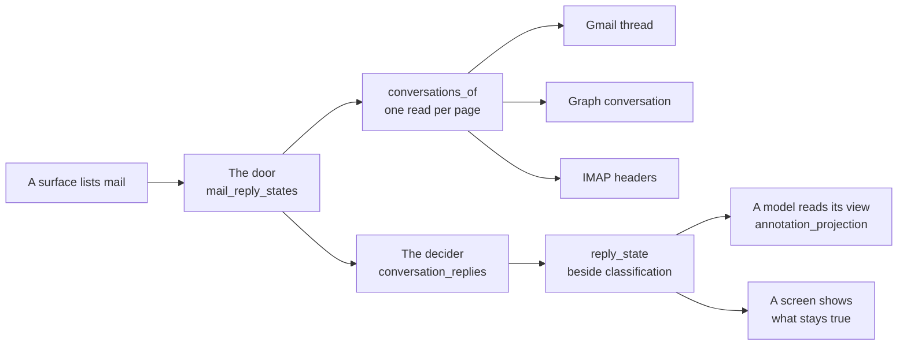

# Mail reply state — whether a listed mail was answered

> Decision record: [ADR-379](../architecture/ADR-379-A-Listed-Mail-Says-Whether-It-Was-Answered.md).

A message read alone cannot say whether it was answered: the reply is ANOTHER message of
the same conversation. Until 2026-11-11 every surface listed mail on its own, so LIA could
offer to answer a mail the person had already answered. Since then every listed message may
carry a **reply state**, read from the mailbox when the message is listed, and every surface
tells the same fact.

## The vocabulary

`apps/api/src/core/mail_reply_state.py` owns it. A message carries `reply_state` beside
`classification`; absent means **not known**, never « not answered ».

| Status | Of a message | Means | Stays true |
|---|---|---|---|
| `answered` | received | the person sent, later and in the same conversation, a message to its sender — or the mailbox itself marks it answered | yes |
| `answer_drafted` | received | an unsent answer of the person's sits in the mailbox | no |
| `unanswered` | received | nothing from the person after it | no |
| `reply_received` | sent by the person | someone else wrote in the conversation afterwards | yes |
| `awaiting_reply` | sent by the person | nobody wrote after it | no |

The two facts are told whenever they are read. The three others are the reading of a moment:
past `MAIL_REPLY_STATE_VALIDITY_SECONDS` a model is told `not_checked`, so an earlier turn's
« no reply yet » is never repeated as current. A state names the message that settles it
(when, to whom or from whom, its first words — the writer's own, the quoted history left
out), its instants in the account's own zone.

A forward to someone else is no answer. A note to oneself, a draft, a message with no date,
and a « nothing found » that a cut conversation cannot vouch for have no state.

## The chain

| Step | Where | What it does |
|---|---|---|
| The read | `conversations_of` on `EmailClientProtocol` (`domains/connectors/clients/protocols.py`) | What the conversations of a page of listed messages hold, in one call |
| The decider | `domains/connectors/clients/conversation_replies.py` | Pure: one rule for the three mailboxes |
| The door | `domains/connectors/mail_reply_states.py` | `reply_states_of` / `attach_reply_states`: the ONE place a surface asks |
| The projection | `core/annotation_projection.py` | What a model is told, decided when the item is shown |

**Per provider.** Gmail reads one thread per distinct conversation (named headers, a partial
response). Graph reads every conversation of the page in one JSON batch; the person's own
messages are those of the Sent folder, and the mailbox's answer mark is the last verb
executed (reply, reply to all). IMAP opens one session and searches by headers; its mark is
the `\Answered` flag, which LIA sets when it sends a reply through SMTP.

**The door fails open.** Nothing is cached — a reply sent a second ago must be seen — and no
model is called. The switch off, a mailbox that cannot be read or the time budget reached
leave the page WITHOUT states. Its settings live in `core/config/connectors.py`, their
defaults in `core/constants.py`:

| Setting | Bounds |
|---|---|
| `MAIL_REPLY_STATE_ENABLED` | The capability: off, no surface reads a conversation and the Tools are offered no mark |
| `MAIL_REPLY_STATE_MAX_MESSAGES` | How many messages of a page are situated |
| `MAIL_REPLY_STATE_CONVERSATION_MAX_MESSAGES` | How many messages of one conversation are read, the newest |
| `MAIL_REPLY_STATE_TIMEOUT_SECONDS` | The time budget of one read |
| `MAIL_REPLY_STATE_VALIDITY_SECONDS` | How long a reading of a moment is told as current |
| `MAIL_REPLY_STATE_EXCERPT_MAX_CHARS` | The longest excerpt of the settling message |

**Observability** (`infrastructure/observability/metrics_mail_reply_state.py`, a row of the
connectors dashboard): `mail_reply_state_reads_total{provider,outcome}` (`read`, `failed`,
`timeout`), `mail_reply_state_read_duration_seconds{provider}` and
`mail_reply_states_total{provider,status}`. Logs carry the provider and an error type, never
a subject, an address or an excerpt.

## What each surface does

| Surface | Where | With the state |
|---|---|---|
| Chat mail tool, both modes | `agents/tools/emails_tools.py` | Each listed message carries it; the `<MailReplyState>` block of the response and ReAct prompts says what it settles |
| Response prompt | `agents/emails/answered_mail.py` | The turn's answered mails are also stated apart, as the LAST context section (`<MailAlreadyAnswered>`): an item id and the instant of the answer, nothing a correspondent wrote |
| Chat e-mail card | `agents/display/components/reply_state_chips.py` | Marks `answered` / `reply_received`, withdraws « reply expected » |
| Initiative | `agents/nodes/initiative_node.py` | Reads the state's line first in each item |
| Voice lookups (phone, Live direct) | `agents/telephony/live_tools.py` | The same tool, reduced for a voice: it hears the state's one line — what happened; « nothing yet » is not said |
| Reply confirmation | `agents/emails/previous_reply.py`, `agents/drafts/preview_email.py` | The card opens on « Already answered », and a reply LIA writes reads the earlier answer |
| Heartbeat | `heartbeat/mail_context.py` | Leaves out unread mail already answered, before its cap; marks an answer drafted and unsent |
| Today briefing | `briefing/fetchers.py`, `briefing/prompt_cards.py` | The mail card's item carries it; the greeting, the synthesis and the radio's journal read it |
| Relationship view, overview, debrief | `relations/providers/emails.py`, `relations/overview/blocks.py` | Per message, instants in UTC like the rest of that contract |
| Tools, mail list | `workbench/mail_reading.py` (`read_reply_marks`) | Read APART: `POST /workbench/mail/reply-marks` answers the marks of the rows shown |
| Tools, contact history | `workbench/contacts_history.py` | Each row shown carries its mark |
| Proactive discussions, mail source | `connectors/discussion_sources.py` | The mailbox's OWN mark alone (`answered_mark`), read with the message and part of the evidence's version; no conversation is read |

A screen shows a durable fact only where its data is cached or archived (the cards, the
relationship view); the Tools read fresh by the person's own hand and also mark an answer
drafted and never sent.

## Every lister declares itself

`domains/connectors/mail_listers.py` lists every module outside the client layer that lists
a mailbox, each with a reason one can check: `SITUATED` (it goes through the door), `MARKED`
(it tells the mailbox's own mark alone) or `NOT_SITUATED`.
`tests/unit/domains/connectors/test_mail_listers_guard.py` walks the call graph and refuses
an omission, a stale entry and a declaration the module does not honour: each standing
names the part of the door its module calls, and no other.

**Adding a surface that lists mail**: call `attach_reply_states` (or `reply_states_of`) while
the mailbox client is open, on the messages the surface actually shows; declare the module;
project the state for a model through `core.mail_reply_state` (`reply_state_view`,
`reply_state_text`, `reply_state_fields`) and never by hand. If a state would say nothing
there, declare `NOT_SITUATED` and write why.

**When a conversation cannot be read** — what the surface tells is versioned and read again,
or its reads are counted — tell the mailbox's own mark: `answered_mark(message)` on a
message read with it (`get_message(mailbox_mark=True)` on Graph, any read on IMAP; Gmail
keeps none), and declare `MARKED`. The mark comes with the message, costs no call and says
the same thing at every read; it does not see an answer that left no mark.

A message `attach_reply_states` has situated carries its state alone: the provider's raw
mark (`answered`, `answered_at`) is the decider's evidence and is taken off the message
there, so nothing is told twice under two names.

## On the web

`apps/web/src/lib/mail-reply-state.ts` reads a stored state and answers what a screen may
show (`settledReplyStatus`); `ClassificationBadges` takes it as `replyState`. The Tools' list
uses `useMailReplyMarks`: one request per read of page one for the rows shown, a next page
asking its own rows, a failed read marking nothing; the row draws `ReplyMarkIcon`.

## Limits

- On Graph and IMAP « the person's own message » means the Sent folder, or a copy found in
  it: a sent message filed elsewhere reads as received. The mailbox's own mark still says a
  message was answered when the reply is not found.
- A proactive discussion's mail source tells the mailbox's own mark and nothing else (its
  evidence is versioned and read again at its version; the registry holds the reason and the
  guard recomputes it). It does not see an answer drafted and never sent, a reply that left
  no mark, nor — on Exchange, which keeps the LAST thing done with a message — a reply
  followed by a forward. On Gmail, which keeps no mark, the person's reply is itself in the
  window read.
- That source's Outlook and iCloud reads are proven on the providers' references and on
  scripted mailboxes, not on a real one (ADR-379, decisions 15 and 16). A bounded read
  fetches its iCloud page in ONE command — every IMAP command is a call of its allowance,
  and one per message refused a full default page as `budget` — and holds that page whole
  meanwhile.
- To an open question (« what do you advise? ») the opening sentence of a pipeline answer may
  still count an answered mail among those asking for a reply, while what follows is right.
  The block stated last halves it (10 wrong openings of 36 against 32 of 60, in the node's
  own chain) and does not remove it; ADR-379 holds the measurements and the leads withdrawn.
- iCloud was not measured on a real account.
