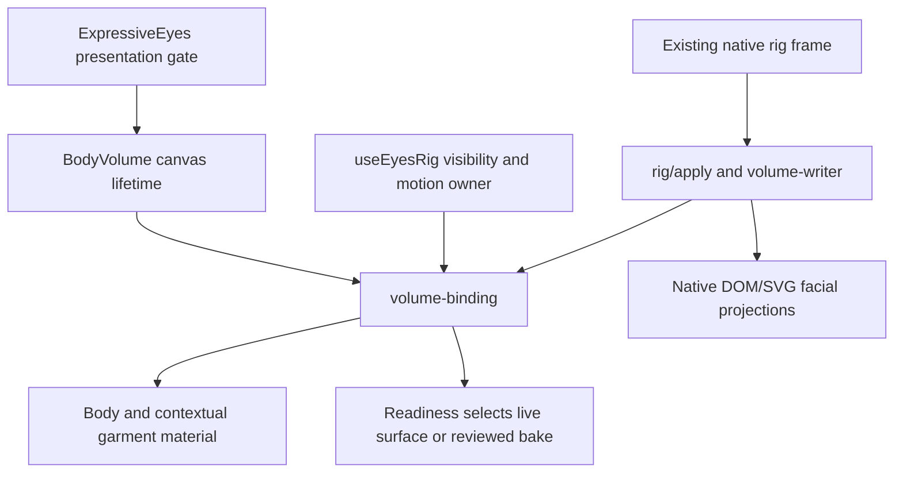

# Native avatar volume

**Last reviewed**: 2026-11-08

This guide describes the implemented local body-volume renderer for LIA's native
avatars. It turns the approved frontal artwork into a bounded anatomical proxy
and projects the existing face onto it using the native rig. The reviewed frontal
source remains the fallback.

The proxy has front/back depth, but its hidden anatomy is approximate. The face
remains projected DOM/SVG layers; garment occlusion depends on the calibrated
body proxy. Neither this guide nor the unit tests guarantee arbitrary-angle
occlusion or real-device performance.

The architectural decision is
[ADR-340](../architecture/ADR-340-Native-Avatar-Volume-From-Reviewed-Offline-Art.md).
The wider avatar behaviour and artwork are documented in
[Spirit avatar](SPIRIT_AVATAR.md) and
[ADR-294](../architecture/ADR-294-A-Face-That-Never-Plays-The-Same-Twice.md).

## Scope and ownership

The supported body identities are declared by `VOLUME_CHARACTERS` in
[`volume-geometry`](../../apps/web/src/components/eyes/volume/volume-geometry.ts).
The companion dispatch and monitor share `BodyVolume`.
Adding an identity requires agreement between its profile, assets, facial
anchors, collar and fallback.

| Contract                                                 | Current source                                                                                                                                                                                                               |
| -------------------------------------------------------- | ---------------------------------------------------------------------------------------------------------------------------------------------------------------------------------------------------------------------------- |
| Animated, non-static presentation gate                   | [`ExpressiveEyes.tsx`](../../apps/web/src/components/eyes/ExpressiveEyes.tsx)                                                                                                                                                |
| Canvas replacement and drawing-buffer bound              | [`BodyVolume.tsx`](../../apps/web/src/components/eyes/volume/BodyVolume.tsx)                                                                                                                                                 |
| Native visibility, document and reduced-motion owner     | [`useEyesRig.ts`](../../apps/web/src/components/eyes/useEyesRig.ts)                                                                                                                                                          |
| Frame writer and projected facial surface                | [`rig/apply.ts`](../../apps/web/src/components/eyes/rig/apply.ts), [`volume-writer.ts`](../../apps/web/src/components/eyes/volume/volume-writer.ts)                                                                          |
| GPU lifetime, image loading, state gates and snapshots   | [`volume-binding.ts`](../../apps/web/src/components/eyes/volume/volume-binding.ts)                                                                                                                                           |
| Companion asset identity and variant                     | [`companion-catalogue.ts`](../../apps/web/src/components/spirit/companion-catalogue.ts)                                                                                                                                      |
| Joint vocabulary, acting and anatomical source profiles  | [`rig/channels.ts`](../../apps/web/src/components/eyes/rig/channels.ts), [`rig/limbs.ts`](../../apps/web/src/components/eyes/rig/limbs.ts), [`limb-profiles.ts`](../../apps/web/src/components/eyes/volume/limb-profiles.ts) |
| Readiness selectors, native bake and fallback projection | [`eyes.css`](../../apps/web/src/styles/eyes.css)                                                                                                                                                                             |

These sources own identities, versions, dimensions, thresholds and budgets.
Link to them when documenting a limit instead of maintaining a second numeric
declaration.

## Body geometry and source coverage

[`volumeProfile`](../../apps/web/src/components/eyes/volume/volume-geometry.ts)
provides calibrated lobes, eye and mouth anchors, scale and collar landmarks for
each supported character and variant. `volumePose` derives bounded yaw and pitch
from native channels. The source does not supply independent rear artwork or a
full original sculpt.

[`readVolumeMask`](../../apps/web/src/components/eyes/volume/volume-mask.ts)
performs one bounded Canvas2D alpha read when the body image loads. There is no
GPU readback or per-frame source-image processing. An unavailable or unreadable
Canvas2D source returns no mask and leaves the bake available.

The
[`distance profile`](../../apps/web/src/components/eyes/volume/volume-distance.ts)
tapers relief toward the source contour. The
[`outline builder`](../../apps/web/src/components/eyes/volume/volume-outline.ts)
samples and refines that contour, clips front triangles, preserves sampled
opaque crests and joins a reflected rear with shared contour positions.
[`surface normals`](../../apps/web/src/components/eyes/volume/volume-normals.ts)
are accumulated from the resulting triangles; contour normals follow the alpha
boundary.

Fine hair, soft shadows and source details can remain outside this sampled hull.
They use the planar material added by
[`withSoftFringe`](../../apps/web/src/components/eyes/volume/volume-fringe.ts).
Before upload,
[`volumeFringeAlpha`](../../apps/web/src/components/eyes/volume/volume-coverage.ts)
rasterizes physical front triangles in source UV space at pixel centres. Covered
solid alpha is removed from the planar texture, while soft alpha and uncovered
source details remain. Rear triangles and the marked planar material do not
conceal missing frontal details. This preparation shares the existing source
read and is retained with the binding's CPU data.

[`mesh-gpu`](../../apps/web/src/components/eyes/volume/mesh-gpu.ts) uses native
WebGL buffers, premultiplied alpha and a body depth test. The monitor explicitly
enables its opaque casing material. Organic radial normals alone do not enable
an opaque rim. If the optional fringe-mask canvas cannot be prepared, the
material can use the original source alpha; that degraded path does not promise
the same avoidance of duplicate solid alpha.

The companion sources contain a measured low-alpha background matte. The shared
[`source-alpha`](../../apps/web/src/components/eyes/volume/source-alpha.ts)
transfer removes the declared floor and remaps the remaining alpha continuously.
Both the GPU material and the local SVG filter used by the bake read this same
transfer. The source files, RGB samples and geometry are unchanged. The filter
runs before brightness and shadow, so the fallback shadow follows the cleaned
silhouette. Monitor and cloth materials keep the identity transfer. The GPU
discard threshold retains the first non-matte alpha sample and remains
representable by the WebGL1 minimum fragment precision.

## Local limb articulation

[`limb-profiles`](../../apps/web/src/components/eyes/volume/limb-profiles.ts)
declares pivots, influence regions, attachment falloff and joint limits separately
for each source identity and variant. Only drawn anatomy is articulated:

| Identity                           | Supported anatomy                                     |
| ---------------------------------- | ----------------------------------------------------- |
| Spirit, Nimbo                      | Lateral appendages, without invented wrists or legs   |
| Moss, Lumen                        | Arms and feet, without separate wrist or leg segments |
| BIP, Boulon, Oscar                 | Arms, wrists, legs and feet                           |
| Orbit, monitor and eye-only styles | No limb articulation; Orbit's ring stays rigid        |

The canonical `LIMB_CHANNELS` in
[`rig/channels`](../../apps/web/src/components/eyes/rig/channels.ts) are signed
screen-plane angles; zero retains the authored pose. The
[`limb acting`](../../apps/web/src/components/eyes/rig/limbs.ts) uses native
springs, loops and tapes. Quiet asymmetric settling shares the rig clock;
readable occasional beats share the existing facial-life cue and seeded side.
Listening opens the stance, thinking favours one side, and
[`speech gestures`](../../apps/web/src/components/eyes/rig/limb-speech.ts) follow
generated phrase stresses and release at their pauses. Quiet phrases need no
hand accent. Body-scene joints share explicit preparation, action, hold and
recovery phases with the face. Interruptions retain spring
position and velocity. There is no additional timer or random stream.

[`body-scene`](../../apps/web/src/components/eyes/rig/body-scene.ts) compiles the
authored phases into native tapes. Continuous flight trajectories avoid a held
apex; smooth target interpolation is opt-in, so existing step tapes retain their
semantics. The character's acting profile limits deformation according to its
material. Wrists trail the primary gesture instead of moving every joint in
unison.

The [approved finishing pass](../superpowers/specs/2026-11-08-avatar-finishing.md)
keeps this pipeline and its artwork. Full turns, somersaults and the repetitive
jig are retired from the scene catalogue. A joyful hop has one takeoff and
landing; the floating scene rises upright, holds its attention, then descends
before restoring contact. Oscar holds his bow, BIP settles before his wink,
and the softer identities keep a longer recovery. The acting profile owns
their pace and selects a repertoire suited to each identity.

Idle life no longer chooses decorative head rocking, eye hops or slapstick
beats. A conversational acknowledgement and thoughtful inclination remain
explicit host cues. Breathing, gaze, blinking and meaningful facial beats
continue; speaking receives its accents from generated phrases rather than
a separate periodic eye bounce. Scene and gesture interruptions preserve the
existing spring state.

[`body-support`](../../apps/web/src/components/eyes/body-support.ts) registers
source-alpha sole landmarks independently for both variants. The
[`body-stage writer`](../../apps/web/src/components/eyes/rig/body-stage-writer.ts)
compensates stage rotation and scale about the selected support before applying
the existing viewport constraint. Scenes release that support during flight.
The rig also keeps contact withdrawn while the actual spring orientation is
outside the grounded lean envelope, including interruption or replacement by
another scene; its existing spring restores support as the body becomes upright.
Floating identities acquire no imaginary feet. This grounds the authored stage
point, not independently articulated foot geometry: it is not inverse kinematics.
The ground shadow follows physical travel and viewport correction, separately
from the torso's support compensation.

[`limb-skin`](../../apps/web/src/components/eyes/volume/limb-skin.ts) prepares
source-space weights and gradients once. The physical hull and locally
tessellated fringe use the same deformation, while face, collar and core torso
remain outside the joint influence. The
[`GPU shader`](../../apps/web/src/components/eyes/volume/limb-shader.ts) bends
distal joints before their parents and transforms normals with the
inverse-transpose spatial Jacobian. Material classification retains the original
normal sentinels. Frames update joint uniforms without rebuilding the mesh.
The reviewed texture and its UVs remain the source;
this adds no texture detail, independent fingers or hand-over-face occlusion.
The native shader distinguishes soft surfaces, Oscar's satin finish, hard shells,
monitor casing and woven cloth. Diffuse light is normalized against the source
normal, and sheen contributes only its change from that normal. The neutral
artwork remains unchanged; turned surfaces receive a bounded material response.
Alpha, fringe transmission and the contextual warm/cool tint retain their
existing paths. Material parameters are prepared once and rebound per draw
because body and cloth share the context.

Articulation adds a static skin buffer and local fringe tessellation. The
geometry budget is prepared once and remains within the existing index and
drawing-buffer bounds. The deformation tests distinguish continuous orientation
from the raster footprint of almost-collinear alpha cuts; their absolute
subpixel tolerance is declared in the test. They do not claim an exact
topological reconstruction of the source silhouette.

## Face and contextual props

The rig writer paints the body and then projects the existing facial wrappers
through
[`createVolumeSurfaceWriter`](../../apps/web/src/components/eyes/volume/volume-writer.ts).
The eyes, eyebrows and mouth keep their native contours and expression channels.
Oscar's eye sockets use rigid cranial projection; mouth articulation remains
separate. The monitor's screen and brow layer move together and keep the rounded
screen clip.

The live face clip comes from the projected source-body contour. Independent
iris masks still constrain pupil travel. These are DOM/SVG projections rather
than a general face mesh in the body's depth buffer, so alignment and occlusion
must be checked within the supported turn envelope.

[`physical-prop-writer`](../../apps/web/src/components/eyes/volume/physical-prop-writer.ts)
projects worn freezing laurel and temple/eye drops with the same native anchors.
Floating environmental motifs retain stage anchors. Static landmarks and collar calibration are owned by
[`layout-profiles`](../../apps/web/src/components/eyes/layout-profiles.ts).

The scarf uses the calibrated collar and immutable woven artwork, built by
[`cloth-geometry`](../../apps/web/src/components/eyes/volume/cloth-geometry.ts).
[`cloth-gpu`](../../apps/web/src/components/eyes/volume/cloth-gpu.ts) shares the
body context and channels, and lazily loads its local material when cold is
active. It disposes that material when cold stops. BIP, Oscar and Nimbo use a
closed circumference with lateral returns; the other collars retain the
authored front patch.

Oscar's band fills the neckline beneath the chin and follows the upper shoulders.
Nimbo's wider fabric extends downwards from its registered upper edge, preserving
mouth clearance and the complete cloud circumference. The fitting tests read the
emitted mesh against source-art landmarks and reject the preceding thin profiles;
visual review still checks both variants, turns and the fallback separately.

[`scarf-fit`](../../apps/web/src/components/eyes/volume/scarf-fit.ts) maps measured
landmarks of the immutable woven artwork onto each collar. Neck width, band
thickness and tail length are independent. Front patches share a piecewise
mapping between the live mesh and clipped CSS fallback, with a mesh row at the
texture seam. The closed collars use prepared
[`scarf-wrap`](../../apps/web/src/components/eyes/volume/scarf-wrap.ts) facets for
both surfaces. Their band and upper knot stay attached to the body. The free
end alone shears below a shared attachment line, following the existing head
yaw and body-roll velocities. The derived `scarfTrail` is zero at rest and
under reduced motion; cold weather alone never starts a periodic cloth wiggle.
The lower patch retains its original UVs and meets the upper one at the same
source position. Fallback after context loss
retains the fitted garment rather than a width-scaled square.

The wrapped fallback projects its front and rear facets before compositing each
side's opacity. This keeps shared textile edges continuous during a weather
fade. Two stages beside the head establish explicit rear/body/front paint order.
They inherit the whole-body motion and share the head's mass translation, tilt,
rotation, scale and origin. Each facet composes the head projection with its
immutable source basis on one element, before opacity is applied; its pseudo
element paints only the original textile patch. The lower knot patch includes
its free-end shear in that same transform order. This preserves source depth even when WebKit
flattens transformed descendants, without an inverse camera, geometry changes
or per-frame JavaScript. There is no extra canvas or clock.
The companion frame declaration also supplies those internal translations as
lengths: percentage translations in WebKit can round a fractional reference box
to physical pixels, shifting the cloth relative to the same head frame.

Browser qualification checks
[`absolute source projection`](../../apps/web/e2e/capture/scarf-projection.mjs)
and actual rear-cloth occlusion separately. The
[`occlusion capture`](../../apps/web/e2e/capture/avatar-scarf-occlusion.mjs)
compares paused native frames against the original body's alpha transmission,
with unchanged/restored controls; matching corners alone cannot prove paint order.

Closed collars use `LEQUAL` against the body, so rear returns are occluded. Front
patches retain deliberate `ALWAYS` compositing with depth writes disabled to
avoid subdivision holes. Every draw restores `LEQUAL` and depth writes in
`finally`. The two wrapped material lifetimes are owned by
[`cloth-material`](../../apps/web/src/components/eyes/volume/cloth-material.ts);
readiness requires both, and a failure releases the pair. While cold requires
an unavailable garment, the entire avatar keeps its coherent baked fallback;
the already prepared body GPU resources remain available. Warming resumes the
live body. Allocation, readiness and redraw invalidation read the same normalized
scarf opacity, including the activation boundary. This is fitted geometry, not cloth
simulation, self-collision or unrestricted garment occlusion.

## Runtime gate and resource lifecycle

`BodyVolume` renders no canvas for a disabled presentation. Animated previews
only permit the live surface when their native motion gate is enabled; historical
static portraits use their bake. React owns mount, identity/variant/size
replacement and detach, without a second animation loop.

The binding starts only when active and visible, reduced motion is off, the
document is visible, and loading, latched failure and context loss permit it.
These inputs come from the existing rig owner. A paint can skip unchanged head,
limb, light, cold and scarf-trail values without an additional frame timer. A
limb-only change therefore redraws even when head and lighting are stationary.

Stopping releases GPU programs, buffers and textures for both body and scarf,
clears live readiness and restores fallback projection. The same binding retains
its loaded image, alpha mask and prepared mesh for a later resume. A temporary
stop does not explicitly release the browser context. Permanent detach also calls
[`releaseNativeContext`](../../apps/web/src/components/eyes/volume/context-lifetime.ts),
which makes a best-effort request through the optional native context extension.
Browsers without that extension keep their normal context lifetime.

| Condition                                                                             | Native result                                                          |
| ------------------------------------------------------------------------------------- | ---------------------------------------------------------------------- |
| Hidden viewport/document or reduced motion                                            | Stop live material and use the reviewed bake                           |
| Missing WebGL, failed body image, unreadable/empty alpha, failed GPU creation/linking | Keep readiness false and retain the bake; a binding failure is latched |
| Fringe texture allocation fails                                                       | Live body draw stays unready, so the bake remains visible              |
| Context lost                                                                          | Stop resources and use the bake                                        |
| Context restored                                                                      | Restart only if the current native gates permit it                     |
| Identity, variant or size replacement                                                 | Clean up the old binding and reset readiness during layout             |
| Permanent detach                                                                      | Dispose native GPU resources and attempt context release               |

The CSS readiness selectors hide the original body bake only after the body and
every currently required garment are ready. They remove fallback head yaw/pitch from the live head while retaining
its other native motion. Facial and scarf fallback projection follows readiness,
so a replacement canvas cannot inherit the previous body's live state.

The low-power context preference, bounded drawing buffer and bounded geometry
are source contracts. They are not measured promises of frame rate, decoded
memory, download size or support on every browser/GPU.

## Verification and troubleshooting

| Evidence                                                                                                                                                                                                                 | What it establishes                                                                                                                       |
| ------------------------------------------------------------------------------------------------------------------------------------------------------------------------------------------------------------------------ | ----------------------------------------------------------------------------------------------------------------------------------------- |
| [`volume-contour.test.ts`](../../apps/web/src/components/eyes/volume/__tests__/volume-contour.test.ts)                                                                                                                   | Independent analytic alpha boundary, hull joins and final-triangle normals                                                                |
| [`volume-coverage.test.ts`](../../apps/web/src/components/eyes/volume/__tests__/volume-coverage.test.ts)                                                                                                                 | Independent UV coverage with holes, soft alpha, shared edges and excluded rear/planar triangles                                           |
| [`volume-fringe.test.ts`](../../apps/web/src/components/eyes/volume/__tests__/volume-fringe.test.ts)                                                                                                                     | Material distinction, optional sampler lifecycle and Canvas2D/allocation failure paths                                                    |
| [`volume-binding.test.ts`](../../apps/web/src/components/eyes/volume/__tests__/volume-binding.test.ts)                                                                                                                   | Visibility/motion gates, replacement, context loss and resource disposal                                                                  |
| [`limbs.test.ts`](../../apps/web/src/components/eyes/rig/__tests__/limbs.test.ts), [`css-boundary.test.ts`](../../apps/web/src/components/eyes/rig/__tests__/css-boundary.test.ts)                                       | Independent motion, phrase release, scene timing, interruption, drift, reduced-motion resume and each joint's actual GPU reader           |
| [`limb-skin.test.ts`](../../apps/web/src/components/eyes/volume/__tests__/limb-skin.test.ts), [`limb-deformation.test.ts`](../../apps/web/src/components/eyes/volume/__tests__/limb-deformation.test.ts)                 | Anatomy/profile agreement, fixed central landmarks, joint bounds, physical/fringe agreement and deformation against source-alpha evidence |
| [`avatar-limbs.spec.ts`](../../apps/web/e2e/smoke/avatar-limbs.spec.ts)                                                                                                                                                  | Native browser surface, contextual movement and motion/visibility gates                                                                   |
| [`volume-writer.test.ts`](../../apps/web/src/components/eyes/volume/__tests__/volume-writer.test.ts), [`physical-prop-writer.test.ts`](../../apps/web/src/components/eyes/volume/__tests__/physical-prop-writer.test.ts) | Native facial and worn-prop projection contracts                                                                                          |
| [`cloth-gpu.test.ts`](../../apps/web/src/components/eyes/volume/__tests__/cloth-gpu.test.ts)                                                                                                                             | Shared material lifecycle and deliberate front-compositing state restoration                                                              |
| [`cloth-wrap-lifecycle.test.ts`](../../apps/web/src/components/eyes/volume/__tests__/cloth-wrap-lifecycle.test.ts)                                                                                                       | Both decode orders, coherent readiness, allocation rollback, failure/warm recovery, context loss and stale callbacks                      |
| [`scarf-fit.test.ts`](../../apps/web/src/components/eyes/volume/__tests__/scarf-fit.test.ts)                                                                                                                             | Independent CSS slice interpretation against the live mesh and fitted material landmarks                                                  |
| [`body-support.test.ts`](../../apps/web/src/components/eyes/__tests__/body-support.test.ts), [`body-stage-writer.test.ts`](../../apps/web/src/components/eyes/rig/__tests__/body-stage-writer.test.ts)                   | Support compensation, identity changes, shadow separation and viewport priority                                                           |
| [`body-choreography.test.ts`](../../apps/web/src/components/eyes/rig/__tests__/body-choreography.test.ts)                                                                                                                | Actual spring trajectories, contact phases, material deformation and interruption recovery                                                |
| [`EyesFace.volume.test.tsx`](../../apps/web/src/components/eyes/__tests__/EyesFace.volume.test.tsx)                                                                                                                      | Real native component dispatch and presentation gates                                                                                     |

Run the repository frontend test task for the full gate. A focused local run can
select `src/components/eyes/volume/__tests__` and
`src/components/eyes/__tests__/EyesFace.volume.test.tsx`; preserve the Taskfile's
neutralized public API and product-telemetry variables when invoking Vitest
directly. Keep contour and coverage oracles independent from the implementation.
Do not repair a failure by widening an expectation or regenerating a baseline
from the failing renderer alone.

When a surface stays baked, check the presentation and native visibility/motion
gates, then asset identity/load, alpha preparation, GPU readiness and context
state. A latched failure needs a new binding rather than automatic retries.
When a face or prop appears displaced, inspect the character/variant profile,
source contour, readiness selectors and projected wrappers together.
For a stationary or detached appendage, inspect its source profile, rig channel,
joint influence and redraw invalidation together; inspect the alpha fringe too.

Mocked WebGL tests establish CPU geometry, requested graphics operations and
resource ownership. Actual GPU raster output, turn-envelope visual fidelity,
asset download/decode costs, device context limits and sustained frame rate
require separate browser/device evidence.
