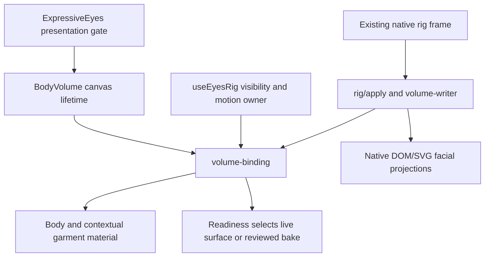

# Native avatar volume

**Last reviewed**: 2026-10-12

This guide describes the implemented local body-volume renderer for LIA's native
avatars. It turns the approved frontal artwork into a bounded anatomical proxy
and projects the existing face onto it using the native rig. The reviewed frontal
source remains the fallback.

The proxy has front/back depth, but its hidden anatomy is approximate. The face
remains projected DOM/SVG layers and the scarf is intentionally composited in
front. Neither this guide nor the unit tests guarantee arbitrary-angle occlusion
or real-device performance.

The architectural decision is
[ADR-340](../architecture/ADR-340-Native-Avatar-Volume-From-Reviewed-Offline-Art.md).
The wider avatar behaviour and artwork are documented in
[Spirit avatar](SPIRIT_AVATAR.md) and
[ADR-294](../architecture/ADR-294-A-Face-That-Never-Plays-The-Same-Twice.md).

## Scope and ownership

The supported body identities are declared by `VOLUME_CHARACTERS` in
[`volume-geometry`](../../apps/web/src/components/eyes/volume/volume-geometry.ts).
The companion dispatch and monitor use `BodyVolume`; Smiley uses its separate
[`SmileySphere`](../../apps/web/src/components/eyes/smiley/SmileySphere.tsx).
Adding an identity requires agreement between its profile, assets, facial
anchors, collar and fallback.

| Contract | Current source |
| --- | --- |
| Animated, non-static presentation gate | [`ExpressiveEyes.tsx`](../../apps/web/src/components/eyes/ExpressiveEyes.tsx) |
| Canvas replacement and drawing-buffer bound | [`BodyVolume.tsx`](../../apps/web/src/components/eyes/volume/BodyVolume.tsx) |
| Native visibility, document and reduced-motion owner | [`useEyesRig.ts`](../../apps/web/src/components/eyes/useEyesRig.ts) |
| Frame writer and projected facial surface | [`rig/apply.ts`](../../apps/web/src/components/eyes/rig/apply.ts), [`volume-writer.ts`](../../apps/web/src/components/eyes/volume/volume-writer.ts) |
| GPU lifetime, image loading, state gates and snapshots | [`volume-binding.ts`](../../apps/web/src/components/eyes/volume/volume-binding.ts) |
| Companion asset identity and variant | [`companion-catalogue.ts`](../../apps/web/src/components/spirit/companion-catalogue.ts) |
| Readiness selectors, native bake and fallback projection | [`eyes.css`](../../apps/web/src/styles/eyes.css) |

These sources own identities, versions, dimensions, thresholds and budgets.
Link to them when documenting a limit instead of maintaining a second numeric
declaration.

## Body geometry and source coverage

[`volumeProfile`](../../apps/web/src/components/eyes/volume/volume-geometry.ts)
provides calibrated lobes, eye and mouth anchors, scale and collar landmarks for
each supported character and variant. `volumePose` derives bounded yaw and pitch
from native channels. The source does not supply independent rear artwork or a
full original sculpt.

[`readVolumeMask`](../../apps/web/src/components/eyes/volume/volume-mask.ts)
performs one bounded Canvas2D alpha read when the body image loads. There is no
GPU readback or per-frame source-image processing. An unavailable or unreadable
Canvas2D source returns no mask and leaves the bake available.

The
[`distance profile`](../../apps/web/src/components/eyes/volume/volume-distance.ts)
tapers relief toward the source contour. The
[`outline builder`](../../apps/web/src/components/eyes/volume/volume-outline.ts)
samples and refines that contour, clips front triangles, preserves sampled
opaque crests and joins a reflected rear with shared contour positions.
[`surface normals`](../../apps/web/src/components/eyes/volume/volume-normals.ts)
are accumulated from the resulting triangles; contour normals follow the alpha
boundary.

Fine hair, soft shadows and source details can remain outside this sampled hull.
They use the planar material added by
[`withSoftFringe`](../../apps/web/src/components/eyes/volume/volume-fringe.ts).
Before upload,
[`volumeFringeAlpha`](../../apps/web/src/components/eyes/volume/volume-coverage.ts)
rasterizes physical front triangles in source UV space at pixel centres. Covered
solid alpha is removed from the planar texture, while soft alpha and uncovered
source details remain. Rear triangles and the marked planar material do not
conceal missing frontal details. This preparation shares the existing source
read and is retained with the binding's CPU data.

[`mesh-gpu`](../../apps/web/src/components/eyes/volume/mesh-gpu.ts) uses native
WebGL buffers, premultiplied alpha and a body depth test. The monitor explicitly
enables its opaque casing material. Organic radial normals alone do not enable
an opaque rim. If the optional fringe-mask canvas cannot be prepared, the
material can use the original source alpha; that degraded path does not promise
the same avoidance of duplicate solid alpha.

## Face and contextual props

The rig writer paints the body and then projects the existing facial wrappers
through
[`createVolumeSurfaceWriter`](../../apps/web/src/components/eyes/volume/volume-writer.ts).
The eyes, eyebrows and mouth keep their native contours and expression channels.
Oscar's eye sockets use rigid cranial projection; mouth articulation remains
separate. The monitor's screen and brow layer move together and keep the rounded
screen clip.

The live face clip comes from the projected source-body contour. Independent
iris masks still constrain pupil travel. These are DOM/SVG projections rather
than a general face mesh in the body's depth buffer, so alignment and occlusion
must be checked within the supported turn envelope.

[`physical-prop-writer`](../../apps/web/src/components/eyes/volume/physical-prop-writer.ts)
projects worn freezing laurel and temple/eye drops with the same native anchors.
Smiley's props use its analytic sphere projection. Floating environmental motifs
retain stage anchors. Static landmarks and collar calibration are owned by
[`layout-profiles`](../../apps/web/src/components/eyes/layout-profiles.ts).

The scarf is an authored alpha front patch on the calibrated collar, built by
[`cloth-geometry`](../../apps/web/src/components/eyes/volume/cloth-geometry.ts).
[`cloth-gpu`](../../apps/web/src/components/eyes/volume/cloth-gpu.ts) shares the
body context and channels, and lazily loads its local material when cold is
active. It disposes that material when cold stops.

During the scarf draw, `depthFunc(ALWAYS)` and disabled depth writes deliberately
put the front garment ahead of coarse body triangles. The draw restores
`LEQUAL` and depth writes in `finally`. This avoids subdivision holes, but is not
a cloth simulation, self-collision system or general depth-correct garment
occlusion. The existing native scarf remains available until its live material
is ready.

## Runtime gate and resource lifecycle

`BodyVolume` renders no canvas for a disabled presentation. Animated previews
only permit the live surface when their native motion gate is enabled; historical
static portraits use their bake. React owns mount, identity/variant/size
replacement and detach, without a second animation loop.

The binding starts only when active and visible, reduced motion is off, the
document is visible, and loading, latched failure and context loss permit it.
These inputs come from the existing rig owner. A paint can skip unchanged head,
light, cold and scarf-sway values without an additional frame timer.

Stopping releases GPU programs, buffers and textures for both body and scarf,
clears live readiness and restores fallback projection. The same binding retains
its loaded image, alpha mask and prepared mesh for a later resume. A temporary
stop does not explicitly release the browser context. Permanent detach also calls
[`releaseNativeContext`](../../apps/web/src/components/eyes/volume/context-lifetime.ts),
which makes a best-effort request through the optional native context extension.
Browsers without that extension keep their normal context lifetime.

| Condition | Native result |
| --- | --- |
| Hidden viewport/document or reduced motion | Stop live material and use the reviewed bake |
| Missing WebGL, failed body image, unreadable/empty alpha, failed GPU creation/linking | Keep readiness false and retain the bake; a binding failure is latched |
| Fringe texture allocation fails | Live body draw stays unready, so the bake remains visible |
| Context lost | Stop resources and use the bake |
| Context restored | Restart only if the current native gates permit it |
| Identity, variant or size replacement | Clean up the old binding and reset readiness during layout |
| Permanent detach | Dispose native GPU resources and attempt context release |

The CSS readiness selectors hide the original body bake only after a live draw
succeeds. They remove fallback head yaw/pitch from the live head while retaining
its other native motion. Facial and scarf fallback projection follows readiness,
so a replacement canvas cannot inherit the previous body's live state.

The low-power context preference, bounded drawing buffer and bounded geometry
are source contracts. They are not measured promises of frame rate, decoded
memory, download size or support on every browser/GPU.

## Verification and troubleshooting

| Evidence | What it establishes |
| --- | --- |
| [`volume-contour.test.ts`](../../apps/web/src/components/eyes/volume/__tests__/volume-contour.test.ts) | Independent analytic alpha boundary, hull joins and final-triangle normals |
| [`volume-coverage.test.ts`](../../apps/web/src/components/eyes/volume/__tests__/volume-coverage.test.ts) | Independent UV coverage with holes, soft alpha, shared edges and excluded rear/planar triangles |
| [`volume-fringe.test.ts`](../../apps/web/src/components/eyes/volume/__tests__/volume-fringe.test.ts) | Material distinction, optional sampler lifecycle and Canvas2D/allocation failure paths |
| [`volume-binding.test.ts`](../../apps/web/src/components/eyes/volume/__tests__/volume-binding.test.ts) | Visibility/motion gates, replacement, context loss and resource disposal |
| [`volume-writer.test.ts`](../../apps/web/src/components/eyes/volume/__tests__/volume-writer.test.ts), [`physical-prop-writer.test.ts`](../../apps/web/src/components/eyes/volume/__tests__/physical-prop-writer.test.ts) | Native facial and worn-prop projection contracts |
| [`cloth-gpu.test.ts`](../../apps/web/src/components/eyes/volume/__tests__/cloth-gpu.test.ts) | Shared material lifecycle and deliberate front-compositing state restoration |
| [`EyesFace.volume.test.tsx`](../../apps/web/src/components/eyes/__tests__/EyesFace.volume.test.tsx) | Real native component dispatch and presentation gates |

Run the repository frontend test task for the full gate. A focused local run can
select `src/components/eyes/volume/__tests__` and
`src/components/eyes/__tests__/EyesFace.volume.test.tsx`; preserve the Taskfile's
neutralized public API and product-telemetry variables when invoking Vitest
directly. Keep contour and coverage oracles independent from the implementation.
Do not repair a failure by widening an expectation or regenerating a baseline
from the failing renderer alone.

When a surface stays baked, check the presentation and native visibility/motion
gates, then asset identity/load, alpha preparation, GPU readiness and context
state. A latched failure needs a new binding rather than automatic retries.
When a face or prop appears displaced, inspect the character/variant profile,
source contour, readiness selectors and projected wrappers together.

Mocked WebGL tests establish CPU geometry, requested graphics operations and
resource ownership. Actual GPU raster output, turn-envelope visual fidelity,
asset download/decode costs, device context limits and sustained frame rate
require separate browser/device evidence.
