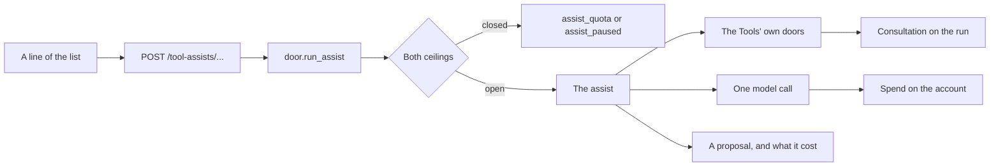

# What LIA does from the Tools

A click on a screen of the Tools asks LIA once and gets a proposal back: words to read, or a form to
check. Nothing is sent, created or saved until the person does it by hand. The decisions are
[ADR-372](../architecture/ADR-372-What-LIA-Does-From-The-Tools-A-Click-A-Call-A-Proposal.md); this
page is the map of the code. The hand-made side is [WORKBENCH.md](WORKBENCH.md).

The same proposal boundary also serves text selected throughout the authenticated
application, including the chat. Reading and editing share one selection engine;
their action registries and destination forms are described below.

## Where it lives

| Layer | Path |
|---|---|
| Bounded context (REST, no LangGraph) | `apps/api/src/domains/tool_assists/` |
| Settings | `apps/api/src/core/config/workbench.py` (`TOOL_ASSIST*` in the env templates) |
| Capability switch | `PlatformCapability.TOOL_ASSISTS` (`domains/feature_switches/registry.py`) |
| Slot | `tool_assist`, beside `email_digest`, `emails_agent` (asked as `email_agent`) and `vision_analysis` |
| Prompts | `domains/agents/prompts/v1/tool_assist_*` |
| Metrics | `infrastructure/observability/metrics_tool_assists.py`, panels on dashboard `10-oauth-connectors-mcp.json` |
| Page | `apps/web/src/components/workbench/assist/` |
| The sign | `AssistStars`: shared yellow stars for explicit AI assistance (guard `assistStars.guard.test.ts`) |
| Addresses and shapes | `apps/web/src/lib/workbench/assist.ts` |

## The modules

| Module | Role |
|---|---|
| `catalogue.py` | Every assist, the slot that answers it and the sources it opens; boot completeness assert. |
| `door.py` | `run_assist`: both ceilings, the spend billed whatever happens, the read filed, the outcome counted, a failure in the workbench's words. |
| `llm.py` | `ask_slot`, `ask_slot_on_image`: one short structured call; `assist_line`, the one-line scaffolds. |
| `mail.py` | A message's summary (the digest), reply, translation, a conversation's summary, a whole message, a subject. A reply proposed to a message the person already answered reads that earlier answer and continues from it ([reply state](./MAIL_REPLY_STATE.md)). |
| `mail_words.py` | A sentence as search criteria, or as a filter's form. |
| `mail_triage.py` | What the messages of a page weigh. |
| `text.py` | Words being written: changed, translated, written from an instruction. |
| `passage.py` | A passage the person selected in what they read: explained, translated, simplified or questioned. |
| `actions.py` | A message or a sentence as an event or a task for its form; the steps of a task. |
| `files.py` | A file or an attachment read by what it is: its words, or by sight. |
| `contact_card.py` | What a contact's latest messages say that the card lacks; a photographed card; a contact said in a sentence. |
| `speech.py` | The words on the screen, read aloud. |
| `keeping.py` | A file kept in a knowledge space: the person's own act, no model. |

## What a click runs through

## Routes

Under `/api/v1/tool-assists`, behind `PlatformCapability.TOOL_ASSISTS`, the session
cookie and the per-account window. Source-specific routes additionally require
`PlatformCapability.WORKBENCH`. Text routes can be used throughout the application
without opening a provider. The window is
(`TOOL_ASSIST_RATE_LIMIT_CALLS`, `TOOL_ASSIST_RATE_LIMIT_WINDOW_SECONDS`).

| Source | Path | What it answers |
|---|---|---|
| Mail | `/mail/summary` · `/mail/conversation` · `/mail/attachment` | A message, a conversation or an attachment, in a few lines |
| | `/mail/reply` · `/mail/compose` · `/mail/subject` | A reply, a whole message or a subject, proposed |
| | `/mail/translate` | A received message in the reader's language |
| | `/mail/search` · `/mail/filter` | Search criteria or a filter's form, read from a sentence |
| | `/mail/triage` | What the messages on screen weigh |
| | `/mail/event` · `/mail/task` | The event or the task a message describes, for its form; `focus` names the passage or the act to read it for, a task is read against the person's `lists` |
| Files | `/files/summary` | A drive's file, in a few lines |
| Calendar | `/calendar/from-words` | An event said in a sentence, for the editor |
| Tasks | `/tasks/from-words` · `/tasks/steps` | A task said in a sentence; the steps of a task |
| Contacts | `/contacts/complete` · `/contacts/from-card` · `/contacts/from-words` | What a contact's latest messages add to the card; a photographed card; a contact said in a sentence, each value heard in it (`said_in_words`) |
| Words | `/text/rewrite` · `/text/translate` · `/text/write` | Words being written: changed, translated, written from an instruction |
| | `/text/passage` | A passage selected in a message's text or a file's words: explained, translated, simplified, or a question about it answered (`ask` alone takes a `question`), as a `mail` or `file` passage |
| Voice | `/read-aloud` | Words on the screen, read aloud: no model, also behind `PlatformCapability.TTS` |
| Spaces | `/spaces/keep-file` · `/spaces/keep-attachment` | A file kept in a knowledge space: the person's own act, no model, also behind `PlatformCapability.RAG_SPACES` |

## A business card in a new contact

The new contact editor offers a choice before opening an image picker: take a photo or
choose one from the photo library. Only the camera input requests capture. Both send the
selected file as multipart data through `apiClient`, which leaves the boundary to the
browser and retains the shared session, cancellation and error handling. The same
transport supports the contact photo and vCard import mutations.

The read uses `useAssistCall` with the assist timeout. Closing cancels the request;
an answer arriving after closing or an account change cannot fill the editor. A refusal
stays in the reading dialog, and selecting the same photo again is an explicit retry.
The returned fields remain a proposal: creating the contact still requires confirmation
in the editor.

## A form read in a message

A message becomes a task or an event under « Ask LIA » alone: « … » keeps its plain lines (named
after the message, no model) only where the assists are switched off, as the one way left. LIA reads
the message with whom it went to and the names of its files (`received_as_external(...,
recipients=True)`), and every value it reads lands in a form the person checks:

- a task carries notes to act on without reopening the mail, the person's list it belongs to (the
  page sends the names, `useTaskListNames`, read once on the first press), and `importance: "high"`
  when the mail says it is urgent, which the form keeps where the provider has an importance;
- an event carries its whole description, a video link as its place when it has no other, guests
  (the sender when the mail proposes or confirms the meeting with the reader), never the mailbox's
  own address (`get_own_address`, filtered in `proposed_event`), and `conference` when the mail asks
  for a video call without a link, never twice where its place already holds one;
- `focus` names the one act or passage the person chose: the summary's « make a task » reads the
  message again for that action, its words reaching the model as the message's own (external).

A task handed to the Tasks tool opens its « New task » form (`tasks/NewTaskDialog.tsx`), never the
quick add, so nothing is saved that the person did not see.

## A passage in its bubble

The application has one selection engine, including chat, the mail text reader, document
panels and their enlarged modal views. `SelectionAssistProvider` owns eligibility and the
account/route lifetime; `SelectionHost` renders inside the active modal's React tree, with
a body portal and the common scroll/visual-viewport positioning. Opaque frames, canvas,
passwords, one-time codes and explicitly excluded secret controls are not eligible.
Original HTML mail retains its isolated frame; “Act on a passage” opens its text view.

Read-only selections offer, in order: Read, Question, Explain, Summarize, Simplify,
Translate, Internet, Task, Event, Reminder, Ticket, Remember and LIA. Editable selections
offer Translate, Correct, Format, Shorten, More formal and Warmer. There is no dictation
action in these menus. A focused, editable caret instead offers a separate compact
Dictate control, including an empty native or rich text field, when STT is enabled and
the browser can capture audio. Existing dedicated dictation controls keep their own lifecycle.
The selected words are frozen whole; a
selection over the published bound is refused before a request, never silently shortened.
No request starts merely because the menu appears. Translation asks for a target
language, with localized suggestions and free entry; retries retain that choice. Format
reorganizes paragraphs and plain-text lists without summarizing or adding facts.
A question opens a local form, never submits the surrounding form
or a chat turn. An answer stays in the bubble, with its measured cost and Copy; an
editable answer has an explicit Replace selection action. Native editing preserves
controlled React values and undo. A changed/detached target cannot be overwritten.

Escape and Close return focus to the source; keyboard users can enter the menu with
Alt+Enter and navigate its actions with arrows. Read uses the existing TTS door and
native audio controls, with the charged cost and any cut stated. Its capability is
published independently of Tools and checked again by the server; closing the bubble
aborts a pending request and releases its audio player, including during metadata load.
Summarize uses the existing passage assist and preserves qualifications and attribution.
LIA uses the existing account-owned chat draft handoff: it appends the selection to an
unsent draft and opens chat; the person still sends it. This explicit chat action uses
the chat draft's existing persistence, unlike the ephemeral native form handoff below.
Closing the menu does not reopen it through focus restoration; a new selection re-arms it.
An editing menu closes immediately when focus leaves its source and its own controls,
including Tab, a different editor and window blur. Closing for that reason never steals
focus back. A genuinely different native selection is admitted after dismissal, even
when a selection handle or accessibility tool emits no pointer event.

The bubble is a non-modal layer beside every Radix popup: a dialog, its lists, a menu.
They share Radix's module-level focus-scope and dismissable-layer stacks, which hold only
as ONE copy. Measured 2026-11-13 with two (the `Select` of one release beside the `Dialog`
of the next): a dialog's trap pushed the focus out of every open list, so no option could
be chosen from the keyboard, and once a bubble had paused that trap the two traps sent the
focus to each other until the page froze. `radix-layer-singletons.guard.test.ts` refuses a
lockfile resolving two versions of `focus-scope`, `dismissable-layer` or `focus-guards`, and
`e2e/smoke/select-in-dialog-focus.spec.ts` holds the journey. With one copy, a matrix of two
dialog lists, a page menu and a page list, each without a bubble, with Dictate and with a
selection, by mouse and by keyboard, found no freeze and the focus inside every open popup:
the bubble needs no rule of its own.

Native touch selection can interrupt the pointer stream without its terminal event.
The observer keeps both pointer and native-touch lifetimes: selection remains hidden
while a finger is down, and the final touch release retires touch pointers only. A held
mouse or pen remains held. Selection events are observed in capture phase, including
events dispatched on a native field. No user-agent branch or arbitrary timeout declares
a gesture finished.

Placement converts the source's client rectangle into the overlay's fixed-coordinate
frame before choosing free space. Its current CSS position and measured rectangle give
that translation directly, including an iOS keyboard pan; no browser-name offset is
assumed. The shared calculation covers the editing menu, caret Dictate and answer bubble,
and remeasures on viewport scrolling/resizing without accumulating a previous correction.

Caret dictation mounts the existing `DictationAct` only after its explicit click; mere
focus opens neither the microphone nor the STT socket. The result uses native plain-text
insertion at the captured caret, preserving undo. Account, route, focus and source-revision
changes retire the recording; a late result cannot write into the old field. If insertion
is unsupported or exceeds the field limit, the words remain available to copy in the shared
answer view. STT continues through its existing server capability, accounting and quota doors.
Recording callbacks are retired during the React commit, before a new account or route can
run its layout effects; a queued result cannot leak words or feedback across that boundary.

Internet prepares one query from the complete, untrusted selection on the assist slot,
then uses one available service: Brave first, Perplexity next, then the instance's own
search (SearXNG, keyless, when the operator runs one — [WEB_SEARCH.md](./WEB_SEARCH.md)),
otherwise Wikipedia.
The web-search capability is checked before preparation and before lookup, and the
chosen connector is rechecked after preparation. No second service is tried on failure.
The bubble names the actual service, query and source links; an empty result is explicit.
Perplexity's numbered citations retain their original order, including repeated URLs.
Only HTTP(S) links without credentials are admitted, and source markup is shown as text.
No page URL is fetched. The model preparation follows the existing platform ceilings and
accounting; Brave and Perplexity use the person's connector key, SearXNG and Wikipedia
none. The actual provider read
is filed on the same run through the `tool_assist` consultation surface, also on failure
or cancellation. Every client is closed and no SQL session spans either network phase.

## From one tool to another

Three lines lead to another tool (2026-11-07). « Write to the guests with LIA » on an event and
« Send by mail with LIA » on a file hand a new message (`compose`, `assisted`) to the mail tool:
to each guest and the organiser once, the person's own address left out, or with the file
attached under the bound « Send by mail » keeps; the message opens on « Write from an
instruction », and only the person's instruction asks a model. « Block a slot in the calendar »
on a task is the person's act, no model: the calendar's editor opens on its title and notes, on
its day at nine when that day is still to come, else today at the next hour.

The same observable `lib/workbench/handoff` also carries selection proposals to Tasks,
Calendar, the memory and reminder settings sections, and Workboard's ticket form. It
holds one account-owned, expiring payload
in memory, with a stable snapshot and an atomic single consumer (`useHandoff`). It survives
navigation, including an already active destination, but not logout, account change or
reload. `APPLICATION_HANDOFF_TTL_MS` owns its lifetime; no source text enters a URL or
browser storage. A busy form is preserved and the waiting proposal is announced; it is
presented after the current form closes. Task lists and writable calendars must be ready
before consuming. Event fields supplied by native defaults are explicitly identified when
the proposal omitted dates/times. The person edits and saves through the existing native
API. Failed saves keep the fields, and same-frame duplicate submissions are coalesced.

Reminder and ticket fields are prepared by `selection_records.py` through the same
accounted assist slot, without reading personal sources or creating records. Reminder
schedules use the shared recurrence schema, consumer limits and engine in the account's
timezone. Missing or ambiguous temporal information leaves the schedule absent; the
native form opens without an hour and cannot save until completed. Impossible, expired
or over-limit model schedules are refused. Ticket proposals contain a title and a
description retaining stated constraints; the person chooses the holder, scheduling and
execution settings. Workboard's capability is checked before model spend. Both forms
retire account-owned edits and late feedback when the account changes.

## Adding an assist

1. A member of `ToolAssist` and its `AssistSpec`: the boot refuses one without.
2. Its work in the module of its source, taking an `AssistRun`. A read goes inside `run.reading()`,
   a client through `open_tool_client` and closed before the model answers (ADR-304). A module
   importing a connector client is declared in `effects/direct_client_callers.py`
   (`CLIENT_CALL_RECORDERS`, surface `tool_assist`).
3. A new source section in `SECTION_*` and in the surface's `domains`
   (`domains/shared/consultation_surfaces.py`).
4. A prompt in `prompts/v1`, its static rules above the marker, third-party words through
   `wrap_external_content`, its name in `PromptName` and in the cache hygiene test.
5. The route in `router.py`, its schemas in `schemas.py`: a source named by its id, never sent.
6. On the page: a line in the tool's `use*Assist` hook, its address in `ASSIST_PATHS`, its words in
   the six languages. A line takes no room: if it needs some, it is a panel that appears when asked.

## Refusals

The workbench's vocabulary, translated on the page (`workbench.errors.*`):

| Code | Meaning |
|---|---|
| `assist_empty` | Nothing to read. |
| `assist_unreadable` | LIA cannot read this kind of file. |
| `assist_not_found` | It read it and found nothing of the kind: no form opens on nothing. |
| `assist_quota` | The account's ceiling is spent: no model was asked. |
| `assist_paused` | The instance's day is spent: no model was asked (with `retry_after` when the ceiling states one). |
| `assist_failed` | No usable answer: nothing is invented, and nothing is retried by itself. |

## Bounds

Every bound a route enforces is published or stated: the words a helper takes and the instruction it
takes are in `GET /workbench` (`limits`); what a document, a conversation or a reading is cut at is
said on the answer (`cut`), and the model is told too. See the `TOOL_ASSIST_*` settings. What only
helps a model read a sentence (the person's lists, labels, what the recipient field holds so far) is
cut to its bound, never refused.

A page weighed is one click for the rate limit and up to one digest per message on it: what bounds
that spend is the account's ceiling, asked before the first one, and each digest already held costs
nothing. The slot's `max_tokens` bounds an answer: a rewrite near the published bound, in a language
that costs more tokens, can pass it, and the assist then refuses rather than hand back half a text.

## What it records

`tool_assists_total{assist, outcome}`, the outcome being `ok`, `held`, `quota`, `refused`, `failed`
or `abandoned`; `tool_assist_duration_seconds{assist}`, what the person waited, the source's read
included; the log line `tool_assist_done`. A read is a consultation on the `tool_assist` surface, the
run a decision, the spend on the account. What was already held opened nothing and files nothing.
An assist writes to no provider, so it files no effect.

## Testing

Unit: `apps/api/tests/unit/domains/tool_assists/`. Integration:
`apps/api/tests/integration/domains/tool_assists/`. Page: `components/workbench/assist/__tests__/`.
Journeys: `apps/web/e2e/smoke/workbench-assists.spec.ts`. Real proofs run on the proof account with
production's slots held in memory, never on the owner's account.

## Cross-application selections (2026-11-09)

The shared observer waits for pointer release or the end of a Shift selection,
then coalesces native selection events. A pause while dragging never opens the
toolbar. Cancellation, window blur, navigation and account changes release the
pending target; interaction inside an existing assist preserves its frozen source.
The positioning hook respects the component's compact width as well as the visual
viewport, keeping the original mail response-bubble proportions. Controls wrap on
small screens and scroll only when the available height requires it.

`GET /selection` publishes the text, question and language bounds, the model slot's timeout,
the additional Internet deadline, search availability, the heartbeat interval and available
task/event/memory destinations. It reads connector
metadata only. `/text/selection` returns a typed proposal; `/text/selection/stream`
is its SSE transport, authenticated and rate-limited before headers, with waiting
comments and one terminal `data` envelope containing `result` or `error`. The
existing SSE middleware disables proxy buffering/compression. This lets a configured
model call outlive the rewrite proxy's idle timeout. Disconnect cancels and awaits
billing/cleanup, including repeated cancellation. The model client retains its
configured deadline and retry policy; there is no automatic browser replay.

`SelectionRequest` checks mode/action/question consistency and preserves the whole
selection. All origins are informational, and their text is external content. The
common model door budgets the rendered prompt, schema, output allowance and framing
reserve against the configured context window. These are admission estimates;
only provider usage is billed. Task/event field bounds are published in the model
schema and overlong proposals are refused rather than silently shortened.

A memory proposal has a literal, nonblank supporting quotation, an explicit translated
selection attribution and no automatically pinned procedural category. It calls
no embedding and saves nothing. The native form remains the user's save boundary.
Both manual memory creation/update and application commands share
`domains/memories/creation_embeddings.py`: current authority and both ceilings before
each vector, owner/run context restored on failure/cancellation, no SQL transaction
held during a provider call, and authority re-read before the write. Manual edits
whose input changed during preparation refuse as a conflict. Existing graceful
storage without a vector on provider failure remains unchanged.
