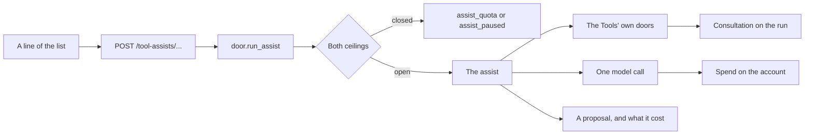

# What LIA does from the Tools

A click on a screen of the Tools asks LIA once and gets a proposal back: words to read, or a form to
check. Nothing is sent, created or saved until the person does it by hand. The decisions are
[ADR-372](../architecture/ADR-372-What-LIA-Does-From-The-Tools-A-Click-A-Call-A-Proposal.md); this
page is the map of the code. The hand-made side is [WORKBENCH.md](WORKBENCH.md).

## Where it lives

| Layer | Path |
|---|---|
| Bounded context (REST, no LangGraph) | `apps/api/src/domains/tool_assists/` |
| Settings | `apps/api/src/core/config/workbench.py` (`TOOL_ASSIST*` in the env templates) |
| Capability switch | `PlatformCapability.TOOL_ASSISTS` (`domains/feature_switches/registry.py`) |
| Slot | `tool_assist`, beside `email_digest`, `emails_agent` (asked as `email_agent`) and `vision_analysis` |
| Prompts | `domains/agents/prompts/v1/tool_assist_*` |
| Metrics | `infrastructure/observability/metrics_tool_assists.py`, panels on dashboard `10-oauth-connectors-mcp.json` |
| Page | `apps/web/src/components/workbench/assist/` |
| The sign | `AssistStars`: yellow stars, the only ones of the Tools (guard `assistStars.guard.test.ts`) |
| Addresses and shapes | `apps/web/src/lib/workbench/assist.ts` |

## The modules

| Module | Role |
|---|---|
| `catalogue.py` | Every assist, the slot that answers it and the sources it opens; boot completeness assert. |
| `door.py` | `run_assist`: both ceilings, the spend billed whatever happens, the read filed, the outcome counted, a failure in the workbench's words. |
| `llm.py` | `ask_slot`, `ask_slot_on_image`: one short structured call; `assist_line`, the one-line scaffolds. |
| `mail.py` | A message's summary (the digest), reply, translation, a conversation's summary, a whole message, a subject. |
| `mail_words.py` | A sentence as search criteria, or as a filter's form. |
| `mail_triage.py` | What the messages of a page weigh. |
| `text.py` | Words being written: changed, translated, written from an instruction. |
| `actions.py` | A message or a sentence as an event or a task for its form; the steps of a task. |
| `files.py` | A file or an attachment read by what it is: its words, or by sight. |
| `contact_card.py` | What a contact's latest messages say that the card lacks; a photographed card. |
| `speech.py` | The words on the screen, read aloud. |
| `keeping.py` | A file kept in a knowledge space: the person's own act, no model. |

## What a click runs through

## Routes

All `POST`, under `/api/v1/tool-assists`, behind `PlatformCapability.WORKBENCH`,
`PlatformCapability.TOOL_ASSISTS`, the session cookie and the per-account window
(`TOOL_ASSIST_RATE_LIMIT_CALLS`, `TOOL_ASSIST_RATE_LIMIT_WINDOW_SECONDS`).

| Source | Path | What it answers |
|---|---|---|
| Mail | `/mail/summary` · `/mail/conversation` · `/mail/attachment` | A message, a conversation or an attachment, in a few lines |
| | `/mail/reply` · `/mail/compose` · `/mail/subject` | A reply, a whole message or a subject, proposed |
| | `/mail/translate` | A received message in the reader's language |
| | `/mail/search` · `/mail/filter` | Search criteria or a filter's form, read from a sentence |
| | `/mail/triage` | What the messages on screen weigh |
| | `/mail/event` · `/mail/task` | The event or the task a message describes, for its form |
| Files | `/files/summary` | A drive's file, in a few lines |
| Calendar | `/calendar/from-words` | An event said in a sentence, for the editor |
| Tasks | `/tasks/from-words` · `/tasks/steps` | A task said in a sentence; the steps of a task |
| Contacts | `/contacts/complete` · `/contacts/from-card` | What a contact's latest messages add to the card; a photographed card |
| Words | `/text/rewrite` · `/text/translate` · `/text/write` | Words being written: changed, translated, written from an instruction |
| Voice | `/read-aloud` | Words on the screen, read aloud: no model, also behind `PlatformCapability.TTS` |
| Spaces | `/spaces/keep-file` · `/spaces/keep-attachment` | A file kept in a knowledge space: the person's own act, no model, also behind `PlatformCapability.RAG_SPACES` |

## Adding an assist

1. A member of `ToolAssist` and its `AssistSpec`: the boot refuses one without.
2. Its work in the module of its source, taking an `AssistRun`. A read goes inside `run.reading()`,
   a client through `open_tool_client` and closed before the model answers (ADR-304). A module
   importing a connector client is declared in `effects/direct_client_callers.py`
   (`CLIENT_CALL_RECORDERS`, surface `tool_assist`).
3. A new source section in `SECTION_*` and in the surface's `domains`
   (`domains/shared/consultation_surfaces.py`).
4. A prompt in `prompts/v1`, its static rules above the marker, third-party words through
   `wrap_external_content`, its name in `PromptName` and in the cache hygiene test.
5. The route in `router.py`, its schemas in `schemas.py`: a source named by its id, never sent.
6. On the page: a line in the tool's `use*Assist` hook, its address in `ASSIST_PATHS`, its words in
   the six languages. A line takes no room: if it needs some, it is a panel that appears when asked.

## Refusals

The workbench's vocabulary, translated on the page (`workbench.errors.*`):

| Code | Meaning |
|---|---|
| `assist_empty` | Nothing to read. |
| `assist_unreadable` | LIA cannot read this kind of file. |
| `assist_not_found` | It read it and found nothing of the kind: no form opens on nothing. |
| `assist_quota` | The account's ceiling is spent: no model was asked. |
| `assist_paused` | The instance's day is spent: no model was asked (with `retry_after` when the ceiling states one). |
| `assist_failed` | No usable answer: nothing is invented, and nothing is retried by itself. |

## Bounds

Every bound a route enforces is published or stated: the words a helper takes and the instruction it
takes are in `GET /workbench` (`limits`); what a document, a conversation or a reading is cut at is
said on the answer (`cut`), and the model is told too. See the `TOOL_ASSIST_*` settings. What only
helps a model read a sentence (the person's lists, labels, what the recipient field holds so far) is
cut to its bound, never refused.

A page weighed is one click for the rate limit and up to one digest per message on it: what bounds
that spend is the account's ceiling, asked before the first one, and each digest already held costs
nothing. The slot's `max_tokens` bounds an answer: a rewrite near the published bound, in a language
that costs more tokens, can pass it, and the assist then refuses rather than hand back half a text.

## What it records

`tool_assists_total{assist, outcome}`, the outcome being `ok`, `held`, `quota`, `refused`, `failed`
or `abandoned`; `tool_assist_duration_seconds{assist}`, what the person waited, the source's read
included; the log line `tool_assist_done`. A read is a consultation on the `tool_assist` surface, the
run a decision, the spend on the account. What was already held opened nothing and files nothing.
An assist writes to no provider, so it files no effect.

## Testing

Unit: `apps/api/tests/unit/domains/tool_assists/`. Integration:
`apps/api/tests/integration/domains/tool_assists/`. Page: `components/workbench/assist/__tests__/`.
Journeys: `apps/web/e2e/smoke/workbench-assists.spec.ts`. Real proofs run on the proof account with
production's slots held in memory, never on the owner's account.
