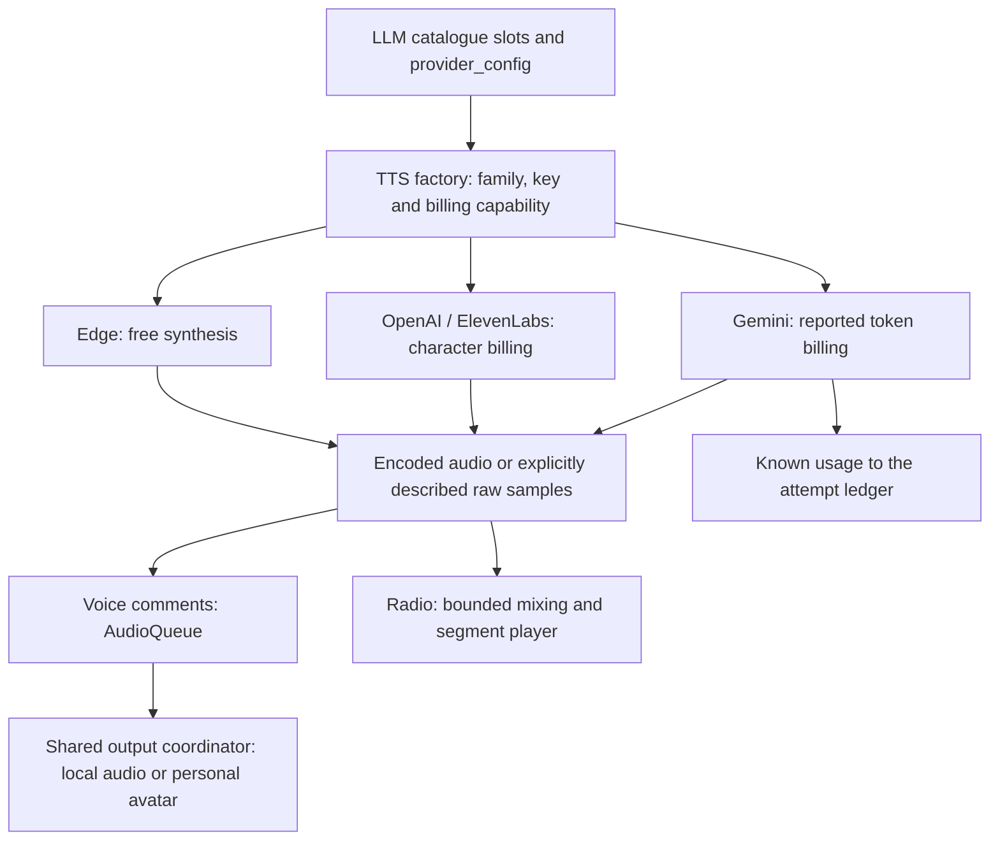

# Voice / Text-to-Speech (TTS)

> **Technical Documentation** - Voice Synthesis Domain
>
> **Version**: 4.0
> **Date**: 2026-05-07
> **Configuration**: TTS lives on the LLM catalogue (ADR-081); provider families and their billing units are declared in `domains/voice/families.py`, with voice and tuning in `provider_config` JSONB.
>
> Related: [ADR-081](../architecture/ADR-081-Voice-TTS-Catalogue-Driven.md) | [ADR-078](../architecture/ADR-078-LLM-Catalogue-DB-Source-Of-Truth.md) | [ARCHITECTURE.md](../ARCHITECTURE.md) | [SMART_SERVICES.md](./SMART_SERVICES.md)

---

## Overview

The Voice domain provides a multi-provider TTS abstraction. As of v1.20.x
(ADR-081), the active provider/model/voice/tuning is selected through the
**Configuration LLM** admin (LLM type `voice_tts`) — the same path used
for chat models since ADR-078 — and stored on
`llm_config_overrides.voice_tts`. Voice IDs and per-provider tuning live
in the row's `provider_config` JSONB blob.

### Key Features

- **LLM-catalogue-driven**: provider, model, voice IDs, and provider-
  specific tuning come from a single override row (`llm_config_overrides
  .voice_tts`) merged with `LLM_DEFAULTS`.
- **Provider families**: Edge, OpenAI, ElevenLabs, Gemini and Fish Audio are declared in
  [families.py](../../apps/api/src/domains/voice/families.py). Available models
  come from the LLM catalogue. Gemini is token-billed: its reported usage is
  recorded by the one synthesis door every caller goes through (`speak()`,
  below), so every surface — the chat and the radio alike — can be served by
  it.
- **Per-provider tuning surfaces**:
  - Edge: SSML `rate` / `pitch` / `volume` strings;
  - OpenAI: `speed` (0.25–4.0) + `response_format` (mp3/opus/…);
  - ElevenLabs: `output_format` + `voice_settings` (stability /
    similarity_boost / style / use_speaker_boost).
  - Gemini: voices and model-specific delivery controls from `controls_for()`.
  - Fish Audio: `output_format`, `latency`, `speed` and `transport` (`http`
    or `websocket`). The form offers exactly the values the client accepts (a
    parity guard holds the two lists equal). The slot stores its JSON as
    written, like every provider's tuning: a format, latency or transport the
    client does not know is repaired at run time with a warning.
- **Shared public Fish Audio voices** (ADR-345 amendment): the public voices an
  administrator pinned are ONE list for every voice slot
  (`fishaudio_pinned_voices`), not a key of a slot's tuning. Pinning is an act
  of its own — `PUT /admin/voice/fishaudio/library/pins/{voice_id}` reads the
  voice, files the administrator's attestation of the right to use it in the
  admin audit log BEFORE storing the pin, and holds the published ceiling
  (`FISHAUDIO_PINNED_VOICES_MAX`) under an instance-wide lock; `DELETE` refuses while a slot speaks with the voice.
  Both take effect at once, without saving a slot.
- **Dynamic voice picker**: `GET /admin/voice/voices?provider=X` returns
  curated lists for Edge/OpenAI/Gemini, a live `GET /v1/voices` for
  ElevenLabs (account-scoped), and for Fish Audio the account's own voices, the
  instance's pins and the vendor's licensed voices, each marked by its source and
  cached per account and pin set. Every picker — the slots', the radio's roles,
  the person's own voices — offers the switch « only voices in my language, and
  multilingual ones » where it narrows the list, on by default and never hiding
  a voice the form holds.
- **The person's own voices** (ADR-345 amendment): each person may choose LIA's
  male and female voice in Settings › Voice mode, among the voices of the engine
  that speaks in the chat (`GET`/`PUT /voice/lia-voices`, `domains/voice/
  lia_voices.py`). The choice is kept per provider (`users.lia_voices`,
  `{provider: {male, female}}`, exported with the account and erased when it is
  deleted): every model of a provider offers the same voices, so a model switched
  for another keeps it (per `provider/model` until 2026-10-16 — such an entry is
  still read and replaced at the next save, ADR-324 decision 43), written strictly
  (a voice the engine does
  not offer is refused, `lia_voice_unknown`; an unavailable catalogue refuses
  a selection with `503 lia_voice_catalogue_unavailable`, while returning to
  defaults remains available), read forgivingly (a voice no
  longer offered speaks with the administrator's), and read at the one seam every
  chat surface speaks through (`VoiceCommentService._get_voice_for_language`):
  the voice comments, the progressive stream, the read-aloud — checked there
  against the catalogue known without asking the vendor (a shipped list or a
  cache; a cold Fish Audio listing took up to 10.4 s on dev), so a catalogue not
  cached yet keeps the choice. Deleting a voice from the library gives every
  person who chose it the administrator's voice back. Never the radio (its roles
  have their own), a live session or a phone call. The ElevenLabs
  list a person is offered is cached like Fish Audio's (`elevenlabs:voices`, ten
  minutes); the administrator's picker reads it live.
  Every preference write, including a reset, checks that the account remains
  active and undeleted in the atomic SQL update; otherwise it refuses with 403.
  The browser serializes successive choices for the current account, cancels
  its queued writes on an account change and ignores that account's late replies.
  Fish Audio catalogue snapshots also carry a durable library revision. Deleting
  a voice advances it while forgetting the personal choices in the same short
  PostgreSQL transaction; a selection validated on the previous revision is
  refused. Cached lists include that revision, so a late listing can only fill
  an obsolete cache entry. No database transaction spans the vendor wait.
  The library checks committed TTS references in one query, never a worker's
  stale configuration cache. Before deletion it reserves the voice in that
  short transaction; personal and instance selections cannot acquire it while
  the vendor answers. Slot writes verify the current catalogue and revision,
  and unpinning checks references under the same lock. A cancellation or an
  uncertain dispatched failure retains the reservation. An explicit deletion
  retry can confirm absence (404) and finish local cleanup; an older attempt
  cannot release a newer token. A refusal before dispatch releases a fresh
  reservation. Forgetting choices uses one correlated SQL update for all
  affected accounts and preserves concurrent changes to other engines.
  Configuration validation uses the `llm_config` speech guard port, wired by the
  API composition root. A missing guard refuses speech writes before SQL changes.
  Omitting a model selects the slot's default model, so changing its provider
  without choosing a matching model is refused as `model_provider_mismatch`.
- **Per-user opt-in**: voice synthesis enabled per user via the
  `users.voice_mode_enabled` flag — orthogonal to the admin's TTS
  provider choice.
- **Bounded configuration fallback**: the factory checks client availability,
  required billing units and the provider key before synthesis. A non-strict
  caller falls back to Edge with a warning; a strict caller such as Radio
  refuses an unservable configuration.

### Pricing surface

Edge is free. OpenAI and ElevenLabs bill characters; Fish Audio bills the UTF-8
BYTES of the text (a Chinese character is three); Gemini reports input-text
and output-audio tokens. The shared tariff axis can store both, but the caller
must retain the family's billing units. Current prices belong to the runtime
catalogue, editable through the Tarification LLM Texte form; they are not a
static table in this document. See
[LLM_PRICING_MANAGEMENT.md](LLM_PRICING_MANAGEMENT.md) and
[billing.py](../../apps/api/src/domains/voice/billing.py).

---

## Architecture



[factory.py](../../apps/api/src/domains/voice/factory.py) checks configuration
before invocation. [families.py](../../apps/api/src/domains/voice/families.py)
declares billing units and delivery controls; the callers retain their own
configuration slots and accounting. The avatar consumes existing comment/Live
output, while Radio has its separate production and playback path.

---

## Admin Control: Configuration LLM

The TTS provider/model/voice is controlled through the **Configuration
LLM** admin form (LLM type `voice_tts`). The override row is persisted to
`llm_config_overrides.voice_tts` and broadcast across workers via the
ADR-063 Pub/Sub channel — no env var, no system_settings table involved.

### Endpoints

```bash
# Read current TTS config (effective = defaults merged with override)
GET /api/v1/admin/llm-config/types/voice_tts
Authorization: Bearer <admin_token>

# Response:
{
  "llm_type": "voice_tts",
  "info": { "required_kind": "tts", ... },
  "effective": {
    "provider": "elevenlabs",
    "model": "eleven_turbo_v2_5",
    "provider_config": "{\"voice_male\":\"echo_id\",\"voice_female\":\"nova_id\",\"output_format\":\"mp3_44100_128\",\"voice_settings\":{...}}",
    ...
  },
  "is_overridden": true
}

# Update (full-replace semantics; null clears the override of that field)
PUT /api/v1/admin/llm-config/types/voice_tts
Authorization: Bearer <admin_token>
{
  "provider": "elevenlabs",
  "model": "eleven_turbo_v2_5",
  "provider_config": "{\"voice_male\":\"<elevenlabs_voice_id>\",...}"
}

# Reset to code defaults
POST /api/v1/admin/llm-config/types/voice_tts/reset

# Voice picker — populated dynamically by the admin form when the
# admin selects a TTS provider. Edge/OpenAI/Gemini return curated lists,
# ElevenLabs returns a live GET /v1/voices for the configured account,
# Fish Audio its own + the instance's pinned + licensed voices (ADR-345).
GET /api/v1/admin/voice/voices?provider=elevenlabs
Authorization: Bearer <admin_token>

# Response:
{
  "provider": "elevenlabs",
  "voices": [
    { "voice_id": "21m00Tcm4TlvDq8ikWAM", "label": "Rachel",
      "gender": "female", "language": "en" },
    ...
  ],
  "source": "live"
}
```

### Cross-worker propagation

```
Admin Request
     │
     ▼
PUT /admin/llm-config/types/voice_tts
     │
     ├── Update llm_config_overrides.voice_tts (PostgreSQL)
     ├── Create AdminAuditLog entry
     └── LLMConfigOverrideCache.invalidate_and_reload()
                    │
                    ├── Reload from DB
                    └── Publish "llm_config_overrides" on Redis Pub/Sub
                                    │
                                    ▼
                       Other API workers receive the message
                                    │
                                    ▼
                       Each worker reloads its in-memory cache
                                    │
                                    ▼
                       Next get_tts_client() call sees the new override
```

The factory reads `LLMConfigOverrideCache.get_override("voice_tts")`
synchronously at synthesis time — no Redis hit on the hot path, no
Postgres query.

---

## Configuration

### Environment Variables

The 14 legacy `VOICE_TTS_*` env vars (Standard/HD modes) were retired by
ADR-081. Per-provider tuning now lives in the admin UI's
`provider_config` JSONB. The remaining voice-related env vars cover the
voice-comment LLM, the Sherpa local STT pipeline, and the WebSocket
transport defaults — see [.env.example](../../.env.example) section
"VOICE — TTS / STT" for the live list.

```bash
# .env — TTS provider/model/voice/tuning are NOT here anymore.
# Configure them under "Configuration LLM → Voice Synthesis (TTS)".

# Voice Comment LLM (still env-driven)
VOICE_LLM_PROVIDER=openai
VOICE_LLM_MODEL=gpt-4.1-nano
VOICE_LLM_TEMPERATURE=0.7
VOICE_LLM_MAX_TOKENS=500
VOICE_MAX_SENTENCES=3
VOICE_EXPRESSIVE_CUES_MAX=2   # cues per spoken comment, 0 = none (ADR-345)

# Voice context
VOICE_CONTEXT_MAX_CHARS=2000
VOICE_PARALLEL_TIMEOUT_SECONDS=15.0
VOICE_CHAT_MODE_MAX_SENTENCES=3
```

### `provider_config` JSONB shape

Documented authoritatively on `apps/api/src/domains/voice/factory.py`.
Only keys relevant to the active provider need be present; others are
ignored:

```json
{
  "voice_male": "fr-FR-RemyMultilingualNeural",
  "voice_female": "fr-FR-VivienneMultilingualNeural",
  "rate": "+10%",            // edge only (SSML)
  "pitch": "+0Hz",           // edge only
  "volume": "+0%",           // edge only
  "speed": 1.1,              // openai (0.25..4.0), fishaudio (0.5..2.0)
  "response_format": "mp3",  // openai only
  "output_format": "mp3_44100_128",  // elevenlabs, fishaudio
  "latency": "balanced",     // fishaudio only: normal | balanced | low
  "transport": "http",       // fishaudio only: http | websocket
  "voice_settings": {                // elevenlabs only
    "stability": 0.5,
    "similarity_boost": 0.75,
    "style": 0.0,
    "use_speaker_boost": true
  }
}
```

---

## Usage

### Factory Pattern

```python
from src.domains.voice.factory import get_tts_client, get_tts_config

# Get the current TTSConfig parsed from the active override
cfg = await get_tts_config()
# cfg.provider = "elevenlabs"
# cfg.model = "eleven_turbo_v2_5"
# cfg.voice_male = "<elevenlabs_voice_id>"
# cfg.voice_female = "<elevenlabs_voice_id>"
# cfg.voice_settings = {"stability": 0.5, ...}
# cfg.is_paid = True

# The client AND the configuration it was built from (Edge's own when Edge
# stands in for an engine that cannot be served)
from src.domains.voice.factory import serve_tts
config, client = serve_tts(cfg)

# One door for a heard synthesis: billed as the engine that spoke bills it,
# recorded once on the run's tracker
from src.domains.voice.spoken import speak
result = await speak(client, "Bonjour !", config.voice_female, model=config.model, ledger=tracker)
```

`unservable_reason()` checks the family's client and key. `serve_tts(...,
strict=True)` (and `get_tts_client_sync`) raises `TTSProviderError` on
failure; a non-strict call returns `_fallback_edge_config()` with its client
and logs `tts_factory_falling_back_to_edge` with the provider and reason. The
voices a caller reads come from the configuration `serve_tts` returns, never
from the one it asked for: the configured engine's voice ids mean nothing to
Edge, which used to speak nothing in its place (ADR-345).

**One door, `speak()`** (`voice/spoken.py`, ADR-345). The chat's three voice
paths and the radio synthesize through it: it calls `synthesize_billed()` and
records the call on the run's tracker, keyed on the client that SPOKE. A
token-billed engine is priced on its usage report, a text-billed one on what it
was sent — characters, or UTF-8 bytes where its family bills bytes
(`families.billed_text_units`). The free engine records nothing, so a line
Edge spoke in place of a paid engine no longer costs that engine's tariff.
Since every caller records through it, a token-billed engine (Gemini) is
served to the chat too — it used to be handed Edge.

### TTSClient Protocol

```python
# apps/api/src/domains/voice/protocol.py

from typing import Protocol, runtime_checkable

@runtime_checkable
class TTSClient(Protocol):
    """Protocol for TTS clients (duck typing interface)."""

    async def synthesize(
        self,
        text: str,
        voice_name: str,
        **kwargs,
    ) -> bytes:
        """Synthesize text to audio bytes."""
        ...

    async def synthesize_base64(
        self,
        text: str,
        voice_name: str,
        **kwargs,
    ) -> str:
        """Synthesize text to base64-encoded audio."""
        ...

    async def close(self) -> None:
        """Clean up resources."""
        ...

    @property
    def provider_name(self) -> str:
        """TTS provider name (edge, openai, gemini)."""
        ...

    @property
    def audio_format(self) -> str:
        """Audio MIME type (audio/mpeg, audio/wav)."""
        ...
```

### Edge TTS Client (Standard)

```python
from src.domains.voice.client import EdgeTTSClient

# Initialize
client = EdgeTTSClient(
    rate="+10%",
    pitch="+0Hz",
    volume="+0%",
)

# Synthesize
audio_bytes = await client.synthesize(
    text="Bonjour, comment puis-je vous aider ?",
    voice_name="fr-FR-DeniseNeural",
)

# Properties
client.provider_name  # "edge"
client.audio_format   # "audio/mpeg"
```

### OpenAI TTS Client (HD)

```python
from src.domains.voice.openai_tts_client import OpenAITTSClient

# Initialize
client = OpenAITTSClient(
    model="tts-1",
    speed=1.0,
    response_format="mp3",
)

# Synthesize
audio_bytes = await client.synthesize(
    text="Hello, how can I help you today?",
    voice_name="nova",
)

# Properties
client.provider_name  # "openai"
client.audio_format   # "audio/mpeg"
```

### Voice Comment Service

```python
from src.domains.voice.service import VoiceCommentService

service = VoiceCommentService(lia_gender="female")

# Stream voice comment as audio chunks (uses sentence streaming under
# the hood — first audio lands as soon as the LLM emits a complete
# sentence rather than at the end of the full ainvoke).
async for chunk in service.stream_voice_comment(
    context_summary="L'utilisateur a demandé ses emails...",
    personality_instruction="Tu es enthousiaste.",
    user_language="fr",
):
    # chunk is VoiceAudioChunk
    yield chunk
```

### TTS concurrency and playback

A vendor that caps an ACCOUNT's in-flight requests reserves capacity through
[`provider_capacity.py`](../../apps/api/src/domains/voice/provider_capacity.py)
(ADR-345): one declared pool per vendor (`CAPACITY_POOLS`), one Redis lease per
in-flight request under the account's key — a digest of the credential, never
the credential. ElevenLabs shares `ELEVENLABS_TTS_MAX_CONCURRENCY` (its key is
the one the former `elevenlabs_concurrency.py` used, so a rolling deploy never
opens a second allowance); Fish Audio shares `FISHAUDIO_MAX_CONCURRENCY` across
synthesis, transcription and voice design, because the vendor counts them
together (measured 2026-10-13, `ratelimit-limit-concurrency: 5`). The allowance
is shared across API workers, client instances and surfaces using the same API
key. The request timeout bounds both waiting and HTTP; completion, failure and
cancellation release the slot, and abandoned leases expire. Configure each
allowance at or below the provider account's limit, reserving headroom if
other applications also use that account. Redis unavailability refuses the
request (`ProviderCapacityUnavailable`, raised to the caller as its own
`provider_network_error`) rather than bypassing the limit.

The browser's [`AudioQueue`](../../apps/web/src/lib/audio-queue.ts) preserves
arrival order before asynchronous initialization, reserves its playback
consumer before any await, and invalidates pending work on stop. Consequently
a burst of SSE chunks starts only one audible source; a stale decode or end
event cannot restart audio from a previous turn.

### Optional speaking avatar and one audible destination

The [speaking avatar](SPEAKING_AVATAR.md) uses the person's Simli connector and
explicit permission to animate the comments already synthesized here. The
dashboard owns one avatar engine; the shared
[voice-output coordinator](../../apps/web/src/lib/voice-output/coordinator.ts)
selects local or avatar playback once per spoken production. Every sentence of
one answer stays on that route, so readiness changing mid-answer does not split
its sound between players. Headerless PCM carries its actual encoding and rate
and is wrapped for browser decoding; encoded audio uses the browser decoder.

The API owns the Simli signalling socket and relays the synthesized PCM through
a single-use browser ticket. The provider token remains encrypted server-side;
returned WebRTC media goes between Simli and the browser. The avatar window keeps
its explicit stop control outside the chat error boundary and reports confirmed
or pending closure. Provider inactivity and the exact relay generation must both
be verified before the lease is released. An open connection may still consume
personal credits while closure is unconfirmed.

The avatar adds no TTS or LLM call. Its video stays muted; a gesture-resumed
Web Audio context renders remote sound. After a potentially audible prefix,
failure cancels the avatar output without replaying that prefix locally. A later
production can use local playback. Simli credits remain the person's vendor
expense, including possible silence consumption, outside LIA's TTS ledger.
[ADR-334](../architecture/ADR-334-Personal-Speaking-Avatar-And-One-Audible-Output.md)
remains Proposed while real provider and physical-device media trials are pending.

### Progressive sentence streaming (ADR-082)

Both code paths above (chat-mode `stream_direct_tts` via
`start_progressive_chat_stream`, and agent-mode `stream_voice_comment`)
are pipelined at the sentence level by ``ProgressiveSentenceStreamer``
([apps/api/src/domains/voice/sentence_streamer.py](../../apps/api/src/domains/voice/sentence_streamer.py)).

```
LLM stream tokens ──► streamer.feed("Bonjour, com")
                       ↓                                   no terminator → buffer
LLM stream tokens ──► streamer.feed("ment ça va ? Au")
                       ↓                                   "? " → dispatch sentence #0
                       ├── asyncio.create_task(synth)  ── ▶ TTS provider call (parallel)
LLM stream tokens ──► streamer.feed("jourd'hui je vais bien.")
                       ↓                                   "." at end → still buffered
LLM closes  ────────► streamer.close_input()
                       ↓                                   trailing buffer → dispatch #1
                       ▼
   in-order delivery via _pending: dict[int, VoiceAudioChunk] + _drain_lock
                       ▼
              audio_chunks() async iterator
                       ▼
            agents SSE main loop emits VoiceAudioChunk
```

A delimiter dispatches only when a **whitespace follows it inside the buffer**
(ADR-154). Two reasons, and they are the same one: a dot glued to the next
character belongs to a token (`3.5`, `12.99`, `1.2.3`, `exemple.fr`), and a dot
sitting at the end of the buffer may simply be one whose next character has not
streamed in yet. `close_input()` flushes whatever never got its space, which is
also the path for an LLM that stops without punctuation.

Four guarantees:

| Invariant | Mechanism |
|---|---|
| A number, a price or a URL is never split across two audio chunks | `[délims]+(?=\s)` — the boundary needs a following whitespace |
| In-order delivery (sentence #1 before #2 even when #2's TTS is faster) | `_pending` map + `_next_emit_idx` counter under `_drain_lock` |
| One sentence failure does NOT block the rest | `_failed: set[int]` skipped during drain |
| End-of-stream sentinel pushed exactly once | `_sentinel_pushed: bool` idempotence flag |

The boundary rule is shared with the one-shot path
(`VoiceCommentService._extract_sentences`) and both are pinned to the same case
table by `tests/unit/domains/voice/test_sentence_boundaries.py`, which also
feeds the text one character at a time — the only way to reproduce a buffer that
ends on a dot.

The resulting **Time-To-First-Audio (TTFA)**:

| Scenario | Legacy v4.0 | v4.1 (sentence streaming) |
|---|---|---|
| Chat mode, response 5 s, 5 sentences | ~5.5 s | **~0.8–1.2 s** |
| Agent mode, voice LLM 2 s, 3 sentences | ~3.5 s | **~1–1.5 s** |
| Agent mode, registry tardif (5 s) | ~6 s | **~3 s** |

### What an agent-mode comment speaks of

The comment of a tool turn is written by its own model while the answer streams,
and it speaks only of the records the answer declared, never ahead of the answer
(ADR-082 amendment 2026-10-14). The response model declares the records it keeps at
character 0, in `<relevant_ids>`; the tag filter hands that declaration over
(`MachineTagFilter.take_declarations`) before the answer's first visible character,
and `VoiceScope` (`agents/services/streaming/voice_scope.py`) — holding the turn's
latest records until then, the initiative node's included — decides once:

| The answer declared | The comment |
|---|---|
| records it retained | reads those records, in the declared order, introduced as the answer's selection (`voice_comment_context_lines.txt`) |
| none, ids no record matches, or nothing at all | is not written: the answer is read aloud (PATH 2A) |

The scope publishes nothing before the answer's first visible character (whitespace
does not count), so the parallel comment starts with the answer at the earliest. The
ids are resolved by the same function as the cards (`registry_filtering._resolve_relevant_ids`):
the cards keep the registry's order, the comment the answer's. Each decision logs
`voice_comment_scope_decided` (`moment`, `source`, `declaration`, `records_count`,
`spoken_count`).

### Plain-text input guarantee

The TTS engine must only ever receive **speakable plain text** — never HTML
or CSS. Two complementary mechanisms enforce this:

1. **At the source (response node).** The rich HTML response directive is
   withheld exactly where a voice would read markup aloud: a conversational
   turn (router `route_to != "planner"`) of an account whose spoken replies
   are on — that reply is streamed verbatim to TTS via the progressive chat
   path, so it is kept in Markdown and no tag reaches the sentence streamer.
   A tool/data turn is synthesised after the tools ran and never fed verbatim
   to the voice, and an account with `voice_enabled` off has no listener, so
   both keep the HTML layout of the `html` display mode on every turn. The
   gate reads the two signals the voice path starts from — the routing target
   and the account's `voice_enabled` preference, carried by the typed runtime
   context (`runtime_voice_enabled`) — so it can never desync from it. See
   `_should_inject_html_directive`
   ([response_node.py](../../apps/api/src/domains/agents/nodes/response_node.py)).
2. **Defense in depth (agents SSE loop).** The synchronous TTS entry points
   (`stream_direct_tts` and the `stream_voice_comment` fallbacks) pass their
   text through `_sanitize_text_for_tts`
   ([voice_stream_helpers.py](../../apps/api/src/domains/agents/services/streaming/voice_stream_helpers.py)),
   which strips HTML via `html_to_text` **only when markup is actually present** — so
   reference turns or post-LLM data cards are never spoken as tags, while plain
   prose containing bare angle brackets (`x < 5 and y > 3`) is left untouched.

   `html_to_text` drops `<head>`/`<style>`/`<script>` **with their content, closing tag
   or not** (`_BLOCK_ELEMENT_RE` in
   [base.py](../../apps/api/src/domains/agents/display/components/base.py)). The optional
   closing tag matters here as much as on notification surfaces: TTS input can arrive
   truncated, and requiring a complete pair meant a severed `<style>` lost its marker to
   tag-stripping while its body survived — the engine would have read a CSS rule aloud.
   The same stripper backs both surfaces, so a fix on one side is a fix on both; that
   shared path is also why an unrelated icon-ligature bug made the voice say "event"
   before a sentence.

Cleanup contract: every SSE generator exit path (HITL `GraphInterrupt`,
top-level `except`, normal end) MUST tear down the voice pipeline via the
`VoiceStreamCoordinator` (ADR-122 — `cleanup_chat_pipeline()` /
`cleanup()`, backed by `_cleanup_chat_voice_pipeline` in
[voice_stream_helpers.py](../../apps/api/src/domains/agents/services/streaming/voice_stream_helpers.py))
to cancel the drain task, the streamer's pending TTS tasks, and the
underlying voice service (closes the persistent httpx client). The helper
is idempotent and safe to call when voice was never spun up.

### Fish Audio over its WebSocket (ADR-345)

A Fish Audio slot may set `provider_config.transport` to `websocket` (the admin
form's « Transport »; `http` by default). Each synthesis is then ONE session of
the vendor's socket ([live.py](../../apps/api/src/domains/voice/fishaudio/live.py)):
`start` with the HTTP request's own fields and an empty text, the text, `stop`,
every `audio` event until `finish`. Never two texts per session: the vendor's
audio events carry no reliable mark of the text they voice — which is also why a
dialogue take always travels over HTTP, on the timed stream. The socket goes out
through the deployment's proxy when one is set (`voice/egress.py`: aiohttp reads
none from the environment, the trap Edge met first). A session that fails
in transit (network, a malformed answer or a `finish` in error) or falls SILENT
for `FISHAUDIO_SOCKET_STALL_SECONDS` — through its handshake or between two
frames — is answered over HTTP and counted (`voice_tts_transport_fallbacks_total`,
dashboard 11); a quota (429) or a refusal is never retried. A successful finish
disarms the silence bound. The whole-request deadline still bounds cleanup;
when it expires after complete audio, that audio is kept and the cleanup
timeout is logged. Explicit cancellation propagates without an HTTP replay.
The bound comes from a measurement: a healthy
session sends its first audio frame 0.6-1.0 s after the text whatever its length
(135 to 1631 bytes) and never leaves 1.7 s between two frames. Before it, nothing
shorter than the request's own 60 s ended a silent session, and on Docker dev
three socket syntheses of one chat turn returned nothing for 22 s (2026-10-14)
until the turn's voice wait ran out (the stage they waited in was not logged).

The socket streams, but a speech client returns a sentence WHOLE, so what a
listener waits for is the finish: measured on `s2.1-pro-free` (2026-10-14, the
real client), HTTP took 1.59-1.65 s per short sentence and the socket
2.62-2.74 s; at 815 bytes both took about 19.6 s. HTTP stays the default; the
switch lets an operator whose account carries the vendor's latency guarantee
measure it.

### Several voices in one request (ADR-345)

A client that voices a whole exchange implements `DialogueTTSClient`
([protocol.py](../../apps/api/src/domains/voice/protocol.py)):
`synthesize_dialogue(turns)` takes `DialogueTurn(voice, words, cue)` and answers
`DialogueAudio(audio, sent_text, turn_starts_s)`. Fish Audio does it on its S2
models and `drama-3` (`voices_dialogue` in the family registry): the text opens
each turn with `<|speaker:N|>`, `reference_id` lists the voices, and
`/v1/tts/stream/with-timestamp` streams the audio with a word-level timing that
places each turn ([dialogue.py](../../apps/api/src/domains/voice/fishaudio/dialogue.py)).
Through the one door, `speak_dialogue` records the request ONCE on what it
carried — markers and cues with the words — whether or not its timing placed
every turn. The radio is the caller ([RADIO.md](RADIO.md#audio)).

### Expressive cues (ADR-345)

Several engines perform cues written inside the text, each in its own syntax
and words: ElevenLabs v3/v4 audio tags (`[whispers]`, a pause as `…`), Fish
Audio S2 models (`[happy]`, `[break]`), Fish Audio `s1` (a fixed set in
parentheses, `(happy)`), Fish Audio `drama-3` (`[…]`), Gemini 3.8 point-in-time
vocal tags (`<laugh>` — its sustained delivery is the `style` control). Every
other engine reads a bracket aloud. LIA's writers speak ONE vocabulary
(`Cue`, written `[cue]`); a dictionary per engine
([expressive_cues.py](../../apps/api/src/domains/voice/expressive_cues.py),
`cue_dialect(provider, model)`) spells each cue the engine's way, or drops it.

Two kinds of text, two rules:

- **Written for speech** — the voice comment. Its prompt carries an
  `<expressive_cues>` block ([cue_prompt.py](../../apps/api/src/domains/voice/cue_prompt.py))
  only when the engine that will speak performs a cue: it names exactly those
  cues, shows one of them in its example, and publishes the budget
  `VOICE_EXPRESSIVE_CUES_MAX` (`0` switches the cues off) that
  `AuthoredCues` enforces across the whole streamed comment. A cue beyond the
  budget, one the engine cannot perform, or any other bracketed text is dropped
  — never read aloud. An engine without cues gets the prompt unchanged.
- **Not written for speech** — an answer read aloud, a document readout, a
  radio line. `neutralize_literal` reads a markdown link or image as its label,
  drops a footnote mark or a task box, reads any other square bracket as its
  words, removes angle tags for an engine that performs `<…>` (a comparison
  such as `3 < 5` stays) and reads a parenthesis as its words for one that
  performs `(…)` — the syntax an engine reads is the syntax of its spellings
  plus what its vendor documents beyond them (`CueDialect.reads`; `drama-3`'s
  paired `<whisper>…</whisper>` tags). A vendor control marker
  (`<|speaker:N|>`) is removed from every text, written or literal: only LIA's
  dialogue composer writes one. A third party's headline can never make the
  voice whisper, nor hand its line to another voice.

The radio hands an engine that performs cues ONE delivery cue opening each line,
from the writer's delivery (the tone's when the engine performs it, else the
energy's); what the cue expresses is counted as rendered
([delivery.py](../../apps/api/src/domains/radio/delivery.py)).

**The engine that speaks decides, not the configured name**: Fish Audio serves
`s1` as `s2.1-pro` once its announced retirement (2026-12-31,
`VENDOR_SHUTDOWNS`) has passed, and S2 reads `(happy)` as words — from that day
an `s1` slot is spelled the S2 way. A cue is text the vendor bills: a few bytes
per sentence, counted by the same `billed_text_units` as the words.

### The Fish Audio voice library (ADR-345)

The account's own voices are managed by an administrator under **Settings →
Administration → Voice library**
([library_router.py](../../apps/api/src/domains/voice/library_router.py),
`/admin/voice/fishaudio/library`); they are the « own » voices the slot pickers
and the radio's cast offer. Every route authenticates on a session of its own
and calls `require_superuser`, so no PostgreSQL connection is held while the
vendor answers (ADR-304); the requests that create a voice, pay or decode (a
clone, a design, saving a candidate, a transcript prefill) share one
per-administrator rate limit.

- **The list** shows every voice the account owns, whatever its state — a failed
  one can be deleted — with the TTS slots that speak with it.
- **A clone** is made from one to a few recordings in the containers the vendor
  documents, each bounded and together bounded by one request body that the
  global body ceiling must carry (`Settings` refuses to boot otherwise). The
  administrator attests that the voice is theirs, or that its owner consented in
  writing: the attestation is filed in the admin audit log BEFORE the vendor is
  called — no record, no clone. The voice is always private, the recordings
  leave under neutral names (`sample-N.ext`: a file name may be a person's), and
  the transcripts are all given or none (the vendor then transcribes them
  itself). The form can fill a transcript with the LOCAL engine when the
  instance runs it, for a recording within the duration the page publishes.
- **A design** describes a voice in words and answers up to four candidates to
  listen to. The instance pays: its daily ceiling is asked first, the flat price
  `FISHAUDIO_VOICE_DESIGN_COST_USD` is charged after a success
  (`record_instance_fixed_spend`) and filed in the audit log under the
  administrator. The candidates wait in Redis (`fishaudio:design`, under ids LIA
  mints) so that saving one uploads the audio the vendor designed, never bytes a
  browser sends back. The design-to-model signature the vendor's model creation
  accepts is not documented on a candidate, so none is sent: a designed voice is
  saved as an uploaded one.
- **Renaming and deleting** stay open when creation is switched off. A voice a
  TTS slot speaks with is never deleted: the page says which slot, and the API
  refuses it again (409) if a slot took it meanwhile. A listener's radio choice
  of a deleted voice reads as « automatic ».

Every change forgets the account's cached voice lists (`invalidate_fish_voices`).
Creating is the operator's switch, `FISHAUDIO_VOICE_CREATION_ENABLED`, off on the
demonstrator. A refusal names itself with a stable code the page translates in
six languages (`library_errors.REFUSAL_CODES`, held to the locales by a guard).

### Per-message TTS cost attribution (ADR-081)

Symmetric with STT (cf. [ADR-080](../architecture/ADR-080-Voice-STT-Remote-Pricing-Unit.md)):

```sql
-- conversation_messages — paid TTS only (Edge stays NULL)
tts_provider           VARCHAR(50)
tts_model              VARCHAR(100)
tts_characters         INTEGER
tts_cost_usd           NUMERIC(10,6)
tts_cost_eur           NUMERIC(10,6)
tts_usd_to_eur_rate    NUMERIC(10,6)

-- user_statistics — lifetime + cycle aggregates
total_tts_characters   NUMERIC(12,0) NOT NULL DEFAULT 0
total_tts_cost_eur     NUMERIC(12,6) NOT NULL DEFAULT 0
cycle_tts_characters   NUMERIC(12,0) NOT NULL DEFAULT 0
cycle_tts_cost_eur     NUMERIC(12,6) NOT NULL DEFAULT 0

-- message_token_summary — the run's own row (ADR-324)
tts_characters         INTEGER       NOT NULL DEFAULT 0
tts_cost_eur           NUMERIC(10,6) NOT NULL DEFAULT 0
```

The TTS cost is included in `cycle_cost_eur` / `total_cost_eur` so the
dashboard "Cost" tile and `user_usage_limits` checks naturally cover it.

**The run's row is the ledger every cost figure reads.** The tracker commits
paid synthesis onto `message_token_summary` by the same UPSERT as every other
family (column arithmetic, so a radio session committing once per production
accumulates), and `MessageTokenSummary.billed_cost_eur` includes it: the chat
meter, the conversation history and a radio session's live cost read that one
figure. The bubble keeps its answer's share for the `🔊` badge and the
per-message export — it is never added on top of the run's figure, which
already holds it. Migration `d79c9fc26844` copied the bubbles' shares onto
their runs, summed per run id.

**Only what the provider SERVED is charged.** A sentence is recorded when its
audio comes back, never when it is dispatched (`speak()` records after the
synthesis returns, one record per served sentence): measured on Docker dev
2026-09-20, four streams refused on every sentence (`invalid_api_key`, zero
audio chunks) had each recorded a `tts_call` and stamped the message with a
cost — absence of delivery was billed.

UI: a discreet badge `🔊 N chars` is rendered before the grand total on
the assistant bubble (mirror of the STT `🎤 X.Xs` badge on the user
bubble). Hidden for Edge synth and historical messages (where the column
is NULL).

CSV exports: `consumption-summary` includes `total_tts_runs`,
`total_tts_characters` and `total_tts_cost_eur`, read from the runs' rows (a
chat answer and a radio session alike). The `tts-usage` export (admin + user)
returns one row per assistant message with `tts_provider IS NOT NULL`, plus
one row per run whose speech no bubble carries — a radio session, or an answer
whose bubble could not be stamped — which names no provider: the two sets
never overlap.

#### Backfill double-pass

The TTS finalisation runs AFTER `archive_message` (the assistant row is
created with `tts_*` columns NULL because parallel-mode voice may still
be synthesising at archive time). Two pass-through points:

1. **First pass** — between background-task wait and `cleanup_run_records`,
   `temp_tracker.get_tts_usage_for_archive()` returns the records
   committed by the parallel voice path (PATH 1) and `update_message_tts`
   writes them on `conversation_messages.tts_*`. Captures a snapshot
   `tts_snapshot_for_done` so the SSE `done` chunk metadata can carry
   `tts_provider`/`tts_model`/`tts_characters`/`tts_cost_eur` to the
   live frontend without waiting for a reload.
2. **Second pass** — after the `voice_needs_finalization` block (which
   covers PATH 2A direct_tts / PATH 2B sync voice_comment), `_run_tts_records`
   has been re-populated by `tracker.commit()`. A second backfill picks
   up any records produced by the sync fallback path that wasn't yet
   captured.

---

## Voice Types

### Standard Mode Voices (Edge TTS)

| Language | Female Voice | Male Voice | Quality |
|----------|-------------|------------|---------|
| French (fr-FR) | DeniseNeural | HenriNeural | Neural |
| French (fr-FR) | VivienneMultilingualNeural | RemyMultilingualNeural | **Multilingual** |
| English (en-US) | AriaNeural | GuyNeural | Neural |
| German (de-DE) | KatjaNeural | ConradNeural | Neural |
| Spanish (es-ES) | ElviraNeural | AlvaroNeural | Neural |

### HD Mode Voices (OpenAI)

| Voice | Characteristics | Best For |
|-------|-----------------|----------|
| **alloy** | Neutral, balanced | General use |
| **echo** | Warm, friendly | Conversational |
| **fable** | Expressive, story-like | Narratives |
| **onyx** | Deep, authoritative | Professional |
| **nova** | Warm, engaging | Female persona |
| **shimmer** | Clear, optimistic | Explanations |

---

## Cost Comparison

Compare the selected catalogue model using its own billing units and current
tariff. Character counts cannot estimate Gemini audio-token charges. Speaking
avatar credits and personal Live-provider charges belong to their respective
accounts and are separate from this TTS ledger.

---

## Metrics

### Prometheus Metrics

```python
# Voice TTS requests, every provider (voice_name: the provider's own voice id)
voice_tts_requests_total{status="success|error", voice_name="..."}

# Voice TTS latency
voice_tts_latency_seconds{voice_name="..."}

# Voice TTS errors (error_type: timeout, http_<code>, empty_response, ...)
voice_tts_errors_total{error_type="...", voice_name="..."}

# A Fish Audio WebSocket session answered over HTTP (ADR-345, dashboard 11)
voice_tts_transport_fallbacks_total{provider="fishaudio", reason="..."}
```

The `voice_tts_mode_cache_total` Prometheus counter was retired with
ADR-081 (no more `voice_tts_mode` system setting). Cache invalidation
for the new override surface is observed through the existing
`llm_config_cache_loaded` log event and the ADR-063 Pub/Sub channel.

---

## Error Handling

### Graceful Degradation

Configuration fallback runs before provider invocation through the single
`unservable_reason()` seam in
[factory.py](../../apps/api/src/domains/voice/factory.py). It checks the caller's
billing capability as well as the key. Strict callers fail visibly instead of
substituting another provider. A synthesis failure after invocation is distinct
from this configuration check; any known paid usage remains accountable.

### Error Recovery

```python
try:
    audio = await client.synthesize(text, voice_name=voice)
except Exception as e:
    logger.error("tts_synthesis_error", error=str(e))
    # Graceful degradation - continue without voice
    return None
```

---

## Files Structure

```
apps/api/src/domains/voice/
├── __init__.py                # Module exports
├── protocol.py                # TTSClient protocol definition
├── factory.py                 # TTS client factory (LLMConfigOverrideCache-driven)
├── client.py                  # EdgeTTSClient
├── openai_tts_client.py       # OpenAITTSClient
├── elevenlabs_tts_client.py   # ElevenLabsTTSClient (ADR-081)
├── gemini_tts_client.py       # Token-billed GeminiTTSClient
├── fishaudio/                 # Fish Audio (ADR-345): formats, wire, tts_client, live,
│                              # dialogue, voices, library, design_store, library_* modules
├── families.py                # Provider billing units and delivery controls
├── billing.py                 # SynthesisResult and billed synthesis seam
├── spoken.py                  # speak() / speak_dialogue(): the one door, billed once
├── provider_capacity.py       # One allowance per vendor account (Redis leases)
├── expressive_cues.py         # The cue vocabulary and one dialect per engine
├── cue_prompt.py              # The cue block of a spoken comment's prompt
├── egress.py                  # The outbound proxy a socket honours
├── voices_catalog.py          # Curated lists + ElevenLabs live API
├── admin_router.py            # GET /admin/voice/voices, /admin/voice/fishaudio/voices/{id}
├── library_router.py          # /admin/voice/fishaudio/library
└── service.py                 # VoiceCommentService
```

---

## Migration History

| Date | Version | Change |
|------|---------|--------|
| 2025-12-24 | 1.0 | Initial implementation avec Google Cloud TTS |
| 2025-12-29 | 2.0 | Migration vers Edge TTS - Gratuit |
| 2026-01-15 | 3.0 | Factory Pattern + Standard/HD modes + Admin System Settings |
| 2026-05-07 | 4.0 | TTS migrated to LLM catalogue (ADR-081) — three providers (Edge / OpenAI / ElevenLabs), `voice_tts` LLM type, voice + tuning in `provider_config` JSONB, `system_settings.voice_tts_mode` retired |
| 2026-05-07 | 4.1 | **Progressive sentence streaming (ADR-082)** — TTFA divided by ~5× (chat mode) / ~2× (agent mode) via `ProgressiveSentenceStreamer` (LLM `astream` → in-order TTS dispatch). Per-message TTS cost attribution (5 cols on `conversation_messages`, 4 aggregates on `user_statistics`, badge `🔊 N chars`). Persistent httpx client on `ElevenLabsTTSClient`. |
| 2026-10-14 | 5.0 | **Fish Audio, served whole (ADR-345)** — a fifth provider (five speech models billed per UTF-8 byte, transcription, WebSocket, multi-voice dialogue, voice library); one door per heard synthesis (`speak`), billed once by the engine that spoke; one allowance per vendor account; one cue vocabulary with a dialect per engine. |

---

## Related Documentation

- [ADR-345](../architecture/ADR-345-Fish-Audio-Served-Whole-One-Door-One-Allowance-Cues-Each-Engine-Reads.md) - Fish Audio, one synthesis door, one allowance per account, expressive cues
- [ADR-082](../architecture/ADR-082-Progressive-Sentence-Streaming.md) - Progressive sentence streaming (low-latency TTS)
- [ADR-081](../architecture/ADR-081-Voice-TTS-Catalogue-Driven.md) - Voice TTS catalogue-driven architecture
- [ADR-080](../architecture/ADR-080-Voice-STT-Remote-Pricing-Unit.md) - Voice STT remote (ElevenLabs Scribe) + pricing-unit
- [ADR-078](../architecture/ADR-078-LLM-Catalogue-DB-Source-Of-Truth.md) - LLM catalogue source of truth
- [ARCHITECTURE.md](../ARCHITECTURE.md) - System architecture
- [AUTHENTICATION.md](./AUTHENTICATION.md) - Admin permissions

---

**VOICE.md** - Version 5.0 - 2026-10-14

*Voice TTS catalogue-driven (ADR-081) + progressive sentence streaming (ADR-082) + per-message cost attribution + Fish Audio served whole (ADR-345).*
