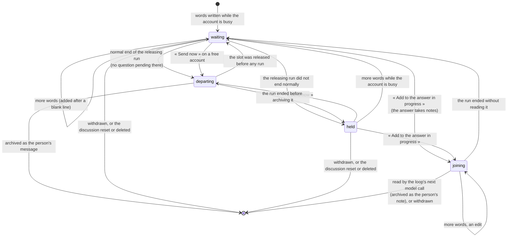

# Waiting messages — words written while LIA works

> ADR-384, ADR-385. What happens to a message the person writes while the account is busy:
> where the server keeps it, when it leaves by itself, when it is held, how it can join the
> answer being written as a note, and how the chat shows it.

## What it is

An account runs one graph at a time (ADR-117). A message written meanwhile — while LIA
answers, while a routine runs, from a second tab — used to be refused with HTTP 409 and lost.
It is now **kept by the server**, one per discussion, and **leaves by itself** when the
account is released by a run that ended normally.

Only **plain typed text** waits. A send that carries attachments, a dictation cost, a
capability directive, a card composition, a one-click decision or a live session keeps the
409 it had: each holds something only the live request carries.

## Data

`waiting_messages` (migration `41dd8c9c2117`): `user_id`, `conversation_id` (both `CASCADE`),
`conversation_revision`, `content` (1 to `CHAT_MESSAGE_MAX_LENGTH` characters), `status`
(`waiting` | `held` | `departing` | `joining`), `stream_id` (the run sending it or about to read
it, set only while departing or joining — migration `a696c8a365f2`),
`send_requested_at`, `version` (bumped on every change of the text), `rendering` (the browser's
display hints: avatar voice and viewport, never the location). One row per discussion
(`uq_waiting_messages_conversation`). It is the person's content: exported with their account,
gone with each discussion (`user_data_map`: `USER_CASCADE`, `FULL`).

`conversation_executions.end_state` (`normal` | `interrupted` | `unstarted`) records how each
run ended; it is written only by the close (`ck_execution_end_state`).

## How a run's end is known

The driver of a run declares its end on its authority (`RunAuthority.end`), from an explicit
result (ADR-263, ADR-303):

| Driver | Normal | Not normal |
|---|---|---|
| Browser producer (`agents/api/background_runner._produce`) | completed, no error published | an error published, a failure, a stop, a kill |
| Out-of-turn runs (`out_of_turn_run.run_end_of`) | `SUCCESS`, `WAITING` | `FAILED`, `QUOTA_BLOCKED` (`BUSY`, `PENDING_QUESTION`: unstarted) |
| Channel gateway (`agents/api/channel_gateway`) | the relayed stream completed with no error | an error relayed, an exception (a stale decision: unstarted) |
| `release_unstarted_execution`, a lost reservation | — | unstarted |
| Operator recovery (`run_recovery.close_stopped`) | — | interrupted |

An end nobody declared closes as **interrupted**: a failure is never read as success.

## The close

`run_admission._close_execution`, in ONE transaction: take the owner lock (the one admission
and every keep take), close the execution with its end, then `settle_release`:

- a message this run was sending and did not archive goes back — **held** after a run that
  started, **waiting** after one that never did;
- after an interrupted end, every **waiting** message of the account becomes **held**, except
  one the person asked to send now.

Once committed, the release is announced (`infrastructure/streaming/release_listener.py`) to the
departure (`agents/api/waiting_departure.py`), installed at import and proven at boot
(`startup/registries._install_release_listener`).

## The departure

`depart_after_release(owner, end)` reads the candidates in order — messages the person asked
to send now first, then, after a normal end only, the waiting ones, oldest first — and for the
first whose discussion has no pending question:

1. **reserve the account** (`reserve_execution`, a relayed, stoppable run): the slot is the
   mutex — two departures never send two messages at once;
2. **claim the message on the version read**: an edit made meanwhile wins, and the queue is
   read again (at most `WAITING_DEPARTURE_ROUNDS` times);
3. **start the person's turn** with their settings (`browser_chat_stream`, as a browser turn
   would), without the browser's live authority, which is never persisted;
4. the **archive** of the person's message deletes the waiting message in its own transaction
   (`archive_first`): the words entered the discussion, or they are still waiting.

A question pending in a discussion keeps its waiting message waiting: it was written before
the question was seen, and is never sent as its answer.

## The race with a release

The keep reads whether the account is busy **under the owner lock**, in the transaction that
keeps the words; the close takes the same lock. A message kept while a close waits is settled
by it; a message arriving after the close sees a free account. Then the request names the run
it was written behind (`behind_stream_id`): if that run ended normally the words leave now,
otherwise they are held. A plain send (no run named) on a free account leaves now.

« Send now » and « Add to the answer in progress » decide under the same lock: marked beside a
close that has not committed, a message would wait for « the next release » — the very one
settling what waited — and stay behind it.

## HTTP

All under `/api/v1/agents/chat/waiting`, the selected discussion as the
`conversation_id` / `conversation_revision` query pair; the writing routes are limited per
account (`RATE_LIMIT_WAITING_MESSAGE_PER_MINUTE`).

| Route | Does | Refuses |
|---|---|---|
| `GET` | the discussion's waiting message, or `null` | — |
| `POST` `{message, behind_stream_id?, rendering?}` | keeps the words (added to what waits); on a free account they may leave at once (`departed`, `stream_id`) | 422 too long once added; 409 `waiting_message_departing` |
| `PUT` `{message, version}` | replaces the words of that version | 409 `waiting_message_changed`; 404 |
| `DELETE` | withdraws it | 409 `waiting_message_departing`; 404 |
| `POST /send` | « Send now »: marks it, stops this discussion's running answer, sends at once on a free account | 409 `waiting_question_pending`; 409 `waiting_message_departing`; 404 |
| `POST /join` `{version}` | adds it to the answer being written in this discussion (ADR-385): `joining`, bound to that run's stream | 409 `waiting_note_closed` (the answer takes no note: it keeps waiting); 409 `waiting_question_pending`; 409 `waiting_message_changed` / `waiting_message_departing`; 404 |

Every read of the message says whether it can join now (`can_join`): the answer of this
discussion runs and takes notes, and the message waits or is held.

A run in another discussion is never stopped from here (an old tab cannot stop another
discussion's work, ADR-378): the marked message leaves first when that run ends.

## A note joins the answer being written

ADR-385. A ReAct loop a person waits for takes notes between its first model call and its
exit; the pipeline mode, a routine, a ticket and a relay never do.

- **The run says so.** `conversation_executions.accepts_notes` is set by the loop's model call
  (`agents/api/turn_notes.read_turn_notes`, only when `a_person_is_waiting()`), withdrawn at the
  loop's two exits (the finalize node, the hand-off of a draft) and by every transition away
  from `running` — a `CHECK` holds that only a running invocation takes notes.
- **Joining is decided under the account's lock** (`POST /join`): the message becomes `joining`
  with the run's stream, or the request answers 409 `waiting_note_closed` and nothing changes.
  A joining note can still take more words, an edit or a withdrawal until it is read.
- **The loop reads it at its next model call**, in ONE transaction: the joining notes of the
  run's stream are deleted and archived as the person's messages (`turn_note: true`). A note
  that joins while the model is answering is read by the next call.
- **The model reads it where it arrived**: each later call of the turn shows it as the person's
  message right after the last message the loop had when it read it, stamped with when it was
  written and framed by one versioned line (`react_turn_note_lines`). It is never written into
  `messages` (`nodes/react_shown`, beside the recovery passes it is ordered with).
- **The loop's exit folds the notes into the turn's question** (same message, by its id), and
  the response is given the same completed request, so the extractions and the later turns read
  what the person asked, notes included.
- **A note nobody read goes back**: the close's settlement turns `joining` rows of its stream into
  waiting ones, then the rules above apply (it leaves after a normal end, is held otherwise).
- Opening and closing the notes tell the open tabs only when a message waits in the discussion,
  so its bubble starts or stops offering to join.

## The chat

- The composer stays open for text while LIA answers (`composerLocks`); the voice, a card
  composition and the attachment sources stay closed (`composerFeatureFlags(..., {textOnly})`).
  « Send next » sits beside « Stop » when the words can wait (`queueAllowed`).
- `useWaitingComposer` decides where a send goes (`composerRoute`): it waits while LIA
  answers, joins what already waits on a free account, and answers a pending question instead.
  A plain send a busy account refused (409) becomes a waiting message (`onBusyRefusal`, the
  optimistic bubble withdrawn by `WITHDRAW_MESSAGE`).
- The waiting message is drawn below the thread (`WaitingMessageBubble`): one sentence says
  where it stands, announced politely; « Add to the answer in progress », edit, withdraw and
  send now follow `waitingActions`. A refusal is said in the server's sentence and the words
  return to the composer; a refused join reads the message again.
- A note LIA read appears in the thread, before the answer being written: the chat merge keeps
  the bubble being streamed after every row archived meanwhile (`mergeServerPage`,
  `streamingId`). Under the note, a mark says it was added to the answer in progress
  (`TurnNoteMark`).
- It is read again when the page's own turn ends, and on every thread signal (ADR-320): a
  message that left is archived, the thread merges it, and the page joins the run sending it.

## Observability

`chat_waiting_messages_total{event}` — `kept`, `added`, `departed`, `held`, `sent_now`,
`edited`, `withdrawn`, `joined`, `note_read`, `note_returned` — on the agents dashboard (panel
« Waiting messages »). Held without departures means people are left deciding; kept without
departures means releases do not reach the departure; joined without `note_read` means the loop
is not reading its notes. Logs carry counts and lengths, never the words.

## Limits, said

- Telegram still answers « busy » and drops the message (lot 34 of the channel programme).
- A turn the person stops after a note was read keeps the note in the conversation they read,
  not in the model's memory of that turn — like the partial answer of a stopped turn (ADR-385).
- The pipeline mode takes no note: its plan is decided before anything runs.
- An archive that fails while a departed run goes on (the archive is best-effort, ADR-117)
  leaves the message held although LIA answered it.
- A departure lost with its worker between the close and the departure leaves the message
  waiting: it leaves at the account's next normal release, or on « Send now ».
