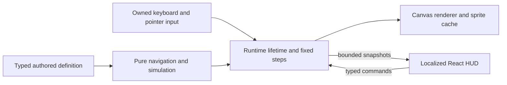

# LIA World — native shared world

LIA World is an optional surface of the authenticated application: an original
shared isometric campus, house and garden, shared human presence, private native
functions and autonomous LIA. It is inspired by MalinosLand's
projected game presentation; no upstream implementation or assets were copied.
LIA keeps the established masculine BIP visual identity through original
directional artwork, with the native eye/mouth rig and a procedural fallback.
Final visual acceptance remains the owner's decision. The
[professional art direction](../superpowers/specs/2026-10-23-world-art-direction.md)
and [V1 execution ledger](../superpowers/plans/2026-10-23-lia-world-v1.md) define
the delivery and its evidence. Browser qualification does not imply owner approval
of final art or physical hardware qualification.

The current [lived-in house design](../superpowers/specs/2026-10-25-world-lived-in-house-design.md),
[implementation plan](../superpowers/plans/2026-10-25-world-lived-in-house.md)
and [refinement qualification](../superpowers/qualification/2026-10-25-world-house-refinement.md)
record the owner's detailed room and furnishing follow-up.

The [main reconciliation record](WORLD_MAIN_RECONCILIATION.md) records the
completed source handoff, conflict decisions, safeguards and qualification status.
The [staged review correction record](../superpowers/qualification/2026-10-26-world-staged-review.md)
records the subsequent performance, focus, contract and reproducibility checks.
The [presence and controls qualification](../superpowers/qualification/2026-10-26-world-presence-and-controls.md)
records the follow-up controls and coarse peer status changes. Direct human audio
remains a [technical proposal](../superpowers/specs/2026-10-26-world-human-voice-proposal.md),
as requested by the owner, pending a separate implementation decision.

## Try it

The [interactions and play design](../superpowers/specs/2026-10-27-world-interactions-and-play.md),
[sequenced plan](../superpowers/plans/2026-10-27-world-interactions-and-play.md) and
[qualification record](../superpowers/qualification/2026-10-27-world-interactions-and-play.md)
track the current extension. Their accepted-lot status distinguishes verified
server authority from subsequent interface and native-sharing work.

When the deployment flag and native operator capability permit it, the
authenticated application exposes **LIA World** through its shared desktop
and mobile navigation, at the localized `dashboard/world` route. Its scene is
loaded lazily. The rest of LIA stays available through normal navigation.

The guided installer asks whether to offer World and writes `WORLD_ENABLED`
from that choice; its default is disabled, including older unattended answer
files. Reconfiguration keeps the recorded choice unless the operator changes
it. The complete development/production examples explicitly enable World,
so copying one of those templates differs from accepting the guided default.
The native administrator capability switch remains effective in both cases.
No additional Compose service, public port or instance provider credential is
needed. The ordinary boot migration path creates its SQL attempt fences, and
the native model registry supplies its translator slot; the usual bootstrap
stores the provider key. Reverse proxies must forward WebSocket upgrades for
`/api/v1/world/ws`. Capacity and authority deadlines come from
[WorldSettings](../../apps/api/src/core/config/world.py); keep a separate
`WORLD_NAMESPACE` for each isolated instance and review the namespace before an
incompatible scene rollout. Changing environment settings requires recreating
the API container. Check the configured `world_message_translator` model, its
provider key and price before offering paid translation; a renderer never
starts a model call.

For a separately created external Windows worktree, run from its root:

```powershell
powershell -NoProfile -ExecutionPolicy Bypass -File scripts/world-prototype.ps1 -Action Start
powershell -NoProfile -ExecutionPolicy Bypass -File scripts/world-prototype.ps1 -Action Sync
powershell -NoProfile -ExecutionPolicy Bypass -File scripts/world-prototype.ps1 -Action Status
```

The ad-hoc shared preview on port 3010 has been retired after reintegration
into main. Open `dashboard/world` through ordinary LIA. The external worktree
and its operational artifacts were archived before removal; see the
[reconciliation report](WORLD_MAIN_RECONCILIATION.md). Standalone URLs below
apply only after deliberately starting a new demo. Automated tests must use
a separate QA host and must never reuse accounts active in an interactive demo.

The standalone helper prints the current preview URL after starting. Change its
language prefix for another supported LIA language. This account-free
preview uses the same scene and is refused by the server outside development.
It is absent from the sitemap and stops the public landing video player.

The helper requires the existing Docker development image, network and dependency
volume. Their names and the port are parameters. It copies a source snapshot
because Docker cannot mount this C: worktree in the current setup. **Run Sync after
an edit**, wait for it to finish, then validate the recompiled page. Environment
files, dependencies and build output are excluded. For this helper, shared node_modules is mounted
read-only; no package installation, shared service restart or dependency mutation
is performed. The retired reconciliation preview used its rebuilt
image's own dependencies, aligned with its frozen lockfile; it did not
consume main's shared dependency volume. Stop removes only the named, ownership-labelled container:

```powershell
powershell -NoProfile -ExecutionPolicy Bypass -File scripts/world-prototype.ps1 -Action Stop
```

The port binds to loopback by default. For a real phone on a trusted local network,
start a separate container with `-Container lia-world-prototype-mobile -Port 3003
-BindAddress 0.0.0.0`, then open `http://<PC-LAN-IP>:3003/fr/world-preview` on the
phone. Windows Firewall must permit that development port. This opt-in exposes
the development web server to the local network; it is not a public deployment.
Stop it with `-Action Stop -Container lia-world-prototype-mobile` after testing.

## Controls and scope

The shared foundation now has native HTTP-only session authentication, explicit
consent to display the native account name, bounded server admission and FIFO waiting, controller
takeover, authoritative collisions and filtered snapshots. Redis is the only
authority; an outage freezes input and enters bounded reconnection. A shorter
silence (no snapshot within `FRESH_SNAPSHOT_MS`, declared in
[movement.ts](../../apps/web/src/features/world/movement.ts) and read by the
[link](../../apps/web/src/features/world/shared-link.ts)) freezes a pending
approach to an object, a seat or a person instead of withdrawing it: the avatar
holds still, the walk resumes from the authoritative position, and the
approach's own deadline still bounds the wait (`SceneHost.ready`). Browser
tickets and controller tokens stay in memory and never travel in a URL.
Private home occupants and blocked accounts are omitted from other viewers'
projections. Account deletion selectively removes presence without clearing
other players. Admission shares the native account row lock with deactivation.

There is no permanently running qualification preview. Recreate the disposable
native host from the current checkout with the repository launcher:

```powershell
# Prerequisite on a fresh development setup: the repository's dependency images.
docker compose -f docker-compose.dev.yml build api web
task world:proof:start
task test:backend:world:integration
$env:E2E_WORLD_NATIVE_URL = 'http://127.0.0.1:3012'
task test:e2e:world-native
task world:proof:stop

# Optimized standalone server, same inert API and native application routes.
task world:proof:start -- --mode production
task test:e2e:world-production
task world:proof:stop
```

`scripts/world-proof.py` creates fresh SQL, Redis, API and web containers with
ownership labels and generated test keys. It mounts no shared development volume
and copies no environment file. API, SQL and Redis use only an internal network;
the web also has a separate access network publishing its loopback port. The
backend has no provider credentials or external network. The integration task uses
the separate `world_test` database and Redis DB 15, with `LIA_REQUIRE_DB=1` so an
infrastructure failure cannot silently skip the suite. `stop` removes only this
launcher's labelled resources. `start` waits for the build and the inert API to
be ready; a bounded readiness failure points to the owned logs. Temporary source
archives and generated credential files are erased even if startup fails.
After editing, stop/start to test a fresh snapshot.

`scripts/world-proof-app.py` refuses any database/cache outside those exact proof
hosts and is never imported by the application entry. Its fixture chooser requires
the explicit proof-host switch; never enable it on a normal application instance.
The launcher prints the current URL and log command. Use visitors 1 and 7 (French),
or 2 and 8 (English), in separate browser profiles. Tabs share one HttpOnly account
cookie. Same-language free text invokes no model; the unbilled cross-language
fixture supports only its explicitly stated phrase. A reload can require explicit
controller takeover before chat. These test accounts are disposable and must not
be used concurrently for an interactive demonstration and automated tests.

The dedicated proof uses `task test:e2e:world-native` with
`E2E_WORLD_NATIVE_URL` naming that disposable local host and
the launcher's ownership-labelled Docker API (set by the Task target).
Set `E2E_WORLD_NATIVE_OPTIMIZED=1` for an optimized build: the same journeys
then enter the real localized application route. Multi-person WebKit proofs
use independent browser processes so each simulated person has its own HTTP
transport pool; native SSE and world sockets remain enabled.
The native notification publisher additionally requires the qualification
namespace and exact disposable database. The reconciliation proof used fresh
PostgreSQL, Redis and session keys on an independent internal network; its
network aliases satisfy the fixture host guards without connecting to the
interactive preview infrastructure. It is separate from the
hermetic PR suite; both retain their transport guards. The authored collision
catalogue is compiled by `node scripts/world-catalogue.cjs`; frontend lint checks
its freshness. Increment the scene version and rotate `WORLD_NAMESPACE` for an
incompatible map rollout; do not preserve old actor coordinates on a new floor.
The server rejects a stale browser's scene before admission.

The qualified world combines private home colour preview and
revision-checked persistence. It no longer reads memories or
interests to furnish the studio. Legacy preference documents remain readable;
new saves keep only the selected palette. Native private function panels and the
ordinary LIA conversation
workspace retain native HITL, costs and quotas. Private direct text uses the
dedicated translator; the inert proof explicitly labels its authored translation
fixture and fictional cached weather. Older lot hosts may be paused to free
resources; their qualification screenshots remain in the execution ledger.

- Focus the scene, then use arrows, WASD or ZQSD. Tab leaves the scene normally.
- Click/tap reachable ground to walk; drag to explore with the camera.
- Wheel, pinch or the native zoom buttons change camera magnification.
- The upper-right minimap moves the camera. Keyboard activation recenters it.
- Recenter restores character following; walking also returns to follow mode.
  LIA's button toggles patrol/follow. At rest after a call, LIA faces the user.
- The optional mobile joystick supports held contact, release and cancellation.
- Help pauses motion, traps focus through the existing dialog and returns focus
  to the scene. Reduced motion removes walking/bobbing decoration and camera easing.
- Graphics quality is in help; performance remains available in the compact HUD.
  Three quality tiers bound backing resolution; the light tier targets a lower
  render cadence. The performance panel reports observed values, not a guarantee.

The authored places group native functions in one shared map. Personal home
colours, atmosphere and assistant panels remain private.
LIA movement is deterministic and calls no model. The world introduces its own
bounded domain, persistence and translator slot without adding LangGraph state.
Shared authority and private LIA operations retain existing ownership, HITL and
accounting contracts. Shared furniture physics, timed home visits, peer voice and
federation remain outside the accepted V1.

## Boundaries for extension



Source is in `apps/web/src/features/world/`:

| Module                     | Responsibility / extension seam                                                                                                    |
| -------------------------- | ---------------------------------------------------------------------------------------------------------------------------------- |
| `types`, `definition`      | Typed dimensions, zones, ground patches, props, spawn and patrol. Extend authored data before adding behaviour.                    |
| `geometry`                 | Projection, inverse projection and anchored camera zoom, independent of React.                                                     |
| `navigation`, `simulation` | Compiled collision grid, bounded route search, fixed-step actors and BIP state. No graphics or application data.                   |
| `art/`                     | Original reusable cuboid/prop/tile painters; closed prop-kind registry checked by TypeScript.                                      |
| `occlusion`, `renderer`    | Viewport culling, foreground masks, cached sprites and bounded LRU ground chunks. Owns graphics resources and BIP image lifetime.  |
| `input`, `runtime`         | Focus/contact ownership, visibility suspension, simulation cadence and resource cleanup, including partial initialization failure. |
| `useWorldRuntime`          | Account lifetime guard, StrictMode cleanup, retries and low-frequency publication. No per-frame React state.                       |
| `World*`                   | Existing LIA buttons/dialogs, localized HUD, minimap and touch controls.                                                           |

Canvas 2D was chosen for this bounded qualification to avoid mutating shared
dependencies and to keep low-device costs controlled. It is not a general game
engine. Keep the model and commands independent if measurements later justify a
renderer replacement. No speculative plugin framework, scripting engine or ECS
was added. The network adapter uses explicit authenticated schemas and server
validation; private LIA and home projections never enter shared snapshots.

Native function placement derives from the existing settings inventory, gates
and localized labels. Administrator-only sections stay outside the world catalogue.
Each selection loads the existing native component through the central asynchronous
registry. The ordinary settings page uses the same registry and pane frame; the
world supplies a compact icon instead of loading the entire icon catalogue.
Account, world authority or capability loss unmounts the selected activity.
World account verification also rereads the real HttpOnly cookie on foreground
return and when the mailbox rejects its authority. Until a read confirms the owner,
private portals stay withdrawn along with the scene; a later verification of that
confirmed owner runs in the background, so the private subtree stays visible and its
effects alive (a streamed answer, a Live session). A read that fails withdraws it, and
a mismatched or inactive identity destroys the old world subtree and offers a full
reload. Same-account verification retains the composer draft, and an unavailable
verification can be retried without publishing the old account's panels. Socket handshake identity is never mistaken for the
identity currently attached to HTTP requests.

The searchable function catalogue reuses native settings search and static slash
commands. A command prepares the ordinary private composer; it never sends on
selection. Explicit world drafts supersede a stale selected-card context without
consuming the host URL's intent. `E`, while the canvas owns focus, opens the same
place action as the visible control. All essential functions remain directly
reachable without walking. The native notification receiver stays mounted; the
redundant floating chat shortcut appears only for activity or unread attention.

Personal lighting uses server-anchored civil time in the account timezone. Weather
borrows only the fresh native briefing cache, without a location, provider call or
model request. Missing or expired cache is neutral. The owner-scoped query aborts
on account change, hides the old context immediately, pauses hidden refreshes and
releases its timer. Night overlays preserve legibility; reduced motion disables
weather particles, and the quality tier bounds their count and raster resolution.

The private peer gallery pages accepted native connections with mutual blocks and
active-account checks. It reads neither email nor profile/home contents. All
accepted peers remain discoverable, including visible actors. A private fenced
World connection lease supplies online (green), home (red), away (light orange)
and offline (gray) status. Away starts after ten minutes without human activity
and takes precedence over home. The normal idle admission timeout still releases
capacity; a connected idle client remains away and must explicitly request entry
again. Heartbeats renew the connection lease without inventing human activity.
Disconnect withdraws presence; missed heartbeats expire the bounded lease.
Only the current controller can renew or remove it. Native login, assistant runs
and session TTL are never presence evidence. Consent explicitly names coarse
presence and the home marker. The private directory polls serially while visible;
failed refreshes retain the list with an unavailable status, never a fake offline
claim. Its relay button prepares a normal LIA draft with native confirmation and costs.

On desktop, LIA and human conversation docks leave the focused scene movable.
Keyboard movement remains canvas-scoped: writing a draft never moves an avatar.
Modal activities and full conversation docks on compact screens retain their
pause behavior. The quick social bar leaves scene navigation active.
The camera/follow/zoom controls share the action bar's bottom row on desktop.
The redundant in-game voice toggle is removed; the application menu retains its
ordinary voice behavior and navigation.

The shared conversation workspace preserves the normal history, SSE, active-run,
pending approval, token/cost visibility and registry lifecycle. Embedded use ignores
the host page's one-shot URL intent and initial-message parameters. Opening LIA
never sends a message or consumes that intent. A world preview without a running
agent graph honestly shows the native offline state; browser approval fixtures do
not establish live model/provider fidelity.

## Resource and failure discipline

Route search visits each grid cell at most once and has an explicit work budget.
Movement clamps stalled elapsed time and subdivides collision checks. Click paths
align an off-centre actor before turning, avoiding blocked-corner clipping.
Rendering caches floor chunks with a bounded LRU and reuses prop sprites. Quality
changes release replaced sprites. The cache estimate counts decoded RGBA surfaces
and the LIA bitmap; it **does not** include the entire browser heap, compositor,
driver allocation or process RSS. Frame p95 measures frame interval; render p95
measures only synchronous JavaScript draw work, not GPU completion.

Wide props use footprint-aware foreground masks on a single reusable actor layer.
This avoids hiding an actor standing beyond either front face of a fountain/table.
Masks omit drop shadows, so compositing cannot double-darken the floor. Both masks
and the actor surface belong to the renderer's measured, released resource set.

Blur/cancel/hidden-tab events release motion inputs. Hidden tabs stop the animation
loop and reset frame samples on return. Teardown releases listeners, frame request,
observer, decoded art and canvas backing surface. Late owner callbacks and retained
commands are refused. Initialization/render/context failures show a localized
retry surface instead of leaving an active invisible runtime.

## Verification and remaining acceptance

See the [qualification ledger](../superpowers/qualification/2026-10-23-world-prototype-ledger.md)
and [implementation plan](../superpowers/plans/2026-10-23-lia-world-playable-prototype.md).
The subsequent native implementation has its own
[V1 ledger](../superpowers/qualification/2026-10-23-world-v1-ledger.md) and
[V1 plan](../superpowers/plans/2026-10-23-lia-world-v1.md).
The pure geometry/navigation/simulation coverage ratchet supplements the existing
global gate; graphics and input stay in that global pool. Real-browser journeys
exercise the actual canvas and native controls in the existing hermetic harness.
Use its official Playwright container as described in [the E2E guide](../../apps/web/e2e/README.md).

Physical phone GPU/thermal/battery behaviour and the Pi running normal LIA load
are separate acceptance steps. Viewport emulation and CPU slowdown establish
useful controlled evidence, never equivalent hardware qualification. Shared-world
concurrency has a separate native five-plus-one browser matrix. Direct text uses
independent private HTTP projections, ephemeral Redis bodies and durable SQL
attempt fences. The dedicated translator uses native quotas/accounting and a
single bounded provider attempt; a language change never starts another paid act.
Only the recipient can explicitly request a missing translated variant. Human
text is neither assistant history nor learning input, and original text requires
an explicit display action when translation is needed.

The discussion follows incoming messages while the reader remains at the bottom,
including when the viewport or keyboard changes the available height. Scrolling
back preserves the reading position and exposes the localized “Latest messages”
action, which restores both the latest content and keyboard focus to the log.
An interrupted mailbox read retains the owner draft and provides an explicit
retry. Recovery reads the mailbox; it does not resend a message. Real-browser
conversation journeys use independent browser processes for distinct people:
background-tab presence expiry and the native per-account write limit remain
enforced during qualification.

Native identity is rechecked on focus/visibility and after a private 401/403.
A first or failed verification hides private portals; a background revalidation of
the confirmed owner keeps them visible and mounted; a confirmed foreign account
destroys the old owner subtree. Same-owner panels retain local edits through React's
[Activity lifecycle](https://react.dev/reference/react/Activity), without pausing
the world transport. The owner-scoped, in-memory reading position survives that
private panel lifecycle and is cleared on explicit close. Hidden zero-height
scroll events cannot overwrite it. Focus restoration waits for the resumed
dialog and respects another focused surface or a background document. Controlled
selects ignore Radix's transient empty native change on effect restoration;
explicit owner-driven clearing and uncontrolled selects retain their contracts.

The native notification stream closes its Redis Pub/Sub connection inside a
bounded, cancellation-shielded cleanup before updating the stream registry. This
is essential under ASGI disconnect cancellation: abandoned subscriptions consume
the same bounded cache pool that World admission and mailbox reads require.
The proof host mounts the application's native security middleware, including
its SSE compression policy, so it exercises the normal notification transport.

The social proof host labels its authored phrase translation as simulated and
unbilled. Native callback/SQL tests establish accounting ownership and exactly-once
records, not linguistic fidelity. Real supplier fidelity and mixed physical
hardware load still require their own qualification.

Phone actions now use a compact dock; wide touch viewports retain the direction
pad. Short landscape layouts keep camera controls and the minimap separate.
Unread counts have an owner-localized accessible description and stay within
the action on phones. World controls preserve their full target area while held.
The [touch follow-up review](../superpowers/qualification/2026-10-24-world-touch-cold-review.md)
records the compiled-CSS and real-browser checks behind these decisions.

## Cached artistic modules

Original procedural artwork is split under `art/`: `painter.ts` owns shared face
lighting; `floors.ts` describes ground materials; `garden.ts`, `architecture.ts`,
`interiors.ts`, `creative.ts` and `person.ts` own bounded visual families.
`palette.ts` is shared by the renderer and minimap. `prop-style.ts` declares
finite deterministic style families and colour/mask/private cache separation;
its pure contracts have a strict coverage gate. Surface detail is baked into
cached sprites. Night lights reuse one halo and are culled against the zoomed
viewport. They are decorative, never an assertion of peer connection state.

The [visual refinement plan](../superpowers/plans/2026-10-28-world-visual-refinement.md)
keeps the same texture identities, actor frame count and effect budgets. Small
bevels preserve support planes; fountain coping is a continuous ring. Authored
model parts are ordered at sprite creation so rear housings hide front details.
Scene ordering keeps foreground wall tiles in front of long furniture, and
picking reuses that same order. Bottle shelves remain open on both sides.
Marble veins, textile weave, contact shade and path verges are baked. Existing
dawn/evening/night phases share their tint between terrain and objects; lamp
halos stay bounded. Motion timing changes use the existing simulation clock.

The [art completion plan](../superpowers/plans/2026-10-24-world-art-completion.md)
and V1 ledger record the artwork passes. `smoke/world-art.spec.ts` runs the exact
trusted painter modules in real browser canvases, checks complete silhouettes
and solid foreground masks for the authored private catalogue, and exercises
the actual app camera, private night/weather context and texture envelope.
Its test-only same-origin oracle bundles trusted local TypeScript as literal
module functions under a restrictive CSP; it adds no application route or debug
API. Animation contact sheets supplement direction and walk-phase checks.
These proofs complement native movement and independent-user journeys; physical
device measurement and owner art acceptance remain separate.

## Compact widgets and private conversations

The quick tools reuse native Radio, weather, phone, voice and display controls.
The phone opens a deliberate choice between a call draft and the SMS archive;
session arrivals retain separate SMS and reminder badges. Spoken comments,
delegated Live and direct Live follow the native account capabilities, connector
availability and microphone ownership. Live opens the embedded native conversation,
with its pending request bound to the requesting account. Theme controls stay
synchronized with the application header, including OLED.

A single lower action row keeps the scene visible. Detailed discovery is in the
Functions menu; settings stay separate. Widgets follow the heading's actual height
instead of a fixed portrait offset. Short landscape folds the quick tools into
one labelled action, preserving touch targets and keyboard dismissal.

Route (footprints), Gestures (open hand) and Photo (camera) share the device widget
group. Folded controls expose the authored [gesture catalogue](../../apps/web/src/features/world/emote-catalogue.ts)
directly beside the joystick, with one keyboard controller shared by both
presentations. The separate Discover, introduction/replay and decorative-actions controls
are retired. The Functions catalogue includes SMS in the atrium. News belongs to
the small table beside the meeting-room sofa; the cafeteria news desk is removed.
The civil clock/phase badge appends the effective localized season. Sheltered
plants keep their neutral green palette independently of outdoor foliage.

Private social messages use a person directory and one selected thread. Each
person has their own unread count, draft and reading position; leaving the world
does not merge identities or expose a hidden original in previews. Opening the
directory reads no unselected thread. Departed people remain available through retained
mailbox history or an addressed draft, while sending still requires native
availability. The expanded panel uses a list/detail flow on phones; desktop keeps
the directory beside the conversation.

The quick social bar shares that mailbox, addressed drafts and translation
consent. It starts hidden on phone and short landscape layouts: Chat folds any
expanded world controls and opens the bar. Its header can hide recent history,
open the full panel or close the bar without discarding the draft. On desktop,
the bar starts visible and Chat retains access to the full panel.

The [nearby recipient projection](../../apps/web/src/features/world/nearby-conversations.ts)
orders authoritative, reachable participants by distance; otherwise the bar
addresses the existing public channel. A focused composer, non-empty draft or
pending delivery keeps its destination. Explicit selection can override the
automatic choice, and ambiguous names retain their identifier suffix. Proximity
creates no send or translation operation and changes no server permission.
Hidden history is never marked read. The viewport dock handles the keyboard and
the scene boundary; short landscape reserves separate spaces for the joystick,
gestures, contextual action and conversation.

The [compact social plan](../superpowers/plans/2026-10-28-world-compact-social.md)
and its [qualification](../superpowers/qualification/2026-10-28-world-compact-social.md)
record the regression and browser evidence.

Home customization exposes colour swatches with immediate preview, explicit save,
cancel and revision-conflict recovery. Its contract contains only palette and
revision preferences. Undeployed motif/placement contracts, artwork and source
digests are removed throughout the client and backend. Read-only loading never
rewrites unreadable preferences; repair requires an explicit reset. Colour edits
introduce no prompt or model call.

The original directional image is retained as an [offline artwork source](../../tools/world-art/README.md),
outside public delivery. Only the repacked atlas is loaded by the renderer.

The [compact-interface plan](../superpowers/plans/2026-10-25-world-compact-interface.md)
and the [qualification ledger](../superpowers/qualification/2026-10-25-world-house-refinement.md)
record this iteration's measured evidence and acceptance limits.

## Verifying a resumed preview

A running container can contain only its idle shell after Docker restarts. Starting
that container does not by itself restore the Next or API process. Reuse the
complete retained runtime configuration when resuming them; do not reconstruct
only a subset of environment variables.

The compiled World JSON catalogue is read at API process startup. Development
entry points watch JSON under the source directory as well as Python, so new pose
slots reach the server. A reloader started before that option was added must be
recreated once. An older worker with a newer client can refuse a newly authored
slot as unavailable; keep both source generations synchronized rather than
inventing a local shared pose.

The browser-facing loopback hostname belongs in NEXT_PUBLIC_ALLOWED_DEV_ORIGINS.
The normal scripts/world-prototype.ps1 launcher derives it from BindAddress.
Without this setting on a resumed Next process, the HTML can return successfully
while the development WebSocket is rejected and the client keeps reloading
without hydration.

The API's CORS_ORIGINS must retain the exact preview origin. A dotenv value
wrapped in quotes must not be passed unchanged through Docker's raw env-file
loader: literal quote/bracket characters can survive into the effective origin
list and reject both the proof login and world admission. A plain comma-separated
origin list works with both loaders; keep the existing exact allowlist.

Before handing over a resumed development preview, run the
apps/web/e2e/native/world-proof-entry.spec.ts journey with E2E_WORLD_NATIVE_URL
set to that preview. It clicks the real visitor chooser, checks the native
session response, HttpOnly cookie and localized admission form, and asserts that
no world ticket was requested. This qualifies bootstrap without taking an existing
player's controller. The journey is development-only; production deliberately
has no identity chooser.

## Mobile controls and social extension plan (g25)

The [approved execution plan](../superpowers/plans/2026-10-25-world-social-avatars.md) sequences mobile controls, account appearance, private bubbles and public discussions.

On compact screens the controls start folded. The world-controls button reveals the map, native widgets and camera controls; short layouts scroll this region. A contextual action is displayed only near an interactable target. The optional joystick uses the same eight canonical headings as keyboard navigation and a neutral dead zone. Its device preference is auto, show or hide; unavailable storage falls back to the current mounted session. Panels and folded-control transitions release any held joystick contact.

A visible private panel pauses local movement, while shared and local scenery simulation remain alive. Painting is capped independently; hidden documents still suspend the animation loop. This removes the previous deliberate five-frame cadence. It is a rendering policy, not a guarantee on unmeasured phones or the Raspberry Pi.

Qualification uses a separate Docker world namespace and inert accounts. The public visitor chooser regression continues to request no admission ticket. No provider, translation or agent call is introduced by these controls.

### Native identity and explicit appearance (g26)

The world derives its public name from the authenticated LIA account at both ticket
creation and socket authentication. Legacy ticket aliases are accepted for older
callers but cannot override that name. The label budget abbreviates long account
names without mutating the profile; account email is never a fallback.

The first entry offers a finite appearance editor; later entries retain the saved
choice. The studio mirror opens the same private editor. Appearance persistence
uses a separate JSONB column, the native fresh-row preference lock and an optimistic
revision, so changing house colors and appearance concurrently preserves both.
Account deletion scrubs the column through the native lifecycle.

Only declared visual choices reach peer actor projections. The owner's preference
revision, profile, memories and account identifiers are excluded. The procedural
mesh uses the existing eight-heading movement and pose system; its appearance cache
has an explicit memory and entry budget. No generation, inference or LLM call is
performed for an appearance change.

Verification includes real PostgreSQL ownership and concurrent writes, Redis/socket
projection, a native mirror journey in Chromium/Firefox/WebKit, and browser canvas
inspection across the authored hair/outfit/accessory headings. These are desktop
browser engines and mobile viewport checks, not measurements on physical phones.

### Ephemeral world speech (g27)

World speech is a presentation of native deliveries, not another messaging
transport. An account-owned channel observes the existing mailbox and device
notification callback. No human text is added to shared spatial snapshots, logs,
browser storage or a new LLM prompt.

Private bubbles show both the peer's ready text and the owner's sent messages
above their respective avatars. An outgoing echo comes only from the confirmed
mailbox projection: its text is the sender's original, independent of recipient
translation status. Incoming text still requires a ready native projection; a
missing translation never falls back to the original. Initial history is not
replayed. A new message from the same speaker replaces its bubble, with expiry
measured by the monotonic browser clock. Participant removal and account
authority loss remove presentation.

A native proactive opening temporarily directs the local LIA actor through the
existing walkable navigation. Display waits for arrival and the closing of private
panels, within a bounded pending lifetime. The person's normal follow choice
survives. The full content is still available through the native application.

The canvas lays out short excerpts at screen-sized text, caches the layout, avoids
card overlaps and viewport overflow, and paints all connectors behind all cards.
An owner-scoped live region provides the same active text to assistive technology.
The native chat remains the readable history and has independent thread unread
state.

### Explicit public discussion (g28)

The directory offers a labelled Everyone channel alongside individual people.
Public and private threads retain separate drafts, read positions, unread counts
and translation-consent choices. Mobile keeps the existing list/detail layout.
A public send carries an explicit audience, never a synthetic recipient UUID.

The server freezes eligible live recipients when accepting the intent, excluding
bilateral blocks and private studios. Rejoining with a new actor does not replay
previous broadcasts. Native account availability, controller, visibility and
language are rechecked around translation. Only the own-language allowlisted
projection reaches each authenticated reader; recipient lists and account/controller
identifiers remain server-side. Speech includes the sender's public echo and uses
the same ephemeral presenter as private speech, with no public spatial text field.

The public read projection has its own history and byte budget; its limits live in
apps/api/src/domains/world/public_models.py. A malformed public cache makes that
substream unavailable and clears its unverifiable browser history, independently
of the private mailbox. Public original text is a deliberate history action when
translation cannot be shown, never an automatic bubble fallback.

Distinct foreign languages share one structured batch through the existing world
translator slot. The native quota, output/context bound, accounting callback,
single-attempt adapter and fair persistent attempt queue still apply. Same-language
messages need no model. Malformed output, a lost acknowledgment, process failure or
a later language change never schedules an automatic paid resend. Native usage is
attributed only to the sender. There is no new persistent text table; ephemeral
bodies/indexes expire and native account erasure removes their owned references.

Qualification substitutes only a fixed inert phrase at the provider port while
retaining native sessions, SQL, Redis, HTTP and browser presentation. Real-provider
language quality and physical-device performance remain separate measurements.

### Night and garden finishing pass (g29)

The authored scene now has denser perimeter groves, four tree silhouettes (broadleaf,
birch, conifer and blossom), an unobstructed vegetable garden, the reversed meeting
lounge and a curved free-standing jukebox. The artificial tall wall behind the jukebox
was removed. The generated collision and pose catalogue follows the authored map;
its scene revision is read from `definition.ts`, never duplicated in this guide.

Night rendering keeps separate outdoor and gentle interior ambient levels. Ground
light pools precede furniture; bulb halos follow it. Lamp halos reuse one cached radial
texture with viewport culling. A fixed bounded field of differently sized stars is
painted behind the opaque plateau, without per-frame randomness or a new timer.
Tree details are baked into existing bounded style families, not regenerated each frame.

Verification entry points: `night-sky.test.ts`, `world-night-details.spec.ts`,
the existing complete-silhouette / lighting pixel oracles, and the opt-in
`e2e/capture/world-finish.spec.ts` day/night walkthrough. The latter opens the
development preview with intercepted account/world API and WebSocket fixtures; it
never obtains a native world controller or calls a paid provider.
Local proof and source/preimage hashes are retained under `.tmp/world-g29/`.
Desktop browser measurements are not qualification of a physical phone or Raspberry Pi.

### Interactive finishes and local sound (g30)

Hover uses a faint clipped footprint on the floor, before furniture is painted;
it never recolours an object. The original silhouette tint was replaced following
visual review. Indoor floors terminate under the exterior wall body instead of
bleeding checker tiles into the grass. Chair backrests respect their facing.
The weather telescope now belongs to divination, and the decorative cat's path
avoids it. The crystal has a steady aura with reduced motion, otherwise a slow
breath. Windows emit no light halo.

Only the explicit development proof mounts the lighting selector: actual time,
simulated day, or simulated night. It changes local presentation and leaves native
time/weather and all server decisions authoritative.

Original sound design lives in `apps/web/public/world/audio/v1/`, with prompts,
source/output hashes and provider creation receipts in `provenance.json`. These
are static original assets; playback performs no provider request, has no model
prompt and incurs no recurring tokens or credits. The gym uses an original
training instrumental. No existing song recording or melody is included.

The compact Sounds control starts disabled and remembers an owner-local mute choice
and independent world-volume value. A deliberate gesture activates Web Audio. The room follows the avatar,
not a camera inspection on the minimap. Outside, rain replaces wildlife; daylight
has garden birds or terrace cicadas. The library is silent. A telephone rings
occasionally instead of continuously.

`audio/soundscape.ts` bounds decoding/cache and concurrent voices; interrupted
loads cannot start in a later room. Fades join room changes. Hidden tabs, lost
account/control authority, native radio, Live, microphone use and LIA's spoken
output suspend world sound. Muting and leaving stop pending work and release audio.

The private-message cue retains IDs only. Initial history and reconnection are
silent; outgoing messages and public broadcasts never ring it. Incoming messages
must be fresh against server time and are deduplicated before playback. A burst
produces one short cue; a late decode cannot ring after mute, pause or shutdown.

Verification includes source pixel oracles, actual day/night preview controls,
native geometry/pose checks, sound policy/lifecycle races and account-owned React
integration. Browser sound tests decode the actual files and measure a real Web
Audio signal, transitions, library silence and shutdown. Windows engine and
viewport emulation results do not qualify physical phone audio routing or Safari
performance. Local evidence remains under `.tmp/world-g30/`.

### Places contrast and arcade score (g31)

The places directory inherits the shared overlay's paired foreground/background
tokens in both themes. Its keyboard highlight uses the same native accent pair;
a browser regression checks normal and focused contrast, viewport containment
and Escape focus return on desktop and mobile.

World sound uses a headset icon, distinct from the native spoken-replies speaker
and Live waveform. Accessible names and audio preferences retain their existing
contracts.

The multimedia ambience is an original melodic chip score with limited harmonics,
soft envelopes, restrained percussion and circular delay tails. The offline source
is `scripts/world-arcade-audio.py`; the client still plays a static mastered MP3.
It replaces the previous scattered arcade effects without new provider usage.
Provenance retains the superseded provider receipt and a new cache revision
invalidates the old recording. Browser qualification decodes the actual file,
checks its loop seam, and plays it through the real sound lifecycle.

### Owned world volume and doorway clearance (g32)

The headset opens a compact, non-modal native control panel with an explicit
activation/mute action and a named keyboard/touch slider. The numeric preference
is separate from mute, scoped to the account, validated on restore and kept usable
when local storage is unavailable. Adjusting it never opts into playback.

A dedicated master gain belongs to the world AudioContext, downstream of ambience
crossfades and message cues. It changes loudness smoothly without decoding or
restarting a room. It never changes radio or LIA voice preferences, gain nodes or
streams. Existing native-audio priority and owner-lifetime guards still apply.

Plants near doors were moved away from the full approach zone. The authored
circulation regression includes shoulder clearance rather than checking only the
wall opening itself. The compiled server collision catalogue follows the same
scene revision; no client-only obstacle movement is applied.

Verification includes owner-isolated storage, mute/volume independence, final-output
audio measurement at zero and nonzero gain, desktop/mobile controls, keyboard focus
return and native geometry/pose checks. Browser viewport emulation is not physical
phone audio-routing qualification.

### Authoritative cabinet games

Each authored cabinet binds to one original deterministic rule engine: tic-tac-toe,
four-in-row or Reversi. Shared Redis authority owns moves, outcomes, consent,
round revisions and deadlines. The computer uses bounded local search with a
legal low-cost fallback; this path calls no LLM, provider, prompt, memory or token
accounting service. There is no durable game-history table or per-match worker.

The host can wait or play the computer. A joining human requests contact; only
the host's explicit acceptance creates a fresh two-human board. An unclaimed
waiting host can deliberately start a fresh computer round. Rematches require
each human's consent and alternate colors. An accepted request is a new pairing,
not a rematch: its board is the canonical fresh one, the host on the first color
and the joiner on the second, whatever color an earlier solo rematch had moved the
host to. A new World controller must explicitly rejoin, a finished table included
while its result is displayed, so a reconnect on the result screen can still
rematch or leave; a new admission identity cannot inherit an earlier admission's game.

The game command boundary bounds distributed account input first: a command the
input cap or the disabled arcade refuses changes no table, so it only consumes
its sequence and records its receipt, without the cookie revalidation, the SQL
policy fence or any computer search. Every other command authenticates the native
cookie and prepares the computer response before acquiring SQL locks. Canonical
account fences serialize fresh eligibility and bidirectional blocks with the
existing contact block/unblock service; they are `FOR NO KEY UPDATE`, like the
[peers pair fence](../../apps/api/src/domains/peers/pair_fence.py), so they order
policy writers and never an insert merely referencing those accounts. The fence
is held through the one bounded Redis commit, a deliberate exception recorded in
[ADR-365](../architecture/ADR-365-Private-Native-LIA-In-An-Authoritative-Isometric-World.md).
The Redis callback performs only pure transitions. Match revision, scene epoch, controller, operation identity
and a hash of the complete command fence duplicate or obsolete delivery. An
uncertain acknowledgment can be retried exactly; it cannot silently replay a
move against a new board. Ordinary movement elsewhere does not revise a match.
Explicit departure remains account/controller/round-fenced while allowing a
newer revision of that same round, so an opponent's concurrent move cannot trap
the player. Departing also clears that player's outstanding rematch consent.

Only current visible participants receive a board. Others receive coarse cabinet
availability — empty, joinable or full — and only a joinable cabinet carries the
round fence a join needs; pending requesters receive no board. A table holding
someone blocked by, blocking or ineligible to the viewer reads exactly like any
other full table, so the hint discloses neither a block nor a revocation. Public
payloads carry opaque World actor identities and their existing public aliases.
Account identifiers, controller secrets, operation receipts belonging to peers and
block reasons are excluded. Policy-hidden refusal payloads also omit the round
identifier/revision.
Projection withdrawal follows the existing bounded socket-policy refresh in
[transport](../../apps/api/src/domains/world/transport.py); mutations consult
fresh SQL policy for every command.

Disconnect suspension and remaining turn time are committed once, with bounded
reconnect and absolute match lifetimes. Inactivity, revocation and outages never
invent a winner. Account erasure includes membership, requests, consent and
receipt-only ownership, plus short-lived input counters. Strict legacy readers
preserve each older authority generation during erasure. Corrupt records fail
closed at both read and pre-commit validation boundaries. They fail differently:
a stored record the reader refuses keeps the reader's own error, which erasure
uses to try the older generations; a record a transition produced invalid is a
server defect — never published, logged by its rule code alone (no value),
counted by `world_authority_integrity_failures_total` and closing the socket 1011.

The socket tells three kinds of failure apart. A frame whose envelope declares
another socket protocol generation closes 4426, asking the client to reload
rather than retry; any other invalid frame, and the frame-rate refusal, closes
1008; a server defect closes 1011. The codes are the `WORLD_SOCKET_CLOSE_*`
constants of [core constants](../../apps/api/src/core/constants.py). A refused
gesture (cooldown or visibility) publishes nothing, so it settles under its
sequence without a native policy read; a gesture that may be published still
reads fresh policy first. Computer searches that outlive their caller's deadline
are awaited by the shutdown sequence before the event loop closes.

The optional child deployment limit is declared with the other
[World settings](../../apps/api/src/core/config/world.py); native World capability
must also permit every command. Disabled startup withdraws stored games, and
disabled projections retain ordinary World admission. Environment changes take
effect through the established restart lifecycle. Bounded, identity-free metrics
are wired to the [World arcade dashboard](../../infrastructure/observability/grafana/dashboards/32-world-arcade.json).

The native activity host opens the [arcade panel](../../apps/web/src/features/world/WorldArcadePanel.tsx)
from the authored cabinet binding and its canonical front approach. Keyboard
grids expose coordinates and piece names, four-in-row exposes gravity columns,
and a Reversi pass is an explicit server-authorized choice. Piece transitions
respect reduced motion. Countdown text follows server time and does not announce
every second to assistive technology.

The [game client](../../apps/web/src/features/world/game-client.ts) retains one
pending command and the exact rendered round, revision and transport generation.
It never changes a board speculatively. A newer unseen invitation cannot inherit
an earlier click's consent. Uncertain commands are not replayed; the owner can
explicitly inspect the current state. Closing queues one departure after any
in-flight acceptance is authoritatively processed. A refused departure permits
a deliberate fresh attempt. Leaving a policy-hidden blocked game releases both
memberships so neither player retains an invisible cabinet reservation.

Activity/account teardown withdraws the interaction, while transport reconnection
requires explicit game rejoin. The dashboard and its native navigation retain
their existing independent lifecycle. Deploy matching API/client images together;
older API workers do not participate in the new contact-policy locking boundary.

## Safe local photos

The [photo projection](../../apps/web/src/features/world/photo-projection.ts) explicitly
selects the owner's appearance and frozen pose, LIA, camera and public decor state.
It excludes other visitors, aliases, notices, speech, device data and game state.
The independent [photo renderer](../../apps/web/src/features/world/photo-renderer.ts)
uses existing painters in a photo purpose that suppresses labels and interaction
markers. It never copies the interactive Canvas or advances its simulation.
The selected camera center and zoom are preserved using a cover crop for the
chosen aspect ratio. Every exported image carries the fixed, mandatory signature
`LIA World - https://lia.jeyswork.com`, the project's website read from the one
[attribution module](../../apps/web/src/lib/project-attribution.ts) the host-neutral
release guard allows (ADR-215). Only authored lamp switches and finite
public screen variants join the still; animation, private screen content and
arbitrary runtime maps are excluded by the [decor projection](../../apps/web/src/features/world/photo-decor.ts).

The [exporter](../../apps/web/src/features/world/photo-export.ts) bounds JPEG size,
physical dimensions, attempts and encoder lifetime. A timeout keeps the single
encoding lease until the browser's actual callback settles. The owner-bound preview
revokes Blob URLs on replacement and teardown; a failed refresh retains the clearly
identified previous preview. Share is a fresh explicit action on the completed
file; opening the panel never invokes a chooser. Download uses a generic filename.
No upload, server photo persistence, assistant message or LLM call is involved.

Native sharing uses a separate capability advertised by the installed binary.
Older shells keep the web preview and supported download. The native bridge
accepts only bounded JPEG bytes with a generic name; no path or URL can be read.
A distinct Android provider grants temporary read access only to the World photo
cache. iOS anchors one activity controller for iPad and preserves cancellation.
Each app limits its private cache; expiry timers run while its process lives and
expired entries are removed on reuse. Killing the process is not a guarantee of
background deletion at an exact wall-clock deadline. Files remain private app
cache and cannot be browsed from World. Native validation and qualification are
recorded in the [ledger](../superpowers/qualification/2026-10-27-world-interactions-and-play.md).

## Approached decorative interactions

The [cosmetic controller](../../apps/web/src/features/world/cosmetic-controller.ts)
reuses native scene navigation: a click selects a reachable approach, and arrival
precedes reaction and sound. Moving fauna can update the bounded approach intent.
Manual input, pause, ownership withdrawal and disposal fence pending sounds.
Pure decor shows a pointer/footprint without action text; native features retain
their labels and binding priority. Flowers and birds have no click interaction;
birds remain part of ambient artwork.

Lamps toggle locally and screens cycle finite authored illustrations. Three
machines have distinct moving mechanisms. The fountain has one avatar toss,
ballistic coin, impact splash and subsequent rings. Only the rightmost gym bench
opens Health. The other two request native authoritative lying poses, wait for
confirmation, animate three bar presses and request standing through the same
host. No shared pose is fabricated by the cosmetic controller. Occupied or
rejected poses produce no exercise; expired confirmations produce no late effect.
The active bar is composed over the owner's body, inside the existing actor
layer and before external foreground masks. Its thin octagonal plates, hand
reach and lift share finite authored geometry; the supporting bench stays static.
The pond plays a finite fishing sequence: the owner takes out a rod, casts a
float, waits and reels it back. The water cue follows the cast impact; movement
cancels the rod and line. Each authored machine has its own electric, pneumatic
gantry or paper-roller sound, selected by its fixed object identity.

Presentation stays local to the current World runtime; it is not persistent or a
new public protocol. Existing bounded sprite caches hold quantized animation
frames. Reduced motion keeps state changes and uses restrained/static responses.
Per-object audio uses the existing sound preference, volume, visibility and voice
priority: two ambience voices plus one transient cue, with message notifications
taking priority. No provider or LLM call occurs on these interaction paths.
The [audio provenance](../../apps/web/public/world/audio/v1/provenance.json) records
the one-time ElevenLabs generations and measured charges. Superseded local/CC0
receipts remain historical; every active decor cue is a generated ElevenLabs asset. Physical
platform limits and the refinement evidence are in the
[refinement ledger](../superpowers/qualification/2026-10-27-world-feedback-refinement.md).
