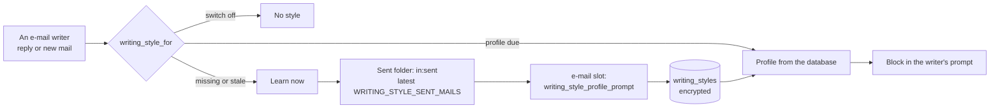

# Writing style — e-mails in the person's own voice

> ADR-383. How LIA learns the way a person writes their e-mails, where every e-mail
> writer reads it, what the person controls, and how it was measured.

## What it is

A **style profile**: a few lines a model wrote about HOW the person writes — the greeting they
use, their sign-off, whether and how they sign, « tu » or « vous », their usual length, tone,
punctuation and emojis — from their own latest sent e-mails. Never WHAT they wrote about: the
request forbids any name, place, project or date, and the measurement checks it (see below).

## Where it is read — one door

`apps/api/src/domains/agents/emails/writing_style.py`, `writing_style_for(user_id, config=,
reading=)`, is the only way a writer reads it:

| Writer | Who calls it | Where the block goes |
|---|---|---|
| `reply_drafting.draft_reply_body` | the reply saved as a draft, the reply the person confirms when they dictated no words, the Tools' « reply » assist | just before the received e-mail (`reply_block`) |
| `content_generation.generate_email_content` | `send_email_tool`, the mailbox draft tools, the Tools' « compose » assist | just before the language rule (`compose_block`) |

Not read: a note to the person's own mailbox (`send_email_to_me_tool`: no greeting, no
sign-off by design), a subject generated alone, a forward's note, the draft critique (it edits
text already written in the person's voice). Both blocks come from
`prompts/v1/writing_style_lines.txt` and are emitted only when a profile exists.

### Who writes a reply's words

`reply_email_tool` takes `content_instruction` (what to answer) and `body` (only the person's
exact words). With no words, `tools/reply_writing.reply_words` has the reply drafter write the
reply from the received e-mail, reading what the person already answered (ADR-379); with no
instruction either, the person's own message in the turn says what to answer. A spending
ceiling or an unusable answer is the tool's refusal, asking for the text.

## Learning

- **When**: on the run of the first writer that needs it — its turn or its assist, which is
  billed and files the read. No scheduler.
- **From what**: the latest `WRITING_STYLE_SENT_MAILS` sent e-mails (`in:sent`), each body as
  the client boundary hands it (quoted history and signature block removed, ADR-287), read by
  its first `WRITING_STYLE_MAIL_HEAD_CHARS` and last `WRITING_STYLE_MAIL_TAIL_CHARS` characters.
  Graph lists previews only, so it reads each hit (`SEARCH_HITS_ARE_WHOLE`),
  `WRITING_STYLE_READ_CONCURRENCY` at a time and in the listing's order; a message that
  cannot be read fails the learning as a whole, and the next e-mail written is the retry.
- **Too few**: under `WRITING_STYLE_MIN_SENT_MAILS` e-mails with words, the row is written with
  no profile: built, nothing learned, not read again before it is due.
- **Again**: once the row is `WRITING_STYLE_MAX_AGE_DAYS` old, at the next e-mail written.
- **Together**: drafts asked at once (a FOR_EACH of replies) learn once, in-process
  (`run_single_flight`); two workers learning at the same instant write the same kind of row,
  the last one kept.
- **Failure**: a mailbox that cannot be read, a model with no usable answer — the writer drafts
  without the style and the failure is logged by its kind
  (`writing_style_learning_failed`). A spending ceiling is raised: it is the draft's own.
- **Nothing held across a wait** (ADR-304): read and close, open the mailbox and close it, ask
  the model, keep the result in a new short session.

## What the person controls

**Settings › Features › Writing style** (`WritingStyleSettings.tsx`):

- the switch, `users.writing_style_enabled` (ON by default), written through
  `PATCH /api/v1/writing-style` — the same reviewed preference the assistant's
  `update_lia_assistant_preferences_tool` writes;
- what was learned, in clear, with how many e-mails and when, and from when it is learned again
  (`GET /api/v1/writing-style`);
- **Forget** (`DELETE /api/v1/writing-style`): what was learned is deleted; with the switch on,
  the next e-mail learns it again.

Switched off, nothing is read, learned or used, and the record is kept (ADR-280); a learning
that arrives after the switch went off writes nothing, conditioned in the same statement.

## Data

| Where | What |
|---|---|
| `writing_styles` | `user_id` (unique, `CASCADE`), `profile_encrypted` (Fernet, NULL = nothing learned), `mails_read`, `built_at` |
| `users.writing_style_enabled` | the switch |

Purged with the account (`build_purge_statements`), exported decrypted (`_DECRYPTED_COLUMNS`),
shown to administrators as a switch column, logged by counts only (ADR-317).

## Registers

- Consultation: `writing_style:email` in a turn (`IN_TURN_CAPABILITIES`), the assist's own
  `reading()` in the Tools (`MAIL_COMPOSE` and `MAIL_REPLY` declare the mail section).
- `effects/direct_client_callers.py`: a recorder (`in-turn`); `connectors/mail_listers.py`:
  `NOT_SITUATED` — a reply state says nothing of a voice.
- Spend: the writer's (`LLM_SPEND_ROADS`: `TURN`), on the e-mail slot.

## Configuration

| Variable | Default | Meaning |
|---|---|---|
| `WRITING_STYLE_SENT_MAILS` | 12 | sent e-mails a profile is learned from |
| `WRITING_STYLE_MAX_AGE_DAYS` | 30 | age after which it is learned again |

## Measurement

`apps/api/scripts/emails/measure_writing_style.py` (`task emails:writing-style:measure`, paid,
on demand) drafts for four fictional people whose sent mail carries planted facts, with the
production request and blocks: replies in three arms (as production was, plus the profile, plus
three sent e-mails verbatim), `--compose` for new mails in two arms. Each persona's marks are
checked by rule; a planted fact written into a new e-mail is a leak; `--judge` adds a blind
vote. Measured 2026-11-13 on three families: replies 42/42/41 → 64/62/63 of 66 marks, new mails
27/24/23 → 44/42/38 of 44, no leak.
