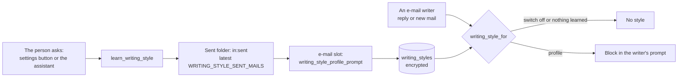

# Writing style — e-mails in the person's own voice

> ADR-383 and its amendment of 2026-11-16. How LIA learns the way a person writes their
> e-mails — when they ask, and only then — who writes the words of an e-mail sent in their
> name, where every e-mail writer reads the style, what the person controls, and how it was
> measured.

## What it is

A **style profile**: a few lines a model wrote about HOW the person writes — the greeting they
use, their sign-off, whether and how they sign, « tu » or « vous », their usual length, tone,
punctuation and emojis — from their own latest sent e-mails. Never WHAT they wrote about: the
request forbids any name, place, project or date, and the measurement checks it (see below).

## Learning — only when the person asks

Nothing learns the style behind the person's back: no scheduler, no sweep, no learning inside a
draft. A profile is kept until the person learns it again or forgets it; it never expires.

| Where they ask | How it runs | Billed to | The read of the sent mail is filed |
|---|---|---|---|
| **Settings › Writing style › Learn my style / Learn again** — `POST /api/v1/writing-style/learn` | the assists' door (`tool_assists/style_learning.py`, `run_assist`): both spending ceilings asked first, the outcome counted (`tool_assists_total{assist="writing_style_learn"}`) | the account (`tool_assist` task type) | by the assist's own `reading()` |
| **The assistant** — `learn_lia_writing_style_tool` | an exact card; its confirmation runs the learning on the turn (`application/writing_style_learning.py`) | the turn | as the turn's consultation `writing_style:email` |

- **One learning per account at a time, whichever surface asks** (`learn_one_at_a_time`, one
  `run_shared_flight` claim across workers): a second click — another tab, another worker — or
  the assistant's confirmed card waits for the first (at least
  `WRITING_STYLE_LEARN_WAIT_SECONDS`, never less than the e-mail slot's call may take) and
  answers what it learned, paying nothing.
- **A learning replaces the record it was asked on, and nothing since**: the click names the
  record the person sees when it arrives, the card the record it bound. A record forgotten or
  learned again meanwhile is the person's later act: it stands — checked before anything is
  read, and again in the statement that keeps the result (`WritingStyleRepository.save(...,
  replaces=)`).
- **From what**: the latest `WRITING_STYLE_SENT_MAILS` sent e-mails (`in:sent`, page after page),
  each body as the client boundary hands it (quoted history and signature block removed,
  ADR-287), read by its first `WRITING_STYLE_MAIL_HEAD_CHARS` and last
  `WRITING_STYLE_MAIL_TAIL_CHARS` characters. Graph lists previews only, so it reads each hit
  (`SEARCH_HITS_ARE_WHOLE`), `WRITING_STYLE_READ_CONCURRENCY` at a time and in the listing's
  order; a message that cannot be read fails the learning as a whole.
- **How it ends** — one closed vocabulary (`LearningOutcome`), read by the settings and the
  assistant:

  | Outcome | What happened | Settings | Assistant (after the card) |
  |---|---|---|---|
  | `learned` | a profile replaced what was learned | « Done », with what it cost | success, `outcome: learned` |
  | `too_few` | under `WRITING_STYLE_MIN_SENT_MAILS` e-mails with words: the row says it was built and holds no profile | « Nothing learned: send a few more e-mails » | success, `outcome: too_few` |
  | `no_mailbox` | no mailbox connected | a link to the connectors | `CONNECTOR_NOT_ACTIVATED` |
  | `reconnect` | the mailbox refuses LIA's access | a link to the connectors | `UNAUTHORIZED` |
  | `switched_off` | the switch went off before the result was kept: nothing kept | the switch takes the focus | a stale state |
  | `superseded` | the record it was asked to replace was forgotten or learned again meanwhile: nothing kept, what it cost said | « Forgotten or learned again meanwhile », then what stands is read back | a stale state |

  A mailbox that answered the read with a failure is classified by its cause, never its words
  (`workbench/errors.refusal_for`); a model with no usable answer keeps nothing.
- **Nothing held across a wait** (ADR-304): read and close, open the mailbox and close it, ask
  the model, keep the result in a new short session — conditioned on the switch being on and on
  the record it replaces still standing.

## Who writes the words of an e-mail — one door

`apps/api/src/domains/agents/emails/authorship.py`, `settle_words`, runs in every tool that
writes to someone: `send_email_tool`, `reply_email_tool`, `create_mailbox_draft_tool`,
`create_mailbox_reply_draft_tool`, `update_mailbox_draft_tool`.

- **The person's words are kept exactly** when they MARKED them (`is_dictated`): a quoted span
  (« », “ ”, " ", „ “, 「」, 『』, ‹ ›), the tail after a colon or a line break, or the whole
  message. One linear pass, compared on NFKC, case-folded words, over the person's messages of
  the turn: the run's own and, when the run resumes the turn after a question (« which
  Paul? »), the request the turn began with (`LiaRuntimeContext.turn_request`).
- **Any other text the agent proposed is what the e-mail must say**: it reaches LIA's writer
  under a header (`email_authorship_lines.txt`) asking it to keep every fact, figure, date,
  time, name, address, link and quoted passage, and to write the rest in the person's voice.
- **A text too long to be written back whole** — over `EMAIL_REWRITE_MAX_SHARE` of the writer's
  output budget — is kept as given rather than cut.
- **Outside a run** (a script, a test) the text is kept: the caller is code, not an agent.

The tools that set a text verbatim declare why (`TEXTS_LEFT_AS_GIVEN`): a note to the person's
own mailbox, a forward's note, a ticket comment, the automatic reply set from the card the
person confirms. A guard holds the two lists complete against every tool that sends or saves an
e-mail.

Each writing tool's manifest, `@tool` schema and docstring read the same constants
(`emails/catalogue_manifests.py`): `body` holds the person's dictated words, `content_instruction`
what to say. The ReAct loop binds the `@tool` schema and docstring; the planner reads the
manifest; both say the same, and a guard reads what the loop binds.

### Who writes a reply's words

`reply_email_tool` takes `content_instruction` (what to answer) and `body` (only the person's
dictated words). With no words, `tools/reply_writing.reply_words` has the reply drafter write the
reply from the received e-mail, reading what the person already answered (ADR-379); with no
instruction either, the person's own message in the turn says what to answer. A spending
ceiling or an unusable answer is the tool's refusal, asking for the text.

## Where it is read — one door

`apps/api/src/domains/agents/emails/writing_style.py`, `writing_style_for(user_id)`, is the only
way a writer reads it — a read, never a learning:

| Writer | Who calls it | Where the block goes |
|---|---|---|
| `reply_drafting.draft_reply_body` | the reply saved as a draft, the reply the person confirms when they dictated no words, the Tools' « reply » assist | just before the received e-mail (`reply_block`) |
| `content_generation.generate_email_content` | `send_email_tool`, the mailbox draft tools, the Tools' « compose » assist | just before the language rule (`compose_block`) |

Not read: a note to the person's own mailbox (`send_email_to_me_tool`: no greeting, no
sign-off by design), a subject generated alone, a forward's note, the draft critique (it edits
text already written in the person's voice). Both blocks come from
`prompts/v1/writing_style_lines.txt` and are emitted only when a profile exists.

## What the person controls

**Settings › Features › Writing style** (`WritingStyleSettings.tsx`):

- the switch, `users.writing_style_enabled` (ON by default), written through
  `PATCH /api/v1/writing-style` — the same reviewed preference the assistant's
  `update_lia_assistant_preferences_tool` writes;
- what was learned, in clear, with how many e-mails and when (`GET /api/v1/writing-style`, which
  also says how many sent e-mails a learning reads);
- **Learn my style / Learn again** (`POST /api/v1/writing-style/learn`): the button keeps its
  focus while it works, and the outcome is said in a status region with what it cost;
- **Forget** (`DELETE /api/v1/writing-style`), behind a confirmation: what was learned is
  deleted; nothing is learned again until the person asks. « Forget » waits while the section's
  own learning runs (that learning would be paid for nothing); a forget from elsewhere during a
  learning stands, and the learning says `superseded`.

The same three acts exist in a conversation: `get_lia_writing_style_tool` reads what the
settings show; `learn_lia_writing_style_tool` and `forget_lia_writing_style_tool` prepare exact
cards — a learning binds the switch and the record it replaces, a forgetting removes the
confirmed record only (`WritingStyleRepository.forget(..., learned_at=)`), so a style learned
again since the card is kept and the card answers a stale state. An open settings section reads
itself again when the assistant learned or forgot (`writing_style` resource) or turned the
switch (`profile`).

Switched off, nothing is read, learned or used, and the record is kept (ADR-280); a learning
that arrives after the switch went off writes nothing, conditioned in the same statement.

## Data

| Where | What |
|---|---|
| `writing_styles` | `user_id` (unique, `CASCADE`), `profile_encrypted` (Fernet, NULL = nothing learned), `mails_read`, `built_at` (when it was learned, at the person's request) |
| `users.writing_style_enabled` | the switch |

Purged with the account (`build_purge_statements`), exported decrypted (`_DECRYPTED_COLUMNS`),
shown to administrators as a switch column, logged by counts only (ADR-317).

## Registers

- Consultation: `writing_style:email` in a turn (`IN_TURN_CAPABILITIES`), the assist's own
  `reading()` from the settings (`WRITING_STYLE_LEARN` declares the mail section).
- `effects/direct_client_callers.py`: a recorder (`in-turn`); `connectors/mail_listers.py`:
  `NOT_SITUATED` — a reply state says nothing of a voice.
- Spend: `LLM_SPEND_ROADS` declares the module `TURN`; from the settings, the assists' door
  hands it the config that bills the account.

## Configuration

| Variable | Default | Meaning |
|---|---|---|
| `WRITING_STYLE_SENT_MAILS` | 12 | sent e-mails a learning reads, when the person asks |

## Measurement

- `apps/api/scripts/emails/measure_writing_style.py` (`task emails:writing-style:measure`, paid,
  on demand) drafts for four fictional people whose sent mail carries planted facts, with the
  production request and blocks: replies in three arms (as production was, plus the profile, plus
  three sent e-mails verbatim), `--compose` for new mails in two arms, `--proposed` for a text the
  agent wrote handed to the writer as what to say. Each persona's marks are checked by rule; a
  planted fact written into a new e-mail is a leak; `--judge` adds a blind vote. Measured
  2026-11-13 on three families: replies 42/42/41 → 64/62/63 of 66 marks, new mails 27/24/23 →
  44/42/38 of 44, no leak. Measured 2026-11-16 on production's e-mail slot with `--proposed`:
  22/22 facts and quoted passages kept, voice marks 28/44 → 43/44 with the profile.
- `apps/api/scripts/react/measure_email_authorship.py` (`task react:authorship:measure`, paid,
  on demand) asks production's ReAct prompt and the real writing tools' schemas who writes the
  e-mail, classified by production's own rule: with the schema of 2026-11-15, 14 of 18 requests
  of intent were written by the loop and 3 of 12 dictations were altered; with the published
  contract, 1 of 18 (handed to the writer by the door) and 12 of 12 kept exactly.
